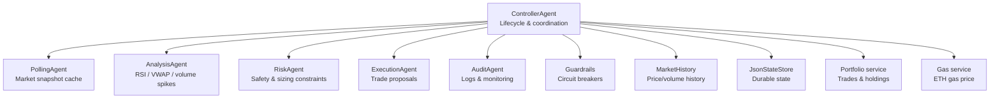
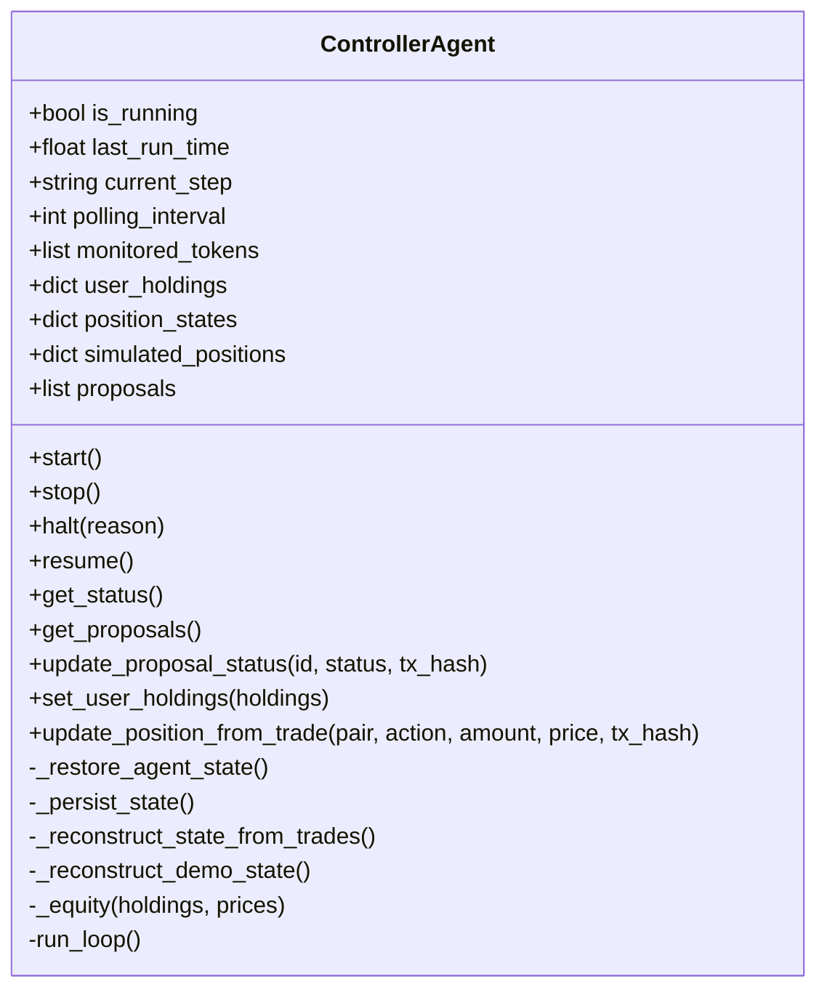
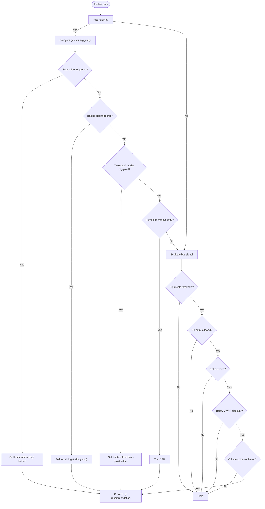
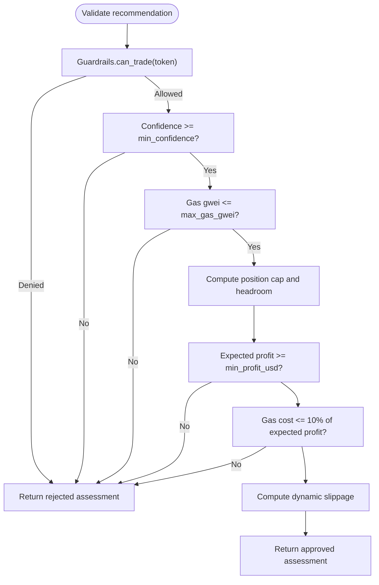
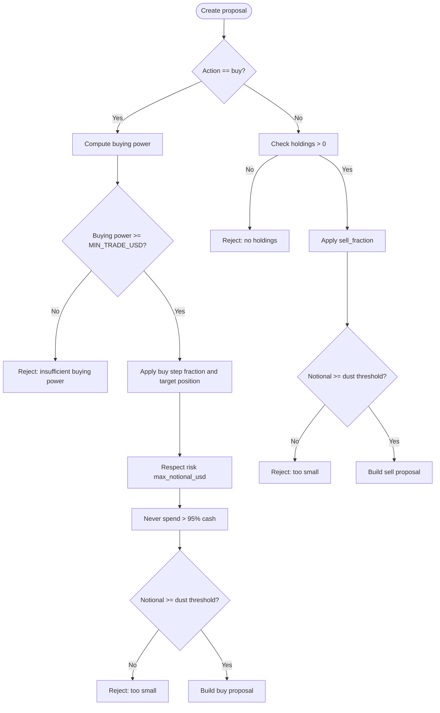
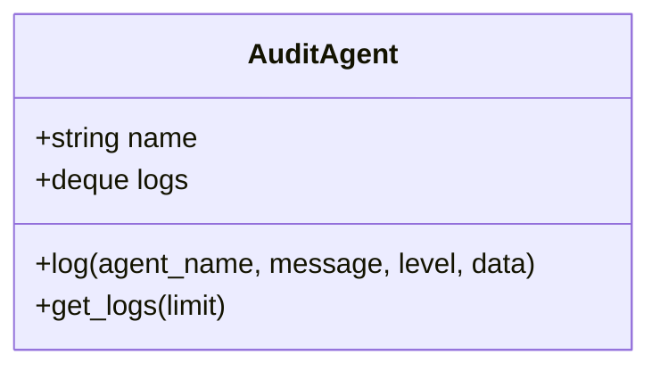
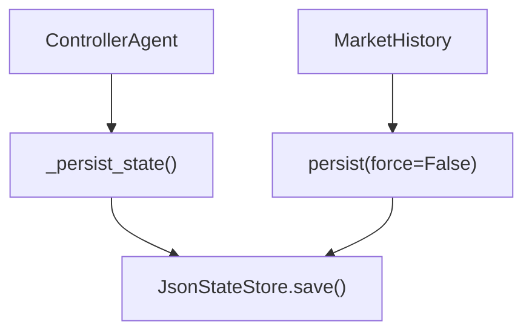
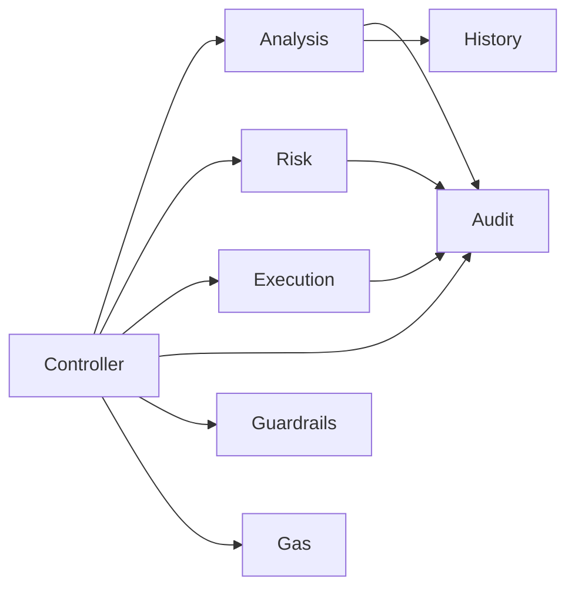
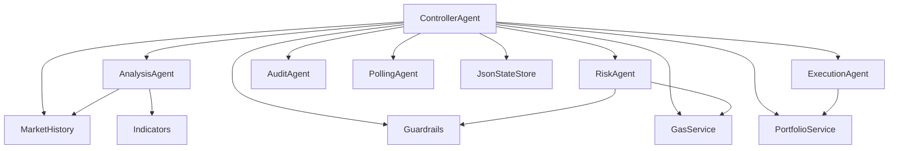

# Agent System

<cite>
**Referenced Files in This Document**
- [controller.py](file://backend/app/agents/controller.py)
- [analysis_agent.py](file://backend/app/agents/analysis_agent.py)
- [risk_agent.py](file://backend/app/agents/risk_agent.py)
- [execution_agent.py](file://backend/app/agents/execution_agent.py)
- [audit_agent.py](file://backend/app/agents/audit_agent.py)
- [polling_agent.py](file://backend/app/agents/polling_agent.py)
- [agents.py](file://backend/app/models/agents.py)
- [state_store.py](file://backend/app/services/state_store.py)
- [guardrails.py](file://backend/app/services/guardrails.py)
- [market_history.py](file://backend/app/services/market_history.py)
- [indicators.py](file://backend/app/services/indicators.py)
- [gas.py](file://backend/app/services/gas.py)
- [portfolio.py](file://backend/app/services/portfolio.py)
- [routes_agents.py](file://backend/app/api/routes_agents.py)
</cite>

## Table of Contents
1. [Introduction](#introduction)
2. [Project Structure](#project-structure)
3. [Core Components](#core-components)
4. [Architecture Overview](#architecture-overview)
5. [Detailed Component Analysis](#detailed-component-analysis)
6. [Dependency Analysis](#dependency-analysis)
7. [Performance Considerations](#performance-considerations)
8. [Troubleshooting Guide](#troubleshooting-guide)
9. [Conclusion](#conclusion)

## Introduction
This document explains the multi-agent trading system implemented in the backend. The system is organized around specialized agents that collaborate through a central controller:

- **Controller agent**: orchestrates the trading lifecycle, manages state, and coordinates data collection, analysis, risk checks, proposal creation, and execution tracking.
- **Analysis agent**: computes technical indicators and generates buy/sell recommendations with confidence scores.
- **Risk agent**: enforces safety rules including position limits, gas price awareness, profit expectations, slippage estimation, and circuit breakers.
- **Execution agent**: converts approved recommendations into sized trade proposals suitable for human or automated approval.
- **Audit agent**: provides structured logging, live log buffers, and rotating file logs for monitoring and debugging.

The design emphasizes deterministic rule-based signals, conservative indicator warm-up behavior, explicit safety checks, and durable state persistence.

## Project Structure
The agent system lives under `backend/app/agents`, with supporting services under `backend/app/services` and shared models under `backend/app/models`. API routes expose agent control and status to the frontend.



**Diagram sources**
- [controller.py:24-72](file://backend/app/agents/controller.py#L24-L72)
- [polling_agent.py:26-43](file://backend/app/agents/polling_agent.py#L26-L43)
- [analysis_agent.py:10-43](file://backend/app/agents/analysis_agent.py#L10-L43)
- [risk_agent.py:8-22](file://backend/app/agents/risk_agent.py#L8-L22)
- [execution_agent.py:9-25](file://backend/app/agents/execution_agent.py#L9-L25)
- [audit_agent.py:33-37](file://backend/app/agents/audit_agent.py#L33-L37)
- [guardrails.py:27-39](file://backend/app/services/guardrails.py#L27-L39)
- [market_history.py:37-43](file://backend/app/services/market_history.py#L37-L43)
- [state_store.py:22-25](file://backend/app/services/state_store.py#L22-L25)
- [portfolio.py:14-26](file://backend/app/services/portfolio.py#L14-L26)
- [gas.py:27-59](file://backend/app/services/gas.py#L27-L59)

**Section sources**
- [controller.py:24-72](file://backend/app/agents/controller.py#L24-L72)
- [routes_agents.py:1-150](file://backend/app/api/routes_agents.py#L1-L150)

## Core Components
The core components are the five agents plus shared infrastructure:

| Component | Responsibility | Key Inputs | Key Outputs |
|---|---|---|---|
| ControllerAgent | Orchestrates polling, analysis, risk, proposal creation, and execution updates | Market snapshots, holdings, position states, guardrails | Status, proposals, persisted state |
| AnalysisAgent | Generates buy/sell/hold recommendations using RSI, VWAP, and volume spikes | Market snapshot, position states, holdings | Recommendations with confidence and reasons |
| RiskAgent | Validates trades against portfolio limits, gas caps, profit filters, and circuit breakers | Recommendation, holdings, prices, gas, guardrails | Approved/rejected assessment with detailed checks |
| ExecutionAgent | Creates sized trade proposals from approved recommendations | Recommendation, risk assessment, holdings, prices | TradeProposal objects |
| AuditAgent | Logs agent events and exposes recent logs | Agent name, message, level, optional data | AuditLog entries and rotating file logs |
| Supporting services | Provide market data, indicators, gas prices, portfolio state, and persistent storage | External APIs, JSON files, in-memory caches | Data consumed by agents |

**Section sources**
- [controller.py:24-72](file://backend/app/agents/controller.py#L24-L72)
- [analysis_agent.py:10-43](file://backend/app/agents/analysis_agent.py#L10-L43)
- [risk_agent.py:8-22](file://backend/app/agents/risk_agent.py#L8-L22)
- [execution_agent.py:9-25](file://backend/app/agents/execution_agent.py#L9-L25)
- [audit_agent.py:33-37](file://backend/app/agents/audit_agent.py#L33-L37)

## Architecture Overview
The controller runs an asynchronous loop that repeatedly:

1. Fetches a market snapshot via the polling agent.
2. Filters pairs to monitored tokens and user holdings.
3. Records price/volume samples for indicator calculation.
4. Computes equity and evaluates guardrail circuit breakers.
5. Invokes the analysis agent to generate recommendations.
6. Calls the risk agent to validate each recommendation.
7. Asks the execution agent to create a trade proposal if approved.
8. Persists state and waits for the next polling interval.

```mermaid
sequenceDiagram
participant Loop as "ControllerAgent.run_loop"
participant Poll as "PollingAgent.poll_once"
participant Hist as "MarketHistory.record"
participant Rails as "Guardrails.begin_cycle"
participant Anal as "AnalysisAgent.analyze"
participant Risk as "RiskAgent.validate"
participant Exec as "ExecutionAgent.create_proposal"
participant Store as "JsonStateStore.save"
Loop->>Poll : fetch market snapshot
Poll-->>Loop : MarketSnapshot
Loop->>Hist : record snapshot
Loop->>Rails : begin_cycle(equity)
Rails-->>Loop : halted?
alt not halted
Loop->>Anal : analyze(snapshot, positions, holdings)
Anal-->>Loop : recommendations
loop per recommendation
Loop->>Risk : validate(recommendation, holdings, prices, gas, guardrails)
Risk-->>Loop : RiskAssessment
alt approved
Loop->>Exec : create_proposal(recommendation, risk, holdings, prices)
Exec-->>Loop : TradeProposal
Loop->>Store : persist state
else rejected
Loop->>Loop : skip proposal
end
end
else halted
Loop->>Loop : wait polling_interval
end
```

**Diagram sources**
- [controller.py:499-674](file://backend/app/agents/controller.py#L499-L674)
- [polling_agent.py:26-43](file://backend/app/agents/polling_agent.py#L26-L43)
- [market_history.py:107-114](file://backend/app/services/market_history.py#L107-L114)
- [guardrails.py:46-71](file://backend/app/services/guardrails.py#L46-L71)
- [analysis_agent.py:76-255](file://backend/app/agents/analysis_agent.py#L76-L255)
- [risk_agent.py:24-190](file://backend/app/agents/risk_agent.py#L24-L190)
- [execution_agent.py:58-179](file://backend/app/agents/execution_agent.py#L58-L179)
- [state_store.py:39-58](file://backend/app/services/state_store.py#L39-L58)

## Detailed Component Analysis

### Controller Agent
The controller is the central orchestrator. It initializes all agents, reconstructs state from trades or demo portfolio, persists critical state, and drives the main loop.

Key responsibilities:
- Lifecycle management: start, stop, halt, resume.
- State reconstruction: rebuild position states and simulated holdings from executed trades or demo fills.
- Proposal lifecycle: create, update, and track proposals; prevent duplicate pending proposals.
- Position state updates: maintain average entry price, peak price, cumulative sold fraction, and buy step counters.
- Equity computation: combine stablecoin balances and token holdings priced at current market values.
- Guardrail integration: evaluate daily drawdown, trade frequency, and manual kill switch.
- Monitoring: update current step, last run time, and audit logs.



**Diagram sources**
- [controller.py:24-72](file://backend/app/agents/controller.py#L24-L72)
- [controller.py:74-125](file://backend/app/agents/controller.py#L74-L125)
- [controller.py:127-221](file://backend/app/agents/controller.py#L127-L221)
- [controller.py:223-266](file://backend/app/agents/controller.py#L223-L266)
- [controller.py:268-400](file://backend/app/agents/controller.py#L268-L400)
- [controller.py:415-496](file://backend/app/agents/controller.py#L415-L496)
- [controller.py:499-674](file://backend/app/agents/controller.py#L499-L674)

Important behaviors:
- Duplicate proposal prevention: skips creating another proposal for the same token while one is already pending or approved.
- Idempotent execution updates: prevents double-filling on repeated execution notifications.
- Demo mode support: applies fills against a virtual portfolio and adjusts holdings accordingly.
- State persistence: saves positions, proposals, last trade times, and guardrail state atomically.

**Section sources**
- [controller.py:24-72](file://backend/app/agents/controller.py#L24-L72)
- [controller.py:74-125](file://backend/app/agents/controller.py#L74-L125)
- [controller.py:127-221](file://backend/app/agents/controller.py#L127-L221)
- [controller.py:223-266](file://backend/app/agents/controller.py#L223-L266)
- [controller.py:268-400](file://backend/app/agents/controller.py#L268-L400)
- [controller.py:415-496](file://backend/app/agents/controller.py#L415-L496)
- [controller.py:499-674](file://backend/app/agents/controller.py#L499-L674)

### Analysis Agent
The analysis agent implements a rule-based strategy focused on buying dips and managing exits through ladders and stops.

Signal generation highlights:
- Exits:
  - Hard stop ladder based on loss thresholds relative to average entry.
  - Trailing stop once the position has gained enough and then drops below a peak threshold.
  - Scale-out take-profit ladder selling portions at predefined gains.
  - Discretionary pump exit when entry price is unknown but price has risen significantly.
- Buys:
  - Dip gates based on 24h change thresholds.
  - Re-entry cooldown after stop-loss requiring lower price and volume confirmation.
  - RSI gate avoiding overbought conditions.
  - VWAP discount requirement when indicators are ready.
  - Volume spike filter to confirm momentum during dips.
- Confidence scoring:
  - Adjusted by RSI depth, volume spike presence, VWAP discount, indicator readiness, and dip severity.
  - Capped to avoid overly confident signals.



**Diagram sources**
- [analysis_agent.py:76-255](file://backend/app/agents/analysis_agent.py#L76-L255)
- [analysis_agent.py:257-349](file://backend/app/agents/analysis_agent.py#L257-L349)

Indicator usage:
- RSI computed from closing prices with warm-up handling.
- VWAP computed from price-volume deltas over a rolling window.
- Volume spike detection compares short-term volume to baseline average.

**Section sources**
- [analysis_agent.py:10-43](file://backend/app/agents/analysis_agent.py#L10-L43)
- [analysis_agent.py:76-255](file://backend/app/agents/analysis_agent.py#L76-L255)
- [analysis_agent.py:257-349](file://backend/app/agents/analysis_agent.py#L257-L349)
- [market_history.py:168-188](file://backend/app/services/market_history.py#L168-L188)
- [indicators.py:17-48](file://backend/app/services/indicators.py#L17-L48)
- [indicators.py:51-66](file://backend/app/services/indicators.py#L51-L66)
- [indicators.py:69-90](file://backend/app/services/indicators.py#L69-L90)

### Risk Agent
The risk agent validates recommendations before they become proposals. It returns a structured assessment with detailed check results so the UI and audit logs can explain decisions.

Validation steps:
- Circuit breaker and frequency caps via guardrails.
- Confidence threshold check.
- Gas price ceiling check.
- Position sizing and exposure limits.
- Minimum expected profit and gas-to-profit ratio.
- Dynamic slippage estimation based on volatility and volume spikes.



**Diagram sources**
- [risk_agent.py:24-190](file://backend/app/agents/risk_agent.py#L24-L190)
- [guardrails.py:92-107](file://backend/app/services/guardrails.py#L92-L107)
- [gas.py:20-24](file://backend/app/services/gas.py#L20-L24)

Key safety mechanisms:
- Position cap prevents overexposure relative to portfolio value.
- Gas price awareness avoids executing when chain fees are too high.
- Profit filters ensure trades have reasonable expected returns.
- Slippage increases with volatility and volume spikes to protect execution quality.

**Section sources**
- [risk_agent.py:8-22](file://backend/app/agents/risk_agent.py#L8-L22)
- [risk_agent.py:24-190](file://backend/app/agents/risk_agent.py#L24-L190)
- [risk_agent.py:192-214](file://backend/app/agents/risk_agent.py#L192-L214)
- [guardrails.py:16-39](file://backend/app/services/guardrails.py#L16-L39)
- [guardrails.py:92-107](file://backend/app/services/guardrails.py#L92-L107)
- [gas.py:20-24](file://backend/app/services/gas.py#L20-L24)

### Execution Agent
The execution agent turns approved recommendations into trade proposals with realistic sizing and metadata.

Proposal creation logic:
- For buys:
  - Reject if buying power is below minimum trade size.
  - Size according to buy step fractions and target position percentage.
  - Respect risk layer exposure headroom and cash limits.
  - Reject dust-sized trades below a small threshold.
- For sells:
  - Reject if no holdings exist.
  - Apply sell fraction from the recommendation.
  - Reject dust-sized sell proposals.



**Diagram sources**
- [execution_agent.py:58-179](file://backend/app/agents/execution_agent.py#L58-L179)

Additional responsibilities:
- Record successful executions to the trade ledger with idempotency by transaction hash.
- Include metadata such as slippage, gas limit, expected profit, auto-tradeability, and price source.

**Section sources**
- [execution_agent.py:9-25](file://backend/app/agents/execution_agent.py#L9-L25)
- [execution_agent.py:27-56](file://backend/app/agents/execution_agent.py#L27-L56)
- [execution_agent.py:58-179](file://backend/app/agents/execution_agent.py#L58-L179)
- [portfolio.py:37-49](file://backend/app/services/portfolio.py#L37-L49)

### Audit Agent
The audit agent provides structured logging for all agents. It maintains an in-memory deque of recent logs and writes to a rotating file.

Features:
- Log levels: INFO, WARNING, ERROR.
- Bounded live buffer for dashboard display.
- Rotating file handler with configurable size and backup count.
- Optional structured data attached to log entries.



**Diagram sources**
- [audit_agent.py:33-63](file://backend/app/agents/audit_agent.py#L33-L63)

**Section sources**
- [audit_agent.py:1-64](file://backend/app/agents/audit_agent.py#L1-L64)

### Shared Models
The shared Pydantic models define the contracts between agents and services.

| Model | Purpose |
|---|---|
| PollingConfig | Controls polling interval, monitored tokens, holdings, and cache duration. |
| AgentStatus | Exposes controller lifecycle, guardrail state, equity, and trade counts. |
| AnalysisRecommendation | Represents strategy output with confidence, indicators, and exit details. |
| RiskAssessment | Represents validation result with checks, slippage, gas, and profit estimates. |
| TradeProposal | Represents a sized, human-approvable trade request. |
| AuditLog | Represents a structured log entry. |

**Section sources**
- [agents.py:1-81](file://backend/app/models/agents.py#L1-L81)

### State Management and Persistence
State is persisted using an atomic JSON state store. The controller saves:
- Position states (average entry, buy step, peak price, cumulative sold).
- Recent proposals.
- Last trade timestamps.
- Guardrail state (day, equity, trade counts, halt flags).

The market history service persists price samples used by indicators across restarts.



**Diagram sources**
- [controller.py:118-125](file://backend/app/agents/controller.py#L118-L125)
- [state_store.py:39-58](file://backend/app/services/state_store.py#L39-L58)
- [market_history.py:62-77](file://backend/app/services/market_history.py#L62-L77)

**Section sources**
- [controller.py:118-125](file://backend/app/agents/controller.py#L118-L125)
- [state_store.py:15-58](file://backend/app/services/state_store.py#L15-L58)
- [market_history.py:37-77](file://backend/app/services/market_history.py#L37-L77)

### Agent Communication Patterns
Agents communicate through well-defined data structures rather than direct coupling:

- Controller calls AnalysisAgent.analyze and receives AnalysisRecommendation objects.
- Controller calls RiskAgent.validate and receives RiskAssessment objects.
- Controller calls ExecutionAgent.create_proposal and receives TradeProposal objects.
- All agents use AuditAgent.log for structured event recording.
- Guardrails provide global circuit breaker state consumed by both controller and risk agent.
- MarketHistory supplies indicator summaries consumed by the analysis agent.
- Gas service supplies current gas price consumed by the controller and risk agent.



**Diagram sources**
- [controller.py:577-666](file://backend/app/agents/controller.py#L577-L666)
- [analysis_agent.py:76-255](file://backend/app/agents/analysis_agent.py#L76-L255)
- [risk_agent.py:24-190](file://backend/app/agents/risk_agent.py#L24-L190)
- [execution_agent.py:58-179](file://backend/app/agents/execution_agent.py#L58-L179)
- [audit_agent.py:39-60](file://backend/app/agents/audit_agent.py#L39-L60)
- [guardrails.py:46-71](file://backend/app/services/guardrails.py#L46-L71)
- [market_history.py:168-188](file://backend/app/services/market_history.py#L168-L188)
- [gas.py:27-59](file://backend/app/services/gas.py#L27-L59)

### Error Handling
Error handling is layered:

- Controller loop catches exceptions, logs them, and sleeps briefly before retrying.
- Market data fetching errors are logged and skipped for that cycle.
- Gas RPC failures return a conservative fallback instead of halting the loop.
- State store save/load operations catch I/O and parsing errors gracefully.
- Portfolio trade loading and saving handle malformed records and missing files.
- Audit logging handles read-only volumes by disabling file handlers.

**Section sources**
- [controller.py:544-550](file://backend/app/agents/controller.py#L544-L550)
- [controller.py:676-678](file://backend/app/agents/controller.py#L676-L678)
- [gas.py:41-59](file://backend/app/services/gas.py#L41-L59)
- [state_store.py:31-37](file://backend/app/services/state_store.py#L31-L37)
- [state_store.py:49-58](file://backend/app/services/state_store.py#L49-L58)
- [portfolio.py:14-26](file://backend/app/services/portfolio.py#L14-L26)
- [audit_agent.py:19-30](file://backend/app/agents/audit_agent.py#L19-L30)

### Extension Points for Custom Agents
The architecture supports extension through:

- Adding new analysis rules inside AnalysisAgent.analyze and helper methods.
- Adding new risk checks inside RiskAgent.validate and returning structured checks.
- Extending ExecutionAgent.create_proposal with new sizing algorithms or proposal fields.
- Introducing new agents coordinated by ControllerAgent in its main loop.
- Using AuditAgent.log for consistent observability across custom logic.
- Leveraging Guardrails for cross-cutting safety policies.
- Using JsonStateStore for durable configuration and runtime state.

Recommended patterns:
- Keep agents stateless where possible; pass required context explicitly.
- Return rich, structured results so downstream agents and UI can explain decisions.
- Use None for indicators during warm-up and let callers decide impact.
- Persist only necessary state to avoid drift between strategy and ledger.

[No sources needed since this section provides general guidance]

## Dependency Analysis
The following diagram shows key dependencies among agents and services.



**Diagram sources**
- [controller.py:24-72](file://backend/app/agents/controller.py#L24-L72)
- [analysis_agent.py:10-43](file://backend/app/agents/analysis_agent.py#L10-L43)
- [risk_agent.py:8-22](file://backend/app/agents/risk_agent.py#L8-L22)
- [execution_agent.py:9-25](file://backend/app/agents/execution_agent.py#L9-L25)
- [polling_agent.py:26-43](file://backend/app/agents/polling_agent.py#L26-L43)
- [guardrails.py:27-39](file://backend/app/services/guardrails.py#L27-L39)
- [market_history.py:37-43](file://backend/app/services/market_history.py#L37-L43)
- [state_store.py:22-25](file://backend/app/services/state_store.py#L22-L25)
- [portfolio.py:14-26](file://backend/app/services/portfolio.py#L14-L26)
- [gas.py:27-59](file://backend/app/services/gas.py#L27-L59)
- [indicators.py:1-97](file://backend/app/services/indicators.py#L1-L97)

**Section sources**
- [controller.py:24-72](file://backend/app/agents/controller.py#L24-L72)
- [analysis_agent.py:10-43](file://backend/app/agents/analysis_agent.py#L10-L43)
- [risk_agent.py:8-22](file://backend/app/agents/risk_agent.py#L8-L22)
- [execution_agent.py:9-25](file://backend/app/agents/execution_agent.py#L9-L25)
- [polling_agent.py:26-43](file://backend/app/agents/polling_agent.py#L26-L43)
- [guardrails.py:27-39](file://backend/app/services/guardrails.py#L27-L39)
- [market_history.py:37-43](file://backend/app/services/market_history.py#L37-L43)
- [state_store.py:22-25](file://backend/app/services/state_store.py#L22-L25)
- [portfolio.py:14-26](file://backend/app/services/portfolio.py#L14-L26)
- [gas.py:27-59](file://backend/app/services/gas.py#L27-L59)
- [indicators.py:1-97](file://backend/app/services/indicators.py#L1-L97)

## Performance Considerations
- Market data caching: The polling agent caches snapshots for a configurable minimum duration to avoid excessive upstream calls and to keep indicators meaningful.
- Indicator warm-up: RSI, VWAP, and volume ratio return None until sufficient samples exist, preventing false signals and reducing unnecessary computations.
- State persistence batching: Market history persists periodically and prunes old samples to keep memory bounded.
- Atomic state writes: JsonStateStore uses temporary files and replace semantics to avoid partial writes.
- Gas price caching: Gas price is cached for a minute to reduce RPC load.
- Proposal deduplication: Controller avoids duplicate pending proposals per token and throttles buy/sell frequencies.

[No sources needed since this section provides general guidance]

## Troubleshooting Guide
Common issues and resolutions:

- Trading halted unexpectedly:
  - Check guardrail status for daily drawdown breach, manual kill switch, or trade limits.
  - Resume manually via API or adjust guardrail configuration.
- No proposals generated:
  - Verify holdings and monitored tokens are set correctly.
  - Check indicator readiness; warm-up may delay signals.
  - Inspect risk checks for confidence, gas cap, position cap, or profit filters.
- Proposals rejected:
  - Review risk assessment checks for specific failures.
  - Ensure sufficient buying power and holdings.
  - Confirm gas price is within configured limits.
- Execution not recorded:
  - Ensure proposal completion endpoint is called with a unique transaction hash.
  - Check portfolio service for idempotency and file write permissions.
- Logs missing:
  - Verify audit file path and permissions.
  - Check rotating file handler initialization and disk space.

Operational endpoints:
- Start/stop agents.
- Halt/resume trading.
- Update holdings.
- View status, state, proposals, and logs.
- Complete or reject proposals.

**Section sources**
- [guardrails.py:46-71](file://backend/app/services/guardrails.py#L46-L71)
- [guardrails.py:81-107](file://backend/app/services/guardrails.py#L81-L107)
- [risk_agent.py:24-190](file://backend/app/agents/risk_agent.py#L24-L190)
- [execution_agent.py:27-56](file://backend/app/agents/execution_agent.py#L27-L56)
- [audit_agent.py:19-30](file://backend/app/agents/audit_agent.py#L19-L30)
- [routes_agents.py:20-150](file://backend/app/api/routes_agents.py#L20-L150)

## Conclusion
The agent system implements a clear separation of concerns:

- The controller coordinates the pipeline and maintains durable state.
- The analysis agent produces disciplined, indicator-backed recommendations.
- The risk agent enforces portfolio safety, gas awareness, and profitability filters.
- The execution agent creates realistic, sized proposals.
- The audit agent ensures visibility and traceability.

Together, these components form a robust, extensible foundation for rule-based algorithmic trading with strong safeguards and observable decision paths.

[No sources needed since this section summarizes without analyzing specific files]