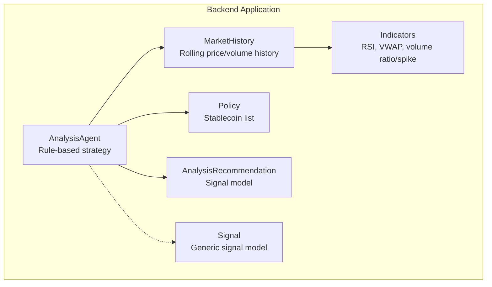
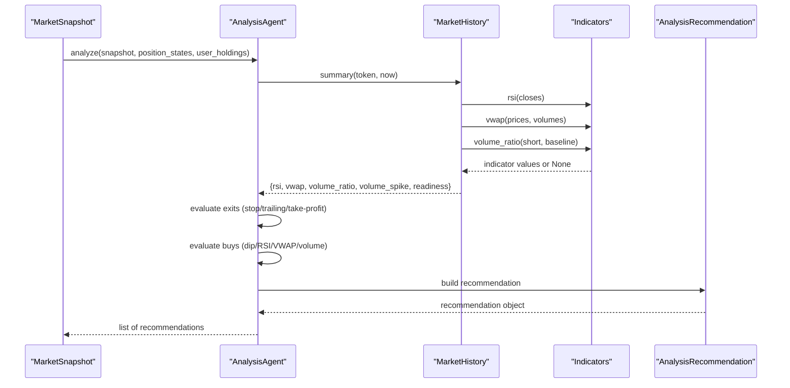
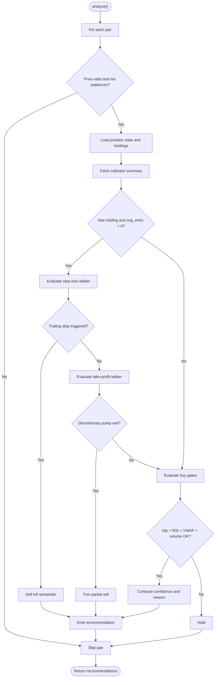
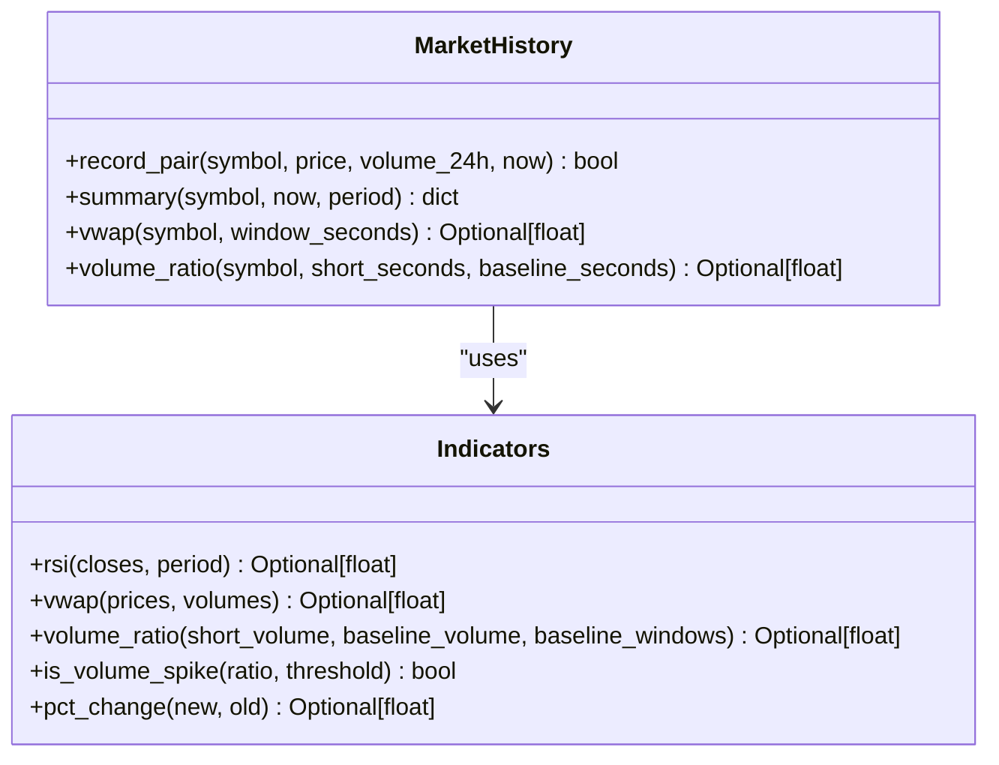
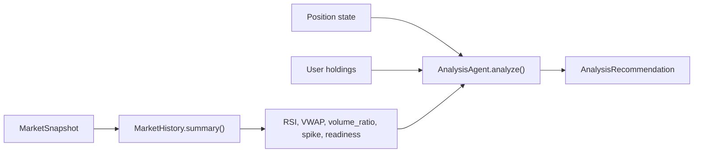
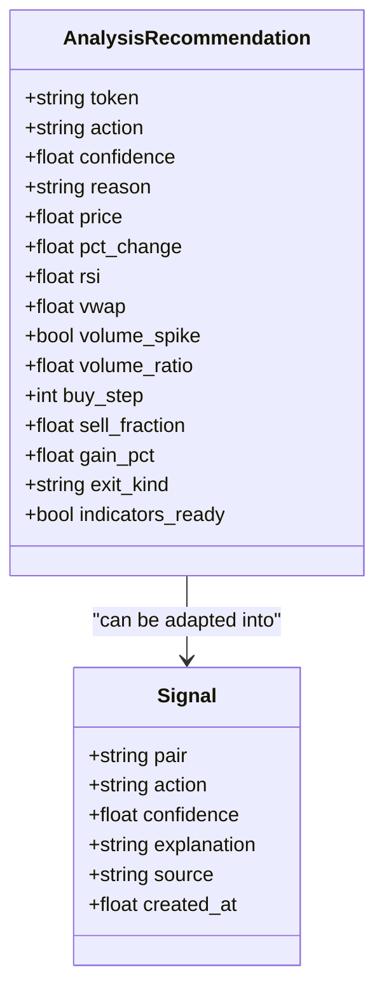
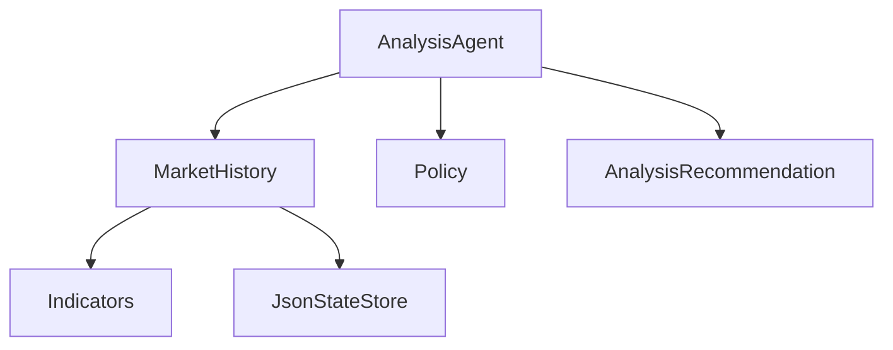

# Analysis Agent

<cite>
**Referenced Files in This Document**
- [analysis_agent.py](file://backend/app/agents/analysis_agent.py)
- [indicators.py](file://backend/app/services/indicators.py)
- [market_history.py](file://backend/app/services/market_history.py)
- [agents.py](file://backend/app/models/agents.py)
- [signals.py](file://backend/app/models/signals.py)
- [policy.py](file://backend/app/services/policy.py)
- [test_analysis_agent.py](file://backend/test_analysis_agent.py)
- [test_indicators.py](file://backend/test_indicators.py)
</cite>

## Table of Contents
1. [Introduction](#introduction)
2. [Project Structure](#project-structure)
3. [Core Components](#core-components)
4. [Architecture Overview](#architecture-overview)
5. [Detailed Component Analysis](#detailed-component-analysis)
6. [Dependency Analysis](#dependency-analysis)
7. [Performance Considerations](#performance-considerations)
8. [Troubleshooting Guide](#troubleshooting-guide)
9. [Conclusion](#conclusion)

## Introduction
The Analysis agent is the rule-based technical analysis and signal-generation layer. It consumes a market snapshot, optional historical price/volume data, and user position state to produce actionable recommendations: buy, sell, or hold. Its primary responsibilities are:

- Computing and gating signals with RSI, VWAP, and volume spike detection.
- Generating buy signals on confirmed dips while avoiding overbought conditions.
- Managing exits through stop-loss ladders, trailing stops, and take-profit ladders.
- Assigning confidence scores that reflect indicator readiness, dip severity, RSI strength, VWAP discount, and volume confirmation.
- Handling missing or warming-up indicators without fabricating neutral values.

This document explains how the agent processes market data, calculates technical indicators, applies thresholds, filters signals, and integrates with the broader trading strategy.

## Project Structure
The Analysis agent lives under the backend application and depends on services for history and indicator math, plus models for recommendations and shared policy constants.

**Diagram sources**
- [analysis_agent.py:10-43](file://backend/app/agents/analysis_agent.py#L10-L43)
- [market_history.py:37-43](file://backend/app/services/market_history.py#L37-L43)
- [indicators.py:1-14](file://backend/app/services/indicators.py#L1-L14)
- [policy.py:1-12](file://backend/app/services/policy.py#L1-L12)
- [agents.py:25-40](file://backend/app/models/agents.py#L25-L40)
- [signals.py:1-16](file://backend/app/models/signals.py#L1-L16)

**Section sources**
- [analysis_agent.py:10-43](file://backend/app/agents/analysis_agent.py#L10-L43)
- [market_history.py:1-27](file://backend/app/services/market_history.py#L1-L27)
- [indicators.py:1-14](file://backend/app/services/indicators.py#L1-L14)
- [policy.py:1-12](file://backend/app/services/policy.py#L1-L12)
- [agents.py:25-40](file://backend/app/models/agents.py#L25-L40)
- [signals.py:1-16](file://backend/app/models/signals.py#L1-L16)

## Core Components
- AnalysisAgent: Implements the rule engine for buys, sells, confidence scoring, and exit management.
- MarketHistory: Maintains rolling per-token samples, computes VWAP, volume ratios, and indicator readiness flags.
- Indicators: Pure functions for RSI, VWAP, volume ratio, and spike detection; returns None when insufficient data.
- AnalysisRecommendation: Typed output model for each token’s recommendation.
- Policy: Shared constants such as stablecoins that must be excluded from trading logic.

Key behaviors:
- Stablecoins are skipped entirely to avoid treating cash-like assets as tradable positions.
- Missing indicators return None; the agent lowers confidence or requires stronger conditions rather than faking neutrality.
- Exits prioritize hard stop-losses, then trailing stops, then scale-out take-profits.
- Buys require a dip threshold, optional RSI/VWAP gates, and a volume-spike filter once history is ready.

**Section sources**
- [analysis_agent.py:10-43](file://backend/app/agents/analysis_agent.py#L10-L43)
- [analysis_agent.py:76-255](file://backend/app/agents/analysis_agent.py#L76-L255)
- [market_history.py:168-188](file://backend/app/services/market_history.py#L168-L188)
- [indicators.py:17-97](file://backend/app/services/indicators.py#L17-L97)
- [agents.py:25-40](file://backend/app/models/agents.py#L25-L40)
- [policy.py:1-12](file://backend/app/services/policy.py#L1-L12)

## Architecture Overview
The agent orchestrates a deterministic pipeline:

1. For each pair in the snapshot, skip invalid prices and stablecoins.
2. Load per-token position state and current holdings.
3. Fetch indicator summary from MarketHistory (or fallback defaults if no history).
4. Evaluate exits first: stop-loss ladder, trailing stop, take-profit ladder, discretionary pump exit.
5. If still holding, evaluate buy gates: dip threshold, re-entry cooldown after stop-loss, RSI gate, VWAP discount, volume spike filter.
6. Compute confidence and reason text.
7. Emit an AnalysisRecommendation.

**Diagram sources**
- [analysis_agent.py:76-255](file://backend/app/agents/analysis_agent.py#L76-L255)
- [market_history.py:168-188](file://backend/app/services/market_history.py#L168-L188)
- [indicators.py:17-97](file://backend/app/services/indicators.py#L17-L97)
- [agents.py:25-40](file://backend/app/models/agents.py#L25-L40)

## Detailed Component Analysis

### AnalysisAgent: Rule Engine and Signal Generation
Responsibilities:
- Maintain configuration constants for buy gates, take-profit ladder, runner cap, trailing stop parameters, and stop-loss ladder.
- Manage per-token state including average entry price, buy step, peak price, tranches sold, last exit details, and cumulative sold fraction.
- Decide actions and compute confidence/reason strings.

Buy logic highlights:
- Dip threshold gating using 24h change.
- Re-entry cooldown after stop-loss requiring lower price and volume confirmation.
- RSI gate prevents buying when RSI is above a maximum threshold.
- VWAP gate requires price below a discounted VWAP when available.
- Volume spike filter becomes mandatory once indicators are ready unless the dip is strong enough.

Exit logic highlights:
- Hard stop-loss ladder triggers at predefined loss thresholds, selling up to cumulative targets.
- Trailing stop activates after a profit arm threshold and a drawdown from peak.
- Take-profit ladder scales out at predefined gain thresholds; a runner holds until a cap.
- Discretionary pump exit trims a small portion when entry price is unknown but price has pumped significantly.

Confidence scoring:
- Base confidence increases slightly with each buy step.
- Additional boosts for low RSI, volume spikes, and deeper discounts below VWAP.
- Penalty when indicators are still warming up.
- Extra boost for major dips.

**Diagram sources**
- [analysis_agent.py:76-255](file://backend/app/agents/analysis_agent.py#L76-L255)
- [analysis_agent.py:258-349](file://backend/app/agents/analysis_agent.py#L258-L349)

**Section sources**
- [analysis_agent.py:20-39](file://backend/app/agents/analysis_agent.py#L20-L39)
- [analysis_agent.py:41-74](file://backend/app/agents/analysis_agent.py#L41-L74)
- [analysis_agent.py:76-255](file://backend/app/agents/analysis_agent.py#L76-L255)
- [analysis_agent.py:258-349](file://backend/app/agents/analysis_agent.py#L258-L349)

### Technical Indicators: RSI, VWAP, and Volume Spike Detection
Pure indicator functions:
- RSI: Wilder’s method over closing prices; returns None during warm-up or invalid inputs; saturates at extremes for monotonic series.
- VWAP: Weighted average price ignoring invalid or zero-volume samples; returns None if denominator is non-positive.
- Volume ratio: Compares short-window traded volume against a baseline window; returns None if inputs are invalid.
- Volume spike: Boolean flag based on ratio exceeding a threshold.

Indicator readiness:
- The history service exposes readiness flags indicating whether RSI and VWAP have sufficient data.
- The analysis agent uses these flags to adjust confidence and apply stricter buy filters.

**Diagram sources**
- [indicators.py:13-97](file://backend/app/services/indicators.py#L13-L97)
- [market_history.py:140-188](file://backend/app/services/market_history.py#L140-L188)

**Section sources**
- [indicators.py:17-97](file://backend/app/services/indicators.py#L17-L97)
- [market_history.py:140-188](file://backend/app/services/market_history.py#L140-L188)
- [test_indicators.py:6-34](file://backend/test_indicators.py#L6-L34)

### Data Flow: From Market Snapshot to Recommendation
The agent composes signals by combining:
- Current snapshot fields: price, 24h change, volume.
- Historical summaries: RSI, VWAP, volume ratio, spike flag, readiness flags.
- Position state: average entry, peak price, cumulative sold, last exit details.
- Holdings: whether the token is currently held.

**Diagram sources**
- [analysis_agent.py:76-255](file://backend/app/agents/analysis_agent.py#L76-L255)
- [market_history.py:168-188](file://backend/app/services/market_history.py#L168-L188)
- [agents.py:25-40](file://backend/app/models/agents.py#L25-L40)

**Section sources**
- [analysis_agent.py:76-255](file://backend/app/agents/analysis_agent.py#L76-L255)
- [agents.py:25-40](file://backend/app/models/agents.py#L25-L40)

### Indicator Calculations and Thresholds
- RSI:
  - Requires at least period + 1 valid closes.
  - Returns None during warm-up; otherwise ranges 0–100.
  - Buy gate rejects when RSI exceeds a maximum threshold.
  - Confidence bonus when RSI is below a lower threshold.

- VWAP:
  - Computed over recent price/volume deltas.
  - Ignores invalid or zero-volume samples.
  - Buy gate requires price below a discounted VWAP when available.
  - Confidence bonus when price is sufficiently below VWAP.

- Volume Spike:
  - Ratio compares short-window traded volume to expected baseline.
  - Spike threshold determines boolean flag.
  - Mandatory filter once indicators are ready unless dip is strong.

- Exit Ladders:
  - Stop-loss ladder defines cumulative sell targets at loss thresholds.
  - Trailing stop triggers after profit arm and drawdown from peak.
  - Take-profit ladder defines cumulative sell targets at gain thresholds.
  - Runner cap caps final tranche at a target gain.

**Section sources**
- [indicators.py:17-97](file://backend/app/services/indicators.py#L17-L97)
- [market_history.py:140-188](file://backend/app/services/market_history.py#L140-L188)
- [analysis_agent.py:20-39](file://backend/app/agents/analysis_agent.py#L20-L39)
- [analysis_agent.py:125-198](file://backend/app/agents/analysis_agent.py#L125-L198)
- [analysis_agent.py:258-349](file://backend/app/agents/analysis_agent.py#L258-L349)

### Signal Filtering Mechanisms
- Stablecoin exclusion: USDC, USDT, DAI are treated as cash equivalents and never generate buy/sell signals.
- Invalid price handling: pairs with non-positive prices are skipped.
- Indicator warm-up: missing RSI/VWAP reduces confidence and tightens buy requirements.
- Re-entry protection: after a stop-loss, re-entry is blocked until cooldown and price/volume conditions are met.
- Strong dip exception: very deep dips can bypass some filters when indicators are not ready.

**Section sources**
- [policy.py:1-12](file://backend/app/services/policy.py#L1-L12)
- [analysis_agent.py:86-111](file://backend/app/agents/analysis_agent.py#L86-L111)
- [analysis_agent.py:258-300](file://backend/app/agents/analysis_agent.py#L258-L300)

### Examples of Signal Generation Under Different Market Conditions
- Oversold dip with confirmation:
  - Price drops beyond minor dip threshold.
  - RSI below buy maximum.
  - Price below discounted VWAP.
  - Volume spike detected.
  - Result: buy signal with boosted confidence.

- Overbought pump without entry:
  - Holding exists but average entry is unknown.
  - 24h change is large.
  - RSI is absent or overbought.
  - Result: partial sell to trim exposure.

- Deep drawdown triggering stop-loss:
  - Gain falls below stop-loss threshold.
  - Result: sell fraction escalates to cumulative target; high confidence.

- Trailing stop protecting profits:
  - Position reached profit arm.
  - Drawdown from peak exceeds distance.
  - Result: full sell of remaining position.

- Warm-up phase:
  - Insufficient history for RSI/VWAP.
  - Only strong dips allowed.
  - Result: cautious buy with reduced confidence.

These scenarios are validated by unit tests covering stablecoin skipping, stop-loss exits, take-profit rung behavior, trailing stop protection, volume spike gating, and re-entry blocking.

**Section sources**
- [test_analysis_agent.py:28-123](file://backend/test_analysis_agent.py#L28-L123)

### Parameter Tuning for Optimal Performance
Tunable parameters include:
- Buy dip thresholds: minor, strong, major.
- RSI buy maximum and overbought threshold.
- VWAP discount factor.
- Volume spike threshold.
- Take-profit ladder thresholds and cumulative fractions.
- Runner target cap.
- Trailing stop arm and distance.
- Stop-loss ladder thresholds and cumulative fractions.
- Stop-loss re-entry cooldown and discount.

Guidelines:
- Increase VWAP discount to require deeper discounts before buying.
- Raise RSI buy maximum to allow earlier entries but risk catching falling knives.
- Adjust volume spike threshold to balance false positives and missed opportunities.
- Tune take-profit ladder to match volatility profiles of different tokens.
- Modify trailing stop distance to accommodate intraday noise versus trend persistence.
- Use stop-loss ladder to enforce disciplined risk control across varying market regimes.

**Section sources**
- [analysis_agent.py:20-39](file://backend/app/agents/analysis_agent.py#L20-L39)
- [analysis_agent.py:258-349](file://backend/app/agents/analysis_agent.py#L258-L349)

### Integration With Broader Trading Strategy
- The agent emits AnalysisRecommendation objects consumed by higher-level orchestration layers.
- Recommendations include action, confidence, reasons, and indicator context for downstream execution and risk checks.
- The generic Signal model provides a common interface for signals from multiple sources, including rules and LLMs.

**Diagram sources**
- [agents.py:25-40](file://backend/app/models/agents.py#L25-L40)
- [signals.py:1-16](file://backend/app/models/signals.py#L1-L16)

**Section sources**
- [agents.py:25-40](file://backend/app/models/agents.py#L25-L40)
- [signals.py:1-16](file://backend/app/models/signals.py#L1-L16)

## Dependency Analysis
Coupling and cohesion:
- AnalysisAgent depends on MarketHistory for indicator computation and on Policy for stablecoin exclusion.
- MarketHistory depends on Indicators for pure math and JsonStateStore for persistence.
- Models define contracts for recommendations and signals, decoupling agents from UI or API layers.

External dependencies:
- Persistence via JsonStateStore for price history.
- No direct network calls inside indicators; history persists samples to disk.

Potential circular dependencies:
- None observed between agents, services, and models.

Integration points:
- API routes and controllers consume agent outputs to expose signals and portfolio status.

**Diagram sources**
- [analysis_agent.py:1-8](file://backend/app/agents/analysis_agent.py#L1-L8)
- [market_history.py:1-27](file://backend/app/services/market_history.py#L1-L27)
- [indicators.py:1-14](file://backend/app/services/indicators.py#L1-L14)
- [policy.py:1-12](file://backend/app/services/policy.py#L1-L12)
- [agents.py:25-40](file://backend/app/models/agents.py#L25-L40)

**Section sources**
- [analysis_agent.py:1-8](file://backend/app/agents/analysis_agent.py#L1-L8)
- [market_history.py:1-27](file://backend/app/services/market_history.py#L1-L27)
- [indicators.py:1-14](file://backend/app/services/indicators.py#L1-L14)
- [policy.py:1-12](file://backend/app/services/policy.py#L1-L12)
- [agents.py:25-40](file://backend/app/models/agents.py#L25-L40)

## Performance Considerations
- Rolling deque storage limits memory usage per token and enforces sample intervals to avoid excessive updates.
- Persistence is throttled to reduce I/O frequency.
- Indicator calculations operate on bounded windows and clean inputs efficiently.
- Avoid unnecessary recomputation by leveraging readiness flags and cached summaries.

[No sources needed since this section provides general guidance]

## Troubleshooting Guide
Common issues and resolutions:
- Missing or stale history:
  - Symptoms: RSI/VWAP are None; indicators_ready is False.
  - Resolution: Feed sufficient samples; ensure record operations occur regularly; verify persistence is enabled.

- Zero or invalid prices/volumes:
  - Symptoms: VWAP returns None; volume ratio returns None.
  - Resolution: Validate upstream data; filter out invalid samples before recording.

- Stablecoin pairs generating unexpected signals:
  - Symptoms: Trades attempted on USDC/USDT/DAI.
  - Resolution: Confirm stablecoin list alignment; ensure policy constants are synchronized.

- Re-entry after stop-loss blocked:
  - Symptoms: Buy attempts fail due to cooldown or price/volume conditions.
  - Resolution: Wait for cooldown; confirm price is lower than last exit price times discount; ensure volume spike is present.

- Overly conservative or aggressive signals:
  - Symptoms: Too few buys or too many false signals.
  - Resolution: Tune dip thresholds, RSI gates, VWAP discount, and volume spike threshold according to asset volatility.

- Edge cases in indicator math:
  - Flat series yields neutral RSI; monotonic series saturates RSI at extremes.
  - VWAP ignores samples without volume; ensure volume data is meaningful.

**Section sources**
- [market_history.py:46-105](file://backend/app/services/market_history.py#L46-L105)
- [indicators.py:13-97](file://backend/app/services/indicators.py#L13-L97)
- [policy.py:1-12](file://backend/app/services/policy.py#L1-L12)
- [analysis_agent.py:86-111](file://backend/app/agents/analysis_agent.py#L86-L111)
- [analysis_agent.py:258-300](file://backend/app/agents/analysis_agent.py#L258-L300)

## Conclusion
The Analysis agent implements a robust, transparent rule-based system for technical analysis and signal generation. It combines RSI, VWAP, and volume spike detection with disciplined exit management and confidence scoring. By returning None for incomplete indicators and applying strict filters, it avoids fabricating signals during warm-up and maintains safety around stablecoins and post-stop-loss re-entry. The modular design separates pure indicator math from stateful history and strategy logic, enabling clear testing, tuning, and integration with broader trading workflows.

[No sources needed since this section summarizes without analyzing specific files]