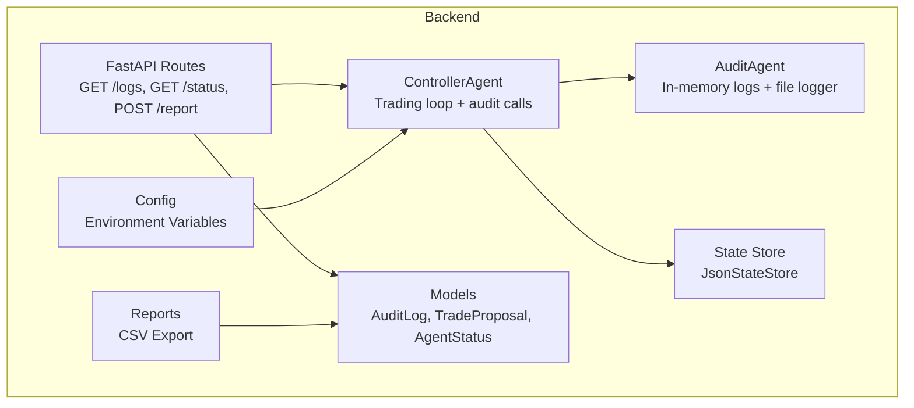
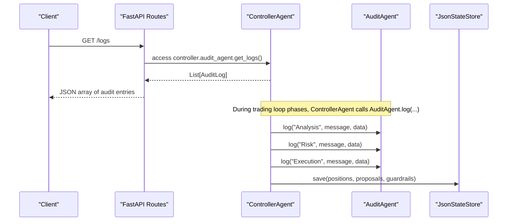
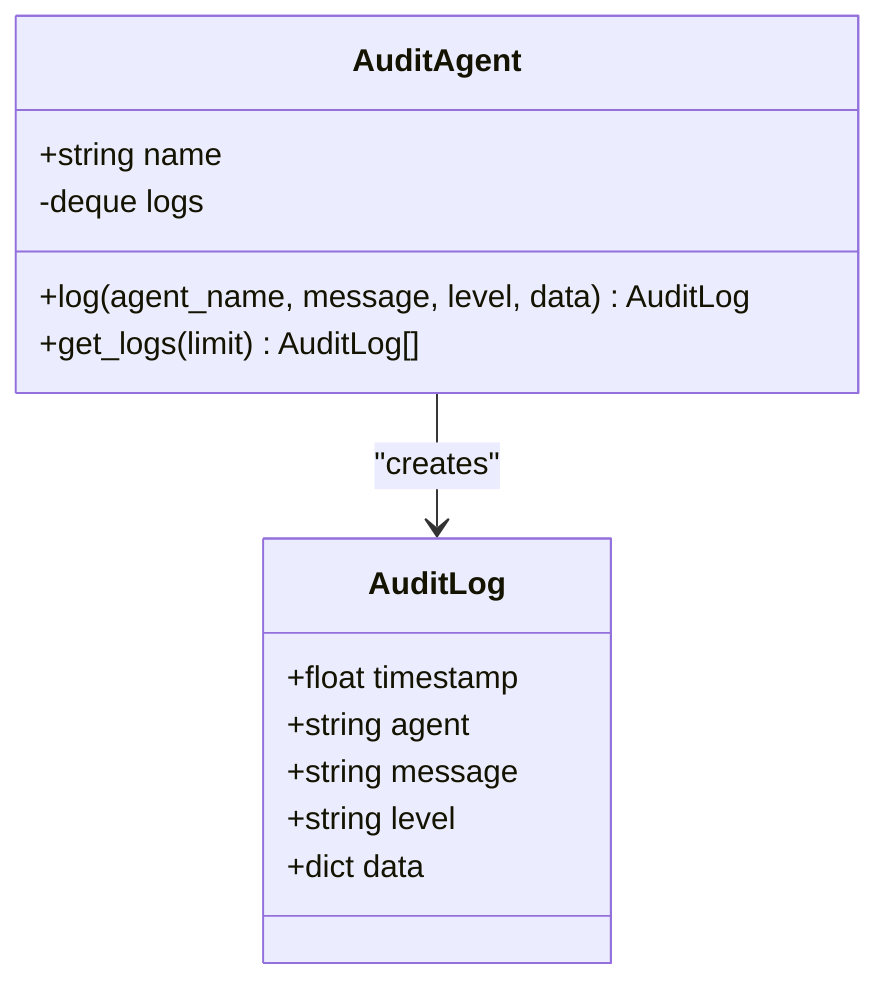
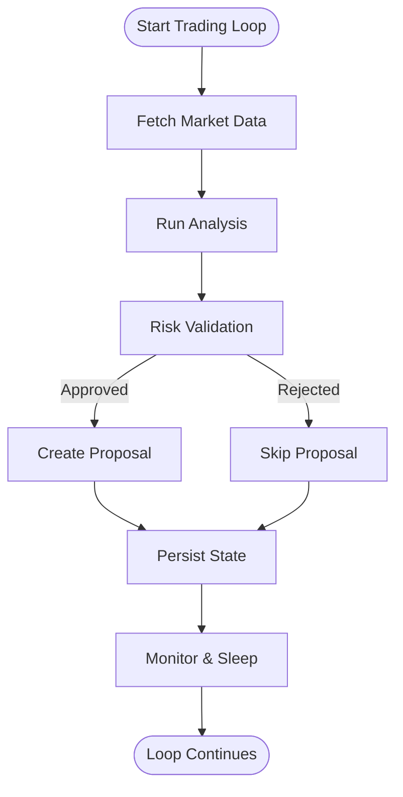
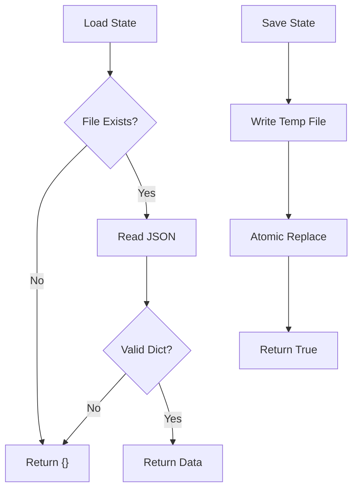
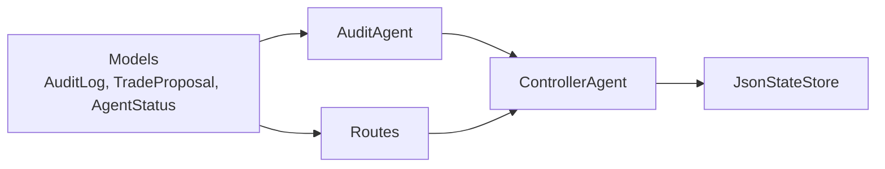

# Audit Agent

<cite>
**Referenced Files in This Document**
- [audit_agent.py](file://backend/app/agents/audit_agent.py)
- [controller.py](file://backend/app/agents/controller.py)
- [routes_agents.py](file://backend/app/api/routes_agents.py)
- [agents.py](file://backend/app/models/agents.py)
- [state_store.py](file://backend/app/services/state_store.py)
- [reports.py](file://backend/app/services/reports.py)
- [config.py](file://backend/app/core/config.py)
</cite>

## Table of Contents
1. [Introduction](#introduction)
2. [Project Structure](#project-structure)
3. [Core Components](#core-components)
4. [Architecture Overview](#architecture-overview)
5. [Detailed Component Analysis](#detailed-component-analysis)
6. [Dependency Analysis](#dependency-analysis)
7. [Performance Considerations](#performance-considerations)
8. [Troubleshooting Guide](#troubleshooting-guide)
9. [Conclusion](#conclusion)
10. [Appendices](#appendices)

## Introduction
The Audit agent provides logging and monitoring infrastructure for the trading system. It records agent activities, captures trade decisions, and maintains an audit trail for compliance and debugging. The agent integrates with a persistent state store to retain critical operational state, exposes real-time logs through API endpoints, and supports reporting features that summarize executed trades.

Key responsibilities:
- Track agent lifecycle events (start, stop, halt, resume).
- Record analysis recommendations, risk assessments, and execution proposals.
- Maintain bounded in-memory logs and durable file-based logs.
- Provide APIs for live log retrieval and report generation.
- Integrate with the state store for persistence of controller state and guardrails.

## Project Structure
The audit functionality is implemented within the backend application and exposed via FastAPI routes. The relevant modules are:
- Audit agent implementation and in-memory log buffer.
- Controller orchestration that emits audit events across the trading pipeline.
- Pydantic models defining structured audit entries.
- JSON state store used by the controller to persist state.
- Report generator for CSV export of trade executions.
- Configuration loader for environment variables.

**Diagram sources**
- [audit_agent.py:1-64](file://backend/app/agents/audit_agent.py#L1-L64)
- [controller.py:24-72](file://backend/app/agents/controller.py#L24-L72)
- [routes_agents.py:1-150](file://backend/app/api/routes_agents.py#L1-L150)
- [agents.py:74-80](file://backend/app/models/agents.py#L74-L80)
- [state_store.py:22-59](file://backend/app/services/state_store.py#L22-L59)
- [reports.py:1-50](file://backend/app/services/reports.py#L1-L50)
- [config.py:1-17](file://backend/app/core/config.py#L1-L17)

**Section sources**
- [audit_agent.py:1-64](file://backend/app/agents/audit_agent.py#L1-L64)
- [controller.py:24-72](file://backend/app/agents/controller.py#L24-L72)
- [routes_agents.py:1-150](file://backend/app/api/routes_agents.py#L1-L150)
- [agents.py:74-80](file://backend/app/models/agents.py#L74-L80)
- [state_store.py:22-59](file://backend/app/services/state_store.py#L22-L59)
- [reports.py:1-50](file://backend/app/services/reports.py#L1-L50)
- [config.py:1-17](file://backend/app/core/config.py#L1-L17)

## Core Components
- AuditAgent: Creates structured audit entries, stores them in a bounded deque, and writes to a rotating file logger. Provides retrieval of recent logs sorted by timestamp.
- ControllerAgent: Orchestrates the trading loop and emits audit events at key stages: fetching data, analysis, risk checks, proposal creation, execution updates, and error handling.
- JsonStateStore: Thread-safe atomic JSON persistence used by the controller to save positions, proposals, guardrails, and timing metadata.
- Models: Define structured schemas for audit logs, trade proposals, and agent status.
- Reports: Generate CSV reports from trade executions with USD valuation fallbacks.
- Config: Loads environment variables such as API keys and demo mode flags.

**Section sources**
- [audit_agent.py:33-63](file://backend/app/agents/audit_agent.py#L33-L63)
- [controller.py:24-72](file://backend/app/agents/controller.py#L24-L72)
- [state_store.py:22-59](file://backend/app/services/state_store.py#L22-L59)
- [agents.py:74-80](file://backend/app/models/agents.py#L74-L80)
- [reports.py:11-49](file://backend/app/services/reports.py#L11-L49)
- [config.py:1-17](file://backend/app/core/config.py#L1-L17)

## Architecture Overview
The audit system is embedded into the controller’s main loop. Each major phase triggers audit events that capture context and optional structured data. The API layer exposes these logs and other operational state to clients.

**Diagram sources**
- [routes_agents.py:92-94](file://backend/app/api/routes_agents.py#L92-L94)
- [controller.py:599-666](file://backend/app/agents/controller.py#L599-L666)
- [audit_agent.py:39-63](file://backend/app/agents/audit_agent.py#L39-L63)
- [state_store.py:39-59](file://backend/app/services/state_store.py#L39-L59)

## Detailed Component Analysis

### AuditAgent
Responsibilities:
- Create structured audit entries with timestamp, agent name, message, level, and optional data.
- Maintain an in-memory deque limited to 1000 entries for live viewing.
- Write formatted messages to a rotating file logger named “dextrader.audit”.
- Expose get_logs(limit) returning the most recent entries sorted by timestamp descending.

Implementation highlights:
- File logging uses RotatingFileHandler with a 5 MB max size and 3 backups; encoding is UTF-8.
- If file logging fails (e.g., read-only volume), it prints a diagnostic and continues without file output.
- Log levels map to INFO, WARNING, ERROR and include optional structured data appended to the message.

**Diagram sources**
- [audit_agent.py:33-63](file://backend/app/agents/audit_agent.py#L33-L63)
- [agents.py:74-80](file://backend/app/models/agents.py#L74-L80)

**Section sources**
- [audit_agent.py:11-31](file://backend/app/agents/audit_agent.py#L11-L31)
- [audit_agent.py:33-63](file://backend/app/agents/audit_agent.py#L33-L63)
- [agents.py:74-80](file://backend/app/models/agents.py#L74-L80)

### ControllerAgent Integration
Responsibilities:
- Initialize and manage AuditAgent alongside Analysis, Risk, and Execution agents.
- Emit audit events during lifecycle transitions (start, stop, halt, resume).
- Record analysis recommendations, risk approvals/rejections, and execution proposals.
- Persist state using JsonStateStore after significant changes.

Key integration points:
- Start/stop/halt/resume emit audit events with appropriate levels.
- Market data fetch errors and loop exceptions are logged as errors.
- Proposal lifecycle emits detailed data including token, action, amounts, prices, and gas metrics.
- Position updates and guardrail interactions are audited.

**Diagram sources**
- [controller.py:499-674](file://backend/app/agents/controller.py#L499-L674)

**Section sources**
- [controller.py:24-72](file://backend/app/agents/controller.py#L24-L72)
- [controller.py:224-243](file://backend/app/agents/controller.py#L224-L243)
- [controller.py:599-666](file://backend/app/agents/controller.py#L599-L666)
- [controller.py:676-678](file://backend/app/agents/controller.py#L676-L678)

### State Store Integration
Responsibilities:
- Provide thread-safe atomic JSON persistence for controller state.
- Save positions, proposals, last trade times, and guardrails configuration.
- Load persisted state on startup to reconstruct trading context.

Behavior:
- Uses a temporary file and os.replace for atomic writes.
- Handles I/O errors gracefully and returns False on failure.
- Supports overriding storage directory via environment variable.

**Diagram sources**
- [state_store.py:27-59](file://backend/app/services/state_store.py#L27-L59)

**Section sources**
- [state_store.py:15-19](file://backend/app/services/state_store.py#L15-L19)
- [state_store.py:22-59](file://backend/app/services/state_store.py#L22-L59)
- [controller.py:118-125](file://backend/app/agents/controller.py#L118-L125)

### API Exposure and Real-Time Monitoring
Endpoints:
- GET /logs: Returns recent audit logs as a list of structured entries.
- GET /status: Returns current agent status including running state, equity, drawdown, and trade counts.
- GET /state: Returns guardrail and indicator state plus position summaries.
- POST /report: Generates a textual summary of proposals and executed trades.

Real-time monitoring:
- Clients can poll /logs to observe audit events as they occur.
- The frontend displays logs with timestamps and color-coded agent names.

**Section sources**
- [routes_agents.py:92-94](file://backend/app/api/routes_agents.py#L92-L94)
- [routes_agents.py:61-84](file://backend/app/api/routes_agents.py#L61-L84)
- [routes_agents.py:119-138](file://backend/app/api/routes_agents.py#L119-L138)

### Reporting Features
Capabilities:
- CSV report generation for trade executions with fields like date, network, pair, action, price, token amount, network fee, USD amount, status, and transaction hash.
- USD valuation prefers captured price_usd when available; otherwise falls back to a rate table including ETH/WETH rates.

Usage:
- The controller’s /report endpoint aggregates executed and pending proposals into a human-readable summary.
- For detailed trade exports, use the CSV report generator with trade execution records.

**Section sources**
- [reports.py:11-49](file://backend/app/services/reports.py#L11-L49)
- [routes_agents.py:119-138](file://backend/app/api/routes_agents.py#L119-L138)

### Log Formats and Structured Data
AuditLog schema:
- timestamp: float Unix time.
- agent: string identifying the emitting component (e.g., Controller, Analysis, Risk, Execution).
- message: human-readable description.
- level: one of INFO, WARNING, ERROR.
- data: optional dictionary containing structured context (e.g., recommendation details, risk assessment, proposal metadata).

File log format:
- Rotating file handler writes lines with timestamp, level, and message.
- Optional data is appended to the message line for traceability.

**Section sources**
- [agents.py:74-80](file://backend/app/models/agents.py#L74-L80)
- [audit_agent.py:19-31](file://backend/app/agents/audit_agent.py#L19-L31)
- [audit_agent.py:39-63](file://backend/app/agents/audit_agent.py#L39-L63)

### Metrics Collection and Alerting
Current capabilities:
- No dedicated metrics collector or alerting service is present in the codebase.
- Operational signals are emitted via audit logs (e.g., halted trading, rejected proposals, errors).
- External systems can consume /logs and implement alerting based on patterns (e.g., repeated warnings or errors).

Recommendations:
- Integrate a metrics library (e.g., Prometheus client) to expose counters and gauges for trade counts, error rates, and latency.
- Add alert rules in external monitoring tools to trigger notifications on specific audit patterns.

[No sources needed since this section provides general guidance]

### Data Retention Policies and Log Rotation
Retention:
- In-memory logs are bounded to 1000 entries; older entries are dropped automatically.
- File logs rotate at 5 MB per file with up to 3 backups.

Rotation behavior:
- RotatingFileHandler manages file sizes and backup counts.
- If file logging cannot be initialized, the agent continues without file output and prints a diagnostic.

**Section sources**
- [audit_agent.py:19-31](file://backend/app/agents/audit_agent.py#L19-L31)
- [audit_agent.py:33-37](file://backend/app/agents/audit_agent.py#L33-L37)

### Integration with External Monitoring Systems
Integration points:
- Clients can poll GET /logs to stream audit events.
- The controller persists state to disk via JsonStateStore, enabling offline analysis and recovery.
- Reports provide summarized outputs suitable for dashboards or compliance reviews.

External tooling suggestions:
- Use log aggregation pipelines (e.g., Fluent Bit, Filebeat) to ship agents.log to centralized storage.
- Build dashboards around /logs and /state endpoints for real-time visibility.

**Section sources**
- [routes_agents.py:92-94](file://backend/app/api/routes_agents.py#L92-L94)
- [state_store.py:22-59](file://backend/app/services/state_store.py#L22-L59)

## Dependency Analysis
The audit subsystem depends on:
- Models for structured data representation.
- Controller for orchestration and event emission.
- State store for persistence.
- API routes for exposure.

**Diagram sources**
- [agents.py:74-80](file://backend/app/models/agents.py#L74-L80)
- [audit_agent.py:33-63](file://backend/app/agents/audit_agent.py#L33-L63)
- [controller.py:24-72](file://backend/app/agents/controller.py#L24-L72)
- [state_store.py:22-59](file://backend/app/services/state_store.py#L22-L59)
- [routes_agents.py:1-150](file://backend/app/api/routes_agents.py#L1-L150)

**Section sources**
- [agents.py:74-80](file://backend/app/models/agents.py#L74-L80)
- [audit_agent.py:33-63](file://backend/app/agents/audit_agent.py#L33-L63)
- [controller.py:24-72](file://backend/app/agents/controller.py#L24-L72)
- [state_store.py:22-59](file://backend/app/services/state_store.py#L22-L59)
- [routes_agents.py:1-150](file://backend/app/api/routes_agents.py#L1-L150)

## Performance Considerations
- In-memory log buffer is capped at 1000 entries to prevent unbounded growth.
- File logging uses rotation to avoid large single files and limit disk usage.
- State persistence uses atomic writes to minimize corruption risk and ensure consistency.
- Avoid excessive logging in hot paths; prefer structured data payloads to reduce message churn.

[No sources needed since this section provides general guidance]

## Troubleshooting Guide
Common issues and resolutions:
- File logging disabled: Occurs when the filesystem is read-only or permissions are insufficient. Check diagnostics printed by the audit agent and verify write permissions to the backend root directory.
- Missing logs in API response: Ensure the controller is running and emitting audit events; check /status and /state endpoints for operational health.
- Stale state: Verify JsonStateStore path and permissions; confirm that saves succeed and no I/O errors are reported.
- High memory usage: Reduce polling frequency or limit monitored tokens; consider increasing the in-memory log cap if necessary.

Operational checks:
- Poll GET /logs to validate recent audit events.
- Inspect agents.log for rotated file content and formatting.
- Review /state for guardrail and position summaries.

**Section sources**
- [audit_agent.py:19-31](file://backend/app/agents/audit_agent.py#L19-L31)
- [routes_agents.py:92-94](file://backend/app/api/routes_agents.py#L92-L94)
- [state_store.py:39-59](file://backend/app/services/state_store.py#L39-L59)

## Conclusion
The Audit agent provides essential observability for the trading system by capturing agent activities, recording trade decisions, and maintaining an audit trail. It integrates with the controller’s lifecycle, persists critical state atomically, and exposes logs and reports via API endpoints. While dedicated metrics and alerting are not implemented, the existing audit events and file logs offer a solid foundation for external monitoring and compliance workflows.

[No sources needed since this section summarizes without analyzing specific files]

## Appendices

### Example: Generating an Audit Trail Entry
Steps:
- ControllerAgent emits an audit event during a trading phase (e.g., analysis recommendation).
- AuditAgent creates an AuditLog entry with timestamp, agent, message, level, and optional data.
- The entry is stored in the in-memory buffer and written to the rotating file logger.
- Clients retrieve the latest entries via GET /logs.

**Section sources**
- [controller.py:619-623](file://backend/app/agents/controller.py#L619-L623)
- [audit_agent.py:39-63](file://backend/app/agents/audit_agent.py#L39-L63)
- [routes_agents.py:92-94](file://backend/app/api/routes_agents.py#L92-L94)

### Example: Performance Monitoring Workflow
Steps:
- Poll GET /status and GET /state to monitor running state, equity, drawdown, and position summaries.
- Observe audit logs for warnings and errors indicating performance issues (e.g., halted trading, rejected proposals).
- Use external tools to aggregate agents.log and build dashboards for latency and error rates.

**Section sources**
- [routes_agents.py:61-84](file://backend/app/api/routes_agents.py#L61-L84)
- [audit_agent.py:19-31](file://backend/app/agents/audit_agent.py#L19-L31)

### Example: Troubleshooting Workflow
Steps:
- Check GET /logs for recent audit events and identify anomalies.
- Validate JsonStateStore persistence by inspecting saved files and confirming atomic writes.
- Review agents.log for rotation and formatting issues.
- Adjust configuration (e.g., polling interval, monitored tokens) based on observed behavior.

**Section sources**
- [routes_agents.py:92-94](file://backend/app/api/routes_agents.py#L92-L94)
- [state_store.py:39-59](file://backend/app/services/state_store.py#L39-L59)
- [audit_agent.py:19-31](file://backend/app/agents/audit_agent.py#L19-L31)