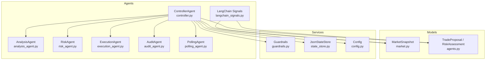
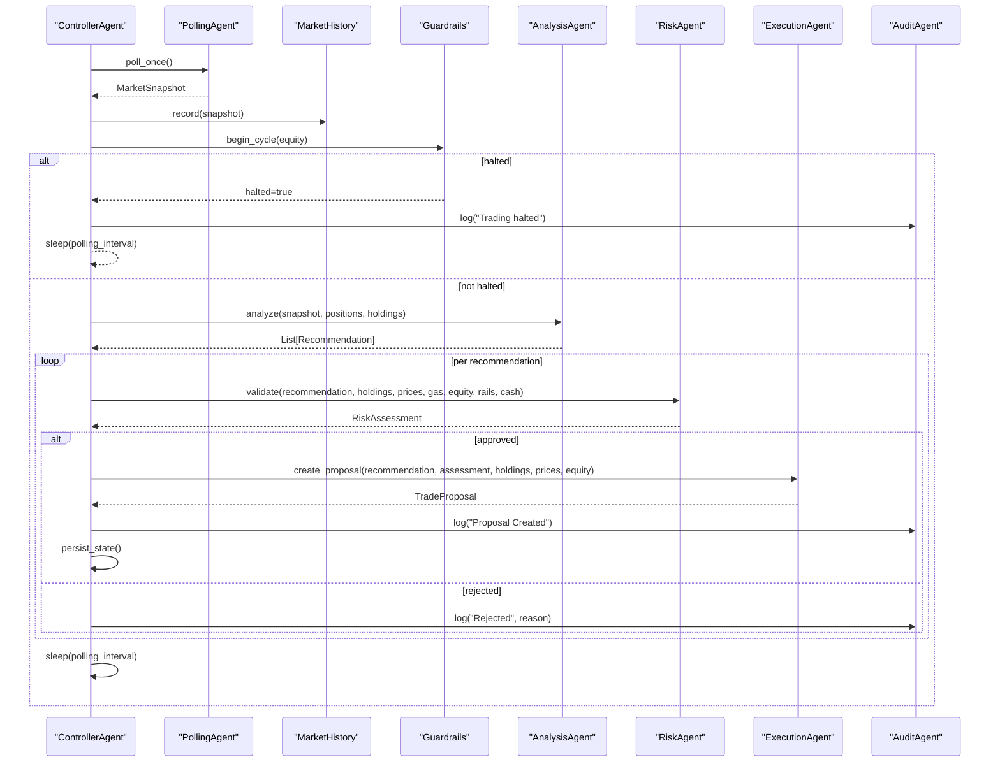
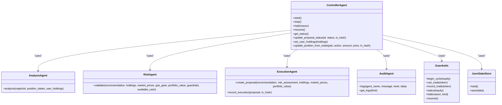

# Controller Agent

<cite>
**Referenced Files in This Document**
- [controller.py](file://backend/app/agents/controller.py)
- [analysis_agent.py](file://backend/app/agents/analysis_agent.py)
- [risk_agent.py](file://backend/app/agents/risk_agent.py)
- [execution_agent.py](file://backend/app/agents/execution_agent.py)
- [audit_agent.py](file://backend/app/agents/audit_agent.py)
- [polling_agent.py](file://backend/app/agents/polling_agent.py)
- [langchain_signals.py](file://backend/app/agents/langchain_signals.py)
- [agents.py](file://backend/app/models/agents.py)
- [market.py](file://backend/app/models/market.py)
- [state_store.py](file://backend/app/services/state_store.py)
- [guardrails.py](file://backend/app/services/guardrails.py)
- [config.py](file://backend/app/core/config.py)
</cite>

## Table of Contents
1. [Introduction](#introduction)
2. [Project Structure](#project-structure)
3. [Core Components](#core-components)
4. [Architecture Overview](#architecture-overview)
5. [Detailed Component Analysis](#detailed-component-analysis)
6. [Dependency Analysis](#dependency-analysis)
7. [Performance Considerations](#performance-considerations)
8. [Troubleshooting Guide](#troubleshooting-guide)
9. [Conclusion](#conclusion)
10. [Appendices](#appendices)

## Introduction
The Controller agent is the central orchestrator of the trading pipeline. It coordinates market data ingestion, strategy analysis, risk validation, proposal creation, execution tracking, and audit logging. It manages the complete lifecycle from polling market snapshots to generating trade proposals and updating internal state after executions. It also integrates with LangChain-based LLM signal generation for enhanced decision-making capabilities.

At runtime, the Controller:
- Polls market data through a shared polling utility.
- Maintains user holdings, position states, and guardrail status.
- Invokes the Analysis agent to generate recommendations.
- Routes recommendations through the Risk agent for validation.
- Creates Trade proposals via the Execution agent.
- Persists state and logs events through the Audit agent.
- Supports demo mode with a simulated portfolio or live mode with injected wallet holdings.

## Project Structure
The Controller lives under the agents package and composes other agents and services:

**Diagram sources**
- [controller.py:24-72](file://backend/app/agents/controller.py#L24-L72)
- [analysis_agent.py:10-18](file://backend/app/agents/analysis_agent.py#L10-L18)
- [risk_agent.py:8-22](file://backend/app/agents/risk_agent.py#L8-L22)
- [execution_agent.py:9-25](file://backend/app/agents/execution_agent.py#L9-L25)
- [audit_agent.py:33-37](file://backend/app/agents/audit_agent.py#L33-L37)
- [polling_agent.py:26-43](file://backend/app/agents/polling_agent.py#L26-L43)
- [langchain_signals.py:19-37](file://backend/app/agents/langchain_signals.py#L19-L37)
- [market.py:14-16](file://backend/app/models/market.py#L14-L16)
- [agents.py:54-72](file://backend/app/models/agents.py#L54-L72)
- [guardrails.py:27-39](file://backend/app/services/guardrails.py#L27-L39)
- [state_store.py:22-59](file://backend/app/services/state_store.py#L22-L59)
- [config.py:9-15](file://backend/app/core/config.py#L9-L15)

**Section sources**
- [controller.py:24-72](file://backend/app/agents/controller.py#L24-L72)
- [config.py:9-15](file://backend/app/core/config.py#L9-L15)

## Core Components
- ControllerAgent: Orchestrates the pipeline, manages lifecycle, state persistence, and integration points.
- AnalysisAgent: Rule-based strategy producing buy/sell/hold recommendations using indicators and position history.
- RiskAgent: Validates recommendations against exposure, gas, profit, and circuit breaker constraints.
- ExecutionAgent: Converts approved recommendations into sized Trade proposals and records executed trades.
- AuditAgent: Centralized logging with rotating file handlers and bounded in-memory log buffer.
- Guardrails: Portfolio-level circuit breakers including daily drawdown limits, trade budgets, and kill switch.
- JsonStateStore: Atomic JSON persistence for controller state and guardrails.
- PollingAgent: Market snapshot cache with minimum 60-second duration.
- LangChain Signals: Optional LLM-driven signal generation via OpenAI or DeepSeek.

**Section sources**
- [controller.py:24-72](file://backend/app/agents/controller.py#L24-L72)
- [analysis_agent.py:10-18](file://backend/app/agents/analysis_agent.py#L10-L18)
- [risk_agent.py:8-22](file://backend/app/agents/risk_agent.py#L8-L22)
- [execution_agent.py:9-25](file://backend/app/agents/execution_agent.py#L9-L25)
- [audit_agent.py:33-37](file://backend/app/agents/audit_agent.py#L33-L37)
- [guardrails.py:27-39](file://backend/app/services/guardrails.py#L27-L39)
- [state_store.py:22-59](file://backend/app/services/state_store.py#L22-L59)
- [polling_agent.py:26-43](file://backend/app/agents/polling_agent.py#L26-L43)
- [langchain_signals.py:19-37](file://backend/app/agents/langchain_signals.py#L19-L37)

## Architecture Overview
The Controller runs an asynchronous loop that:
1. Fetches a MarketSnapshot and filters pairs to monitored tokens and current holdings.
2. Records the snapshot into historical data and updates last prices.
3. Computes equity and evaluates guardrails; halts if thresholds are breached.
4. Calls AnalysisAgent.analyze to produce recommendations.
5. For each recommendation, calls RiskAgent.validate to approve or reject.
6. If approved, calls ExecutionAgent.create_proposal to create a TradeProposal.
7. Persists state and waits for the next polling interval.

**Diagram sources**
- [controller.py:499-674](file://backend/app/agents/controller.py#L499-L674)
- [polling_agent.py:26-43](file://backend/app/agents/polling_agent.py#L26-L43)
- [analysis_agent.py:76-255](file://backend/app/agents/analysis_agent.py#L76-L255)
- [risk_agent.py:24-190](file://backend/app/agents/risk_agent.py#L24-L190)
- [execution_agent.py:58-179](file://backend/app/agents/execution_agent.py#L58-L179)
- [guardrails.py:46-71](file://backend/app/services/guardrails.py#L46-L71)

## Detailed Component Analysis

### ControllerAgent Lifecycle and State Management
Responsibilities:
- Initialize agents, state store, guardrails, and demo/live mode configuration.
- Reconstruct state from trades or demo fills on startup.
- Provide start/stop/halt/resume methods.
- Maintain current_step, last_run_time, monitored_tokens, user_holdings, position_states, proposals, and last_trade_times.
- Persist and restore state atomically.

Key behaviors:
- start(): marks running, logs system start, and schedules run_loop().
- stop(): sets running false and logs system stop.
- halt()/resume(): toggles guardrails and persists state.
- get_status(): returns AgentStatus including halted state, equity, drawdown, and trade counts.
- update_proposal_status(): idempotently transitions proposal statuses, applies demo fills, updates position state, records trades, and persists state.
- _update_position_state(): maintains average entry price, peak price, cumulative sold fraction, and user holdings across buys and sells.
- set_user_holdings(): injects holdings (live mode) or refreshes from demo portfolio.
- update_position_from_trade(): reconciles internal state with recorded trades, updates guardrails counters, and persists state.

Persistence:
- Uses JsonStateStore to save positions, recent proposals, last_trade_times, and guardrails.
- Restores state from disk and reconstructs positions from trade ledger or demo fills.

Error handling:
- Wraps main loop iterations in try/except, logs errors, and sleeps before retrying.
- Logs market fetch failures and continues gracefully.

Configuration:
- DEMO_MODE controls whether the system uses DemoPortfolio or live holdings.
- polling_interval controls the loop cadence.
- monitored_tokens defines default symbols to watch.

**Section sources**
- [controller.py:24-72](file://backend/app/agents/controller.py#L24-L72)
- [controller.py:75-125](file://backend/app/agents/controller.py#L75-L125)
- [controller.py:128-221](file://backend/app/agents/controller.py#L128-L221)
- [controller.py:224-267](file://backend/app/agents/controller.py#L224-L267)
- [controller.py:269-400](file://backend/app/agents/controller.py#L269-L400)
- [controller.py:402-478](file://backend/app/agents/controller.py#L402-L478)
- [controller.py:499-674](file://backend/app/agents/controller.py#L499-L674)
- [state_store.py:22-59](file://backend/app/services/state_store.py#L22-L59)

### AnalysisAgent Strategy
Responsibilities:
- Generate AnalysisRecommendation objects based on market data, indicators, and position state.
- Implement exit logic: hard stop ladder, trailing stop, scale-out take-profit ladder, and discretionary pump exit.
- Implement buy logic: dip detection with RSI, VWAP discount, volume spike confirmation, and re-entry cooldown after stop-loss.

Complexity:
- Processes each pair once per cycle; indicator lookups are O(1) per token.
- Exit ladder checks iterate over fixed-size ladders; overall complexity is linear in number of pairs.

Integration:
- Consumes MarketSnapshot and position_states provided by Controller.
- Emits recommendations consumed by Controller’s risk and execution stages.

**Section sources**
- [analysis_agent.py:10-18](file://backend/app/agents/analysis_agent.py#L10-L18)
- [analysis_agent.py:76-255](file://backend/app/agents/analysis_agent.py#L76-L255)
- [analysis_agent.py:258-349](file://backend/app/agents/analysis_agent.py#L258-L349)

### RiskAgent Validation
Responsibilities:
- Validate recommendations against confidence thresholds, gas caps, position sizing, expected profit, and gas-to-profit ratio.
- Enforce guardrails’ circuit breakers and per-token trade limits.
- Compute dynamic slippage based on volatility and volume spikes.

Outputs:
- RiskAssessment with approval flag, reasons, estimated gas, max slippage, expected profit, and detailed checks.

Integration:
- Called by Controller for each recommendation.
- Uses Guardrails for global trading allowances and config.

**Section sources**
- [risk_agent.py:8-22](file://backend/app/agents/risk_agent.py#L8-L22)
- [risk_agent.py:24-190](file://backend/app/agents/risk_agent.py#L24-L190)
- [risk_agent.py:192-215](file://backend/app/agents/risk_agent.py#L192-L215)

### ExecutionAgent Proposal Creation
Responsibilities:
- Convert approved recommendations into TradeProposal objects with proper sizing, slippage, gas cost, and auto-tradeable flags.
- Record executed trades via portfolio service when tx_hash is provided.

Sizing rules:
- Buy steps use predefined fractions and target position percentage.
- Respects risk layer headroom and available cash.
- Rejects proposals below dust threshold or with insufficient buying power.

Integration:
- Consumes AnalysisRecommendation and RiskAssessment.
- Produces TradeProposal used by Controller for persistence and UI.

**Section sources**
- [execution_agent.py:9-25](file://backend/app/agents/execution_agent.py#L9-L25)
- [execution_agent.py:58-179](file://backend/app/agents/execution_agent.py#L58-L179)

### AuditAgent Logging
Responsibilities:
- Maintain a bounded in-memory deque of AuditLog entries.
- Write structured logs to a rotating file handler at backend root.
- Expose get_logs for inspection.

Integration:
- Used by Controller and other agents to log lifecycle events, decisions, and errors.

**Section sources**
- [audit_agent.py:33-64](file://backend/app/agents/audit_agent.py#L33-L64)

### Guardrails Circuit Breakers
Responsibilities:
- Track daily equity, drawdown, trade counts, and per-token trade counts.
- Halt trading automatically when daily drawdown exceeds configured limit.
- Provide can_trade allowance checks and status reporting.

Integration:
- Controller invokes begin_cycle each loop and can_trade during validation.
- Controller exposes guardrails status via get_guardrail_status and AgentStatus.

**Section sources**
- [guardrails.py:27-39](file://backend/app/services/guardrails.py#L27-L39)
- [guardrails.py:46-71](file://backend/app/services/guardrails.py#L46-L71)
- [guardrails.py:92-133](file://backend/app/services/guardrails.py#L92-L133)

### PollingAgent Market Data Cache
Responsibilities:
- Cache MarketSnapshot for a configurable minimum duration (default 60 seconds).
- Provide poll_once function used by Controller.

Integration:
- Controller calls poll_once to obtain filtered and timestamped market data.

**Section sources**
- [polling_agent.py:26-43](file://backend/app/agents/polling_agent.py#L26-L43)

### LangChain Signals Integration
Responsibilities:
- Build a Pydantic-parsed chain to generate Signal lists from market snapshots using ChatOpenAI.
- Provide direct DeepSeek API integration for alternative LLM provider.

Integration:
- Returns Signal objects compatible with downstream consumers; Controller can optionally consume these signals alongside rule-based analysis.

**Section sources**
- [langchain_signals.py:19-37](file://backend/app/agents/langchain_signals.py#L19-L37)
- [langchain_signals.py:40-58](file://backend/app/agents/langchain_signals.py#L40-L58)
- [langchain_signals.py:61-123](file://backend/app/agents/langchain_signals.py#L61-L123)

## Dependency Analysis
The Controller depends on:
- Agents: AnalysisAgent, RiskAgent, ExecutionAgent, AuditAgent.
- Services: Guardrails, JsonStateStore, DemoPortfolio (demo mode), Gas pricing, MarketHistory, Policy constants.
- Models: AgentStatus, TradeProposal, MarketSnapshot.
- Config: DEMO_MODE and API keys.

**Diagram sources**
- [controller.py:24-72](file://backend/app/agents/controller.py#L24-L72)
- [analysis_agent.py:10-18](file://backend/app/agents/analysis_agent.py#L10-L18)
- [risk_agent.py:8-22](file://backend/app/agents/risk_agent.py#L8-L22)
- [execution_agent.py:9-25](file://backend/app/agents/execution_agent.py#L9-L25)
- [audit_agent.py:33-37](file://backend/app/agents/audit_agent.py#L33-L37)
- [guardrails.py:27-39](file://backend/app/services/guardrails.py#L27-L39)
- [state_store.py:22-59](file://backend/app/services/state_store.py#L22-L59)

**Section sources**
- [controller.py:24-72](file://backend/app/agents/controller.py#L24-L72)
- [agents.py:54-72](file://backend/app/models/agents.py#L54-L72)
- [market.py:14-16](file://backend/app/models/market.py#L14-L16)

## Performance Considerations
- Market data caching: PollingAgent caches snapshots for at least 60 seconds to avoid redundant network calls and ensure meaningful indicator calculations.
- Loop cadence: Controller’s polling_interval determines throughput; shorter intervals increase responsiveness but may raise external API load.
- Indicator warming: AnalysisAgent avoids fabricating indicators; early cycles may produce lower-confidence recommendations until RSI/VWAP stabilize.
- State persistence: JsonStateStore performs atomic writes; frequent saves are bounded by proposal count and lifecycle events.
- Gas estimation: RiskAgent estimates gas costs and enforces gas-to-profit ratios to prevent uneconomical trades.

[No sources needed since this section provides general guidance]

## Troubleshooting Guide
Common issues and resolutions:
- Trading halted unexpectedly:
  - Check guardrails status for daily drawdown breaches or manual kill switch.
  - Use resume() to clear manual halts; investigate drawdown triggers.
- No proposals generated:
  - Verify AnalysisAgent recommendations exist and meet confidence thresholds.
  - Confirm RiskAgent approvals; inspect checks for gas caps, position caps, or min-profit failures.
- Duplicate proposals:
  - Controller prevents duplicate pending proposals per token within cooldown windows.
- Position state drift:
  - Ensure update_position_from_trade is called for recorded trades; verify tx_hash deduplication.
- Demo vs live mode mismatches:
  - In demo mode, holdings come from DemoPortfolio; in live mode, holdings are injected or fetched.
- LLM signal generation failures:
  - Validate OPENAI_API_KEY or DEEPSEEK_API_KEY configuration and network connectivity.

**Section sources**
- [controller.py:561-575](file://backend/app/agents/controller.py#L561-L575)
- [controller.py:601-666](file://backend/app/agents/controller.py#L601-L666)
- [guardrails.py:46-71](file://backend/app/services/guardrails.py#L46-L71)
- [guardrails.py:92-133](file://backend/app/services/guardrails.py#L92-L133)
- [langchain_signals.py:40-58](file://backend/app/agents/langchain_signals.py#L40-L58)
- [langchain_signals.py:61-123](file://backend/app/agents/langchain_signals.py#L61-L123)

## Conclusion
The ControllerAgent is the backbone of the trading system, integrating market data, strategy analysis, risk validation, proposal creation, and audit logging. It ensures robust state management, resilient error handling, and configurable operation modes. With optional LLM-powered signals, it can augment rule-based strategies for richer decision-making while maintaining strict risk controls and transparent auditing.

[No sources needed since this section summarizes without analyzing specific files]

## Appendices

### Configuration Options
- DEMO_MODE: Enables simulated portfolio behavior when true.
- COINMARKETCAP_API_KEY, COINGECKO_API_KEY, OPENAI_API_KEY, DEEPSEEK_API_KEY: External service credentials.
- DEXTRADER_STATE_DIR: Overrides state file directory for JsonStateStore.

**Section sources**
- [config.py:9-15](file://backend/app/core/config.py#L9-L15)
- [state_store.py:15-19](file://backend/app/services/state_store.py#L15-L19)

### Data Models Summary
- MarketSnapshot: Aggregates TradingPair list and timestamp.
- TradeProposal: Encodes token, action, amount, price, slippage, gas, status, and metadata.
- RiskAssessment: Encodes approval, reasons, gas estimates, slippage, and check details.
- AgentStatus: Exposes runtime status including halted state and equity metrics.

**Section sources**
- [market.py:14-16](file://backend/app/models/market.py#L14-L16)
- [agents.py:54-72](file://backend/app/models/agents.py#L54-L72)
- [agents.py:11-23](file://backend/app/models/agents.py#L11-L23)