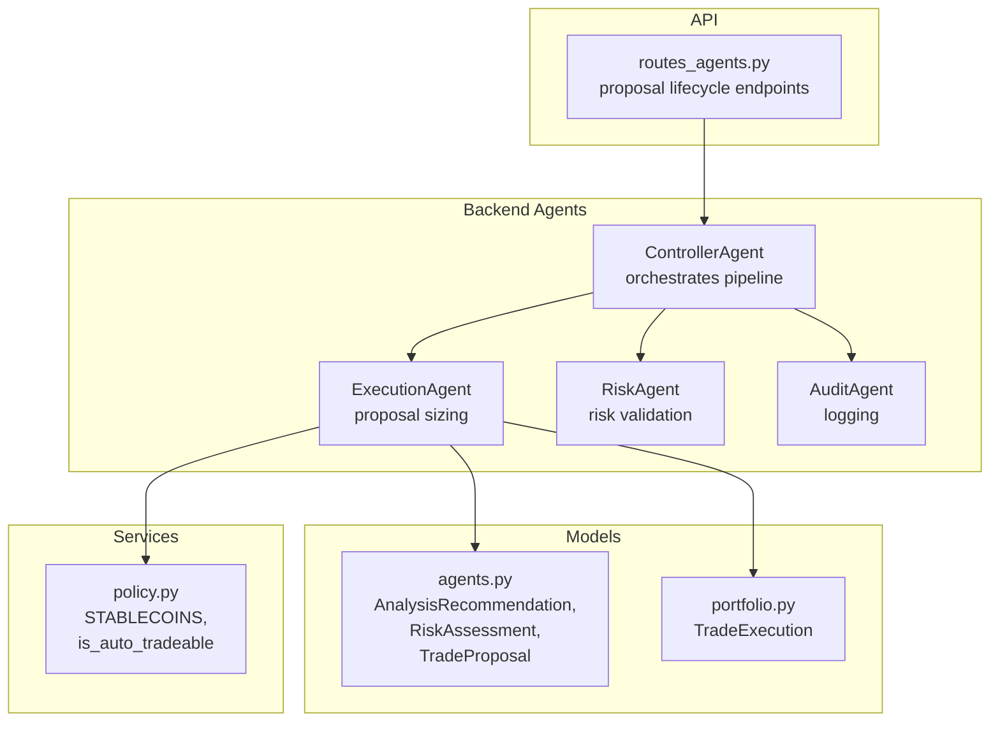
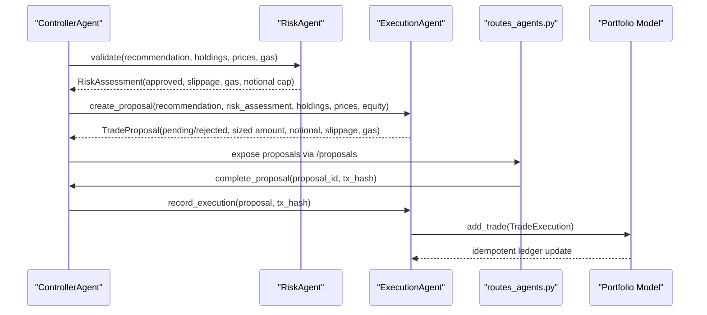
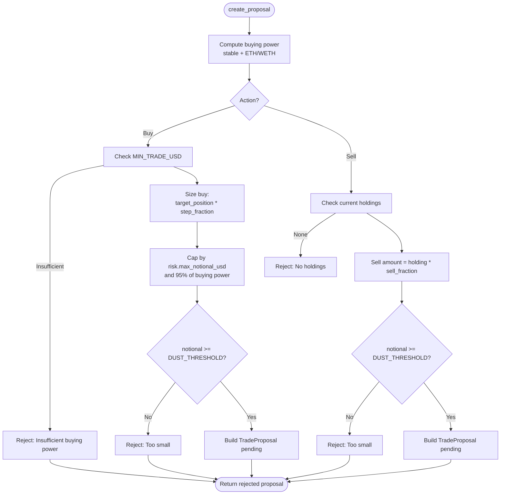
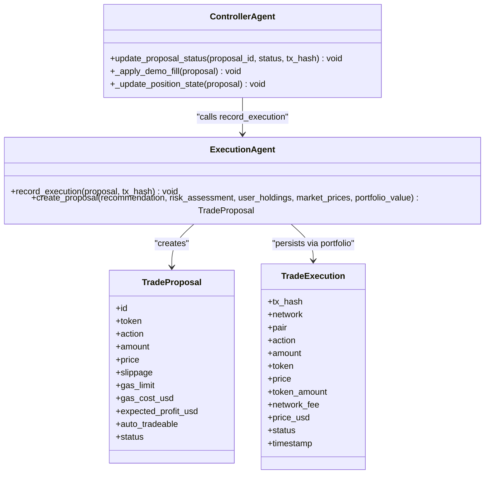
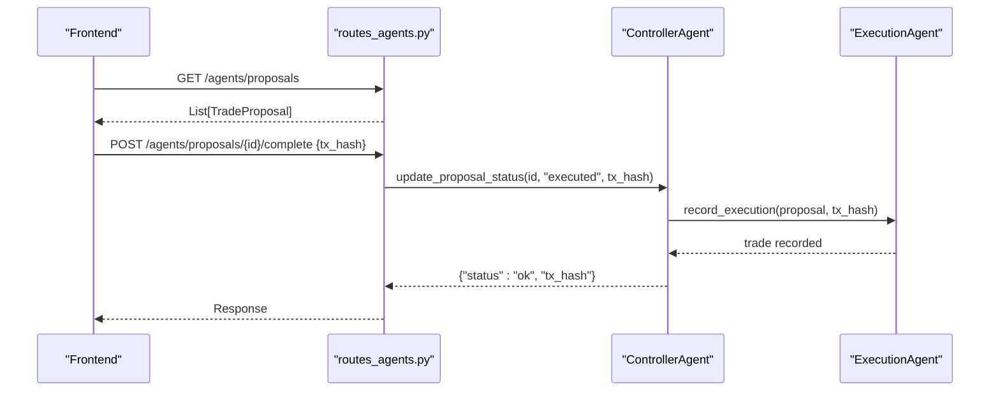
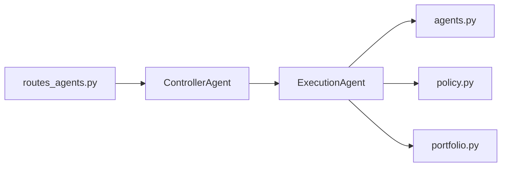

# Execution Agent

<cite>
**Referenced Files in This Document**
- [execution_agent.py](file://backend/app/agents/execution_agent.py)
- [agents.py](file://backend/app/models/agents.py)
- [portfolio.py](file://backend/app/models/portfolio.py)
- [controller.py](file://backend/app/agents/controller.py)
- [routes_agents.py](file://backend/app/api/routes_agents.py)
- [policy.py](file://backend/app/services/policy.py)
- [test_execution_agent.py](file://backend/test_execution_agent.py)
</cite>

## Table of Contents
1. [Introduction](#introduction)
2. [Project Structure](#project-structure)
3. [Core Components](#core-components)
4. [Architecture Overview](#architecture-overview)
5. [Detailed Component Analysis](#detailed-component-analysis)
6. [Dependency Analysis](#dependency-analysis)
7. [Performance Considerations](#performance-considerations)
8. [Troubleshooting Guide](#troubleshooting-guide)
9. [Conclusion](#conclusion)

## Introduction
The Execution agent is responsible for turning approved analysis signals into precise, human-reviewable trade proposals. It computes position sizing from account equity and holdings, derives entry prices and slippage parameters, enforces minimum trade sizes and dust thresholds, and integrates with the portfolio system to ensure balance checks and allocation strategies are respected. The resulting TradeProposal carries all information needed for approval workflows, human-in-the-loop execution, and subsequent blockchain transaction recording.

This document explains how analyzed signals become executable proposals, how sizing works under different buy and sell scenarios, how the proposal lifecycle integrates with the controller and API, and how errors such as insufficient funds or dust trades are handled.

## Project Structure
The Execution agent lives inside the backend agent layer and collaborates with models, services, and the orchestration controller:

**Diagram sources**
- [controller.py:24-29](file://backend/app/agents/controller.py#L24-L29)
- [execution_agent.py:9-25](file://backend/app/agents/execution_agent.py#L9-L25)
- [agents.py:25-72](file://backend/app/models/agents.py#L25-L72)
- [portfolio.py:17-35](file://backend/app/models/portfolio.py#L17-L35)
- [policy.py:1-12](file://backend/app/services/policy.py#L1-L12)
- [routes_agents.py:97-116](file://backend/app/api/routes_agents.py#L97-L116)

**Section sources**
- [controller.py:24-29](file://backend/app/agents/controller.py#L24-L29)
- [execution_agent.py:9-25](file://backend/app/agents/execution_agent.py#L9-L25)
- [agents.py:25-72](file://backend/app/models/agents.py#L25-L72)
- [portfolio.py:17-35](file://backend/app/models/portfolio.py#L17-L35)
- [policy.py:1-12](file://backend/app/services/policy.py#L1-L12)
- [routes_agents.py:97-116](file://backend/app/api/routes_agents.py#L97-L116)

## Core Components
- ExecutionAgent: Computes sized proposals from recommendations and risk assessments, enforces buying power, target position sizing, step-based scaling, dust thresholds, and slippage/gas metadata.
- TradeProposal: Structured output carrying token, action, amount, price, slippage, gas limits, expected profit, auto-tradeability, and status.
- AnalysisRecommendation and RiskAssessment: Inputs that define signal intent, confidence, pricing, exit strategy, slippage tolerance, gas estimates, and notional caps.
- ControllerAgent: Orchestrates the pipeline, persists proposals, applies demo fills, updates positions, and records executed trades.
- Policy constants: Define stablecoins and auto-tradeable tokens used by sizing and auto-trade flags.
- Portfolio model: Defines the uniform TradeExecution record used when recording successful blockchain transactions.

**Section sources**
- [execution_agent.py:9-25](file://backend/app/agents/execution_agent.py#L9-L25)
- [agents.py:25-72](file://backend/app/models/agents.py#L25-L72)
- [controller.py:296-330](file://backend/app/agents/controller.py#L296-L330)
- [policy.py:1-12](file://backend/app/services/policy.py#L1-L12)
- [portfolio.py:17-35](file://backend/app/models/portfolio.py#L17-L35)

## Architecture Overview
The Execution agent sits between risk approval and human approval/execution. The controller runs a loop that fetches market data, analyzes signals, validates risk, creates proposals, and exposes them via API. When a proposal is marked executed, the controller updates internal state and records the trade.

**Diagram sources**
- [controller.py:625-666](file://backend/app/agents/controller.py#L625-L666)
- [execution_agent.py:58-179](file://backend/app/agents/execution_agent.py#L58-L179)
- [routes_agents.py:97-110](file://backend/app/api/routes_agents.py#L97-L110)
- [portfolio.py:17-35](file://backend/app/models/portfolio.py#L17-L35)

## Detailed Component Analysis

### ExecutionAgent: Proposal Sizing and Parameters
The Execution agent transforms an AnalysisRecommendation and RiskAssessment into a TradeProposal. It calculates buying power from stablecoin balances plus ETH/WETH value, then sizes buys using a target position percentage and step fractions. Sells use the current holding and a recommended sell fraction.

Key behaviors:
- Buying power calculation uses stablecoins and ETH/WETH valuation.
- Buy sizing:
  - Target position equals a fixed percentage of buying power.
  - Step-based fractions scale the notional across multiple tranches.
  - Risk layer may cap notional exposure.
  - Never spends more than 95% of available cash.
  - Enforces minimum trade size and dust threshold.
- Sell sizing:
  - Uses current holdings and sell_fraction from recommendation.
  - Rejects if no holdings exist or notional falls below dust threshold.
- Slippage and gas:
  - Propagation of max_slippage and estimated_gas_usd from risk assessment.
  - Gas limit constant for proposal metadata.
- Auto-trade flag:
  - Derived from policy list of auto-tradeable tokens.

**Diagram sources**
- [execution_agent.py:58-179](file://backend/app/agents/execution_agent.py#L58-L179)

**Section sources**
- [execution_agent.py:18-25](file://backend/app/agents/execution_agent.py#L18-L25)
- [execution_agent.py:58-179](file://backend/app/agents/execution_agent.py#L58-L179)
- [policy.py:1-12](file://backend/app/services/policy.py#L1-L12)

#### Example: Buy Sizing Calculation
Given:
- Stable holdings: USDC = $1000
- ETH price: $3000
- Recommendation: buy VVV at $2 per token, buy_step = 4
- Risk: approved, max_notional_usd = $80

Steps:
- Buying power = $1000 (stable) + $0 (no ETH/WETH) = $1000.
- Target position = 8% of $1000 = $80.
- Step 4 fraction = 60%.
- Notional = min($80 * 0.60, $80 risk cap, $1000 * 0.95) = $48.
- Amount = $48 / $2 = 24 tokens.
- Result: TradeProposal with amount = 24, notional_usd = $48, status = pending.

This matches the test expectations.

**Section sources**
- [test_execution_agent.py:43-50](file://backend/test_execution_agent.py#L43-L50)
- [execution_agent.py:98-143](file://backend/app/agents/execution_agent.py#L98-L143)

#### Example: Sell Sizing Calculation
Given:
- Holdings: VVV = 100 tokens
- Price: $2 per token
- Recommendation: sell_fraction = 0.20

Steps:
- Sell amount = 100 * 0.20 = 20 tokens.
- Notional = 20 * $2 = $40.
- Result: TradeProposal with amount = 20, notional_usd = $40, status = pending.

**Section sources**
- [test_execution_agent.py:58-64](file://backend/test_execution_agent.py#L58-L64)
- [execution_agent.py:145-179](file://backend/app/agents/execution_agent.py#L145-L179)

### TradeProposal Structure
The TradeProposal encapsulates all fields required for downstream approval and execution:

- Identification and context:
  - id, token, action, timestamp
- Pricing and sizing:
  - price, amount, notional_usd, pct_change
- Risk and execution parameters:
  - slippage, gas_limit, gas_cost_usd, expected_profit_usd
- Workflow and policy:
  - status (pending, approved, rejected, executed), auto_tradeable, price_source
- Exit details:
  - sell_fraction, exit_kind

These fields enable both automated and manual execution paths while preserving auditability.

**Section sources**
- [agents.py:54-72](file://backend/app/models/agents.py#L54-L72)

### Integration With Portfolio Management
The Execution agent does not directly write to the portfolio ledger; it produces TradeProposal objects. Actual trade recording happens after execution through the controller and portfolio service:

- Controller.update_proposal_status marks a proposal executed and:
  - In demo mode, applies a virtual fill against DemoPortfolio and updates position state.
  - Otherwise, logs execution, updates guardrails/trade counts, and calls ExecutionAgent.record_execution.
- ExecutionAgent.record_execution constructs a TradeExecution and persists it via portfolio.add_trade.

**Diagram sources**
- [execution_agent.py:28-55](file://backend/app/agents/execution_agent.py#L28-L55)
- [controller.py:296-330](file://backend/app/agents/controller.py#L296-L330)
- [portfolio.py:17-35](file://backend/app/models/portfolio.py#L17-L35)

**Section sources**
- [controller.py:296-330](file://backend/app/agents/controller.py#L296-L330)
- [execution_agent.py:28-55](file://backend/app/agents/execution_agent.py#L28-L55)
- [portfolio.py:17-35](file://backend/app/models/portfolio.py#L17-L35)

### Approval Workflow and Human-in-the-Loop Execution
The workflow supports human review before execution:

- Proposals are created with status "pending".
- The API exposes endpoints to approve or reject proposals:
  - GET /agents/proposals returns the list.
  - POST /agents/proposals/{proposal_id}/complete marks executed and optionally accepts a tx_hash.
  - POST /agents/proposals/{proposal_id}/reject marks rejected.
- Once completed, the controller updates internal state and records the trade.

**Diagram sources**
- [routes_agents.py:87-116](file://backend/app/api/routes_agents.py#L87-L116)
- [controller.py:296-330](file://backend/app/agents/controller.py#L296-L330)
- [execution_agent.py:28-55](file://backend/app/agents/execution_agent.py#L28-L55)

**Section sources**
- [routes_agents.py:87-116](file://backend/app/api/routes_agents.py#L87-L116)
- [controller.py:296-330](file://backend/app/agents/controller.py#L296-L330)

### Coordination With Blockchain Execution Components
While this repository does not include a direct blockchain client, the Execution agent prepares all necessary parameters for on-chain execution:

- Slippage tolerance comes from RiskAssessment.max_slippage.
- Gas limit and cost are included in the proposal.
- After a transaction succeeds, the caller provides tx_hash via the completion endpoint.
- The controller records the trade in the portfolio ledger with uniform fields for base/quote semantics.

This design allows external execution components to consume TradeProposal fields and report back results.

**Section sources**
- [agents.py:42-72](file://backend/app/models/agents.py#L42-L72)
- [execution_agent.py:58-179](file://backend/app/agents/execution_agent.py#L58-L179)
- [portfolio.py:17-35](file://backend/app/models/portfolio.py#L17-L35)

## Dependency Analysis
The Execution agent depends on:
- Models: AnalysisRecommendation, RiskAssessment, TradeProposal.
- Policy: STABLECOINS and is_auto_tradeable for buying power and auto-trade flags.
- Portfolio model: TradeExecution for recording successful executions.
- Controller: orchestrates creation, persistence, and lifecycle transitions.

**Diagram sources**
- [execution_agent.py:5-6](file://backend/app/agents/execution_agent.py#L5-L6)
- [controller.py:24-29](file://backend/app/agents/controller.py#L24-L29)
- [routes_agents.py:1-7](file://backend/app/api/routes_agents.py#L1-L7)

**Section sources**
- [execution_agent.py:5-6](file://backend/app/agents/execution_agent.py#L5-L6)
- [controller.py:24-29](file://backend/app/agents/controller.py#L24-L29)
- [routes_agents.py:1-7](file://backend/app/api/routes_agents.py#L1-L7)

## Performance Considerations
- Minimal computation: Sizing logic is O(1) per recommendation.
- Avoid unnecessary allocations: Reuses constants and simple arithmetic.
- Idempotent trade recording: Prevents duplicate ledger entries based on tx_hash.
- Demo mode optimization: Virtual fills avoid network I/O during testing.

[No sources needed since this section provides general guidance]

## Troubleshooting Guide
Common issues and resolutions:

- Insufficient buying power:
  - Symptom: Buy proposal rejected with reason indicating insufficient buying power.
  - Cause: No stablecoins or ETH/WETH, or total buying power below MIN_TRADE_USD.
  - Resolution: Fund wallet with stablecoins or ETH/WETH; verify holdings passed to the controller.

- Trade too small (dust threshold):
  - Symptom: Proposal rejected due to notional below DUST_THRESHOLD_USD.
  - Cause: Calculated notional is smaller than the dust threshold.
  - Resolution: Increase position sizing or reduce price volatility impact; adjust strategy parameters.

- No holdings to sell:
  - Symptom: Sell proposal rejected because there are no holdings.
  - Cause: Current holdings do not include the token.
  - Resolution: Acquire holdings first or correct token symbol casing.

- Duplicate proposal prevention:
  - Symptom: No new proposal generated for the same token within cooldown windows.
  - Cause: Controller suppresses duplicate buy/sell proposals within time windows.
  - Resolution: Wait for cooldown or adjust strategy to produce distinct signals.

- Demo vs real mode discrepancies:
  - Symptom: Proposal amounts differ in demo mode due to virtual fills.
  - Cause: DemoPortfolio clips fills to available cash/holdings.
  - Resolution: Review demo portfolio state and fills; confirm alignment with intended sizing.

**Section sources**
- [execution_agent.py:98-179](file://backend/app/agents/execution_agent.py#L98-L179)
- [controller.py:613-617](file://backend/app/agents/controller.py#L613-L617)
- [test_execution_agent.py:37-41](file://backend/test_execution_agent.py#L37-L41)

## Conclusion
The Execution agent provides robust, auditable trade proposal generation grounded in account equity, holdings, and risk constraints. It standardizes sizing through step-based buy scaling and fraction-based sells, enforces safety thresholds like dust and minimum trade sizes, and integrates cleanly with the controller’s approval workflow and portfolio ledger. By exposing clear APIs and structured proposal fields, it enables both human-in-the-loop oversight and automated execution pipelines while maintaining resilience against common failure modes.

[No sources needed since this section summarizes without analyzing specific files]