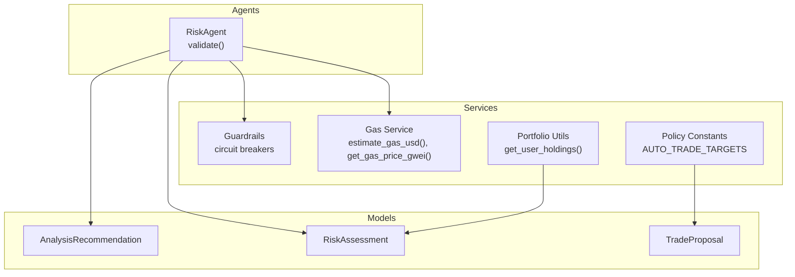
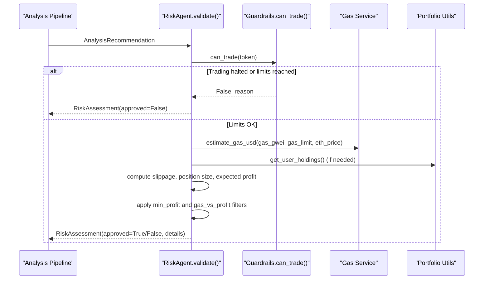
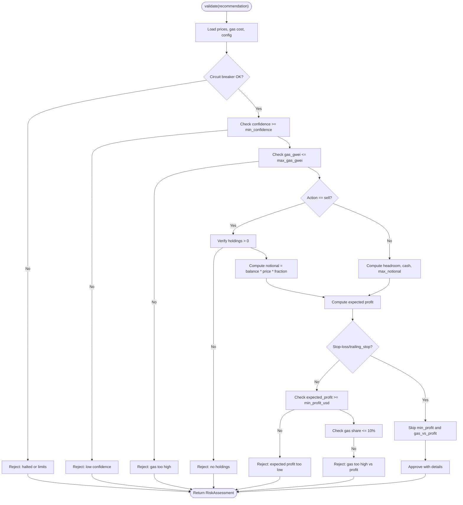
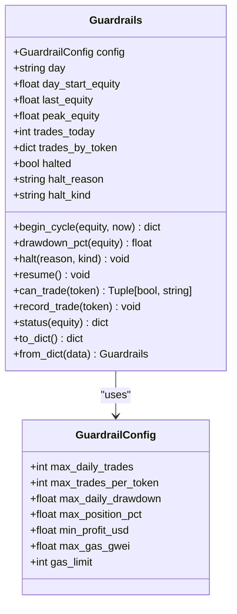
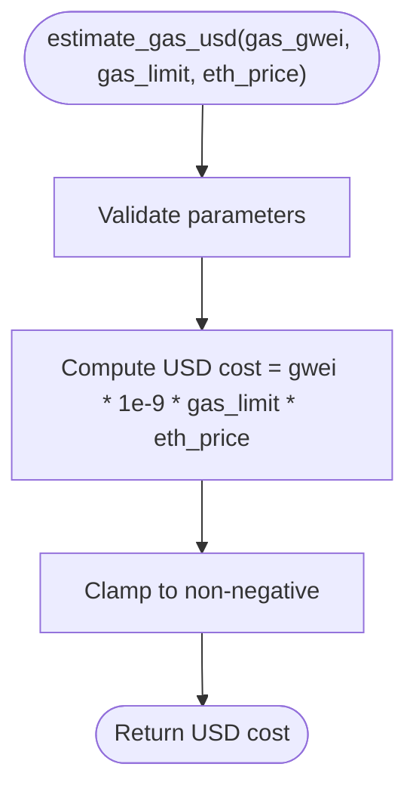
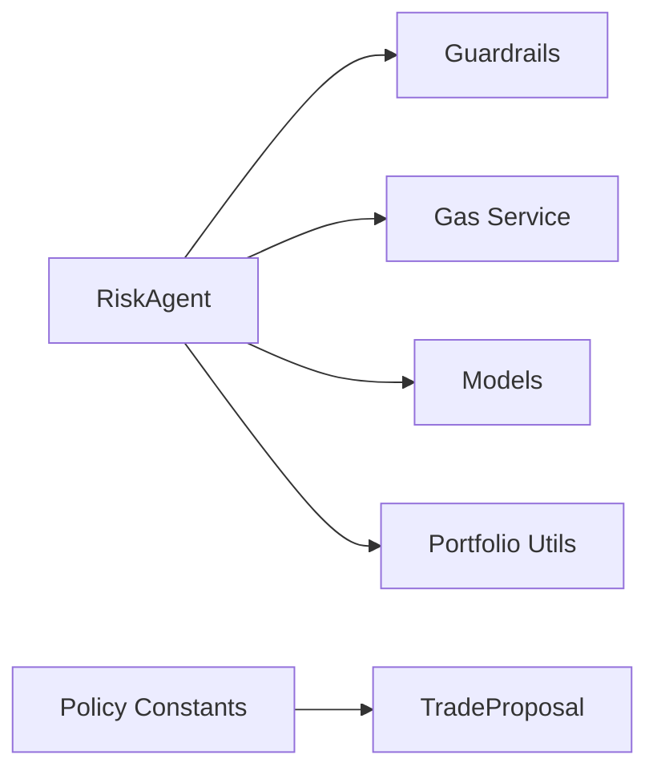

# Risk Agent

<cite>
**Referenced Files in This Document**
- [risk_agent.py](file://backend/app/agents/risk_agent.py)
- [guardrails.py](file://backend/app/services/guardrails.py)
- [gas.py](file://backend/app/services/gas.py)
- [agents.py](file://backend/app/models/agents.py)
- [policy.py](file://backend/app/services/policy.py)
- [portfolio.py](file://backend/app/services/portfolio.py)
- [test_risk_agent.py](file://backend/test_risk_agent.py)
- [test_guardrails.py](file://backend/test_guardrails.py)
</cite>

## Table of Contents
1. [Introduction](#introduction)
2. [Project Structure](#project-structure)
3. [Core Components](#core-components)
4. [Architecture Overview](#architecture-overview)
5. [Detailed Component Analysis](#detailed-component-analysis)
6. [Dependency Analysis](#dependency-analysis)
7. [Performance Considerations](#performance-considerations)
8. [Troubleshooting Guide](#troubleshooting-guide)
9. [Conclusion](#conclusion)
10. [Appendices](#appendices)

## Introduction
The Risk agent is the safety and validation layer for trade proposals generated by the analysis pipeline. It evaluates whether a proposed buy or sell should proceed, how large it should be, what slippage to expect, and whether gas costs are justified. It also enforces portfolio-level guardrails such as daily drawdown protection, daily trade limits, per-token trade caps, and an emergency kill switch.

Its responsibilities include:
- Confidence scoring validation against a minimum threshold.
- Position sizing and exposure checks based on portfolio value, existing holdings, and available cash.
- Gas price awareness and cost optimization through USD-based gas cost estimation.
- Circuit breaker enforcement via the guardrails system.
- Automated rejection criteria with detailed check-by-check diagnostics.
- Stop-loss and trailing-stop exemptions that prioritize capital preservation over profit filters.

This document explains the risk assessment algorithms, configuration thresholds, automated rejection rules, position sizing logic, and integration points with the broader risk management framework.

## Project Structure
The risk-related code spans agents, services, models, and tests:
- The Risk agent implementation lives under the agents package.
- Portfolio-level circuit breakers and drawdown tracking live in the guardrails service.
- Gas price fetching and USD cost estimation are provided by the gas service.
- Shared data models define recommendations, assessments, and trade proposals.
- Policy constants define auto-tradeable targets and stablecoins.
- Portfolio utilities compute current holdings from executed trades.
- Unit tests validate core behaviors of the Risk agent and Guardrails.

**Diagram sources**
- [risk_agent.py:8-214](file://backend/app/agents/risk_agent.py#L8-L214)
- [guardrails.py:16-164](file://backend/app/services/guardrails.py#L16-L164)
- [gas.py:20-59](file://backend/app/services/gas.py#L20-L59)
- [agents.py:25-72](file://backend/app/models/agents.py#L25-L72)
- [policy.py:6-11](file://backend/app/services/policy.py#L6-L11)
- [portfolio.py:59-92](file://backend/app/services/portfolio.py#L59-L92)

**Section sources**
- [risk_agent.py:8-214](file://backend/app/agents/risk_agent.py#L8-L214)
- [guardrails.py:16-164](file://backend/app/services/guardrails.py#L16-L164)
- [gas.py:20-59](file://backend/app/services/gas.py#L20-L59)
- [agents.py:25-72](file://backend/app/models/agents.py#L25-L72)
- [policy.py:6-11](file://backend/app/services/policy.py#L6-L11)
- [portfolio.py:59-92](file://backend/app/services/portfolio.py#L59-L92)

## Core Components
- RiskAgent: Validates trade proposals, computes dynamic slippage, estimates gas costs, sizes positions, and applies profit and gas-to-profit filters.
- Guardrails: Tracks daily equity, drawdowns, trade counts, and enforces circuit breakers including manual halt and daily drawdown halt.
- Gas Service: Estimates USD gas cost and fetches live gas prices with caching and fallback behavior.
- Models: Define structured inputs and outputs for recommendations, assessments, and trade proposals.
- Policy: Provides shared constants for auto-tradeable tokens and stablecoins.
- Portfolio Utilities: Compute user holdings from executed trades to inform position sizing.

Key behaviors:
- Confidence gating prevents low-confidence trades from proceeding.
- Gas cap prevents execution when gas prices exceed configured thresholds.
- Position sizing respects portfolio percentage caps, headroom, and available cash.
- Min-profit and gas-vs-profit filters ensure trades are economically viable.
- Stop-loss and trailing-stop exits bypass min-profit checks to protect capital.
- Dynamic slippage adapts to market volatility and volume spikes.

**Section sources**
- [risk_agent.py:8-214](file://backend/app/agents/risk_agent.py#L8-L214)
- [guardrails.py:16-164](file://backend/app/services/guardrails.py#L16-L164)
- [gas.py:20-59](file://backend/app/services/gas.py#L20-L59)
- [agents.py:25-72](file://backend/app/models/agents.py#L25-L72)
- [policy.py:6-11](file://backend/app/services/policy.py#L6-L11)
- [portfolio.py:59-92](file://backend/app/services/portfolio.py#L59-L92)

## Architecture Overview
The Risk agent integrates with the analysis pipeline and guardrails to form a layered risk management system:

**Diagram sources**
- [risk_agent.py:24-190](file://backend/app/agents/risk_agent.py#L24-L190)
- [guardrails.py:92-112](file://backend/app/services/guardrails.py#L92-L112)
- [gas.py:20-24](file://backend/app/services/gas.py#L20-L24)
- [portfolio.py:59-92](file://backend/app/services/portfolio.py#L59-L92)

## Detailed Component Analysis

### RiskAgent
The Risk agent performs a sequence of checks and returns a structured RiskAssessment containing approval status, reasons, slippage, gas metrics, expected profit, and per-check diagnostics.

Primary workflow:
- Initialize defaults for confidence threshold, slippage bounds, gas limit, and ETH price fallback.
- Load market prices and compute USD gas cost using the gas service.
- Enforce circuit breakers via guardrails; reject immediately if trading is halted or limits are exceeded.
- Validate confidence against the minimum threshold.
- Check gas price against configured maximum gwei.
- For sells, verify holdings exist and compute notional based on sell fraction.
- For buys, compute max notional considering portfolio percentage cap, headroom, and available cash.
- Calculate expected profit:
  - Sells use gain_pct when present; stop-loss and trailing-stop are exempt from min-profit checks.
  - Buys assume reaching the first ladder rung with a default positive expectation.
- Apply min-profit filter and gas-vs-profit ratio filter unless exempt.
- Return approved assessment with computed slippage, gas, expected profit, and max notional.

Dynamic slippage:
- Base slippage depends on absolute price change thresholds.
- Volume spike adds a fixed increment.
- Slippage is capped at an absolute maximum.

Position sizing:
- Sell notional equals balance multiplied by price and sell fraction.
- Buy notional is constrained by:
  - A per-step target percentage of portfolio value.
  - Headroom relative to the configured maximum position percentage.
  - Available cash multiplied by a conservative factor.
- Minimum notional ensures trades are above dust thresholds.

Profit and gas filters:
- Expected profit must meet a configured minimum USD amount.
- Gas cost must not exceed a percentage of expected profit.
- Stop-loss and trailing-stop exits bypass these filters to prioritize capital protection.

**Diagram sources**
- [risk_agent.py:24-190](file://backend/app/agents/risk_agent.py#L24-L190)

**Section sources**
- [risk_agent.py:8-214](file://backend/app/agents/risk_agent.py#L8-L214)

### Guardrails System
Guardrails implement portfolio-level circuit breakers independent of strategy decisions. They track:
- Daily trade count and per-token trade count.
- Daily start equity, last equity, peak equity.
- Drawdown percentage and automatic halt when drawdown breaches a configured threshold.
- Manual halt (kill switch) and resume functionality.
- Status reporting and serialization for persistence.

Key operations:
- begin_cycle updates day boundaries, resets counters, and triggers drawdown halt if breached.
- can_trade checks halt state, daily trade limit, and per-token trade limit.
- record_trade increments counters for audit and enforcement.
- status returns a comprehensive snapshot of guardrail state.
- to_dict/from_dict support persistence and restoration.

**Diagram sources**
- [guardrails.py:16-164](file://backend/app/services/guardrails.py#L16-L164)

**Section sources**
- [guardrails.py:16-164](file://backend/app/services/guardrails.py#L16-L164)

### Gas Price Awareness and Cost Optimization
The gas service provides:
- USD gas cost estimation based on gwei, gas limit, and ETH price.
- Live gas price fetching from an RPC endpoint with caching and fallback behavior.
- Conservative defaults to avoid halting the agent loop due to RPC failures.

Integration:
- Risk agent uses estimated gas cost to enforce gas-vs-profit ratio and to report gas metrics in assessments.
- Guardrails config includes a maximum gas gwei threshold to prevent expensive executions.

**Diagram sources**
- [gas.py:20-24](file://backend/app/services/gas.py#L20-L24)

**Section sources**
- [gas.py:20-59](file://backend/app/services/gas.py#L20-L59)

### Models and Data Contracts
- AnalysisRecommendation: Encapsulates token, action, confidence, price, indicators, and exit metadata.
- RiskAssessment: Encapsulates approval decision, reasons, slippage, gas metrics, expected profit, and per-check diagnostics.
- TradeProposal: Represents a trade with status, timestamps, and economic fields.
- PollingConfig and AgentStatus: Support agent lifecycle and monitoring.

These models standardize communication between analysis, risk, and execution layers.

**Section sources**
- [agents.py:5-72](file://backend/app/models/agents.py#L5-L72)

### Portfolio Constraints and Holdings
Portfolio utilities compute current holdings from executed trades, supporting:
- New format where selling reduces base token amount.
- Legacy format compatibility.
- Cleanup of small residuals and negatives.

Risk agent uses holdings to validate sells and compute position sizing for buys.

**Section sources**
- [portfolio.py:59-92](file://backend/app/services/portfolio.py#L59-L92)

### Policy Constants
Shared policy constants define auto-tradeable targets and stablecoins, ensuring consistency across backend and frontend executors.

**Section sources**
- [policy.py:6-11](file://backend/app/services/policy.py#L6-L11)

## Dependency Analysis
The Risk agent depends on:
- Guardrails for circuit breaker enforcement and drawdown protection.
- Gas service for USD cost estimation and live gas price fetching.
- Models for structured input/output contracts.
- Portfolio utilities for holdings computation.
- Policy constants for auto-tradeable targets.

**Diagram sources**
- [risk_agent.py:8-214](file://backend/app/agents/risk_agent.py#L8-L214)
- [guardrails.py:16-164](file://backend/app/services/guardrails.py#L16-L164)
- [gas.py:20-59](file://backend/app/services/gas.py#L20-L59)
- [agents.py:25-72](file://backend/app/models/agents.py#L25-L72)
- [portfolio.py:59-92](file://backend/app/services/portfolio.py#L59-L92)
- [policy.py:6-11](file://backend/app/services/policy.py#L6-L11)

**Section sources**
- [risk_agent.py:8-214](file://backend/app/agents/risk_agent.py#L8-L214)
- [guardrails.py:16-164](file://backend/app/services/guardrails.py#L16-L164)
- [gas.py:20-59](file://backend/app/services/gas.py#L20-L59)
- [agents.py:25-72](file://backend/app/models/agents.py#L25-L72)
- [portfolio.py:59-92](file://backend/app/services/portfolio.py#L59-L92)
- [policy.py:6-11](file://backend/app/services/policy.py#L6-L11)

## Performance Considerations
- Gas price fetching is cached for a short interval to reduce RPC load and latency.
- Fallback values prevent agent loops from stalling due to network issues.
- Position sizing calculations are O(1) and rely on simple arithmetic.
- Guardrails maintain lightweight counters and dictionaries for fast checks.
- Risk agent returns detailed checks to enable efficient UI feedback without additional queries.

## Troubleshooting Guide
Common rejection reasons and their causes:
- Circuit breaker halted:
  - Manual kill switch engaged or daily drawdown breach.
  - Check guardrails status and halt reason.
- Low confidence:
  - Recommendation confidence below minimum threshold.
  - Review analysis signals and thresholds.
- Gas price too high:
  - Current gwei exceeds configured maximum.
  - Monitor chain congestion and adjust thresholds.
- No holdings for sell:
  - Attempting to sell a token not held.
  - Verify portfolio holdings and trade history.
- Position cap reached:
  - Existing position plus proposed size exceeds portfolio percentage cap.
  - Reduce size or wait for position reduction.
- Expected profit too low:
  - Notional size or gain_pct insufficient to meet minimum USD profit.
  - Increase position size or focus on higher-probability setups.
- Gas cost too high relative to profit:
  - Gas share exceeds allowed percentage of expected profit.
  - Wait for lower gas prices or increase expected profit.

Validation examples:
- Tests confirm buy sizing and approval, gas cap blocking, kill switch blocking, position cap exhaustion, min-profit blocking for small portfolios, sell without holdings rejection, stop-loss exemption, and dynamic slippage scaling.

**Section sources**
- [test_risk_agent.py:53-103](file://backend/test_risk_agent.py#L53-L103)
- [test_guardrails.py:10-59](file://backend/test_guardrails.py#L10-L59)

## Conclusion
The Risk agent provides a robust, configurable safety layer that protects portfolios through confidence gating, position sizing constraints, gas-aware cost optimization, and circuit breaker enforcement. Its integration with guardrails ensures portfolio-level protections such as daily drawdown limits and trade caps. By returning detailed check-by-check diagnostics, it enables transparent decision-making and auditability. The design balances aggressiveness with prudence, allowing profitable opportunities while preventing excessive risk exposure.

## Appendices

### Configuration Reference
- Risk agent defaults:
  - Minimum confidence threshold.
  - Base and absolute maximum slippage.
  - Gas limit and ETH price fallback.
- Guardrails configuration:
  - Maximum daily trades.
  - Maximum trades per token.
  - Maximum daily drawdown.
  - Maximum position percentage.
  - Minimum USD profit.
  - Maximum gas gwei.
  - Gas limit.

**Section sources**
- [risk_agent.py:15-21](file://backend/app/agents/risk_agent.py#L15-L21)
- [guardrails.py:16-24](file://backend/app/services/guardrails.py#L16-L24)

### Example Scenarios
- High volatility buy:
  - Dynamic slippage increases due to large price changes.
  - Position sizing constrained by portfolio cap and headroom.
- Stop-loss sell:
  - Exempt from min-profit and gas-vs-profit filters.
  - Prioritizes capital preservation.
- Kill switch engagement:
  - All trades blocked until resumed manually.
- Daily drawdown halt:
  - Automatic halt triggered when equity drops below configured threshold.

**Section sources**
- [risk_agent.py:203-214](file://backend/app/agents/risk_agent.py#L203-L214)
- [risk_agent.py:132-174](file://backend/app/agents/risk_agent.py#L132-L174)
- [guardrails.py:46-71](file://backend/app/services/guardrails.py#L46-L71)
- [guardrails.py:81-89](file://backend/app/services/guardrails.py#L81-L89)