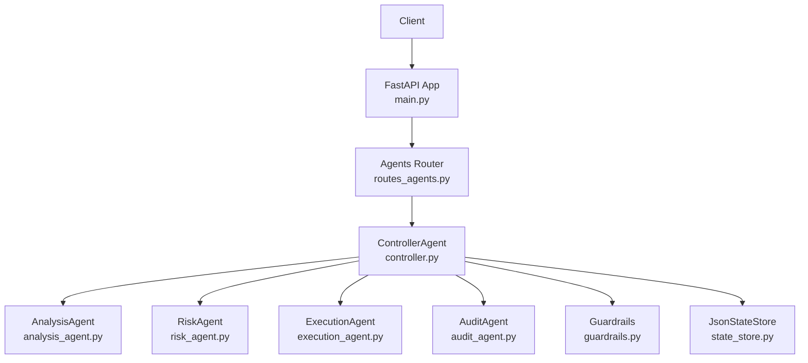
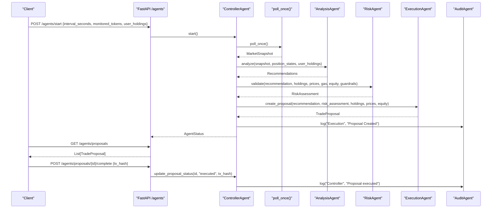
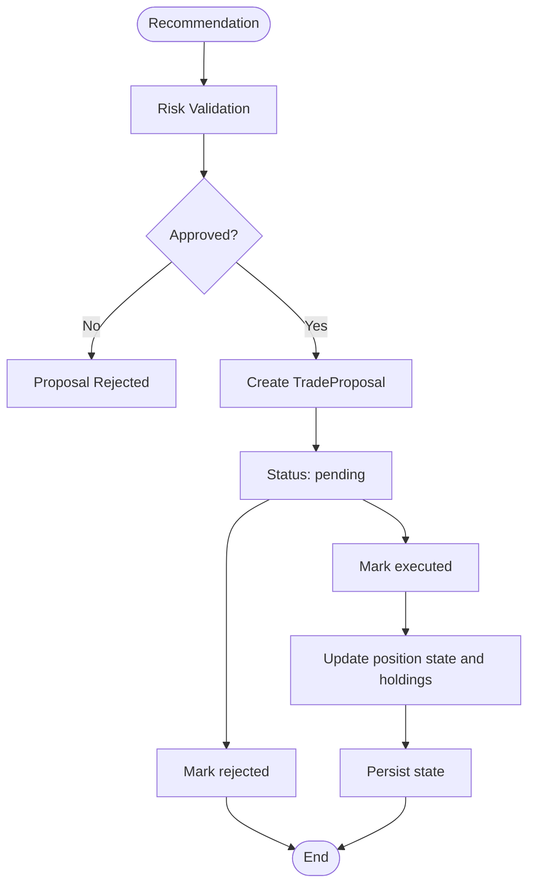

# Agent Control API

<cite>
**Referenced Files in This Document**
- [main.py](file://backend/app/main.py)
- [routes_agents.py](file://backend/app/api/routes_agents.py)
- [controller.py](file://backend/app/agents/controller.py)
- [agents.py](file://backend/app/models/agents.py)
- [state_store.py](file://backend/app/services/state_store.py)
- [langchain_signals.py](file://backend/app/agents/langchain_signals.py)
- [signals.py](file://backend/app/models/signals.py)
- [analysis_agent.py](file://backend/app/agents/analysis_agent.py)
- [risk_agent.py](file://backend/app/agents/risk_agent.py)
- [execution_agent.py](file://backend/app/agents/execution_agent.py)
- [audit_agent.py](file://backend/app/agents/audit_agent.py)
- [guardrails.py](file://backend/app/services/guardrails.py)
</cite>

## Table of Contents
1. [Introduction](#introduction)
2. [Project Structure](#project-structure)
3. [Core Components](#core-components)
4. [Architecture Overview](#architecture-overview)
5. [Agent Control Endpoints](#agent-control-endpoints)
6. [Proposal Workflow and State Management](#proposal-workflow-and-state-management)
7. [Audit Logs and Monitoring](#audit-logs-and-monitoring)
8. [LangChain Integration for LLM Signals](#langchain-integration-for-llm-signals)
9. [State Persistence and Recovery](#state-persistence-and-recovery)
10. [Security, Rate Limiting, and Operational Controls](#security-rate-limiting-and-operational-controls)
11. [Troubleshooting Guide](#troubleshooting-guide)
12. [Conclusion](#conclusion)

## Introduction
This document describes the Agent Control API used to start, stop, monitor, and control the trading agent lifecycle. It covers:
- HTTP endpoints under `/agents`
- Request and response schemas for controlling agents, proposals, and audit logs
- Agent state management, proposal workflow, and real-time status updates
- Practical operations such as triggering analysis cycles, reviewing trade proposals, approving or rejecting trades, and monitoring agent health
- Integration with LangChain for LLM-powered signals
- State persistence mechanisms, security considerations, rate limiting guidance, and debugging approaches

The backend is a FastAPI application that mounts the agent routes under the `/agents` prefix. The controller coordinates market data polling, rule-based analysis, risk validation, execution proposal creation, guardrail enforcement, and audit logging.

## Project Structure
The Agent Control API lives in the backend FastAPI application:
- Routes are defined in `routes_agents.py`
- Business logic is implemented by `ControllerAgent` in `controller.py`
- Data models are defined in `models/agents.py`
- State persistence uses `services/state_store.py`
- Audit logging is provided by `agents/audit_agent.py`
- Guardrails provide portfolio-level circuit breakers via `services/guardrails.py`
- Analysis, risk, and execution logic are split into dedicated agents
- LangChain signal generation utilities live in `agents/langchain_signals.py`

**Diagram sources**
- [main.py:34-38](file://backend/app/main.py#L34-L38)
- [routes_agents.py:1-150](file://backend/app/api/routes_agents.py#L1-L150)
- [controller.py:24-72](file://backend/app/agents/controller.py#L24-L72)

**Section sources**
- [main.py:1-60](file://backend/app/main.py#L1-L60)
- [routes_agents.py:1-150](file://backend/app/api/routes_agents.py#L1-L150)

## Core Components
- **ControllerAgent**: Orchestrates the agent lifecycle, maintains proposals, position states, holdings, guardrails, and audit logs. It exposes methods for starting/stopping, halting/resuming, querying status, updating proposals, and persisting state.
- **AnalysisAgent**: Produces buy/sell/hold recommendations based on technical indicators, price changes, volume spikes, and position state.
- **RiskAgent**: Validates recommendations against confidence thresholds, gas costs, position sizing, profit expectations, and guardrail constraints.
- **ExecutionAgent**: Converts approved recommendations into human-reviewable trade proposals with amounts, slippage, gas estimates, and optional auto-trade flags.
- **AuditAgent**: Maintains an in-memory log buffer and writes structured audit entries to a rotating file.
- **Guardrails**: Portfolio-level circuit breakers including daily drawdown limits, per-token trade limits, kill switch, and configuration exposure.
- **JsonStateStore**: Thread-safe JSON file storage with atomic saves and configurable directory via environment variable.

**Section sources**
- [controller.py:24-72](file://backend/app/agents/controller.py#L24-L72)
- [analysis_agent.py:10-18](file://backend/app/agents/analysis_agent.py#L10-L18)
- [risk_agent.py:8-22](file://backend/app/agents/risk_agent.py#L8-L22)
- [execution_agent.py:9-25](file://backend/app/agents/execution_agent.py#L9-L25)
- [audit_agent.py:33-64](file://backend/app/agents/audit_agent.py#L33-L64)
- [guardrails.py:16-39](file://backend/app/services/guardrails.py#L16-L39)
- [state_store.py:22-59](file://backend/app/services/state_store.py#L22-L59)

## Architecture Overview
The agent control flow follows this sequence:
1. A client calls `/agents/start` with polling configuration.
2. The controller starts its background loop, fetching market snapshots.
3. The analysis agent generates recommendations.
4. The risk agent validates recommendations.
5. The execution agent creates trade proposals.
6. Proposals are exposed via `/agents/proposals`.
7. Clients approve/reject proposals through completion or rejection endpoints.
8. Executed proposals update positions, holdings, guardrails, and audit logs.
9. Status and state endpoints expose real-time metrics and indicator summaries.

**Diagram sources**
- [routes_agents.py:30-63](file://backend/app/api/routes_agents.py#L30-L63)
- [controller.py:224-266](file://backend/app/agents/controller.py#L224-L266)
- [controller.py:499-674](file://backend/app/agents/controller.py#L499-L674)
- [execution_agent.py:58-179](file://backend/app/agents/execution_agent.py#L58-L179)
- [audit_agent.py:39-60](file://backend/app/agents/audit_agent.py#L39-L60)

## Agent Control Endpoints
All endpoints are mounted under `/agents`.

### Start Agents
- **Method**: `POST`
- **URL**: `/agents/start`
- **Request Body**: `PollingConfig`
  - `interval_seconds`: int (default 60)
  - `monitored_tokens`: Optional list of strings
  - `user_holdings`: Optional dict mapping symbol to amount
  - `agent_cache_duration`: Optional int seconds
- **Response**: `AgentStatus`
- **Behavior**:
  - Updates polling interval, monitored tokens, and user holdings if provided
  - Starts the controller’s background loop
  - Returns current agent status

**Section sources**
- [routes_agents.py:30-39](file://backend/app/api/routes_agents.py#L30-L39)
- [agents.py:5-10](file://backend/app/models/agents.py#L5-L10)
- [agents.py:11-24](file://backend/app/models/agents.py#L11-L24)
- [controller.py:224-266](file://backend/app/agents/controller.py#L224-L266)

### Stop Agents
- **Method**: `POST`
- **URL**: `/agents/stop`
- **Request Body**: None
- **Response**: `AgentStatus`
- **Behavior**: Stops the controller loop and returns updated status.

**Section sources**
- [routes_agents.py:42-45](file://backend/app/api/routes_agents.py#L42-L45)
- [controller.py:231-233](file://backend/app/agents/controller.py#L231-L233)

### Halt Agents (Kill Switch)
- **Method**: `POST`
- **URL**: `/agents/halt`
- **Request Body**: Optional `HaltRequest`
  - `reason`: string (default "Manual kill switch")
- **Response**: `AgentStatus`
- **Behavior**: Engages guardrail halt and persists state.

**Section sources**
- [routes_agents.py:48-52](file://backend/app/api/routes_agents.py#L48-L52)
- [controller.py:235-238](file://backend/app/agents/controller.py#L235-L238)
- [guardrails.py:81-89](file://backend/app/services/guardrails.py#L81-L89)

### Resume Agents
- **Method**: `POST`
- **URL**: `/agents/resume`
- **Request Body**: None
- **Response**: `AgentStatus`
- **Behavior**: Clears guardrail halt and persists state.

**Section sources**
- [routes_agents.py:55-58](file://backend/app/api/routes_agents.py#L55-L58)
- [controller.py:240-243](file://backend/app/agents/controller.py#L240-L243)
- [guardrails.py:86-89](file://backend/app/services/guardrails.py#L86-L89)

### Get Agent Status
- **Method**: `GET`
- **URL**: `/agents/status`
- **Response**: `AgentStatus`
- **Behavior**: Returns running flag, current step, last run time, monitored tokens, holdings, halted state, equity, drawdown, and trade counts.

**Section sources**
- [routes_agents.py:61-63](file://backend/app/api/routes_agents.py#L61-L63)
- [controller.py:245-260](file://backend/app/agents/controller.py#L245-L260)
- [agents.py:11-24](file://backend/app/models/agents.py#L11-L24)

### Get Detailed State
- **Method**: `GET`
- **URL**: `/agents/state`
- **Response**: Dict containing:
  - Guardrail status
  - Positions with average entry, buy step, peak price, cumulative sold
  - Indicator summaries per monitored token
- **Behavior**: Aggregates guardrail and indicator state for dashboard consumption.

**Section sources**
- [routes_agents.py:66-84](file://backend/app/api/routes_agents.py#L66-L84)
- [controller.py:265-266](file://backend/app/agents/controller.py#L265-L266)

### Update Holdings
- **Method**: `POST`
- **URL**: `/agents/holdings`
- **Request Body**: Dict mapping symbol to float amount
- **Response**: Dict with status and holdings
- **Behavior**: Updates injected holdings; in demo mode, returns actual demo portfolio holdings.

**Section sources**
- [routes_agents.py:20-27](file://backend/app/api/routes_agents.py#L20-L27)
- [controller.py:402-413](file://backend/app/agents/controller.py#L402-L413)

### Get Proposals
- **Method**: `GET`
- **URL**: `/agents/proposals`
- **Response**: List of `TradeProposal`
- **Behavior**: Returns all proposals currently held by the controller.

**Section sources**
- [routes_agents.py:87-89](file://backend/app/api/routes_agents.py#L87-L89)
- [controller.py:262-263](file://backend/app/agents/controller.py#L262-L263)
- [agents.py:54-73](file://backend/app/models/agents.py#L54-L73)

### Complete Proposal (Approve/Execute)
- **Method**: `POST`
- **URL**: `/agents/proposals/{proposal_id}/complete`
- **Request Body**: Optional `CompleteRequest`
  - `tx_hash`: Optional string
- **Query Parameter**: Legacy `tx_hash` supported
- **Response**: Dict with status and tx_hash
- **Behavior**: Marks proposal as executed; in demo mode applies virtual fill and updates positions; otherwise records execution and updates guardrails and position state.

**Section sources**
- [routes_agents.py:97-110](file://backend/app/api/routes_agents.py#L97-L110)
- [controller.py:296-330](file://backend/app/agents/controller.py#L296-L330)
- [execution_agent.py:28-56](file://backend/app/agents/execution_agent.py#L28-L56)

### Reject Proposal
- **Method**: `POST`
- **URL**: `/agents/proposals/{proposal_id}/reject`
- **Request Body**: None
- **Response**: Dict with status
- **Behavior**: Marks proposal as rejected.

**Section sources**
- [routes_agents.py:113-116](file://backend/app/api/routes_agents.py#L113-L116)
- [controller.py:296-330](file://backend/app/agents/controller.py#L296-L330)

### Generate Report
- **Method**: `POST`
- **URL**: `/agents/report`
- **Request Body**: None
- **Response**: Dict with summary text
- **Behavior**: Summarizes total proposals, executed count, pending count, and details of executed trades.

**Section sources**
- [routes_agents.py:119-138](file://backend/app/api/routes_agents.py#L119-L138)

### Update Agent Cache Duration
- **Method**: `POST`
- **URL**: `/agents/config/cache-duration`
- **Request Body**: Integer duration in seconds
- **Response**: Dict with status and new cache duration
- **Behavior**: Calls internal function to set agent cache duration; raises 400 on invalid values.

**Section sources**
- [routes_agents.py:141-149](file://backend/app/api/routes_agents.py#L141-L149)

## Proposal Workflow and State Management
Proposals follow a controlled lifecycle:
- Creation: After analysis and risk approval, the execution agent creates a proposal with id, token, action, amount, price, slippage, gas limit, timestamps, and optional fields like sell fraction and exit kind.
- Pending: New proposals default to pending.
- Approved/Rejected: UI can approve by marking executed or reject explicitly.
- Executed: Marking executed triggers position updates, guardrail trade counting, and optional demo fills.

**Diagram sources**
- [controller.py:647-666](file://backend/app/agents/controller.py#L647-L666)
- [controller.py:296-330](file://backend/app/agents/controller.py#L296-L330)
- [execution_agent.py:58-179](file://backend/app/agents/execution_agent.py#L58-L179)

**Section sources**
- [controller.py:296-400](file://backend/app/agents/controller.py#L296-L400)
- [execution_agent.py:58-179](file://backend/app/agents/execution_agent.py#L58-L179)
- [agents.py:54-73](file://backend/app/models/agents.py#L54-L73)

## Audit Logs and Monitoring
- **Get Logs**: `GET /agents/logs` returns recent audit entries sorted by timestamp descending.
- **Audit Entries**: Include timestamp, agent name, message, level, and optional data payload.
- **File Logging**: Rotating file handler writes to `agents.log` in the backend root directory.
- **In-Memory Buffer**: Keeps up to 1000 entries for quick access.

Practical usage:
- Monitor agent lifecycle events: start, stop, halt, resume
- Track proposal creation, execution, and rejection
- Inspect risk checks and guardrail decisions
- Review errors from market data fetching and loop exceptions

**Section sources**
- [routes_agents.py:92-94](file://backend/app/api/routes_agents.py#L92-L94)
- [audit_agent.py:33-64](file://backend/app/agents/audit_agent.py#L33-L64)
- [controller.py:676-678](file://backend/app/agents/controller.py#L676-L678)

## LangChain Integration for LLM Signals
LangChain utilities provide LLM-powered signal generation:
- `build_signal_chain` constructs a prompt template with format instructions and parses outputs into a Pydantic model.
- `generate_signals_with_langchain` sends a mini snapshot to an OpenAI-compatible LLM and returns structured signals.
- `generate_signals_with_deepseek` directly calls DeepSeek API and parses JSON responses into signals.

Signal model:
- `pair`: token pair
- `action`: buy, sell, or hold
- `confidence`: float between 0.0 and 1.0
- `explanation`: optional reasoning
- `source`: llm, rules, or deepseek
- `created_at`: timestamp

Note: The controller’s main loop currently uses rule-based analysis. LLM signals are available as utilities and can be integrated into the analysis pipeline if desired.

**Section sources**
- [langchain_signals.py:19-58](file://backend/app/agents/langchain_signals.py#L19-L58)
- [langchain_signals.py:61-123](file://backend/app/agents/langchain_signals.py#L61-L123)
- [signals.py:9-16](file://backend/app/models/signals.py#L9-L16)

## State Persistence and Recovery
The controller persists:
- Position states (average entry, buy steps, peak price, cumulative sold, exit metadata)
- Recent proposals (up to 200)
- Last trade times per token
- Guardrails state (day, equity, drawdown, trade counts, halt state)

Persistence mechanics:
- Uses `JsonStateStore` with thread-safe locking
- Atomic save via temporary file and `os.replace`
- Configurable directory via `DEXTRADER_STATE_DIR`; defaults to backend root
- On startup, reconstructs state from persisted data and/or trade ledger

Recovery behavior:
- In non-demo mode, reconstructs positions from recorded trades
- In demo mode, seeds holdings and positions from demo portfolio fills
- Restores guardrails and proposals while filtering invalid entries

**Section sources**
- [controller.py:74-125](file://backend/app/agents/controller.py#L74-L125)
- [controller.py:127-221](file://backend/app/agents/controller.py#L127-L221)
- [state_store.py:15-59](file://backend/app/services/state_store.py#L15-L59)

## Security, Rate Limiting, and Operational Controls
Security considerations:
- CORS origins are configurable via `CORS_ORIGINS`; default allows local development origins only.
- No authentication middleware is present in the shown code; protect the API behind a reverse proxy or add authentication before exposing externally.
- Kill switch (`/agents/halt`) provides immediate operational safety to prevent new trades.
- Guardrails enforce daily drawdown limits, per-token trade limits, and maximum gas caps.

Rate limiting:
- Not built into the shown routes. Implement rate limiting at the gateway or via middleware if needed.
- The controller enforces internal cooldowns for duplicate proposals and repeated buy/sell actions per token.

Operational controls:
- Start/Stop/Halt/Resume endpoints allow full lifecycle control.
- `/agents/state` exposes detailed guardrail and indicator state for dashboards.
- `/agents/report` summarizes proposal outcomes.

**Section sources**
- [main.py:16-32](file://backend/app/main.py#L16-L32)
- [routes_agents.py:48-58](file://backend/app/api/routes_agents.py#L48-L58)
- [controller.py:601-617](file://backend/app/agents/controller.py#L601-L617)
- [guardrails.py:16-39](file://backend/app/services/guardrails.py#L16-L39)

## Troubleshooting Guide
Common issues and diagnostics:
- Market data fetch failures: The controller logs errors and retries after a delay. Check `/agents/logs` for error messages.
- Halted state: If guardrails halt trading due to drawdown or manual kill switch, use `/agents/resume` after addressing the cause.
- Duplicate proposals: The controller skips duplicates for the same token when already pending.
- Demo mode behavior: In demo mode, holdings come from the demo portfolio; injecting holdings via `/agents/holdings` is ignored.
- State corruption: `JsonStateStore` handles read/write errors gracefully; inspect the state file path and permissions.

Debugging approach:
- Use `/agents/status` to check running state, current step, and last run time.
- Use `/agents/state` to inspect guardrails, positions, and indicators.
- Use `/agents/logs` to review recent audit entries.
- Enable verbose prints in the controller loop for detailed analysis and risk logs.

**Section sources**
- [controller.py:544-550](file://backend/app/agents/controller.py#L544-L550)
- [controller.py:676-678](file://backend/app/agents/controller.py#L676-L678)
- [routes_agents.py:61-84](file://backend/app/api/routes_agents.py#L61-L84)
- [routes_agents.py:92-94](file://backend/app/api/routes_agents.py#L92-L94)

## Conclusion
The Agent Control API provides comprehensive lifecycle management for the trading agent system. Operators can start and stop agents, engage kill switches, monitor real-time status and state, manage trade proposals, and review audit logs. The architecture separates concerns across analysis, risk, execution, and audit components, with robust state persistence and guardrail enforcement. For production deployments, add authentication, authorization, and rate limiting at the gateway layer, and consider integrating LLM signals into the analysis pipeline where appropriate.