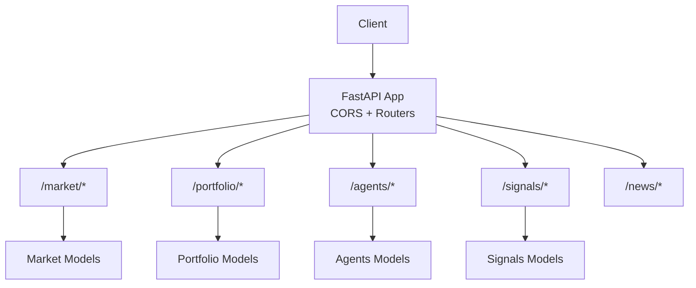
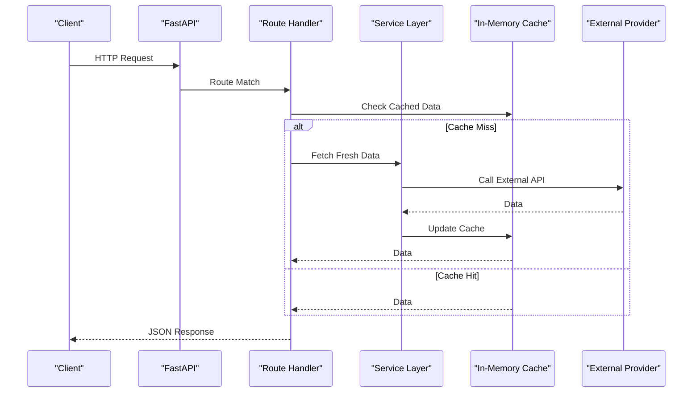
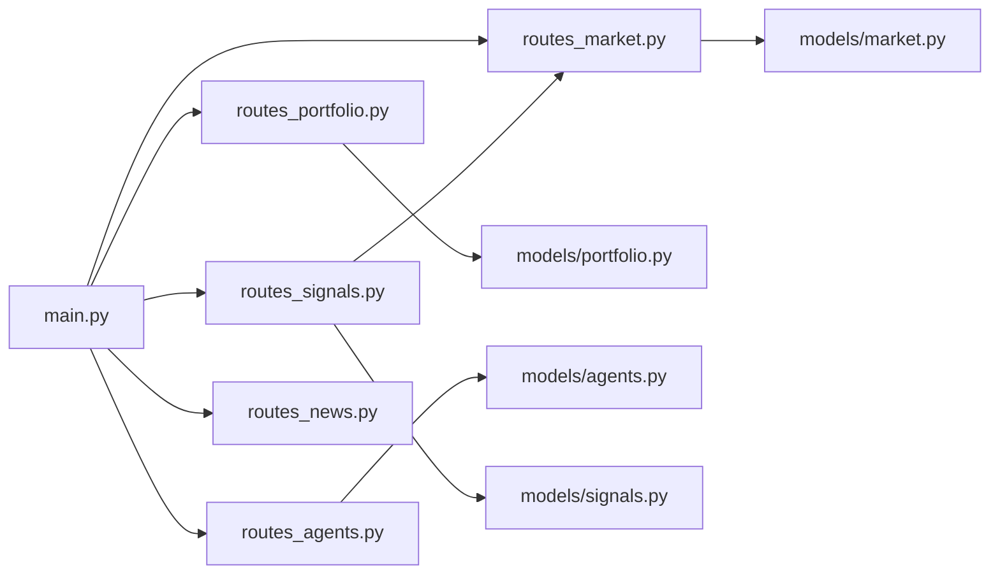

# Backend API Reference

<cite>
**Referenced Files in This Document**
- [main.py](file://backend/app/main.py)
- [config.py](file://backend/app/core/config.py)
- [routes_market.py](file://backend/app/api/routes_market.py)
- [routes_portfolio.py](file://backend/app/api/routes_portfolio.py)
- [routes_agents.py](file://backend/app/api/routes_agents.py)
- [routes_signals.py](file://backend/app/api/routes_signals.py)
- [routes_news.py](file://backend/app/api/routes_news.py)
- [market.py](file://backend/app/models/market.py)
- [portfolio.py](file://backend/app/models/portfolio.py)
- [agents.py](file://backend/app/models/agents.py)
- [signals.py](file://backend/app/models/signals.py)
</cite>

## Table of Contents
1. [Introduction](#introduction)
2. [Project Structure](#project-structure)
3. [Core Components](#core-components)
4. [Architecture Overview](#architecture-overview)
5. [Detailed Component Analysis](#detailed-component-analysis)
6. [Dependency Analysis](#dependency-analysis)
7. [Performance Considerations](#performance-considerations)
8. [Troubleshooting Guide](#troubleshooting-guide)
9. [Conclusion](#conclusion)

## Introduction
This document provides a comprehensive API reference for the DexTrader backend. It covers all HTTP endpoints exposed by FastAPI, including Market data, Portfolio management, Agents control, Signals generation, and News RSS aggregation. For each endpoint, you will find:
- HTTP method and URL pattern
- Request parameters and body schema
- Response schema
- Authentication requirements
- Rate limiting behavior
- Error responses
- Practical usage examples and integration patterns

The backend is built with FastAPI and exposes REST endpoints under versioned prefixes such as `/market`, `/portfolio`, `/agents`, `/signals`, and `/news`. A health check endpoint is also available at `/health`.

## Project Structure
The backend application is organized into:
- Application entry point and middleware configuration
- API route modules per domain
- Pydantic models for request/response schemas
- Services for external integrations (market data, news feeds, portfolio persistence)
- Agent controllers and state management

**Diagram sources**
- [main.py:14-38](file://backend/app/main.py#L14-L38)

**Section sources**
- [main.py:14-38](file://backend/app/main.py#L14-L38)

## Core Components
- Market API: Provides market snapshots, gainers/losers, base tokens, and token volumes with caching and rate-limit-aware fallbacks.
- Portfolio API: Manages holdings, records trades, lists and exports trade history, and supports demo mode.
- Agents API: Controls the trading loop lifecycle, monitors status/state, manages proposals, and exposes logs and reports.
- Signals API: Generates trading recommendations using LLM providers or rule-based evaluation.
- News API: Aggregates RSS feeds from multiple crypto news sources with in-memory caching.

Key shared behaviors:
- CORS is configured via environment variable `CORS_ORIGINS`.
- Demo mode toggles certain behaviors based on `DEMO_MODE`.
- External provider calls are cached to reduce latency and avoid rate limits.

**Section sources**
- [main.py:14-38](file://backend/app/main.py#L14-L38)
- [config.py:9-15](file://backend/app/core/config.py#L9-L15)

## Architecture Overview
The API layer delegates to services and agent controllers. Caching strategies protect against upstream rate limits and repeated network calls.

**Diagram sources**
- [routes_market.py:26-51](file://backend/app/api/routes_market.py#L26-L51)
- [routes_news.py:84-152](file://backend/app/api/routes_news.py#L84-L152)

## Detailed Component Analysis

### Market API
Base path: `/market`

Endpoints:
- GET `/market/`
  - Purpose: Retrieve a snapshot of trading pairs.
  - Query parameters:
    - `limit`: integer, default 50, range 1–500
    - `refresh`: boolean, default false; forces cache refresh
  - Response: `MarketSnapshot`
  - Authentication: None
  - Rate limiting: Uses in-memory cache with 1-hour TTL; concurrent requests share work via lock.
  - Errors: None expected from this endpoint itself.

- GET `/market/gainers-losers`
  - Purpose: Return top gainers and losers sorted by 24h change.
  - Query parameters:
    - `limit`: integer, default 10, range 1–100
    - `refresh`: boolean, default false
  - Response: `GainersLosers`
  - Authentication: None
  - Rate limiting: Shares cache with `/market/`.

- GET `/market/base-tokens`
  - Purpose: Get base token rankings sorted by market cap or volume.
  - Query parameters:
    - `sort_by`: enum `market_cap` or `volume_24h`, default `market_cap`
  - Response: `BaseTokenSnapshot`
  - Authentication: None
  - Rate limiting: Per-sort cache with 5-minute TTL; serves stale data on upstream 429.
  - Errors:
    - 502: Unable to fetch Base token market data (including when upstream errors occur and no valid cache exists).

- GET `/market/token-volumes`
  - Purpose: Retrieve 24h volumes for specific token addresses on a given chain.
  - Query parameters:
    - `chain_id`: integer, must be one of supported networks (e.g., 1=eth, 8453=base, 42161=arbitrum)
    - `addresses`: comma-separated list of EVM addresses (max 100), validated format
  - Response: `TokenVolumesSnapshot`
  - Authentication: None
  - Rate limiting: Per-address cache with 5-minute TTL; bounded LRU cache size.
  - Errors:
    - 422: Invalid query parameters (ambiguous params, unsupported chain_id, malformed addresses, oversized query string).
    - 502: Unable to fetch token volumes.

Response schemas:
- `MarketSnapshot`: `{ pairs: TradingPair[], timestamp?: number }`
- `TradingPair`: `{ base_symbol, quote_symbol, price, change_24h, volume_24h?, cmc_url? }`
- `GainersLosers`: `{ gainers: TradingPair[], losers: TradingPair[] }`
- `BaseTokenSnapshot`: `{ tokens: BaseToken[] }`
- `BaseToken`: `{ id, name, symbol, price, change_24h?, volume_24h?, market_cap? }`
- `TokenVolumesSnapshot`: `{ chain_id: number, volumes: { address: number|null } }`

Example calls:
- List market pairs (limit 20):
  - `GET /market/?limit=20`
- Force refresh market data:
  - `GET /market/?refresh=true`
- Top 5 gainers and losers:
  - `GET /market/gainers-losers?limit=5`
- Base tokens by volume:
  - `GET /market/base-tokens?sort_by=volume_24h`
- Token volumes on Ethereum:
  - `GET /market/token-volumes?chain_id=1&addresses=0x...A,0x...B`

Integration notes:
- Use `refresh=true` sparingly to avoid upstream rate limits.
- Batch token volume queries to maximize cache hits.

**Section sources**
- [routes_market.py:53-67](file://backend/app/api/routes_market.py#L53-L67)
- [routes_market.py:82-109](file://backend/app/api/routes_market.py#L82-L109)
- [routes_market.py:121-172](file://backend/app/api/routes_market.py#L121-L172)
- [market.py:5-40](file://backend/app/models/market.py#L5-L40)

### Portfolio API
Base path: `/portfolio`

Endpoints:
- GET `/portfolio/demo`
  - Purpose: Return virtual portfolio summary in demo mode.
  - Authentication: None
  - Behavior: Returns 404 if demo mode is not enabled.
  - Response: Object containing portfolio summary fields plus `prices_available`.

- POST `/portfolio/demo/reset`
  - Purpose: Reset demo portfolio and related controller state.
  - Authentication: None
  - Behavior: Returns 404 if demo mode is not enabled.
  - Response: Summary object after reset.

- POST `/portfolio/holdings`
  - Purpose: Update user holdings in the controller.
  - Body: `{ [symbol]: number }`
  - Authentication: None
  - Response: `{ status: "updated", count: number }`

- GET `/portfolio/`
  - Purpose: Placeholder for wallet-based portfolio retrieval.
  - Query parameters:
    - `address`: required string
  - Response: `PortfolioSnapshot`
  - Authentication: None
  - Note: Current implementation returns empty positions.

- POST `/portfolio/trade`
  - Purpose: Record a trade execution.
  - Body: `TradeExecution`
  - Authentication: None
  - Behavior: In demo mode, returns 403 with guidance to use agents proposal completion.
  - Response: Echoes submitted `TradeExecution`.

- GET `/portfolio/trades`
  - Purpose: List recent trades with optional filters.
  - Query parameters:
    - `limit`: integer, default 100
    - `network`: string, optional filter
    - `action`: string, optional filter
    - `start_date`: integer timestamp, optional
    - `end_date`: integer timestamp, optional
  - Response: Array of `TradeExecution`
  - Authentication: None

- GET `/portfolio/trades/export`
  - Purpose: Export trades as CSV.
  - Query parameters:
    - `eth_price`: float, default 3000.0, must be > 0
  - Response: CSV file stream with attachment header.

- POST `/portfolio/trades/reload`
  - Purpose: Reload trades from persistent storage.
  - Authentication: None
  - Response: `{ status: "reloaded", count: number }`

- GET `/portfolio/trades/debug`
  - Purpose: Debug view of last 10 trades and total count.
  - Authentication: None
  - Response: `{ total_trades: number, recent_trades: [...] }`

Response schemas:
- `PortfolioSnapshot`: `{ address: string, positions: WalletPosition[] }`
- `WalletPosition`: `{ token_symbol, balance, value_usd, pnl_24h }`
- `TradeExecution`: `{ tx_hash, network, pair, action, amount, token, price, token_amount, network_fee, price_usd, status, timestamp }`

Example calls:
- Update holdings:
  - `POST /portfolio/holdings` with body `{ "ETH": 1.5, "USDC": 500.0 }`
- Record a trade:
  - `POST /portfolio/trade` with `TradeExecution` payload
- List trades filtered by network and time window:
  - `GET /portfolio/trades?network=base&action=sell&start_date=1710000000&end_date=1710086400&limit=50`
- Export CSV:
  - `GET /portfolio/trades/export?eth_price=3500.0`

Integration notes:
- In demo mode, do not call `/portfolio/trade`; instead complete proposals via `/agents/proposals/{id}/complete`.
- Use `/portfolio/trades/export` for reporting pipelines.

**Section sources**
- [routes_portfolio.py:41-60](file://backend/app/api/routes_portfolio.py#L41-L60)
- [routes_portfolio.py:63-68](file://backend/app/api/routes_portfolio.py#L63-L68)
- [routes_portfolio.py:70-72](file://backend/app/api/routes_portfolio.py#L70-L72)
- [routes_portfolio.py:75-96](file://backend/app/api/routes_portfolio.py#L75-L96)
- [routes_portfolio.py:99-154](file://backend/app/api/routes_portfolio.py#L99-L154)
- [portfolio.py:5-36](file://backend/app/models/portfolio.py#L5-L36)

### Agents API
Base path: `/agents`

Endpoints:
- POST `/agents/holdings`
  - Purpose: Dynamically update user holdings in the controller.
  - Body: `{ [symbol]: number }`
  - Authentication: None
  - Response: `{ status: "ok", holdings: ... }` or ignored in demo mode.

- POST `/agents/start`
  - Purpose: Start the polling loop with optional configuration.
  - Body: `PollingConfig`
  - Authentication: None
  - Response: `AgentStatus`

- POST `/agents/stop`
  - Purpose: Stop the polling loop.
  - Authentication: None
  - Response: `AgentStatus`

- POST `/agents/halt`
  - Purpose: Kill switch to stop opening new trades until resumed.
  - Body: Optional `{ reason: string }`
  - Authentication: None
  - Response: `AgentStatus`

- POST `/agents/resume`
  - Purpose: Resume after halt.
  - Authentication: None
  - Response: `AgentStatus`

- GET `/agents/status`
  - Purpose: Read current agent status.
  - Authentication: None
  - Response: `AgentStatus`

- GET `/agents/state`
  - Purpose: Guardrail and indicator state for dashboard.
  - Authentication: None
  - Response: Object with guardrail status, positions, and indicators.

- GET `/agents/proposals`
  - Purpose: List trade proposals.
  - Authentication: None
  - Response: Array of `TradeProposal`

- GET `/agents/logs`
  - Purpose: Retrieve audit logs.
  - Authentication: None
  - Response: Array of `AuditLog`

- POST `/agents/proposals/{proposal_id}/complete`
  - Purpose: Mark a proposal executed.
  - Path parameter: `proposal_id`
  - Body: Optional `{ tx_hash?: string }`
  - Legacy support: Also accepts `tx_hash` query param.
  - Authentication: None
  - Response: `{ status: "ok", tx_hash?: string }`

- POST `/agents/proposals/{proposal_id}/reject`
  - Purpose: Reject a proposal.
  - Path parameter: `proposal_id`
  - Authentication: None
  - Response: `{ status: "ok" }`

- POST `/agents/report`
  - Purpose: Generate a textual daily report summarizing proposals.
  - Authentication: None
  - Response: `{ summary: string }`

- POST `/agents/config/cache-duration`
  - Purpose: Update agent cache duration dynamically.
  - Body: `{ duration: number }`
  - Authentication: None
  - Response: `{ status: "ok", cache_duration: number }`
  - Errors:
    - 400: Invalid cache duration value.

Response schemas:
- `PollingConfig`: `{ interval_seconds: number, monitored_tokens?: string[], user_holdings?: { [symbol]: number }, agent_cache_duration?: number }`
- `AgentStatus`: `{ running: boolean, current_step?: string, last_run?: number, monitored_tokens?: string[], user_holdings?: { [symbol]: number }, halted: boolean, halt_reason?: string, equity?: number, day_start_equity?: number, drawdown_pct?: number, trades_today: number, max_daily_trades: number }`
- `TradeProposal`: `{ id, token, action, amount, price, pct_change?, reason?, slippage, gas_limit, status, timestamp, notional_usd, expected_profit_usd, gas_cost_usd, auto_tradeable, price_source, sell_fraction?, exit_kind? }`
- `AuditLog`: `{ timestamp: number, agent: string, message: string, level: "INFO"|"WARNING"|"ERROR", data?: object }`

Example calls:
- Start agents with custom polling interval:
  - `POST /agents/start` with `{ interval_seconds: 30, monitored_tokens: ["ETH/USDC"], user_holdings: { "ETH": 1.0, "USDC": 1000.0 } }`
- Halt agents:
  - `POST /agents/halt` with `{ reason: "Manual kill switch" }`
- Complete a proposal:
  - `POST /agents/proposals/abc123/complete` with `{ tx_hash: "0x..." }`
- Get logs:
  - `GET /agents/logs`

Integration notes:
- Use `/agents/status` and `/agents/state` to drive UI state and charts.
- Proposals flow: generate → review → complete/reject → record trade via portfolio or agents.

**Section sources**
- [routes_agents.py:20-27](file://backend/app/api/routes_agents.py#L20-L27)
- [routes_agents.py:30-58](file://backend/app/api/routes_agents.py#L30-L58)
- [routes_agents.py:61-84](file://backend/app/api/routes_agents.py#L61-L84)
- [routes_agents.py:87-116](file://backend/app/api/routes_agents.py#L87-L116)
- [routes_agents.py:119-149](file://backend/app/api/routes_agents.py#L119-L149)
- [agents.py:5-79](file://backend/app/models/agents.py#L5-L79)

### Signals API
Base path: `/signals`

Endpoints:
- GET `/signals` and GET `/signals/`
  - Purpose: Generate trading signals for market pairs.
  - Query parameters:
    - `limit`: integer, default 50, range 1–500
  - Response: Array of `Signal`
  - Authentication: None
  - Behavior:
    - Attempts DeepSeek first if configured; falls back to OpenAI if DeepSeek fails or is unavailable; finally uses rule-based evaluation.
    - Billing/quota errors from DeepSeek skip OpenAI fallback and use rules.
  - Errors: None expected from this endpoint itself.

Response schema:
- `Signal`: `{ pair, action: "buy"|"sell"|"hold", confidence: number, explanation?, source?: "llm"|"rules"|"deepseek", created_at? }`

Example calls:
- Get up to 100 signals:
  - `GET /signals?limit=100`

Integration notes:
- The endpoint reuses cached market data to minimize external calls.
- If LLM providers are unavailable, signals are still generated using deterministic rules.

**Section sources**
- [routes_signals.py:20-53](file://backend/app/api/routes_signals.py#L20-L53)
- [signals.py:5-15](file://backend/app/models/signals.py#L5-L15)

### News API
Base path: `/news`

Endpoints:
- GET `/news/feeds`
  - Purpose: Aggregate articles from configured RSS sources.
  - Query parameters:
    - `refresh`: boolean, default false; force fresh fetch
  - Response: Array of `FeedArticles`
  - Authentication: None
  - Rate limiting: In-memory cache with 30-minute TTL.
  - Errors: None expected from this endpoint itself; individual feed failures are logged and skipped.

Response schemas:
- `NewsArticle`: `{ title, link, published, source, summary?, thumbnail? }`
- `FeedArticles`: `{ source, articles: NewsArticle[] }`

Example calls:
- Get cached feeds:
  - `GET /news/feeds`
- Force refresh:
  - `GET /news/feeds?refresh=true`

Integration notes:
- Each feed returns up to 10 most recent entries.
- HTML tags are stripped and summaries truncated to 300 characters.

**Section sources**
- [routes_news.py:70-81](file://backend/app/api/routes_news.py#L70-L81)
- [routes_news.py:84-152](file://backend/app/api/routes_news.py#L84-L152)
- [routes_news.py:155-162](file://backend/app/api/routes_news.py#L155-L162)

### Health Endpoint
- GET `/health`
  - Purpose: Basic liveness probe and demo mode indicator.
  - Response: `{ status: "ok", demo: boolean }`
  - Authentication: None

**Section sources**
- [main.py:57-59](file://backend/app/main.py#L57-L59)

## Dependency Analysis
The following diagram shows how routes depend on models and shared services.

**Diagram sources**
- [main.py:7-11](file://backend/app/main.py#L7-L11)
- [routes_signals.py:8-11](file://backend/app/api/routes_signals.py#L8-L11)

**Section sources**
- [main.py:7-11](file://backend/app/main.py#L7-L11)
- [routes_signals.py:8-11](file://backend/app/api/routes_signals.py#L8-L11)

## Performance Considerations
- Market data cache: 1-hour TTL with concurrency lock to prevent thundering herd.
- Base tokens cache: 5-minute TTL per sort key; serves stale data on upstream 429.
- Token volumes cache: 5-minute TTL per address; bounded LRU to limit memory growth.
- News feeds cache: 30-minute TTL across all sources.
- Signals endpoint leverages cached market data and short-circuits to rule-based evaluation when LLM providers fail.

Recommendations:
- Avoid frequent `refresh=true` calls to respect upstream rate limits.
- Batch token volume queries to improve cache hit rates.
- Monitor `/agents/status` and `/agents/state` to tune polling intervals and monitor performance.

[No sources needed since this section provides general guidance]

## Troubleshooting Guide
Common issues and resolutions:
- 422 Invalid token volume query:
  - Ensure `chain_id` is a single numeric value and one of supported networks.
  - Validate that `addresses` contains up to 100 well-formed EVM addresses.
- 502 Unable to fetch Base token market data:
  - Upstream provider may be down or rate-limited; retry later or rely on cached ranking.
- 502 Unable to fetch token volumes:
  - Temporary provider error; retry later.
- 403 Demo mode: real trade recording is disabled:
  - Use `/agents/proposals/{id}/complete` to simulate fills in demo mode.
- 404 Demo mode is not enabled:
  - Enable demo mode via environment configuration.

Debugging tips:
- Use `/portfolio/trades/debug` to inspect recent trades.
- Use `/agents/logs` to review audit trail.
- Use `/agents/state` to verify guardrails and indicators.

**Section sources**
- [routes_market.py:121-172](file://backend/app/api/routes_market.py#L121-L172)
- [routes_portfolio.py:75-96](file://backend/app/api/routes_portfolio.py#L75-L96)
- [routes_portfolio.py:140-154](file://backend/app/api/routes_portfolio.py#L140-L154)
- [routes_agents.py:92-94](file://backend/app/api/routes_agents.py#L92-L94)
- [routes_agents.py:66-84](file://backend/app/api/routes_agents.py#L66-L84)

## Conclusion
The DexTrader backend exposes a clear set of REST APIs for market data, portfolio operations, agent control, signal generation, and news aggregation. Endpoints are designed with caching and resilience in mind, providing practical defaults while allowing explicit overrides where necessary. Clients should integrate with these APIs using the documented schemas and follow best practices around rate limiting and error handling.

[No sources needed since this section summarizes without analyzing specific files]