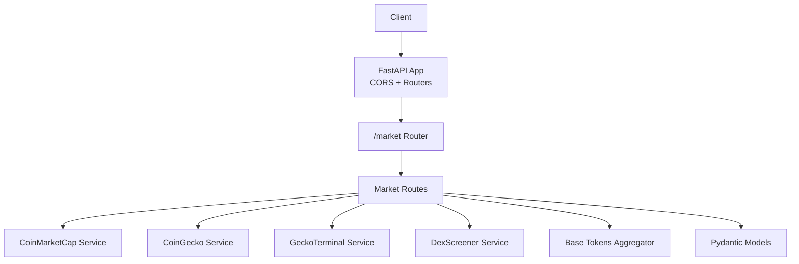
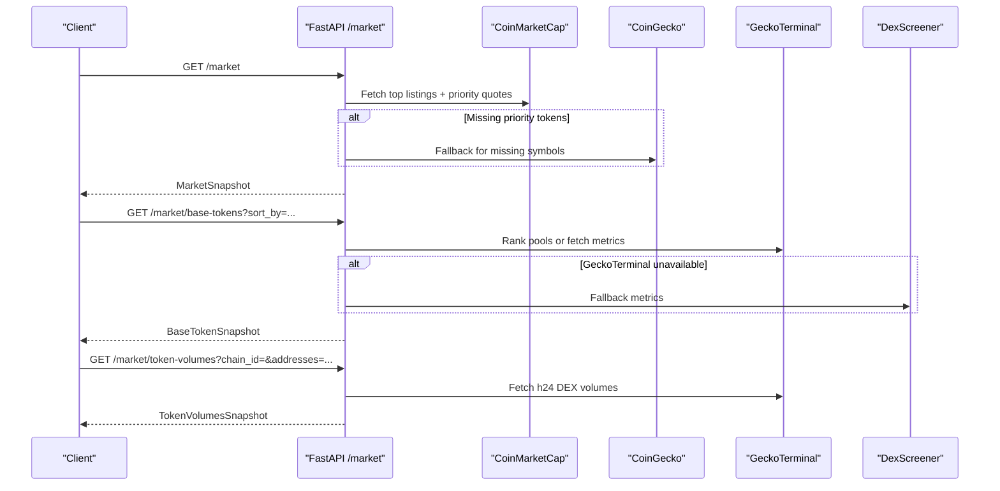
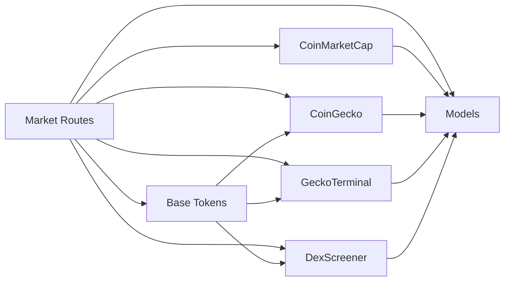

# Market Data API

<cite>
**Referenced Files in This Document**
- [main.py](file://backend/app/main.py)
- [routes_market.py](file://backend/app/api/routes_market.py)
- [market.py](file://backend/app/models/market.py)
- [config.py](file://backend/app/core/config.py)
- [coinmarketcap.py](file://backend/app/services/coinmarketcap.py)
- [coingecko.py](file://backend/app/services/coingecko.py)
- [geckoterminal.py](file://backend/app/services/geckoterminal.py)
- [dexscreener.py](file://backend/app/services/dexscreener.py)
- [base_tokens.py](file://backend/app/services/base_tokens.py)
</cite>

## Table of Contents
1. [Introduction](#introduction)
2. [Project Structure](#project-structure)
3. [Core Components](#core-components)
4. [Architecture Overview](#architecture-overview)
5. [Detailed Component Analysis](#detailed-component-analysis)
6. [Dependency Analysis](#dependency-analysis)
7. [Performance Considerations](#performance-considerations)
8. [Troubleshooting Guide](#troubleshooting-guide)
9. [Conclusion](#conclusion)

## Introduction
This document describes the Market Data API exposed by the backend service. It covers endpoints for retrieving token prices and market statistics, gainers and losers lists, base tokens configuration, and token volume analysis. It also documents how the system aggregates data from multiple providers (CoinGecko, CoinMarketCap, DexScreener, GeckoTerminal), including caching, rate limiting, error handling, authentication requirements, CORS configuration, and performance optimization tips.

The API is implemented with FastAPI and exposes routes under the `/market` prefix. Responses are validated against Pydantic models to ensure consistent schemas.

## Project Structure
The market data feature spans API routes, request/response models, and provider integration services:

- API routes define HTTP endpoints and apply caching and validation.
- Models define response schemas for market snapshots, gainers/losers, base tokens, and volumes.
- Services integrate external market data providers and aggregate results.
- The application entrypoint configures CORS and pre-populates caches on startup.

**Diagram sources**
- [main.py:14-38](file://backend/app/main.py#L14-L38)
- [routes_market.py:15-58](file://backend/app/api/routes_market.py#L15-L58)
- [coinmarketcap.py:71-187](file://backend/app/services/coinmarketcap.py#L71-L187)
- [coingecko.py:69-135](file://backend/app/services/coingecko.py#L69-L135)
- [geckoterminal.py:149-176](file://backend/app/services/geckoterminal.py#L149-L176)
- [dexscreener.py:84-114](file://backend/app/services/dexscreener.py#L84-L114)
- [base_tokens.py:315-320](file://backend/app/services/base_tokens.py#L315-L320)

**Section sources**
- [main.py:14-38](file://backend/app/main.py#L14-L38)
- [routes_market.py:15-58](file://backend/app/api/routes_market.py#L15-L58)

## Core Components
- Market routes expose endpoints for market pairs, gainers/losers, base tokens, and token volumes.
- Models define structured responses for trading pairs, snapshots, and rankings.
- Provider services fetch data from external APIs and normalize it into common structures.
- Base tokens aggregator combines ecosystem candidates, chain-specific metrics, and price changes.

Key responsibilities:
- Route handlers validate inputs, enforce limits, and return typed responses.
- Caching reduces repeated calls to external providers.
- Error handling returns stable status codes and messages.
- Provider fallbacks improve resilience when one source is unavailable.

**Section sources**
- [routes_market.py:53-172](file://backend/app/api/routes_market.py#L53-L172)
- [market.py:5-41](file://backend/app/models/market.py#L5-L41)
- [coinmarketcap.py:71-187](file://backend/app/services/coinmarketcap.py#L71-L187)
- [coingecko.py:69-135](file://backend/app/services/coingecko.py#L69-L135)
- [geckoterminal.py:149-176](file://backend/app/services/geckoterminal.py#L149-L176)
- [dexscreener.py:84-114](file://backend/app/services/dexscreener.py#L84-L114)
- [base_tokens.py:173-320](file://backend/app/services/base_tokens.py#L173-L320)

## Architecture Overview
The Market Data API integrates four providers:

- CoinMarketCap: Top listings and quotes; optional priority symbol resolution via slugs or symbols.
- CoinGecko: Price and change data; used as a fallback for missing priority tokens and for Base ecosystem metadata.
- GeckoTerminal: Chain-specific DEX metrics and pool-based volume ranking on Base.
- DexScreener: Keyless fallback for Base token metrics when GeckoTerminal is unavailable.

Aggregation flow:
- Market pairs endpoint uses CoinMarketCap as primary and falls back to CoinGecko for missing priority tokens.
- Base tokens endpoint ranks tokens by FDV or 24h volume using GeckoTerminal where possible, falling back to DexScreener and candidate-based ranking.
- Token volumes endpoint queries GeckoTerminal for chain-local 24h DEX volumes per address.

**Diagram sources**
- [routes_market.py:53-172](file://backend/app/api/routes_market.py#L53-L172)
- [coinmarketcap.py:71-187](file://backend/app/services/coinmarketcap.py#L71-L187)
- [coingecko.py:69-135](file://backend/app/services/coingecko.py#L69-L135)
- [geckoterminal.py:149-176](file://backend/app/services/geckoterminal.py#L149-L176)
- [dexscreener.py:84-114](file://backend/app/services/dexscreener.py#L84-L114)
- [base_tokens.py:173-320](file://backend/app/services/base_tokens.py#L173-L320)

## Detailed Component Analysis

### Endpoints

#### GET /market
- Purpose: Retrieve a list of trading pairs with price, 24h change, and optional volume.
- Method: GET
- URL pattern: `/market`
- Query parameters:
  - `limit`: Integer between 1 and 500 (default 50). Limits the number of pairs returned.
  - `refresh`: Boolean. Forces a fresh fetch from providers instead of returning cached data.
- Response schema: `MarketSnapshot` containing a list of `TradingPair`.
- Behavior:
  - Uses an in-process cache with a 1-hour TTL to reduce provider calls.
  - On first call or refresh, fetches data from CoinMarketCap and falls back to CoinGecko for missing priority tokens.
  - Applies the requested limit to the aggregated result.

Example request:
- GET `/market?limit=20&refresh=false`

Example response:
- JSON object with `pairs` array of trading pair objects and optional `timestamp`.

Error handling:
- If provider calls fail, partial data may be returned if available; otherwise, errors propagate from services.

Rate limiting:
- Internal cache mitigates repeated requests.
- External provider rate limits are handled within services (see provider sections).

Caching strategy:
- Global cache stores aggregated pairs with timestamp; concurrent misses are serialized via an async lock.

**Section sources**
- [routes_market.py:17-58](file://backend/app/api/routes_market.py#L17-L58)
- [coinmarketcap.py:71-187](file://backend/app/services/coinmarketcap.py#L71-L187)
- [coingecko.py:69-135](file://backend/app/services/coingecko.py#L69-L135)
- [market.py:5-17](file://backend/app/models/market.py#L5-L17)

#### GET /market/gainers-losers
- Purpose: Return top gainers and losers sorted by 24h price change.
- Method: GET
- URL pattern: `/market/gainers-losers`
- Query parameters:
  - `limit`: Integer between 1 and 100 (default 10). Number of items per list.
  - `refresh`: Boolean. Forces a fresh fetch from providers.
- Response schema: `GainersLosers` containing two lists: `gainers` and `losers`.
- Behavior:
  - Reuses the same aggregated pairs as `/market`, sorts by `change_24h`, and slices the top N for each side.

Example request:
- GET `/market/gainers-losers?limit=10&refresh=false`

Example response:
- JSON object with `gainers` and `losers` arrays of trading pair objects.

Error handling:
- Same caching and provider behavior as `/market`.

**Section sources**
- [routes_market.py:61-67](file://backend/app/api/routes_market.py#L61-L67)
- [market.py:19-22](file://backend/app/models/market.py#L19-L22)

#### GET /market/base-tokens
- Purpose: Retrieve a ranked list of base tokens, either by market cap (FDV) or 24h volume.
- Method: GET
- URL pattern: `/market/base-tokens`
- Query parameters:
  - `sort_by`: Enum-like string, either `market_cap` or `volume_24h` (default `market_cap`).
- Response schema: `BaseTokenSnapshot` containing a list of `BaseToken`.
- Behavior:
  - Uses a separate cache per sort key with a 5-minute TTL.
  - For `market_cap`: ranks Base ecosystem candidates by FDV using GeckoTerminal metrics; falls back to DexScreener if needed.
  - For `volume_24h`: attempts GeckoTerminal pool-based ranking; falls back to candidate-based ranking if slow/unavailable.
  - Enriches with price changes from CoinGecko when possible.

Example request:
- GET `/market/base-tokens?sort_by=volume_24h`

Example response:
- JSON object with `tokens` array of base token objects including id, name, symbol, price, change_24h, volume_24h, and market_cap.

Error handling:
- Returns 502 if fetching base token market data fails and no usable cached snapshot exists.
- Serves stale cached data when rate limited to keep UI responsive.

Rate limiting:
- Internal cache prevents repeated provider calls within TTL.
- External provider rate limits are respected with retries and delays.

Caching strategy:
- Per-sort-key cache with timestamps; lock ensures single fetch per sort key.

**Section sources**
- [routes_market.py:70-109](file://backend/app/api/routes_market.py#L70-L109)
- [base_tokens.py:173-320](file://backend/app/services/base_tokens.py#L173-L320)
- [geckoterminal.py:149-176](file://backend/app/services/geckoterminal.py#L149-L176)
- [dexscreener.py:84-114](file://backend/app/services/dexscreener.py#L84-L114)
- [coingecko.py:250-302](file://backend/app/services/coingecko.py#L250-L302)
- [market.py:24-36](file://backend/app/models/market.py#L24-L36)

#### GET /market/token-volumes
- Purpose: Retrieve chain-local 24h DEX USD volumes for specified token addresses.
- Method: GET
- URL pattern: `/market/token-volumes`
- Query parameters:
  - `chain_id`: Required integer. Supported values map to networks: 1 (eth), 8453 (base), 42161 (arbitrum).
  - `addresses`: Required comma-separated list of Ethereum-style contract addresses (0x...). Max count enforced.
- Response schema: `TokenVolumesSnapshot` containing `chain_id` and a mapping from address to optional volume.
- Behavior:
  - Validates query length, parameter counts, numeric format, supported network, and address format.
  - Deduplicates and normalizes addresses to lowercase.
  - Uses an LRU-style cache keyed by `(chain_id, address)` with a 5-minute TTL and max entries.
  - Calls GeckoTerminal to fetch h24 volumes for missing addresses.

Example request:
- GET `/market/token-volumes?chain_id=8453&addresses=0xABCDEF1234567890abcdef1234567890abcdef12,0x1234567890ABCDEF1234567890ABCDEF12345678`

Example response:
- JSON object with `chain_id` and `volumes` mapping addresses to optional float volumes.

Error handling:
- Returns 422 for invalid queries or malformed addresses.
- Returns 502 if fetching token volumes fails.

Rate limiting:
- Internal cache reduces repeated calls; provider rate limits are handled within GeckoTerminal service.

Caching strategy:
- Ordered cache with move-to-end on access and eviction of oldest entries beyond max size.

**Section sources**
- [routes_market.py:112-172](file://backend/app/api/routes_market.py#L112-L172)
- [geckoterminal.py:165-176](file://backend/app/services/geckoterminal.py#L165-L176)
- [market.py:38-41](file://backend/app/models/market.py#L38-L41)

### Request and Response Schemas

#### TradingPair
- Fields:
  - `base_symbol`: String representing the base asset symbol.
  - `quote_symbol`: String representing the quote currency (e.g., USD).
  - `price`: Float price.
  - `change_24h`: Float percentage change over 24 hours.
  - `volume_24h`: Optional float 24h volume.
  - `cmc_url`: Optional string link to CoinMarketCap page.

#### MarketSnapshot
- Fields:
  - `pairs`: List of `TradingPair`.
  - `timestamp`: Optional float indicating snapshot time.

#### GainersLosers
- Fields:
  - `gainers`: List of `TradingPair` sorted by highest positive change.
  - `losers`: List of `TradingPair` sorted by most negative change.

#### BaseToken
- Fields:
  - `id`: String identifier (often CoinGecko coin id).
  - `name`: String token name.
  - `symbol`: Uppercased token symbol.
  - `price`: Float price.
  - `change_24h`: Optional float percentage change.
  - `volume_24h`: Optional float 24h volume.
  - `market_cap`: Optional float representing FDV or market cap depending on ranking method.

#### BaseTokenSnapshot
- Fields:
  - `tokens`: List of `BaseToken`.

#### TokenVolumesSnapshot
- Fields:
  - `chain_id`: Integer blockchain identifier.
  - `volumes`: Mapping from address string to optional float volume.

**Section sources**
- [market.py:5-41](file://backend/app/models/market.py#L5-L41)

### Provider Integration Details

#### CoinMarketCap
- Primary source for top listings and quotes.
- Supports trial (keyless) and pro endpoints; prefers pro when API key is configured.
- Priority symbols are ensured via batched symbol and slug lookups.
- Falls back to CoinGecko for any still-missing priority tokens.

Authentication:
- Uses `X-CMC_PRO_API_KEY` header when a key is present and not using trial path.

Rate limiting:
- Trial path is aggressively rate-limited; pro path raises limits.
- Batching minimizes request count.

**Section sources**
- [coinmarketcap.py:10-24](file://backend/app/services/coinmarketcap.py#L10-L24)
- [coinmarketcap.py:71-187](file://backend/app/services/coinmarketcap.py#L71-L187)
- [config.py:9-10](file://backend/app/core/config.py#L9-L10)

#### CoinGecko
- Provides price and change data; used as fallback for missing priority tokens and for Base ecosystem metadata.
- Supports demo API key via custom header.
- Implements retry-on-429 with respect to `Retry-After` header.

Authentication:
- Optional demo API key header `x-cg-demo-api-key`.

Rate limiting:
- One polite retry with delay capped at maximum threshold.

**Section sources**
- [coingecko.py:11-16](file://backend/app/services/coingecko.py#L11-L16)
- [coingecko.py:69-135](file://backend/app/services/coingecko.py#L69-L135)
- [coingecko.py:155-174](file://backend/app/services/coingecko.py#L155-L174)
- [config.py:10](file://backend/app/core/config.py#L10)

#### GeckoTerminal
- Provides chain-specific DEX metrics and pool-based volume ranking on Base.
- Includes Cloudflare-friendly headers and user-agent identification.
- Implements retry-on-429 and page delays to stay within public API limits.

Authentication:
- Public API; no key required.

Rate limiting:
- Retries once on 429; page polling includes delays.

**Section sources**
- [geckoterminal.py:9-23](file://backend/app/services/geckoterminal.py#L9-L23)
- [geckoterminal.py:110-118](file://backend/app/services/geckoterminal.py#L110-L118)
- [geckoterminal.py:149-176](file://backend/app/services/geckoterminal.py#L149-L176)
- [geckoterminal.py:195-241](file://backend/app/services/geckoterminal.py#L195-L241)

#### DexScreener
- Keyless fallback for Base token metrics when GeckoTerminal is unavailable.
- Reports chain-specific price, FDV, and 24h volume per pair; selects deepest pool per token.

Authentication:
- No key required.

Rate limiting:
- No explicit rate-limit handling; used as fallback only.

**Section sources**
- [dexscreener.py:1-6](file://backend/app/services/dexscreener.py#L1-L6)
- [dexscreener.py:84-114](file://backend/app/services/dexscreener.py#L84-L114)

### Authentication Requirements
- Market Data endpoints do not require client-side authentication.
- Provider keys are server-side environment variables:
  - `COINMARKETCAP_API_KEY`
  - `COINGECKO_API_KEY`
- Demo mode flag controls simulated portfolio behavior but does not affect market data endpoints.

**Section sources**
- [config.py:9-15](file://backend/app/core/config.py#L9-L15)

### CORS Configuration
- CORS middleware allows configurable origins via `CORS_ORIGINS`.
- Default origins include local development URLs.
- Credentials allowed unless wildcard origin is set.

**Section sources**
- [main.py:16-32](file://backend/app/main.py#L16-L32)

### Performance Optimization Tips
- Use `refresh=false` to leverage in-process caches for faster responses.
- Batch token volume requests by grouping addresses to minimize provider calls.
- Prefer pro endpoints for CoinMarketCap by setting an API key to avoid trial rate limits.
- Monitor provider availability; GeckoTerminal fallbacks ensure resilience.
- Tune cache durations based on expected update frequency and latency requirements.

[No sources needed since this section provides general guidance]

## Dependency Analysis
The market data pipeline depends on provider services and shared models:

**Diagram sources**
- [routes_market.py:10-13](file://backend/app/api/routes_market.py#L10-L13)
- [coinmarketcap.py:71-187](file://backend/app/services/coinmarketcap.py#L71-L187)
- [coingecko.py:69-135](file://backend/app/services/coingecko.py#L69-L135)
- [geckoterminal.py:149-176](file://backend/app/services/geckoterminal.py#L149-L176)
- [dexscreener.py:84-114](file://backend/app/services/dexscreener.py#L84-L114)
- [base_tokens.py:173-320](file://backend/app/services/base_tokens.py#L173-L320)

**Section sources**
- [routes_market.py:10-13](file://backend/app/api/routes_market.py#L10-L13)
- [base_tokens.py:173-320](file://backend/app/services/base_tokens.py#L173-L320)

## Performance Considerations
- In-process caches reduce external API calls:
  - Market pairs cache: 1 hour TTL.
  - Base tokens cache: 5 minutes TTL per sort key.
  - Token volumes cache: 5 minutes TTL with LRU eviction up to 1000 entries.
- Provider-level retries and delays mitigate transient failures and rate limits.
- Prefetching on startup initializes market data cache to avoid cold-start spikes.

**Section sources**
- [routes_market.py:17-24](file://backend/app/api/routes_market.py#L17-L24)
- [routes_market.py:70-73](file://backend/app/api/routes_market.py#L70-L73)
- [routes_market.py:112-118](file://backend/app/api/routes_market.py#L112-L118)
- [main.py:41-49](file://backend/app/main.py#L41-L49)

## Troubleshooting Guide
Common issues and resolutions:

- 422 Invalid token volume query:
  - Ensure `chain_id` is a supported integer and appears exactly once.
  - Ensure `addresses` is a single comma-separated string with valid Ethereum addresses.
  - Check total query string length does not exceed internal limits.

- 502 Unable to fetch Base token market data:
  - Indicates provider failure and absence of usable cached snapshot.
  - Retry after provider recovery; check logs for rate limiting or timeouts.

- 502 Unable to fetch token volumes:
  - GeckoTerminal may be unavailable or rate-limited.
  - Verify network connectivity and provider status; retry later.

- Partial or empty data:
  - Some providers may return incomplete payloads; services filter invalid entries.
  - Use `refresh=true` sparingly to force fresh data while respecting rate limits.

Provider-specific notes:
- CoinMarketCap trial path is heavily rate-limited; configure API key for higher limits.
- CoinGecko demo API requires correct header naming; verify environment variable presence.
- GeckoTerminal may challenge automated clients; ensure proper headers and user-agent.

**Section sources**
- [routes_market.py:76-79](file://backend/app/api/routes_market.py#L76-L79)
- [routes_market.py:93-109](file://backend/app/api/routes_market.py#L93-L109)
- [routes_market.py:127-140](file://backend/app/api/routes_market.py#L127-L140)
- [routes_market.py:156-159](file://backend/app/api/routes_market.py#L156-L159)
- [coingecko.py:85-90](file://backend/app/services/coingecko.py#L85-L90)
- [coinmarketcap.py:10-24](file://backend/app/services/coinmarketcap.py#L10-L24)
- [geckoterminal.py:18-23](file://backend/app/services/geckoterminal.py#L18-L23)

## Conclusion
The Market Data API provides robust endpoints for retrieving token prices, market statistics, gainers/losers, base tokens rankings, and token volumes. It aggregates data from multiple providers with resilient fallbacks, caching, and rate-limit handling. Clients can rely on consistent schemas and predictable error responses. For optimal performance, use caching strategies, batch requests, and configure provider keys where applicable.

[No sources needed since this section summarizes without analyzing specific files]