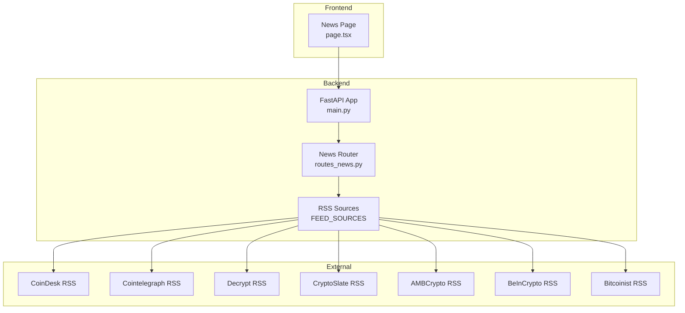
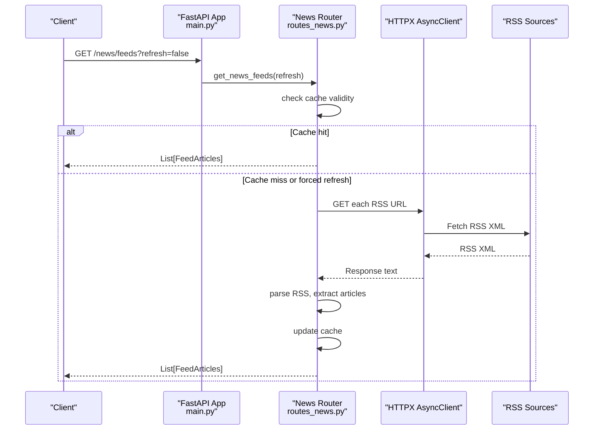
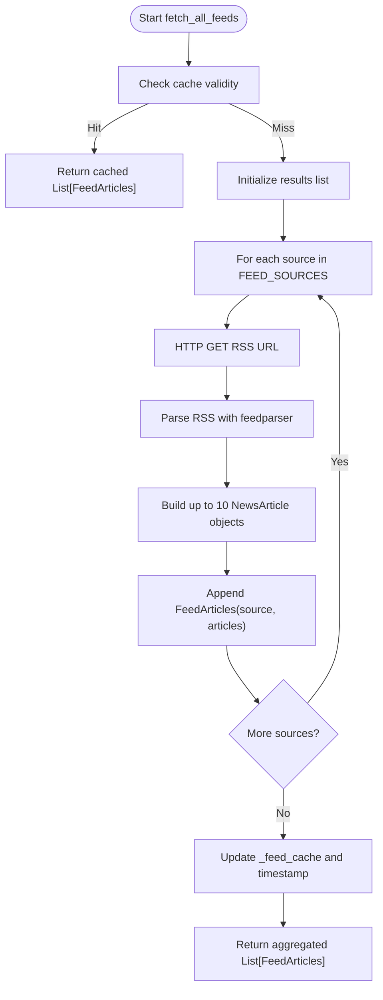
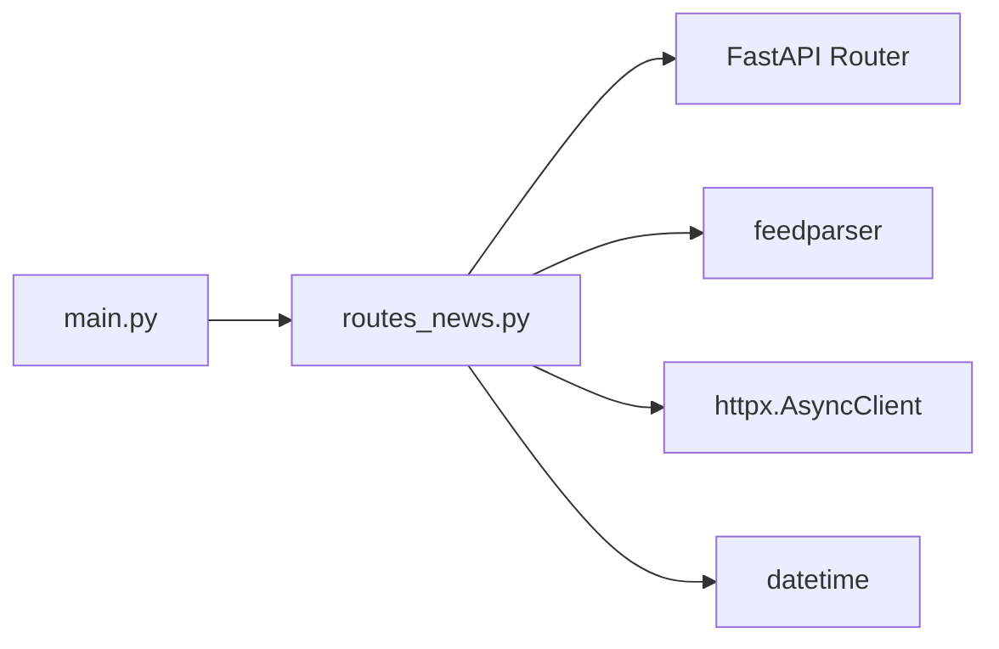

# News Feed API

<cite>
**Referenced Files in This Document**
- [routes_news.py](file://backend/app/api/routes_news.py)
- [main.py](file://backend/app/main.py)
- [guardrails.py](file://backend/app/services/guardrails.py)
- [page.tsx](file://frontend/app/news/page.tsx)
</cite>

## Table of Contents
1. [Introduction](#introduction)
2. [Project Structure](#project-structure)
3. [Core Components](#core-components)
4. [Architecture Overview](#architecture-overview)
5. [Detailed Component Analysis](#detailed-component-analysis)
6. [Dependency Analysis](#dependency-analysis)
7. [Performance Considerations](#performance-considerations)
8. [Troubleshooting Guide](#troubleshooting-guide)
9. [Conclusion](#conclusion)

## Introduction
This document describes the News Feed API that aggregates cryptocurrency news from multiple RSS sources, normalizes article metadata, and exposes a single endpoint for clients to retrieve grouped or filtered news content. It also explains the aggregation pipeline, caching behavior, source management, and how guardrails are integrated into the broader system.

The API is implemented with FastAPI and uses asynchronous HTTP requests to fetch RSS feeds, parsing them with feedparser. The frontend consumes this API to display news grouped by source or in chronological order.

## Project Structure
The News Feed feature spans backend routes, application startup logic, and a frontend page:

- Backend route module defines the API endpoint and aggregation logic.
- Application startup pre-populates caches to reduce cold-start latency.
- Frontend calls the API and provides client-side filtering and view modes.

**Diagram sources**
- [main.py:34-38](file://backend/app/main.py#L34-L38)
- [routes_news.py:58-67](file://backend/app/api/routes_news.py#L58-L67)
- [page.tsx:40-59](file://frontend/app/news/page.tsx#L40-L59)

**Section sources**
- [main.py:34-38](file://backend/app/main.py#L34-L38)
- [routes_news.py:58-67](file://backend/app/api/routes_news.py#L58-L67)
- [page.tsx:40-59](file://frontend/app/news/page.tsx#L40-L59)

## Core Components
- NewsRouter: Defines the /news/feeds endpoint and aggregation function.
- Data Models: NewsArticle and FeedArticles define response schemas.
- Aggregation Pipeline: Asynchronously fetches RSS feeds, parses entries, extracts summaries and thumbnails, and caps results per source.
- Cache: In-memory cache stores aggregated results for a configurable duration.
- Startup Pre-Population: On application startup, the aggregator runs once to warm the cache.

Key responsibilities:
- Normalize heterogeneous RSS fields into a consistent schema.
- Provide optional refresh control to bypass cache.
- Gracefully handle individual source failures without breaking the entire response.

**Section sources**
- [routes_news.py:70-82](file://backend/app/api/routes_news.py#L70-L82)
- [routes_news.py:84-152](file://backend/app/api/routes_news.py#L84-L152)
- [routes_news.py:155-163](file://backend/app/api/routes_news.py#L155-L163)
- [main.py:41-54](file://backend/app/main.py#L41-L54)

## Architecture Overview
The News Feed API follows a simple request-to-aggregation flow:

**Diagram sources**
- [routes_news.py:84-152](file://backend/app/api/routes_news.py#L84-L152)
- [routes_news.py:155-163](file://backend/app/api/routes_news.py#L155-L163)

## Detailed Component Analysis

### API Endpoint: GET /news/feeds
- Method: GET
- Path: /news/feeds
- Query Parameters:
  - refresh (boolean): If true, bypasses cache and forces a fresh fetch from all configured RSS sources. Default is false.
- Authentication: None
- Rate Limiting: Not implemented at the API layer.
- Response: Array of FeedArticles objects grouped by source.

Response Schema:
- FeedArticles:
  - source: string (name of the news source)
  - articles: array of NewsArticle
- NewsArticle:
  - title: string
  - link: string
  - published: string (normalized date string)
  - source: string
  - summary: string (HTML stripped, truncated)
  - thumbnail: string (URL if available)

Example Request:
- GET /news/feeds
- GET /news/feeds?refresh=true

Example Response:
- Array containing one FeedArticles object per configured source, each with up to 10 articles.

Notes:
- Each source returns at most 10 recent entries.
- If a source fails, its FeedArticles entry contains an empty articles list; other sources still succeed.

**Section sources**
- [routes_news.py:155-163](file://backend/app/api/routes_news.py#L155-L163)
- [routes_news.py:70-82](file://backend/app/api/routes_news.py#L70-L82)
- [routes_news.py:84-152](file://backend/app/api/routes_news.py#L84-L152)

### RSS Feed Aggregation Process
The aggregation pipeline performs the following steps:

1. Source Configuration:
   - FEED_SOURCES maps human-readable names to RSS URLs.
2. Cache Check:
   - If not forcing refresh and cache is within the configured TTL, return cached data.
3. Parallel Fetching:
   - Uses an async HTTP client to fetch all configured RSS URLs concurrently.
4. Parsing and Normalization:
   - Parses RSS XML using feedparser.
   - Extracts title, link, published date, and normalized summary.
   - Attempts to extract thumbnail from media_thumbnail, media_content, enclosures, or image fields.
5. Result Construction:
   - Builds NewsArticle objects and groups them under FeedArticles by source.
6. Cache Update:
   - Stores the aggregated result and timestamp for subsequent requests.

**Diagram sources**
- [routes_news.py:84-152](file://backend/app/api/routes_news.py#L84-L152)

**Section sources**
- [routes_news.py:58-67](file://backend/app/api/routes_news.py#L58-L67)
- [routes_news.py:84-152](file://backend/app/api/routes_news.py#L84-L152)

### Content Filtering and Search Capabilities
Server-Side:
- No server-side filtering or search parameters are exposed on the /news/feeds endpoint.
- Clients can filter by source and sort chronologically on the frontend.

Client-Side:
- The frontend supports:
  - Filtering by selected source.
  - View modes: grouped by source or chronological ordering.
  - Refresh button to force a new fetch.

Recommendation:
- If server-side filtering/search is required, extend the endpoint with query parameters such as source, keyword, and date range.

**Section sources**
- [page.tsx:62-85](file://frontend/app/news/page.tsx#L62-L85)
- [page.tsx:127-153](file://frontend/app/news/page.tsx#L127-L153)

### News Categorization System
Current Implementation:
- Articles are grouped by source name only.
- No explicit categorization tags or categories are extracted or exposed.

Recommendation:
- Introduce a category field in NewsArticle and populate it via keyword heuristics or external classification services.
- Expose a /news/categories endpoint to enumerate available categories and counts.

**Section sources**
- [routes_news.py:70-82](file://backend/app/api/routes_news.py#L70-L82)

### Guardrails Integration for Content Moderation
Guardrails Module Purpose:
- The guardrails service implements portfolio-level circuit breakers and risk controls for trading operations. It is not directly invoked by the News Feed API.

Integration Notes:
- While not part of the news aggregation pipeline, guardrails represent a broader moderation and safety mechanism in the system.
- If future content moderation is needed for news (e.g., blocking certain topics), a similar guardrail-style policy could be introduced to filter or halt specific news processing paths.

**Section sources**
- [guardrails.py:1-165](file://backend/app/services/guardrails.py#L1-L165)

### Caching Strategies
- In-Memory Cache:
  - Stores aggregated results in process memory.
  - TTL-based expiration controlled by CACHE_DURATION_MINUTES.
- Pre-Population:
  - On application startup, the aggregator runs once to warm the cache.
- Bypass Mechanism:
  - The refresh query parameter allows clients to force a full refresh.

Operational Implications:
- Cache is process-scoped; scaling horizontally requires a shared cache (e.g., Redis).
- Consider adding cache invalidation strategies based on source freshness or error rates.

**Section sources**
- [routes_news.py:10-13](file://backend/app/api/routes_news.py#L10-L13)
- [routes_news.py:90-98](file://backend/app/api/routes_news.py#L90-L98)
- [main.py:41-54](file://backend/app/main.py#L41-L54)

### Rate Limiting and Performance Optimization
Current State:
- No rate limiting is implemented at the API layer.
- Concurrent fetching reduces total latency across sources.
- Summary extraction strips HTML and truncates to a fixed length to minimize payload size.

Optimization Recommendations:
- Add rate limiting per IP or per client token.
- Implement pagination or limit parameters to cap returned articles.
- Use a distributed cache for horizontal scaling.
- Add retry/backoff policies for transient network errors.
- Monitor and log slow sources to optimize timeouts and concurrency.

**Section sources**
- [routes_news.py:100-146](file://backend/app/api/routes_news.py#L100-L146)
- [routes_news.py:34-54](file://backend/app/api/routes_news.py#L34-L54)

### Practical Examples

Request Examples:
- Retrieve latest aggregated news:
  - GET /news/feeds
- Force a fresh fetch from all sources:
  - GET /news/feeds?refresh=true

Response Format Example:
- Array of FeedArticles:
  - Each object includes:
    - source: string
    - articles: array of NewsArticle
      - title: string
      - link: string
      - published: string
      - source: string
      - summary: string
      - thumbnail: string

Filtering Options:
- Server-side: none currently.
- Client-side: filter by source and sort chronologically.

**Section sources**
- [routes_news.py:155-163](file://backend/app/api/routes_news.py#L155-L163)
- [routes_news.py:70-82](file://backend/app/api/routes_news.py#L70-L82)
- [page.tsx:62-85](file://frontend/app/news/page.tsx#L62-L85)

## Dependency Analysis
The News Feed API depends on:
- FastAPI router and models.
- feedparser for RSS parsing.
- httpx for asynchronous HTTP requests.
- datetime for cache timing.

**Diagram sources**
- [routes_news.py:1-8](file://backend/app/api/routes_news.py#L1-L8)
- [main.py:11-12](file://backend/app/main.py#L11-L12)

**Section sources**
- [routes_news.py:1-8](file://backend/app/api/routes_news.py#L1-L8)
- [main.py:11-12](file://backend/app/main.py#L11-L12)

## Performance Considerations
- Concurrency:
  - All RSS sources are fetched concurrently to minimize overall latency.
- Payload Size:
  - Summaries are stripped of HTML and truncated to reduce response size.
- Cache Hit Ratio:
  - Frequent reads benefit from the in-memory cache; consider increasing TTL or adding persistence for high-traffic deployments.
- Error Resilience:
  - Individual source failures do not fail the entire response; consumers should handle empty article lists per source.

[No sources needed since this section provides general guidance]

## Troubleshooting Guide
Common Issues:
- Empty Articles for a Source:
  - Indicates a failure fetching or parsing that specific RSS feed. Check logs for errors associated with that source.
- Stale Data:
  - If data appears outdated, use refresh=true to force a fresh fetch.
- Slow Responses:
  - Some sources may be slow; monitor timeouts and consider adjusting concurrency or timeouts.
- CORS Errors:
  - Ensure the frontend origin is allowed by CORS settings in the application configuration.

Debugging Tips:
- Inspect the health endpoint to verify application status.
- Review logs for feed fetch errors and timestamps.
- Validate RSS URLs and accessibility from the server environment.

**Section sources**
- [routes_news.py:140-146](file://backend/app/api/routes_news.py#L140-L146)
- [main.py:57-59](file://backend/app/main.py#L57-L59)

## Conclusion
The News Feed API provides a straightforward way to aggregate cryptocurrency news from multiple RSS sources, normalize article metadata, and serve grouped results to clients. It includes basic caching and robustness against individual source failures. Future enhancements can introduce server-side filtering, categorization, rate limiting, and persistent caching to improve scalability and usability.

[No sources needed since this section summarizes without analyzing specific files]