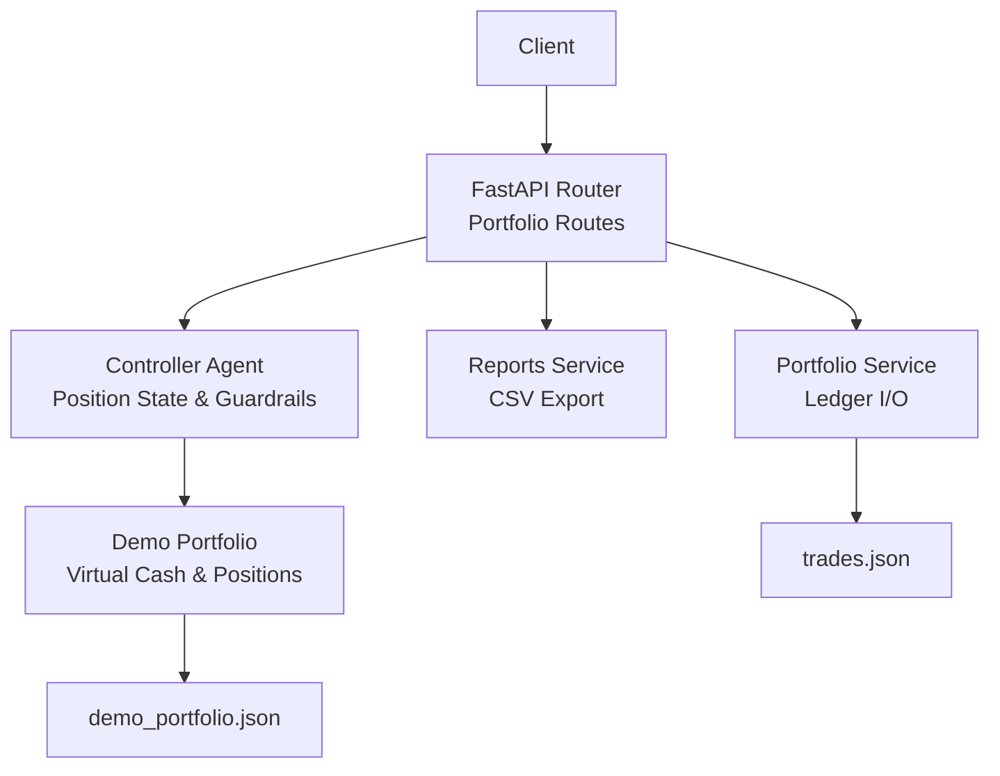
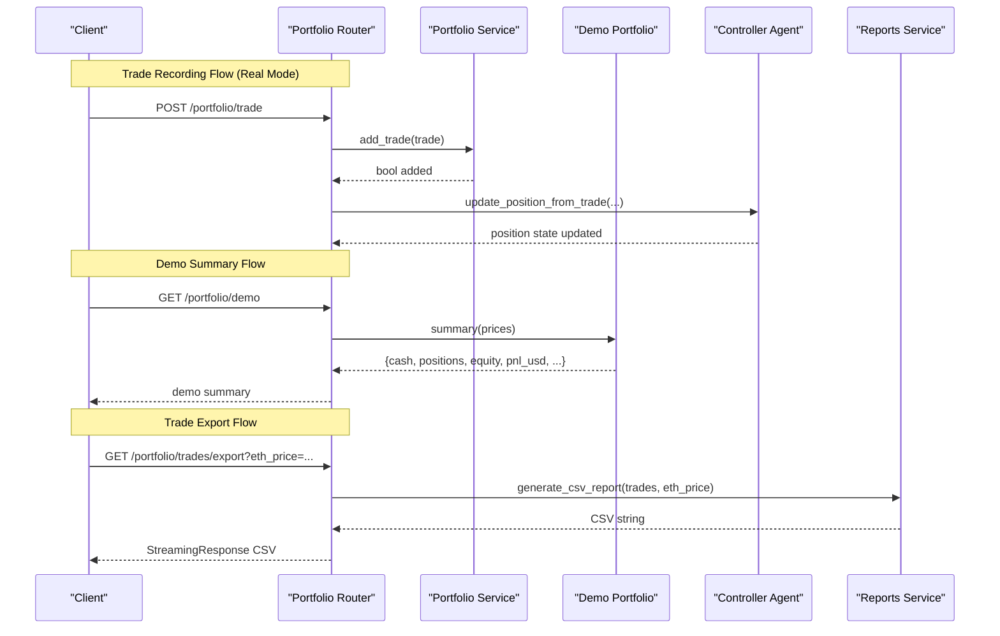
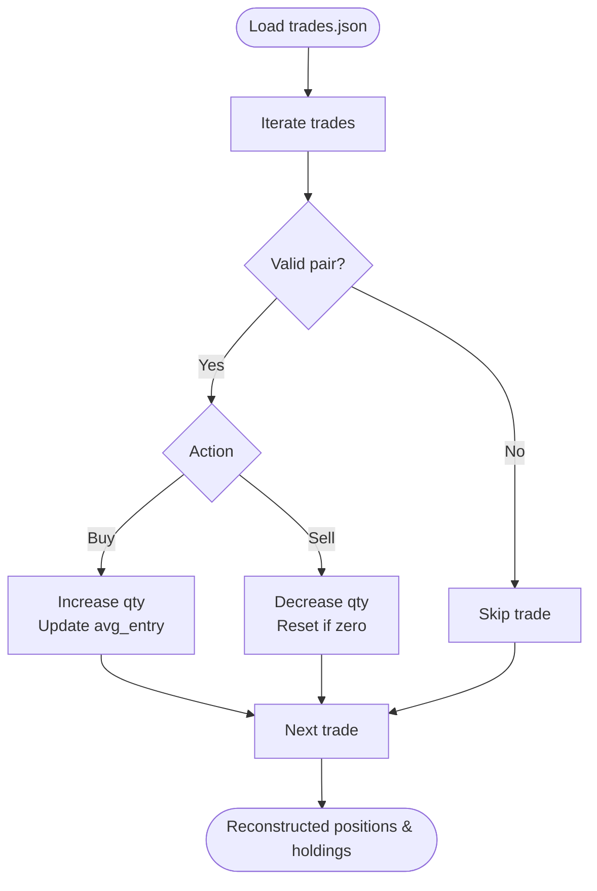
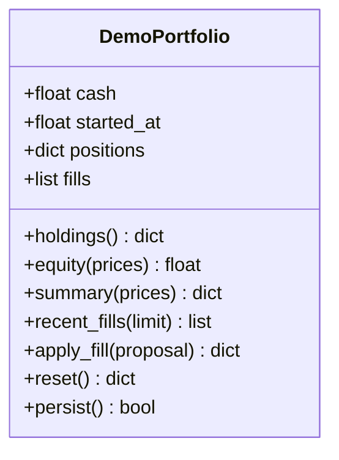
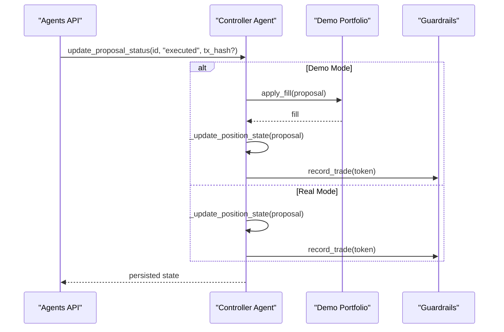
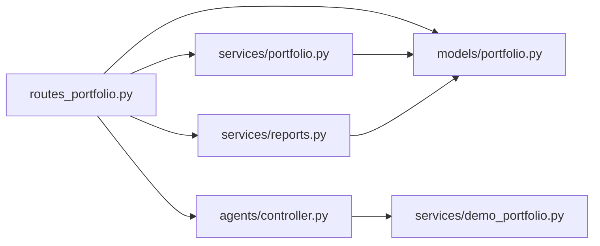

# Portfolio Management API

<cite>
**Referenced Files in This Document**
- [routes_portfolio.py](file://backend/app/api/routes_portfolio.py)
- [portfolio.py](file://backend/app/services/portfolio.py)
- [portfolio.py](file://backend/app/models/portfolio.py)
- [demo_portfolio.py](file://backend/app/services/demo_portfolio.py)
- [reports.py](file://backend/app/services/reports.py)
- [controller.py](file://backend/app/agents/controller.py)
</cite>

## Table of Contents
1. [Introduction](#introduction)
2. [Project Structure](#project-structure)
3. [Core Components](#core-components)
4. [Architecture Overview](#architecture-overview)
5. [Detailed Component Analysis](#detailed-component-analysis)
6. [Dependency Analysis](#dependency-analysis)
7. [Performance Considerations](#performance-considerations)
8. [Troubleshooting Guide](#troubleshooting-guide)
9. [Conclusion](#conclusion)

## Introduction
This document describes the Portfolio Management API exposed by the backend service. It covers portfolio endpoints for holdings management, trade recording, position tracking, and report generation. It also explains how portfolio state is managed, how balances and P&L are calculated, and how demo mode provides a safe environment for testing and development without touching real-chain execution.

The API supports two operating modes:
- Real mode: trades are persisted to a JSON ledger and used to reconstruct positions, holdings, and strategy state.
- Demo mode: a virtual portfolio simulates fills, cash, positions, and P&L without writing to the real trade ledger.

## Project Structure
The portfolio-related functionality spans FastAPI routes, Pydantic models, persistence services, a demo portfolio simulator, CSV reporting, and an agent controller that keeps internal position state consistent with recorded trades or demo fills.

**Diagram sources**
- [routes_portfolio.py:1-155](file://backend/app/api/routes_portfolio.py#L1-L155)
- [portfolio.py:1-96](file://backend/app/services/portfolio.py#L1-L96)
- [reports.py:1-50](file://backend/app/services/reports.py#L1-L50)
- [controller.py:1-683](file://backend/app/agents/controller.py#L1-L683)
- [demo_portfolio.py:1-176](file://backend/app/services/demo_portfolio.py#L1-L176)

**Section sources**
- [routes_portfolio.py:1-155](file://backend/app/api/routes_portfolio.py#L1-L155)
- [portfolio.py:1-96](file://backend/app/services/portfolio.py#L1-L96)
- [demo_portfolio.py:1-176](file://backend/app/services/demo_portfolio.py#L1-L176)
- [controller.py:1-683](file://backend/app/agents/controller.py#L1-L683)
- [reports.py:1-50](file://backend/app/services/reports.py#L1-L50)

## Core Components
- Portfolio routes: HTTP endpoints for demo portfolio access, holdings updates, trade recording, trade listing, trade export, and trade reload.
- Portfolio service: in-memory trade ledger backed by a JSON file; idempotent trade addition; holdings reconstruction from trade history.
- Models: standardized trade record schema and portfolio snapshot model.
- Demo portfolio: virtual portfolio with cash, positions, fills, equity, and P&L calculations.
- Reports: CSV export of trades with USD valuation fallbacks.
- Controller agent: maintains position states, guardrails, proposals, and integrates with demo portfolio or trade ledger.

**Section sources**
- [routes_portfolio.py:1-155](file://backend/app/api/routes_portfolio.py#L1-L155)
- [portfolio.py:1-96](file://backend/app/services/portfolio.py#L1-L96)
- [portfolio.py:1-37](file://backend/app/models/portfolio.py#L1-L37)
- [demo_portfolio.py:1-176](file://backend/app/services/demo_portfolio.py#L1-L176)
- [reports.py:1-50](file://backend/app/services/reports.py#L1-L50)
- [controller.py:1-683](file://backend/app/agents/controller.py#L1-L683)

## Architecture Overview
The portfolio API is a thin HTTP layer over domain services and the controller agent. In real mode, trades are appended to a JSON ledger and consumed to reconstruct holdings and position state. In demo mode, the controller uses a virtual portfolio to simulate fills and maintain cash, positions, and P&L.

**Diagram sources**
- [routes_portfolio.py:75-132](file://backend/app/api/routes_portfolio.py#L75-L132)
- [portfolio.py:37-57](file://backend/app/services/portfolio.py#L37-L57)
- [controller.py:415-478](file://backend/app/agents/controller.py#L415-L478)
- [demo_portfolio.py:72-99](file://backend/app/services/demo_portfolio.py#L72-L99)
- [reports.py:11-49](file://backend/app/services/reports.py#L11-L49)

## Detailed Component Analysis

### HTTP Endpoints

#### GET /portfolio/demo
- Purpose: Return the current demo portfolio summary including cash, positions, equity, and P&L.
- Behavior:
  - Requires demo mode to be enabled.
  - Returns a summary computed from the demo portfolio and last market prices.
  - Includes a flag indicating whether prices are available.
- Response fields:
  - cash: number
  - positions: array of position objects
  - equity: number
  - starting_cash: number
  - pnl_usd: number
  - pnl_pct: number
  - fills: number
  - started_at: number
  - prices_available: boolean
- Errors:
  - 404 if demo mode is not enabled.

**Section sources**
- [routes_portfolio.py:41-49](file://backend/app/api/routes_portfolio.py#L41-L49)
- [demo_portfolio.py:72-99](file://backend/app/services/demo_portfolio.py#L72-L99)

#### POST /portfolio/demo/reset
- Purpose: Reset the demo portfolio to its initial state.
- Behavior:
  - Resets cash, positions, fills, and timestamps.
  - Clears controller position states and simulated positions.
  - Rebuilds user holdings from the demo portfolio.
- Response: demo portfolio summary after reset.
- Errors:
  - 404 if demo mode is not enabled.

**Section sources**
- [routes_portfolio.py:52-60](file://backend/app/api/routes_portfolio.py#L52-L60)
- [demo_portfolio.py:160-166](file://backend/app/services/demo_portfolio.py#L160-L166)
- [controller.py:185-221](file://backend/app/agents/controller.py#L185-L221)

#### POST /portfolio/holdings
- Purpose: Update the controller’s view of user holdings.
- Behavior:
  - In demo mode, this endpoint ignores injected holdings and returns the demo portfolio’s holdings instead.
  - In real mode, it sets injected holdings and logs the update.
- Request body: object mapping token symbols to quantities.
- Response: status and count of holdings keys.

**Section sources**
- [routes_portfolio.py:63-68](file://backend/app/api/routes_portfolio.py#L63-L68)
- [controller.py:402-413](file://backend/app/agents/controller.py#L402-L413)

#### GET /portfolio/
- Purpose: Placeholder endpoint returning a minimal portfolio snapshot.
- Behavior:
  - Accepts an address query parameter.
  - Returns a snapshot with empty positions.

**Section sources**
- [routes_portfolio.py:70-72](file://backend/app/api/routes_portfolio.py#L70-L72)
- [portfolio.py:5-15](file://backend/app/models/portfolio.py#L5-L15)

#### POST /portfolio/trade
- Purpose: Record a new trade in the ledger and update position state.
- Behavior:
  - In demo mode, real trade recording is disabled; clients should use proposal completion to simulate fills.
  - Adds the trade idempotently by tx_hash.
  - On successful addition, updates controller position state using pair, action, token_amount, price, and optional tx_hash.
- Request body: standardized trade record.
- Response: the accepted trade record.
- Errors:
  - 403 in demo mode when attempting to record a real trade.

**Section sources**
- [routes_portfolio.py:75-96](file://backend/app/api/routes_portfolio.py#L75-L96)
- [portfolio.py:37-49](file://backend/app/services/portfolio.py#L37-L49)
- [controller.py:415-478](file://backend/app/agents/controller.py#L415-L478)

#### GET /portfolio/trades
- Purpose: List recent trades with optional filters.
- Behavior:
  - In demo mode, returns recent fills converted to the standard trade format.
  - In real mode, returns trades from the ledger.
  - Supports filtering by network, action, start_date, end_date, and limit.
- Query parameters:
  - limit: integer (default 100)
  - network: string (optional; "all" means no filter)
  - action: string (optional; "all" means no filter)
  - start_date: integer timestamp (optional)
  - end_date: integer timestamp (optional)
- Response: array of trade records.

**Section sources**
- [routes_portfolio.py:99-122](file://backend/app/api/routes_portfolio.py#L99-L122)
- [portfolio.py:51-52](file://backend/app/services/portfolio.py#L51-L52)

#### GET /portfolio/trades/export
- Purpose: Export trades as a CSV file stream.
- Behavior:
  - Uses the same data source as /portfolio/trades (demo fills or ledger).
  - Generates CSV with date, network, pair, action, price, token amount, network fee, USD amount, status, and tx hash.
  - USD valuation prefers price_usd captured at execution; otherwise falls back to quote currency rates and an ETH price parameter.
- Query parameters:
  - eth_price: positive float (default 3000.0)
- Response: text/csv stream with attachment header.

**Section sources**
- [routes_portfolio.py:124-132](file://backend/app/api/routes_portfolio.py#L124-L132)
- [reports.py:11-49](file://backend/app/services/reports.py#L11-L49)

#### POST /portfolio/trades/reload
- Purpose: Reload the trade ledger from disk.
- Behavior:
  - Re-reads trades.json into memory.
  - Useful when the file is updated externally.
- Response: status and count of reloaded trades.

**Section sources**
- [routes_portfolio.py:134-138](file://backend/app/api/routes_portfolio.py#L134-L138)
- [portfolio.py:54-57](file://backend/app/services/portfolio.py#L54-L57)

#### GET /portfolio/trades/debug
- Purpose: Debug endpoint showing recent trades metadata.
- Behavior:
  - Returns total trade count and the last 10 trades’ key fields.

**Section sources**
- [routes_portfolio.py:140-154](file://backend/app/api/routes_portfolio.py#L140-L154)

### Data Models

#### TradeExecution
Standardized trade record used across producers and consumers. Key fields:
- tx_hash: unique transaction identifier
- network: chain or environment name
- pair: base/quote pair string
- action: "buy" or "sell"
- amount: quantity of the quote currency involved
- token: quote currency symbol
- price: quote per base unit price
- token_amount: quantity of the base token bought/sold
- network_fee: gas fee in USD
- price_usd: USD per base token at execution time
- status: execution status
- timestamp: Unix timestamp

Complexity notes:
- Validation and normalization occur at the model boundary.
- Consumers interpret pair as base/quote and derive token amounts accordingly.

**Section sources**
- [portfolio.py:17-36](file://backend/app/models/portfolio.py#L17-L36)

#### PortfolioSnapshot and WalletPosition
- PortfolioSnapshot: contains wallet address and list of positions.
- WalletPosition: token symbol, balance, value_usd, and 24h P&L.

These models define the shape of portfolio snapshots returned by portfolio endpoints.

**Section sources**
- [portfolio.py:5-15](file://backend/app/models/portfolio.py#L5-L15)

### Portfolio State Management

#### Real Mode State Reconstruction
- Trades are loaded from trades.json on module load.
- The controller reconstructs position states and simulated holdings by iterating through trades:
  - For buys: increases position quantity and updates average entry price.
  - For sells: decreases position quantity and resets state when fully sold out.
- User holdings are derived from trade history, ignoring stablecoins as tradable positions.

**Diagram sources**
- [portfolio.py:14-26](file://backend/app/services/portfolio.py#L14-L26)
- [controller.py:128-180](file://backend/app/agents/controller.py#L128-L180)
- [portfolio.py:59-92](file://backend/app/services/portfolio.py#L59-L92)

**Section sources**
- [portfolio.py:14-26](file://backend/app/services/portfolio.py#L14-L26)
- [controller.py:128-180](file://backend/app/agents/controller.py#L128-L180)
- [portfolio.py:59-92](file://backend/app/services/portfolio.py#L59-L92)

#### Demo Mode State Management
- The demo portfolio persists cash, positions, fills, and start time.
- Holdings exclude stablecoins and small dust quantities.
- Equity is cash plus sum of position quantities times current or average entry prices.
- P&L is equity minus starting cash, with percentage calculation.

**Diagram sources**
- [demo_portfolio.py:26-176](file://backend/app/services/demo_portfolio.py#L26-L176)

**Section sources**
- [demo_portfolio.py:26-176](file://backend/app/services/demo_portfolio.py#L26-L176)

### Balance Calculations and P&L Tracking

#### Holdings Calculation
- Holdings are computed from trade history:
  - Buy actions increase base token quantity.
  - Sell actions decrease base token quantity.
  - Legacy formats where token equals base are handled via token vs quote comparison.
- Small residuals and negative balances are cleaned up.

**Section sources**
- [portfolio.py:59-92](file://backend/app/services/portfolio.py#L59-L92)

#### Demo Equity and P&L
- Equity sums cash and position values.
- Position value uses current price if available; otherwise average entry.
- P&L is equity minus starting cash; percentage is relative to starting cash.

**Section sources**
- [demo_portfolio.py:65-99](file://backend/app/services/demo_portfolio.py#L65-L99)

### Relationship Between Portfolio Data and Trading Execution

#### Proposal Completion and Fill Simulation
- When a proposal is marked executed:
  - In demo mode, the controller applies a fill against the demo portfolio, adjusting cash and positions.
  - In real mode, the controller updates position state and guardrails based on the proposal details.
- The controller tracks applied and counted transaction hashes to avoid duplicate effects.

**Diagram sources**
- [controller.py:296-330](file://backend/app/agents/controller.py#L296-L330)
- [controller.py:333-400](file://backend/app/agents/controller.py#L333-L400)
- [demo_portfolio.py:105-158](file://backend/app/services/demo_portfolio.py#L105-L158)

**Section sources**
- [controller.py:296-330](file://backend/app/agents/controller.py#L296-L330)
- [controller.py:333-400](file://backend/app/agents/controller.py#L333-L400)
- [demo_portfolio.py:105-158](file://backend/app/services/demo_portfolio.py#L105-L158)

### Practical Examples

#### Adding a Trade (Real Mode)
- Send a POST request to /portfolio/trade with a standardized trade record.
- The service checks for duplicate tx_hash and appends only new trades.
- The controller updates position state and guardrails accordingly.

**Section sources**
- [routes_portfolio.py:75-96](file://backend/app/api/routes_portfolio.py#L75-L96)
- [portfolio.py:37-49](file://backend/app/services/portfolio.py#L37-L49)
- [controller.py:415-478](file://backend/app/agents/controller.py#L415-L478)

#### Querying Holdings
- Use POST /portfolio/holdings to set holdings explicitly.
- In demo mode, holdings are derived from the demo portfolio and cannot be injected.
- In real mode, holdings are reconstructed from the trade ledger unless overridden by injected holdings.

**Section sources**
- [routes_portfolio.py:63-68](file://backend/app/api/routes_portfolio.py#L63-L68)
- [controller.py:402-413](file://backend/app/agents/controller.py#L402-L413)
- [portfolio.py:59-92](file://backend/app/services/portfolio.py#L59-L92)

#### Generating Reports
- Use GET /portfolio/trades/export with an eth_price parameter to download a CSV report.
- The report includes date, network, pair, action, price, token amount, network fee, USD amount, status, and tx hash.

**Section sources**
- [routes_portfolio.py:124-132](file://backend/app/api/routes_portfolio.py#L124-L132)
- [reports.py:11-49](file://backend/app/services/reports.py#L11-L49)

#### Managing Demo Portfolios
- Retrieve demo summary via GET /portfolio/demo.
- Reset demo state via POST /portfolio/demo/reset.
- Simulate fills by completing proposals; the controller will apply them against the demo portfolio.

**Section sources**
- [routes_portfolio.py:41-60](file://backend/app/api/routes_portfolio.py#L41-L60)
- [controller.py:269-294](file://backend/app/agents/controller.py#L269-L294)
- [demo_portfolio.py:72-99](file://backend/app/services/demo_portfolio.py#L72-L99)

## Dependency Analysis

**Diagram sources**
- [routes_portfolio.py:1-155](file://backend/app/api/routes_portfolio.py#L1-L155)
- [portfolio.py:1-37](file://backend/app/models/portfolio.py#L1-L37)
- [portfolio.py:1-96](file://backend/app/services/portfolio.py#L1-L96)
- [reports.py:1-50](file://backend/app/services/reports.py#L1-L50)
- [controller.py:1-683](file://backend/app/agents/controller.py#L1-L683)
- [demo_portfolio.py:1-176](file://backend/app/services/demo_portfolio.py#L1-L176)

**Section sources**
- [routes_portfolio.py:1-155](file://backend/app/api/routes_portfolio.py#L1-L155)
- [portfolio.py:1-96](file://backend/app/services/portfolio.py#L1-L96)
- [reports.py:1-50](file://backend/app/services/reports.py#L1-L50)
- [controller.py:1-683](file://backend/app/agents/controller.py#L1-L683)
- [demo_portfolio.py:1-176](file://backend/app/services/demo_portfolio.py#L1-L176)

## Performance Considerations
- Trade ledger operations are file-based JSON reads/writes; frequent writes may incur I/O overhead.
- Filtering and limiting trade lists reduce payload size and processing time.
- Demo portfolio operations are in-memory with periodic persistence, suitable for simulation.
- CSV export streams content to avoid large in-memory strings beyond what is necessary.

[No sources needed since this section provides general guidance]

## Troubleshooting Guide

#### Common Issues
- Demo mode not enabled:
  - GET /portfolio/demo and POST /portfolio/demo/reset return 404.
  - Ensure demo mode is configured before accessing these endpoints.

- Duplicate trade recording:
  - POST /portfolio/trade is idempotent by tx_hash; repeated submissions do not create duplicates.
  - If expected changes are missing, verify tx_hash uniqueness and order of arrival.

- Missing holdings:
  - In real mode, holdings are reconstructed from trades; ensure trades.json contains complete history.
  - In demo mode, holdings come from the demo portfolio; inject holdings is ignored.

- CSV valuation discrepancies:
  - If price_usd is missing, USD amounts fall back to quote currency rates and the provided eth_price.
  - Adjust eth_price parameter to reflect realistic valuations for older records.

**Section sources**
- [routes_portfolio.py:41-60](file://backend/app/api/routes_portfolio.py#L41-L60)
- [portfolio.py:37-49](file://backend/app/services/portfolio.py#L37-L49)
- [reports.py:11-49](file://backend/app/services/reports.py#L11-L49)

## Conclusion
The Portfolio Management API provides robust endpoints for managing portfolios in both real and demo modes. It enforces standardized trade records, ensures idempotent ledger updates, and maintains consistent position state through the controller agent. Demo mode offers a safe sandbox for testing trading strategies and UI flows without affecting real assets. Reporting utilities enable CSV exports with flexible USD valuation strategies. Proper usage of these endpoints allows reliable portfolio operations, accurate balance and P&L tracking, and effective integration with trading execution workflows.

[No sources needed since this section summarizes without analyzing specific files]