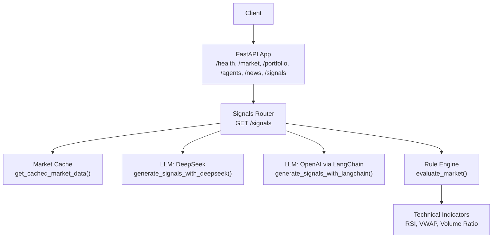
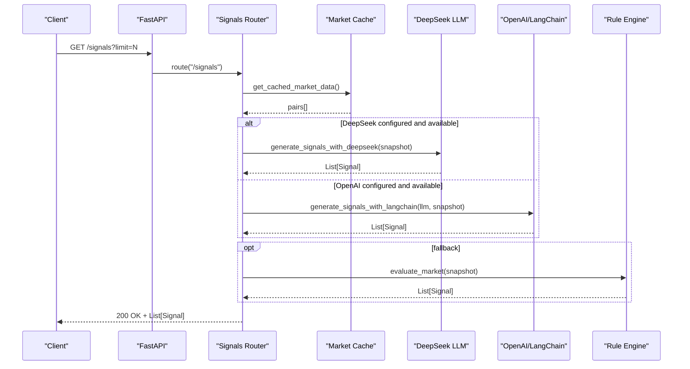
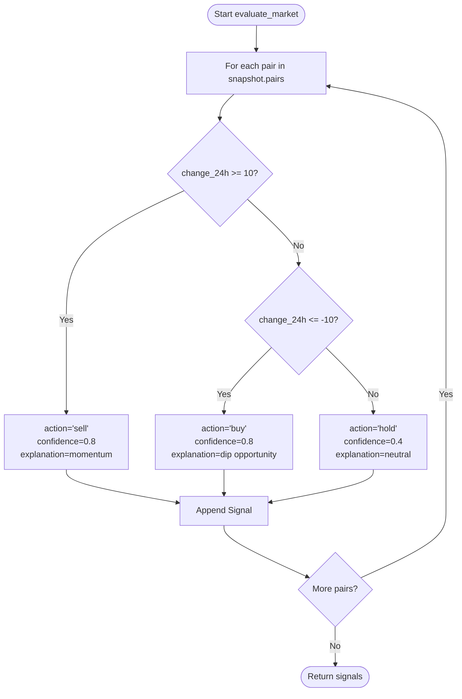
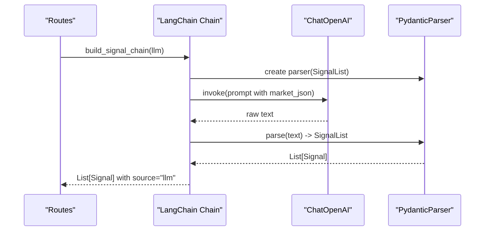
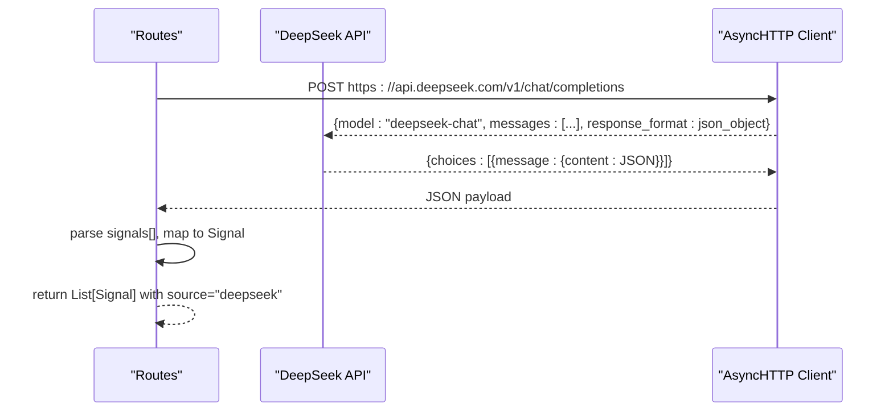
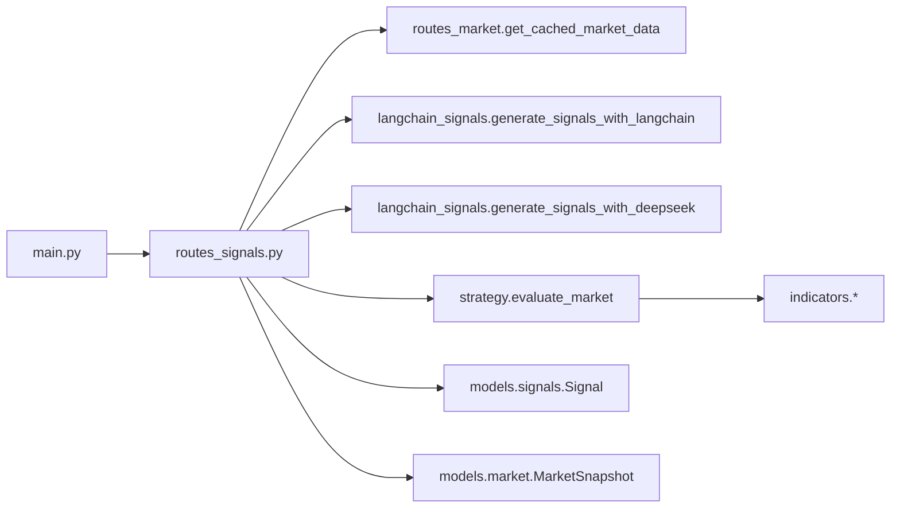

# Trading Signals API

<cite>
**Referenced Files in This Document**
- [main.py](file://backend/app/main.py)
- [routes_signals.py](file://backend/app/api/routes_signals.py)
- [signals.py](file://backend/app/models/signals.py)
- [market.py](file://backend/app/models/market.py)
- [indicators.py](file://backend/app/services/indicators.py)
- [strategy.py](file://backend/app/services/strategy.py)
- [langchain_signals.py](file://backend/app/agents/langchain_signals.py)
- [test_signals_route.py](file://backend/test_signals_route.py)
</cite>

## Table of Contents
1. [Introduction](#introduction)
2. [Project Structure](#project-structure)
3. [Core Components](#core-components)
4. [Architecture Overview](#architecture-overview)
5. [Detailed Component Analysis](#detailed-component-analysis)
6. [Dependency Analysis](#dependency-analysis)
7. [Performance Considerations](#performance-considerations)
8. [Troubleshooting Guide](#troubleshooting-guide)
9. [Conclusion](#conclusion)

## Introduction
This document provides comprehensive API documentation for the Trading Signals endpoints that generate trading recommendations and analyze market conditions. It explains the HTTP interface, request/response schemas, signal generation pipeline (technical indicators, strategy evaluation, confidence scoring), practical usage examples, integration patterns, filtering options, customization parameters, performance considerations, and how signals fit into the broader trading workflow.

## Project Structure
The Trading Signals feature is implemented as a FastAPI router mounted under /signals. The endpoint retrieves market data, optionally calls an LLM provider to generate signals, or falls back to rule-based logic. Technical indicator helpers are available for advanced analysis.

**Diagram sources**
- [main.py:34-38](file://backend/app/main.py#L34-L38)
- [routes_signals.py:20-53](file://backend/app/api/routes_signals.py#L20-L53)
- [langchain_signals.py:19-58](file://backend/app/agents/langchain_signals.py#L19-L58)
- [langchain_signals.py:61-122](file://backend/app/agents/langchain_signals.py#L61-L122)
- [strategy.py:8-38](file://backend/app/services/strategy.py#L8-L38)
- [indicators.py:17-96](file://backend/app/services/indicators.py#L17-L96)

**Section sources**
- [main.py:34-38](file://backend/app/main.py#L34-L38)

## Core Components
- Signal model: defines the structure of each trading recommendation including pair, action, confidence, explanation, source, and timestamp.
- Market snapshot: represents the input market data used by the signal generators.
- Rule engine: generates signals based on simple price-change thresholds with deterministic confidence and explanations.
- LLM integrations:
  - OpenAI via LangChain: structured output parsing to produce Signal objects.
  - DeepSeek direct API: JSON response parsing to produce Signal objects.
- Technical indicators: pure functions for RSI, VWAP, volume ratio/spike detection, and percentage change.

Key responsibilities:
- routes_signals.py: exposes GET /signals, orchestrates data fetching and fallbacks.
- langchain_signals.py: implements LLM-based signal generation.
- strategy.py: implements rule-based signal generation.
- indicators.py: provides reusable technical indicator calculations.
- models/signals.py and models/market.py: define shared data structures.

**Section sources**
- [signals.py:1-16](file://backend/app/models/signals.py#L1-L16)
- [market.py:5-16](file://backend/app/models/market.py#L5-L16)
- [strategy.py:8-38](file://backend/app/services/strategy.py#L8-L38)
- [langchain_signals.py:15-58](file://backend/app/agents/langchain_signals.py#L15-L58)
- [langchain_signals.py:61-122](file://backend/app/agents/langchain_signals.py#L61-L122)
- [indicators.py:17-96](file://backend/app/services/indicators.py#L17-L96)

## Architecture Overview
The Trading Signals API follows a layered architecture:
- API Layer: FastAPI routers expose REST endpoints.
- Orchestration Layer: Routes fetch market data and select a signal generator.
- Generation Layer: LLM providers or rule engine produce signals.
- Data Layer: Market snapshots and technical indicators support analysis.

**Diagram sources**
- [routes_signals.py:20-53](file://backend/app/api/routes_signals.py#L20-L53)
- [langchain_signals.py:40-58](file://backend/app/agents/langchain_signals.py#L40-L58)
- [langchain_signals.py:61-122](file://backend/app/agents/langchain_signals.py#L61-L122)
- [strategy.py:8-38](file://backend/app/services/strategy.py#L8-L38)

## Detailed Component Analysis

### HTTP Endpoints

#### GET /signals
Generates trading signals for the top N trading pairs from cached market data.

- Method: GET
- Path: /signals or /signals/
- Query Parameters:
  - limit: integer, 1 ≤ limit ≤ 500, default 50. Controls how many pairs are analyzed.
- Response: Array of Signal objects.

Response schema (Signal):
- pair: string (e.g., "BTC/USDT")
- action: enum ("buy", "sell", "hold")
- confidence: float (0.0–1.0)
- explanation: string (optional)
- source: enum ("llm", "rules", "deepseek")
- created_at: float (Unix timestamp)

Behavior:
- Retrieves cached market data and slices it to the requested limit.
- Attempts DeepSeek first if configured; on billing/quota errors, falls back to rules.
- If DeepSeek is unavailable or fails, attempts OpenAI via LangChain; on failure, falls back to rules.
- If neither LLM is configured, uses rule-based generation.

Validation:
- Invalid limit values return 422 validation error.

Examples:
- Request: GET /signals?limit=10
- Response: 200 OK with array of up to 10 Signal objects.

Notes:
- Both /signals and /signals/ are supported to avoid proxy redirect issues.

**Section sources**
- [routes_signals.py:17-53](file://backend/app/api/routes_signals.py#L17-L53)
- [test_signals_route.py:36-45](file://backend/test_signals_route.py#L36-L45)

### Signal Generation Pipeline

#### Rule-Based Strategy (Fallback)
- Input: MarketSnapshot containing pairs with price and 24h change.
- Logic:
  - If 24h change ≥ 10% → sell with high confidence and momentum explanation.
  - If 24h change ≤ -10% → buy with high confidence and dip opportunity explanation.
  - Otherwise → hold with neutral confidence.
- Output: List[Signal] with source="rules".

Complexity:
- Time: O(P) where P is number of pairs.
- Space: O(1) additional beyond output list.

**Diagram sources**
- [strategy.py:8-38](file://backend/app/services/strategy.py#L8-L38)

**Section sources**
- [strategy.py:8-38](file://backend/app/services/strategy.py#L8-L38)

#### LLM-Based Strategy (LangChain/OpenAI)
- Input: MarketSnapshot (limited to first 10 pairs).
- Process:
  - Build prompt with market data and format instructions.
  - Use PydanticOutputParser to enforce SignalList structure.
  - Parse LLM output into List[Signal].
  - Set source="llm" and created_at timestamp.
- Error Handling: Raises exception on parse or network failures.

**Diagram sources**
- [langchain_signals.py:19-58](file://backend/app/agents/langchain_signals.py#L19-L58)

**Section sources**
- [langchain_signals.py:19-58](file://backend/app/agents/langchain_signals.py#L19-L58)

#### LLM-Based Strategy (DeepSeek Direct)
- Input: MarketSnapshot (limited to first 10 pairs).
- Process:
  - Construct system prompt requesting JSON with signals array.
  - POST to DeepSeek API with temperature=0 and JSON response format.
  - Parse JSON content to extract signals.
  - Map fields to Signal model and set source="deepseek".
- Error Handling: Raises on HTTP or JSON parse errors.

**Diagram sources**
- [langchain_signals.py:61-122](file://backend/app/agents/langchain_signals.py#L61-L122)

**Section sources**
- [langchain_signals.py:61-122](file://backend/app/agents/langchain_signals.py#L61-L122)

### Technical Indicators
Pure helper functions for computing common indicators. These are not directly invoked by the current rule engine but are available for future enhancements or custom strategies.

- RSI (Relative Strength Index)
  - Inputs: closes sequence, period (default 14)
  - Returns: float in [0,100] or None if insufficient data
  - Complexity: O(n) time, O(1) extra space
- VWAP (Volume-Weighted Average Price)
  - Inputs: prices, volumes sequences
  - Returns: float or None if no valid samples
  - Complexity: O(n) time, O(1) extra space
- Volume Ratio and Spike Detection
  - volume_ratio(short_volume, baseline_volume, baseline_windows)
  - is_volume_spike(ratio, threshold=2.0)
  - Returns: float ratio or None; boolean spike flag
- Percentage Change
  - pct_change(new, old)
  - Returns: float or None

Usage notes:
- Functions return None when inputs are invalid or insufficient, allowing callers to decide whether to block trades or reduce confidence.

**Section sources**
- [indicators.py:17-96](file://backend/app/services/indicators.py#L17-L96)

### Data Models

#### Signal
- Fields:
  - pair: string
  - action: "buy" | "sell" | "hold"
  - confidence: float
  - explanation: string (optional)
  - source: "llm" | "rules" | "deepseek" (optional)
  - created_at: float (optional)

#### Market Snapshot
- TradingPair:
  - base_symbol: string
  - quote_symbol: string
  - price: float
  - change_24h: float
  - volume_24h: float (optional)
  - cmc_url: string (optional)
- MarketSnapshot:
  - pairs: list of TradingPair
  - timestamp: float (optional)

These models define the contract between the API, services, and LLM integrations.

**Section sources**
- [signals.py:1-16](file://backend/app/models/signals.py#L1-L16)
- [market.py:5-16](file://backend/app/models/market.py#L5-L16)

## Dependency Analysis
The following diagram shows key dependencies among components involved in signal generation.

**Diagram sources**
- [main.py:34-38](file://backend/app/main.py#L34-L38)
- [routes_signals.py:6-11](file://backend/app/api/routes_signals.py#L6-L11)
- [langchain_signals.py:11-12](file://backend/app/agents/langchain_signals.py#L11-L12)
- [strategy.py:4-5](file://backend/app/services/strategy.py#L4-L5)
- [indicators.py:1-6](file://backend/app/services/indicators.py#L1-L6)

**Section sources**
- [routes_signals.py:6-11](file://backend/app/api/routes_signals.py#L6-L11)
- [strategy.py:4-5](file://backend/app/services/strategy.py#L4-L5)
- [langchain_signals.py:11-12](file://backend/app/agents/langchain_signals.py#L11-L12)

## Performance Considerations
- Limit parameter:
  - Reduces the number of pairs processed, lowering LLM payload size and computation time.
  - Validated server-side; invalid values return 422.
- LLM fallback chain:
  - DeepSeek attempted first; on billing/quota errors, immediately falls back to rules without trying OpenAI.
  - OpenAI via LangChain attempted next; on failure, falls back to rules.
  - This minimizes latency and cost while ensuring availability.
- Data slicing:
  - LLM paths slice the snapshot to the first 10 pairs to keep prompts small.
- Rule engine efficiency:
  - Simple O(P) pass over pairs with constant-time checks per pair.
- Network timeouts:
  - DeepSeek client uses a timeout to prevent hanging requests.

Recommendations:
- Use reasonable limits (e.g., 10–50) for low-latency responses.
- Prefer rule-based signals for high-throughput scenarios.
- Monitor LLM provider quotas and errors to adjust fallback behavior.

**Section sources**
- [routes_signals.py:20-53](file://backend/app/api/routes_signals.py#L20-L53)
- [langchain_signals.py:44-47](file://backend/app/agents/langchain_signals.py#L44-L47)
- [langchain_signals.py:86-102](file://backend/app/agents/langchain_signals.py#L86-L102)
- [strategy.py:8-38](file://backend/app/services/strategy.py#L8-L38)

## Troubleshooting Guide
Common issues and resolutions:
- 422 Validation Error on /signals:
  - Cause: limit outside allowed range [1, 500].
  - Resolution: Ensure limit is within bounds.
- Empty signals list:
  - Cause: Cached market data returns empty pairs.
  - Resolution: Verify upstream market data sources and cache pre-population at startup.
- LLM errors:
  - DeepSeek billing/quota errors:
    - Behavior: Skips OpenAI fallback and uses rule-based signals.
    - Resolution: Check account status or configure alternative keys.
  - OpenAI errors:
    - Behavior: Falls back to rule-based signals.
    - Resolution: Validate API key and model availability.
- Proxy redirect issues:
  - Behavior: Both /signals and /signals/ are registered to avoid losing /api prefix during redirects.
  - Resolution: Use either path; tests confirm both work without redirect.

Operational tips:
- Health check: GET /health returns service status and demo mode flag.
- CORS configuration: Adjust CORS_ORIGINS environment variable as needed.

**Section sources**
- [test_signals_route.py:36-45](file://backend/test_signals_route.py#L36-L45)
- [routes_signals.py:28-53](file://backend/app/api/routes_signals.py#L28-L53)
- [main.py:57-59](file://backend/app/main.py#L57-L59)
- [main.py:16-32](file://backend/app/main.py#L16-L32)

## Conclusion
The Trading Signals API offers a flexible pipeline for generating trading recommendations through rule-based logic and optional LLM integrations. Clients can control processing scope via the limit parameter and rely on robust fallback mechanisms to ensure consistent availability. Technical indicators are provided for future customization, and the clear data models enable straightforward integration into broader trading workflows.