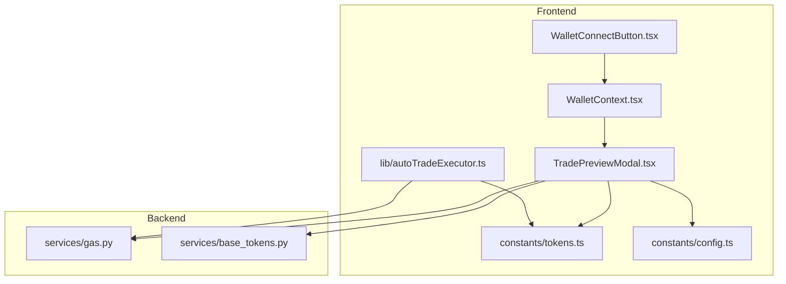
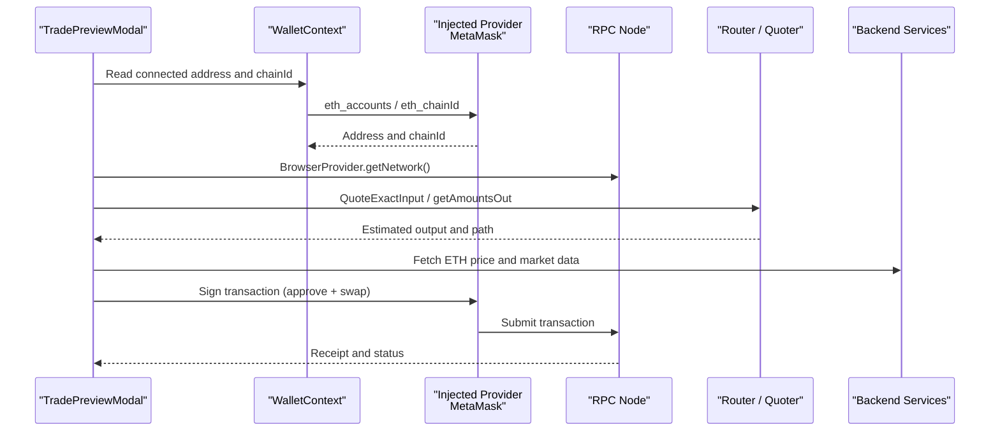
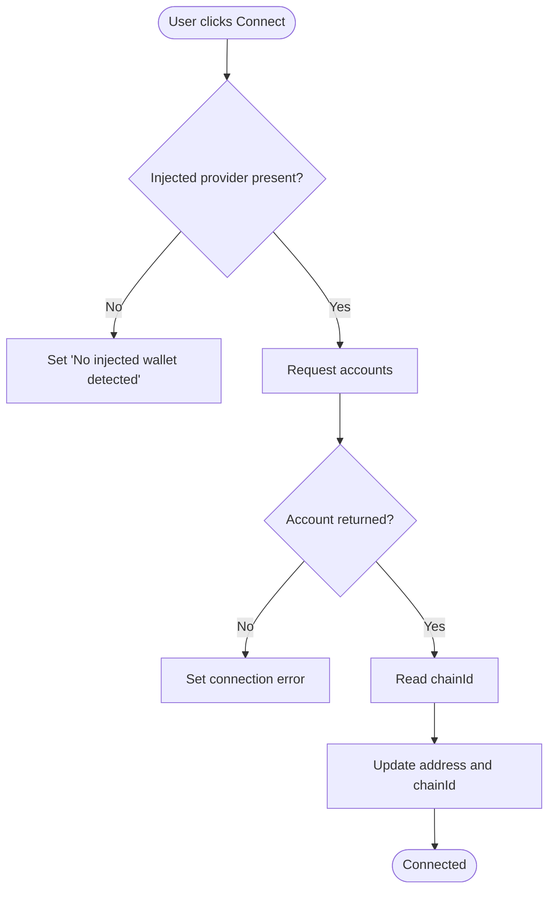
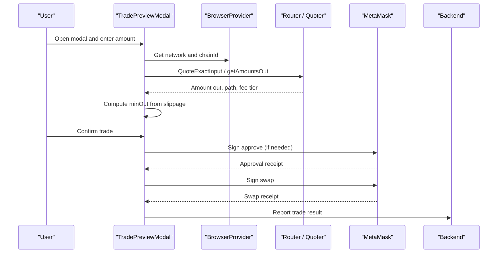
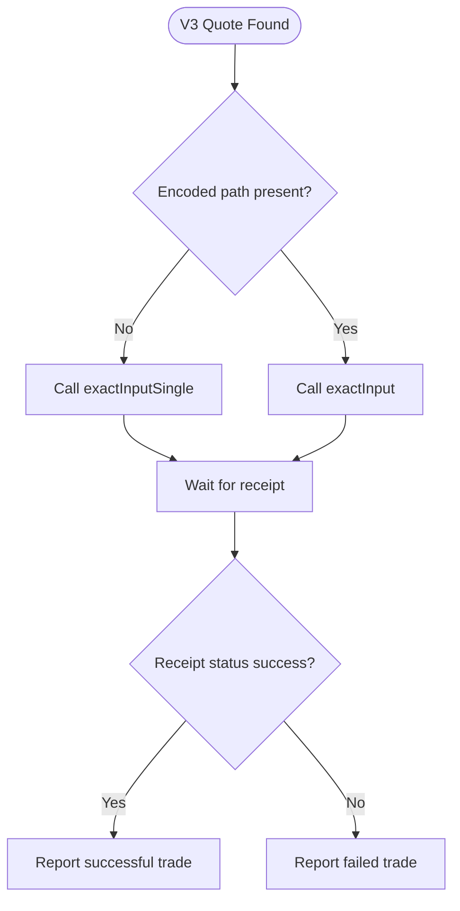
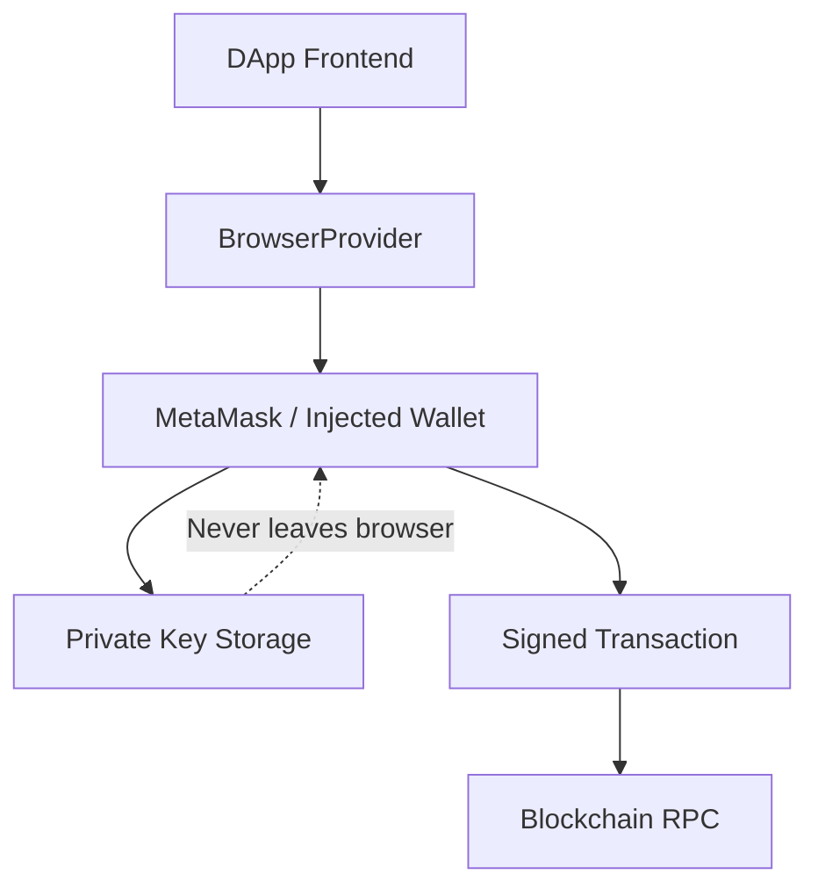
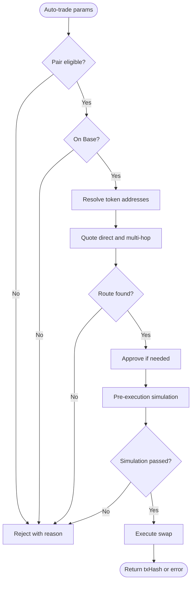
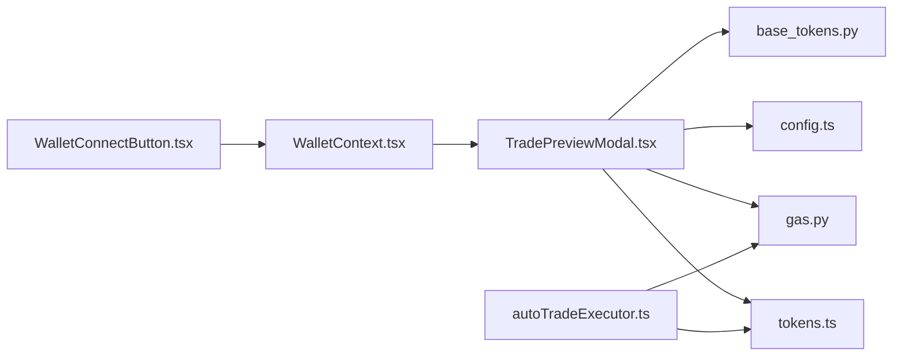

# Blockchain Integration

<cite>
**Referenced Files in This Document**
- [WalletContext.tsx](file://frontend/context/WalletContext.tsx)
- [WalletConnectButton.tsx](file://frontend/components/WalletConnectButton.tsx)
- [TradePreviewModal.tsx](file://frontend/components/TradePreviewModal.tsx)
- [tokens.ts](file://frontend/constants/tokens.ts)
- [config.ts](file://frontend/constants/config.ts)
- [autoTradeExecutor.ts](file://frontend/lib/autoTradeExecutor.ts)
- [gas.py](file://backend/app/services/gas.py)
- [base_tokens.py](file://backend/app/services/base_tokens.py)
</cite>

## Table of Contents
1. [Introduction](#introduction)
2. [Project Structure](#project-structure)
3. [Core Components](#core-components)
4. [Architecture Overview](#architecture-overview)
5. [Detailed Component Analysis](#detailed-component-analysis)
6. [Dependency Analysis](#dependency-analysis)
7. [Performance Considerations](#performance-considerations)
8. [Troubleshooting Guide](#troubleshooting-guide)
9. [Conclusion](#conclusion)

## Introduction
This document explains the blockchain integration layer that connects the frontend to decentralized exchanges and on-chain liquidity protocols. It covers:

- Wallet connection through an injected provider such as MetaMask using ethers.js.
- Transaction signing, gas estimation, and Uniswap V3 swap execution.
- Multi-chain support for Base, Ethereum Mainnet, Arbitrum, and Sepolia testnet.
- Token configuration and smart contract interactions with routers, quoters, and Aerodrome.
- The trade preview modal, slippage tolerance, price impact display, and error handling.
- Security model where private keys remain in the browser wallet.
- Auto-trade executor limitations and supported token pairs.

The system is primarily implemented in the Next.js frontend, with backend services providing market data, gas estimates, and Base token discovery.

## Project Structure
The blockchain integration spans several frontend modules and a small set of backend utilities:

**Diagram sources**
- [WalletContext.tsx:1-118](file://frontend/context/WalletContext.tsx#L1-L118)
- [WalletConnectButton.tsx:1-31](file://frontend/components/WalletConnectButton.tsx#L1-L31)
- [TradePreviewModal.tsx:1-800](file://frontend/components/TradePreviewModal.tsx#L1-L800)
- [tokens.ts:1-128](file://frontend/constants/tokens.ts#L1-L128)
- [config.ts:1-8](file://frontend/constants/config.ts#L1-L8)
- [autoTradeExecutor.ts:1-298](file://frontend/lib/autoTradeExecutor.ts#L1-L298)
- [gas.py:1-60](file://backend/app/services/gas.py#L1-L60)
- [base_tokens.py:1-321](file://backend/app/services/base_tokens.py#L1-L321)

**Section sources**
- [WalletContext.tsx:1-118](file://frontend/context/WalletContext.tsx#L1-L118)
- [WalletConnectButton.tsx:1-31](file://frontend/components/WalletConnectButton.tsx#L1-L31)
- [TradePreviewModal.tsx:1-800](file://frontend/components/TradePreviewModal.tsx#L1-L800)
- [tokens.ts:1-128](file://frontend/constants/tokens.ts#L1-L128)
- [config.ts:1-8](file://frontend/constants/config.ts#L1-L8)
- [autoTradeExecutor.ts:1-298](file://frontend/lib/autoTradeExecutor.ts#L1-L298)
- [gas.py:1-60](file://backend/app/services/gas.py#L1-L60)
- [base_tokens.py:1-321](file://backend/app/services/base_tokens.py#L1-L321)

## Core Components
- **Wallet context**: Provides connected address, chain ID, connection state, and basic connect/disconnect behavior over `window.ethereum`.
- **Trade preview modal**: Handles quoting across Uniswap V2, Uniswap V3, and Aerodrome; shows estimated output, price impact, gas cost, slippage, and executes trades.
- **Auto-trade executor**: Executes automated swaps on Base via Uniswap V3 with pre-execution simulation, approval handling, and multi-hop routing.
- **Token constants**: Defines token addresses, router addresses, quoter addresses, and helper functions per network.
- **Backend gas service**: Caches and returns live gas prices from a configured RPC.
- **Base token service**: Discovers and ranks Base tokens using multiple market data providers.

**Section sources**
- [WalletContext.tsx:1-118](file://frontend/context/WalletContext.tsx#L1-L118)
- [TradePreviewModal.tsx:1-800](file://frontend/components/TradePreviewModal.tsx#L1-L800)
- [autoTradeExecutor.ts:1-298](file://frontend/lib/autoTradeExecutor.ts#L1-L298)
- [tokens.ts:1-128](file://frontend/constants/tokens.ts#L1-L128)
- [gas.py:1-60](file://backend/app/services/gas.py#L1-L60)
- [base_tokens.py:1-321](file://backend/app/services/base_tokens.py#L1-L321)

## Architecture Overview
The blockchain integration follows a client-first architecture:

- The browser uses ethers.js to interact with the injected provider (MetaMask or similar).
- Quoting happens against DEX routers and quoters deployed on the selected chain.
- Transactions are signed by the user’s wallet; no private keys leave the browser.
- Backend services provide auxiliary data like ETH price, gas prices, and Base token metadata.

**Diagram sources**
- [WalletContext.tsx:28-98](file://frontend/context/WalletContext.tsx#L28-L98)
- [TradePreviewModal.tsx:174-780](file://frontend/components/TradePreviewModal.tsx#L174-L780)
- [TradePreviewModal.tsx:1114-1884](file://frontend/components/TradePreviewModal.tsx#L1114-L1884)
- [gas.py:27-59](file://backend/app/services/gas.py#L27-L59)

## Detailed Component Analysis

### Wallet Connection Using ethers.js and Injected Providers
The wallet connection layer reads the injected provider from `window.ethereum`, requests accounts, listens for account and chain changes, and exposes a simple React context.

Key behaviors:
- Detects whether an injected provider exists.
- Requests accounts via `eth_requestAccounts`.
- Reads current chain ID via `eth_chainId`.
- Updates address and chain ID reactively.
- Displays connection errors and loading states.

**Diagram sources**
- [WalletContext.tsx:74-98](file://frontend/context/WalletContext.tsx#L74-L98)
- [WalletContext.tsx:28-36](file://frontend/context/WalletContext.tsx#L28-L36)

**Section sources**
- [WalletContext.tsx:1-118](file://frontend/context/WalletContext.tsx#L1-L118)
- [WalletConnectButton.tsx:1-31](file://frontend/components/WalletConnectButton.tsx#L1-L31)

### Supported Networks and Token Configuration
The application supports:

- **Ethereum Mainnet**: Chain ID `1`.
- **Base**: Chain ID `8453`.
- **Arbitrum One**: Chain ID `42161`.
- **Sepolia**: Chain ID `11155111`.

Token configuration includes:
- Per-network token address maps.
- Router addresses for Uniswap V2 and V3.
- Quoter addresses for Uniswap V3.
- Aerodrome router and factory addresses on Base.
- Helper function to resolve token addresses by symbol and network.

Important notes:
- Base and Arbitrum currently use Uniswap V3 only in the trading flow; V2 router is not used for those networks.
- Some tokens have explicit decimal overrides for Base.

**Section sources**
- [tokens.ts:1-128](file://frontend/constants/tokens.ts#L1-L128)
- [TradePreviewModal.tsx:192-219](file://frontend/components/TradePreviewModal.tsx#L192-L219)

### Trade Preview Modal: Quoting, Slippage, and Execution
The trade preview modal is the central UI for reviewing and executing trades. It performs:

1. **Quote selection**:
   - Tries Uniswap V2 first when a V2 router exists.
   - Falls back to Uniswap V3 if V2 fails.
   - Adds an Arbitrum USDC.e fallback for better liquidity.
   - Adds Aerodrome support on Base for low-cap tokens.

2. **Price impact calculation**:
   - For V2 direct pairs, it queries pair reserves.
   - For V3, it compares a tiny quote spot rate with the actual quote.
   - For Aerodrome, it derives impact from pool reserves.

3. **Gas estimation**:
   - Uses static fee data to estimate approximate ETH gas cost.
   - Shows different estimated gas limits depending on protocol version.

4. **Slippage tolerance**:
   - Default slippage is configurable.
   - High-tax meme tokens receive higher recommended slippage.
   - Slippage is converted into basis points and applied to minimum output.

5. **Execution paths**:
   - **Uniswap V2**: Approve ERC20 if needed, then call swap methods supporting fee-on-transfer tokens.
   - **Uniswap V3**: Approve ERC20 if needed, then call `exactInputSingle` or `exactInput` for multi-hop routes.
   - **Aerodrome**: Approve ERC20 if needed, then call appropriate swap method with deadline.

6. **Transaction lifecycle**:
   - Prepares transaction parameters.
   - Sends transaction through the signer.
   - Waits for receipt.
   - Reports successful or failed trades to the backend.

**Diagram sources**
- [TradePreviewModal.tsx:174-780](file://frontend/components/TradePreviewModal.tsx#L174-L780)
- [TradePreviewModal.tsx:1114-1884](file://frontend/components/TradePreviewModal.tsx#L1114-L1884)

**Section sources**
- [TradePreviewModal.tsx:1-800](file://frontend/components/TradePreviewModal.tsx#L1-L800)
- [TradePreviewModal.tsx:800-1599](file://frontend/components/TradePreviewModal.tsx#L800-L1599)
- [TradePreviewModal.tsx:1600-2198](file://frontend/components/TradePreviewModal.tsx#L1600-L2198)

### Uniswap V3 Swap Execution on Base
Uniswap V3 execution involves:

- Selecting the correct V3 router and quoter based on chain ID.
- Trying direct pools across fee tiers.
- Falling back to multi-hop routes via high-liquidity intermediates.
- Handling approvals for non-ETH inputs.
- Computing minimum output from quoted amount and slippage.
- Executing either `exactInputSingle` or `exactInput`.

**Diagram sources**
- [TradePreviewModal.tsx:1212-1399](file://frontend/components/TradePreviewModal.tsx#L1212-L1399)

**Section sources**
- [TradePreviewModal.tsx:1212-1399](file://frontend/components/TradePreviewModal.tsx#L1212-L1399)

### Gas Estimation and Fee Overrides
Gas estimation appears in two layers:

- **Frontend**: Estimates approximate ETH gas cost using `provider.getFeeData()` and fixed gas limits per protocol path.
- **Backend**: Caches `eth_gasPrice` from a configured RPC and provides USD conversion helpers.

The frontend also allows users to supply a custom gas price in Gwei. When EIP-1559 is available, it sets `maxFeePerGas` and `maxPriorityFeePerGas`, ensuring the max fee is never below the network suggestion.

**Section sources**
- [TradePreviewModal.tsx:386-397](file://frontend/components/TradePreviewModal.tsx#L386-L397)
- [TradePreviewModal.tsx:559-567](file://frontend/components/TradePreviewModal.tsx#L559-L567)
- [TradePreviewModal.tsx:1317-1339](file://frontend/components/TradePreviewModal.tsx#L1317-L1339)
- [gas.py:20-59](file://backend/app/services/gas.py#L20-L59)

### Error Handling for Failed Transactions
The modal implements layered error handling:

- Input validation: rejects empty or invalid amounts.
- Network mismatch: warns when the connected chain does not match the expected network.
- Quote failures: clears quote and displays a user-friendly message.
- Approval failures: handles nonce-related anomalies on Base while still checking receipts.
- Execution failures: catches revert messages, normalizes common errors, and reports failed trades to the backend.
- Receipt waiting: tolerates specific nonce parsing errors that may be false positives.

Common error messages include insufficient funds, simulation failures, and tax-token slippage issues.

**Section sources**
- [TradePreviewModal.tsx:174-780](file://frontend/components/TradePreviewModal.tsx#L174-L780)
- [TradePreviewModal.tsx:1114-1884](file://frontend/components/TradePreviewModal.tsx#L1114-L1884)

### Security Model: Private Keys Stay in the Browser
The security model relies on the injected provider:

- The app never stores private keys.
- All signing operations go through `BrowserProvider.getSigner()`.
- MetaMask or another wallet prompts the user before signing.
- Demo mode can disable wallet-dependent flows at build time.

**Diagram sources**
- [TradePreviewModal.tsx:1114-1173](file://frontend/components/TradePreviewModal.tsx#L1114-L1173)
- [config.ts:3-7](file://frontend/constants/config.ts#L3-L7)

**Section sources**
- [TradePreviewModal.tsx:1114-1173](file://frontend/components/TradePreviewModal.tsx#L1114-L1173)
- [config.ts:1-8](file://frontend/constants/config.ts#L1-L8)

### Auto-Trade Executor: Limitations and Supported Pairs
The auto-trade executor is designed specifically for Base and enforces stricter constraints than manual trading:

- **Network restriction**: Only Base is allowed.
- **Target tokens**: Restricted to a defined list of target symbols.
- **Settlement token rule**: USDC is allowed only as settlement.
- **Routing**: Direct pools and multi-hop routes via high-liquidity intermediates.
- **Slippage floor**: Volatile tokens receive a minimum slippage threshold.
- **Pre-execution simulation**: Runs `multicall.staticCall` before opening MetaMask.
- **Approval handling**: Approves input tokens when necessary.
- **Deadline wrapping**: Wraps swap calls in multicall with a deadline.

Supported target tokens include ETH, WETH, VVV, VIRTUAL, AERO, TIBBIR, and AVNT. Volatile tokens include DEGEN, TIBBIR, TOSHI, BRETT, FAI, and LUNA.

**Diagram sources**
- [autoTradeExecutor.ts:44-282](file://frontend/lib/autoTradeExecutor.ts#L44-L282)
- [autoTradeExecutor.ts:287-297](file://frontend/lib/autoTradeExecutor.ts#L287-L297)

**Section sources**
- [autoTradeExecutor.ts:1-298](file://frontend/lib/autoTradeExecutor.ts#L1-L298)

### Multi-Chain Support Patterns
Multi-chain behavior is implemented by mapping chain IDs to token sets and router addresses:

- Chain ID `1`: Ethereum Mainnet.
- Chain ID `8453`: Base.
- Chain ID `42161`: Arbitrum.
- Chain ID `11155111`: Sepolia.

The modal selects token lists and routers accordingly, and falls back to settings-based configuration when the chain ID is unknown. It also validates that the connected chain matches the expected network before execution.

**Section sources**
- [TradePreviewModal.tsx:192-219](file://frontend/components/TradePreviewModal.tsx#L192-L219)
- [TradePreviewModal.tsx:1136-1170](file://frontend/components/TradePreviewModal.tsx#L1136-L1170)
- [tokens.ts:98-128](file://frontend/constants/tokens.ts#L98-L128)

### Address Validation and Token Decimals
Address validation is conservative:

- If a token address cannot be resolved from the active token map, quoting is aborted.
- Decimal resolution prefers on-chain `decimals()` calls, with sensible fallbacks.
- Base tokens include explicit decimal overrides for selected assets.
- The auto-trade executor caches decimals to reduce repeated calls.

**Section sources**
- [TradePreviewModal.tsx:245-252](file://frontend/components/TradePreviewModal.tsx#L245-L252)
- [TradePreviewModal.tsx:1044-1068](file://frontend/components/TradePreviewModal.tsx#L1044-L1068)
- [autoTradeExecutor.ts:16-28](file://frontend/lib/autoTradeExecutor.ts#L16-L28)
- [tokens.ts:78-84](file://frontend/constants/tokens.ts#L78-L84)

## Dependency Analysis
The following diagram shows how core files depend on each other:

**Diagram sources**
- [WalletContext.tsx:1-118](file://frontend/context/WalletContext.tsx#L1-L118)
- [WalletConnectButton.tsx:1-31](file://frontend/components/WalletConnectButton.tsx#L1-L31)
- [TradePreviewModal.tsx:1-800](file://frontend/components/TradePreviewModal.tsx#L1-L800)
- [tokens.ts:1-128](file://frontend/constants/tokens.ts#L1-L128)
- [config.ts:1-8](file://frontend/constants/config.ts#L1-L8)
- [autoTradeExecutor.ts:1-298](file://frontend/lib/autoTradeExecutor.ts#L1-L298)
- [gas.py:1-60](file://backend/app/services/gas.py#L1-L60)
- [base_tokens.py:1-321](file://backend/app/services/base_tokens.py#L1-L321)

**Section sources**
- [WalletContext.tsx:1-118](file://frontend/context/WalletContext.tsx#L1-L118)
- [TradePreviewModal.tsx:1-800](file://frontend/components/TradePreviewModal.tsx#L1-L800)
- [autoTradeExecutor.ts:1-298](file://frontend/lib/autoTradeExecutor.ts#L1-L298)
- [tokens.ts:1-128](file://frontend/constants/tokens.ts#L1-L128)
- [gas.py:1-60](file://backend/app/services/gas.py#L1-L60)
- [base_tokens.py:1-321](file://backend/app/services/base_tokens.py#L1-L321)

## Performance Considerations
- **Quoting strategy**: The modal tries V2 first, then V3, then specialized fallbacks. This reduces unnecessary expensive V3 calls when V2 is available.
- **Static quotes**: V3 quoting uses static calls to avoid sending transactions during price discovery.
- **Decimals caching**: The auto-trade executor caches token decimals to avoid repeated RPC calls.
- **Gas caching**: The backend caches gas prices for a short window to reduce RPC load.
- **Gas limit estimates**: Fixed gas limits are used for UI estimation; actual on-chain gas usage may vary.
- **Multi-hop complexity**: Multi-hop V3 routes increase computation and gas costs; they should be used cautiously.

[No sources needed since this section provides general guidance]

## Troubleshooting Guide
Common issues and resolutions:

- **No injected wallet detected**: Ensure MetaMask or another compatible wallet is installed and unlocked.
- **Wrong network**: Switch the wallet to the expected network before trading.
- **Insufficient balance**: Verify you hold enough of the input token and enough ETH for gas.
- **Approval required**: Approve the router for the input token before swapping.
- **Tax-token failures**: Increase slippage tolerance for tokens with transfer taxes.
- **Nonce parsing errors on Base**: The code tolerates certain false-positive nonce errors and continues if the transaction was likely confirmed.
- **No route found**: Try a different pair, reduce trade size, or check liquidity on the target DEX.
- **Backend reporting failure**: Trade execution may still succeed even if reporting to the backend fails; check the transaction hash on the explorer.

**Section sources**
- [WalletContext.tsx:74-98](file://frontend/context/WalletContext.tsx#L74-L98)
- [TradePreviewModal.tsx:1710-1740](file://frontend/components/TradePreviewModal.tsx#L1710-L1740)
- [TradePreviewModal.tsx:1844-1884](file://frontend/components/TradePreviewModal.tsx#L1844-L1884)

## Conclusion
The blockchain integration layer combines a secure browser-only signing model with robust multi-DEX quoting and execution. It supports Ethereum Mainnet, Base, Arbitrum, and Sepolia, with special handling for Uniswap V2, Uniswap V3, and Aerodrome. The trade preview modal provides transparency through quotes, price impact, gas estimates, and slippage controls. The auto-trade executor adds automation with strict safety constraints, particularly on Base. Backend services complement the frontend by providing gas pricing and Base token discovery.

[No sources needed since this section summarizes without analyzing specific files]