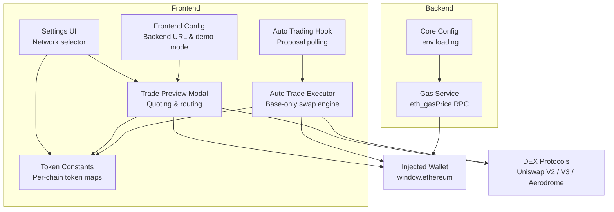
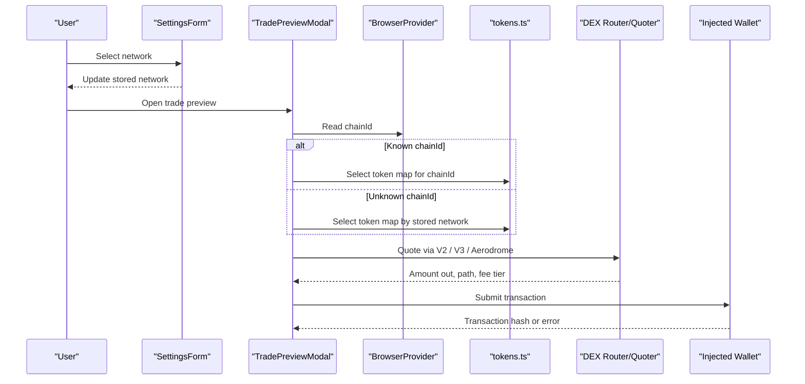
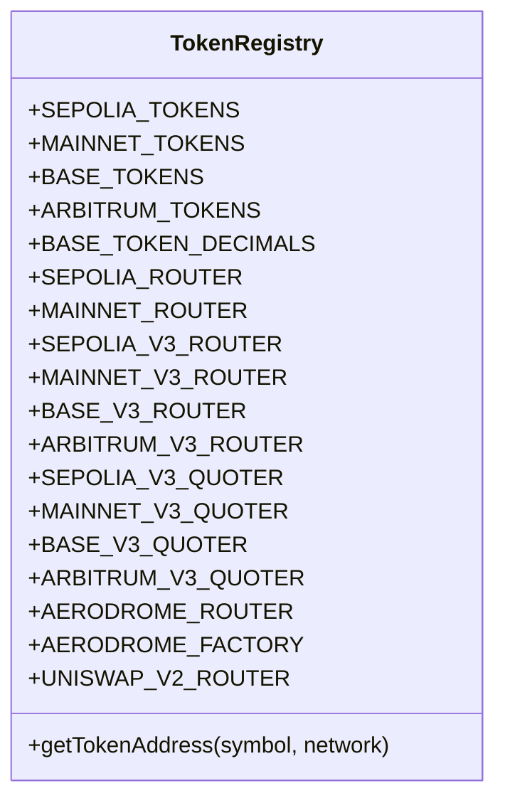
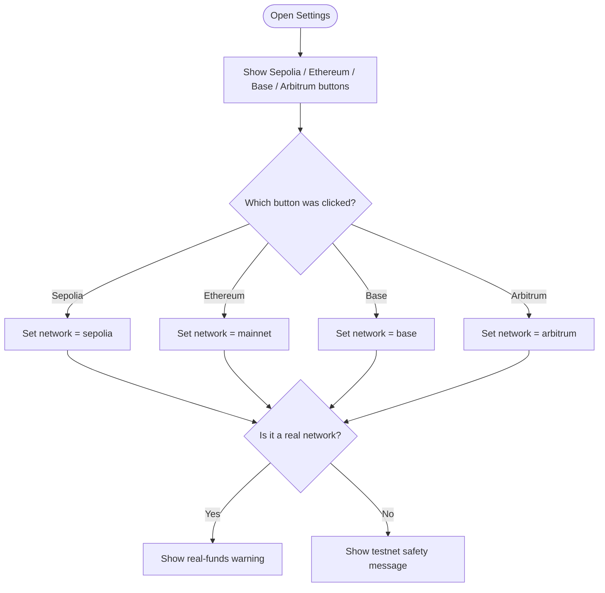
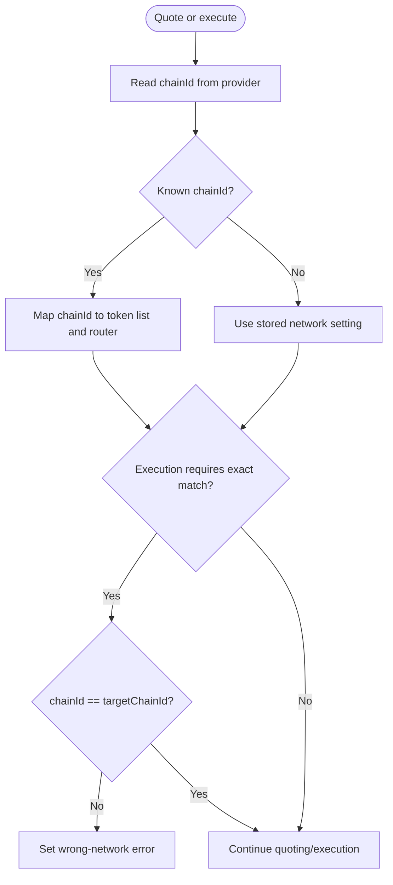
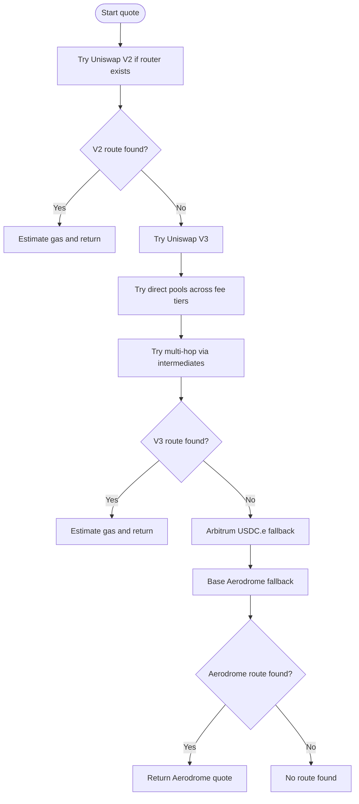
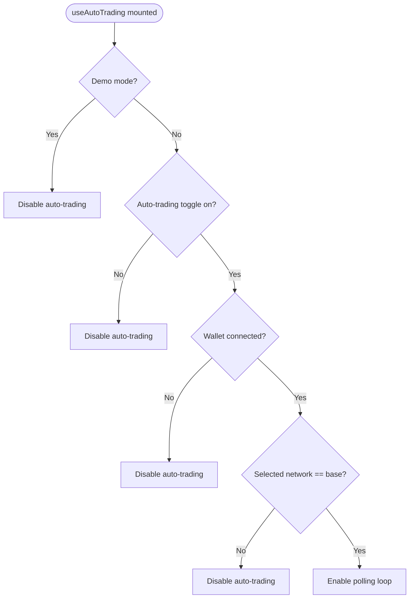
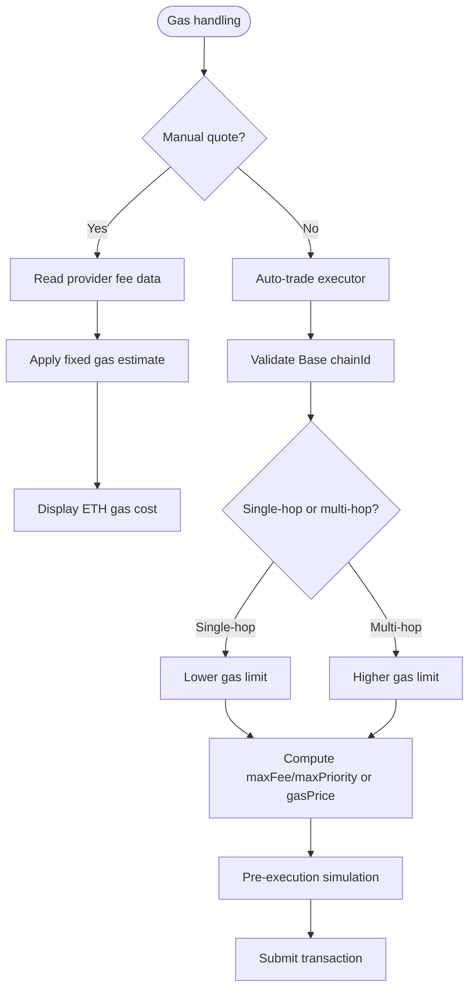
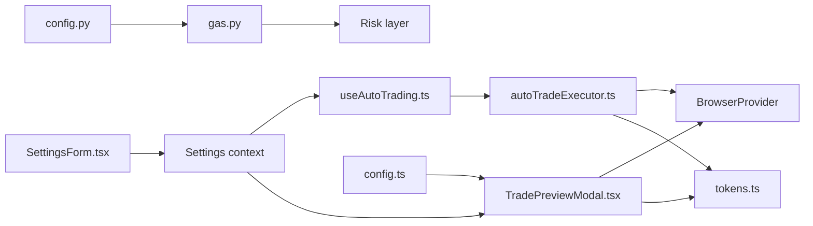

# Multi-Chain Network Support

<cite>
**Referenced Files in This Document**   
- [README.md](file://README.md)
- [tokens.ts](file://frontend/constants/tokens.ts)
- [config.ts](file://frontend/constants/config.ts)
- [TradePreviewModal.tsx](file://frontend/components/TradePreviewModal.tsx)
- [autoTradeExecutor.ts](file://frontend/lib/autoTradeExecutor.ts)
- [useAutoTrading.ts](file://frontend/hooks/useAutoTrading.ts)
- [SettingsForm.tsx](file://frontend/components/SettingsForm.tsx)
- [config.py](file://backend/app/core/config.py)
- [gas.py](file://backend/app/services/gas.py)
</cite>

## Table of Contents
1. [Introduction](#introduction)
2. [Project Structure](#project-structure)
3. [Core Components](#core-components)
4. [Architecture Overview](#architecture-overview)
5. [Detailed Component Analysis](#detailed-component-analysis)
6. [Dependency Analysis](#dependency-analysis)
7. [Performance Considerations](#performance-considerations)
8. [Troubleshooting Guide](#troubleshooting-guide)
9. [Conclusion](#conclusion)
10. [Appendices](#appendices)

## Introduction
This document explains how DexTrader supports multiple blockchain networks and how network-specific configuration is handled across the frontend and backend. The application currently recognizes four networks:

- **Sepolia** (testnet)
- **Ethereum mainnet**
- **Base**
- **Arbitrum One**

The system uses a combination of:

- A token constants file that maps supported tokens, router addresses, quoter addresses, and DEX protocol metadata to each network.
- Frontend components that select token lists and routing logic based on the wallet’s active chain ID or the user-selected network setting.
- Chain ID validation before quoting and execution.
- Network-specific gas estimation and RPC usage.
- Protocol selection between Uniswap V2, Uniswap V3, and Aerodrome depending on the chain and available liquidity.

The trading proposal pipeline runs server-side, but actual swaps are built and signed in the browser through the injected wallet. Auto-trading is intentionally restricted to Base for now.

**Section sources**
- [README.md:3-19](file://README.md#L3-L19)
- [README.md:22-34](file://README.md#L22-L34)
- [README.md:66-86](file://README.md#L66-L86)

## Project Structure
Multi-chain support is primarily implemented in the frontend, with small backend integration points for gas pricing and environment configuration.

**Diagram sources**
- [SettingsForm.tsx:77-129](file://frontend/components/SettingsForm.tsx#L77-L129)
- [tokens.ts:1-128](file://frontend/constants/tokens.ts#L1-L128)
- [TradePreviewModal.tsx:174-779](file://frontend/components/TradePreviewModal.tsx#L174-L779)
- [autoTradeExecutor.ts:44-282](file://frontend/lib/autoTradeExecutor.ts#L44-L282)
- [useAutoTrading.ts:21-204](file://frontend/hooks/useAutoTrading.ts#L21-L204)
- [config.ts:1-8](file://frontend/constants/config.ts#L1-L8)
- [config.py:1-17](file://backend/app/core/config.py#L1-L17)
- [gas.py:1-60](file://backend/app/services/gas.py#L1-L60)

**Section sources**
- [README.md:116-144](file://README.md#L116-L144)
- [README.md:146-154](file://README.md#L146-L154)

## Core Components
The multi-chain behavior is driven by these core pieces:

| Component | Responsibility | Key Behavior |
|---|---|---|
| `frontend/constants/tokens.ts` | Defines per-chain token addresses, router addresses, quoter addresses, and special DEX endpoints | Exports `SEPOLIA_TOKENS`, `MAINNET_TOKENS`, `BASE_TOKENS`, `ARBITRUM_TOKENS`, plus V2/V3 routers and Aerodrome metadata |
| `frontend/components/SettingsForm.tsx` | Lets users choose the target network | Stores `sepolia`, `mainnet`, `base`, or `arbitrum` in local settings |
| `frontend/components/TradePreviewModal.tsx` | Quotes trades and selects DEX routes | Reads the wallet’s chain ID, selects token lists, tries V2, V3, then Aerodrome |
| `frontend/lib/autoTradeExecutor.ts` | Executes automated swaps | Currently locked to Base; validates chain ID, quotes via QuoterV3, and executes via SwapRouter02 |
| `frontend/hooks/useAutoTrading.ts` | Polls proposals and triggers auto-execution | Disables itself unless the selected network is `base` |
| `frontend/constants/config.ts` | Provides build-time and runtime config | Backend URL and demo mode flag |
| `backend/app/core/config.py` | Loads environment variables | API keys and demo mode |
| `backend/app/services/gas.py` | Reads live gas price from an RPC endpoint | Defaults to Base mainnet RPC; used by risk layer and display logic |

**Section sources**
- [tokens.ts:1-128](file://frontend/constants/tokens.ts#L1-L128)
- [SettingsForm.tsx:77-129](file://frontend/components/SettingsForm.tsx#L77-L129)
- [TradePreviewModal.tsx:174-779](file://frontend/components/TradePreviewModal.tsx#L174-L779)
- [autoTradeExecutor.ts:44-282](file://frontend/lib/autoTradeExecutor.ts#L44-L282)
- [useAutoTrading.ts:21-204](file://frontend/hooks/useAutoTrading.ts#L21-L204)
- [config.ts:1-8](file://frontend/constants/config.ts#L1-L8)
- [config.py:1-17](file://backend/app/core/config.py#L1-L17)
- [gas.py:1-60](file://backend/app/services/gas.py#L1-L60)

## Architecture Overview
At runtime, the user’s wallet provider (`window.ethereum`) determines the actual chain. The UI also maintains a user-selected network preference. Most quoting and execution paths prefer the wallet’s chain ID when available, falling back to the configured network name when needed.

**Diagram sources**
- [SettingsForm.tsx:77-129](file://frontend/components/SettingsForm.tsx#L77-L129)
- [TradePreviewModal.tsx:174-219](file://frontend/components/TradePreviewModal.tsx#L174-L219)
- [tokens.ts:1-128](file://frontend/constants/tokens.ts#L1-L128)

## Detailed Component Analysis

### Token Constants and Network Metadata
The token constants file is the central registry for multi-chain support. It defines:

- **Supported tokens per network:**
  - Sepolia testnet tokens
  - Ethereum mainnet tokens
  - Base tokens
  - Arbitrum tokens
- **Router addresses:**
  - Uniswap V2 routers for Sepolia and Ethereum mainnet
  - Uniswap V3 routers and quoters for all supported chains
- **Aerodrome metadata:**
  - Factory and router addresses for Base-specific low-cap liquidity
- **Decimal overrides:**
  - Some Base tokens have non-standard decimals explicitly listed
- **Address lookup helper:**
  - `getTokenAddress(symbol, network)` returns the correct address for the selected network

Important characteristics:

- ETH is represented as WETH when interacting with DEX contracts.
- Bridged stablecoins such as USDC.e on Arbitrum and USDbC on Base are included where relevant.
- Some tokens are placeholders or fallbacks on testnets to keep the UI functional during testing.
- The default exported V2 router is set to Sepolia for backward compatibility, but components should resolve the correct router by chain ID.

**Diagram sources**
- [tokens.ts:1-128](file://frontend/constants/tokens.ts#L1-L128)

**Section sources**
- [tokens.ts:1-128](file://frontend/constants/tokens.ts#L1-L128)

### Network Selection UI
The Settings page exposes four network options:

- Sepolia
- Ethereum
- Base
- Arbitrum

The selected value is stored in the frontend settings context and used throughout the app. Real-network buttons include a warning that real funds may be used. Testnet mode is presented as safer for strategy testing.

**Diagram sources**
- [SettingsForm.tsx:77-129](file://frontend/components/SettingsForm.tsx#L77-L129)

**Section sources**
- [SettingsForm.tsx:77-129](file://frontend/components/SettingsForm.tsx#L77-L129)

### Chain ID Resolution and Validation
The trade preview modal resolves the active chain using the injected provider. If the chain ID is known, it selects the matching token list and router. If the chain ID is unknown or null, it falls back to the stored network setting.

Key behaviors:

- Chain ID `1` → Ethereum mainnet
- Chain ID `8453` → Base
- Chain ID `42161` → Arbitrum
- Chain ID `11155111` → Sepolia
- Unknown chain IDs fall back to the user-selected network
- Execution paths validate that the connected chain matches the expected target chain

**Diagram sources**
- [TradePreviewModal.tsx:174-219](file://frontend/components/TradePreviewModal.tsx#L174-L219)
- [TradePreviewModal.tsx:981-1012](file://frontend/components/TradePreviewModal.tsx#L981-L1012)
- [TradePreviewModal.tsx:1136-1170](file://frontend/components/TradePreviewModal.tsx#L1136-L1170)

**Section sources**
- [TradePreviewModal.tsx:174-219](file://frontend/components/TradePreviewModal.tsx#L174-L219)
- [TradePreviewModal.tsx:981-1012](file://frontend/components/TradePreviewModal.tsx#L981-L1012)
- [TradePreviewModal.tsx:1136-1170](file://frontend/components/TradePreviewModal.tsx#L1136-L1170)

### DEX Protocol Routing
The modal attempts multiple DEX protocols and routes to maximize liquidity and slippage control:

1. **Uniswap V2**
   - Used when a V2 router is available for the chain
   - Tries direct pairs and common intermediaries such as WETH, USDC, USDT, and DAI
   - Calculates price impact for direct pairs using pool reserves
2. **Uniswap V3**
   - Uses QuoterV2 to compare fee tiers: 0.01%, 0.05%, 0.3%, 1%
   - Supports single-hop and multi-hop routes through high-liquidity intermediates
   - Avoids routes that hit pool boundaries
3. **Aerodrome (Base only)**
   - Queries the Aerodrome factory for volatile or stable pools
   - Computes output from pool reserves
   - Supports indirect routes via WETH when direct pools are missing

**Diagram sources**
- [TradePreviewModal.tsx:265-397](file://frontend/components/TradePreviewModal.tsx#L265-L397)
- [TradePreviewModal.tsx:399-574](file://frontend/components/TradePreviewModal.tsx#L399-L574)
- [TradePreviewModal.tsx:576-631](file://frontend/components/TradePreviewModal.tsx#L576-L631)
- [TradePreviewModal.tsx:633-767](file://frontend/components/TradePreviewModal.tsx#L633-L767)

**Section sources**
- [TradePreviewModal.tsx:265-397](file://frontend/components/TradePreviewModal.tsx#L265-L397)
- [TradePreviewModal.tsx:399-574](file://frontend/components/TradePreviewModal.tsx#L399-L574)
- [TradePreviewModal.tsx:576-631](file://frontend/components/TradePreviewModal.tsx#L576-L631)
- [TradePreviewModal.tsx:633-767](file://frontend/components/TradePreviewModal.tsx#L633-L767)

### Auto-Trading Network Restrictions
Auto-trading is intentionally limited to Base. The hook disables itself if:

- Demo mode is enabled
- Auto-trading is off
- No wallet is connected
- The selected network is not `base`

The executor then enforces the same rule at runtime by checking the wallet’s chain ID against Base’s chain ID.

**Diagram sources**
- [useAutoTrading.ts:89-117](file://frontend/hooks/useAutoTrading.ts#L89-L117)
- [autoTradeExecutor.ts:44-63](file://frontend/lib/autoTradeExecutor.ts#L44-L63)

**Section sources**
- [useAutoTrading.ts:89-117](file://frontend/hooks/useAutoTrading.ts#L89-L117)
- [autoTradeExecutor.ts:44-63](file://frontend/lib/autoTradeExecutor.ts#L44-L63)

### Gas Optimization and Network-Specific Parameters
Gas handling differs between manual quoting and automated execution:

- **Manual quoting:**
  - Uses provider fee data
  - Applies fixed estimated gas limits for V2 and V3
  - Displays estimated gas cost in ETH
- **Auto-trade execution:**
  - Validates the wallet chain is Base
  - Chooses higher gas limits for multi-hop routes
  - Respects user-provided gas price while ensuring it does not go below the network’s suggested `maxFeePerGas`
  - Wraps the swap in a multicall with a deadline to limit mempool exposure
  - Performs a pre-execution simulation before opening the wallet confirmation

The backend gas service reads `eth_gasPrice` from the configured RPC, defaults to Base mainnet, caches results for 60 seconds, and returns a conservative fallback instead of failing the agent loop.

**Diagram sources**
- [TradePreviewModal.tsx:386-397](file://frontend/components/TradePreviewModal.tsx#L386-L397)
- [TradePreviewModal.tsx:559-567](file://frontend/components/TradePreviewModal.tsx#L559-L567)
- [autoTradeExecutor.ts:199-232](file://frontend/lib/autoTradeExecutor.ts#L199-L232)
- [gas.py:27-59](file://backend/app/services/gas.py#L27-L59)

**Section sources**
- [TradePreviewModal.tsx:386-397](file://frontend/components/TradePreviewModal.tsx#L386-L397)
- [TradePreviewModal.tsx:559-567](file://frontend/components/TradePreviewModal.tsx#L559-L567)
- [autoTradeExecutor.ts:199-232](file://frontend/lib/autoTradeExecutor.ts#L199-L232)
- [gas.py:27-59](file://backend/app/services/gas.py#L27-L59)

### Environment and Configuration
Environment variables affect both frontend and backend behavior:

- **Frontend:**
  - `NEXT_PUBLIC_BACKEND_URL`: Backend origin
  - `NEXT_PUBLIC_DEMO_MODE`: Build-time demo mode
- **Backend:**
  - API keys for market data and LLM providers
  - `DEMO_MODE`: Enables simulated portfolio behavior
  - `BASE_RPC_URL`: JSON-RPC endpoint for gas price queries

The frontend config module exports the backend URL and demo mode flag. The backend config module loads `.env` values and exposes demo mode.

**Section sources**
- [README.md:66-86](file://README.md#L66-L86)
- [config.ts:1-8](file://frontend/constants/config.ts#L1-L8)
- [config.py:1-17](file://backend/app/core/config.py#L1-L17)
- [gas.py:12-14](file://backend/app/services/gas.py#L12-L14)

## Dependency Analysis
The following diagram shows how multi-chain dependencies flow through the frontend and backend.

**Diagram sources**
- [SettingsForm.tsx:77-129](file://frontend/components/SettingsForm.tsx#L77-L129)
- [TradePreviewModal.tsx:174-219](file://frontend/components/TradePreviewModal.tsx#L174-L219)
- [useAutoTrading.ts:21-204](file://frontend/hooks/useAutoTrading.ts#L21-L204)
- [autoTradeExecutor.ts:44-282](file://frontend/lib/autoTradeExecutor.ts#L44-L282)
- [tokens.ts:1-128](file://frontend/constants/tokens.ts#L1-L128)
- [config.py:1-17](file://backend/app/core/config.py#L1-L17)
- [gas.py:1-60](file://backend/app/services/gas.py#L1-L60)
- [config.ts:1-8](file://frontend/constants/config.ts#L1-L8)

**Section sources**
- [README.md:22-34](file://README.md#L22-L34)
- [README.md:116-144](file://README.md#L116-L144)

## Performance Considerations
Multi-chain quoting can involve many on-chain calls. The current implementation balances responsiveness with correctness:

- Quoting is debounced rather than triggered on every keystroke.
- V2 and V3 quoting use static calls where possible to avoid unnecessary state changes.
- V3 quoting compares multiple fee tiers and intermediate hops to find better routes.
- Gas prices are cached on the backend for 60 seconds.
- Auto-trade performs a pre-execution simulation to fail early before prompting the user.
- Slippage is increased for volatile low-cap tokens in auto-trade to reduce reverts.

Recommendations:

- Avoid excessive concurrent quotes by keeping debounce intervals reasonable.
- Prefer direct routes when available; multi-hop routes increase gas and failure surface.
- Monitor RPC reliability; failed RPC calls should not block the entire trading loop.
- Use testnets for heavy experimentation before switching to mainnet.

[No sources needed since this section provides general guidance]

## Troubleshooting Guide

### Common Multi-Chain Issues

| Symptom | Likely Cause | Resolution |
|---|---|---|
| “Token address not found” | Selected token is not present in the token list for the active chain | Add the token to the appropriate token map in `tokens.ts` |
| “Wrong network” or “Please switch to...” | Wallet chain ID does not match the selected network | Switch the wallet to the expected chain or update the settings network |
| “No route found” | No liquidity on V2, V3, or Aerodrome for the pair | Try a different pair, add liquidity, or wait for better pool coverage |
| Auto-trade disabled | Selected network is not Base or demo mode is enabled | Set network to `base` and disable demo mode |
| Gas estimation fails | RPC unavailable or malformed response | Verify `BASE_RPC_URL`; the backend falls back to a conservative gas price |
| Swap reverts on volatile tokens | Slippage too tight | Increase slippage; auto-trade applies a minimum floor for volatile tokens |

**Section sources**
- [TradePreviewModal.tsx:230-235](file://frontend/components/TradePreviewModal.tsx#L230-L235)
- [TradePreviewModal.tsx:999-1003](file://frontend/components/TradePreviewModal.tsx#L999-L1003)
- [TradePreviewModal.tsx:1164-1169](file://frontend/components/TradePreviewModal.tsx#L1164-L1169)
- [useAutoTrading.ts:95-117](file://frontend/hooks/useAutoTrading.ts#L95-L117)
- [autoTradeExecutor.ts:61-63](file://frontend/lib/autoTradeExecutor.ts#L61-L63)
- [gas.py:27-59](file://backend/app/services/gas.py#L27-L59)

## Conclusion
DexTrader’s multi-chain support is centered on a clear separation between configuration and execution:

- `tokens.ts` is the source of truth for chain-specific token addresses, routers, and DEX metadata.
- The UI selects token lists and routing strategies based on the wallet’s chain ID, with a fallback to the user-selected network.
- Chain ID validation prevents accidental execution on unsupported chains.
- Manual quoting supports multiple DEX protocols, while auto-trading is intentionally restricted to Base.
- Gas handling combines provider fee data, backend RPC access, and conservative fallbacks.

To extend support further, new networks should be added consistently across token maps, router addresses, chain ID checks, and any protocol-specific routing logic.

[No sources needed since this section summarizes without analyzing specific files]

## Appendices

### How to Add a New Network
Adding a new network involves updating several places:

1. **Add token maps**
   - Define a new token record in `tokens.ts`
   - Include WETH, stablecoins, and other high-liquidity assets
   - Add decimal overrides where needed
2. **Add router and quoter addresses**
   - Add V2 router if supported
   - Add V3 router and quoter addresses
   - Add protocol-specific factory/router if applicable
3. **Update chain ID mapping**
   - Add the chain ID to all chain resolution branches in `TradePreviewModal.tsx`
   - Ensure balance loading, quoting, and submission paths handle the new chain
4. **Update settings and warnings**
   - Add the network option in `SettingsForm.tsx`
   - Update real-fund warnings and filter options
5. **Update auto-trading if supported**
   - Extend `useAutoTrading.ts` and `autoTradeExecutor.ts` if auto-trade should support the new chain
   - Add eligible token targets and routing intermediates
6. **Update backend gas configuration if needed**
   - Add a dedicated RPC variable if the chain requires a different gas endpoint
   - Keep fallback behavior so failures do not break the agent loop

**Section sources**
- [tokens.ts:1-128](file://frontend/constants/tokens.ts#L1-L128)
- [TradePreviewModal.tsx:174-219](file://frontend/components/TradePreviewModal.tsx#L174-L219)
- [SettingsForm.tsx:77-129](file://frontend/components/SettingsForm.tsx#L77-L129)
- [useAutoTrading.ts:89-117](file://frontend/hooks/useAutoTrading.ts#L89-L117)
- [autoTradeExecutor.ts:44-63](file://frontend/lib/autoTradeExecutor.ts#L44-L63)
- [gas.py:12-14](file://backend/app/services/gas.py#L12-L14)

### Example: Adding a New Token to Base
1. Find the contract address on Base Explorer.
2. Confirm the token’s decimals.
3. Add the symbol and address to `BASE_TOKENS`.
4. Add a decimal override in `BASE_TOKEN_DECIMALS` if it is not 18.
5. Test quoting and execution on Base mainnet or a Base testnet.
6. If the token is volatile, consider adding it to the volatile token list in auto-trade if appropriate.

**Section sources**
- [tokens.ts:40-84](file://frontend/constants/tokens.ts#L40-L84)
- [autoTradeExecutor.ts:9-12](file://frontend/lib/autoTradeExecutor.ts#L9-L12)