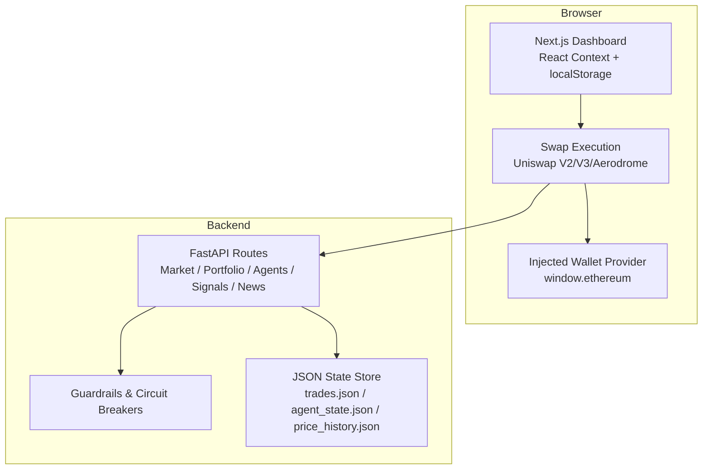
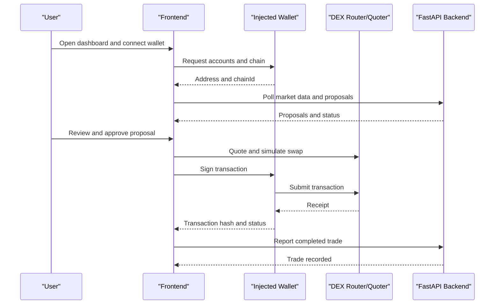
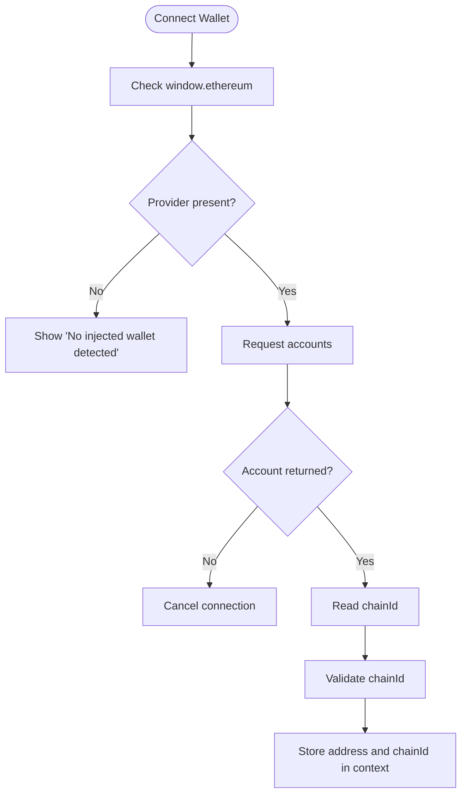
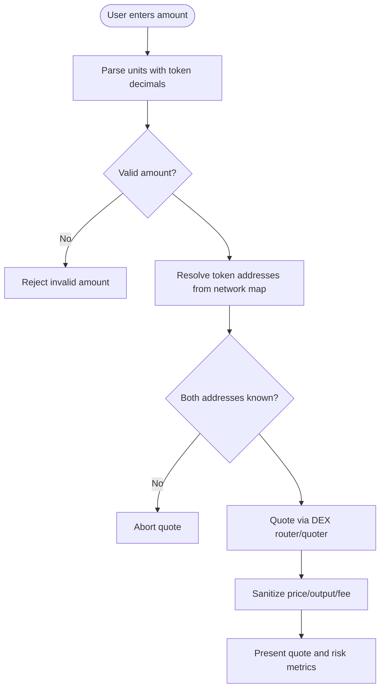
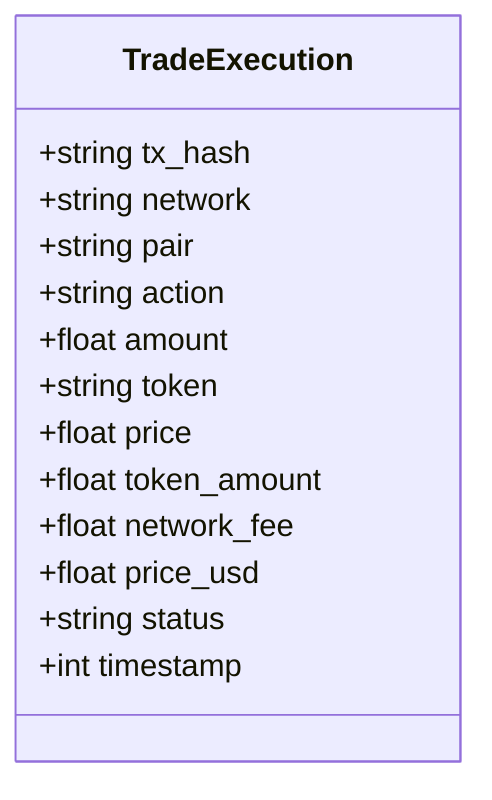
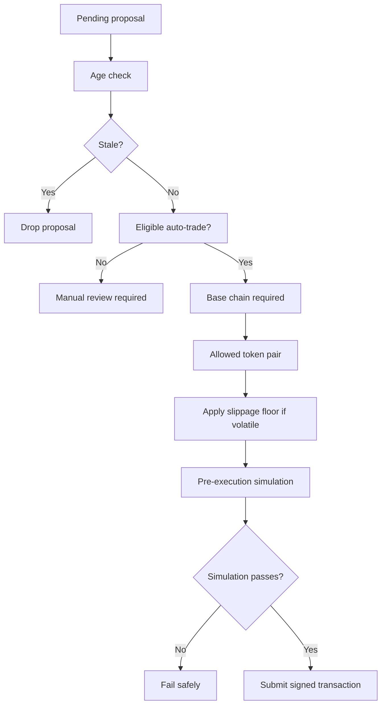
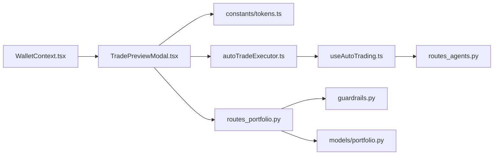

# Security Model & Best Practices

<cite>
**Referenced Files in This Document**
- [README.md](file://README.md)
- [backend/app/main.py](file://backend/app/main.py)
- [backend/app/api/routes_portfolio.py](file://backend/app/api/routes_portfolio.py)
- [backend/app/api/routes_agents.py](file://backend/app/api/routes_agents.py)
- [backend/app/services/guardrails.py](file://backend/app/services/guardrails.py)
- [backend/app/models/portfolio.py](file://backend/app/models/portfolio.py)
- [frontend/context/WalletContext.tsx](file://frontend/context/WalletContext.tsx)
- [frontend/components/TradePreviewModal.tsx](file://frontend/components/TradePreviewModal.tsx)
- [frontend/lib/autoTradeExecutor.ts](file://frontend/lib/autoTradeExecutor.ts)
- [frontend/hooks/useAutoTrading.ts](file://frontend/hooks/useAutoTrading.ts)
- [frontend/constants/tokens.ts](file://frontend/constants/tokens.ts)
</cite>

## Table of Contents
1. [Introduction](#introduction)
2. [Project Structure](#project-structure)
3. [Core Components](#core-components)
4. [Architecture Overview](#architecture-overview)
5. [Detailed Component Analysis](#detailed-component-analysis)
6. [Dependency Analysis](#dependency-analysis)
7. [Performance Considerations](#performance-considerations)
8. [Troubleshooting Guide](#troubleshooting-guide)
9. [Conclusion](#conclusion)
10. [Appendices](#appendices)

## Introduction
This document explains the security model and best practices for DexTrader’s blockchain integration. The application follows a server-side reasoning, client-side signing model: private keys never leave the browser, and the backend only receives trade results after the user approves and signs transactions through an injected wallet provider. It also documents input validation, address sanitization, protection against common attack vectors, safe handling of transaction data, replay-prevention techniques, secure communication with blockchain nodes, limitations of automated trading, and recommended safety measures.

The project is experimental and can move real funds on Base mainnet by default; use testnets or small amounts until you trust it.

**Section sources**
- [README.md:3-10](file://README.md#L3-L10)
- [README.md:156-183](file://README.md#L156-L183)

## Project Structure
DexTrader consists of two layers:
- Frontend: Next.js dashboard that reads the wallet in the browser, builds quotes, constructs transactions, and sends them through `window.ethereum`.
- Backend: FastAPI service that generates trade proposals, persists state to JSON files, exposes unauthenticated routes behind CORS, and records completed trades.

**Diagram sources**
- [README.md:22-34](file://README.md#L22-L34)
- [backend/app/main.py:14-38](file://backend/app/main.py#L14-L38)
- [frontend/context/WalletContext.tsx:21-98](file://frontend/context/WalletContext.tsx#L21-L98)
- [frontend/lib/autoTradeExecutor.ts:44-282](file://frontend/lib/autoTradeExecutor.ts#L44-L282)

**Section sources**
- [README.md:116-144](file://README.md#L116-L144)
- [backend/app/main.py:14-38](file://backend/app/main.py#L14-L38)

## Core Components
The security model centers on five components:

- **Wallet context**: Manages connection to the injected wallet, tracks the current account and chain, and exposes connect/disconnect operations. Private keys are never exported.
- **Trade preview modal**: Builds quotes from DEX routers/quoters, validates inputs, estimates gas and slippage, simulates calls where possible, and submits signed transactions through the wallet.
- **Auto-trade executor**: Restricts automated swaps to a whitelist of tokens, enforces network checks, performs pre-execution simulation, applies slippage floors for volatile tokens, and wraps execution in multicall with a deadline.
- **Agent proposal pipeline**: Generates proposals on the backend; the frontend polls them and executes eligible ones either manually or automatically.
- **Portfolio recording**: Receives completed trade reports from the frontend and updates position state; demo mode blocks real trade recording.

Key security responsibilities:
- Keep private keys exclusively in the browser.
- Validate and sanitize all user-supplied values before quoting or executing.
- Enforce network, token, and slippage constraints.
- Use simulation and deadlines to reduce failed or stale on-chain transactions.
- Record only post-execution results, not sensitive signing material.

**Section sources**
- [frontend/context/WalletContext.tsx:1-117](file://frontend/context/WalletContext.tsx#L1-L117)
- [frontend/components/TradePreviewModal.tsx:174-779](file://frontend/components/TradePreviewModal.tsx#L174-L779)
- [frontend/lib/autoTradeExecutor.ts:44-282](file://frontend/lib/autoTradeExecutor.ts#L44-L282)
- [backend/app/api/routes_agents.py:87-116](file://backend/app/api/routes_agents.py#L87-L116)
- [backend/app/api/routes_portfolio.py:75-96](file://backend/app/api/routes_portfolio.py#L75-L96)

## Architecture Overview
The system separates strategy generation from execution:

**Diagram sources**
- [README.md:15-19](file://README.md#L15-L19)
- [frontend/components/TradePreviewModal.tsx:1172-1824](file://frontend/components/TradePreviewModal.tsx#L1172-L1824)
- [frontend/lib/autoTradeExecutor.ts:232-276](file://frontend/lib/autoTradeExecutor.ts#L232-L276)
- [backend/app/api/routes_portfolio.py:75-96](file://backend/app/api/routes_portfolio.py#L75-L96)

## Detailed Component Analysis

### Wallet Security and Key Isolation
The wallet layer lives entirely in the browser:
- Connection uses `eth_requestAccounts` and listens to `accountsChanged` and `chainChanged`.
- Addresses and chain identifiers are stored in React context and local storage settings.
- No private key material is read, serialized, or sent to the backend.
- Errors from wallet interactions are surfaced to the UI without leaking secrets.

Best practices enforced here:
- Never call methods that would export private keys.
- Always validate the returned chain identifier.
- Handle account changes defensively.
- Avoid storing sensitive data beyond the wallet address.

**Diagram sources**
- [frontend/context/WalletContext.tsx:21-98](file://frontend/context/WalletContext.tsx#L21-L98)

**Section sources**
- [frontend/context/WalletContext.tsx:1-117](file://frontend/context/WalletContext.tsx#L1-L117)

### Input Validation and Address Sanitization
The frontend validates and sanitizes inputs at multiple stages:
- Amount parsing uses `parseUnits` with dynamically resolved decimals.
- Excessive decimal precision is truncated to avoid underflow or parsing errors.
- Token addresses are resolved from a per-network token map; missing addresses abort quoting.
- Prices and outputs are sanitized to prevent NaN/null values from reaching the backend.
- Slippage is bounded and adjusted for volatile tokens.

**Diagram sources**
- [frontend/components/TradePreviewModal.tsx:245-263](file://frontend/components/TradePreviewModal.tsx#L245-L263)
- [frontend/components/TradePreviewModal.tsx:1172-1203](file://frontend/components/TradePreviewModal.tsx#L1172-L1203)
- [frontend/components/TradePreviewModal.tsx:1791-1808](file://frontend/components/TradePreviewModal.tsx#L1791-L1808)
- [frontend/constants/tokens.ts:1-128](file://frontend/constants/tokens.ts#L1-L128)

**Section sources**
- [frontend/components/TradePreviewModal.tsx:174-779](file://frontend/components/TradePreviewModal.tsx#L174-L779)
- [frontend/constants/tokens.ts:1-128](file://frontend/constants/tokens.ts#L1-L128)

### Safe Handling of Transaction Data
Transaction construction and reporting follow a uniform standard:
- The frontend computes quote quantity, base quantity, execution price, and network fee.
- A standardized payload includes `tx_hash`, `network`, `pair`, `action`, `amount`, `token`, `price`, `token_amount`, `network_fee`, `status`, and `timestamp`.
- The backend models this payload with Pydantic and records it only after successful submission.
- Duplicate transaction hashes are handled so the same trade does not double-count position state.

**Diagram sources**
- [backend/app/models/portfolio.py:17-36](file://backend/app/models/portfolio.py#L17-L36)

**Section sources**
- [frontend/components/TradePreviewModal.tsx:1798-1824](file://frontend/components/TradePreviewModal.tsx#L1798-L1824)
- [backend/app/models/portfolio.py:17-36](file://backend/app/models/portfolio.py#L17-L36)
- [backend/app/api/routes_portfolio.py:75-96](file://backend/app/api/routes_portfolio.py#L75-L96)
- [backend/app/agents/controller.py:431-466](file://backend/app/agents/controller.py#L431-L466)

### Protection Against Common Attack Vectors
The code implements several defensive patterns:

- **Replay and stale execution prevention**:
  - Auto-trade wraps router calls in multicall with a deadline.
  - Stale proposals older than twice the polling interval or ten minutes are dropped.
  - Nonce pinning is avoided to remain compatible with wallet relays.
- **Slippage and price impact controls**:
  - Minimum slippage floor for volatile tokens.
  - Pool boundary checks when using Uniswap V3 quoters.
  - Price impact estimation for V2 direct pairs and V3 spot-rate comparisons.
- **Network and token whitelisting**:
  - Auto-trade requires Base chain ID.
  - Only allowed tokens participate in automated execution.
- **Simulation before signing**:
  - Pre-execution static calls reject obviously failing transactions.
- **CORS and origin control**:
  - Default CORS allows only localhost origins unless explicitly configured.

**Diagram sources**
- [frontend/hooks/useAutoTrading.ts:140-186](file://frontend/hooks/useAutoTrading.ts#L140-L186)
- [frontend/lib/autoTradeExecutor.ts:61-63](file://frontend/lib/autoTradeExecutor.ts#L61-L63)
- [frontend/lib/autoTradeExecutor.ts:157-164](file://frontend/lib/autoTradeExecutor.ts#L157-L164)
- [frontend/lib/autoTradeExecutor.ts:232-259](file://frontend/lib/autoTradeExecutor.ts#L232-L259)
- [backend/app/main.py:16-32](file://backend/app/main.py#L16-L32)

**Section sources**
- [frontend/hooks/useAutoTrading.ts:21-208](file://frontend/hooks/useAutoTrading.ts#L21-L208)
- [frontend/lib/autoTradeExecutor.ts:44-282](file://frontend/lib/autoTradeExecutor.ts#L44-L282)
- [frontend/components/TradePreviewModal.tsx:400-557](file://frontend/components/TradePreviewModal.tsx#L400-L557)
- [backend/app/main.py:16-32](file://backend/app/main.py#L16-L32)

### Secure Communication with Blockchain Nodes
Communication with blockchain nodes occurs in the browser:
- `BrowserProvider` is created from `window.ethereum`.
- Network detection uses `provider.getNetwork()` and chain ID checks.
- Quotes and simulations call DEX contracts directly through the provider.
- Gas pricing respects wallet relay behavior and avoids unsafe overrides.

Recommendations:
- Prefer trusted RPC endpoints and consider adding node health checks.
- Do not hardcode secret RPC credentials in the frontend.
- Monitor upstream node failures and degrade gracefully.

**Section sources**
- [frontend/lib/autoTradeExecutor.ts:55-66](file://frontend/lib/autoTradeExecutor.ts#L55-L66)
- [frontend/components/TradePreviewModal.tsx:188-219](file://frontend/components/TradePreviewModal.tsx#L188-L219)
- [frontend/lib/autoTradeExecutor.ts:207-230](file://frontend/lib/autoTradeExecutor.ts#L207-L230)

### Limitations of Client-Side Trading and Automated Execution
Important limitations:
- Pricing source differs from execution venue: proposals use global spot prices, while execution happens on DEX pools.
- Auto-trade supports only a narrow set of tokens and Base chain routing paths.
- Demo mode disables real trade recording and wallet-driven automation.
- JSON persistence has no database migration path or multi-process safety.
- The backend API is unauthenticated; CORS is a configuration default, not a security boundary.

Operational risks:
- Automated execution can trigger surprise MetaMask popups if proposals are stale.
- Low liquidity or high volatility can cause reverts despite slippage protections.
- Strategy indicators need warm-up history; freshly started backends may trade on weaker signals.

**Section sources**
- [README.md:168-183](file://README.md#L168-L183)
- [frontend/hooks/useAutoTrading.ts:95-117](file://frontend/hooks/useAutoTrading.ts#L95-L117)
- [frontend/lib/autoTradeExecutor.ts:47-76](file://frontend/lib/autoTradeExecutor.ts#L47-L76)
- [backend/app/api/routes_portfolio.py:75-81](file://backend/app/api/routes_portfolio.py#L75-L81)

### Recommended Safety Measures
Adopt these practices when extending or operating DexTrader:

- **Private key isolation**:
  - Never log, store, or transmit private keys or seed phrases.
  - Keep signing logic in the browser; the backend should only record outcomes.
- **Input validation**:
  - Validate amounts, decimals, symbols, and addresses before quoting.
  - Reject malformed or duplicated query parameters early.
- **Network and token policy**:
  - Enforce chain IDs and token whitelists for automated flows.
  - Require explicit user approval for non-whitelisted actions.
- **Slippage and limits**:
  - Apply minimum slippage floors for volatile tokens.
  - Cap maximum slippage and enforce price impact warnings.
- **Replay and staleness protection**:
  - Use deadlines and nonce management compatible with wallets.
  - Drop stale proposals and avoid re-executing identical transactions.
- **Secure communication**:
  - Configure CORS strictly for production hosts.
  - Add authentication or API gateways if exposing the backend publicly.
- **Incident response**:
  - Provide manual kill switches and circuit breakers.
  - Rotate logs and retain audit trails without exposing secrets.
  - Have procedures for RPC outages, DEX contract upgrades, and compromised wallets.

**Section sources**
- [backend/app/api/routes_agents.py:48-58](file://backend/app/api/routes_agents.py#L48-L58)
- [backend/app/services/guardrails.py:16-25](file://backend/app/services/guardrails.py#L16-L25)
- [backend/app/services/guardrails.py:91-112](file://backend/app/services/guardrails.py#L91-L112)
- [backend/app/main.py:16-32](file://backend/app/main.py#L16-L32)

## Dependency Analysis
The frontend depends on injected wallet providers and DEX contracts; the backend depends on FastAPI, Pydantic, and external market data APIs. There is no shared secret dependency between frontend and backend for signing.

**Diagram sources**
- [frontend/context/WalletContext.tsx:1-117](file://frontend/context/WalletContext.tsx#L1-L117)
- [frontend/components/TradePreviewModal.tsx:1-10](file://frontend/components/TradePreviewModal.tsx#L1-L10)
- [frontend/constants/tokens.ts:1-128](file://frontend/constants/tokens.ts#L1-L128)
- [frontend/lib/autoTradeExecutor.ts:1-43](file://frontend/lib/autoTradeExecutor.ts#L1-L43)
- [frontend/hooks/useAutoTrading.ts:1-20](file://frontend/hooks/useAutoTrading.ts#L1-L20)
- [backend/app/api/routes_agents.py:1-10](file://backend/app/api/routes_agents.py#L1-L10)
- [backend/app/api/routes_portfolio.py:1-15](file://backend/app/api/routes_portfolio.py#L1-L15)
- [backend/app/services/guardrails.py:1-25](file://backend/app/services/guardrails.py#L1-L25)
- [backend/app/models/portfolio.py:1-17](file://backend/app/models/portfolio.py#L1-L17)

**Section sources**
- [frontend/context/WalletContext.tsx:1-117](file://frontend/context/WalletContext.tsx#L1-L117)
- [frontend/components/TradePreviewModal.tsx:1-10](file://frontend/components/TradePreviewModal.tsx#L1-L10)
- [frontend/lib/autoTradeExecutor.ts:1-43](file://frontend/lib/autoTradeExecutor.ts#L1-L43)
- [frontend/hooks/useAutoTrading.ts:1-20](file://frontend/hooks/useAutoTrading.ts#L1-L20)
- [backend/app/api/routes_agents.py:1-10](file://backend/app/api/routes_agents.py#L1-L10)
- [backend/app/api/routes_portfolio.py:1-15](file://backend/app/api/routes_portfolio.py#L1-L15)
- [backend/app/services/guardrails.py:1-25](file://backend/app/services/guardrails.py#L1-L25)
- [backend/app/models/portfolio.py:1-17](file://backend/app/models/portfolio.py#L1-L17)

## Performance Considerations
Security-related performance considerations include:
- Quoting across multiple fee tiers and intermediates increases RPC calls; cache token decimals and prefer staticCall simulations.
- Stale proposal filtering prevents unnecessary wallet prompts and reduces mempool pressure.
- Gas estimation and override logic should respect wallet relay requirements to avoid unusable transactions.
- Backend JSON persistence is simple but not suited for high-concurrency workloads; single-process operation is assumed.

[No sources needed since this section provides general guidance]

## Troubleshooting Guide
Common issues and their security-relevant diagnostics:

- **No injected wallet detected**:
  - Verify the browser extension is installed and unlocked.
  - Confirm `window.ethereum` is present before connecting.
- **Wrong network for auto-trade**:
  - Auto-trade requires Base; switch the wallet network or disable automation.
- **Stale proposal skipped**:
  - If the laptop sleeps or the tab is idle, old proposals are dropped to avoid outdated market context.
- **Transaction reverted on-chain**:
  - Check slippage, pool liquidity, and volatile-token floors.
  - Inspect the receipt status and error message.
- **Demo mode blocks trade recording**:
  - Real trade recording returns 403 in demo mode; use proposal completion endpoints for simulated fills.
- **CORS errors**:
  - Ensure the frontend origin matches `CORS_ORIGINS`; do not set `*` in production without additional auth.

**Section sources**
- [frontend/context/WalletContext.tsx:74-98](file://frontend/context/WalletContext.tsx#L74-L98)
- [frontend/hooks/useAutoTrading.ts:113-117](file://frontend/hooks/useAutoTrading.ts#L113-L117)
- [frontend/hooks/useAutoTrading.ts:140-165](file://frontend/hooks/useAutoTrading.ts#L140-L165)
- [frontend/components/TradePreviewModal.tsx:1728-1746](file://frontend/components/TradePreviewModal.tsx#L1728-L1746)
- [backend/app/api/routes_portfolio.py:75-81](file://backend/app/api/routes_portfolio.py#L75-L81)
- [backend/app/main.py:16-32](file://backend/app/main.py#L16-L32)

## Conclusion
DexTrader’s security model keeps private keys in the browser and delegates signing to wallet providers. The frontend validates inputs, sanitizes addresses, enforces network and token policies, applies slippage protections, and simulates transactions where possible. The backend focuses on proposal generation, guardrails, and recording completed trades. Automated trading is intentionally constrained and must be used with caution. For production deployments, add authentication, strict CORS, robust RPC monitoring, and clear incident response procedures.

[No sources needed since this section summarizes without analyzing specific files]

## Appendices

### Security Checklist
- Private keys never leave the browser.
- All user inputs validated before quoting or execution.
- Network and token whitelists enforced for automation.
- Slippage floors applied for volatile tokens.
- Pre-execution simulation used to fail fast.
- Deadlines and staleness checks prevent replay and surprise executions.
- CORS configured for intended origins only.
- Demo mode prevents accidental real trade recording.
- Audit logs rotate and avoid sensitive data.

[No sources needed since this section provides general guidance]