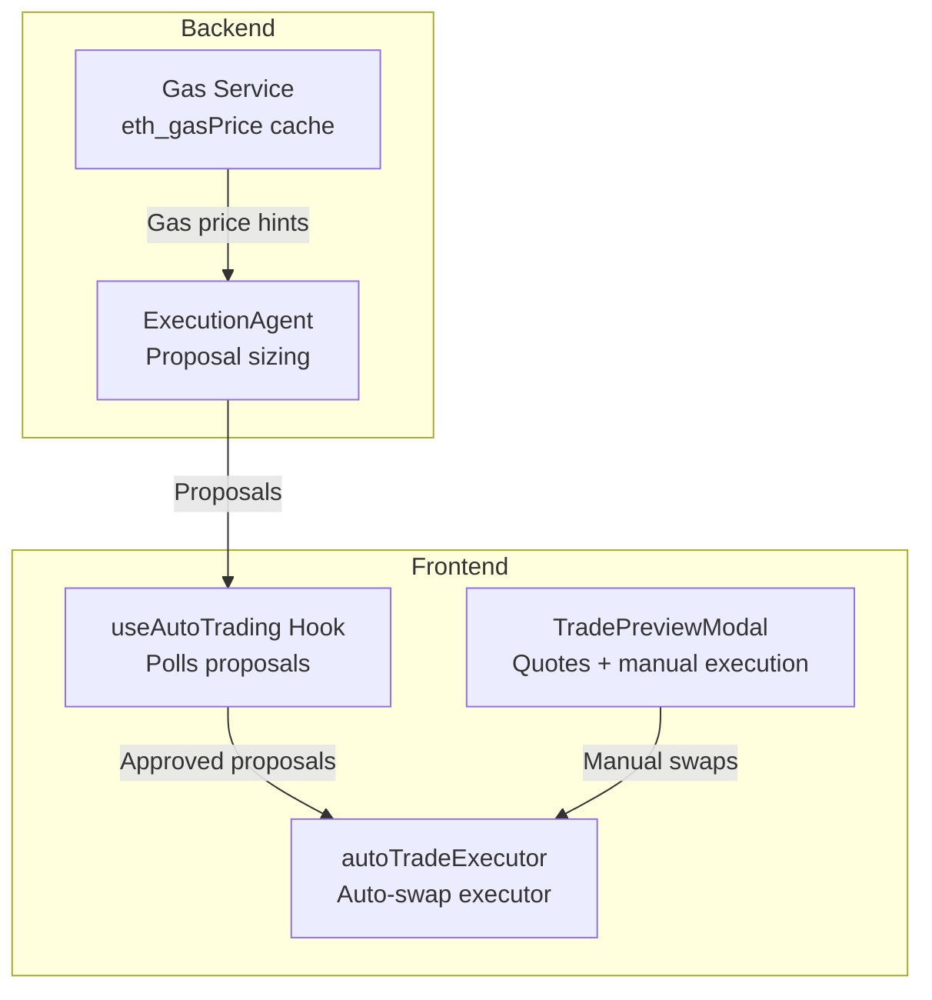
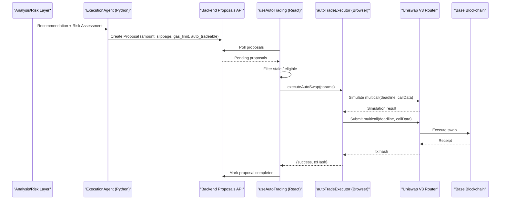
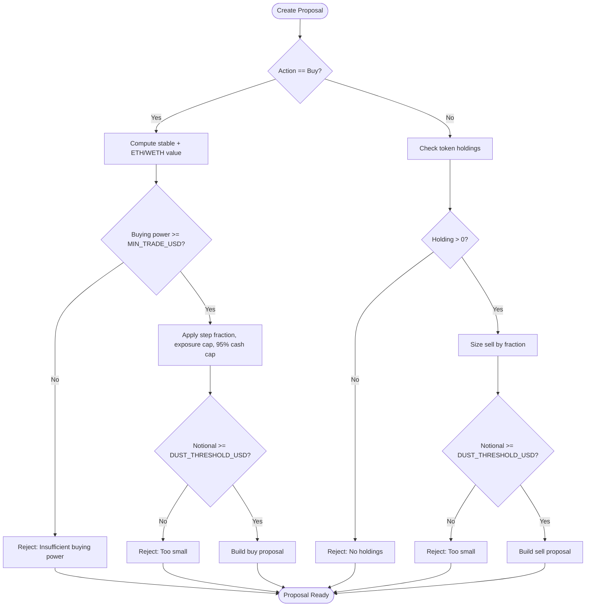
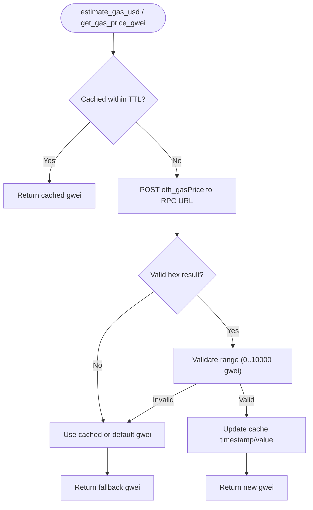
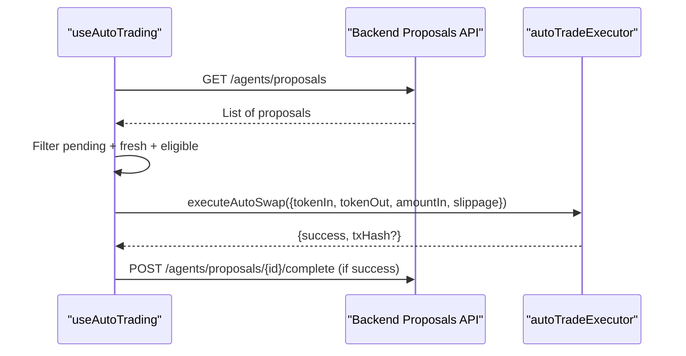
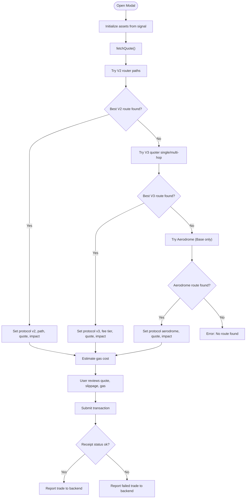
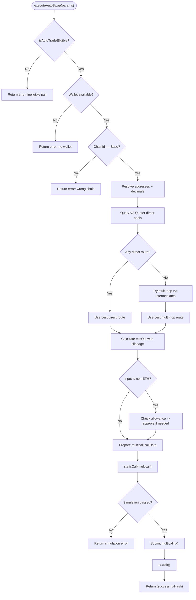
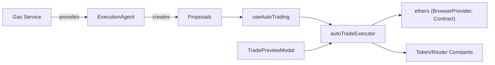

# Transaction Execution & Trade Processing

<cite>
**Referenced Files in This Document**
- [autoTradeExecutor.ts](file://frontend/lib/autoTradeExecutor.ts)
- [TradePreviewModal.tsx](file://frontend/components/TradePreviewModal.tsx)
- [useAutoTrading.ts](file://frontend/hooks/useAutoTrading.ts)
- [execution_agent.py](file://backend/app/agents/execution_agent.py)
- [gas.py](file://backend/app/services/gas.py)
</cite>

## Table of Contents
1. [Introduction](#introduction)
2. [Project Structure](#project-structure)
3. [Core Components](#core-components)
4. [Architecture Overview](#architecture-overview)
5. [Detailed Component Analysis](#detailed-component-analysis)
6. [Dependency Analysis](#dependency-analysis)
7. [Performance Considerations](#performance-considerations)
8. [Troubleshooting Guide](#troubleshooting-guide)
9. [Conclusion](#conclusion)

## Introduction
This document explains how trades are proposed, previewed, and executed across the system. It focuses on:
- The backend proposal pipeline that sizes trades and marks them auto-tradeable.
- The frontend `TradePreviewModal` component that shows quotes, gas estimates, slippage, and expected outcomes.
- The `autoTradeExecutor` module that prepares, signs, simulates, and submits blockchain transactions for approved auto-trades.
- The complete lifecycle from proposal generation to confirmation, including error handling, gas price estimation strategies, retry considerations, and status monitoring.

## Project Structure
The relevant parts of the codebase are split between a Python backend (proposal sizing, risk-aware parameters, and trade recording) and a Next.js frontend (wallet interaction, quoting, execution, and user-facing trade previews).

**Diagram sources**
- [execution_agent.py:9-22](file://backend/app/agents/execution_agent.py#L9-L22)
- [gas.py:20-59](file://backend/app/services/gas.py#L20-L59)
- [useAutoTrading.ts:21-87](file://frontend/hooks/useAutoTrading.ts#L21-L87)
- [TradePreviewModal.tsx:34-172](file://frontend/components/TradePreviewModal.tsx#L34-L172)
- [autoTradeExecutor.ts:44-282](file://frontend/lib/autoTradeExecutor.ts#L44-L282)

**Section sources**
- [execution_agent.py:9-22](file://backend/app/agents/execution_agent.py#L9-L22)
- [gas.py:20-59](file://backend/app/services/gas.py#L20-L59)
- [useAutoTrading.ts:21-87](file://frontend/hooks/useAutoTrading.ts#L21-L87)
- [TradePreviewModal.tsx:34-172](file://frontend/components/TradePreviewModal.tsx#L34-L172)
- [autoTradeExecutor.ts:44-282](file://frontend/lib/autoTradeExecutor.ts#L44-L282)

## Core Components
- Backend ExecutionAgent: Converts analysis recommendations into sized, human-approvable trade proposals with slippage, gas limits, and auto-trade eligibility flags.
- Backend Gas service: Provides cached live gas prices with safe fallbacks.
- Frontend useAutoTrading hook: Polls pending proposals, filters stale ones, checks auto-trade eligibility, and calls the auto-swap executor.
- Frontend TradePreviewModal: Shows quotes across multiple DEX protocols, calculates price impact, estimates gas cost, and executes manual trades.
- Frontend autoTradeExecutor: Prepares, simulates, signs, and submits Uniswap V3 transactions on Base with slippage protection and approval handling.

**Section sources**
- [execution_agent.py:57-179](file://backend/app/agents/execution_agent.py#L57-L179)
- [gas.py:20-59](file://backend/app/services/gas.py#L20-L59)
- [useAutoTrading.ts:21-87](file://frontend/hooks/useAutoTrading.ts#L21-L87)
- [TradePreviewModal.tsx:174-780](file://frontend/components/TradePreviewModal.tsx#L174-L780)
- [autoTradeExecutor.ts:44-282](file://frontend/lib/autoTradeExecutor.ts#L44-L282)

## Architecture Overview
The trade lifecycle spans backend proposal creation and frontend execution:

**Diagram sources**
- [execution_agent.py:57-179](file://backend/app/agents/execution_agent.py#L57-L179)
- [useAutoTrading.ts:28-87](file://frontend/hooks/useAutoTrading.ts#L28-L87)
- [autoTradeExecutor.ts:186-276](file://frontend/lib/autoTradeExecutor.ts#L186-L276)

## Detailed Component Analysis

### Backend Proposal Generation: ExecutionAgent
Responsibilities:
- Compute buying power and size buy/sell orders based on strategy steps and risk constraints.
- Attach slippage, gas limit, and auto-trade eligibility to each proposal.
- Record successful executions back to portfolio/trade records.

Key behaviors:
- Buy sizing uses step fractions and exposure headroom; minimum notional thresholds prevent dust trades.
- Sell sizing respects current holdings and minimum thresholds.
- Auto-trade eligibility is derived from policy rules and attached to proposals.

**Diagram sources**
- [execution_agent.py:57-179](file://backend/app/agents/execution_agent.py#L57-L179)

**Section sources**
- [execution_agent.py:57-179](file://backend/app/agents/execution_agent.py#L57-L179)

### Live Gas Price Estimation: Gas Service
Responsibilities:
- Provide a conservative cached gas price via `eth_gasPrice`.
- Convert gwei and gas limit into USD cost using an ETH price input.
- Return safe fallback values when RPC calls fail.

Strategies:
- Cache results for a fixed interval to reduce RPC load.
- Validate returned gas price ranges and fall back gracefully.

**Diagram sources**
- [gas.py:20-59](file://backend/app/services/gas.py#L20-L59)

**Section sources**
- [gas.py:20-59](file://backend/app/services/gas.py#L20-L59)

### Frontend Auto-Trading Orchestrator: useAutoTrading Hook
Responsibilities:
- Poll backend proposals at a configured interval.
- Skip stale proposals to avoid executing outdated market context.
- Enforce auto-trade eligibility and network constraints.
- Convert proposals into executor parameters and report completion.

Key behaviors:
- Demo mode disables auto-trading.
- Requires wallet connection and Base network.
- Filters out non-auto-tradeable tokens and USDC-only flows.

**Diagram sources**
- [useAutoTrading.ts:28-87](file://frontend/hooks/useAutoTrading.ts#L28-L87)
- [useAutoTrading.ts:124-190](file://frontend/hooks/useAutoTrading.ts#L124-L190)

**Section sources**
- [useAutoTrading.ts:21-87](file://frontend/hooks/useAutoTrading.ts#L21-L87)
- [useAutoTrading.ts:124-190](file://frontend/hooks/useAutoTrading.ts#L124-L190)

### Manual Trade Preview & Execution: TradePreviewModal
Responsibilities:
- Fetch quotes from multiple DEX protocols (V2, V3, Aerodrome) and select best routes.
- Calculate price impact and estimate gas costs.
- Handle approvals, slippage, and transaction submission.
- Report trade outcomes to the backend.

Quote flow highlights:
- Detects network and selects token sets/router addresses accordingly.
- Tries direct and multi-hop paths; computes price impact against spot rates.
- For Base, includes Aerodrome fallback logic for low-cap liquidity.

Execution flow highlights:
- Computes min output from slippage tolerance.
- Handles token approvals where needed.
- Submits transactions and tracks receipts.
- Reports failed trades to the backend when applicable.

**Diagram sources**
- [TradePreviewModal.tsx:174-780](file://frontend/components/TradePreviewModal.tsx#L174-L780)
- [TradePreviewModal.tsx:1333-1708](file://frontend/components/TradePreviewModal.tsx#L1333-L1708)
- [TradePreviewModal.tsx:1844-1884](file://frontend/components/TradePreviewModal.tsx#L1844-L1884)

**Section sources**
- [TradePreviewModal.tsx:34-172](file://frontend/components/TradePreviewModal.tsx#L34-L172)
- [TradePreviewModal.tsx:174-780](file://frontend/components/TradePreviewModal.tsx#L174-L780)
- [TradePreviewModal.tsx:1333-1708](file://frontend/components/TradePreviewModal.tsx#L1333-L1708)
- [TradePreviewModal.tsx:1844-1884](file://frontend/components/TradePreviewModal.tsx#L1844-L1884)

### Automated Swap Execution: autoTradeExecutor
Responsibilities:
- Validate auto-trade eligibility and network constraints.
- Resolve token addresses and decimals.
- Query Uniswap V3 Quoter for best direct or multi-hop routes.
- Apply slippage floors for volatile tokens.
- Approve token spenders if necessary.
- Simulate the full multicall before opening MetaMask.
- Submit the transaction and wait for confirmation.

Key implementation details:
- Route selection:
  - Iterates fee tiers for direct pools.
  - If no direct pool, tries multi-hop via high-liquidity intermediates.
- Slippage calculation:
  - Uses requested slippage but enforces a higher floor for volatile tokens.
- Approval handling:
  - Checks allowance and approves max if needed before swap.
- Gas configuration:
  - Accepts optional gas price override; ensures it does not go below network suggested maxFeePerGas.
  - Sets explicit gas limits for direct vs multi-hop.
- Pre-execution simulation:
  - Runs staticCall through multicall to catch failures early.
- Transaction submission:
  - Wraps exactInputSingle or exactInput inside multicall with deadline.
  - Waits for receipt and returns tx hash.

**Diagram sources**
- [autoTradeExecutor.ts:44-282](file://frontend/lib/autoTradeExecutor.ts#L44-L282)

**Section sources**
- [autoTradeExecutor.ts:44-282](file://frontend/lib/autoTradeExecutor.ts#L44-L282)

## Dependency Analysis
- Backend ExecutionAgent depends on policy rules to determine auto-trade eligibility and attaches slippage and gas parameters to proposals.
- Frontend useAutoTrading depends on backend proposals and autoTradeExecutor for execution.
- autoTradeExecutor depends on ethers BrowserProvider, contract interfaces for Quoter and Router, and token constants.
- TradePreviewModal depends on multiple DEX routers/quoters and performs its own quoting and execution flow.

**Diagram sources**
- [execution_agent.py:57-179](file://backend/app/agents/execution_agent.py#L57-L179)
- [gas.py:20-59](file://backend/app/services/gas.py#L20-L59)
- [useAutoTrading.ts:21-87](file://frontend/hooks/useAutoTrading.ts#L21-L87)
- [autoTradeExecutor.ts:1-14](file://frontend/lib/autoTradeExecutor.ts#L1-L14)
- [TradePreviewModal.tsx:1-7](file://frontend/components/TradePreviewModal.tsx#L1-L7)

**Section sources**
- [execution_agent.py:57-179](file://backend/app/agents/execution_agent.py#L57-L179)
- [gas.py:20-59](file://backend/app/services/gas.py#L20-L59)
- [useAutoTrading.ts:21-87](file://frontend/hooks/useAutoTrading.ts#L21-L87)
- [autoTradeExecutor.ts:1-14](file://frontend/lib/autoTradeExecutor.ts#L1-L14)
- [TradePreviewModal.tsx:1-7](file://frontend/components/TradePreviewModal.tsx#L1-L7)

## Performance Considerations
- Quoting efficiency:
  - autoTradeExecutor iterates fee tiers and intermediates; consider caching intermediate symbols and skipping invalid pairs.
  - TradePreviewModal tries multiple protocols; ensure rate limiting and timeouts to avoid UI freezes.
- Gas estimation:
  - Backend caches gas prices to reduce RPC calls.
  - Frontend estimates gas cost using static heuristics per protocol; dynamic estimation can be improved by simulating gas usage.
- Transaction simulation:
  - Pre-execution staticCall avoids costly failed on-chain transactions.
- Network constraints:
  - Auto-trade restricted to Base; ensure users switch networks to avoid unnecessary retries.

[No sources needed since this section provides general guidance]

## Troubleshooting Guide

Common errors and resolutions:
- Insufficient funds:
  - Symptom: “Insufficient ETH for gas + value.”
  - Resolution: Ensure sufficient native token balance for both value and gas; adjust gas limit or lower amount.
- No liquidity route found:
  - Symptom: “No liquidity route found for X -> Y.”
  - Resolution: Increase slippage tolerance, try different intermediates, or check token support on the selected network.
- Simulation failure:
  - Symptom: “Pre-execution simulation failed.”
  - Resolution: Reduce slippage tolerance for tax tokens, verify allowances, or confirm correct token addresses.
- Wrong network:
  - Symptom: “Auto-trade requires Base network.”
  - Resolution: Switch wallet network to Base before executing auto-trades.
- Stale proposals:
  - Symptom: Auto-trading skips old proposals.
  - Resolution: Refresh proposals or reconnect wallet; stale guard prevents executing outdated market context.

**Section sources**
- [autoTradeExecutor.ts:44-63](file://frontend/lib/autoTradeExecutor.ts#L44-L63)
- [autoTradeExecutor.ts:151-153](file://frontend/lib/autoTradeExecutor.ts#L151-L153)
- [autoTradeExecutor.ts:250-259](file://frontend/lib/autoTradeExecutor.ts#L250-L259)
- [useAutoTrading.ts:140-165](file://frontend/hooks/useAutoTrading.ts#L140-L165)
- [TradePreviewModal.tsx:1871-1880](file://frontend/components/TradePreviewModal.tsx#L1871-L1880)

## Conclusion
The system integrates backend proposal sizing with robust frontend quoting and execution. The autoTradeExecutor ensures safe, simulated, and slippage-protected transactions on Base, while TradePreviewModal offers comprehensive visibility into quotes, gas costs, and expected outcomes. Together, they provide a resilient workflow from proposal generation to confirmation, with clear error handling and configurable parameters for slippage and gas.

[No sources needed since this section summarizes without analyzing specific files]