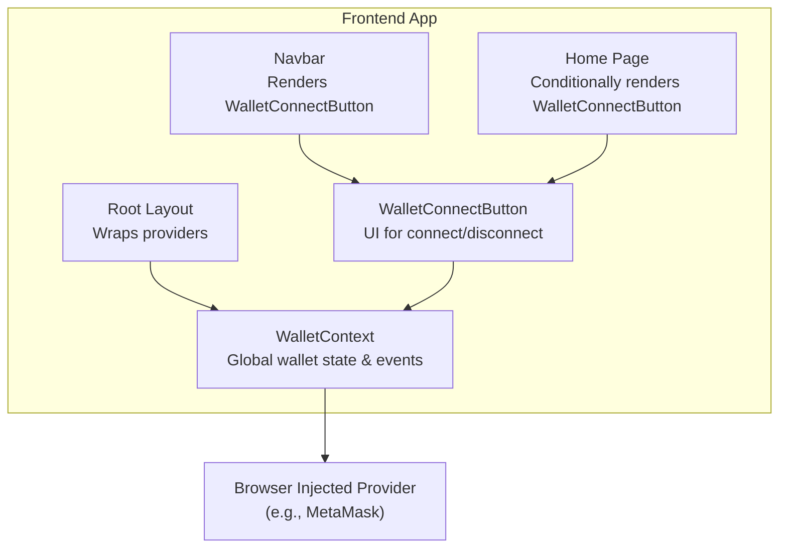
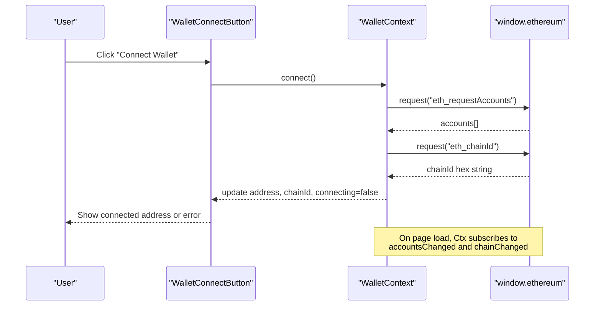
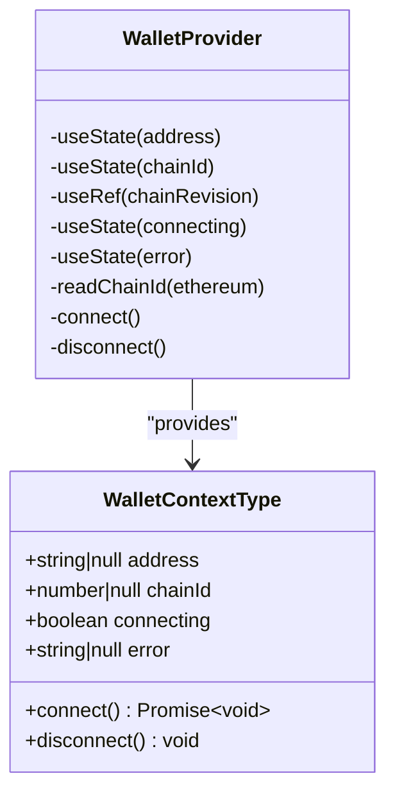
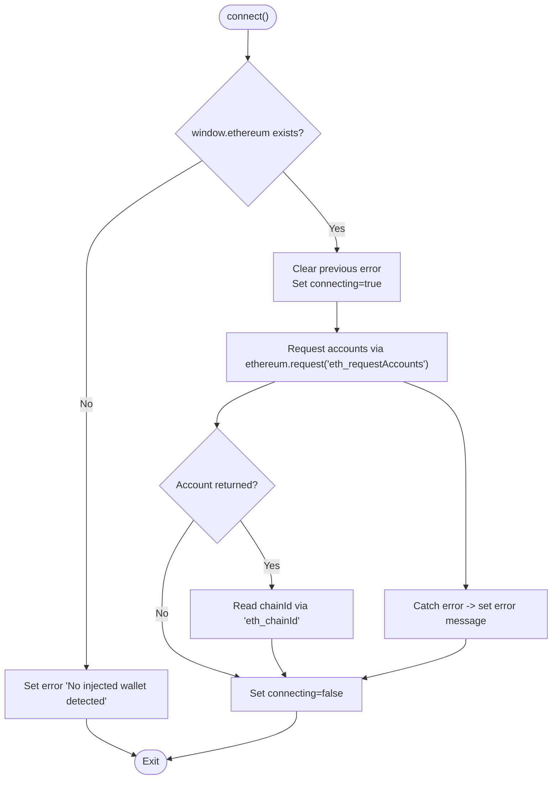
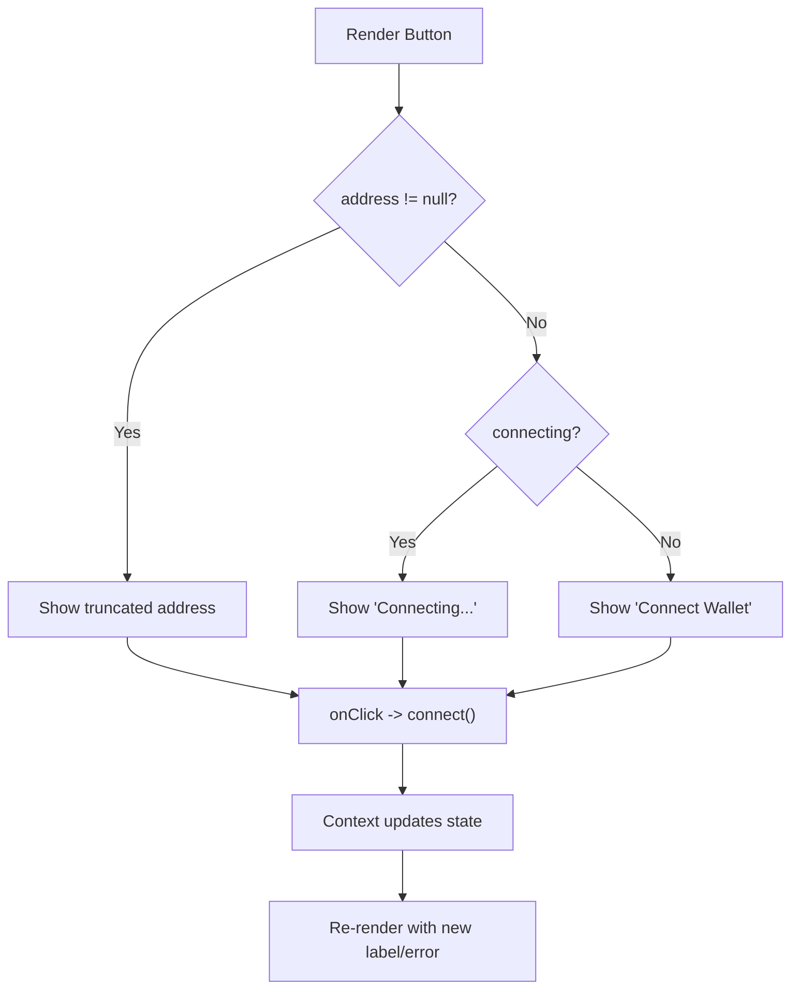
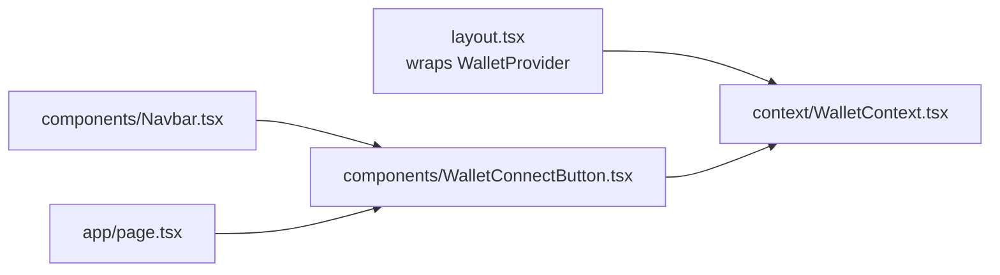

# Wallet Connection & Provider Management

<cite>
**Referenced Files in This Document**
- [WalletContext.tsx](file://frontend/context/WalletContext.tsx)
- [WalletConnectButton.tsx](file://frontend/components/WalletConnectButton.tsx)
- [layout.tsx](file://frontend/app/layout.tsx)
- [Navbar.tsx](file://frontend/components/Navbar.tsx)
- [page.tsx](file://frontend/app/page.tsx)
</cite>

## Table of Contents
1. [Introduction](#introduction)
2. [Project Structure](#project-structure)
3. [Core Components](#core-components)
4. [Architecture Overview](#architecture-overview)
5. [Detailed Component Analysis](#detailed-component-analysis)
6. [Dependency Analysis](#dependency-analysis)
7. [Performance Considerations](#performance-considerations)
8. [Troubleshooting Guide](#troubleshooting-guide)
9. [Conclusion](#conclusion)

## Introduction
This document explains how the application connects to browser-based wallets (such as MetaMask) using the injected provider API and how wallet state is managed globally. It focuses on:
- How the app detects and uses the injected Ethereum provider from the browser
- The WalletConnectButton component for user interaction
- The WalletContext implementation that manages global wallet state, connection lifecycle, and chain events
- Supported wallet types, network detection, and automatic chain switching behavior
- Examples for checking connectivity, handling disconnections, and implementing error boundaries around wallet operations

## Project Structure
The wallet integration lives in the frontend Next.js application:
- Global wallet state and provider event handling are implemented in a React context
- A reusable UI button triggers connection and displays status and errors
- The root layout wraps the application with the wallet provider so all components can access wallet state

**Diagram sources**
- [layout.tsx:16-40](file://frontend/app/layout.tsx#L16-L40)
- [Navbar.tsx:47-47](file://frontend/components/Navbar.tsx#L47-L47)
- [page.tsx:36-36](file://frontend/app/page.tsx#L36-L36)
- [WalletConnectButton.tsx:4-29](file://frontend/components/WalletConnectButton.tsx#L4-L29)
- [WalletContext.tsx:21-109](file://frontend/context/WalletContext.tsx#L21-L109)

**Section sources**
- [layout.tsx:16-40](file://frontend/app/layout.tsx#L16-L40)
- [Navbar.tsx:47-47](file://frontend/components/Navbar.tsx#L47-L47)
- [page.tsx:36-36](file://frontend/app/page.tsx#L36-L36)

## Core Components
- WalletContext: Provides global wallet state (address, chainId), connection lifecycle (connecting, error), and actions (connect, disconnect). It also listens to provider events for account and chain changes.
- WalletConnectButton: A small UI component that calls connect and shows the current address or an error message.

Key responsibilities:
- Detecting the injected provider via window.ethereum
- Requesting accounts and reading the current chain ID
- Subscribing to accountsChanged and chainChanged events
- Exposing a simple interface to child components

**Section sources**
- [WalletContext.tsx:4-11](file://frontend/context/WalletContext.tsx#L4-L11)
- [WalletContext.tsx:21-109](file://frontend/context/WalletContext.tsx#L21-L109)
- [WalletConnectButton.tsx:4-29](file://frontend/components/WalletConnectButton.tsx#L4-L29)

## Architecture Overview
The application relies on the EIP-1193 provider injected by wallets like MetaMask. There is no ethers.js dependency in the wallet integration; it uses the native provider API directly.

**Diagram sources**
- [WalletConnectButton.tsx:16-22](file://frontend/components/WalletConnectButton.tsx#L16-L22)
- [WalletContext.tsx:74-98](file://frontend/context/WalletContext.tsx#L74-L98)
- [WalletContext.tsx:28-36](file://frontend/context/WalletContext.tsx#L28-L36)
- [WalletContext.tsx:38-72](file://frontend/context/WalletContext.tsx#L38-L72)

## Detailed Component Analysis

### WalletContext Implementation
WalletContext is the single source of truth for wallet state. It:
- Initializes state for address, chainId, connecting, and error
- Reads the initial chainId and checks for existing accounts when the provider is available
- Subscribes to provider events to keep state in sync
- Provides connect and disconnect functions

**Diagram sources**
- [WalletContext.tsx:4-11](file://frontend/context/WalletContext.tsx#L4-L11)
- [WalletContext.tsx:21-109](file://frontend/context/WalletContext.tsx#L21-L109)

Key behaviors:
- Provider detection: Uses window.ethereum if present
- Account management: Calls eth_requestAccounts to prompt the user and sets the first returned account
- Chain management: Reads eth_chainId and updates chainId; listens to chainChanged to reflect wallet-initiated chain switches
- Event listeners: Subscribes to accountsChanged and chainChanged; cleans up on unmount
- Error handling: Sets a user-facing error message on failed connections and clears it before new attempts
- Disconnect: Clears the local address state

**Diagram sources**
- [WalletContext.tsx:74-98](file://frontend/context/WalletContext.tsx#L74-L98)

**Section sources**
- [WalletContext.tsx:15-19](file://frontend/context/WalletContext.tsx#L15-L19)
- [WalletContext.tsx:28-36](file://frontend/context/WalletContext.tsx#L28-L36)
- [WalletContext.tsx:38-72](file://frontend/context/WalletContext.tsx#L38-L72)
- [WalletContext.tsx:74-102](file://frontend/context/WalletContext.tsx#L74-L102)

### WalletConnectButton Component
WalletConnectButton is a minimal UI wrapper around useWallet:
- Displays a truncated address when connected
- Shows a connecting indicator while connecting
- Renders any error messages provided by WalletContext
- Triggers the connect action on click

**Diagram sources**
- [WalletConnectButton.tsx:4-29](file://frontend/components/WalletConnectButton.tsx#L4-L29)

**Section sources**
- [WalletConnectButton.tsx:4-29](file://frontend/components/WalletConnectButton.tsx#L4-L29)

### Provider Integration Details
- Injected provider: The code accesses window.ethereum directly. This works with any EIP-1193-compliant wallet (MetaMask, Brave Wallet, Rabby, etc.).
- No ethers.js usage: The integration does not import or use ethers.js; it uses the provider’s request method and event system.
- Network detection: The app reads the current chainId and listens to chainChanged to stay in sync with the wallet’s active chain.
- Automatic chain switching: When the user switches chains in their wallet, the chainChanged handler updates the context’s chainId automatically.

Supported wallet types:
- Any browser wallet that injects an EIP-1193 provider into window.ethereum (e.g., MetaMask)

Automatic chain switching:
- The context subscribes to chainChanged and updates chainId accordingly. If your app requires a specific chain, you can add logic to call wallet_switchEthereumChain via ethereum.request after detecting a mismatch.

**Section sources**
- [WalletContext.tsx:38-72](file://frontend/context/WalletContext.tsx#L38-L72)
- [WalletContext.tsx:28-36](file://frontend/context/WalletContext.tsx#L28-L36)

## Dependency Analysis
The following diagram shows how the wallet features are wired into the app:

**Diagram sources**
- [layout.tsx:16-40](file://frontend/app/layout.tsx#L16-L40)
- [Navbar.tsx:47-47](file://frontend/components/Navbar.tsx#L47-L47)
- [page.tsx:36-36](file://frontend/app/page.tsx#L36-L36)
- [WalletConnectButton.tsx:4-29](file://frontend/components/WalletConnectButton.tsx#L4-L29)
- [WalletContext.tsx:21-109](file://frontend/context/WalletContext.tsx#L21-L109)

**Section sources**
- [layout.tsx:16-40](file://frontend/app/layout.tsx#L16-L40)
- [Navbar.tsx:47-47](file://frontend/components/Navbar.tsx#L47-L47)
- [page.tsx:36-36](file://frontend/app/page.tsx#L36-L36)

## Performance Considerations
- Minimal re-renders: Only necessary state (address, chainId, connecting, error) is exposed via context.
- Event cleanup: The effect removes event listeners on unmount to avoid memory leaks.
- Avoid heavy work in event handlers: Keep accountsChanged and chainChanged handlers lightweight; offload expensive tasks to separate modules if needed.
- Debounce chain changes: If multiple rapid chain changes occur, consider debouncing updates to reduce unnecessary re-renders.

[No sources needed since this section provides general guidance]

## Troubleshooting Guide

Common issues and resolutions:
- No injected wallet detected
  - Symptom: Error message indicates no injected wallet.
  - Cause: window.ethereum is undefined (no wallet extension installed or enabled).
  - Resolution: Install and enable a compatible wallet (e.g., MetaMask).

- Connection fails
  - Symptom: Error message appears after clicking Connect.
  - Cause: User rejected the request or the provider threw an error.
  - Resolution: Inform the user to approve the connection request in their wallet.

- Disconnected after user action
  - Symptom: Address becomes null.
  - Cause: User disconnected accounts in the wallet.
  - Behavior: The accountsChanged handler sets address to null; UI reflects this.

- Chain mismatch
  - Symptom: App expects a specific chain but chainId differs.
  - Behavior: chainChanged updates chainId automatically.
  - Resolution: Add logic to switch chains via wallet_switchEthereumChain when needed.

- Using useWallet outside provider
  - Symptom: Error thrown indicating useWallet must be used within a WalletProvider.
  - Resolution: Ensure the app is wrapped with WalletProvider at the root layout.

Operational examples:
- Checking wallet connectivity
  - Use the address field from useWallet; if null, the wallet is not connected.
  - Optionally check chainId to determine the active network.

- Handling disconnections
  - Listen to address changes; when it becomes null, show a “Connect Wallet” prompt.

- Implementing error boundaries for wallet operations
  - Wrap wallet-dependent components with a React error boundary to catch unexpected exceptions during provider interactions.
  - Display a friendly message and a retry option.

**Section sources**
- [WalletContext.tsx:74-102](file://frontend/context/WalletContext.tsx#L74-L102)
- [WalletContext.tsx:38-72](file://frontend/context/WalletContext.tsx#L38-L72)

## Conclusion
The wallet integration leverages the standard EIP-1193 provider injected by browser wallets without relying on ethers.js. WalletContext centralizes connection state, event subscriptions, and chain synchronization, while WalletConnectButton offers a simple UI for users to connect and see their status. The design is extensible: you can add chain-switching enforcement, richer error messaging, and additional wallet-specific flows while keeping the core state management consistent.

[No sources needed since this section summarizes without analyzing specific files]