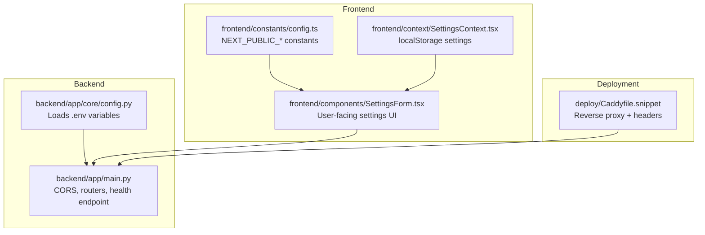
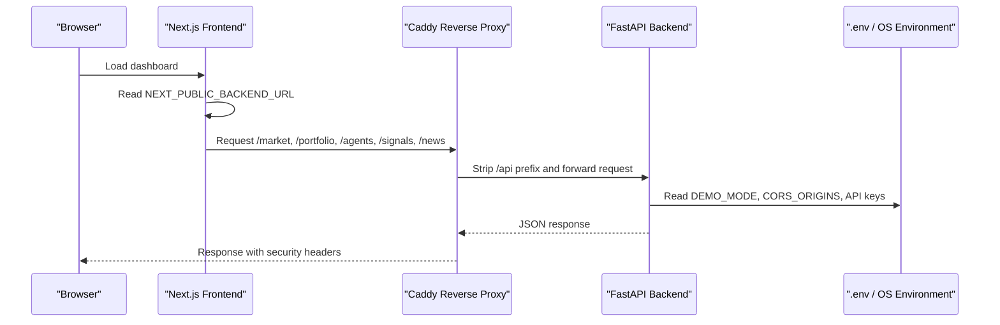
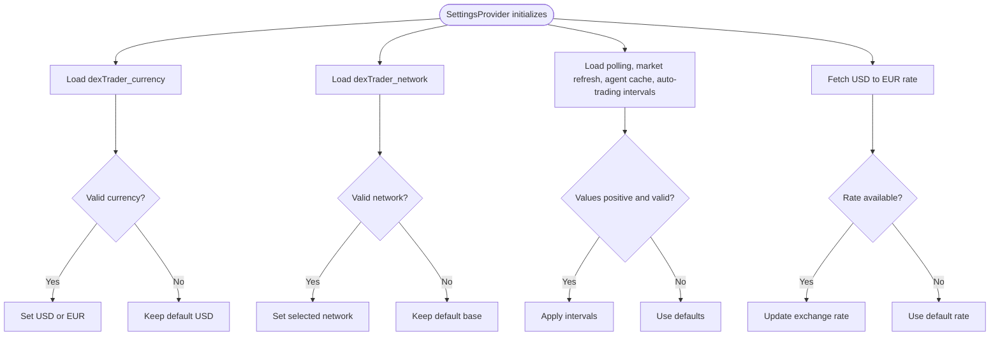
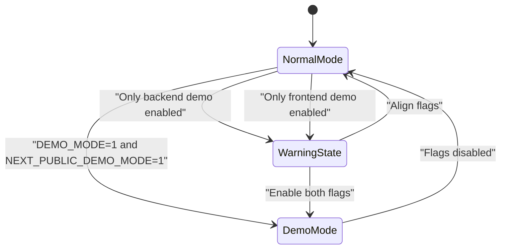
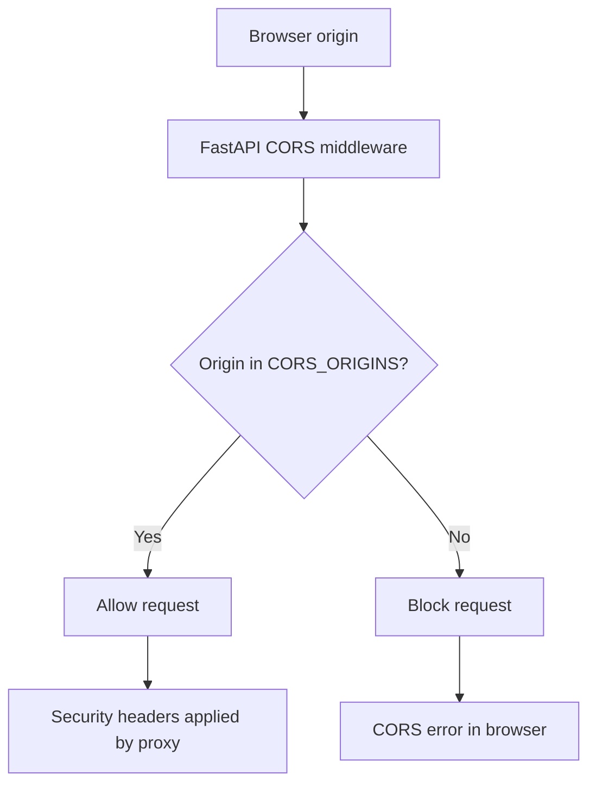
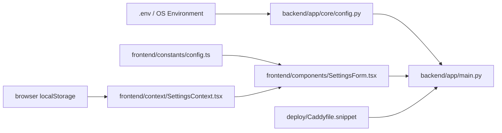

# Configuration & Environment

<cite>
**Referenced Files in This Document**   
- [README.md](file://README.md)
- [backend/app/core/config.py](file://backend/app/core/config.py)
- [backend/app/main.py](file://backend/app/main.py)
- [frontend/constants/config.ts](file://frontend/constants/config.ts)
- [frontend/context/SettingsContext.tsx](file://frontend/context/SettingsContext.tsx)
- [frontend/components/SettingsForm.tsx](file://frontend/components/SettingsForm.tsx)
- [deploy/Caddyfile.snippet](file://deploy/Caddyfile.snippet)
</cite>

## Table of Contents
1. [Introduction](#introduction)
2. [Project Structure](#project-structure)
3. [Core Components](#core-components)
4. [Architecture Overview](#architecture-overview)
5. [Detailed Component Analysis](#detailed-component-analysis)
6. [Dependency Analysis](#dependency-analysis)
7. [Performance Considerations](#performance-considerations)
8. [Troubleshooting Guide](#troubleshooting-guide)
9. [Conclusion](#conclusion)
10. [Appendices](#appendices)

## Introduction
This document explains every configuration surface for DexTrader: environment variables, frontend build-time constants, in-app settings stored in the browser, demo mode behavior, CORS and deployment security, validation rules, defaults, and migration guidance when changing configuration.

The system has two configuration layers:
- Backend runtime configuration loaded from `.env`.
- Frontend configuration split between build-time constants and user-controlled `localStorage` settings.

## Project Structure
Configuration is spread across a small number of focused files:

**Diagram sources**
- [backend/app/core/config.py:1-17](file://backend/app/core/config.py#L1-L17)
- [backend/app/main.py:1-60](file://backend/app/main.py#L1-L60)
- [frontend/constants/config.ts:1-8](file://frontend/constants/config.ts#L1-L8)
- [frontend/context/SettingsContext.tsx:1-201](file://frontend/context/SettingsContext.tsx#L1-L201)
- [frontend/components/SettingsForm.tsx:1-680](file://frontend/components/SettingsForm.tsx#L1-L680)
- [deploy/Caddyfile.snippet:1-31](file://deploy/Caddyfile.snippet#L1-L31)

**Section sources**
- [README.md:66-86](file://README.md#L66-L86)
- [backend/app/core/config.py:1-17](file://backend/app/core/config.py#L1-L17)
- [backend/app/main.py:1-60](file://backend/app/main.py#L1-L60)
- [frontend/constants/config.ts:1-8](file://frontend/constants/config.ts#L1-L8)
- [frontend/context/SettingsContext.tsx:1-201](file://frontend/context/SettingsContext.tsx#L1-L201)
- [frontend/components/SettingsForm.tsx:1-680](file://frontend/components/SettingsForm.tsx#L1-L680)
- [deploy/Caddyfile.snippet:1-31](file://deploy/Caddyfile.snippet#L1-L31)

## Core Components
This section summarizes the main configuration surfaces before diving into details.

| Area | What it controls | Where it is defined or used |
|---|---|---|
| Backend secrets | API keys and runtime flags | `backend/app/core/config.py` |
| Backend network exposure | Allowed browser origins | `backend/app/main.py` |
| Frontend backend address | URL used by all pages to call the backend | `frontend/constants/config.ts` |
| Frontend demo build flag | Build-time demo behavior | `frontend/constants/config.ts` |
| In-app display and trading preferences | Currency, network, polling intervals, auto-trading | `frontend/context/SettingsContext.tsx` |
| Settings UI | User interaction with in-app settings | `frontend/components/SettingsForm.tsx` |
| Deployment headers and reverse proxy | TLS, security headers, `/api` routing | `deploy/Caddyfile.snippet` |

**Section sources**
- [backend/app/core/config.py:1-17](file://backend/app/core/config.py#L1-L17)
- [backend/app/main.py:14-32](file://backend/app/main.py#L14-L32)
- [frontend/constants/config.ts:1-8](file://frontend/constants/config.ts#L1-L8)
- [frontend/context/SettingsContext.tsx:1-201](file://frontend/context/SettingsContext.tsx#L1-L201)
- [frontend/components/SettingsForm.tsx:1-680](file://frontend/components/SettingsForm.tsx#L1-L680)
- [deploy/Caddyfile.snippet:1-31](file://deploy/Caddyfile.snippet#L1-L31)

## Architecture Overview
The configuration architecture separates concerns clearly:

**Diagram sources**
- [frontend/constants/config.ts:1-8](file://frontend/constants/config.ts#L1-L8)
- [backend/app/main.py:14-32](file://backend/app/main.py#L14-L32)
- [backend/app/core/config.py:1-17](file://backend/app/core/config.py#L1-L17)
- [deploy/Caddyfile.snippet:1-31](file://deploy/Caddyfile.snippet#L1-L31)

## Detailed Component Analysis

### Backend Environment Variables
The backend loads environment variables through Python’s dotenv utilities and exposes them as module-level configuration values.

| Variable | Type | Default Behavior | Purpose |
|---|---|---:|---|
| `COINMARKETCAP_API_KEY` | String | Optional; may be `None` | Used by CoinMarketCap integration. The documented behavior notes that the current trial base URL does not send this key. |
| `COINGECKO_API_KEY` | String | Optional; may be `None` | Used as a demo API key header on CoinGecko calls. Requests still work without it under stricter anonymous limits. |
| `OPENAI_API_KEY` | String | Optional; may be `None` | Second-tier signal source via LangChain. |
| `DEEPSEEK_API_KEY` | String | Optional; may be `None` | First-tier signal source using an HTTP client call. |
| `DEMO_MODE` | Boolean-like string | Disabled unless set to one of the accepted truthy values | Enables public demo behavior: virtual portfolio, simulated fills, and refusal of real trade submissions. |

Accepted truthy values for `DEMO_MODE` are normalized case-insensitively and include values such as `1`, `true`, `yes`, and `on`. Any other value evaluates to disabled.

Important implementation note: the file reads environment variables at import time. Changing `.env` requires restarting the backend process.

**Section sources**
- [backend/app/core/config.py:1-17](file://backend/app/core/config.py#L1-L17)
- [README.md:66-86](file://README.md#L66-L86)

#### .env File Structure
The repository documents that secrets live in a root-level `.env` file and that the file is gitignored. The README also references copying `.env.example` if you want to supply API keys.

Recommended `.env` structure:

| Section | Variables | Notes |
|---|---|---|
| Market data | `COINMARKETCAP_API_KEY`, `COINGECKO_API_KEY` | Both optional. Keys improve rate limits but are not strictly required for basic operation. |
| AI signals | `OPENAI_API_KEY`, `DEEPSEEK_API_KEY` | Optional. If neither is present, the signal layer falls back to deterministic rule-based logic. |
| Runtime flags | `DEMO_MODE` | Set to a truthy value to enable demo mode. |
| Network exposure | `CORS_ORIGINS` | Comma-separated list of allowed browser origins. |
| Other backend settings | `BASE_RPC_URL`, `DEXTRADER_STATE_DIR` | Referenced elsewhere in the codebase for gas pricing and state directory location. |

Validation guidance:
- Do not commit `.env` to version control.
- Keep API keys out of logs and error responses.
- Use separate `.env` files for development, staging, and production.
- Validate that required keys are present at startup if your deployment needs strict enforcement.

**Section sources**
- [README.md:66-86](file://README.md#L66-L86)
- [backend/app/core/config.py:1-17](file://backend/app/core/config.py#L1-L17)

### Frontend Build-Time Constants
The frontend uses Next.js build-time constants prefixed with `NEXT_PUBLIC_`. These values are baked into the built JavaScript bundle and cannot be changed at runtime.

| Constant | Source | Default | Meaning |
|---|---|---:|---|
| `NEXT_PUBLIC_BACKEND_URL` | `frontend/constants/config.ts` | `http://127.0.0.1:8000` | Base URL for all backend API calls. |
| `NEXT_PUBLIC_DEMO_MODE` | `frontend/constants/config.ts` | `false` | Build-time demo mode. When enabled, the UI shows a banner, hides wallet actions, and treats the app as a simulation. |

Behavioral implications:
- Changing `NEXT_PUBLIC_BACKEND_URL` requires rebuilding the frontend.
- Changing `NEXT_PUBLIC_DEMO_MODE` requires rebuilding the frontend because it is evaluated during build.
- The backend’s `DEMO_MODE` and the frontend’s `NEXT_PUBLIC_DEMO_MODE` should agree in production deployments.

**Section sources**
- [frontend/constants/config.ts:1-8](file://frontend/constants/config.ts#L1-L8)
- [README.md:79-81](file://README.md#L79-L81)
- [README.md:88-99](file://README.md#L88-L99)

### In-App Settings Stored in localStorage
In-app settings are browser-only and persist under keys prefixed with `dexTrader_`. They are managed by the settings context and exposed through the settings UI.

| localStorage Key | Type | Default | Validation Rules | Purpose |
|---|---|---:|---|---|
| `dexTrader_currency` | `"USD"` or `"EUR"` | `"USD"` | Only these two values are accepted. | Display currency for balances and reports. |
| `dexTrader_network` | `"sepolia"`, `"mainnet"`, `"base"`, or `"arbitrum"` | `"base"` | Only these four values are accepted. | Selected blockchain network. |
| `dexTrader_pollingInterval` | Number (seconds) | `30` | Must be a positive integer when loaded. | Polling interval for agent analysis updates. |
| `dexTrader_marketRefreshInterval` | Number (seconds) | `60` | Must be a positive integer when loaded. | Intended market refresh interval; stored and rendered but not actively scheduled by the current code. |
| `dexTrader_agentCacheDuration` | Number (seconds) | `300` | Must be a positive integer when loaded; UI enforces a minimum of `60`. | How long agent results use cached market data. Also posted to the backend cache configuration endpoint. |
| `dexTrader_autoTrading` | Boolean string | `false` | Only the exact string `"true"` enables auto-trading. | Whether automatic execution is enabled. |
| `dexTrader_autoTradingInterval` | Number (seconds) | `300` | Must be a positive integer when loaded; UI enforces a minimum of `30`. | How often auto-trading checks for new proposals. |

Additional runtime behavior:
- The EUR exchange rate is fetched from a free exchange rate API on initialization. If the fetch fails, a default fallback rate is used.
- The settings UI allows toggling auto-trading and selecting predefined check intervals.
- Some settings are cosmetic or partially implemented; for example, `marketRefreshInterval` is persisted but not wired to an active scheduler in the analyzed code.

**Diagram sources**
- [frontend/context/SettingsContext.tsx:28-104](file://frontend/context/SettingsContext.tsx#L28-L104)

**Section sources**
- [frontend/context/SettingsContext.tsx:1-201](file://frontend/context/SettingsContext.tsx#L1-L201)
- [frontend/components/SettingsForm.tsx:31-40](file://frontend/components/SettingsForm.tsx#L31-L40)
- [frontend/components/SettingsForm.tsx:178-352](file://frontend/components/SettingsForm.tsx#L178-L352)
- [README.md:86](file://README.md#L86)

### Demo Mode Configuration
Demo mode affects both backend behavior and frontend presentation.

Backend behavior:
- `DEMO_MODE` is read from the environment.
- It influences agent controller behavior and trade submission restrictions.
- The health endpoint includes the demo flag so clients can inspect runtime mode.

Frontend behavior:
- `NEXT_PUBLIC_DEMO_MODE` is a build-time constant.
- When enabled, the UI avoids wallet-dependent flows and simulates portfolio interactions.
- A rebuild is required after changing this constant.

Production alignment:
- The documented hosted demo runs with both backend and frontend demo flags enabled.
- Mismatched flags can cause confusing behavior, such as a frontend expecting simulation while the backend accepts real trades, or vice versa.

**Diagram sources**
- [backend/app/core/config.py:14-16](file://backend/app/core/config.py#L14-L16)
- [frontend/constants/config.ts:3-8](file://frontend/constants/config.ts#L3-L8)
- [README.md:88-99](file://README.md#L88-L99)

**Section sources**
- [backend/app/core/config.py:14-16](file://backend/app/core/config.py#L14-L16)
- [frontend/constants/config.ts:3-8](file://frontend/constants/config.ts#L3-L8)
- [README.md:88-99](file://README.md#L88-L99)

### CORS and Network Security
CORS is configured in the FastAPI application. By default, only local development origins are allowed.

Key behaviors:
- `CORS_ORIGINS` is a comma-separated list.
- If the wildcard origin is included, credentials are disabled.
- Methods and headers are broadly allowed.
- The health endpoint returns the current demo mode.

Deployment considerations:
- In production, restrict `CORS_ORIGINS` to the exact frontend origin(s).
- Avoid setting `CORS_ORIGINS="*"` unless you fully understand the implications.
- The Caddy snippet adds security headers such as HSTS, content type sniffing prevention, and referrer policy.
- The reverse proxy strips the `/api` prefix before forwarding to FastAPI.

**Diagram sources**
- [backend/app/main.py:16-32](file://backend/app/main.py#L16-L32)
- [deploy/Caddyfile.snippet:1-31](file://deploy/Caddyfile.snippet#L1-L31)

**Section sources**
- [backend/app/main.py:14-32](file://backend/app/main.py#L14-L32)
- [deploy/Caddyfile.snippet:1-31](file://deploy/Caddyfile.snippet#L1-L31)
- [README.md:76](file://README.md#L76)
- [README.md:101-103](file://README.md#L101-L103)

### Configuration Validation and Defaults
The code applies different levels of validation:

| Setting | Validation | Default |
|---|---|---|
| `DEMO_MODE` | Case-insensitive match against known truthy strings | Disabled |
| `currency` | Must be exactly `"USD"` or `"EUR"` | `"USD"` |
| `network` | Must be one of the four supported networks | `"base"` |
| `pollingInterval` | Positive integer when loaded | `30` seconds |
| `marketRefreshInterval` | Positive integer when loaded | `60` seconds |
| `agentCacheDuration` | Positive integer when loaded; UI minimum `60` seconds | `300` seconds |
| `autoTrading` | Exact string `"true"` enables it | Disabled |
| `autoTradingInterval` | Positive integer when loaded; UI minimum `30` seconds | `300` seconds |
| `NEXT_PUBLIC_BACKEND_URL` | Uses environment variable or hardcoded fallback | `http://127.0.0.1:8000` |
| `NEXT_PUBLIC_DEMO_MODE` | Strict equality with `"1"` | `false` |
| `CORS_ORIGINS` | Split by comma and trimmed; empty entries ignored | Localhost origins |

Recommendations for stronger validation:
- Add startup validation for required API keys in production.
- Reject invalid `localStorage` values explicitly and reset them to defaults.
- Normalize `CORS_ORIGINS` and reject malformed entries.
- Add explicit bounds checking for intervals and cache durations.

**Section sources**
- [backend/app/core/config.py:9-16](file://backend/app/core/config.py#L9-L16)
- [frontend/context/SettingsContext.tsx:28-104](file://frontend/context/SettingsContext.tsx#L28-L104)
- [frontend/constants/config.ts:1-8](file://frontend/constants/config.ts#L1-L8)
- [backend/app/main.py:16-32](file://backend/app/main.py#L16-L32)

### Migration Guide for Configuration Changes
Use this guide when updating configuration across environments.

#### Change Backend API Keys
1. Update `.env` in the target environment.
2. Restart the backend process.
3. Verify the relevant service works through its expected route.
4. Confirm no keys appear in logs or error responses.

#### Change `DEMO_MODE`
1. Decide whether demo mode should be enabled.
2. Set `DEMO_MODE` in the backend environment.
3. If enabling demo mode in production, also set `NEXT_PUBLIC_DEMO_MODE=1` and rebuild the frontend.
4. Test the health endpoint and frontend behavior.
5. Ensure trade submission routes behave as expected for the chosen mode.

#### Change Frontend Backend URL
1. Set `NEXT_PUBLIC_BACKEND_URL` in the frontend build environment.
2. Rebuild the frontend.
3. Deploy the new build.
4. Verify that API calls reach the intended backend host.

#### Change CORS Origins
1. Set `CORS_ORIGINS` to the exact frontend origin(s).
2. Avoid wildcards unless necessary.
3. Restart the backend.
4. Test cross-origin requests from the deployed frontend.
5. Review proxy headers and TLS configuration.

#### Reset In-App Settings
If users report incorrect polling intervals, wrong networks, or stale preferences:
1. Clear `dexTrader_` keys in browser storage.
2. Reload the page.
3. Reconfigure the desired network and intervals.
4. Verify that the settings UI reflects the new values.

**Section sources**
- [README.md:66-86](file://README.md#L66-L86)
- [README.md:88-99](file://README.md#L88-L99)
- [frontend/context/SettingsContext.tsx:28-104](file://frontend/context/SettingsContext.tsx#L28-L104)
- [backend/app/main.py:16-32](file://backend/app/main.py#L16-L32)

## Dependency Analysis
Configuration dependencies form a clear chain:

Coupling observations:
- Backend configuration is tightly coupled to environment variables.
- Frontend constants are decoupled from runtime state but require rebuilds for changes.
- In-app settings are independent of backend configuration but affect how the UI interacts with backend endpoints.
- CORS connects frontend origins to backend acceptance policies.

Potential risks:
- Stale frontend builds pointing to the wrong backend.
- Mismatched demo flags between frontend and backend.
- Overly permissive CORS allowing unintended browser access.
- Invalid `localStorage` values causing unexpected defaults.

**Diagram sources**
- [backend/app/core/config.py:1-17](file://backend/app/core/config.py#L1-L17)
- [backend/app/main.py:14-32](file://backend/app/main.py#L14-L32)
- [frontend/constants/config.ts:1-8](file://frontend/constants/config.ts#L1-L8)
- [frontend/context/SettingsContext.tsx:1-201](file://frontend/context/SettingsContext.tsx#L1-L201)
- [frontend/components/SettingsForm.tsx:1-680](file://frontend/components/SettingsForm.tsx#L1-L680)
- [deploy/Caddyfile.snippet:1-31](file://deploy/Caddyfile.snippet#L1-L31)

**Section sources**
- [backend/app/core/config.py:1-17](file://backend/app/core/config.py#L1-L17)
- [backend/app/main.py:14-32](file://backend/app/main.py#L14-L32)
- [frontend/constants/config.ts:1-8](file://frontend/constants/config.ts#L1-L8)
- [frontend/context/SettingsContext.tsx:1-201](file://frontend/context/SettingsContext.tsx#L1-L201)
- [frontend/components/SettingsForm.tsx:1-680](file://frontend/components/SettingsForm.tsx#L1-L680)
- [deploy/Caddyfile.snippet:1-31](file://deploy/Caddyfile.snippet#L1-L31)

## Performance Considerations
Configuration choices directly affect performance and resource usage:

- Lower polling intervals increase API calls and CPU usage.
- Shorter agent cache durations reduce staleness but increase upstream API pressure.
- Longer market refresh intervals reduce external API load but make displayed prices less fresh.
- Auto-trading intervals determine how frequently proposal checks occur.
- CORS misconfiguration can cause repeated failed browser requests and console noise.
- Demo mode reduces risk but does not eliminate upstream API costs.

Best practices:
- Start with conservative intervals and monitor API rate limits.
- Use demo mode for testing and training workflows.
- Cache aggressively where possible, especially for non-critical display data.
- Avoid extremely short intervals in production.

[No sources needed since this section provides general guidance]

## Troubleshooting Guide
Common configuration issues and resolutions:

| Symptom | Likely Cause | Resolution |
|---|---|---|
| Frontend cannot reach backend | Wrong `NEXT_PUBLIC_BACKEND_URL` or missing CORS entry | Verify the frontend build constant and add the frontend origin to `CORS_ORIGINS`. |
| CORS errors in browser | Missing or wildcard CORS configuration | Set explicit allowed origins; avoid `*` unless intentional. |
| Demo UI behaves unexpectedly | Mismatched demo flags | Align `DEMO_MODE` and `NEXT_PUBLIC_DEMO_MODE`, then rebuild the frontend if needed. |
| API keys have no effect | Missing or unused keys | Confirm keys are present in `.env` and restart the backend. |
| Settings reset after reload | Invalid `localStorage` values | Clear `dexTrader_` keys and reconfigure. |
| EUR formatting looks wrong | Exchange rate fetch failure | Check the external rate API; the app falls back to a default rate. |
| Agent cache duration not applied | Backend endpoint unavailable or network error | Inspect the settings UI network request and backend availability. |

**Section sources**
- [frontend/constants/config.ts:1-8](file://frontend/constants/config.ts#L1-L8)
- [backend/app/main.py:16-32](file://backend/app/main.py#L16-L32)
- [frontend/context/SettingsContext.tsx:95-104](file://frontend/context/SettingsContext.tsx#L95-L104)
- [frontend/components/SettingsForm.tsx:243-307](file://frontend/components/SettingsForm.tsx#L243-L307)
- [README.md:101-103](file://README.md#L101-L103)

## Conclusion
DexTrader’s configuration is intentionally simple but spans multiple layers. For safe operation:
- Keep API keys in `.env` and never commit them.
- Align backend and frontend demo flags.
- Restrict CORS to trusted origins.
- Treat frontend build-time constants as immutable until rebuilt.
- Validate and document in-app settings carefully.
- Review security headers and reverse proxy configuration in production.

[No sources needed since this section summarizes without analyzing specific files]

## Appendices

### Complete Environment Variable Reference
| Variable | Scope | Required | Default | Notes |
|---|---|---:|---|---|
| `COINMARKETCAP_API_KEY` | Backend | No | None | Trial endpoint currently does not send the key. |
| `COINGECKO_API_KEY` | Backend | No | None | Improves demo API access; anonymous calls still work. |
| `OPENAI_API_KEY` | Backend | No | None | Fallback signal source. |
| `DEEPSEEK_API_KEY` | Backend | No | None | Primary LLM signal source when available. |
| `DEMO_MODE` | Backend | No | Disabled | Enable with a truthy value. |
| `CORS_ORIGINS` | Backend | No | Localhost origins | Comma-separated; credentials disabled for wildcard. |
| `BASE_RPC_URL` | Backend | No | Base mainnet RPC | Used for gas price reading. |
| `DEXTRADER_STATE_DIR` | Backend | No | Backend directory | Directory for state files. |
| `NEXT_PUBLIC_BACKEND_URL` | Frontend build | No | Local backend | Requires rebuild to change. |
| `NEXT_PUBLIC_DEMO_MODE` | Frontend build | No | Disabled | Requires rebuild to change. |

**Section sources**
- [README.md:66-86](file://README.md#L66-L86)
- [backend/app/core/config.py:1-17](file://backend/app/core/config.py#L1-L17)
- [backend/app/main.py:16-32](file://backend/app/main.py#L16-L32)
- [frontend/constants/config.ts:1-8](file://frontend/constants/config.ts#L1-L8)