# Agent State Models

<cite>
**Referenced Files in This Document**
- [agents.py](file://backend/app/models/agents.py)
- [controller.py](file://backend/app/agents/controller.py)
- [analysis_agent.py](file://backend/app/agents/analysis_agent.py)
- [risk_agent.py](file://backend/app/agents/risk_agent.py)
- [execution_agent.py](file://backend/app/agents/execution_agent.py)
- [audit_agent.py](file://backend/app/agents/audit_agent.py)
- [state_store.py](file://backend/app/services/state_store.py)
- [guardrails.py](file://backend/app/services/guardrails.py)
- [routes_agents.py](file://backend/app/api/routes_agents.py)
- [signals.py](file://backend/app/models/signals.py)
</cite>

## Table of Contents
1. [Introduction](#introduction)
2. [Project Structure](#project-structure)
3. [Core Data Models](#core-data-models)
4. [Architecture Overview](#architecture-overview)
5. [Agent Lifecycle and State Transitions](#agent-lifecycle-and-state-transitions)
6. [Detailed Component Analysis](#detailed-component-analysis)
7. [Inter-Agent Communication Protocols](#inter-agent-communication-protocols)
8. [State Persistence and Registry Model](#state-persistence-and-registry-model)
9. [Configuration Schemas and Validation](#configuration-schemas-and-validation)
10. [Monitoring, Status, and Audit Structures](#monitoring-status-and-audit-structures)
11. [Dependency Analysis](#dependency-analysis)
12. [Performance Considerations](#performance-considerations)
13. [Troubleshooting Guide](#troubleshooting-guide)
14. [Conclusion](#conclusion)

## Introduction
This document describes the Pydantic data models and state structures that power the agent system. It focuses on:
- Agent lifecycle states and how they are represented.
- Configuration schemas for polling, guardrails, and runtime behavior.
- Status tracking structures exposed to the API.
- Inter-agent communication protocols between Analysis, Risk, Execution, and Audit agents.
- Message formats such as recommendations, risk assessments, trade proposals, and audit logs.
- State persistence mechanisms, including position state, proposal history, and guardrail counters.
- Examples of state transitions, configuration validation, and monitoring data structures.

The documentation is designed for both technical readers who need implementation details and non-technical readers who need a clear understanding of how agents coordinate trades safely.

## Project Structure
The agent system is centered around a controller that orchestrates four specialized agents:
- Analysis agent: generates trading recommendations based on market indicators and position state.
- Risk agent: validates recommendations against portfolio limits, gas costs, profit expectations, and circuit breakers.
- Execution agent: converts approved recommendations into human-reviewable trade proposals.
- Audit agent: records structured log entries for visibility and debugging.

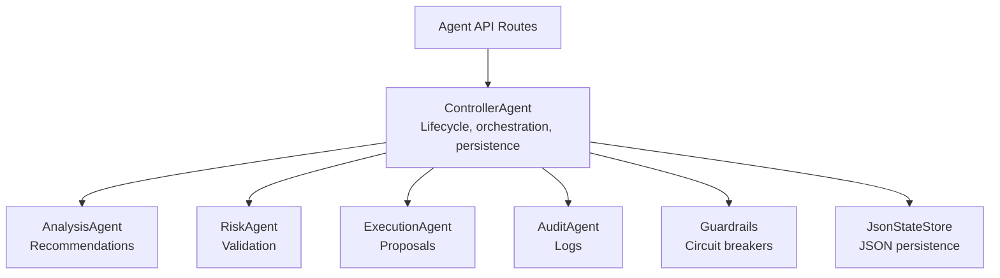

**Diagram sources**
- [controller.py:24-72](file://backend/app/agents/controller.py#L24-L72)
- [analysis_agent.py:10-18](file://backend/app/agents/analysis_agent.py#L10-L18)
- [risk_agent.py:8-22](file://backend/app/agents/risk_agent.py#L8-L22)
- [execution_agent.py:9-26](file://backend/app/agents/execution_agent.py#L9-L26)
- [audit_agent.py:33-37](file://backend/app/agents/audit_agent.py#L33-L37)
- [state_store.py:22-25](file://backend/app/services/state_store.py#L22-L25)
- [routes_agents.py:1-9](file://backend/app/api/routes_agents.py#L1-L9)

**Section sources**
- [controller.py:24-72](file://backend/app/agents/controller.py#L24-L72)
- [routes_agents.py:1-9](file://backend/app/api/routes_agents.py#L1-L9)

## Core Data Models
The core Pydantic models define the contract between agents and the API layer.

| Model | Purpose | Key Fields | Notes |
|---|---|---|---|
| `PollingConfig` | Runtime configuration for polling loop | `interval_seconds`, `monitored_tokens`, `user_holdings`, `agent_cache_duration` | Used by `/start` to configure controller behavior. |
| `AgentStatus` | High-level status snapshot | `running`, `current_step`, `last_run`, `monitored_tokens`, `user_holdings`, `halted`, `halt_reason`, `equity`, `day_start_equity`, `drawdown_pct`, `trades_today`, `max_daily_trades` | Returned by most agent endpoints. |
| `AnalysisRecommendation` | Strategy output from analysis agent | `token`, `action`, `confidence`, `reason`, `price`, `pct_change`, `rsi`, `vwap`, `volume_spike`, `volume_ratio`, `buy_step`, `sell_fraction`, `gain_pct`, `exit_kind`, `indicators_ready` | Input to risk agent. |
| `RiskAssessment` | Validation result from risk agent | `approved`, `reason`, `adjusted_amount`, `max_slippage`, `estimated_gas`, `gas_gwei`, `estimated_gas_usd`, `expected_profit_usd`, `max_notional_usd`, `checks` | Includes per-check diagnostics. |
| `TradeProposal` | Human-reviewable trade request | `id`, `token`, `action`, `amount`, `price`, `pct_change`, `reason`, `slippage`, `gas_limit`, `status`, `timestamp`, `notional_usd`, `expected_profit_usd`, `gas_cost_usd`, `auto_tradeable`, `price_source`, `sell_fraction`, `exit_kind` | Status transitions: pending → approved/rejected/executed. |
| `AuditLog` | Structured log entry | `timestamp`, `agent`, `message`, `level`, `data` | In-memory deque plus rotating file logger. |
| `Signal` | Generic signal model used elsewhere | `pair`, `action`, `confidence`, `explanation`, `source`, `created_at` | Not directly consumed by controller; useful for external signals. |

**Section sources**
- [agents.py:5-80](file://backend/app/models/agents.py#L5-L80)
- [signals.py:5-16](file://backend/app/models/signals.py#L5-L16)

## Architecture Overview
The controller runs an asynchronous loop that:
1. Fetches a market snapshot.
2. Updates price history and computes equity.
3. Applies guardrails to determine whether trading is allowed.
4. Invokes the analysis agent to generate recommendations.
5. Validates each recommendation through the risk agent.
6. Creates trade proposals via the execution agent.
7. Persists state and monitors proposals until completion.

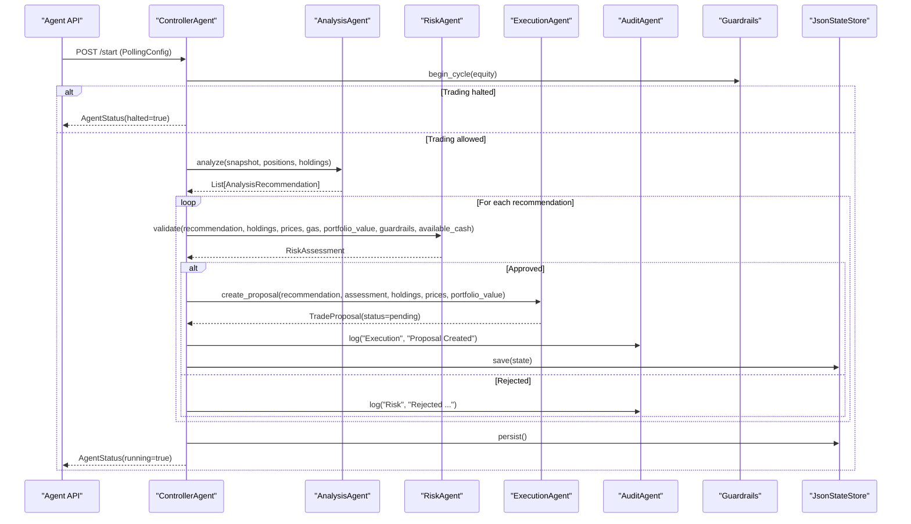

**Diagram sources**
- [controller.py:499-674](file://backend/app/agents/controller.py#L499-L674)
- [analysis_agent.py:76-255](file://backend/app/agents/analysis_agent.py#L76-L255)
- [risk_agent.py:24-190](file://backend/app/agents/risk_agent.py#L24-L190)
- [execution_agent.py:58-179](file://backend/app/agents/execution_agent.py#L58-L179)
- [audit_agent.py:39-60](file://backend/app/agents/audit_agent.py#L39-L60)
- [guardrails.py:46-71](file://backend/app/services/guardrails.py#L46-L71)
- [state_store.py:39-50](file://backend/app/services/state_store.py#L39-L50)

## Agent Lifecycle and State Transitions
The controller exposes lifecycle methods and tracks its current step. The primary states include:
- Idle: not running.
- Running: loop active.
- Halted: guardrails prevent new trades.
- Monitoring: loop completed a cycle and is sleeping until next interval.

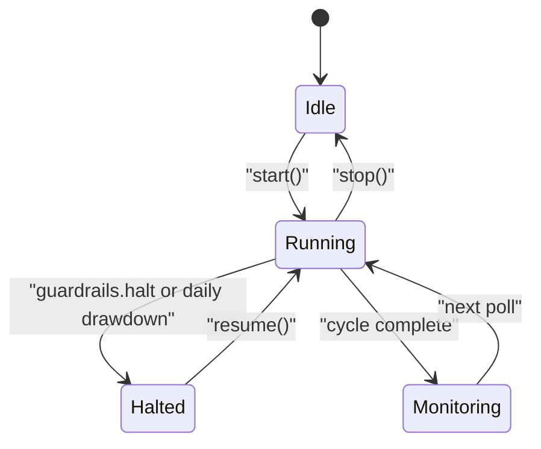

**Diagram sources**
- [controller.py:224-243](file://backend/app/agents/controller.py#L224-L243)
- [controller.py:561-574](file://backend/app/agents/controller.py#L561-L574)
- [controller.py:672-674](file://backend/app/agents/controller.py#L672-L674)
- [guardrails.py:46-71](file://backend/app/services/guardrails.py#L46-L71)

### Proposal Lifecycle
A trade proposal moves through these statuses:
- Pending: created by execution agent after risk approval.
- Approved: optional intermediate state when UI confirms before execution.
- Rejected: declined by risk or manual rejection.
- Executed: confirmed with transaction hash; updates positions and guardrails.

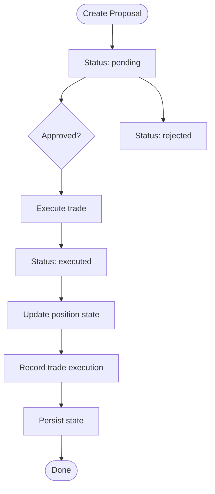

**Diagram sources**
- [execution_agent.py:98-179](file://backend/app/agents/execution_agent.py#L98-L179)
- [controller.py:296-330](file://backend/app/agents/controller.py#L296-L330)
- [controller.py:333-400](file://backend/app/agents/controller.py#L333-L400)
- [execution_agent.py:28-56](file://backend/app/agents/execution_agent.py#L28-L56)

## Detailed Component Analysis

### Analysis Agent
The analysis agent implements rule-based strategy logic:
- Buys dips confirmed by RSI, VWAP, and volume spikes.
- Exits positions using take-profit ladders, stop-loss ladders, and trailing stops.
- Tracks position state including average entry price, buy steps, peak price, cumulative sold fraction, and exit metadata.

Key responsibilities:
- Compute indicators from market history.
- Decide action: buy, sell, or hold.
- Produce `AnalysisRecommendation` objects with confidence, reason, and exit metadata.

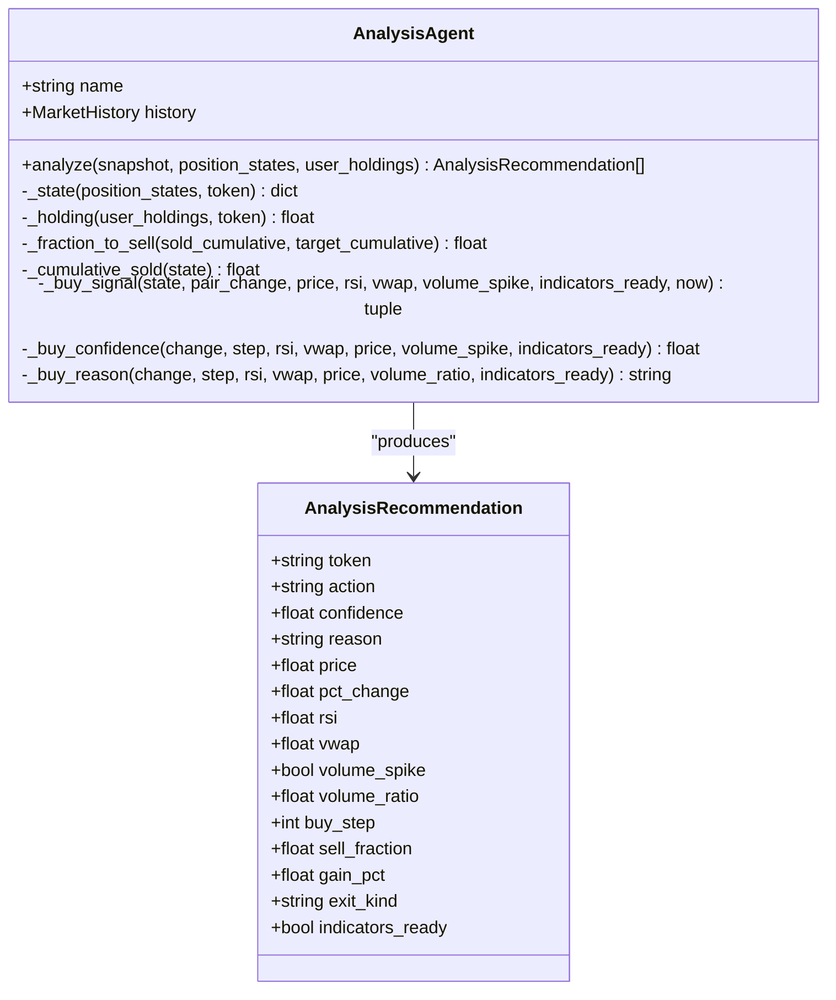

**Diagram sources**
- [analysis_agent.py:10-56](file://backend/app/agents/analysis_agent.py#L10-L56)
- [analysis_agent.py:76-255](file://backend/app/agents/analysis_agent.py#L76-L255)
- [agents.py:25-41](file://backend/app/models/agents.py#L25-L41)

**Section sources**
- [analysis_agent.py:10-56](file://backend/app/agents/analysis_agent.py#L10-L56)
- [analysis_agent.py:76-255](file://backend/app/agents/analysis_agent.py#L76-L255)
- [agents.py:25-41](file://backend/app/models/agents.py#L25-L41)

### Risk Agent
The risk agent validates recommendations against multiple constraints:
- Confidence threshold.
- Gas price ceiling.
- Position sizing and exposure caps.
- Minimum expected profit and gas-to-profit ratio.
- Circuit breaker checks via guardrails.

It returns a `RiskAssessment` with detailed check results, slippage estimates, gas cost estimates, and expected profit.

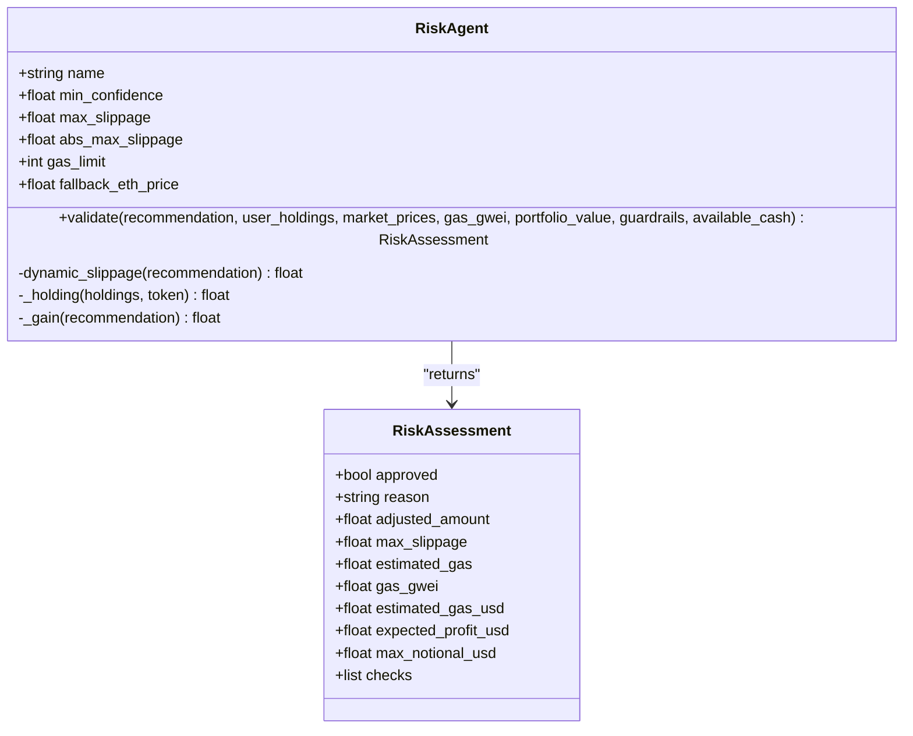

**Diagram sources**
- [risk_agent.py:8-22](file://backend/app/agents/risk_agent.py#L8-L22)
- [risk_agent.py:24-190](file://backend/app/agents/risk_agent.py#L24-L190)
- [agents.py:42-52](file://backend/app/models/agents.py#L42-L52)

**Section sources**
- [risk_agent.py:8-22](file://backend/app/agents/risk_agent.py#L8-L22)
- [risk_agent.py:24-190](file://backend/app/agents/risk_agent.py#L24-L190)
- [agents.py:42-52](file://backend/app/models/agents.py#L42-L52)

### Execution Agent
The execution agent transforms approved recommendations into trade proposals:
- Computes buying power from stablecoins and ETH/WETH.
- Sizes buys using step fractions and target position percentage.
- Respects risk layer headroom and minimum trade thresholds.
- Produces `TradeProposal` objects with slippage, gas limits, and auto-tradeability flags.

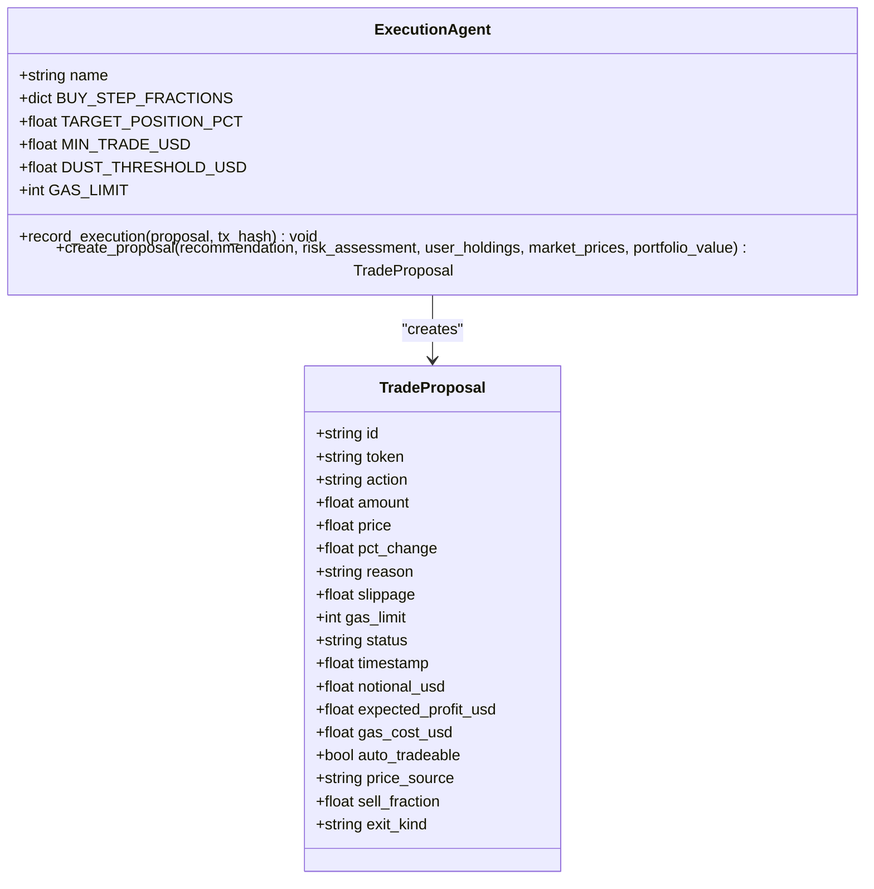

**Diagram sources**
- [execution_agent.py:9-26](file://backend/app/agents/execution_agent.py#L9-L26)
- [execution_agent.py:58-179](file://backend/app/agents/execution_agent.py#L58-L179)
- [agents.py:54-73](file://backend/app/models/agents.py#L54-L73)

**Section sources**
- [execution_agent.py:9-26](file://backend/app/agents/execution_agent.py#L9-L26)
- [execution_agent.py:58-179](file://backend/app/agents/execution_agent.py#L58-L179)
- [agents.py:54-73](file://backend/app/models/agents.py#L54-L73)

### Audit Agent
The audit agent provides structured logging:
- Maintains an in-memory deque of recent logs.
- Writes to a rotating file logger.
- Emits `AuditLog` entries with timestamp, agent name, message, level, and optional data.

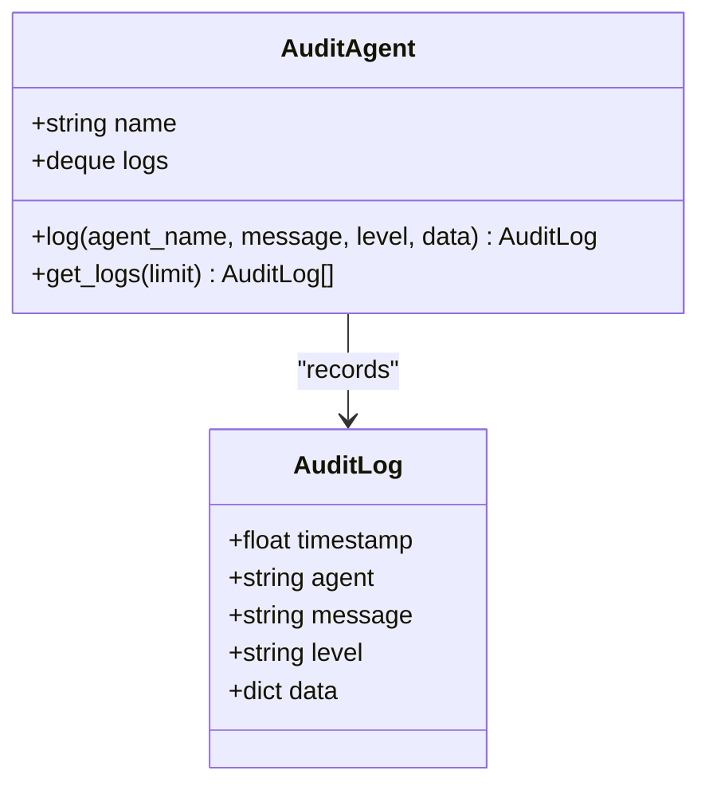

**Diagram sources**
- [audit_agent.py:33-63](file://backend/app/agents/audit_agent.py#L33-L63)
- [agents.py:74-79](file://backend/app/models/agents.py#L74-L79)

**Section sources**
- [audit_agent.py:33-63](file://backend/app/agents/audit_agent.py#L33-L63)
- [agents.py:74-79](file://backend/app/models/agents.py#L74-L79)

## Inter-Agent Communication Protocols
Agents communicate through well-defined Pydantic models:
- Analysis agent outputs `AnalysisRecommendation`.
- Risk agent consumes recommendations and outputs `RiskAssessment`.
- Execution agent consumes recommendations and assessments to produce `TradeProposal`.
- Controller coordinates the flow and persists state.
- Audit agent records events across all stages.

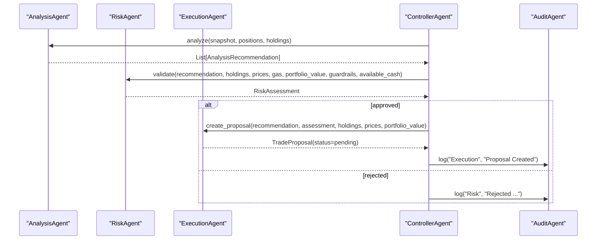

**Diagram sources**
- [controller.py:577-666](file://backend/app/agents/controller.py#L577-L666)
- [analysis_agent.py:76-255](file://backend/app/agents/analysis_agent.py#L76-L255)
- [risk_agent.py:24-190](file://backend/app/agents/risk_agent.py#L24-L190)
- [execution_agent.py:58-179](file://backend/app/agents/execution_agent.py#L58-L179)
- [audit_agent.py:39-60](file://backend/app/agents/audit_agent.py#L39-L60)

## State Persistence and Registry Model
The controller persists several categories of state:
- Position states: average entry price, buy step, peak price, tranches sold, cumulative sold, last exit price/timestamp/kind.
- Proposals: up to 200 recent proposals serialized as dictionaries.
- Last trade times: per-token timestamps for cooldowns.
- Guardrails: day, equity metrics, trade counts, halt state.

Persistence uses `JsonStateStore`, which writes atomically via temporary files and replaces the target file.

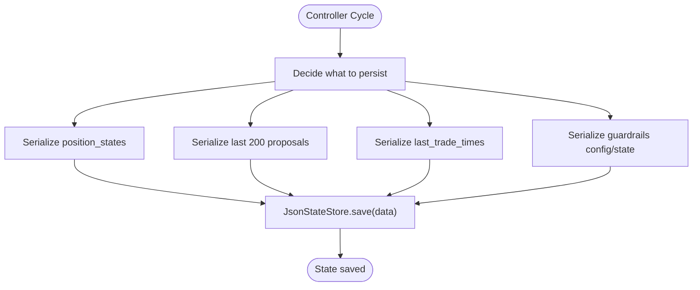

**Diagram sources**
- [controller.py:118-125](file://backend/app/agents/controller.py#L118-L125)
- [state_store.py:39-50](file://backend/app/services/state_store.py#L39-L50)

### Position State Model
Position state is stored as a dictionary keyed by token, containing:
- `avg_entry`: weighted average entry price.
- `buy_step`: number of successful buy steps capped at 4.
- `peak_price`: highest observed price since entry.
- `tranches_sold`: historical tranche metadata.
- `cumulative_sold`: total fraction sold relative to original position.
- `last_exit_price`, `last_exit_ts`, `last_exit_kind`: exit metadata.

This structure is reconstructed from trades or demo fills and updated on every executed proposal.

**Section sources**
- [controller.py:128-180](file://backend/app/agents/controller.py#L128-L180)
- [controller.py:185-221](file://backend/app/agents/controller.py#L185-L221)
- [controller.py:333-400](file://backend/app/agents/controller.py#L333-L400)

### Guardrails State Model
Guardrails track:
- Day key and start-of-day equity.
- Last and peak equity.
- Daily trade count and per-token trade count.
- Halt state, reason, and kind.
- Configuration values like maximum daily trades, per-token limit, drawdown limit, position percentage cap, minimum profit, gas cap, and gas limit.

These values are persisted alongside position and proposal state.

**Section sources**
- [guardrails.py:16-39](file://backend/app/services/guardrails.py#L16-L39)
- [guardrails.py:46-71](file://backend/app/services/guardrails.py#L46-L71)
- [guardrails.py:115-133](file://backend/app/services/guardrails.py#L115-L133)
- [guardrails.py:136-164](file://backend/app/services/guardrails.py#L136-L164)

## Configuration Schemas and Validation
Runtime configuration is primarily provided through `PollingConfig` and guardrail settings.

### Polling Configuration
- `interval_seconds`: controls polling frequency.
- `monitored_tokens`: restricts pairs analyzed.
- `user_holdings`: injects holdings for simulation or testing.
- `agent_cache_duration`: adjusts cache duration for agent data.

The `/start` endpoint applies these settings to the controller before starting the loop.

### Guardrail Configuration
Guardrail configuration includes:
- `max_daily_trades`: daily trade budget.
- `max_trades_per_token`: per-token trade budget.
- `max_daily_drawdown`: automatic halt threshold.
- `max_position_pct`: maximum portfolio allocation per position.
- `min_profit_usd`: minimum expected profit filter.
- `max_gas_gwei`: gas price ceiling.
- `gas_limit`: gas limit used for cost estimation.

These values influence risk validation and controller halting behavior.

**Section sources**
- [agents.py:5-10](file://backend/app/models/agents.py#L5-L10)
- [routes_agents.py:30-39](file://backend/app/api/routes_agents.py#L30-L39)
- [guardrails.py:16-25](file://backend/app/services/guardrails.py#L16-L25)
- [risk_agent.py:52-79](file://backend/app/agents/risk_agent.py#L52-L79)

## Monitoring, Status, and Audit Structures
The API exposes:
- `AgentStatus`: running state, current step, last run time, monitored tokens, holdings, halt state, equity metrics, and trade counts.
- `/state`: guardrail status, position states, and indicator summaries.
- `/proposals`: list of trade proposals.
- `/logs`: recent audit logs.

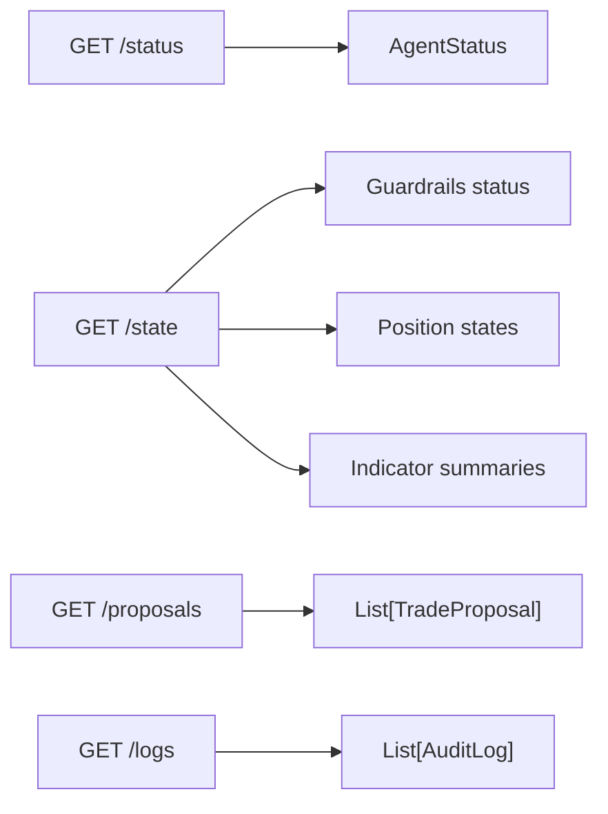

**Diagram sources**
- [routes_agents.py:61-94](file://backend/app/api/routes_agents.py#L61-L94)
- [agents.py:11-23](file://backend/app/models/agents.py#L11-L23)
- [agents.py:54-79](file://backend/app/models/agents.py#L54-L79)

**Section sources**
- [routes_agents.py:61-94](file://backend/app/api/routes_agents.py#L61-L94)
- [agents.py:11-23](file://backend/app/models/agents.py#L11-L23)
- [agents.py:54-79](file://backend/app/models/agents.py#L54-L79)

## Dependency Analysis
The following diagram shows import and dependency relationships among core modules:

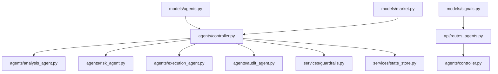

**Diagram sources**
- [agents.py:1-80](file://backend/app/models/agents.py#L1-L80)
- [controller.py:1-21](file://backend/app/agents/controller.py#L1-L21)
- [routes_agents.py:1-9](file://backend/app/api/routes_agents.py#L1-L9)
- [signals.py:1-16](file://backend/app/models/signals.py#L1-L16)

**Section sources**
- [agents.py:1-80](file://backend/app/models/agents.py#L1-L80)
- [controller.py:1-21](file://backend/app/agents/controller.py#L1-L21)
- [routes_agents.py:1-9](file://backend/app/api/routes_agents.py#L1-L9)
- [signals.py:1-16](file://backend/app/models/signals.py#L1-L16)

## Performance Considerations
- Proposal deduplication: the controller avoids duplicate pending proposals per token within short cooldown windows.
- State persistence: only the last 200 proposals are persisted to reduce disk size.
- Indicator warming: analysis falls back to lower-confidence decisions when RSI/VWAP are not ready.
- Gas cost estimation: risk agent uses configurable gas limits and ETH price fallback to avoid excessive costs.
- Atomic state writes: `JsonStateStore` uses temporary files to prevent partial writes.

[No sources needed since this section provides general guidance]

## Troubleshooting Guide
Common issues and their data-model-related causes:
- Trading halted: check `AgentStatus.halted`, `AgentStatus.halt_reason`, and guardrail status for daily drawdown or manual kill switch.
- No proposals generated: verify `AnalysisRecommendation.indicators_ready`, confidence thresholds, and dip conditions.
- Proposals rejected: inspect `RiskAssessment.checks` for failed confidence, gas price, position cap, or minimum profit checks.
- Small or dust trades: execution agent rejects trades below minimum USD thresholds.
- Missing holdings: execution agent requires real holdings; injected holdings are ignored in demo mode.

Use `/logs` to review audit entries and `/state` to inspect guardrail and indicator state.

**Section sources**
- [routes_agents.py:92-116](file://backend/app/api/routes_agents.py#L92-L116)
- [risk_agent.py:61-174](file://backend/app/agents/risk_agent.py#L61-L174)
- [execution_agent.py:98-179](file://backend/app/agents/execution_agent.py#L98-L179)
- [audit_agent.py:39-63](file://backend/app/agents/audit_agent.py#L39-L63)

## Conclusion
The agent system’s data models provide a robust foundation for safe, auditable trading automation. `AnalysisRecommendation`, `RiskAssessment`, and `TradeProposal` form the core messaging contracts, while `AgentStatus`, `AuditLog`, and guardrail state enable comprehensive monitoring. The controller orchestrates lifecycle management, state persistence, and inter-agent coordination, ensuring that trading decisions are validated, sized, and recorded consistently.

[No sources needed since this section summarizes without analyzing specific files]