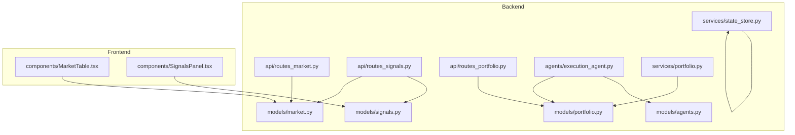
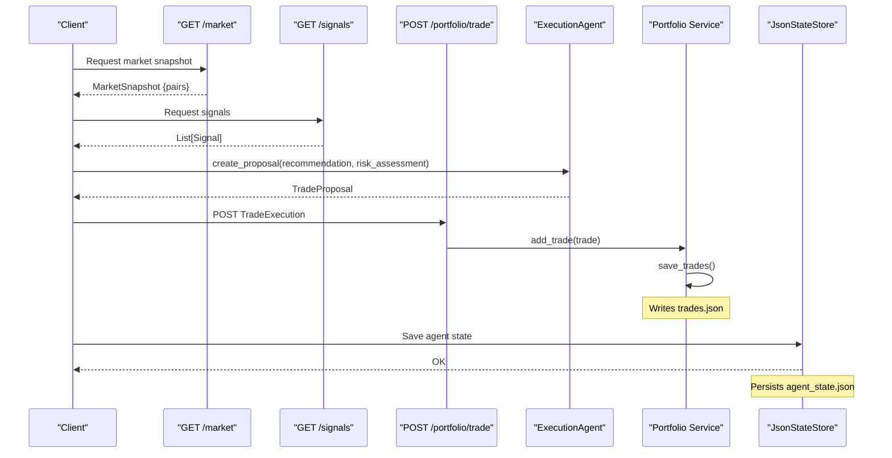
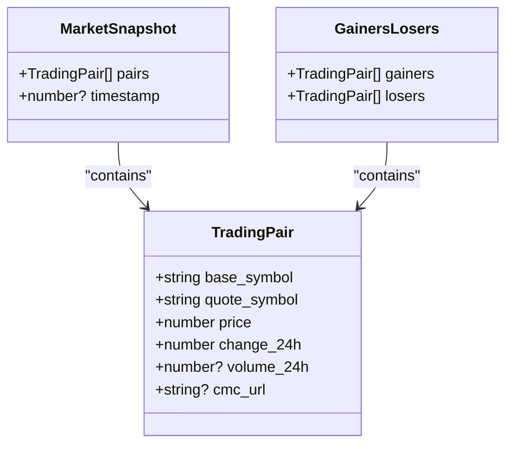
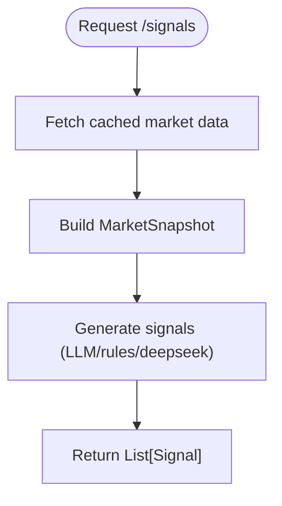
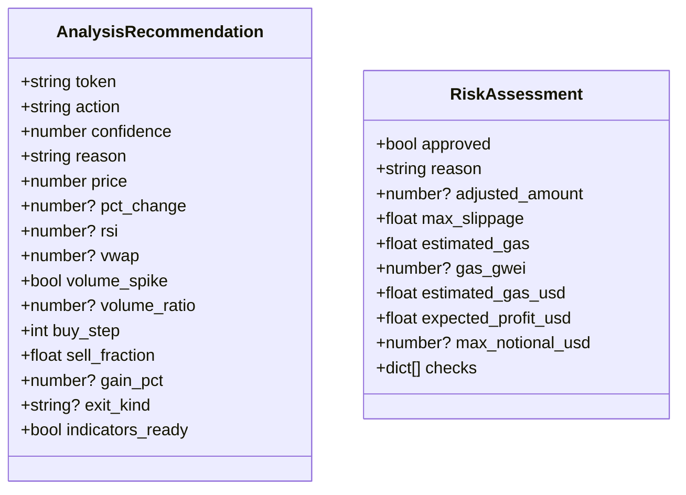
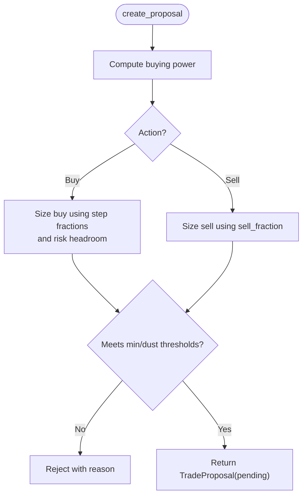
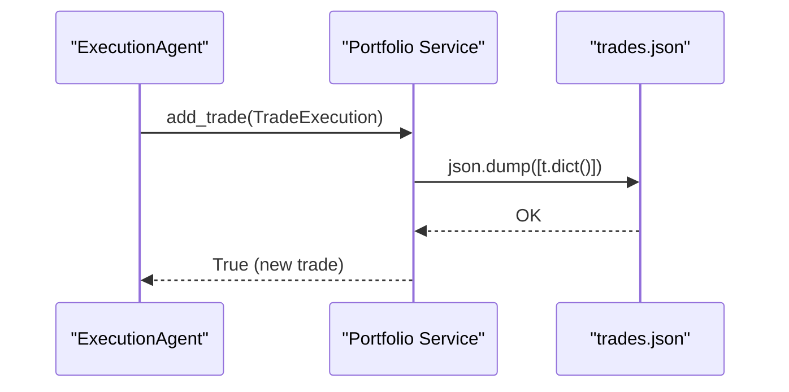
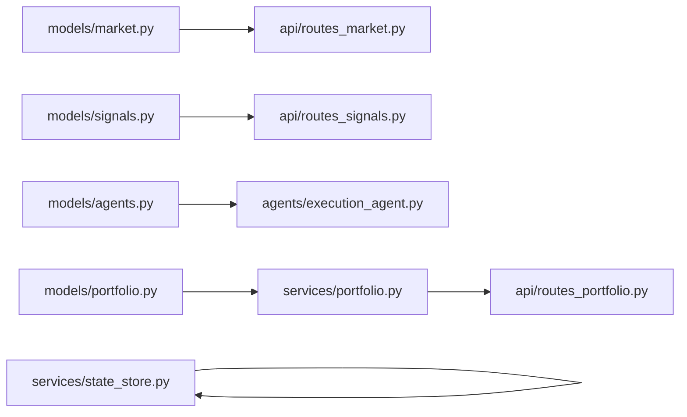

# Data Models & Schemas

<cite>
**Referenced Files in This Document**
- [market.py](file://backend/app/models/market.py)
- [signals.py](file://backend/app/models/signals.py)
- [agents.py](file://backend/app/models/agents.py)
- [portfolio.py](file://backend/app/models/portfolio.py)
- [routes_market.py](file://backend/app/api/routes_market.py)
- [routes_signals.py](file://backend/app/api/routes_signals.py)
- [routes_portfolio.py](file://backend/app/api/routes_portfolio.py)
- [execution_agent.py](file://backend/app/agents/execution_agent.py)
- [state_store.py](file://backend/app/services/state_store.py)
- [portfolio.py](file://backend/app/services/portfolio.py)
- [MarketTable.tsx](file://frontend/components/MarketTable.tsx)
- [SignalsPanel.tsx](file://frontend/components/SignalsPanel.tsx)
</cite>

## Table of Contents
1. Introduction
2. Project Structure
3. Core Components
4. Architecture Overview
5. Detailed Component Analysis
6. Dependency Analysis
7. Performance Considerations
8. Troubleshooting Guide
9. Conclusion

## Introduction
This document defines the data models and schemas used across the trading system, covering Pydantic models for market data, signals, risk assessment, trade proposals, and completed trades, as well as TypeScript interfaces on the frontend. It explains field definitions, validation rules, relationships, API request/response schemas, JSON persistence files (trades.json, agent_state.json, price_history.json), data transformation patterns, lifecycle, serialization formats, and migration considerations.

## Project Structure
The backend uses Pydantic models to validate and serialize data exchanged via FastAPI routes and persisted to JSON files. The frontend mirrors key structures with TypeScript types for consistent UI behavior.

**Diagram sources**
- [market.py:5-40](file://backend/app/models/market.py#L5-L40)
- [signals.py:5-15](file://backend/app/models/signals.py#L5-L15)
- [agents.py:25-72](file://backend/app/models/agents.py#L25-L72)
- [portfolio.py:17-36](file://backend/app/models/portfolio.py#L17-L36)
- [routes_market.py:53-172](file://backend/app/api/routes_market.py#L53-L172)
- [routes_signals.py:20-53](file://backend/app/api/routes_signals.py#L20-L53)
- [routes_portfolio.py:75-138](file://backend/app/api/routes_portfolio.py#L75-L138)
- [execution_agent.py:28-179](file://backend/app/agents/execution_agent.py#L28-L179)
- [state_store.py:22-59](file://backend/app/services/state_store.py#L22-L59)
- [portfolio.py:14-96](file://backend/app/services/portfolio.py#L14-L96)
- [MarketTable.tsx:6-13](file://frontend/components/MarketTable.tsx#L6-L13)
- [SignalsPanel.tsx:1-154](file://frontend/components/SignalsPanel.tsx#L1-L154)

**Section sources**
- [routes_market.py:53-172](file://backend/app/api/routes_market.py#L53-L172)
- [routes_signals.py:20-53](file://backend/app/api/routes_signals.py#L20-L53)
- [routes_portfolio.py:75-138](file://backend/app/api/routes_portfolio.py#L75-L138)
- [execution_agent.py:28-179](file://backend/app/agents/execution_agent.py#L28-L179)
- [state_store.py:22-59](file://backend/app/services/state_store.py#L22-L59)
- [portfolio.py:14-96](file://backend/app/services/portfolio.py#L14-L96)

## Core Components
This section documents the primary Pydantic models and their TypeScript counterparts, including fields, types, validation constraints, and relationships.

### TradingPair (Market Data Representation)
- Purpose: Represents a single tradable pair with price and change metrics.
- Fields:
  - base_symbol: string
  - quote_symbol: string
  - price: number
  - change_24h: number
  - volume_24h: optional number
  - cmc_url: optional string
- Validation: Pydantic enforces numeric types; optional fields may be null.
- Relationships: Aggregated into MarketSnapshot and GainersLosers.
- Frontend mapping: TypeScript type mirrors these fields in MarketTable.tsx.

**Section sources**
- [market.py:5-11](file://backend/app/models/market.py#L5-L11)
- [MarketTable.tsx:6-13](file://frontend/components/MarketTable.tsx#L6-L13)

### MarketSnapshot, BaseTokenSnapshot, TokenVolumesSnapshot
- MarketSnapshot:
  - pairs: list of TradingPair
  - timestamp: optional number
- BaseTokenSnapshot:
  - tokens: list of BaseToken
- TokenVolumesSnapshot:
  - chain_id: integer
  - volumes: map from address to optional number
- Validation: Lists enforce element types; optional fields allow nulls.
- Usage: Exposed by /market endpoints.

**Section sources**
- [market.py:14-40](file://backend/app/models/market.py#L14-L40)
- [routes_market.py:53-172](file://backend/app/api/routes_market.py#L53-L172)

### Signal (Trading Signals)
- Purpose: Encapsulates a trading signal produced by LLM or rule-based agents.
- Fields:
  - pair: string
  - action: literal "buy", "sell", or "hold"
  - confidence: number
  - explanation: optional string
  - source: optional literal "llm", "rules", or "deepseek"
  - created_at: optional number (epoch seconds)
- Validation: Literal enums constrain action and source; confidence is numeric.
- Usage: Returned by /signals endpoint.

**Section sources**
- [signals.py:5-15](file://backend/app/models/signals.py#L5-L15)
- [routes_signals.py:20-53](file://backend/app/api/routes_signals.py#L20-L53)
- [SignalsPanel.tsx:1-154](file://frontend/components/SignalsPanel.tsx#L1-L154)

### AnalysisRecommendation (Trading Recommendation)
- Purpose: Internal recommendation produced by analysis agents before proposal sizing.
- Fields:
  - token: string
  - action: literal "buy", "sell", or "hold"
  - confidence: number
  - reason: string
  - price: number
  - pct_change: optional number
  - rsi: optional number
  - vwap: optional number
  - volume_spike: boolean
  - volume_ratio: optional number
  - buy_step: integer
  - sell_fraction: number
  - gain_pct: optional number
  - exit_kind: optional string ("take_profit", "stop_loss", "trailing_stop")
  - indicators_ready: boolean
- Validation: Literals constrain action and exit_kind; numeric fields validated by Pydantic.
- Relationships: Input to ExecutionAgent.create_proposal.

**Section sources**
- [agents.py:25-40](file://backend/app/models/agents.py#L25-L40)
- [execution_agent.py:58-179](file://backend/app/agents/execution_agent.py#L58-L179)

### RiskAssessment (Risk Evaluation Result)
- Purpose: Risk layer output that approves/rejects and adjusts exposure.
- Fields:
  - approved: boolean
  - reason: string
  - adjusted_amount: optional number
  - max_slippage: number (default 0.5)
  - estimated_gas: number (default 0.0)
  - gas_gwei: optional number
  - estimated_gas_usd: number (default 0.0)
  - expected_profit_usd: number (default 0.0)
  - max_notional_usd: optional number
  - checks: list of dicts
- Validation: Defaults applied; numeric fields validated.
- Relationships: Influences TradeProposal sizing and metadata.

**Section sources**
- [agents.py:42-52](file://backend/app/models/agents.py#L42-L52)
- [execution_agent.py:81-96](file://backend/app/agents/execution_agent.py#L81-L96)

### TradeProposal (Executable Trade Specification)
- Purpose: Sized, human-approvable trade specification derived from recommendations and risk assessment.
- Fields:
  - id: string
  - token: string
  - action: literal "buy" or "sell"
  - amount: number (token quantity)
  - price: number
  - pct_change: optional number
  - reason: optional string
  - slippage: number
  - gas_limit: integer
  - status: literal "pending", "approved", "rejected", "executed" (default "pending")
  - timestamp: number
  - notional_usd: number (default 0.0)
  - expected_profit_usd: number (default 0.0)
  - gas_cost_usd: number (default 0.0)
  - auto_tradeable: boolean (default False)
  - price_source: string (default "global_spot")
  - sell_fraction: optional number
  - exit_kind: optional string
- Validation: Literals constrain action/status; numeric fields validated.
- Relationships: Produced by ExecutionAgent; later converted to TradeExecution upon completion.

**Section sources**
- [agents.py:54-72](file://backend/app/models/agents.py#L54-L72)
- [execution_agent.py:81-179](file://backend/app/agents/execution_agent.py#L81-L179)

### TradeExecution (Completed Transaction Record)
- Purpose: Uniform ledger record for completed trades, consumed by portfolio services and reports.
- Fields:
  - tx_hash: string
  - network: string
  - pair: string (BASE/QUOTE)
  - action: string ("buy" or "sell")
  - amount: number (quote currency spent/received)
  - token: string (quote currency symbol)
  - price: number (quote per base)
  - token_amount: number (base token quantity)
  - network_fee: number (gas fee USD)
  - price_usd: number (USD per base at execution)
  - status: string ("completed", "failed", "pending"; default "completed")
  - timestamp: integer (epoch seconds)
- Validation: Numeric fields validated; defaults ensure safe serialization.
- Relationships: Persisted to trades.json; used to reconstruct holdings.

**Section sources**
- [portfolio.py:17-36](file://backend/app/models/portfolio.py#L17-L36)
- [portfolio.py:14-96](file://backend/app/services/portfolio.py#L14-L96)
- [routes_portfolio.py:75-138](file://backend/app/api/routes_portfolio.py#L75-L138)

## Architecture Overview
The data flow spans market data ingestion, signal generation, recommendation and risk evaluation, proposal creation, execution recording, and persistence.

**Diagram sources**
- [routes_market.py:53-58](file://backend/app/api/routes_market.py#L53-L58)
- [routes_signals.py:20-53](file://backend/app/api/routes_signals.py#L20-L53)
- [execution_agent.py:58-179](file://backend/app/agents/execution_agent.py#L58-L179)
- [routes_portfolio.py:75-96](file://backend/app/api/routes_portfolio.py#L75-L96)
- [portfolio.py:37-49](file://backend/app/services/portfolio.py#L37-L49)
- [state_store.py:39-59](file://backend/app/services/state_store.py#L39-L59)

## Detailed Component Analysis

### TradingPair Model
- Definition: Defines a minimal representation of a tradable pair with price and change metrics.
- Types and Validation:
  - base_symbol, quote_symbol: strings
  - price, change_24h: floats
  - volume_24h, cmc_url: optional
- Relationships:
  - Used within MarketSnapshot.pairs and GainersLosers.gainers/losers.
- Frontend Mapping:
  - TypeScript interface in MarketTable.tsx mirrors fields for sorting/filtering.

**Diagram sources**
- [market.py:5-21](file://backend/app/models/market.py#L5-L21)

**Section sources**
- [market.py:5-21](file://backend/app/models/market.py#L5-L21)
- [MarketTable.tsx:6-13](file://frontend/components/MarketTable.tsx#L6-L13)

### Signal Model
- Definition: Captures actionable trading signals with confidence and provenance.
- Types and Validation:
  - action: literal enum ["buy","sell","hold"]
  - source: literal enum ["llm","rules","deepseek"]
  - confidence: float
  - created_at: optional epoch seconds
- API Contract:
  - GET /signals returns List[Signal].

**Diagram sources**
- [routes_signals.py:20-53](file://backend/app/api/routes_signals.py#L20-L53)

**Section sources**
- [signals.py:5-15](file://backend/app/models/signals.py#L5-L15)
- [routes_signals.py:20-53](file://backend/app/api/routes_signals.py#L20-L53)
- [SignalsPanel.tsx:1-154](file://frontend/components/SignalsPanel.tsx#L1-L154)

### AnalysisRecommendation and RiskAssessment
- AnalysisRecommendation:
  - Provides token-level recommendation with technical indicators and exit strategy hints.
- RiskAssessment:
  - Approves or rejects trades, sets slippage, gas estimates, profit expectations, and exposure limits.
- Interaction:
  - ExecutionAgent consumes both to compute sized TradeProposal.

**Diagram sources**
- [agents.py:25-52](file://backend/app/models/agents.py#L25-L52)

**Section sources**
- [agents.py:25-52](file://backend/app/models/agents.py#L25-L52)
- [execution_agent.py:58-179](file://backend/app/agents/execution_agent.py#L58-L179)

### TradeProposal Model
- Definition: Sized trade specification with metadata for approval and execution.
- Key Rules:
  - For buys: amount computed from buying power, target position fraction, and risk headroom.
  - For sells: amount based on current holdings and sell_fraction.
  - Status transitions: pending -> approved/executed/rejected.
- Dependencies:
  - Uses STABLECOINS and is_auto_tradeable to determine auto-trade eligibility.

**Diagram sources**
- [execution_agent.py:58-179](file://backend/app/agents/execution_agent.py#L58-L179)

**Section sources**
- [agents.py:54-72](file://backend/app/models/agents.py#L54-L72)
- [execution_agent.py:58-179](file://backend/app/agents/execution_agent.py#L58-L179)

### TradeExecution Model and Ledger Persistence
- Definition: Immutable record of completed trades with uniform semantics for buy/sell.
- Semantics:
  - amount = quote currency quantity
  - token_amount = base token quantity
  - token = quote currency symbol
  - price = quote per base
  - price_usd = USD per base at execution
- Persistence:
  - Saved to trades.json via PortfolioService.add_trade.
  - Holdings reconstructed from trade history.

**Diagram sources**
- [execution_agent.py:28-56](file://backend/app/agents/execution_agent.py#L28-L56)
- [portfolio.py:37-49](file://backend/app/services/portfolio.py#L37-L49)

**Section sources**
- [portfolio.py:17-36](file://backend/app/models/portfolio.py#L17-L36)
- [portfolio.py:14-96](file://backend/app/services/portfolio.py#L14-L96)
- [routes_portfolio.py:75-96](file://backend/app/api/routes_portfolio.py#L75-L96)

## Dependency Analysis
Key dependencies between models and services:

**Diagram sources**
- [market.py:5-40](file://backend/app/models/market.py#L5-L40)
- [signals.py:5-15](file://backend/app/models/signals.py#L5-L15)
- [agents.py:25-72](file://backend/app/models/agents.py#L25-L72)
- [portfolio.py:17-36](file://backend/app/models/portfolio.py#L17-L36)
- [routes_market.py:53-172](file://backend/app/api/routes_market.py#L53-L172)
- [routes_signals.py:20-53](file://backend/app/api/routes_signals.py#L20-L53)
- [routes_portfolio.py:75-138](file://backend/app/api/routes_portfolio.py#L75-L138)
- [execution_agent.py:28-179](file://backend/app/agents/execution_agent.py#L28-L179)
- [state_store.py:22-59](file://backend/app/services/state_store.py#L22-L59)
- [portfolio.py:14-96](file://backend/app/services/portfolio.py#L14-L96)

**Section sources**
- [routes_market.py:53-172](file://backend/app/api/routes_market.py#L53-L172)
- [routes_signals.py:20-53](file://backend/app/api/routes_signals.py#L20-L53)
- [routes_portfolio.py:75-138](file://backend/app/api/routes_portfolio.py#L75-L138)
- [execution_agent.py:28-179](file://backend/app/agents/execution_agent.py#L28-L179)
- [state_store.py:22-59](file://backend/app/services/state_store.py#L22-L59)
- [portfolio.py:14-96](file://backend/app/services/portfolio.py#L14-L96)

## Performance Considerations
- Caching:
  - Market data cached for 1 hour to reduce external API calls.
  - Base tokens and token volumes use shorter TTLs with rate-limit handling.
- Concurrency:
  - Async locks prevent duplicate cache misses and concurrent writes.
- Serialization:
  - JSON persistence uses atomic writes via temporary files and os.replace to avoid partial states.
- Filtering:
  - API endpoints support limit and query filters to reduce payload sizes.

[No sources needed since this section provides general guidance]

## Troubleshooting Guide
- Trades Not Appearing:
  - Verify trades.json exists and is readable; check error logs from load_trades/save_trades.
  - Ensure tx_hash uniqueness; duplicate hashes are ignored by add_trade.
- Agent State Issues:
  - Inspect agent_state.json for corruption; JsonStateStore.load returns empty dict on errors.
- Market Data Errors:
  - Rate-limited base-token requests return stale snapshots; refresh after backoff.
- Signal Generation Failures:
  - DeepSeek/OpenAI failures fall back to rule-based evaluation; check API keys and quotas.

**Section sources**
- [portfolio.py:14-35](file://backend/app/services/portfolio.py#L14-L35)
- [state_store.py:27-37](file://backend/app/services/state_store.py#L27-L37)
- [routes_market.py:93-109](file://backend/app/api/routes_market.py#L93-L109)
- [routes_signals.py:28-53](file://backend/app/api/routes_signals.py#L28-L53)

## Conclusion
The data model layer provides a clear contract between market data, signals, risk assessments, trade proposals, and executed trades. Pydantic ensures strict validation, while JSON persistence offers simple, portable storage. TypeScript interfaces mirror backend models to keep the frontend aligned. Careful attention to field semantics, especially around amounts and units, ensures consistency across producers and consumers. Migration strategies should preserve backward compatibility by adding optional fields and handling legacy formats during reconstruction.