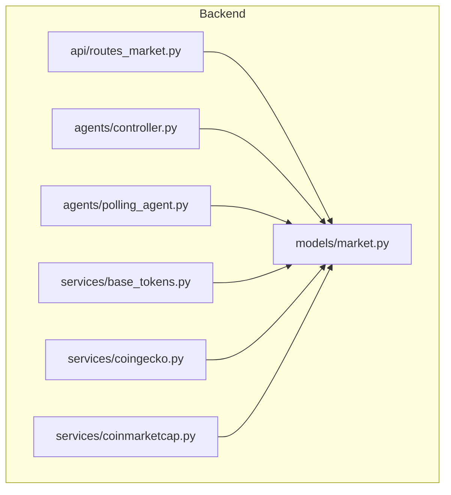
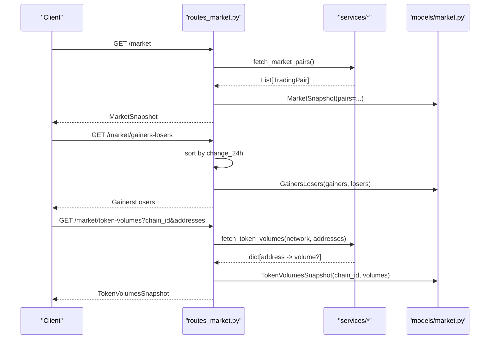
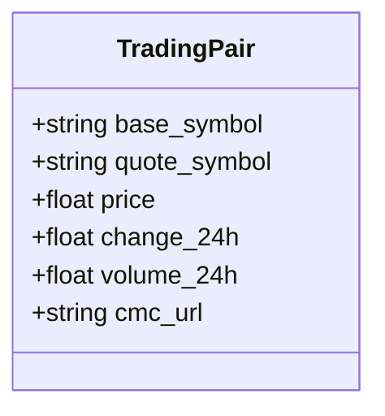
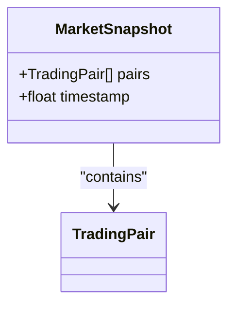
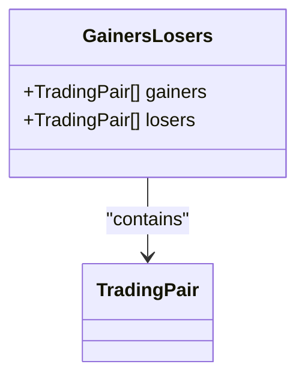
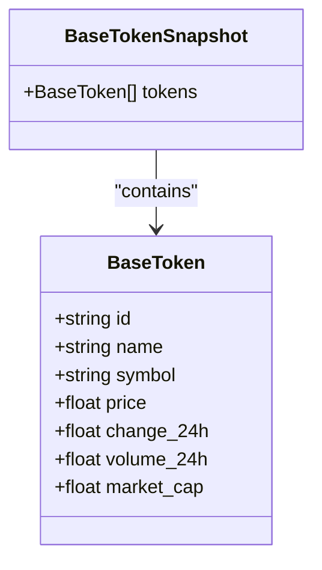
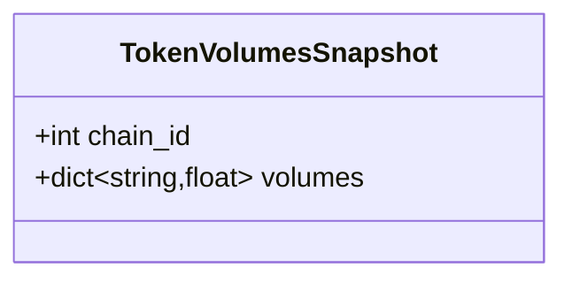
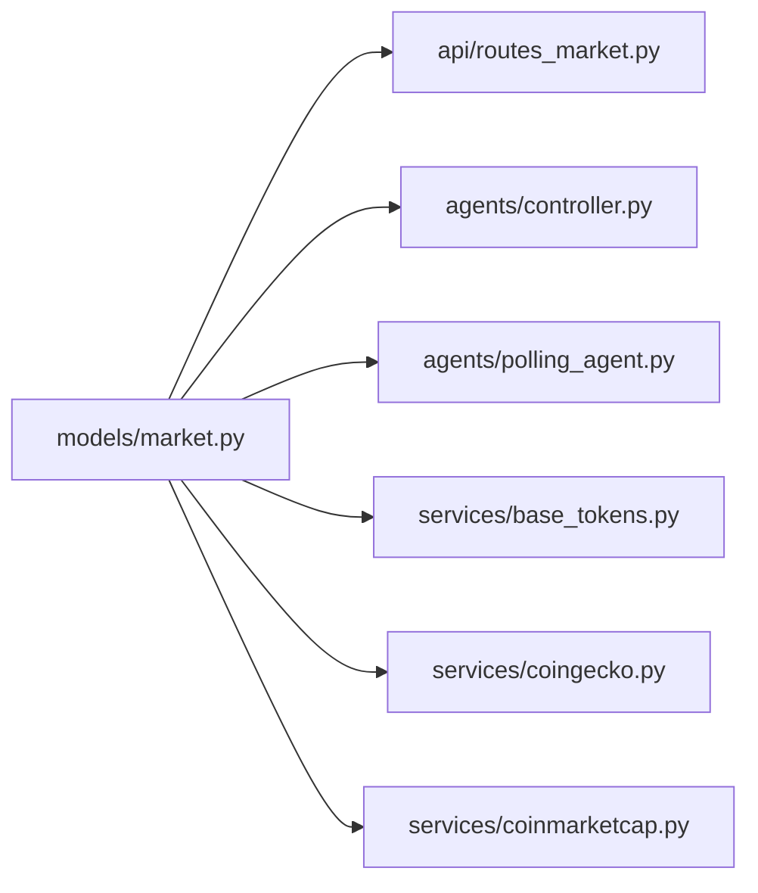

# Market Data Models

<cite>
**Referenced Files in This Document**
- [market.py](file://backend/app/models/market.py)
- [routes_market.py](file://backend/app/api/routes_market.py)
- [controller.py](file://backend/app/agents/controller.py)
- [polling_agent.py](file://backend/app/agents/polling_agent.py)
- [base_tokens.py](file://backend/app/services/base_tokens.py)
- [coingecko.py](file://backend/app/services/coingecko.py)
- [coinmarketcap.py](file://backend/app/services/coinmarketcap.py)
</cite>

## Table of Contents
1. [Introduction](#introduction)
2. [Project Structure](#project-structure)
3. [Core Components](#core-components)
4. [Architecture Overview](#architecture-overview)
5. [Detailed Component Analysis](#detailed-component-analysis)
6. [Dependency Analysis](#dependency-analysis)
7. [Performance Considerations](#performance-considerations)
8. [Troubleshooting Guide](#troubleshooting-guide)
9. [Conclusion](#conclusion)

## Introduction
This document provides comprehensive data model documentation for market-related Pydantic models used across the backend. It focuses on:
- TradingPair: a single cryptocurrency trading pair with price, change, volume, and metadata.
- MarketSnapshot: a collection of TradingPairs with optional timestamp information.
- GainersLosers: top-performing and underperforming assets derived from TradingPairs.
- BaseToken and BaseTokenSnapshot: token metadata and pricing information for base tokens.
- TokenVolumesSnapshot: chain-specific volume tracking for token addresses.

The models are defined using Pydantic and consumed by API routes and internal services to represent and exchange market data consistently.

## Project Structure
Market data models live under the backend application’s models package and are consumed by API routes and agents/services that produce or consume market payloads.

**Diagram sources**
- [market.py:5-40](file://backend/app/models/market.py#L5-L40)
- [routes_market.py:10-172](file://backend/app/api/routes_market.py#L10-L172)
- [controller.py:513-513](file://backend/app/agents/controller.py#L513-L513)
- [polling_agent.py:38-38](file://backend/app/agents/polling_agent.py#L38-L38)
- [base_tokens.py:214-289](file://backend/app/services/base_tokens.py#L214-L289)
- [coingecko.py:128-128](file://backend/app/services/coingecko.py#L128-L128)
- [coinmarketcap.py:204-204](file://backend/app/services/coinmarketcap.py#L204-L204)

**Section sources**
- [market.py:1-42](file://backend/app/models/market.py#L1-L42)
- [routes_market.py:1-173](file://backend/app/api/routes_market.py#L1-L173)

## Core Components
This section documents each Pydantic model, its fields, types, validation behavior, and usage patterns observed in the codebase.

### TradingPair
Represents a single trading pair with essential market metrics.

- Fields
  - base_symbol: string; required. The base asset symbol (e.g., BTC).
  - quote_symbol: string; required. The quote asset symbol (e.g., USDC).
  - price: float; required. Current price of the base asset in quote units.
  - change_24h: float; required. Percentage change over the last 24 hours.
  - volume_24h: float; optional. 24-hour trading volume; defaults to None if not available.
  - cmc_url: string; optional. CoinMarketCap URL reference; defaults to None if not available.

- Validation rules
  - All fields are validated by Pydantic’s default type coercion and constraints.
  - Optional fields accept None when not provided.

- Usage examples
  - Constructed by service providers when mapping external market data into the domain model.
  - Consumed by API endpoints and agents as part of lists within snapshots.

**Section sources**
- [market.py:5-11](file://backend/app/models/market.py#L5-L11)
- [coingecko.py:128-128](file://backend/app/services/coingecko.py#L128-L128)
- [coinmarketcap.py:204-204](file://backend/app/services/coinmarketcap.py#L204-L204)

### MarketSnapshot
A snapshot containing a list of TradingPairs and an optional timestamp.

- Fields
  - pairs: list of TradingPair; required. The set of trading pairs included in this snapshot.
  - timestamp: float; optional. Unix timestamp indicating when the snapshot was captured.

- Validation rules
  - Requires at least one TradingPair entry.
  - Timestamp is optional and can be omitted.

- Usage examples
  - Returned by the market endpoint after applying limit and caching logic.
  - Built by polling agents and controllers to represent current market state.

**Section sources**
- [market.py:14-16](file://backend/app/models/market.py#L14-L16)
- [routes_market.py:53-58](file://backend/app/api/routes_market.py#L53-L58)
- [controller.py:513-513](file://backend/app/agents/controller.py#L513-L513)
- [polling_agent.py:38-38](file://backend/app/agents/polling_agent.py#L38-L38)

### GainersLosers
Groups TradingPairs into top gainers and losers based on 24-hour change.

- Fields
  - gainers: list of TradingPair; required. Top N pairs sorted by highest positive change_24h.
  - losers: list of TradingPair; required. Bottom N pairs sorted by lowest change_24h.

- Validation rules
  - Both lists must contain TradingPair entries.
  - Ordering is enforced by the route logic before constructing the model.

- Usage examples
  - Populated by the gainers-losers endpoint which sorts pairs by change_24h and slices the top/bottom N.

**Section sources**
- [market.py:19-21](file://backend/app/models/market.py#L19-L21)
- [routes_market.py:61-67](file://backend/app/api/routes_market.py#L61-L67)

### BaseToken
Metadata and pricing information for a base token.

- Fields
  - id: string; required. Unique identifier for the token.
  - name: string; required. Human-readable token name.
  - symbol: string; required. Token ticker symbol.
  - price: float; required. Current token price.
  - change_24h: float; optional. 24-hour percentage change; defaults to None.
  - volume_24h: float; optional. 24-hour volume; defaults to None.
  - market_cap: float; optional. Market capitalization; defaults to None.

- Validation rules
  - Required fields enforce presence and correct types.
  - Optional fields allow missing values gracefully.

- Usage examples
  - Created by the base tokens service when fetching and transforming ranking data.
  - Aggregated into BaseTokenSnapshot for API responses.

**Section sources**
- [market.py:24-31](file://backend/app/models/market.py#L24-L31)
- [base_tokens.py:214-289](file://backend/app/services/base_tokens.py#L214-L289)

### BaseTokenSnapshot
A container for a list of BaseToken objects.

- Fields
  - tokens: list of BaseToken; required. Collection of base token records.

- Validation rules
  - Must include at least one BaseToken entry.

- Usage examples
  - Returned by the base-tokens endpoint after fetching and optionally caching results.

**Section sources**
- [market.py:34-35](file://backend/app/models/market.py#L34-L35)
- [routes_market.py:82-109](file://backend/app/api/routes_market.py#L82-L109)

### TokenVolumesSnapshot
Chain-specific volume tracking for token contract addresses.

- Fields
  - chain_id: integer; required. Blockchain network identifier (e.g., Ethereum, Base, Arbitrum).
  - volumes: dictionary mapping address strings to optional float volumes. Values may be None if unavailable.

- Validation rules
  - chain_id must be an integer.
  - volumes keys are contract addresses; values are floats or None.

- Usage examples
  - Returned by the token-volumes endpoint after validating inputs, querying provider, and caching results.

**Section sources**
- [market.py:38-40](file://backend/app/models/market.py#L38-L40)
- [routes_market.py:121-172](file://backend/app/api/routes_market.py#L121-L172)

## Architecture Overview
The following diagram shows how market data flows through services, models, and API routes.

**Diagram sources**
- [routes_market.py:53-67](file://backend/app/api/routes_market.py#L53-L67)
- [routes_market.py:121-172](file://backend/app/api/routes_market.py#L121-L172)
- [market.py:5-40](file://backend/app/models/market.py#L5-L40)

## Detailed Component Analysis

### TradingPair Model
- Purpose: Encapsulates a single trading pair’s identity and key market metrics.
- Key responsibilities:
  - Provide consistent field names and types for downstream consumers.
  - Allow optional fields for non-critical metadata like volume and external links.

**Diagram sources**
- [market.py:5-11](file://backend/app/models/market.py#L5-L11)

**Section sources**
- [market.py:5-11](file://backend/app/models/market.py#L5-L11)
- [coingecko.py:128-128](file://backend/app/services/coingecko.py#L128-L128)
- [coinmarketcap.py:204-204](file://backend/app/services/coinmarketcap.py#L204-L204)

### MarketSnapshot Model
- Purpose: Represents a point-in-time view of multiple trading pairs.
- Key responsibilities:
  - Aggregate TradingPair instances.
  - Optionally record the capture time via timestamp.

**Diagram sources**
- [market.py:14-16](file://backend/app/models/market.py#L14-L16)
- [market.py:5-11](file://backend/app/models/market.py#L5-L11)

**Section sources**
- [market.py:14-16](file://backend/app/models/market.py#L14-L16)
- [routes_market.py:53-58](file://backend/app/api/routes_market.py#L53-L58)
- [controller.py:513-513](file://backend/app/agents/controller.py#L513-L513)
- [polling_agent.py:38-38](file://backend/app/agents/polling_agent.py#L38-L38)

### GainersLosers Model
- Purpose: Organizes TradingPairs into top gainers and losers based on 24-hour performance.
- Key responsibilities:
  - Provide ordered lists for UI display and analysis.

**Diagram sources**
- [market.py:19-21](file://backend/app/models/market.py#L19-L21)
- [market.py:5-11](file://backend/app/models/market.py#L5-L11)

**Section sources**
- [market.py:19-21](file://backend/app/models/market.py#L19-L21)
- [routes_market.py:61-67](file://backend/app/api/routes_market.py#L61-L67)

### BaseToken and BaseTokenSnapshot Models
- Purpose: Represent base token metadata and aggregate them into a snapshot.
- Key responsibilities:
  - Standardize token attributes such as id, name, symbol, price, and optional metrics.
  - Provide a container for lists of tokens returned by the base-tokens endpoint.

**Diagram sources**
- [market.py:24-35](file://backend/app/models/market.py#L24-L35)

**Section sources**
- [market.py:24-35](file://backend/app/models/market.py#L24-L35)
- [base_tokens.py:214-289](file://backend/app/services/base_tokens.py#L214-L289)
- [routes_market.py:82-109](file://backend/app/api/routes_market.py#L82-L109)

### TokenVolumesSnapshot Model
- Purpose: Track per-address trading volumes on a specific blockchain.
- Key responsibilities:
  - Associate a chain identifier with a map of contract addresses to their volumes.
  - Support optional volume values to handle cases where data is unavailable.

**Diagram sources**
- [market.py:38-40](file://backend/app/models/market.py#L38-L40)

**Section sources**
- [market.py:38-40](file://backend/app/models/market.py#L38-L40)
- [routes_market.py:121-172](file://backend/app/api/routes_market.py#L121-L172)

## Dependency Analysis
The models are consumed by API routes and internal components. The following diagram highlights dependencies between modules.

**Diagram sources**
- [market.py:5-40](file://backend/app/models/market.py#L5-L40)
- [routes_market.py:10-172](file://backend/app/api/routes_market.py#L10-L172)
- [controller.py:513-513](file://backend/app/agents/controller.py#L513-L513)
- [polling_agent.py:38-38](file://backend/app/agents/polling_agent.py#L38-L38)
- [base_tokens.py:214-289](file://backend/app/services/base_tokens.py#L214-L289)
- [coingecko.py:128-128](file://backend/app/services/coingecko.py#L128-L128)
- [coinmarketcap.py:204-204](file://backend/app/services/coinmarketcap.py#L204-L204)

**Section sources**
- [market.py:5-40](file://backend/app/models/market.py#L5-L40)
- [routes_market.py:10-172](file://backend/app/api/routes_market.py#L10-L172)

## Performance Considerations
- Caching:
  - Market data is cached for a configurable duration to reduce external API calls.
  - Base tokens and token volumes have dedicated caches with TTLs and concurrency locks.
- Input validation:
  - Token volumes endpoint enforces strict query parameter validation to prevent oversized or malformed requests.
- Sorting and slicing:
  - Gainers/losers computation sorts by change_24h and slices limits efficiently.

[No sources needed since this section provides general guidance]

## Troubleshooting Guide
- Invalid token volume queries:
  - The endpoint rejects ambiguous or oversized queries and invalid contract addresses, returning HTTP 422.
- External service errors:
  - When fetching base tokens or token volumes fails, the endpoint returns HTTP 502 with descriptive details.
- Rate limiting:
  - For base tokens, if a refresh attempt is rate limited, the endpoint serves a previously successful cached snapshot instead of failing.

**Section sources**
- [routes_market.py:121-172](file://backend/app/api/routes_market.py#L121-L172)
- [routes_market.py:82-109](file://backend/app/api/routes_market.py#L82-L109)

## Conclusion
The market data models provide a clear, typed contract for representing trading pairs, snapshots, rankings, base tokens, and chain-specific volumes. They are consistently used across API routes and internal services to ensure reliable data exchange and processing. By adhering to these models, developers can extend functionality while maintaining consistency and correctness.

[No sources needed since this section summarizes without analyzing specific files]