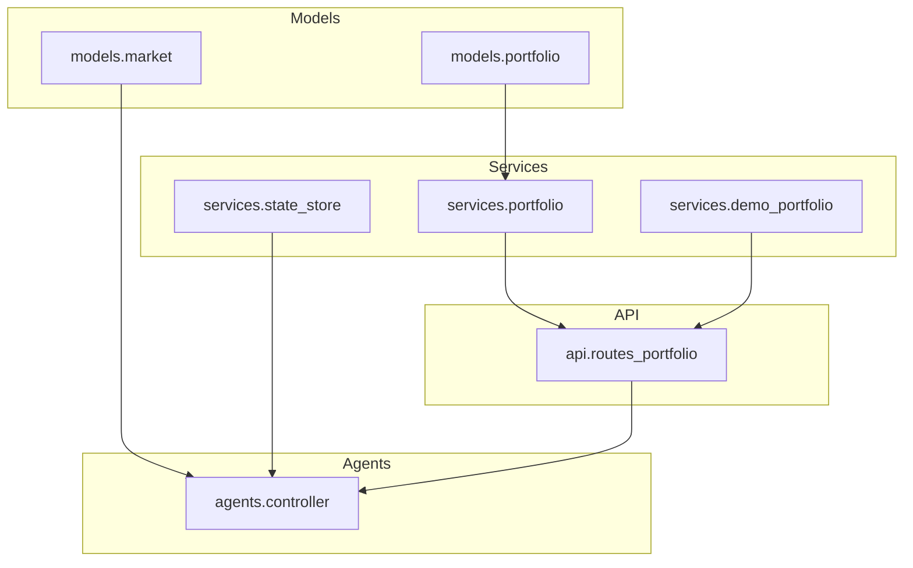
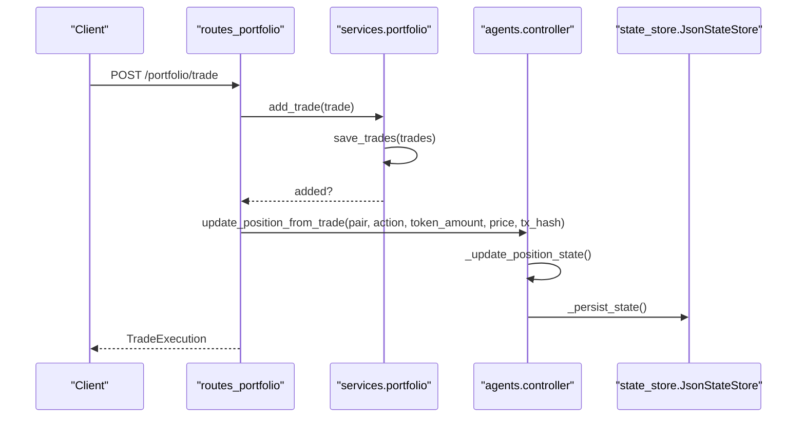
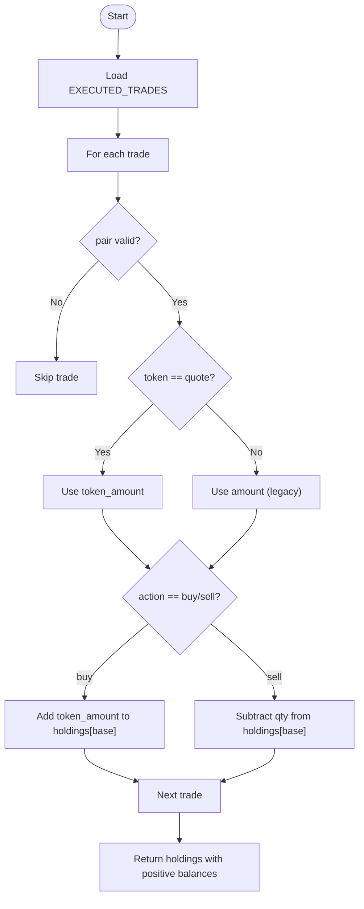
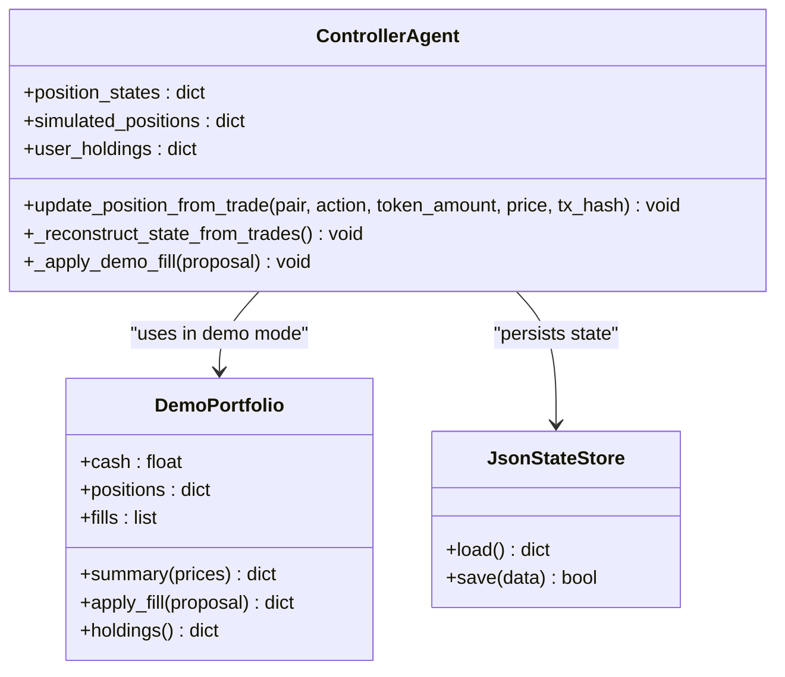
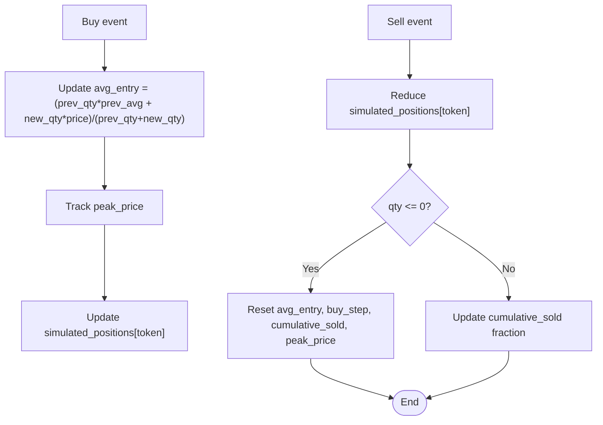
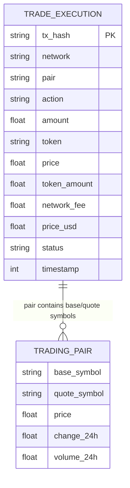
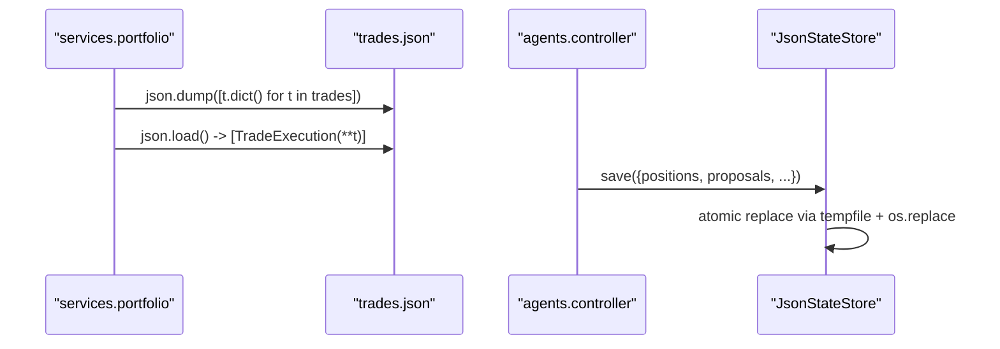
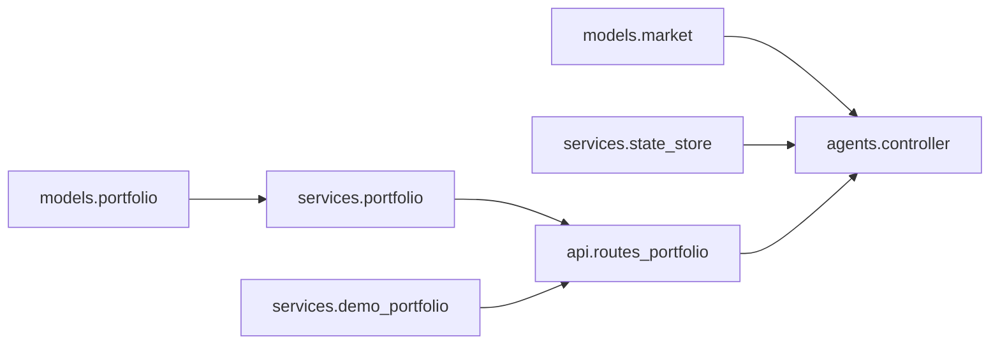

# Portfolio Models

<cite>
**Referenced Files in This Document**   
- [portfolio.py](file://backend/app/models/portfolio.py)
- [market.py](file://backend/app/models/market.py)
- [portfolio_service.py](file://backend/app/services/portfolio.py)
- [demo_portfolio.py](file://backend/app/services/demo_portfolio.py)
- [routes_portfolio.py](file://backend/app/api/routes_portfolio.py)
- [controller.py](file://backend/app/agents/controller.py)
- [state_store.py](file://backend/app/services/state_store.py)
</cite>

## Table of Contents
1. [Introduction](#introduction)
2. [Project Structure](#project-structure)
3. [Core Components](#core-components)
4. [Architecture Overview](#architecture-overview)
5. [Detailed Component Analysis](#detailed-component-analysis)
6. [Dependency Analysis](#dependency-analysis)
7. [Performance Considerations](#performance-considerations)
8. [Troubleshooting Guide](#troubleshooting-guide)
9. [Conclusion](#conclusion)
10. [Appendices](#appendices)

## Introduction
This document explains the portfolio management data models and their usage across the application. It focuses on:
- Position tracking structures for per-token holdings, cost basis, and unrealized P&L
- Holdings representation derived from trade history
- Portfolio state management for both live and demo modes
- Transaction history and trade execution records
- Portfolio performance metrics
- Relationships between portfolio models and trading pair data
- Examples of serialization, deserialization, and state persistence patterns

The goal is to make these concepts accessible while providing precise references to the source code.

## Project Structure
Portfolio-related logic spans models, services, API routes, and the agent controller:
- Data models define Pydantic schemas for positions, snapshots, and trades
- Services implement persistence, trade ledger operations, and demo portfolio simulation
- API routes expose endpoints for portfolio queries, trade recording, and reporting
- The controller orchestrates position state updates, reconstruction from trades, and integration with market data

**Diagram sources**
- [portfolio.py:5-36](file://backend/app/models/portfolio.py#L5-L36)
- [market.py:5-16](file://backend/app/models/market.py#L5-L16)
- [portfolio_service.py:14-96](file://backend/app/services/portfolio.py#L14-L96)
- [demo_portfolio.py:26-176](file://backend/app/services/demo_portfolio.py#L26-L176)
- [routes_portfolio.py:41-155](file://backend/app/api/routes_portfolio.py#L41-L155)
- [controller.py:24-72](file://backend/app/agents/controller.py#L24-L72)

**Section sources**
- [portfolio.py:5-36](file://backend/app/models/portfolio.py#L5-L36)
- [market.py:5-16](file://backend/app/models/market.py#L5-L16)
- [portfolio_service.py:14-96](file://backend/app/services/portfolio.py#L14-L96)
- [demo_portfolio.py:26-176](file://backend/app/services/demo_portfolio.py#L26-L176)
- [routes_portfolio.py:41-155](file://backend/app/api/routes_portfolio.py#L41-L155)
- [controller.py:24-72](file://backend/app/agents/controller.py#L24-L72)

## Core Components
This section documents the primary Pydantic models and how they represent portfolio state.

- WalletPosition: Represents a single token position with balance, USD value, and 24-hour P&L.
- PortfolioSnapshot: Groups an address with its list of wallet positions.
- TradeExecution: A uniform record of executed trades including amount, token quantity, price, fees, status, and timestamp.

These models are used by:
- API routes to serialize/deserialize requests and responses
- Services to persist and reconstruct portfolio state
- Controller to update internal position states and compute metrics

**Section sources**
- [portfolio.py:5-36](file://backend/app/models/portfolio.py#L5-L36)

## Architecture Overview
The portfolio system integrates several layers:
- Models define canonical shapes for positions and trades
- Services provide persistence (JSON files) and computation (holdings derivation, demo fills)
- API routes expose endpoints for querying and updating portfolio state
- Controller maintains in-memory state, reconstructs it from trades, and coordinates with market data

**Diagram sources**
- [routes_portfolio.py:75-96](file://backend/app/api/routes_portfolio.py#L75-L96)
- [portfolio_service.py:37-52](file://backend/app/services/portfolio.py#L37-L52)
- [controller.py:415-478](file://backend/app/agents/controller.py#L415-L478)
- [state_store.py:39-59](file://backend/app/services/state_store.py#L39-L59)

## Detailed Component Analysis

### Position Tracking Structures
- WalletPosition captures per-token exposure:
  - token_symbol: asset identifier
  - balance: current quantity held
  - value_usd: current USD valuation
  - pnl_24h: 24-hour change in USD value
- PortfolioSnapshot aggregates positions under an address.

These models are lightweight and intended for API payloads and simple displays. They do not encode cost basis or unrealized P&L directly; those calculations occur elsewhere (e.g., demo summary).

**Section sources**
- [portfolio.py:5-15](file://backend/app/models/portfolio.py#L5-L15)

### Holdings Representation
Holdings are derived from the trade ledger:
- get_user_holdings computes symbol-to-quantity mappings by iterating executed trades
- It supports both new and legacy trade formats
- Stablecoins are treated as cash and excluded from tradable positions

**Diagram sources**
- [portfolio_service.py:59-92](file://backend/app/services/portfolio.py#L59-L92)

**Section sources**
- [portfolio_service.py:59-92](file://backend/app/services/portfolio.py#L59-L92)

### Portfolio State Management
The controller manages:
- position_states: per-token strategy state (average entry, peak price, cumulative sold, etc.)
- simulated_positions: in-memory quantities used for analysis and risk checks
- user_holdings: current holdings fed into agents (from demo, injected, or reconstructed)

Key behaviors:
- Reconstruction from trades recalculates average entry and quantities
- Demo mode uses DemoPortfolio for virtual fills and summaries
- State persistence via JsonStateStore ensures resilience across restarts

**Diagram sources**
- [controller.py:24-72](file://backend/app/agents/controller.py#L24-L72)
- [controller.py:128-183](file://backend/app/agents/controller.py#L128-L183)
- [controller.py:415-478](file://backend/app/agents/controller.py#L415-L478)
- [demo_portfolio.py:26-176](file://backend/app/services/demo_portfolio.py#L26-L176)
- [state_store.py:22-59](file://backend/app/services/state_store.py#L22-L59)

**Section sources**
- [controller.py:128-183](file://backend/app/agents/controller.py#L128-L183)
- [controller.py:415-478](file://backend/app/agents/controller.py#L415-L478)
- [demo_portfolio.py:26-176](file://backend/app/services/demo_portfolio.py#L26-L176)
- [state_store.py:22-59](file://backend/app/services/state_store.py#L22-L59)

### Cost Basis and Unrealized P&L Calculations
- Average entry (cost basis):
  - Computed incrementally when buying: weighted average of existing position value plus new purchase value divided by total quantity
  - Reset when fully sold out
- Unrealized P&L:
  - In demo mode, computed as (current_value - cost_basis) per position
  - Current value uses latest market prices or fallback to average entry if unavailable

**Diagram sources**
- [controller.py:333-400](file://backend/app/agents/controller.py#L333-L400)
- [controller.py:415-478](file://backend/app/agents/controller.py#L415-L478)
- [demo_portfolio.py:72-99](file://backend/app/services/demo_portfolio.py#L72-L99)

**Section sources**
- [controller.py:333-400](file://backend/app/agents/controller.py#L333-L400)
- [controller.py:415-478](file://backend/app/agents/controller.py#L415-L478)
- [demo_portfolio.py:72-99](file://backend/app/services/demo_portfolio.py#L72-L99)

### Transaction History Models and Trade Execution Records
- TradeExecution defines a standardized schema for all trade producers/consumers:
  - tx_hash: unique transaction identifier
  - network: chain/network name
  - pair: base/quote format (e.g., ETH/USDC)
  - action: "buy" or "sell"
  - amount: quote currency amount spent/received
  - token: quote currency symbol
  - price: quote per base unit price
  - token_amount: base token quantity bought/sold
  - network_fee: gas fee in USD
  - price_usd: USD per base at execution
  - status: "completed", "failed", "pending"
  - timestamp: Unix time

- The service layer persists trades to JSON and provides idempotent addition by tx_hash.

**Section sources**
- [portfolio.py:17-36](file://backend/app/models/portfolio.py#L17-L36)
- [portfolio_service.py:14-52](file://backend/app/services/portfolio.py#L14-L52)

### Relationship Between Portfolio Models and Trading Pair Data
- Trading pairs are modeled in market.py with base_symbol, quote_symbol, price, and other fields
- Portfolio logic interprets pair strings like "BASE/QUOTE" to derive holdings and update positions
- Market data informs valuation and P&L calculations

**Diagram sources**
- [portfolio.py:17-36](file://backend/app/models/portfolio.py#L17-L36)
- [market.py:5-16](file://backend/app/models/market.py#L5-L16)

**Section sources**
- [market.py:5-16](file://backend/app/models/market.py#L5-L16)
- [portfolio.py:17-36](file://backend/app/models/portfolio.py#L17-L36)

### Portfolio Performance Metrics
- Demo portfolio summary includes:
  - cash, positions, equity, starting_cash
  - pnl_usd and pnl_pct relative to starting cash
  - number of fills and start timestamp
- Equity calculation sums stablecoin cash plus token positions valued at market prices (or average entry fallback)

**Section sources**
- [demo_portfolio.py:65-99](file://backend/app/services/demo_portfolio.py#L65-L99)

### Serialization, Deserialization, and State Persistence Patterns
- TradeExecution serialization:
  - Save: convert list of TradeExecution to JSON using model.dict()
  - Load: parse JSON and instantiate TradeExecution objects
- Agent state persistence:
  - JsonStateStore writes atomically via temp file and os.replace
  - Controller persists position_states, proposals, last_trade_times, guardrails
- Demo portfolio persistence:
  - Stores cash, positions, fills, started_at in demo_portfolio.json

**Diagram sources**
- [portfolio_service.py:28-35](file://backend/app/services/portfolio.py#L28-L35)
- [portfolio_service.py:14-26](file://backend/app/services/portfolio.py#L14-L26)
- [controller.py:118-125](file://backend/app/agents/controller.py#L118-L125)
- [state_store.py:39-59](file://backend/app/services/state_store.py#L39-L59)

**Section sources**
- [portfolio_service.py:28-35](file://backend/app/services/portfolio.py#L28-L35)
- [portfolio_service.py:14-26](file://backend/app/services/portfolio.py#L14-L26)
- [controller.py:118-125](file://backend/app/agents/controller.py#L118-L125)
- [state_store.py:39-59](file://backend/app/services/state_store.py#L39-L59)

## Dependency Analysis
- Models depend only on Pydantic and typing
- Services depend on models and filesystem utilities
- API routes depend on services and models
- Controller depends on services, models, and state store

**Diagram sources**
- [portfolio.py:5-36](file://backend/app/models/portfolio.py#L5-L36)
- [market.py:5-16](file://backend/app/models/market.py#L5-L16)
- [portfolio_service.py:1-96](file://backend/app/services/portfolio.py#L1-L96)
- [demo_portfolio.py:1-176](file://backend/app/services/demo_portfolio.py#L1-L176)
- [routes_portfolio.py:1-155](file://backend/app/api/routes_portfolio.py#L1-L155)
- [controller.py:1-72](file://backend/app/agents/controller.py#L1-L72)
- [state_store.py:1-59](file://backend/app/services/state_store.py#L1-L59)

**Section sources**
- [portfolio.py:5-36](file://backend/app/models/portfolio.py#L5-L36)
- [market.py:5-16](file://backend/app/models/market.py#L5-L16)
- [portfolio_service.py:1-96](file://backend/app/services/portfolio.py#L1-L96)
- [demo_portfolio.py:1-176](file://backend/app/services/demo_portfolio.py#L1-L176)
- [routes_portfolio.py:1-155](file://backend/app/api/routes_portfolio.py#L1-L155)
- [controller.py:1-72](file://backend/app/agents/controller.py#L1-L72)
- [state_store.py:1-59](file://backend/app/services/state_store.py#L1-L59)

## Performance Considerations
- Trade ledger operations are O(n) over stored trades for holdings derivation and filtering
- Demo portfolio keeps recent fills limited to 1000 entries to bound memory
- Atomic state saves avoid partial writes but incur I/O overhead; batch updates where possible
- Avoid frequent reloads of trades.json; prefer in-memory caches during runtime

## Troubleshooting Guide
Common issues and resolutions:
- Invalid pair format:
  - Ensure pair strings follow "BASE/QUOTE"; invalid pairs are skipped during holdings derivation
- Duplicate trade handling:
  - Trades are idempotent by tx_hash; duplicate submissions will be ignored
- Negative or residual holdings:
  - Small residuals or negatives are filtered out; missing history may cause inconsistencies
- Demo vs live mode:
  - Demo mode disables real trade recording; use proposal completion endpoints instead

**Section sources**
- [portfolio_service.py:71-92](file://backend/app/services/portfolio.py#L71-L92)
- [portfolio_service.py:37-49](file://backend/app/services/portfolio.py#L37-L49)
- [routes_portfolio.py:75-96](file://backend/app/api/routes_portfolio.py#L75-L96)

## Conclusion
The portfolio management system centers on clear Pydantic models for positions and trades, robust service-layer persistence, and a controller that maintains consistent state across live and demo modes. Cost basis and unrealized P&L are computed incrementally and exposed through demo summaries. The design emphasizes idempotency, atomic persistence, and compatibility with trading pair data.

## Appendices

### API Endpoints Summary
- GET /portfolio/: returns a PortfolioSnapshot for a given address
- POST /portfolio/trade: records a TradeExecution and updates position state
- GET /portfolio/trades: lists trades with optional filters
- POST /portfolio/trades/reload: reloads trades from disk
- GET /portfolio/trades/export: exports CSV report
- GET /portfolio/demo: returns demo portfolio summary
- POST /portfolio/demo/reset: resets demo portfolio state
- POST /portfolio/holdings: updates controller holdings from frontend

**Section sources**
- [routes_portfolio.py:41-155](file://backend/app/api/routes_portfolio.py#L41-L155)