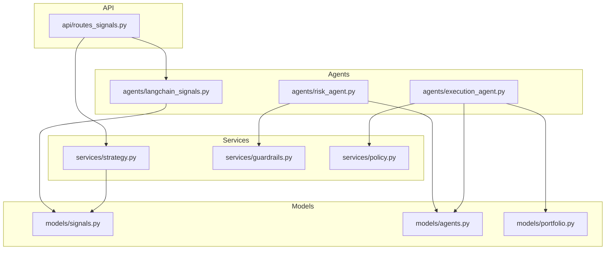
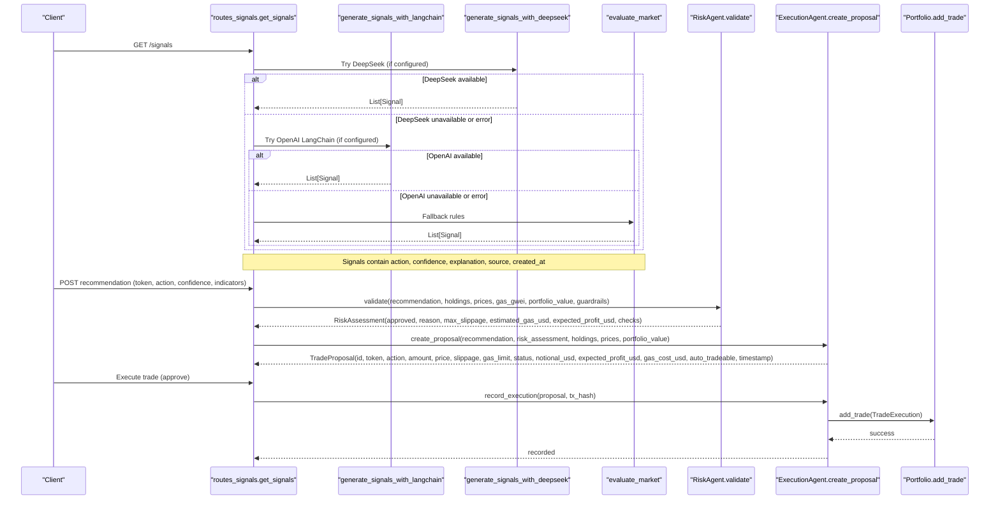
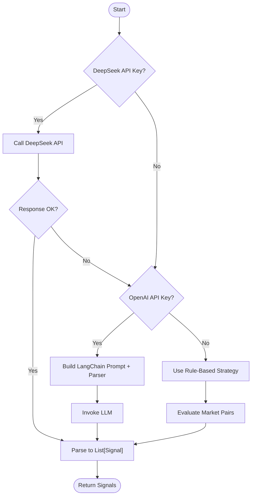
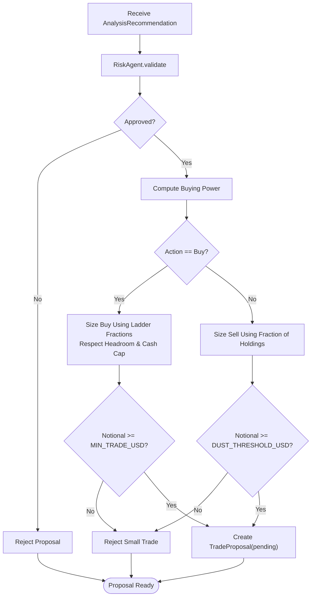
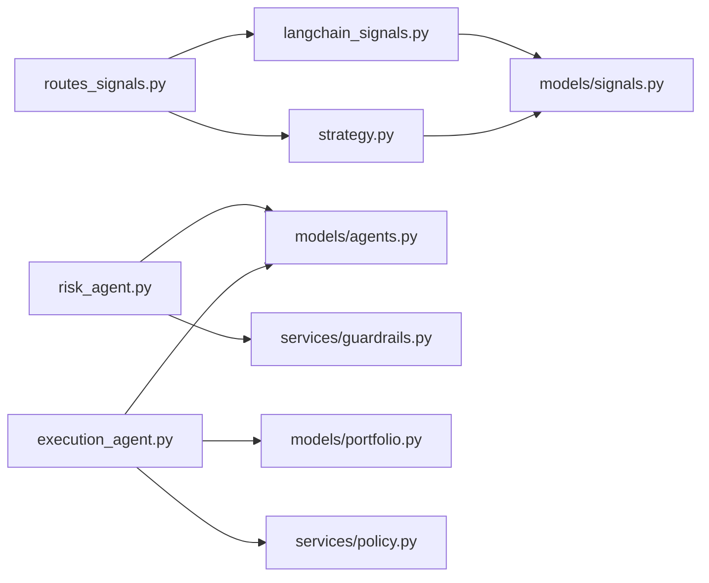

# Trading Signals & Proposals

<cite>
**Referenced Files in This Document**   
- [signals.py](file://backend/app/models/signals.py)
- [agents.py](file://backend/app/models/agents.py)
- [portfolio.py](file://backend/app/models/portfolio.py)
- [langchain_signals.py](file://backend/app/agents/langchain_signals.py)
- [strategy.py](file://backend/app/services/strategy.py)
- [risk_agent.py](file://backend/app/agents/risk_agent.py)
- [execution_agent.py](file://backend/app/agents/execution_agent.py)
- [guardrails.py](file://backend/app/services/guardrails.py)
- [routes_signals.py](file://backend/app/api/routes_signals.py)
- [policy.py](file://backend/app/services/policy.py)
</cite>

## Table of Contents
1. [Introduction](#introduction)
2. [Project Structure](#project-structure)
3. [Core Components](#core-components)
4. [Architecture Overview](#architecture-overview)
5. [Detailed Component Analysis](#detailed-component-analysis)
6. [Dependency Analysis](#dependency-analysis)
7. [Performance Considerations](#performance-considerations)
8. [Troubleshooting Guide](#troubleshooting-guide)
9. [Conclusion](#conclusion)

## Introduction
This document provides detailed data model documentation for trading signals and proposals in the DexTrader backend. It focuses on Pydantic models used to represent technical analysis outputs, risk evaluations, executable trade proposals, and completed transactions. It also explains signal generation workflows and proposal approval processes, including how confidence scores, indicator values, position sizing, slippage, gas costs, and blockchain settlement details are modeled and propagated through the system.

## Project Structure
The relevant code is organized into:
- Data models under `app/models`
- Agents that implement analysis, risk, and execution logic under `app/agents`
- Services providing strategy evaluation, guardrails, and policy constants under `app/services`
- API routes exposing signal generation endpoints under `app/api`

**Diagram sources**
- [routes_signals.py:1-55](file://backend/app/api/routes_signals.py#L1-L55)
- [langchain_signals.py:1-123](file://backend/app/agents/langchain_signals.py#L1-L123)
- [strategy.py:1-39](file://backend/app/services/strategy.py#L1-L39)
- [risk_agent.py:1-215](file://backend/app/agents/risk_agent.py#L1-L215)
- [execution_agent.py:1-180](file://backend/app/agents/execution_agent.py#L1-L180)
- [guardrails.py:1-165](file://backend/app/services/guardrails.py#L1-L165)
- [policy.py:1-12](file://backend/app/services/policy.py#L1-L12)
- [signals.py:1-16](file://backend/app/models/signals.py#L1-L16)
- [agents.py:1-81](file://backend/app/models/agents.py#L1-L81)
- [portfolio.py:1-37](file://backend/app/models/portfolio.py#L1-L37)

**Section sources**
- [routes_signals.py:1-55](file://backend/app/api/routes_signals.py#L1-L55)
- [langchain_signals.py:1-123](file://backend/app/agents/langchain_signals.py#L1-L123)
- [strategy.py:1-39](file://backend/app/services/strategy.py#L1-L39)
- [risk_agent.py:1-215](file://backend/app/agents/risk_agent.py#L1-L215)
- [execution_agent.py:1-180](file://backend/app/agents/execution_agent.py#L1-L180)
- [guardrails.py:1-165](file://backend/app/services/guardrails.py#L1-L165)
- [policy.py:1-12](file://backend/app/services/policy.py#L1-L12)
- [signals.py:1-16](file://backend/app/models/signals.py#L1-L16)
- [agents.py:1-81](file://backend/app/models/agents.py#L1-L81)
- [portfolio.py:1-37](file://backend/app/models/portfolio.py#L1-L37)

## Core Components
This section documents the primary Pydantic models and their roles in the trading pipeline.

- Signal: Represents a basic trading signal with pair, action, confidence, explanation, source, and timestamp.
- AnalysisRecommendation: Extends signal concepts with richer technical indicators and decision parameters such as RSI, VWAP, volume metrics, buy step, sell fraction, gain percentage, and exit kind.
- RiskAssessment: Encapsulates safety evaluation results, including approval status, reasons, adjusted amounts, slippage, gas estimates, expected profit, maximum notional exposure, and a list of checks performed.
- TradeProposal: Defines an executable trade specification with token, action, amount, price, slippage, gas limit, status, timestamps, notional USD, expected profit, gas cost, auto-tradeability, price source, optional sell fraction, and exit kind.
- TradeExecution: Records completed transactions with blockchain transaction hash, network, pair, action, quote/base quantities, price, fees, USD price at execution, status, and timestamp.

Key responsibilities:
- Signal generation produces initial recommendations from market data using LLMs or rule-based strategies.
- Risk assessment validates and sizes trades based on guardrails, portfolio constraints, and gas economics.
- Execution agent converts approved recommendations into human-approvable proposals with explicit sizing and thresholds.
- Portfolio service records executed trades with standardized fields for reporting and analytics.

**Section sources**
- [signals.py:1-16](file://backend/app/models/signals.py#L1-L16)
- [agents.py:25-73](file://backend/app/models/agents.py#L25-L73)
- [portfolio.py:17-36](file://backend/app/models/portfolio.py#L17-L36)

## Architecture Overview
The trading pipeline flows from market snapshots through signal generation, risk validation, proposal creation, and execution recording.

**Diagram sources**
- [routes_signals.py:17-53](file://backend/app/api/routes_signals.py#L17-L53)
- [langchain_signals.py:19-58](file://backend/app/agents/langchain_signals.py#L19-L58)
- [langchain_signals.py:61-123](file://backend/app/agents/langchain_signals.py#L61-L123)
- [strategy.py:8-38](file://backend/app/services/strategy.py#L8-L38)
- [risk_agent.py:24-190](file://backend/app/agents/risk_agent.py#L24-L190)
- [execution_agent.py:28-56](file://backend/app/agents/execution_agent.py#L28-L56)
- [execution_agent.py:58-179](file://backend/app/agents/execution_agent.py#L58-L179)
- [portfolio.py:17-36](file://backend/app/models/portfolio.py#L17-L36)

## Detailed Component Analysis

### Signal Model
Purpose:
- Captures a minimal trading signal with pair identifier, action type, confidence score, optional explanation, source classification, and creation timestamp.

Fields:
- pair: string identifying the trading pair.
- action: literal enum of "buy", "sell", or "hold".
- confidence: float between 0.0 and 1.0 representing signal strength.
- explanation: optional textual reasoning.
- source: optional literal enum indicating origin ("llm", "rules", "deepseek").
- created_at: optional float timestamp.

Complexity:
- O(1) construction and serialization; lightweight payload suitable for streaming and UI display.

Usage:
- Produced by LLM-based generators and rule-based evaluator.
- Consumed by downstream agents and APIs.

**Section sources**
- [signals.py:5-16](file://backend/app/models/signals.py#L5-L16)
- [langchain_signals.py:15-17](file://backend/app/agents/langchain_signals.py#L15-L17)
- [langchain_signals.py:40-58](file://backend/app/agents/langchain_signals.py#L40-L58)
- [langchain_signals.py:61-123](file://backend/app/agents/langchain_signals.py#L61-L123)
- [strategy.py:8-38](file://backend/app/services/strategy.py#L8-L38)

### AnalysisRecommendation Model
Purpose:
- Represents a structured technical analysis output with actionable parameters and indicator values.

Fields:
- token: target token symbol.
- action: "buy", "sell", or "hold".
- confidence: float confidence score.
- reason: textual rationale.
- price: current price used for sizing and valuation.
- pct_change: optional percentage change for volatility context.
- rsi: optional Relative Strength Index value.
- vwap: optional Volume Weighted Average Price.
- volume_spike: boolean flag indicating unusual volume activity.
- volume_ratio: optional ratio comparing current to baseline volume.
- buy_step: integer ladder step influencing position sizing.
- sell_fraction: optional fraction of holdings to sell.
- gain_pct: optional expected gain percentage.
- exit_kind: optional exit strategy ("take_profit", "stop_loss", "trailing_stop").
- indicators_ready: boolean indicating readiness of technical indicators.

Complexity:
- O(1) construction; includes multiple optional numeric fields enabling rich risk and sizing calculations.

Usage:
- Input to RiskAgent for validation and sizing.
- Source for ExecutionAgent to produce TradeProposal.

**Section sources**
- [agents.py:25-40](file://backend/app/models/agents.py#L25-L40)
- [risk_agent.py:24-190](file://backend/app/agents/risk_agent.py#L24-L190)
- [execution_agent.py:58-179](file://backend/app/agents/execution_agent.py#L58-L179)

### RiskAssessment Model
Purpose:
- Encapsulates safety evaluation outcomes, including whether a recommendation is approved, reasons, slippage estimation, gas cost projections, expected profit, maximum notional exposure, and a detailed list of checks.

Fields:
- approved: boolean approval result.
- reason: textual summary of approval or rejection.
- adjusted_amount: optional adjusted trade amount after risk adjustments.
- max_slippage: float maximum acceptable slippage percentage.
- estimated_gas: float gas estimate (often gwei).
- gas_gwei: optional gas price in gwei.
- estimated_gas_usd: float estimated gas cost in USD.
- expected_profit_usd: float expected profit in USD.
- max_notional_usd: optional maximum notional exposure allowed.
- checks: list of dicts detailing each check’s name, pass/fail, and detail.

Complexity:
- O(k) where k is number of checks; typically small constant.

Usage:
- Returned by RiskAgent.validate to inform ExecutionAgent.create_proposal.
- Used to compute slippage and gas filters, and to constrain position sizing.

**Section sources**
- [agents.py:42-52](file://backend/app/models/agents.py#L42-L52)
- [risk_agent.py:24-190](file://backend/app/agents/risk_agent.py#L24-L190)

### TradeProposal Model
Purpose:
- Defines an executable trade specification ready for human approval or automated execution.

Fields:
- id: unique identifier for the proposal.
- token: target token symbol.
- action: "buy" or "sell".
- amount: quantity of tokens to buy/sell.
- price: unit price used for valuation.
- pct_change: optional percentage change context.
- reason: optional rationale combining recommendation and sizing.
- slippage: float maximum slippage percentage derived from risk assessment.
- gas_limit: integer gas limit for the transaction.
- status: literal enum of "pending", "approved", "rejected", "executed".
- timestamp: float creation time.
- notional_usd: float total USD value of the trade.
- expected_profit_usd: float expected profit in USD from risk assessment.
- gas_cost_usd: float estimated gas cost in USD.
- auto_tradeable: boolean indicating if the token qualifies for automatic trading.
- price_source: string indicating price source (e.g., "global_spot").
- sell_fraction: optional fraction of holdings to sell.
- exit_kind: optional exit strategy tag.

Complexity:
- O(1) construction; includes computed fields like notional_usd and gas_cost_usd.

Usage:
- Created by ExecutionAgent.create_proposal from AnalysisRecommendation and RiskAssessment.
- Recorded via ExecutionAgent.record_execution upon successful blockchain transaction.

**Section sources**
- [agents.py:54-73](file://backend/app/models/agents.py#L54-L73)
- [execution_agent.py:58-179](file://backend/app/agents/execution_agent.py#L58-L179)

### TradeExecution Model
Purpose:
- Standardizes completed transaction records for reporting and analytics, capturing blockchain and settlement information.

Fields:
- tx_hash: blockchain transaction hash.
- network: string identifying the blockchain network (e.g., "base").
- pair: string pair identifier (e.g., "TOKEN/USDC").
- action: string describing the trade direction.
- amount: float quantity of quote currency spent/received.
- token: string quote currency symbol.
- price: float unit price in quote currency.
- token_amount: float quantity of base token received/sold.
- network_fee: float gas fee in USD.
- price_usd: float USD price per base token at execution.
- status: string lifecycle state (e.g., "completed").
- timestamp: int Unix timestamp of execution.

Complexity:
- O(1) construction; designed for persistence and downstream reporting.

Usage:
- Populated by ExecutionAgent.record_execution and persisted via portfolio service.

**Section sources**
- [portfolio.py:17-36](file://backend/app/models/portfolio.py#L17-L36)
- [execution_agent.py:28-56](file://backend/app/agents/execution_agent.py#L28-L56)

### Signal Generation Workflows
Two primary pathways generate signals:
- LLM-based generation via LangChain/OpenAI or DeepSeek API.
- Rule-based fallback evaluating 24-hour price changes.

Workflow highlights:
- API route attempts DeepSeek first; falls back to OpenAI LangChain; finally uses rules.
- LLM chains parse structured outputs into SignalList containing List[Signal].
- DeepSeek client posts JSON payloads and parses responses into Signal objects.
- Rule-based evaluator assigns actions and confidence based on thresholding of price change.

**Diagram sources**
- [routes_signals.py:17-53](file://backend/app/api/routes_signals.py#L17-L53)
- [langchain_signals.py:19-58](file://backend/app/agents/langchain_signals.py#L19-L58)
- [langchain_signals.py:61-123](file://backend/app/agents/langchain_signals.py#L61-L123)
- [strategy.py:8-38](file://backend/app/services/strategy.py#L8-L38)

**Section sources**
- [routes_signals.py:17-53](file://backend/app/api/routes_signals.py#L17-L53)
- [langchain_signals.py:19-58](file://backend/app/agents/langchain_signals.py#L19-L58)
- [langchain_signals.py:61-123](file://backend/app/agents/langchain_signals.py#L61-L123)
- [strategy.py:8-38](file://backend/app/services/strategy.py#L8-L38)

### Proposal Approval Process
The approval process transforms an AnalysisRecommendation into a TradeProposal:
- RiskAgent.validate performs circuit breaker checks, confidence thresholds, gas caps, position sizing, minimum profit, and gas-to-profit ratios.
- ExecutionAgent.create_proposal computes buying power, applies ladder fractions, respects risk layer headroom, enforces minimum trade size and dust thresholds, and sets proposal status accordingly.

**Diagram sources**
- [risk_agent.py:24-190](file://backend/app/agents/risk_agent.py#L24-L190)
- [execution_agent.py:58-179](file://backend/app/agents/execution_agent.py#L58-L179)

**Section sources**
- [risk_agent.py:24-190](file://backend/app/agents/risk_agent.py#L24-L190)
- [execution_agent.py:58-179](file://backend/app/agents/execution_agent.py#L58-L179)

## Dependency Analysis
The following diagram maps dependencies among core modules and models:

**Diagram sources**
- [routes_signals.py:1-55](file://backend/app/api/routes_signals.py#L1-L55)
- [langchain_signals.py:1-123](file://backend/app/agents/langchain_signals.py#L1-L123)
- [strategy.py:1-39](file://backend/app/services/strategy.py#L1-L39)
- [risk_agent.py:1-215](file://backend/app/agents/risk_agent.py#L1-L215)
- [execution_agent.py:1-180](file://backend/app/agents/execution_agent.py#L1-L180)
- [guardrails.py:1-165](file://backend/app/services/guardrails.py#L1-L165)
- [policy.py:1-12](file://backend/app/services/policy.py#L1-L12)
- [signals.py:1-16](file://backend/app/models/signals.py#L1-L16)
- [agents.py:1-81](file://backend/app/models/agents.py#L1-L81)
- [portfolio.py:1-37](file://backend/app/models/portfolio.py#L1-L37)

**Section sources**
- [routes_signals.py:1-55](file://backend/app/api/routes_signals.py#L1-L55)
- [langchain_signals.py:1-123](file://backend/app/agents/langchain_signals.py#L1-L123)
- [strategy.py:1-39](file://backend/app/services/strategy.py#L1-L39)
- [risk_agent.py:1-215](file://backend/app/agents/risk_agent.py#L1-L215)
- [execution_agent.py:1-180](file://backend/app/agents/execution_agent.py#L1-L180)
- [guardrails.py:1-165](file://backend/app/services/guardrails.py#L1-L165)
- [policy.py:1-12](file://backend/app/services/policy.py#L1-L12)
- [signals.py:1-16](file://backend/app/models/signals.py#L1-L16)
- [agents.py:1-81](file://backend/app/models/agents.py#L1-L81)
- [portfolio.py:1-37](file://backend/app/models/portfolio.py#L1-L37)

## Performance Considerations
- Signal generation prefers LLM calls but falls back to rule-based evaluation to avoid latency and billing issues.
- LLM chain limits input to top pairs to reduce payload size and processing time.
- Risk checks are deterministic and fast, operating on small lists of checks.
- Proposal sizing uses simple arithmetic and bounded operations; complexity remains O(1) relative to inputs.
- Gas estimation and slippage calculations are lightweight and rely on configuration constants.

[No sources needed since this section provides general guidance]

## Troubleshooting Guide
Common issues and resolutions:
- DeepSeek billing or quota errors: The API route detects specific HTTP codes and messages, then falls back to OpenAI or rules. Check logs for billing-related strings and ensure API keys are valid.
- OpenAI failures: If OpenAI fails, the route falls back to rule-based signals. Verify API key configuration and model availability.
- Insufficient buying power: ExecutionAgent rejects buy proposals when buying power is below minimum thresholds. Connect a funded wallet or adjust portfolio value inputs.
- Trades too small: Both buy and sell paths enforce minimum notional thresholds; proposals below dust thresholds are rejected. Adjust position sizing or wait for larger opportunities.
- Risk rejections: Review RiskAssessment.checks to identify which guardrail failed (confidence, gas price, position cap, min profit, gas vs profit). Adjust recommendation confidence, gas price, or portfolio parameters accordingly.

**Section sources**
- [routes_signals.py:28-53](file://backend/app/api/routes_signals.py#L28-L53)
- [execution_agent.py:98-179](file://backend/app/agents/execution_agent.py#L98-L179)
- [risk_agent.py:54-190](file://backend/app/agents/risk_agent.py#L54-L190)

## Conclusion
The DexTrader backend implements a robust pipeline for generating trading signals, validating them through risk controls, and producing executable proposals with clear sizing and safety constraints. The Pydantic models provide a consistent contract across components:
- Signal captures concise, actionable insights.
- AnalysisRecommendation enriches signals with technical indicators and decision parameters.
- RiskAssessment formalizes safety checks and economic filters.
- TradeProposal standardizes executable specifications with explicit risk and gas considerations.
- TradeExecution records completed transactions with blockchain and settlement details.

Together, these models and agents enable transparent, auditable, and configurable trading workflows suitable for both manual oversight and automated execution.

[No sources needed since this section summarizes without analyzing specific files]