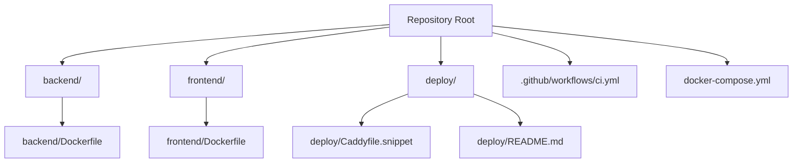
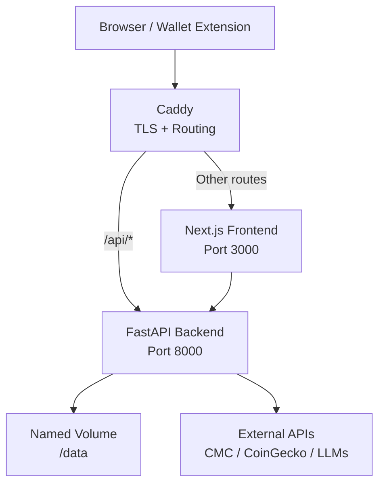
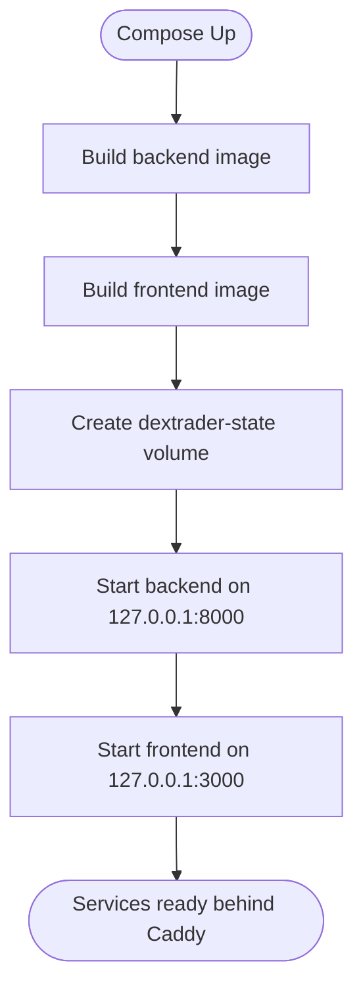
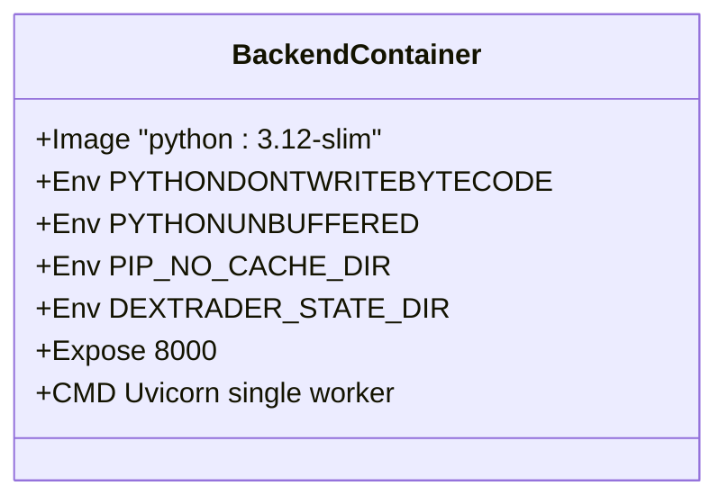
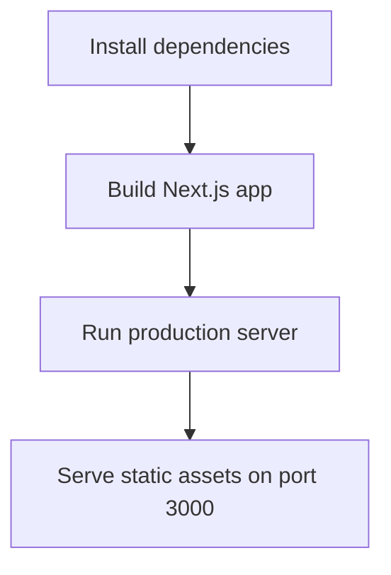
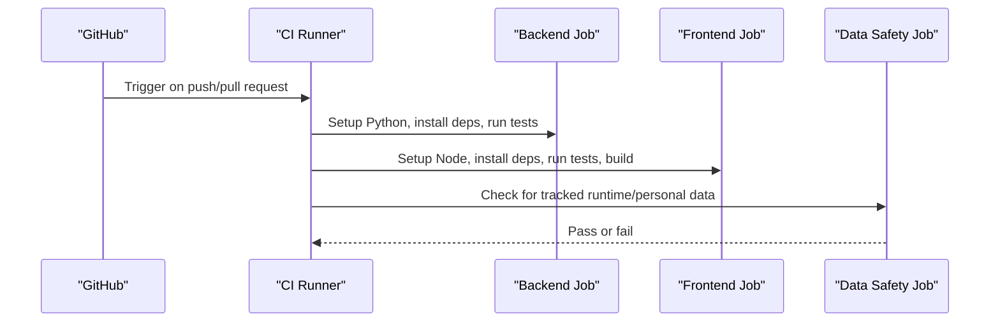
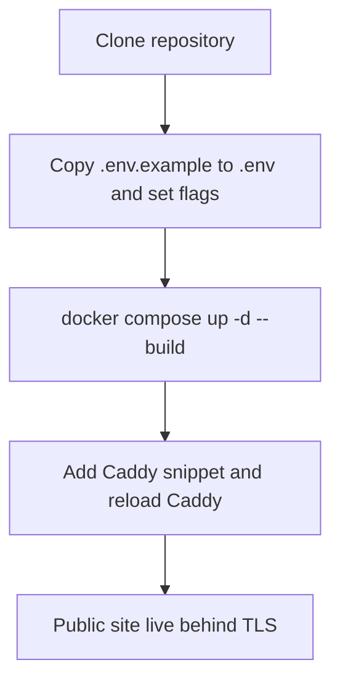
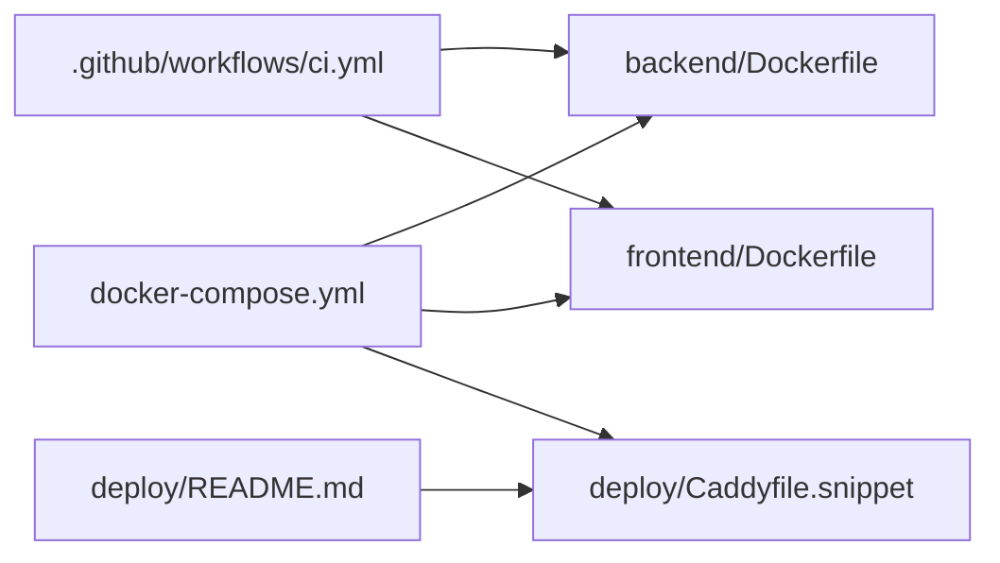

# Deployment & DevOps

<cite>
**Referenced Files in This Document**
- [README.md](file://README.md)
- [docker-compose.yml](file://docker-compose.yml)
- [ci.yml](file://.github/workflows/ci.yml)
- [backend/Dockerfile](file://backend/Dockerfile)
- [frontend/Dockerfile](file://frontend/Dockerfile)
- [deploy/README.md](file://deploy/README.md)
- [Caddyfile.snippet](file://deploy/Caddyfile.snippet)
- [config.py](file://backend/app/core/config.py)
- [config.ts](file://frontend/constants/config.ts)
- [state_store.py](file://backend/app/services/state_store.py)
- [audit_agent.py](file://backend/app/agents/audit_agent.py)
</cite>

## Table of Contents
1. [Introduction](#introduction)
2. [Project Structure](#project-structure)
3. [Core Components](#core-components)
4. [Architecture Overview](#architecture-overview)
5. [Detailed Component Analysis](#detailed-component-analysis)
6. [Dependency Analysis](#dependency-analysis)
7. [Performance Considerations](#performance-considerations)
8. [Troubleshooting Guide](#troubleshooting-guide)
9. [Conclusion](#conclusion)
10. [Appendices](#appendices)

## Introduction
This document provides deployment and DevOps guidance for DexTrader, a two-part application consisting of:
- A Next.js frontend that runs in the browser and interacts with an injected wallet to sign transactions.
- A FastAPI backend that produces trade proposals from market data and persists state as JSON files.

The repository ships container definitions, a Docker Compose stack for local and demo deployments, a GitHub Actions CI pipeline, and production notes for deploying behind Caddy. The current codebase is explicitly not a hardened production product; it uses localhost-only defaults, no authentication, and file-based state. Production use requires additional security, monitoring, backup, scaling, and operational controls beyond what is present in the repository.

## Project Structure
At a high level, the deployment-relevant structure is:

**Diagram sources**
- [docker-compose.yml:1-36](file://docker-compose.yml#L1-L36)
- [backend/Dockerfile:1-21](file://backend/Dockerfile#L1-L21)
- [frontend/Dockerfile:1-25](file://frontend/Dockerfile#L1-L25)
- [deploy/Caddyfile.snippet:1-32](file://deploy/Caddyfile.snippet#L1-L32)
- [deploy/README.md:1-37](file://deploy/README.md#L1-L37)
- [ci.yml:1-54](file://.github/workflows/ci.yml#L1-L54)

**Section sources**
- [README.md:22-34](file://README.md#L22-L34)
- [README.md:116-144](file://README.md#L116-L144)

## Core Components
This section summarizes the components that matter for deployment.

### Backend Service
- Runtime: Python 3.12 image, FastAPI via Uvicorn.
- Containerization: Single-worker Uvicorn process because state is stored in JSON files.
- State directory: Configurable through `DEXTRADER_STATE_DIR`, defaulting to the backend directory.
- Environment variables: API keys, demo mode flag, CORS origins, RPC URL, and state directory.

Key implementation points:
- `.env` loading and configuration are handled by the backend configuration module.
- State persistence uses atomic JSON writes with a thread lock.
- Audit logs rotate at 5 MB per file with three backups.

**Section sources**
- [backend/Dockerfile:1-21](file://backend/Dockerfile#L1-L21)
- [config.py:1-17](file://backend/app/core/config.py#L1-L17)
- [state_store.py:1-59](file://backend/app/services/state_store.py#L1-L59)
- [audit_agent.py:1-64](file://backend/app/agents/audit_agent.py#L1-L64)

### Frontend Service
- Runtime: Node 20 Alpine image, Next.js production server.
- Build-time variables: `NEXT_PUBLIC_BACKEND_URL` and `NEXT_PUBLIC_DEMO_MODE` are baked into the build.
- Output: Static assets served by Next.js production server on port 3000.

Key implementation points:
- The frontend reads the backend origin from a build-time constant.
- Demo mode changes UI behavior and disables real wallet execution.

**Section sources**
- [frontend/Dockerfile:1-25](file://frontend/Dockerfile#L1-L25)
- [config.ts:1-8](file://frontend/constants/config.ts#L1-L8)

### Orchestration
- `docker-compose.yml` defines two services: `backend` and `frontend`.
- Both bind to loopback only (`127.0.0.1`).
- Backend exposes `/data` through a named volume for persistent state.
- Frontend depends on backend and receives build args for backend URL and demo mode.

**Section sources**
- [docker-compose.yml:1-36](file://docker-compose.yml#L1-L36)

### Reverse Proxy and TLS Termination
- Caddy terminates TLS and proxies:
  - `/api/*` to the backend on `127.0.0.1:8000`, stripping the `/api` prefix.
  - All other routes to the frontend on `127.0.0.1:3000`.
- Security headers include HSTS, content type sniffing prevention, referrer policy, and removal of the `Server` header.
- Access logs rotate by size and retention count.

**Section sources**
- [Caddyfile.snippet:1-32](file://deploy/Caddyfile.snippet#L1-L32)

### CI Pipeline
GitHub Actions runs on push to `main` and on pull requests:
- Backend job: installs Python dependencies and runs unit tests.
- Frontend job: installs Node dependencies, runs policy tests, TypeScript type checking, and builds the app.
- Data safety job: fails if runtime or personal data files are tracked in Git.

**Section sources**
- [ci.yml:1-54](file://.github/workflows/ci.yml#L1-L54)

## Architecture Overview
The production-like deployment described in this repository consists of:
- A reverse proxy (Caddy) handling TLS, compression, routing, and access logging.
- A Next.js frontend serving the dashboard and client-side trading logic.
- A FastAPI backend providing market data, signals, agent control, portfolio endpoints, and JSON-file-backed state.
- A persistent volume for backend state when running in demo mode.

**Diagram sources**
- [Caddyfile.snippet:6-16](file://deploy/Caddyfile.snippet#L6-L16)
- [docker-compose.yml:8-32](file://docker-compose.yml#L8-L32)
- [backend/Dockerfile:19-20](file://backend/Dockerfile#L19-L20)
- [frontend/Dockerfile:18-24](file://frontend/Dockerfile#L18-L24)

## Detailed Component Analysis

### Docker Compose Orchestration
The compose file defines:
- `backend`:
  - Builds from `./backend`.
  - Reads secrets from `.env`.
  - Sets `DEXTRADER_STATE_DIR=/data` and enables demo mode.
  - Mounts `dextrader-state:/data`.
  - Exposes port `8000` bound to loopback.
  - Restarts unless stopped.
- `frontend`:
  - Builds from `./frontend`.
  - Injects `NEXT_PUBLIC_BACKEND_URL` and `NEXT_PUBLIC_DEMO_MODE` as build arguments.
  - Exposes port `3000` bound to loopback.
  - Depends on `backend`.
  - Restarts unless stopped.

Operational implications:
- Because both ports are loopback-bound, external clients must reach the services through Caddy.
- Changing frontend build-time variables requires rebuilding the frontend image.
- The named volume preserves demo portfolio state across container restarts.

**Diagram sources**
- [docker-compose.yml:1-36](file://docker-compose.yml#L1-L36)

**Section sources**
- [docker-compose.yml:1-36](file://docker-compose.yml#L1-L36)
- [deploy/README.md:1-37](file://deploy/README.md#L1-L37)

### Backend Containerization
The backend image:
- Uses `python:3.12-slim`.
- Disables bytecode writing and pip cache.
- Copies requirements and installs dependencies.
- Copies application code.
- Creates `/data` for state.
- Runs Uvicorn with one worker.

Important constraints:
- One worker is intentional because JSON files are not safe for concurrent writers.
- State directory can be overridden via environment variable.

**Diagram sources**
- [backend/Dockerfile:1-21](file://backend/Dockerfile#L1-L21)

**Section sources**
- [backend/Dockerfile:1-21](file://backend/Dockerfile#L1-L21)

### Frontend Containerization
The frontend image uses a multi-stage build:
- Dependency stage installs Node modules.
- Build stage copies source and builds Next.js output.
- Runner stage serves the built app in production.

Build-time configuration:
- `NEXT_PUBLIC_BACKEND_URL` determines where the frontend calls the backend.
- `NEXT_PUBLIC_DEMO_MODE` toggles demo UI behavior.

**Diagram sources**
- [frontend/Dockerfile:1-25](file://frontend/Dockerfile#L1-L25)

**Section sources**
- [frontend/Dockerfile:1-25](file://frontend/Dockerfile#L1-L25)
- [config.ts:1-8](file://frontend/constants/config.ts#L1-L8)

### GitHub Actions CI Pipeline
The CI pipeline has three jobs:

1. **Backend job**
   - Checks out code.
   - Sets up Python 3.12 with pip cache.
   - Installs dependencies.
   - Runs unit tests.

2. **Frontend job**
   - Checks out code.
   - Sets up Node 20 with npm cache.
   - Installs dependencies.
   - Runs policy tests.
   - Runs TypeScript type checks.
   - Builds the app with a backend URL environment variable.

3. **No personal data job**
   - Scans tracked files and fails if runtime or personal data files are committed.

**Diagram sources**
- [ci.yml:1-54](file://.github/workflows/ci.yml#L1-L54)

**Section sources**
- [ci.yml:1-54](file://.github/workflows/ci.yml#L1-L54)

### Production Deployment Strategy
The documented production strategy is:
- Run containers behind Caddy on the host.
- Bind both services to loopback.
- Use Caddy for TLS termination, compression, routing, and access logging.
- Keep frontend build-time variables consistent with backend runtime configuration.

Update procedure:
- Pull latest code.
- Rebuild and redeploy with Docker Compose.

**Diagram sources**
- [deploy/README.md:1-37](file://deploy/README.md#L1-L37)
- [Caddyfile.snippet:1-32](file://deploy/Caddyfile.snippet#L1-L32)

**Section sources**
- [deploy/README.md:1-37](file://deploy/README.md#L1-L37)
- [Caddyfile.snippet:1-32](file://deploy/Caddyfile.snippet#L1-L32)

### Environment Configuration
Environment variables affect both backend and frontend:

| Variable | Scope | Purpose |
|---|---|---|
| `COINMARKETCAP_API_KEY` | Backend | API key for CoinMarketCap when not using the trial endpoint. |
| `COINGECKO_API_KEY` | Backend | Optional key for CoinGecko demo API calls. |
| `OPENAI_API_KEY` | Backend | Second-tier signal provider. |
| `DEEPSEEK_API_KEY` | Backend | First-tier signal provider. |
| `CORS_ORIGINS` | Backend | Allowed frontend origins. |
| `BASE_RPC_URL` | Backend | JSON-RPC endpoint for gas price reading. |
| `DEXTRADER_STATE_DIR` | Backend | Directory for JSON state files. |
| `DEMO_MODE` | Backend | Enables simulated portfolio and blocks real trades. |
| `NEXT_PUBLIC_BACKEND_URL` | Frontend | Backend origin used at build time. |
| `NEXT_PUBLIC_DEMO_MODE` | Frontend | Enables demo UI behavior at build time. |

Notes:
- Backend loads `.env` automatically.
- Frontend variables are build-time constants, not runtime overrides.
- Demo mode requires matching frontend and backend configuration.

**Section sources**
- [README.md:66-84](file://README.md#L66-L84)
- [config.py:1-17](file://backend/app/core/config.py#L1-L17)
- [config.ts:1-8](file://frontend/constants/config.ts#L1-L8)

### Security Hardening
Current posture:
- No authentication on API routes.
- CORS defaults to localhost origins.
- Services bind to loopback only.
- Caddy adds security headers and removes server identification.

Recommended hardening steps:
- Add authentication and authorization before exposing any route publicly.
- Restrict CORS to exact trusted origins.
- Use network policies or firewall rules to limit access to internal networks.
- Rotate API keys regularly and store them in a secrets manager rather than plain `.env` files.
- Validate all inputs and rate-limit sensitive endpoints.
- Monitor and alert on unexpected proposal creation or trade submission.
- Avoid exposing `/docs` or debug endpoints in production.

Security-related implementation references:
- Backend configuration reads API keys and demo mode.
- Caddy config sets security headers and access log rotation.

**Section sources**
- [README.md:101-113](file://README.md#L101-L113)
- [config.py:1-17](file://backend/app/core/config.py#L1-L17)
- [Caddyfile.snippet:18-23](file://deploy/Caddyfile.snippet#L18-L23)

### Monitoring and Logging
Existing logging:
- Backend audit agent writes rotating logs to `agents.log` with 5 MB per file and three backups.
- In-memory log buffer keeps the last 1,000 entries for the UI.
- Caddy access logs rotate by size and retain a fixed number of files.

Monitoring recommendations:
- Centralize logs with a log shipper or structured logging pipeline.
- Export metrics such as request latency, error rates, agent activity, and proposal throughput.
- Alert on failed upstream API calls, state write failures, and unusual proposal patterns.
- Track disk usage for state files and logs.
- Add health check endpoints and readiness probes for orchestration platforms.

**Section sources**
- [audit_agent.py:1-64](file://backend/app/agents/audit_agent.py#L1-L64)
- [Caddyfile.snippet:25-30](file://deploy/Caddyfile.snippet#L25-L30)

### Scaling Considerations
Current limitations:
- Backend runs a single Uvicorn worker.
- State is persisted as JSON files without database-level concurrency guarantees.
- Two workers would race on the same files.

Scaling guidance:
- Do not scale backend horizontally while using JSON state files.
- If horizontal scaling is required, migrate state to a proper database with transaction support.
- Scale frontend replicas behind a load balancer since the frontend is mostly stateless after build.
- Use read replicas or caching layers for market data if needed, but ensure consistency with the agent loop’s cache semantics.
- Consider message queues for decoupling proposal generation from execution reporting.

**Section sources**
- [backend/Dockerfile:19-20](file://backend/Dockerfile#L19-L20)
- [README.md:177-179](file://README.md#L177-L179)

### Backup Strategies for JSON State Files
State files include:
- `trades.json`
- `agent_state.json`
- `price_history.json`
- `demo_portfolio.json` (demo mode)

Backup guidance:
- Back up the `dextrader-state` volume or configured state directory regularly.
- Use consistent snapshots to avoid partial writes.
- Test restore procedures against a staging environment.
- Encrypt backups at rest and in transit.
- Retain multiple generations for recovery windows.
- Exclude these files from version control; CI already enforces this.

Implementation references:
- State directory path resolution and atomic writes.
- CI check for tracked runtime data.

**Section sources**
- [state_store.py:15-59](file://backend/app/services/state_store.py#L15-L59)
- [ci.yml:44-54](file://.github/workflows/ci.yml#L44-L54)
- [README.md:177-180](file://README.md#L177-L180)

### Log Rotation
Existing rotation:
- Backend audit logs rotate by size and keep a limited number of backups.
- Caddy access logs rotate by size and retain a fixed count.

Production considerations:
- Ensure sufficient disk space for rotated logs.
- Ship logs to a centralized system for analysis.
- Define retention policies aligned with compliance and storage costs.
- Monitor log growth and alert on disk pressure.

**Section sources**
- [audit_agent.py:21-30](file://backend/app/agents/audit_agent.py#L21-L30)
- [Caddyfile.snippet:25-30](file://deploy/Caddyfile.snippet#L25-L30)

### Disaster Recovery Procedures
Recovery plan outline:
1. Stop new traffic by updating Caddy routing or DNS.
2. Preserve current state files and logs for forensics.
3. Restore state from the most recent verified backup.
4. Restart backend and frontend services.
5. Verify health endpoints and sample API responses.
6. Confirm frontend connects to the restored backend.
7. Monitor agent loop, proposals, and portfolio state closely.
8. Roll back to previous backup if corruption is detected.

Operational safeguards:
- Keep automated backups with integrity checks.
- Maintain runbooks for common failure scenarios.
- Practice disaster recovery drills regularly.

[No sources needed since this section provides general operational guidance]

### Performance Optimization
Optimization areas:
- Cache market data appropriately; the dashboard uses longer caches while the agent loop uses shorter intervals.
- Avoid unnecessary rebuilds by caching dependency layers in CI and Docker.
- Use compression enabled by Caddy.
- Tune resource limits for containers to prevent memory pressure.
- Monitor upstream API latency and errors.
- Reduce noisy logs in production to lower I/O overhead.

**Section sources**
- [README.md:15-17](file://README.md#L15-L17)
- [Caddyfile.snippet:6-7](file://deploy/Caddyfile.snippet#L6-L7)

### Resource Allocation for Production
Recommendations:
- Assign CPU and memory limits based on observed usage.
- Reserve enough memory for Python dependencies, market data caches, and log buffers.
- Allocate sufficient disk for state files and rotated logs.
- Use separate volumes for state and logs to simplify backups and cleanup.
- Monitor container resource utilization and adjust limits accordingly.

[No sources needed since this section provides general guidance]

## Dependency Analysis
The deployment dependencies are:

**Diagram sources**
- [ci.yml:1-54](file://.github/workflows/ci.yml#L1-L54)
- [docker-compose.yml:1-36](file://docker-compose.yml#L1-L36)
- [backend/Dockerfile:1-21](file://backend/Dockerfile#L1-L21)
- [frontend/Dockerfile:1-25](file://frontend/Dockerfile#L1-L25)
- [Caddyfile.snippet:1-32](file://deploy/Caddyfile.snippet#L1-L32)
- [deploy/README.md:1-37](file://deploy/README.md#L1-L37)

**Section sources**
- [ci.yml:1-54](file://.github/workflows/ci.yml#L1-L54)
- [docker-compose.yml:1-36](file://docker-compose.yml#L1-L36)

## Performance Considerations
- The backend warms caches on startup, improving first-load performance.
- The frontend caches market data for longer periods, while the agent loop uses fresher prices.
- Caddy enables gzip and zstd encoding.
- The single-worker backend avoids contention on JSON state files but limits throughput.
- External API calls can introduce latency and rate-limit failures; monitor upstream availability.

**Section sources**
- [README.md:64-65](file://README.md#L64-L65)
- [README.md:15-17](file://README.md#L15-L17)
- [Caddyfile.snippet:6-7](file://deploy/Caddyfile.snippet#L6-L7)
- [backend/Dockerfile:19-20](file://backend/Dockerfile#L19-L20)

## Troubleshooting Guide
Common issues and resolutions:

| Symptom | Likely Cause | Resolution |
|---|---|---|
| Frontend cannot reach backend | Wrong `NEXT_PUBLIC_BACKEND_URL` or missing Caddy route | Verify build-time variable and Caddy `/api/*` proxy configuration. |
| Demo portfolio disappears after restart | Volume removed or state directory changed | Inspect `dextrader-state` volume and `DEXTRADER_STATE_DIR`. |
| Backend state not written | Read-only filesystem or insufficient permissions | Ensure writable state directory and correct volume mount. |
| Logs missing | Audit handler disabled due to write failure | Check filesystem permissions and log path. |
| CI fails on data tracking | Runtime or personal data committed | Remove tracked files and rely on `.gitignore`. |
| CORS errors locally | Backend CORS does not allow frontend origin | Adjust `CORS_ORIGINS` for development. |

**Section sources**
- [config.ts:1-8](file://frontend/constants/config.ts#L1-L8)
- [Caddyfile.snippet:9-12](file://deploy/Caddyfile.snippet#L9-L12)
- [docker-compose.yml:11-17](file://docker-compose.yml#L11-L17)
- [state_store.py:39-59](file://backend/app/services/state_store.py#L39-L59)
- [audit_agent.py:21-30](file://backend/app/agents/audit_agent.py#L21-L30)
- [ci.yml:44-54](file://.github/workflows/ci.yml#L44-L54)
- [README.md:76-76](file://README.md#L76-L76)

## Conclusion
DexTrader provides a functional containerized stack with Docker Compose, a GitHub Actions CI pipeline, and a documented production layout behind Caddy. However, it is explicitly experimental: it lacks authentication, uses file-based state, and targets localhost-only operation by default. For production, you should add authentication, secure secrets management, robust monitoring, automated backups, disaster recovery testing, input validation, rate limiting, and potentially a database-backed state layer if horizontal scaling is required.

[No sources needed since this section summarizes without analyzing specific files]

## Appendices

### Quick Deployment Checklist
- Copy `.env.example` to `.env` and configure required variables.
- Set `DEMO_MODE=1` and `NEXT_PUBLIC_DEMO_MODE=1` for demo deployment.
- Build and start services with Docker Compose.
- Add the Caddy snippet and reload Caddy.
- Verify frontend loads and backend responds under the public domain.
- Configure backups for the state volume.
- Set up log shipping and monitoring.
- Plan disaster recovery and test restores.

**Section sources**
- [docker-compose.yml:1-36](file://docker-compose.yml#L1-L36)
- [deploy/README.md:1-37](file://deploy/README.md#L1-L37)
- [Caddyfile.snippet:1-32](file://deploy/Caddyfile.snippet#L1-L32)