# Development Guide

<cite>
**Referenced Files in This Document**
- [README.md](file://README.md)
- [agent_guidelines.txt](file://agent_guidelines.txt)
- [backend/app/main.py](file://backend/app/main.py)
- [backend/requirements.txt](file://backend/requirements.txt)
- [frontend/package.json](file://frontend/package.json)
- [.github/workflows/ci.yml](file://.github/workflows/ci.yml)
- [docker-compose.yml](file://docker-compose.yml)
- [backend/app/agents/controller.py](file://backend/app/agents/controller.py)
- [backend/app/agents/analysis_agent.py](file://backend/app/agents/analysis_agent.py)
- [backend/app/agents/risk_agent.py](file://backend/app/agents/risk_agent.py)
- [backend/app/agents/execution_agent.py](file://backend/app/agents/execution_agent.py)
- [backend/app/services/indicators.py](file://backend/app/services/indicators.py)
- [backend/app/services/market_history.py](file://backend/app/services/market_history.py)
- [backend/app/services/guardrails.py](file://backend/app/services/guardrails.py)
- [backend/app/services/strategy.py](file://backend/app/services/strategy.py)
- [frontend/lib/autoTradeExecutor.ts](file://frontend/lib/autoTradeExecutor.ts)
- [frontend/components/TradePreviewModal.tsx](file://frontend/components/TradePreviewModal.tsx)
- [frontend/constants/tokens.ts](file://frontend/constants/tokens.ts)
</cite>

## Table of Contents
1. [Introduction](#introduction)
2. [Project Structure](#project-structure)
3. [Agent Guidelines and Trading Philosophy](#agent-guidelines-and-trading-philosophy)
4. [Development Workflow](#development-workflow)
5. [Coding Standards and Conventions](#coding-standards-and-conventions)
6. [Architecture Overview](#architecture-overview)
7. [Core Components](#core-components)
8. [Extending the System](#extending-the-system)
9. [Debugging, Logging, and Profiling](#debugging-logging-and-profiling)
10. [Dependency Analysis](#dependency-analysis)
11. [Performance Considerations](#performance-considerations)
12. [Troubleshooting Guide](#troubleshooting-guide)
13. [Contribution Process](#contribution-process)
14. [Conclusion](#conclusion)

## Introduction
DexTrader is a semi-autonomous crypto trading experiment with two parts:
- A Next.js dashboard that reads your wallet in the browser.
- A FastAPI backend that turns market data into trade proposals.

The backend never signs or sends transactions. The browser builds and submits swaps through an injected wallet. The system implements rule-based agents for analysis, risk validation, proposal creation, and audit logging. It uses global spot pricing for proposals and executes on-chain against DEX routers.

This guide explains how to contribute, extend, debug, and maintain DexTrader safely.

## Project Structure
At a high level:
- `backend/app` contains the FastAPI application, agent pipeline, services, models, and API routes.
- `frontend/app` contains Next.js pages; `frontend/components`, `context`, `hooks`, and `lib` contain UI logic and on-chain execution helpers.
- `scripts` holds cross-cutting tests.
- `.github/workflows/ci.yml` defines CI checks.
- `docker-compose.yml` runs a demo stack.

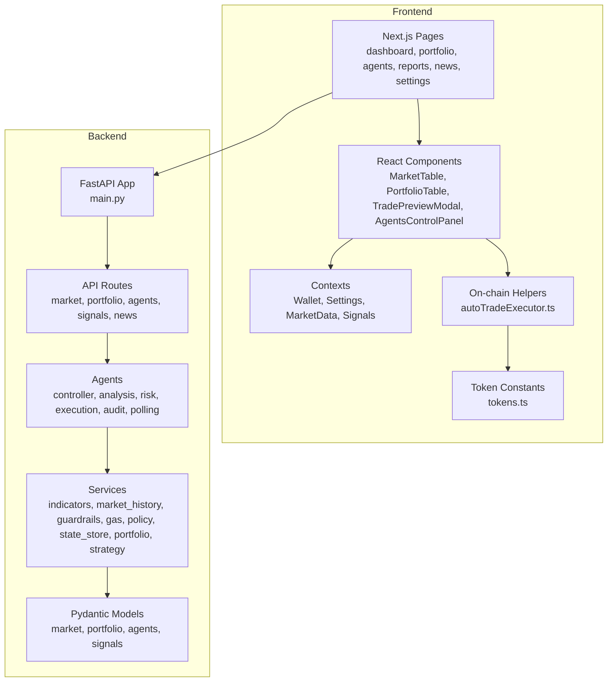

**Diagram sources**
- [backend/app/main.py:34-38](file://backend/app/main.py#L34-L38)
- [frontend/components/TradePreviewModal.tsx:1-10](file://frontend/components/TradePreviewModal.tsx#L1-L10)
- [frontend/lib/autoTradeExecutor.ts:1-10](file://frontend/lib/autoTradeExecutor.ts#L1-L10)
- [frontend/constants/tokens.ts:1-10](file://frontend/constants/tokens.ts#L1-L10)

**Section sources**
- [README.md:116-144](file://README.md#L116-L144)

## Agent Guidelines and Trading Philosophy
The original design brief defines four agents:
- Controller/Orchestrator
- Analysis Agent (RSI, VWAP, volume)
- Risk Agent (position limits, gas, slippage)
- Execution Agent (proposal only, human approval required)
- Audit Agent (read-only logging)

Key principles:
- Use real-time price feeds and per-token monitoring.
- Enforce VWAP deviation thresholds and a 5-minute volume spike filter.
- Use RSI(14) buy/sell gates.
- Scale out profits mechanically while protecting downside with stop-losses and trailing stops.
- Cap position size and daily trades.
- Include dynamic slippage and gas-aware profitability checks.
- Implement circuit breakers and a manual kill switch.
- Simulate before executing and log every action.

These principles are implemented in the backend agents and services, while the frontend handles wallet signing and on-chain routing.

**Section sources**
- [agent_guidelines.txt:1-134](file://agent_guidelines.txt#L1-L134)
- [README.md:156-167](file://README.md#L156-L167)

## Development Workflow
Recommended local workflow:
1. Start the backend from `backend/`.
2. Start the frontend from `frontend/`.
3. Open the dashboard and connect an injected wallet.
4. Run backend unit tests from `backend/`.
5. Run frontend policy tests from `frontend/`.
6. Build the frontend to validate production configuration.

CI runs:
- Backend unit tests on Python 3.12.
- Frontend policy tests, TypeScript type checking, and build.
- A check that runtime/personal data files are not tracked.

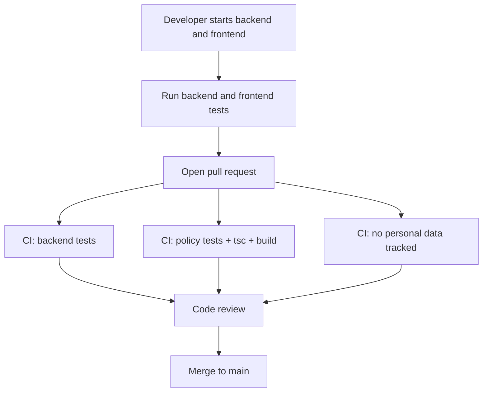

**Diagram sources**
- [.github/workflows/ci.yml:1-54](file://.github/workflows/ci.yml#L1-L54)
- [README.md:146-154](file://README.md#L146-L154)

**Section sources**
- [README.md:35-57](file://README.md#L35-L57)
- [README.md:146-154](file://README.md#L146-L154)
- [.github/workflows/ci.yml:1-54](file://.github/workflows/ci.yml#L1-L54)

## Coding Standards and Conventions
General rules derived from the codebase:
- Keep indicators pure and stateless where possible. Return `None` when data is insufficient rather than fabricating neutral values.
- Separate concerns: analysis, risk, execution, and audit should remain distinct modules.
- Persist state through the shared JSON state store instead of ad-hoc file writes.
- Prefer explicit constants for trading parameters and document them near their use.
- Treat stablecoins as cash everywhere in the strategy layer.
- Validate upstream inputs and return structured errors or rejections rather than failing silently.
- Log actionable context for every decision, especially rejections and halts.
- Do not track runtime data files in Git.
- Keep frontend token addresses and router constants centralized.

Backend dependencies are pinned in `requirements.txt`; frontend dependencies and scripts are defined in `package.json`.

**Section sources**
- [backend/app/services/indicators.py:1-10](file://backend/app/services/indicators.py#L1-L10)
- [backend/app/services/guardrails.py:1-10](file://backend/app/services/guardrails.py#L1-L10)
- [backend/app/agents/analysis_agent.py:10-18](file://backend/app/agents/analysis_agent.py#L10-L18)
- [backend/requirements.txt:1-9](file://backend/requirements.txt#L1-L9)
- [frontend/package.json:1-31](file://frontend/package.json#L1-L31)

## Architecture Overview
The controller orchestrates the agent loop:
1. Poll market data.
2. Record samples in rolling history.
3. Ask the analysis agent for recommendations.
4. Ask the risk agent to validate.
5. Create a trade proposal.
6. Persist state and audit logs.
7. Wait for the next cycle.

```mermaid
sequenceDiagram
participant Loop as "ControllerAgent"
participant History as "MarketHistory"
participant Analysis as "AnalysisAgent"
participant Risk as "RiskAgent"
participant Execution as "ExecutionAgent"
participant Audit as "AuditAgent"
Loop->>Loop : "fetch snapshot"
Loop->>History : "record(snapshot)"
Loop->>Analysis : "analyze(snapshot, positions, holdings)"
Analysis-->>Loop : "recommendations"
Loop->>Risk : "validate(recommendation, holdings, prices, gas, guardrails)"
Risk-->>Loop : "approval or rejection"
Loop->>Execution : "create_proposal(recommendation, risk_assessment)"
Execution-->>Loop : "TradeProposal"
Loop->>Audit : "log recommendation, risk result, proposal"
Loop->>Loop : "persist state"
```

**Diagram sources**
- [backend/app/agents/controller.py:499-674](file://backend/app/agents/controller.py#L499-L674)
- [backend/app/agents/analysis_agent.py:76-255](file://backend/app/agents/analysis_agent.py#L76-L255)
- [backend/app/agents/risk_agent.py:24-190](file://backend/app/agents/risk_agent.py#L24-L190)
- [backend/app/agents/execution_agent.py:58-179](file://backend/app/agents/execution_agent.py#L58-L179)
- [backend/app/services/market_history.py:107-114](file://backend/app/services/market_history.py#L107-L114)

## Core Components

### Controller Agent
Responsibilities:
- Lifecycle control: start, stop, halt, resume.
- State reconstruction from trades or demo portfolio.
- Running the polling loop.
- Coordinating analysis, risk, and execution.
- Managing proposals, guardrail counters, and persisted state.

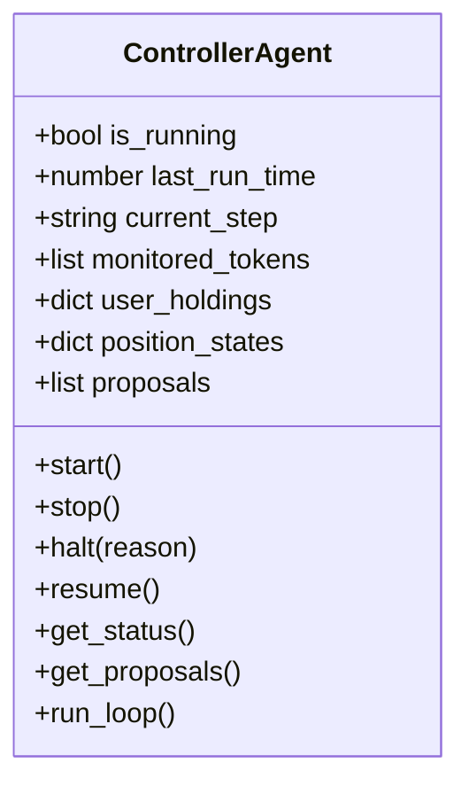

**Diagram sources**
- [backend/app/agents/controller.py:24-73](file://backend/app/agents/controller.py#L24-L73)
- [backend/app/agents/controller.py:224-266](file://backend/app/agents/controller.py#L224-L266)
- [backend/app/agents/controller.py:499-674](file://backend/app/agents/controller.py#L499-L674)

**Section sources**
- [backend/app/agents/controller.py:24-73](file://backend/app/agents/controller.py#L24-L73)
- [backend/app/agents/controller.py:224-266](file://backend/app/agents/controller.py#L224-L266)
- [backend/app/agents/controller.py:499-674](file://backend/app/agents/controller.py#L499-L674)

### Analysis Agent
Responsibilities:
- Evaluate exits first: stop ladder, trailing stop, scale-out ladder.
- Evaluate buys after exits: dip entry with RSI, VWAP, and volume-spike filters.
- Handle indicator warm-up by lowering confidence or skipping signals.
- Produce structured recommendations with reasons and metadata.

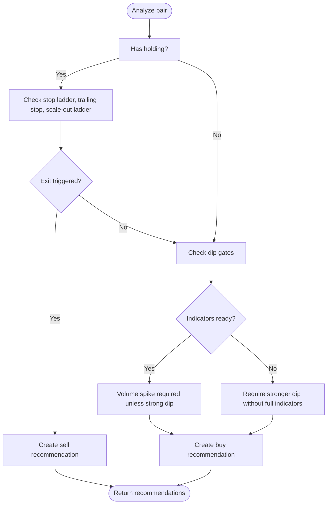

**Diagram sources**
- [backend/app/agents/analysis_agent.py:76-255](file://backend/app/agents/analysis_agent.py#L76-L255)
- [backend/app/agents/analysis_agent.py:258-349](file://backend/app/agents/analysis_agent.py#L258-L349)

**Section sources**
- [backend/app/agents/analysis_agent.py:10-18](file://backend/app/agents/analysis_agent.py#L10-L18)
- [backend/app/agents/analysis_agent.py:76-255](file://backend/app/agents/analysis_agent.py#L76-L255)
- [backend/app/agents/analysis_agent.py:258-349](file://backend/app/agents/analysis_agent.py#L258-L349)

### Risk Agent
Responsibilities:
- Apply circuit breaker and frequency caps.
- Validate confidence, gas ceiling, holdings, position sizing, minimum profit, and gas-to-profit ratio.
- Compute dynamic slippage based on volatility and volume spikes.
- Return structured checks so the UI can explain rejections.

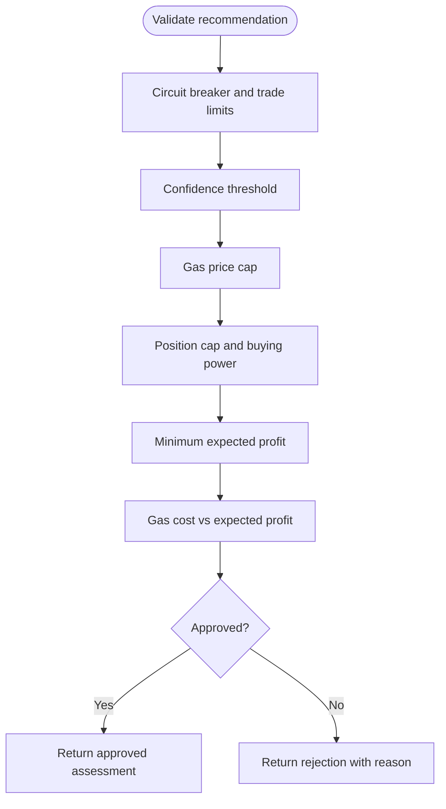

**Diagram sources**
- [backend/app/agents/risk_agent.py:24-190](file://backend/app/agents/risk_agent.py#L24-L190)
- [backend/app/agents/risk_agent.py:203-215](file://backend/app/agents/risk_agent.py#L203-L215)

**Section sources**
- [backend/app/agents/risk_agent.py:8-22](file://backend/app/agents/risk_agent.py#L8-L22)
- [backend/app/agents/risk_agent.py:24-190](file://backend/app/agents/risk_agent.py#L24-L190)
- [backend/app/agents/risk_agent.py:203-215](file://backend/app/agents/risk_agent.py#L203-L215)

### Execution Agent
Responsibilities:
- Convert approved recommendations into sized, human-approvable proposals.
- Respect buying power, dust thresholds, step fractions, and exposure headroom.
- Record successful executions back to the trade ledger.

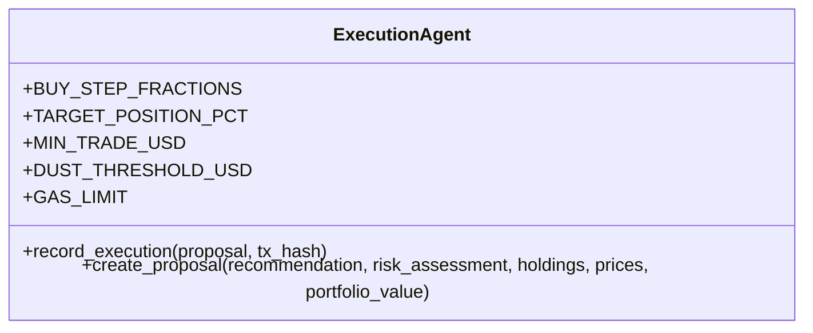

**Diagram sources**
- [backend/app/agents/execution_agent.py:9-25](file://backend/app/agents/execution_agent.py#L9-L25)
- [backend/app/agents/execution_agent.py:28-56](file://backend/app/agents/execution_agent.py#L28-L56)
- [backend/app/agents/execution_agent.py:58-179](file://backend/app/agents/execution_agent.py#L58-L179)

**Section sources**
- [backend/app/agents/execution_agent.py:9-25](file://backend/app/agents/execution_agent.py#L9-L25)
- [backend/app/agents/execution_agent.py:58-179](file://backend/app/agents/execution_agent.py#L58-L179)

### Services Layer
- Indicators: pure functions for RSI, VWAP, volume ratio, spike detection, and percentage change.
- Market history: rolling per-token samples, persistence, warm-up handling, and summary generation.
- Guardrails: portfolio-level circuit breakers, drawdown tracking, trade budgets, and status reporting.
- Strategy: deterministic signal fallback using 24-hour change thresholds.

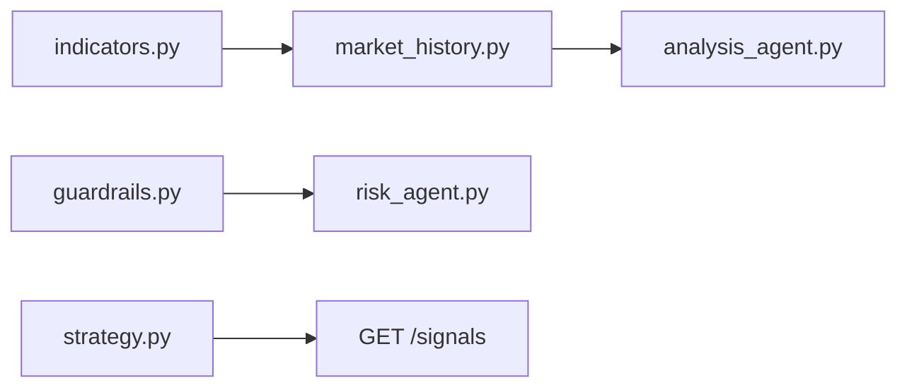

**Diagram sources**
- [backend/app/services/indicators.py:17-97](file://backend/app/services/indicators.py#L17-L97)
- [backend/app/services/market_history.py:37-189](file://backend/app/services/market_history.py#L37-L189)
- [backend/app/services/guardrails.py:16-165](file://backend/app/services/guardrails.py#L16-L165)
- [backend/app/services/strategy.py:8-39](file://backend/app/services/strategy.py#L8-L39)

**Section sources**
- [backend/app/services/indicators.py:1-97](file://backend/app/services/indicators.py#L1-L97)
- [backend/app/services/market_history.py:1-189](file://backend/app/services/market_history.py#L1-L189)
- [backend/app/services/guardrails.py:1-165](file://backend/app/services/guardrails.py#L1-L165)
- [backend/app/services/strategy.py:1-39](file://backend/app/services/strategy.py#L1-L39)

## Extending the System

### Extending the Agent System
To add a new agent:
1. Create a new module under `backend/app/agents/`.
2. Define a clear interface: inputs, outputs, and side effects.
3. Integrate it into the controller loop at the appropriate stage.
4. Add audit logging for decisions and failures.
5. Add tests covering normal paths, edge cases, and failure modes.
6. Update the controller’s status and proposal lifecycle if needed.

When adding a new orchestration stage, keep the existing separation:
- Analysis produces recommendations.
- Risk validates constraints.
- Execution creates proposals.
- Audit records everything.

**Section sources**
- [backend/app/agents/controller.py:24-73](file://backend/app/agents/controller.py#L24-L73)
- [backend/app/agents/controller.py:499-674](file://backend/app/agents/controller.py#L499-L674)

### Adding New Technical Indicators
Guidelines:
- Place pure math in `backend/app/services/indicators.py`.
- Return `None` when there is insufficient data.
- Avoid global state or network calls inside indicator functions.
- Extend `MarketHistory.summary()` to expose the new indicator to the analysis agent.
- Update the analysis agent to consume the indicator and adjust confidence or gating logic.
- Add unit tests for boundary conditions and warm-up behavior.

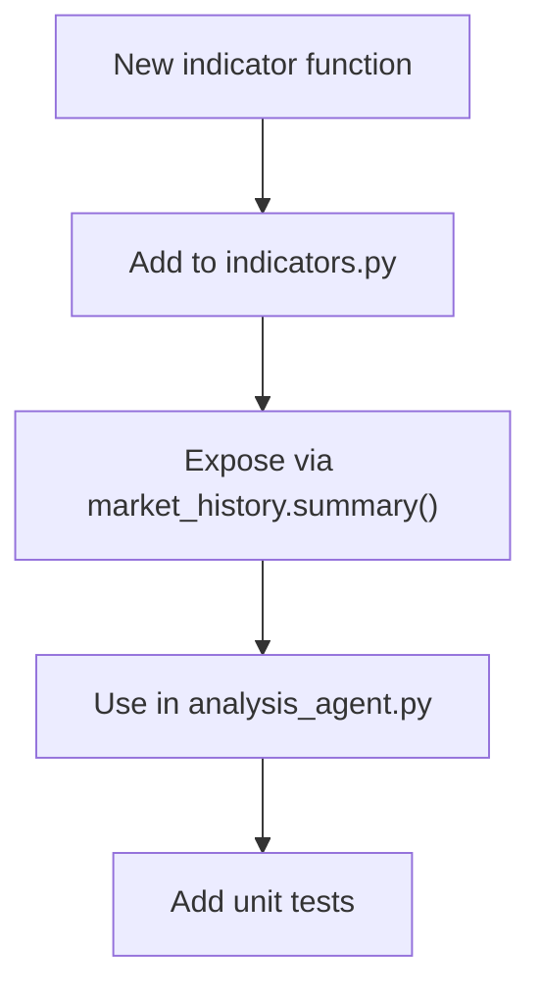

**Diagram sources**
- [backend/app/services/indicators.py:17-97](file://backend/app/services/indicators.py#L17-L97)
- [backend/app/services/market_history.py:168-189](file://backend/app/services/market_history.py#L168-L189)
- [backend/app/agents/analysis_agent.py:101-112](file://backend/app/agents/analysis_agent.py#L101-L112)

**Section sources**
- [backend/app/services/indicators.py:1-97](file://backend/app/services/indicators.py#L1-L97)
- [backend/app/services/market_history.py:168-189](file://backend/app/services/market_history.py#L168-L189)
- [backend/app/agents/analysis_agent.py:101-112](file://backend/app/agents/analysis_agent.py#L101-L112)

### Integrating Additional Market Data Sources
Guidelines:
- Add a new service under `backend/app/services/` with a clean interface.
- Cache results appropriately; do not call upstream APIs on every loop iteration.
- Normalize data into the model used by the controller and analysis agent.
- Mock upstream HTTP in tests.
- Add configuration for endpoints and keys through environment variables.
- Update the startup cache warm-up if the source is important for initial UX.

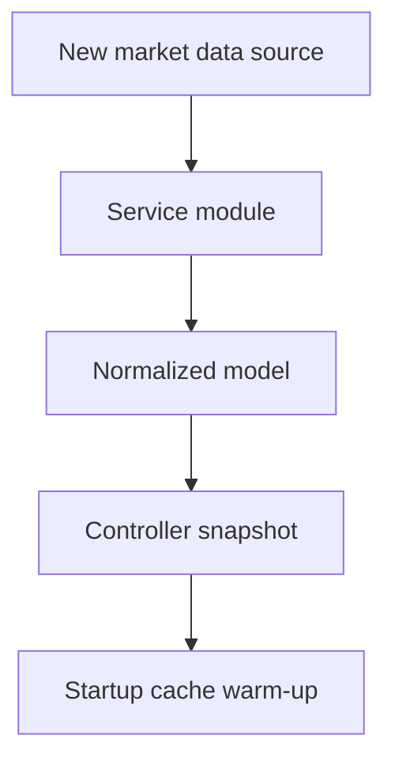

**Diagram sources**
- [backend/app/main.py:41-54](file://backend/app/main.py#L41-L54)
- [backend/app/agents/controller.py:499-550](file://backend/app/agents/controller.py#L499-L550)

**Section sources**
- [backend/app/main.py:41-54](file://backend/app/main.py#L41-L54)
- [backend/app/agents/controller.py:499-550](file://backend/app/agents/controller.py#L499-L550)

### Implementing Custom Risk Rules
Guidelines:
- Add domain-specific checks in `backend/app/agents/risk_agent.py`.
- Use structured checks so rejections are explainable.
- Respect existing guardrails for portfolio-level circuit breakers.
- Document thresholds and rationale near the implementation.
- Add tests for each new rule, including pass, fail, and edge cases.

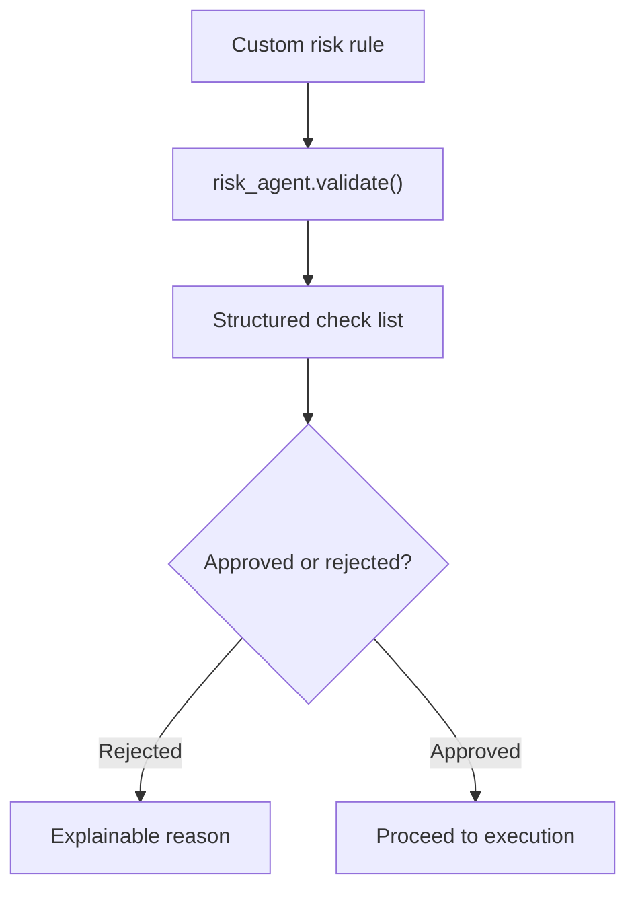

**Diagram sources**
- [backend/app/agents/risk_agent.py:24-190](file://backend/app/agents/risk_agent.py#L24-L190)
- [backend/app/services/guardrails.py:92-113](file://backend/app/services/guardrails.py#L92-L113)

**Section sources**
- [backend/app/agents/risk_agent.py:24-190](file://backend/app/agents/risk_agent.py#L24-L190)
- [backend/app/services/guardrails.py:92-113](file://backend/app/services/guardrails.py#L92-L113)

## Debugging, Logging, and Profiling

### Backend Debugging
- Use the health endpoint to verify the backend is running and whether demo mode is enabled.
- Inspect agent logs through the agents API and the rotating audit log file.
- Print statements in the controller and agents help trace the loop, but rely on audit logs for persistent evidence.
- For market data issues, check startup cache pre-population and upstream error handling.

**Section sources**
- [backend/app/main.py:57-59](file://backend/app/main.py#L57-L59)
- [backend/app/agents/controller.py:544-550](file://backend/app/agents/controller.py#L544-L550)
- [backend/app/agents/controller.py:676-678](file://backend/app/agents/controller.py#L676-L678)

### Frontend Debugging
- Open the browser console to see auto-trade execution errors, quote failures, and simulation results.
- Verify the selected network matches the auto-trade executor’s chain requirement.
- Check token address resolution and decimals for the active network.
- Use the trade preview modal to inspect quoting across V2, V3, and Aerodrome paths.

**Section sources**
- [frontend/lib/autoTradeExecutor.ts:45-63](file://frontend/lib/autoTradeExecutor.ts#L45-L63)
- [frontend/lib/autoTradeExecutor.ts:250-281](file://frontend/lib/autoTradeExecutor.ts#L250-L281)
- [frontend/components/TradePreviewModal.tsx:174-235](file://frontend/components/TradePreviewModal.tsx#L174-L235)

### Performance Notes
- The controller loop sleeps between cycles; tune polling intervals carefully.
- Market history persists periodically to avoid excessive disk writes.
- Frontend quoting tries multiple routes; expensive RPC calls should be debounced and cached where safe.
- Demo mode avoids real transaction costs but still exercises the same proposal and risk logic.

**Section sources**
- [backend/app/agents/controller.py:672-674](file://backend/app/agents/controller.py#L672-L674)
- [backend/app/services/market_history.py:62-77](file://backend/app/services/market_history.py#L62-L77)
- [frontend/components/TradePreviewModal.tsx:167-172](file://frontend/components/TradePreviewModal.tsx#L167-L172)

## Dependency Analysis
The backend depends on FastAPI, Uvicorn, LangChain, Pydantic, httpx, dotenv, and feedparser. The frontend depends on Next.js, React, ethers, TypeScript, Tailwind, and ESLint.

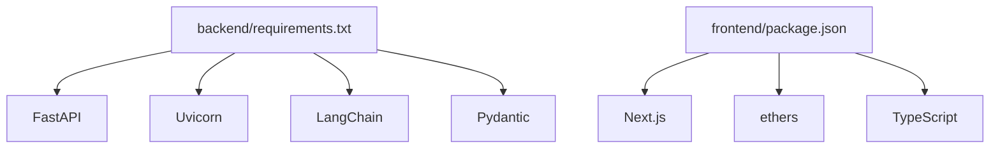

**Diagram sources**
- [backend/requirements.txt:1-9](file://backend/requirements.txt#L1-L9)
- [frontend/package.json:12-28](file://frontend/package.json#L12-L28)

**Section sources**
- [backend/requirements.txt:1-9](file://backend/requirements.txt#L1-L9)
- [frontend/package.json:1-31](file://frontend/package.json#L1-L31)

## Performance Considerations
- Indicator warm-up matters: RSI(14) needs enough closes, VWAP needs volume deltas, and the volume spike filter needs sufficient history.
- The controller loop should not poll too aggressively; respect the configured interval.
- Market history pruning keeps memory bounded and prevents unbounded growth.
- Frontend quoting may try many routes; avoid unnecessary re-quotes by debouncing input changes.
- Demo fills are optimistic and ignore slippage, fees, and partial fills; treat demo P&L as bookkeeping, not a realistic backtest.

**Section sources**
- [README.md:173-183](file://README.md#L173-L183)
- [backend/app/services/market_history.py:25-28](file://backend/app/services/market_history.py#L25-L28)
- [backend/app/services/market_history.py:79-87](file://backend/app/services/market_history.py#L79-L87)
- [frontend/components/TradePreviewModal.tsx:167-172](file://frontend/components/TradePreviewModal.tsx#L167-L172)

## Troubleshooting Guide

Common issues and resolutions:
- No proposals appear:
  - Check whether the controller is running and not halted.
  - Confirm market data snapshots are being recorded.
  - Verify indicators are warming up and not blocking signals.
- Proposals are rejected:
  - Inspect risk checks: confidence, gas ceiling, position cap, minimum profit, gas-to-profit ratio.
  - Ensure the wallet has sufficient holdings or buying power.
- Auto-trade fails:
  - Confirm the browser is on Base.
  - Confirm the token pair is eligible for auto-trade.
  - Check slippage, allowance, and pre-execution simulation errors.
- Quotes fail:
  - Verify token addresses and decimals for the active network.
  - Check whether V2, V3, or Aerodrome routes exist.
  - Look for pool boundary or liquidity issues.

**Section sources**
- [backend/app/agents/controller.py:544-550](file://backend/app/agents/controller.py#L544-L550)
- [backend/app/agents/risk_agent.py:54-190](file://backend/app/agents/risk_agent.py#L54-L190)
- [frontend/lib/autoTradeExecutor.ts:45-63](file://frontend/lib/autoTradeExecutor.ts#L45-L63)
- [frontend/lib/autoTradeExecutor.ts:157-184](file://frontend/lib/autoTradeExecutor.ts#L157-L184)
- [frontend/lib/autoTradeExecutor.ts:250-281](file://frontend/lib/autoTradeExecutor.ts#L250-L281)
- [frontend/components/TradePreviewModal.tsx:174-235](file://frontend/components/TradePreviewModal.tsx#L174-L235)

## Contribution Process

### Git Workflow
- Work on feature branches for changes.
- Keep runtime data files out of Git; CI will fail if they are tracked.
- Write tests for new logic.
- Run backend and frontend tests locally before opening a pull request.
- Keep commit messages focused and descriptive.

### Pull Request Process
- Ensure CI passes: backend tests, frontend policy tests, TypeScript checks, and frontend build.
- Include test coverage for new agents, indicators, services, or routes.
- Document configuration changes and environment variables.
- Explain trade-offs for strategy parameter changes.

### Code Review Standards
- Prefer small, focused changes.
- Validate that new rules are explainable and logged.
- Ensure state persistence is safe and consistent.
- Confirm that upstream API calls are mocked in tests.
- Verify that security-sensitive defaults remain conservative.

### Best Practices for Code Quality
- Keep pure logic separate from I/O.
- Use structured models for all external contracts.
- Fail closed on missing balances, invalid inputs, or insufficient history.
- Avoid hardcoding secrets; use environment variables.
- Prefer deterministic defaults and document non-deterministic behavior.

**Section sources**
- [.github/workflows/ci.yml:44-54](file://.github/workflows/ci.yml#L44-L54)
- [README.md:146-154](file://README.md#L146-L154)
- [backend/app/services/indicators.py:1-10](file://backend/app/services/indicators.py#L1-L10)
- [backend/app/agents/risk_agent.py:8-13](file://backend/app/agents/risk_agent.py#L8-L13)

## Conclusion
DexTrader combines a rule-based backend agent pipeline with a client-side execution model. Contributors should preserve the separation of concerns, enforce safety through risk and guardrail layers, and make every decision observable through structured logs. When extending the system, prioritize clarity, testability, and conservative defaults. Always treat the software as experimental and remember that real funds can be at risk when connected to a live chain.