# External Integrations

<cite>
**Referenced Files in This Document**
- [config.py](file://backend/app/core/config.py)
- [coinmarketcap.py](file://backend/app/services/coinmarketcap.py)
- [coingecko.py](file://backend/app/services/coingecko.py)
- [geckoterminal.py](file://backend/app/services/geckoterminal.py)
- [gas.py](file://backend/app/services/gas.py)
- [langchain_signals.py](file://backend/app/agents/langchain_signals.py)
- [routes_news.py](file://backend/app/api/routes_news.py)
- [reports.py](file://backend/app/services/reports.py)
</cite>

## Table of Contents
1. [Introduction](#introduction)
2. [Project Structure](#project-structure)
3. [Core Components](#core-components)
4. [Architecture Overview](#architecture-overview)
5. [Detailed Component Analysis](#detailed-component-analysis)
6. [Dependency Analysis](#dependency-analysis)
7. [Performance Considerations](#performance-considerations)
8. [Troubleshooting Guide](#troubleshooting-guide)
9. [Conclusion](#conclusion)

## Introduction
This document explains the external service integrations used by DexTrader for market data, DEX pool analytics, LLM-based signal generation, gas price estimation, news aggregation, and currency conversion. It focuses on:

- Market data providers: CoinMarketCap trial API, CoinGecko API.
- DEX pool data provider: GeckoTerminal for Base network pools and token metrics.
- LLM integration: OpenAI GPT-4o-mini via LangChain and direct DeepSeek API calls.
- Gas price estimation for Base.
- News feed aggregation from RSS sources.
- Exchange rate handling for reporting and display.
- Configuration, rate limiting, fallbacks, error recovery, caching, and abstraction patterns that allow swapping providers or testing with mocks.

## Project Structure
The external integrations live primarily under `backend/app/services`, with configuration in `backend/app/core/config.py`. The news aggregator is exposed through a FastAPI route in `backend/app/api/routes_news.py`. LLM signal generation is implemented in `backend/app/agents/langchain_signals.py`.

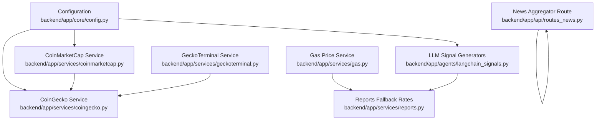

**Diagram sources**
- [config.py:9-12](file://backend/app/core/config.py#L9-L12)
- [coinmarketcap.py:71-187](file://backend/app/services/coinmarketcap.py#L71-L187)
- [coingecko.py:69-111](file://backend/app/services/coingecko.py#L69-L111)
- [geckoterminal.py:149-162](file://backend/app/services/geckoterminal.py#L149-L162)
- [gas.py:27-59](file://backend/app/services/gas.py#L27-L59)
- [routes_news.py:84-152](file://backend/app/api/routes_news.py#L84-L152)
- [langchain_signals.py:40-122](file://backend/app/agents/langchain_signals.py#L40-L122)
- [reports.py:7-34](file://backend/app/services/reports.py#L7-L34)

**Section sources**
- [config.py:1-17](file://backend/app/core/config.py#L1-L17)
- [coinmarketcap.py:1-212](file://backend/app/services/coinmarketcap.py#L1-L212)
- [coingecko.py:1-303](file://backend/app/services/coingecko.py#L1-L303)
- [geckoterminal.py:1-242](file://backend/app/services/geckoterminal.py#L1-L242)
- [gas.py:1-60](file://backend/app/services/gas.py#L1-L60)
- [routes_news.py:1-163](file://backend/app/api/routes_news.py#L1-L163)
- [langchain_signals.py:1-123](file://backend/app/agents/langchain_signals.py#L1-L123)
- [reports.py:1-50](file://backend/app/services/reports.py#L1-L50)

## Core Components
- Market data providers:
  - CoinMarketCap: supports both trial (keyless) and Pro endpoints; includes priority symbol resolution and fallback to CoinGecko.
  - CoinGecko: provides trading pairs, ecosystem candidates, Base address mapping, and price changes.
- DEX analytics:
  - GeckoTerminal: fetches Base token metrics, volumes, and ranked pools while respecting public API limits.
- LLM signals:
  - LangChain + OpenAI GPT-4o-mini pipeline.
  - Direct DeepSeek API call path.
- Gas estimation:
  - Base RPC `eth_gasPrice` with short-term cache and conservative fallback.
- News aggregation:
  - RSS feeds from multiple crypto news sources with in-memory caching.
- Currency conversion:
  - Reporting uses static USD rates with ETH/WETH override; frontend displays optional USD-to-EUR exchange rate UI state.

**Section sources**
- [coinmarketcap.py:10-24](file://backend/app/services/coinmarketcap.py#L10-L24)
- [coingecko.py:18-66](file://backend/app/services/coingecko.py#L18-L66)
- [geckoterminal.py:25-33](file://backend/app/services/geckoterminal.py#L25-L33)
- [langchain_signals.py:19-37](file://backend/app/agents/langchain_signals.py#L19-L37)
- [gas.py:12-17](file://backend/app/services/gas.py#L12-L17)
- [routes_news.py:58-67](file://backend/app/api/routes_news.py#L58-L67)
- [reports.py:7-9](file://backend/app/services/reports.py#L7-L9)

## Architecture Overview
The system composes several independent external services. Providers are loosely coupled through functions and classes rather than a shared interface, but their usage patterns make them swappable at call sites.

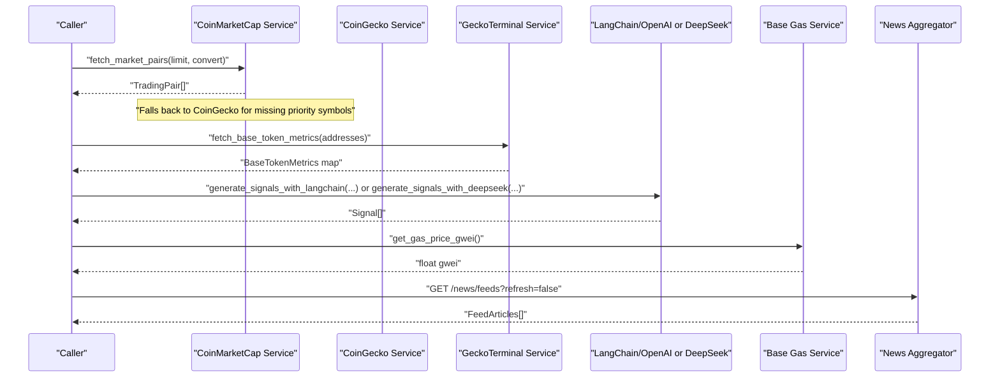

**Diagram sources**
- [coinmarketcap.py:71-187](file://backend/app/services/coinmarketcap.py#L71-L187)
- [coingecko.py:69-111](file://backend/app/services/coingecko.py#L69-L111)
- [geckoterminal.py:149-162](file://backend/app/services/geckoterminal.py#L149-L162)
- [langchain_signals.py:40-122](file://backend/app/agents/langchain_signals.py#L40-L122)
- [gas.py:27-59](file://backend/app/services/gas.py#L27-L59)
- [routes_news.py:155-162](file://backend/app/api/routes_news.py#L155-L162)

## Detailed Component Analysis

### Market Data Providers

#### CoinMarketCap Trial and Pro API
- Endpoint selection:
  - If an API key is configured, the Pro base URL is used.
  - Otherwise, the trial-pro-api path is selected.
  - An environment variable can override the base URL.
- Authentication:
  - For non-trial endpoints, the header `X-CMC_PRO_API_KEY` is set from `COINMARKETCAP_API_KEY`.
  - The trial endpoint is keyless; sending an invalid/expired key causes rejection.
- Data retrieval strategy:
  - Fetch top listings first.
  - For missing priority tokens, attempt quotes by symbol and slug in batches.
  - If still missing, fall back to CoinGecko for those symbols.
- Error handling:
  - Network errors and non-200 responses are logged; processing continues.
  - Batching prevents one bad symbol/slug from failing the entire request.

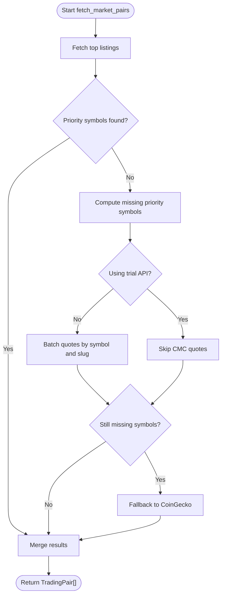

**Diagram sources**
- [coinmarketcap.py:17-24](file://backend/app/services/coinmarketcap.py#L17-L24)
- [coinmarketcap.py:71-187](file://backend/app/services/coinmarketcap.py#L71-L187)

**Section sources**
- [coinmarketcap.py:10-24](file://backend/app/services/coinmarketcap.py#L10-L24)
- [coinmarketcap.py:71-187](file://backend/app/services/coinmarketcap.py#L71-L187)

#### CoinGecko API
- Purpose:
  - Provide trading pair prices, 24h change, volume, and links.
  - Resolve Base contract addresses and ecosystem candidates.
- Rate limiting:
  - One polite retry on HTTP 429, honoring `Retry-After` when present.
  - Retry delay is bounded to avoid long hangs.
- Headers:
  - Uses `x-cg-demo-api-key` when `COINGECKO_API_KEY` is set.
- Functions:
  - `fetch_coingecko_pairs`: returns `TradingPair` list for given symbols.
  - `fetch_base_ecosystem_candidates`: lists Base ecosystem coins by global market cap.
  - `fetch_coin_base_address`: resolves Base contract address for a coin ID.
  - `fetch_price_changes`: returns 24h change per coin ID.
  - `fetch_base_address_map`: bulk-maps coin IDs to Base addresses.

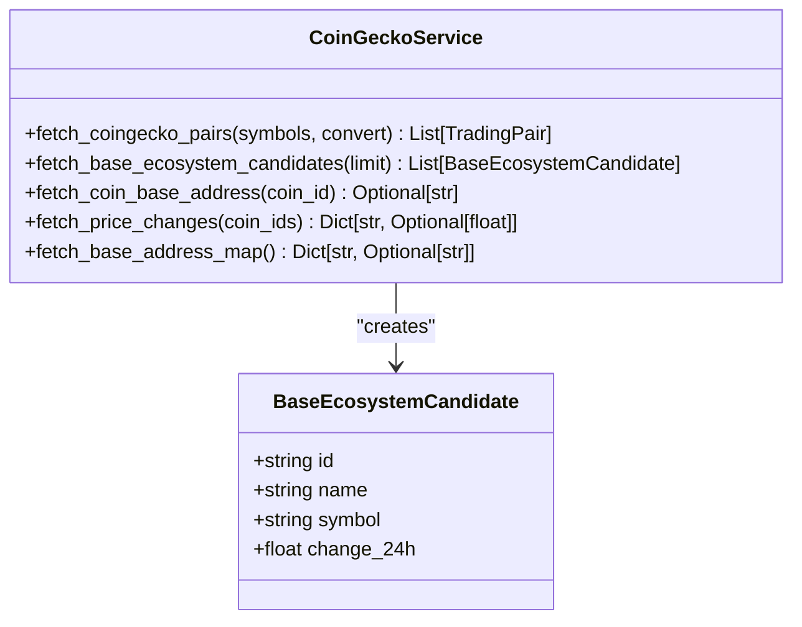

**Diagram sources**
- [coingecko.py:69-111](file://backend/app/services/coingecko.py#L69-L111)
- [coingecko.py:177-223](file://backend/app/services/coingecko.py#L177-L223)

**Section sources**
- [coingecko.py:11-17](file://backend/app/services/coingecko.py#L11-L17)
- [coingecko.py:69-111](file://backend/app/services/coingecko.py#L69-L111)
- [coingecko.py:155-174](file://backend/app/services/coingecko.py#L155-L174)
- [coingecko.py:177-223](file://backend/app/services/coingecko.py#L177-L223)
- [coingecko.py:226-303](file://backend/app/services/coingecko.py#L226-L303)

#### GeckoTerminal for DEX Pool Data
- Purpose:
  - Fetch Base-chain token metrics (price, FDV, volume).
  - Rank Base tokens by attributed 24h DEX volume.
- Rate limiting:
  - Public API allows approximately 30 calls per minute.
  - Pools are fetched page-by-page with a 2-second delay between pages.
  - Internal `_get_json` retries once on HTTP 429.
- Quoting logic:
  - Volume is attributed only to the non-quote-side token to avoid inflating stablecoin/quote token volumes.
- Key functions:
  - `fetch_base_token_metrics`: batched token metadata and metrics.
  - `fetch_token_volumes`: chain-local 24h DEX USD volumes.
  - `fetch_base_volume_ranked_addresses`: ranks Base tokens by attributed volume.

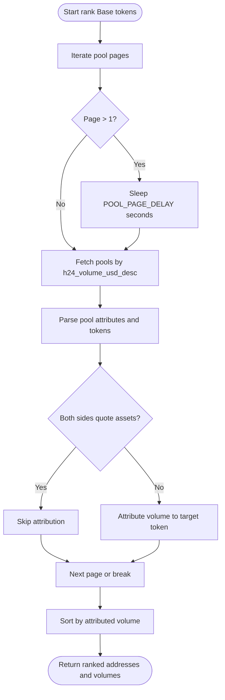

**Diagram sources**
- [geckoterminal.py:11-16](file://backend/app/services/geckoterminal.py#L11-L16)
- [geckoterminal.py:195-241](file://backend/app/services/geckoterminal.py#L195-L241)

**Section sources**
- [geckoterminal.py:9-33](file://backend/app/services/geckoterminal.py#L9-L33)
- [geckoterminal.py:110-118](file://backend/app/services/geckoterminal.py#L110-L118)
- [geckoterminal.py:149-176](file://backend/app/services/geckoterminal.py#L149-L176)
- [geckoterminal.py:195-241](file://backend/app/services/geckoterminal.py#L195-L241)

### LLM Integration for Signal Generation

#### OpenAI GPT-4o-mini via LangChain
- Pipeline:
  - Builds a prompt template with format instructions from Pydantic parser.
  - Chains prompt, LLM, and output parser.
  - Serializes a truncated market snapshot into JSON for the model.
- Output:
  - Returns a list of `Signal` objects with source marked as `"llm"` and timestamps.

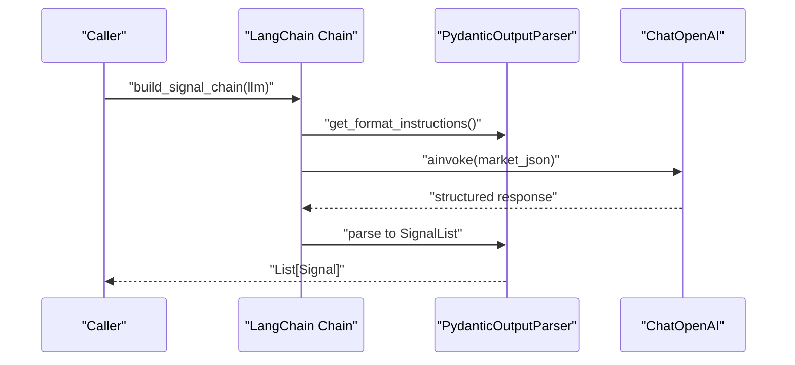

**Diagram sources**
- [langchain_signals.py:19-37](file://backend/app/agents/langchain_signals.py#L19-L37)
- [langchain_signals.py:40-58](file://backend/app/agents/langchain_signals.py#L40-L58)

**Section sources**
- [langchain_signals.py:1-17](file://backend/app/agents/langchain_signals.py#L1-L17)
- [langchain_signals.py:19-58](file://backend/app/agents/langchain_signals.py#L19-L58)

#### Direct DeepSeek API Calls
- Implementation:
  - Sends a chat completion request directly to DeepSeek’s `/v1/chat/completions`.
  - Requires `DEEPSEEK_API_KEY` from configuration.
  - Expects JSON output with a `signals` array.
- Output:
  - Maps fields to `Signal` objects with source marked as `"deepseek"`.

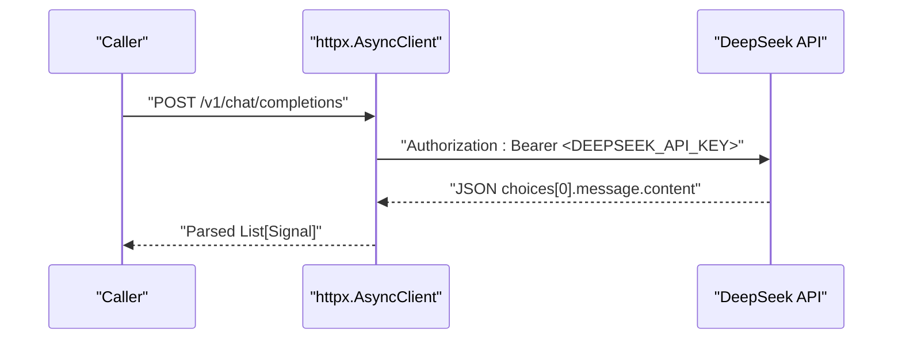

**Diagram sources**
- [langchain_signals.py:61-122](file://backend/app/agents/langchain_signals.py#L61-L122)

**Section sources**
- [langchain_signals.py:61-122](file://backend/app/agents/langchain_signals.py#L61-L122)

### Gas Price Estimation Service for Base
- Behavior:
  - Calls `eth_gasPrice` on the configured Base RPC URL.
  - Caches the result for 60 seconds.
  - Validates the returned gwei value; if implausible, treats it as an error.
  - On failure, logs and returns a cached value or a conservative fallback.
- Utility:
  - Provides USD cost calculation based on gwei, gas limit, and ETH price.

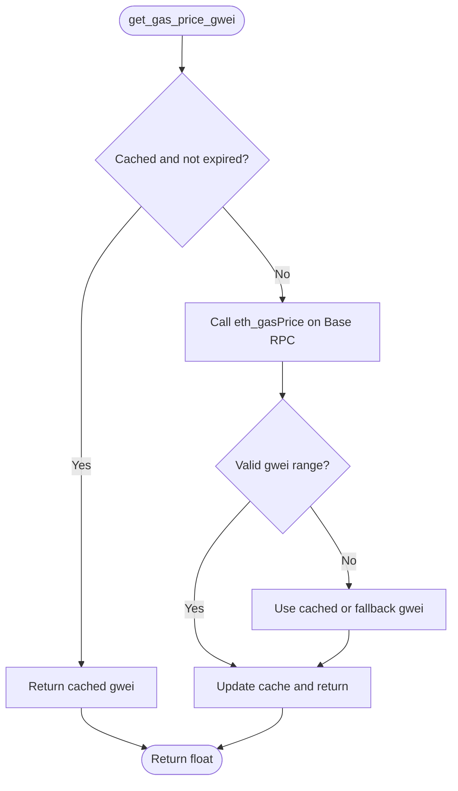

**Diagram sources**
- [gas.py:27-59](file://backend/app/services/gas.py#L27-L59)

**Section sources**
- [gas.py:12-17](file://backend/app/services/gas.py#L12-L17)
- [gas.py:20-24](file://backend/app/services/gas.py#L20-L24)
- [gas.py:27-59](file://backend/app/services/gas.py#L27-L59)

### News Feed Aggregation from RSS Sources
- Sources:
  - Multiple crypto news outlets are configured.
- Processing:
  - Fetches each feed, parses RSS, extracts title/link/published/source/summary/thumbnail.
  - Limits to up to 10 articles per source.
- Caching:
  - In-memory cache with a 30-minute TTL.
  - Supports forced refresh via query parameter.
- Error handling:
  - Per-feed errors are logged and skipped; other feeds continue.

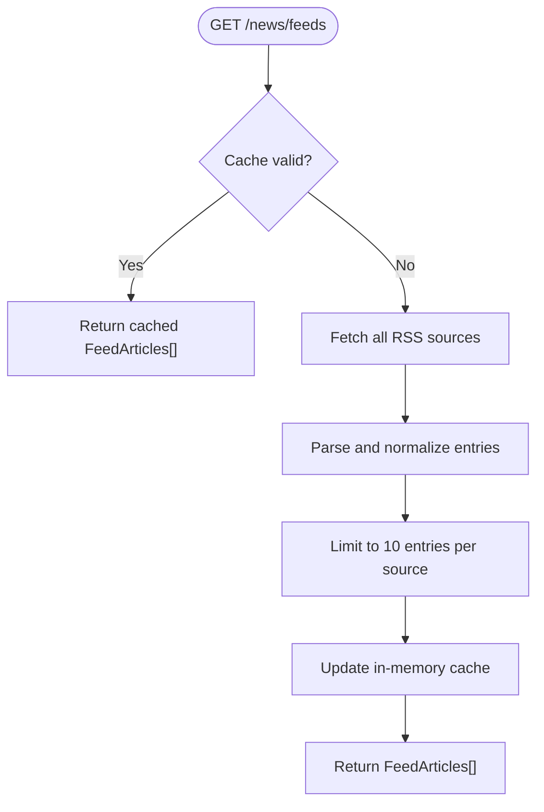

**Diagram sources**
- [routes_news.py:84-152](file://backend/app/api/routes_news.py#L84-L152)
- [routes_news.py:155-162](file://backend/app/api/routes_news.py#L155-L162)

**Section sources**
- [routes_news.py:10-13](file://backend/app/api/routes_news.py#L10-L13)
- [routes_news.py:58-67](file://backend/app/api/routes_news.py#L58-L67)
- [routes_news.py:84-152](file://backend/app/api/routes_news.py#L84-L152)
- [routes_news.py:155-162](file://backend/app/api/routes_news.py#L155-L162)

### Exchange Rate Services for Currency Conversion
- Reporting:
  - Static USD rates table is used for older trade records without explicit USD prices.
  - ETH/WETH rates can be overridden by a live ETH price passed into the report generator.
- Frontend display:
  - The settings UI shows an exchange rate when EUR is selected, indicating USD-to-EUR conversion support at the presentation layer.

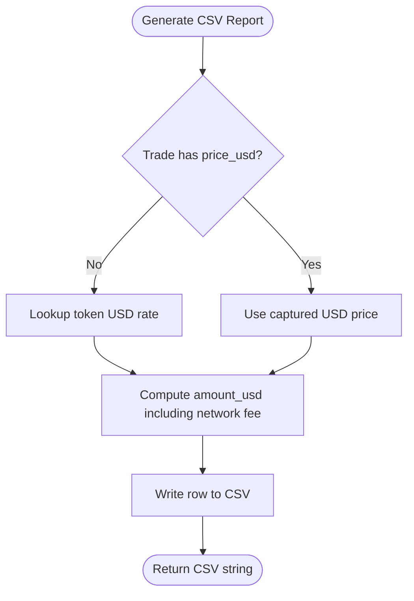

**Diagram sources**
- [reports.py:7-9](file://backend/app/services/reports.py#L7-L9)
- [reports.py:11-49](file://backend/app/services/reports.py#L11-L49)

**Section sources**
- [reports.py:7-9](file://backend/app/services/reports.py#L7-L9)
- [reports.py:11-49](file://backend/app/services/reports.py#L11-L49)

## Dependency Analysis
- Configuration:
  - All external keys are loaded from environment variables in `config.py`.
- Provider coupling:
  - CoinMarketCap depends on CoinGecko as a fallback for missing priority symbols.
  - GeckoTerminal does not depend on CoinGecko directly, but its token metrics may include a CoinGecko ID for downstream correlation.
- LLM integration:
  - LangChain path depends on `langchain_openai.ChatOpenAI`.
  - DeepSeek path depends on direct HTTP calls to DeepSeek’s API.
- Gas service:
  - Independent of market data providers; relies on Base RPC.
- News aggregator:
  - Independent of market data providers; relies on RSS feeds.

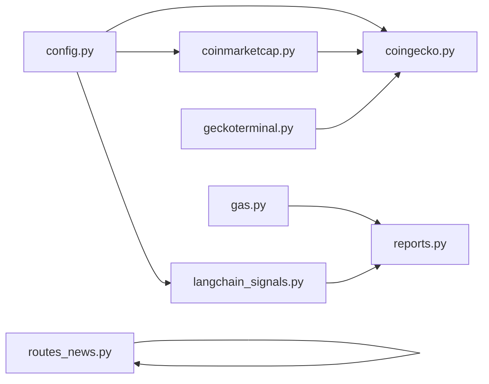

**Diagram sources**
- [config.py:9-12](file://backend/app/core/config.py#L9-L12)
- [coinmarketcap.py:177-187](file://backend/app/services/coinmarketcap.py#L177-L187)
- [geckoterminal.py:96-106](file://backend/app/services/geckoterminal.py#L96-L106)
- [langchain_signals.py:6-9](file://backend/app/agents/langchain_signals.py#L6-L9)
- [gas.py:12-17](file://backend/app/services/gas.py#L12-L17)
- [routes_news.py:58-67](file://backend/app/api/routes_news.py#L58-L67)
- [reports.py:7-9](file://backend/app/services/reports.py#L7-L9)

**Section sources**
- [config.py:9-12](file://backend/app/core/config.py#L9-L12)
- [coinmarketcap.py:177-187](file://backend/app/services/coinmarketcap.py#L177-L187)
- [geckoterminal.py:96-106](file://backend/app/services/geckoterminal.py#L96-L106)
- [langchain_signals.py:6-9](file://backend/app/agents/langchain_signals.py#L6-L9)
- [gas.py:12-17](file://backend/app/services/gas.py#L12-L17)
- [routes_news.py:58-67](file://backend/app/api/routes_news.py#L58-L67)
- [reports.py:7-9](file://backend/app/services/reports.py#L7-L9)

## Performance Considerations
- Rate limiting:
  - CoinGecko: single retry on 429 with bounded delay.
  - GeckoTerminal: page-by-page polling with delays and one retry on 429.
  - CoinMarketCap: batching by symbol/slug reduces failures and respects endpoint constraints.
- Caching:
  - Gas price: 60-second in-process cache.
  - News feeds: 30-minute in-memory cache.
- Concurrency:
  - Asynchronous HTTP clients reduce blocking during external calls.
- Payload size:
  - LLM inputs truncate market snapshots to a manageable number of pairs.

[No sources needed since this section provides general guidance]

## Troubleshooting Guide
- Missing or invalid API keys:
  - Ensure `COINMARKETCAP_API_KEY`, `COINGECKO_API_KEY`, `OPENAI_API_KEY`, and `DEEPSEEK_API_KEY` are set in the environment.
  - For CoinMarketCap trial mode, do not send an invalid key; use the keyless path.
- Rate limit errors:
  - CoinGecko and GeckoTerminal implement retries; if persistent, reduce request frequency or add application-level throttling.
- RPC failures:
  - Gas price estimation falls back to a conservative value; verify `BASE_RPC_URL` and network connectivity.
- News feed issues:
  - Individual feed failures are isolated; check network access to specific RSS URLs and content structure.
- LLM parsing errors:
  - Ensure the model response matches expected JSON structures; validate outputs and handle malformed responses gracefully.

**Section sources**
- [config.py:9-12](file://backend/app/core/config.py#L9-L12)
- [coinmarketcap.py:71-187](file://backend/app/services/coinmarketcap.py#L71-L187)
- [coingecko.py:155-174](file://backend/app/services/coingecko.py#L155-L174)
- [geckoterminal.py:110-118](file://backend/app/services/geckoterminal.py#L110-L118)
- [gas.py:27-59](file://backend/app/services/gas.py#L27-L59)
- [routes_news.py:140-146](file://backend/app/api/routes_news.py#L140-L146)
- [langchain_signals.py:49-58](file://backend/app/agents/langchain_signals.py#L49-L58)
- [langchain_signals.py:103-122](file://backend/app/agents/langchain_signals.py#L103-L122)

## Conclusion
DexTrader integrates multiple external services to provide robust market data, DEX analytics, LLM-driven signals, gas estimation, news aggregation, and currency conversion. Each integration includes practical strategies for rate limiting, fallbacks, error recovery, and caching. While there is no unified service interface, the modular design makes it straightforward to swap providers or introduce mock implementations for testing.

[No sources needed since this section summarizes without analyzing specific files]