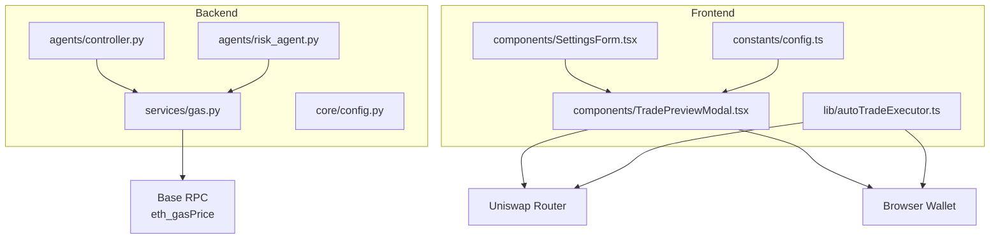
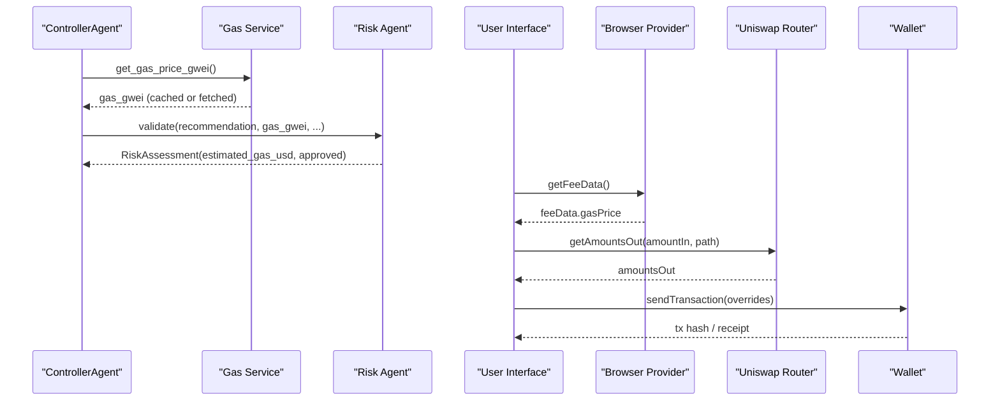
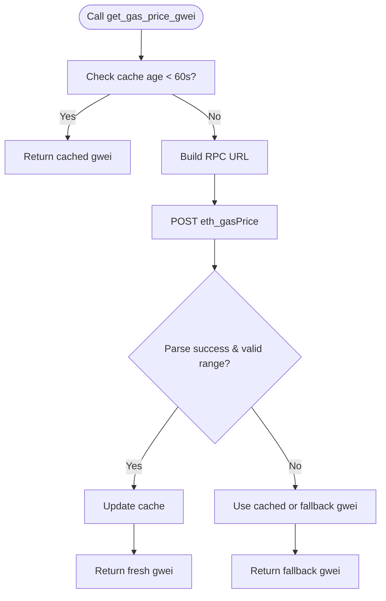
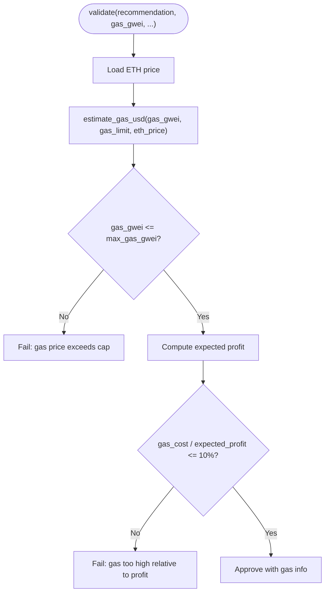
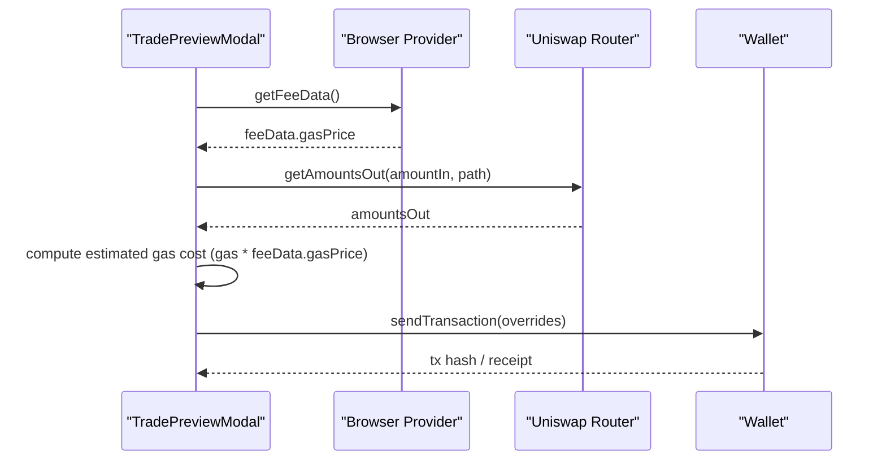
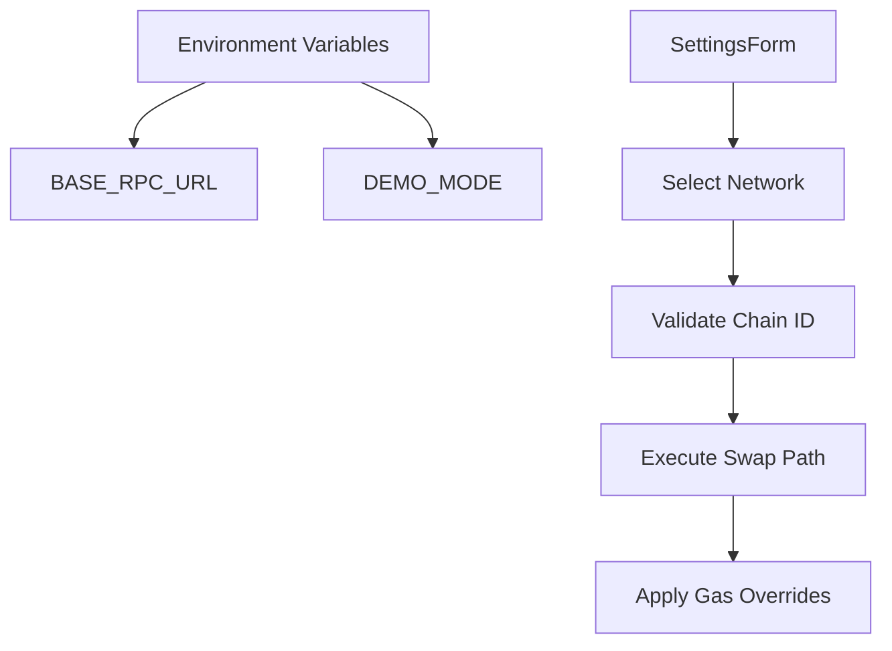
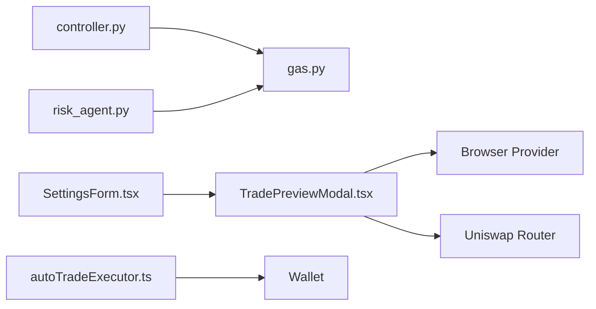

# Gas Estimation Service

<cite>
**Referenced Files in This Document**
- [gas.py](file://backend/app/services/gas.py)
- [controller.py](file://backend/app/agents/controller.py)
- [risk_agent.py](file://backend/app/agents/risk_agent.py)
- [config.py](file://backend/app/core/config.py)
- [README.md](file://README.md)
- [TradePreviewModal.tsx](file://frontend/components/TradePreviewModal.tsx)
- [autoTradeExecutor.ts](file://frontend/lib/autoTradeExecutor.ts)
- [SettingsForm.tsx](file://frontend/components/SettingsForm.tsx)
- [config.ts](file://frontend/constants/config.ts)
</cite>

## Table of Contents
1. [Introduction](#introduction)
2. [Project Structure](#project-structure)
3. [Core Components](#core-components)
4. [Architecture Overview](#architecture-overview)
5. [Detailed Component Analysis](#detailed-component-analysis)
6. [Dependency Analysis](#dependency-analysis)
7. [Performance Considerations](#performance-considerations)
8. [Troubleshooting Guide](#troubleshooting-guide)
9. [Conclusion](#conclusion)

## Introduction
This document explains the gas price estimation service for the Base network and how it integrates into trade proposal generation, risk checks, and user-facing cost displays. The backend fetches current gas prices from a Base RPC endpoint, caches them, converts them to USD estimates using an ETH price, and feeds those values into the risk layer. The frontend estimates gas costs for Uniswap swaps on Base, allows manual gas price overrides, and shows estimated network fees during trade previews and after execution.

## Project Structure
The gas estimation feature spans both backend and frontend:
- Backend:
  - `backend/app/services/gas.py` provides gas price fetching and USD conversion utilities.
  - `backend/app/agents/controller.py` calls the gas service during the agent loop.
  - `backend/app/agents/risk_agent.py` uses gas estimates to enforce safety rules.
  - `backend/app/core/config.py` loads environment variables (including demo mode).
- Frontend:
  - `frontend/components/TradePreviewModal.tsx` estimates gas for quotes and displays network fee estimates.
  - `frontend/lib/autoTradeExecutor.ts` executes automated swaps on Base with chain validation.
  - `frontend/components/SettingsForm.tsx` lets users select networks including Base.
  - `frontend/constants/config.ts` defines frontend configuration constants.



**Diagram sources**
- [gas.py:12-59](file://backend/app/services/gas.py#L12-L59)
- [controller.py:590-635](file://backend/app/agents/controller.py#L590-L635)
- [risk_agent.py:24-51](file://backend/app/agents/risk_agent.py#L24-L51)
- [TradePreviewModal.tsx:559-567](file://frontend/components/TradePreviewModal.tsx#L559-L567)
- [TradePreviewModal.tsx:1625-1655](file://frontend/components/TradePreviewModal.tsx#L1625-L1655)
- [autoTradeExecutor.ts:45-66](file://frontend/lib/autoTradeExecutor.ts#L45-L66)
- [SettingsForm.tsx:93-113](file://frontend/components/SettingsForm.tsx#L93-L113)
- [config.ts:1-8](file://frontend/constants/config.ts#L1-L8)

**Section sources**
- [README.md:116-144](file://README.md#L116-L144)
- [config.py:1-17](file://backend/app/core/config.py#L1-L17)

## Core Components
- Gas price fetching and caching:
  - Fetches `eth_gasPrice` from Base RPC via HTTP POST JSON-RPC.
  - Caches results for 60 seconds.
  - Validates returned gas price range; falls back to a conservative value on errors.
- USD gas cost calculation:
  - Converts gwei and gas limit to USD using ETH price.
- Risk integration:
  - Uses gas estimate to cap gas price and ensure gas cost is within acceptable profit ratio.
- Frontend gas estimation:
  - Estimates gas for V2/V3/Aerodrome paths using provider fee data.
  - Displays estimated network fee in ETH and supports manual gas price override.
  - Enforces Base chain ID for auto-trade execution.

**Section sources**
- [gas.py:12-59](file://backend/app/services/gas.py#L12-L59)
- [risk_agent.py:24-51](file://backend/app/agents/risk_agent.py#L24-L51)
- [TradePreviewModal.tsx:559-567](file://frontend/components/TradePreviewModal.tsx#L559-L567)
- [TradePreviewModal.tsx:1625-1655](file://frontend/components/TradePreviewModal.tsx#L1625-L1655)
- [autoTradeExecutor.ts:45-66](file://frontend/lib/autoTradeExecutor.ts#L45-L66)

## Architecture Overview
The system combines backend gas price retrieval with frontend transaction simulation to provide accurate cost estimates for trades on Base.



**Diagram sources**
- [controller.py:590-635](file://backend/app/agents/controller.py#L590-L635)
- [gas.py:27-59](file://backend/app/services/gas.py#L27-L59)
- [risk_agent.py:24-51](file://backend/app/agents/risk_agent.py#L24-L51)
- [TradePreviewModal.tsx:559-567](file://frontend/components/TradePreviewModal.tsx#L559-L567)
- [TradePreviewModal.tsx:1611-1655](file://frontend/components/TradePreviewModal.tsx#L1611-L1655)

## Detailed Component Analysis

### Backend Gas Price Service
Responsibilities:
- Read `BASE_RPC_URL` from environment; default to Base mainnet.
- Cache gas price for 60 seconds.
- Validate gas price range and return fallback on failure.
- Provide USD conversion utility for gas cost estimation.

Key behaviors:
- HTTP POST to JSON-RPC `eth_gasPrice`.
- Parses hex result to wei, converts to gwei.
- Applies conservative fallback when RPC fails or returns implausible values.



**Diagram sources**
- [gas.py:12-59](file://backend/app/services/gas.py#L12-L59)

**Section sources**
- [gas.py:12-59](file://backend/app/services/gas.py#L12-L59)

### Risk Agent Integration
Responsibilities:
- Compute USD gas cost using gas gwei, fixed gas limit, and ETH price.
- Enforce maximum gas price cap.
- Ensure gas cost does not exceed a percentage of expected profit.
- Include gas-related fields in risk assessment output.

Key behaviors:
- Default gas limit set in code.
- ETH price sourced from market prices or fallback.
- Checks include confidence, position sizing, min profit, and gas vs profit ratio.



**Diagram sources**
- [risk_agent.py:24-51](file://backend/app/agents/risk_agent.py#L24-L51)
- [risk_agent.py:71-79](file://backend/app/agents/risk_agent.py#L71-L79)
- [risk_agent.py:150-174](file://backend/app/agents/risk_agent.py#L150-L174)

**Section sources**
- [risk_agent.py:24-51](file://backend/app/agents/risk_agent.py#L24-L51)
- [risk_agent.py:71-79](file://backend/app/agents/risk_agent.py#L71-L79)
- [risk_agent.py:150-174](file://backend/app/agents/risk_agent.py#L150-L174)

### Controller Loop Integration
Responsibilities:
- Fetch live gas price before generating proposals.
- Pass gas gwei to risk agent for validation.
- Continue proposal creation if risk checks pass.

Key behaviors:
- Calls gas service once per analysis cycle.
- Computes available cash including ETH/WETH valuation.
- Logs and persists state around proposal creation.

```mermaid
sequenceDiagram
participant Loop as "Controller Loop"
participant Gas as "get_gas_price_gwei"
participant Risk as "RiskAgent.validate"
participant Exec as "ExecutionAgent.create_proposal"
Loop->>Gas : fetch gas_gwei
Gas-->>Loop : gas_gwei
Loop->>Risk : validate(rec, gas_gwei, ...)
Risk-->>Loop : RiskAssessment(approved, estimated_gas_usd)
alt Approved
Loop->>Exec : create_proposal(...)
Exec-->>Loop : Proposal
else Rejected
Loop->>Loop : skip proposal
end
```

**Diagram sources**
- [controller.py:590-635](file://backend/app/agents/controller.py#L590-L635)

**Section sources**
- [controller.py:590-635](file://backend/app/agents/controller.py#L590-L635)

### Frontend Trade Preview and Execution
Responsibilities:
- Estimate gas cost for quotes using provider fee data.
- Display estimated network fee in ETH.
- Allow manual gas price override and apply EIP-1559 or legacy overrides.
- Enforce Base chain ID for auto-trade execution.

Key behaviors:
- For V3 and Aerodrome quotes, compute estimated gas and multiply by feeData.gasPrice.
- During swap execution, set gasLimit and optional gas price overrides.
- Auto-trade executor validates chainId equals Base and constructs transactions accordingly.



**Diagram sources**
- [TradePreviewModal.tsx:559-567](file://frontend/components/TradePreviewModal.tsx#L559-L567)
- [TradePreviewModal.tsx:1611-1655](file://frontend/components/TradePreviewModal.tsx#L1611-L1655)

**Section sources**
- [TradePreviewModal.tsx:559-567](file://frontend/components/TradePreviewModal.tsx#L559-L567)
- [TradePreviewModal.tsx:1611-1655](file://frontend/components/TradePreviewModal.tsx#L1611-L1655)
- [autoTradeExecutor.ts:45-66](file://frontend/lib/autoTradeExecutor.ts#L45-L66)

### Network Configuration and Strategy Options
- Environment configuration:
  - `BASE_RPC_URL` controls the RPC endpoint used for gas price fetching; defaults to Base mainnet.
  - Demo mode toggles are loaded from environment variables.
- Frontend network selection:
  - Users can switch between Sepolia, Ethereum Mainnet, Base, and Arbitrum.
  - Chain IDs are validated against expected values for each network.
- Gas price strategy options:
  - Backend uses live gas price with a hard cap enforced by guardrails.
  - Frontend allows manual gas price override in Gwei; if provided, applies EIP-1559 or legacy overrides.
  - No explicit slow/average/fast presets are implemented; strategy is controlled by caps and user overrides.



**Diagram sources**
- [README.md:70-86](file://README.md#L70-L86)
- [SettingsForm.tsx:93-113](file://frontend/components/SettingsForm.tsx#L93-L113)
- [TradePreviewModal.tsx:998-1001](file://frontend/components/TradePreviewModal.tsx#L998-L1001)
- [TradePreviewModal.tsx:1639-1655](file://frontend/components/TradePreviewModal.tsx#L1639-L1655)

**Section sources**
- [README.md:70-86](file://README.md#L70-L86)
- [config.py:1-17](file://backend/app/core/config.py#L1-L17)
- [SettingsForm.tsx:93-113](file://frontend/components/SettingsForm.tsx#L93-L113)
- [TradePreviewModal.tsx:998-1001](file://frontend/components/TradePreviewModal.tsx#L998-L1001)
- [TradePreviewModal.tsx:1639-1655](file://frontend/components/TradePreviewModal.tsx#L1639-L1655)

## Dependency Analysis
- Backend dependencies:
  - `controller.py` depends on `gas.py` to fetch live gas prices.
  - `risk_agent.py` depends on `gas.py` to compute USD gas cost.
- Frontend dependencies:
  - `TradePreviewModal.tsx` depends on browser provider and Uniswap router for quoting and execution.
  - `autoTradeExecutor.ts` enforces Base chain ID and interacts with wallet for signing.
  - `SettingsForm.tsx` manages network selection which affects token lists and chain validation.



**Diagram sources**
- [controller.py:590-635](file://backend/app/agents/controller.py#L590-L635)
- [risk_agent.py:24-51](file://backend/app/agents/risk_agent.py#L24-L51)
- [gas.py:12-59](file://backend/app/services/gas.py#L12-L59)
- [TradePreviewModal.tsx:559-567](file://frontend/components/TradePreviewModal.tsx#L559-L567)
- [autoTradeExecutor.ts:45-66](file://frontend/lib/autoTradeExecutor.ts#L45-L66)
- [SettingsForm.tsx:93-113](file://frontend/components/SettingsForm.tsx#L93-L113)

**Section sources**
- [controller.py:590-635](file://backend/app/agents/controller.py#L590-L635)
- [risk_agent.py:24-51](file://backend/app/agents/risk_agent.py#L24-L51)
- [gas.py:12-59](file://backend/app/services/gas.py#L12-L59)
- [TradePreviewModal.tsx:559-567](file://frontend/components/TradePreviewModal.tsx#L559-L567)
- [autoTradeExecutor.ts:45-66](file://frontend/lib/autoTradeExecutor.ts#L45-L66)
- [SettingsForm.tsx:93-113](file://frontend/components/SettingsForm.tsx#L93-L113)

## Performance Considerations
- Gas price caching reduces RPC load and latency; cache duration is 60 seconds.
- Frontend gas estimation uses provider fee data for near-real-time pricing without additional backend calls.
- Fixed gas limits in risk agent simplify cost calculations; frontend uses conservative gas limits for tax tokens.
- Avoid unnecessary re-renders by updating gas estimates only when quote or fee data changes.

[No sources needed since this section provides general guidance]

## Troubleshooting Guide
Common issues and resolutions:
- RPC failures:
  - Backend logs warnings and falls back to cached or default gas price; check `BASE_RPC_URL` and network connectivity.
- Implausible gas prices:
  - Backend validates range; if out of bounds, fallback is used; verify upstream RPC behavior.
- Frontend gas estimation missing:
  - Ensure provider has fee data; handle cases where `feeData.gasPrice` is unavailable.
- Transaction nonce errors:
  - Frontend handles specific nonce parsing errors and assumes success when appropriate; monitor receipts and logs.
- Chain mismatch:
  - Auto-trade requires Base chain ID; ensure wallet is connected to correct network.

**Section sources**
- [gas.py:41-59](file://backend/app/services/gas.py#L41-L59)
- [TradePreviewModal.tsx:1710-1740](file://frontend/components/TradePreviewModal.tsx#L1710-L1740)
- [autoTradeExecutor.ts:57-66](file://frontend/lib/autoTradeExecutor.ts#L57-L66)

## Conclusion
The gas estimation service integrates live Base RPC gas prices with risk checks and frontend trade previews to deliver accurate cost estimates for Uniswap swaps. It employs caching, fallback mechanisms, and user-configurable gas overrides to balance reliability and performance. The frontend complements this by estimating gas costs locally and enforcing Base chain constraints during execution. Together, these components provide robust gas-aware trading workflows suitable for production use on Base.

[No sources needed since this section summarizes without analyzing specific files]