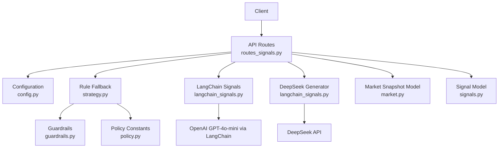
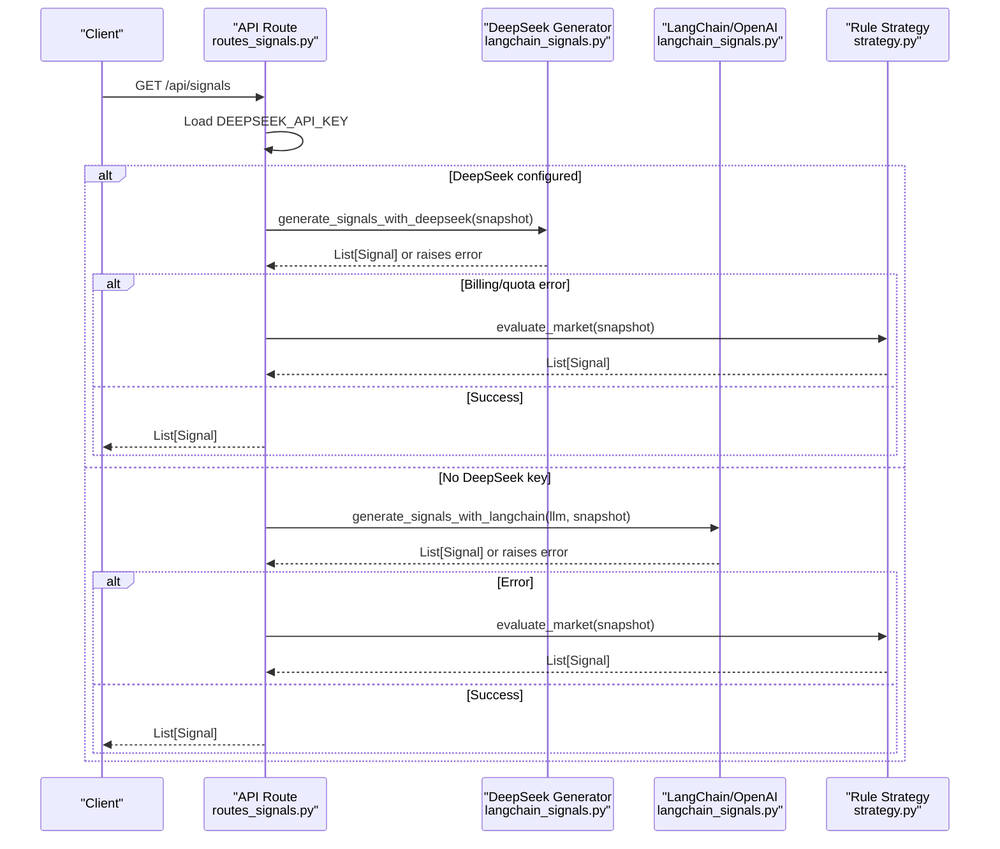
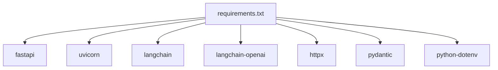

# LLM Integration

<cite>
**Referenced Files in This Document**
- [langchain_signals.py](file://backend/app/agents/langchain_signals.py)
- [routes_signals.py](file://backend/app/api/routes_signals.py)
- [config.py](file://backend/app/core/config.py)
- [signals.py](file://backend/app/models/signals.py)
- [market.py](file://backend/app/models/market.py)
- [strategy.py](file://backend/app/services/strategy.py)
- [guardrails.py](file://backend/app/services/guardrails.py)
- [policy.py](file://backend/app/services/policy.py)
- [analysis_agent.py](file://backend/app/agents/analysis_agent.py)
- [requirements.txt](file://backend/requirements.txt)
</cite>

## Table of Contents
1. [Introduction](#introduction)
2. [Project Structure](#project-structure)
3. [Core Components](#core-components)
4. [Architecture Overview](#architecture-overview)
5. [Detailed Component Analysis](#detailed-component-analysis)
6. [Dependency Analysis](#dependency-analysis)
7. [Performance Considerations](#performance-considerations)
8. [Troubleshooting Guide](#troubleshooting-guide)
9. [Conclusion](#conclusion)

## Introduction
This document explains how the system integrates Large Language Models to generate trading signals and how those signals flow into the agent pipeline. It covers:
- OpenAI GPT-4o-mini integration through LangChain
- Direct DeepSeek API calls
- Prompt engineering, response parsing, and confidence scoring
- API key configuration, fallback strategies, and cost optimization
- Integration with the rule-based analysis agent for human-readable rationale
- Safety guardrails, content filtering considerations, and rate limiting guidance

The goal is to make the signal generation pipeline transparent, safe, and production-ready while keeping costs predictable.

## Project Structure
The LLM signal pipeline lives primarily under the backend application:
- API route layer exposes a signals endpoint that orchestrates provider selection and fallbacks
- Agent layer implements two LLM-backed generators: one using LangChain with OpenAI, another calling DeepSeek directly
- Core configuration loads environment variables for API keys
- Models define structured outputs for market snapshots and signals
- Services provide deterministic rule-based fallback signals, safety guardrails, and shared policy constants
- The analysis agent provides detailed, human-readable trade rationale based on technical indicators and position state

**Diagram sources**
- [routes_signals.py:1-55](file://backend/app/api/routes_signals.py#L1-L55)
- [langchain_signals.py:1-123](file://backend/app/agents/langchain_signals.py#L1-L123)
- [config.py:1-17](file://backend/app/core/config.py#L1-L17)
- [strategy.py:1-39](file://backend/app/services/strategy.py#L1-L39)
- [market.py:1-42](file://backend/app/models/market.py#L1-L42)
- [signals.py:1-16](file://backend/app/models/signals.py#L1-L16)
- [guardrails.py:1-165](file://backend/app/services/guardrails.py#L1-L165)
- [policy.py:1-12](file://backend/app/services/policy.py#L1-L12)

**Section sources**
- [routes_signals.py:1-55](file://backend/app/api/routes_signals.py#L1-L55)
- [langchain_signals.py:1-123](file://backend/app/agents/langchain_signals.py#L1-L123)
- [config.py:1-17](file://backend/app/core/config.py#L1-L17)
- [strategy.py:1-39](file://backend/app/services/strategy.py#L1-L39)
- [market.py:1-42](file://backend/app/models/market.py#L1-L42)
- [signals.py:1-16](file://backend/app/models/signals.py#L1-L16)
- [guardrails.py:1-165](file://backend/app/services/guardrails.py#L1-L165)
- [policy.py:1-12](file://backend/app/services/policy.py#L1-L12)

## Core Components
- API signals route: selects provider, handles errors, and falls back to rules when needed
- LangChain OpenAI generator: builds a prompt chain, parses structured output, and tags signals
- DeepSeek direct generator: sends JSON-formatted requests and parses responses
- Rule-based strategy: deterministic fallback signals based on 24h price change
- Models: standardized structures for market data and signals
- Guardrails: portfolio-level circuit breakers and limits
- Policy: shared constants for auto-tradeable tokens and stablecoins
- Analysis agent: detailed rule-based recommendations with human-readable reasons

Key responsibilities:
- Provider orchestration and fallback are centralized in the signals route
- Structured output validation ensures consistent signal fields
- Deterministic fallback guarantees availability even when LLM providers fail or are unavailable
- Guardrails enforce risk controls independent of LLM suggestions

**Section sources**
- [routes_signals.py:1-55](file://backend/app/api/routes_signals.py#L1-L55)
- [langchain_signals.py:1-123](file://backend/app/agents/langchain_signals.py#L1-L123)
- [strategy.py:1-39](file://backend/app/services/strategy.py#L1-L39)
- [signals.py:1-16](file://backend/app/models/signals.py#L1-L16)
- [guardrails.py:1-165](file://backend/app/services/guardrails.py#L1-L165)
- [policy.py:1-12](file://backend/app/services/policy.py#L1-L12)

## Architecture Overview
The signal generation architecture combines LLM-driven analysis with deterministic safeguards:

**Diagram sources**
- [routes_signals.py:20-53](file://backend/app/api/routes_signals.py#L20-L53)
- [langchain_signals.py:40-123](file://backend/app/agents/langchain_signals.py#L40-L123)
- [strategy.py:8-38](file://backend/app/services/strategy.py#L8-L38)

## Detailed Component Analysis

### API Signals Route Orchestration
Responsibilities:
- Accepts a limit parameter and slices cached market pairs
- Builds a MarketSnapshot and routes to providers
- Implements fallback logic prioritizing DeepSeek, then OpenAI, then rules
- Treats billing/quota errors from DeepSeek as non-recoverable and skips OpenAI fallback

Behavior highlights:
- If DeepSeek key exists, attempt DeepSeek first; on specific billing/quota errors, skip OpenAI and use rules
- If OpenAI key exists, attempt LangChain/OpenAI; on any error, fall back to rules
- If no keys exist, return rule-based signals

Cost and reliability implications:
- Prioritizing DeepSeek can reduce costs if it is cheaper than OpenAI
- Explicit handling of 402/429/quota/payment prevents unnecessary OpenAI calls after billing failures
- Rule fallback ensures service continuity

**Section sources**
- [routes_signals.py:1-55](file://backend/app/api/routes_signals.py#L1-L55)

### LangChain OpenAI Signal Generation
Responsibilities:
- Build a prompt chain using LangChain with ChatOpenAI
- Use PydanticOutputParser to enforce structured JSON output
- Tag each signal with source and timestamp
- Limit input pairs to improve latency and cost

Prompt engineering approach:
- System role instructs the model to act as an expert crypto trading assistant
- User context includes serialized market data
- Format instructions ensure the model returns a list of signals with action, confidence, and reasoning

Response parsing:
- Parser validates structure against SignalList schema
- Each signal is cast to the Signal model, ensuring type safety

Confidence scoring:
- Confidence comes from the LLM’s own assessment (0.0 to 1.0)
- Source is set to "llm" and created_at is populated at runtime

Error handling:
- Exceptions are logged and re-raised so the caller can handle them

Optimization techniques:
- Truncating pairs to the first 10 reduces token usage and latency
- Temperature set to 0 for deterministic outputs

**Section sources**
- [langchain_signals.py:19-58](file://backend/app/agents/langchain_signals.py#L19-L58)
- [signals.py:1-16](file://backend/app/models/signals.py#L1-L16)

### DeepSeek Direct API Integration
Responsibilities:
- Send a structured request to DeepSeek’s chat completions endpoint
- Enforce JSON response format
- Parse and map the response to Signal objects

Prompt engineering approach:
- System prompt defines the assistant role and expected output structure
- User message includes serialized market data
- Response format is constrained to JSON object

Response parsing:
- Extracts choices[0].message.content and parses JSON
- Maps fields like pair/symbol, action, confidence, and reasoning/explanation
- Sets source to "deepseek" and created_at to current time

Error handling:
- HTTP errors are raised by raise_for_status
- Parsing errors propagate up to the caller

Rate limiting and timeouts:
- Async client uses a 60-second timeout
- Production should add retry/backoff and rate-limit awareness around this call

**Section sources**
- [langchain_signals.py:61-123](file://backend/app/agents/langchain_signals.py#L61-L123)

### Rule-Based Strategy Fallback
Responsibilities:
- Generate deterministic signals based on 24h price change thresholds
- Assign confidence levels and explanations
- Mark signals as rule-based

Logic overview:
- If 24h change >= +10%: sell with higher confidence
- If 24h change <= -10%: buy with higher confidence
- Otherwise: hold with lower confidence

Use cases:
- Fallback when LLM providers are unavailable or fail
- Baseline signals when no API keys are configured

**Section sources**
- [strategy.py:1-39](file://backend/app/services/strategy.py#L1-L39)

### Models: Signals and Market Snapshots
Signals:
- Fields include pair, action, confidence, explanation, source, and created_at
- Action is restricted to buy/sell/hold
- Source distinguishes between llm, rules, and deepseek

Market snapshot:
- Contains a list of TradingPair objects with price, change_24h, volume, and metadata
- Used to serialize market context for LLM prompts

**Section sources**
- [signals.py:1-16](file://backend/app/models/signals.py#L1-L16)
- [market.py:1-42](file://backend/app/models/market.py#L1-L42)

### Guardrails and Policy
Guardrails:
- Portfolio-level circuit breakers including daily drawdown limits, per-token trade caps, and kill switch
- Track trades today, peak equity, and halt status
- Provide status reporting and persistence helpers

Policy:
- Shared constants for auto-tradeable targets and stablecoins
- Utility function to check if a symbol is auto-tradeable

Integration points:
- Guardrails operate independently of strategy and can block execution regardless of LLM suggestions
- Policy informs which tokens are eligible for automated actions

**Section sources**
- [guardrails.py:1-165](file://backend/app/services/guardrails.py#L1-L165)
- [policy.py:1-12](file://backend/app/services/policy.py#L1-L12)

### Analysis Agent for Human-Readable Rationale
Responsibilities:
- Produce detailed, rule-based recommendations with human-readable reasons
- Incorporate technical indicators (RSI, VWAP, volume spike) when available
- Manage position states, exits (stop-loss, trailing stop, take-profit ladder), and dip buys
- Cap confidence values and annotate indicator readiness

Human-readable rationale:
- Reasons explain dips, indicator conditions, and exit triggers
- Recommendations include actionable details like sell fractions and gain percentages

Integration with LLM signals:
- While not directly invoked by the LLM generators, the analysis agent complements LLM outputs by providing robust, interpretable trade rationales grounded in market history and position state

**Section sources**
- [analysis_agent.py:1-349](file://backend/app/agents/analysis_agent.py#L1-L349)

## Dependency Analysis
External dependencies relevant to LLM integration:
- FastAPI and Uvicorn for the web server
- LangChain and langchain-openai for OpenAI integration
- httpx for asynchronous HTTP requests to DeepSeek
- Pydantic for data validation
- python-dotenv for loading environment variables

**Diagram sources**
- [requirements.txt:1-9](file://backend/requirements.txt#L1-L9)

**Section sources**
- [requirements.txt:1-9](file://backend/requirements.txt#L1-L9)

## Performance Considerations
- Token cost control:
  - Truncate market pairs to a fixed number before sending to LLMs
  - Use temperature 0 for deterministic outputs
  - Prefer structured JSON responses to minimize retries
- Latency optimization:
  - Use async HTTP clients for external API calls
  - Keep prompts concise and focused on essential market data
- Reliability:
  - Implement retries with exponential backoff for transient network errors
  - Add circuit breakers around external LLM calls to prevent cascading failures
- Observability:
  - Log provider selection, latency, token usage, and error codes
  - Track confidence distributions and signal sources for monitoring

[No sources needed since this section provides general guidance]

## Troubleshooting Guide
Common issues and resolutions:
- Missing API keys:
  - Ensure OPENAI_API_KEY and/or DEEPSEEK_API_KEY are set in environment variables
  - Verify .env file is loaded correctly
- DeepSeek billing or quota errors:
  - Errors containing 402, 429, quota, or payment keywords will skip OpenAI fallback and use rules
  - Review account billing status and quotas
- OpenAI errors:
  - Any exception during LangChain/OpenAI invocation falls back to rules
  - Check API key validity and model availability
- Parsing failures:
  - Ensure LLM responses conform to expected JSON structure
  - Validate field names like pair/symbol, action, confidence, and reasoning/explanation
- Rate limiting:
  - Add client-side throttling and retry logic with backoff
  - Monitor provider dashboards for rate limit warnings

Safety and content filtering:
- The current implementation does not include explicit content filters for LLM outputs
- For production, consider adding post-processing validators to reject unsafe or malformed signals
- Integrate guardrails to prevent risky executions even if LLM suggests aggressive actions

**Section sources**
- [routes_signals.py:28-53](file://backend/app/api/routes_signals.py#L28-L53)
- [langchain_signals.py:86-123](file://backend/app/agents/langchain_signals.py#L86-L123)
- [guardrails.py:1-165](file://backend/app/services/guardrails.py#L1-L165)

## Conclusion
The LLM integration provides flexible signal generation through OpenAI GPT-4o-mini via LangChain and direct DeepSeek API calls, with robust fallback to deterministic rules. Prompt engineering emphasizes structured outputs and clear reasoning, while confidence scores reflect both LLM assessments and rule-based heuristics. Configuration is environment-driven, and fallback strategies ensure resilience. For production, add rate limiting, retries, observability, and content filtering to complement existing guardrails and policy controls.

[No sources needed since this section summarizes without analyzing specific files]