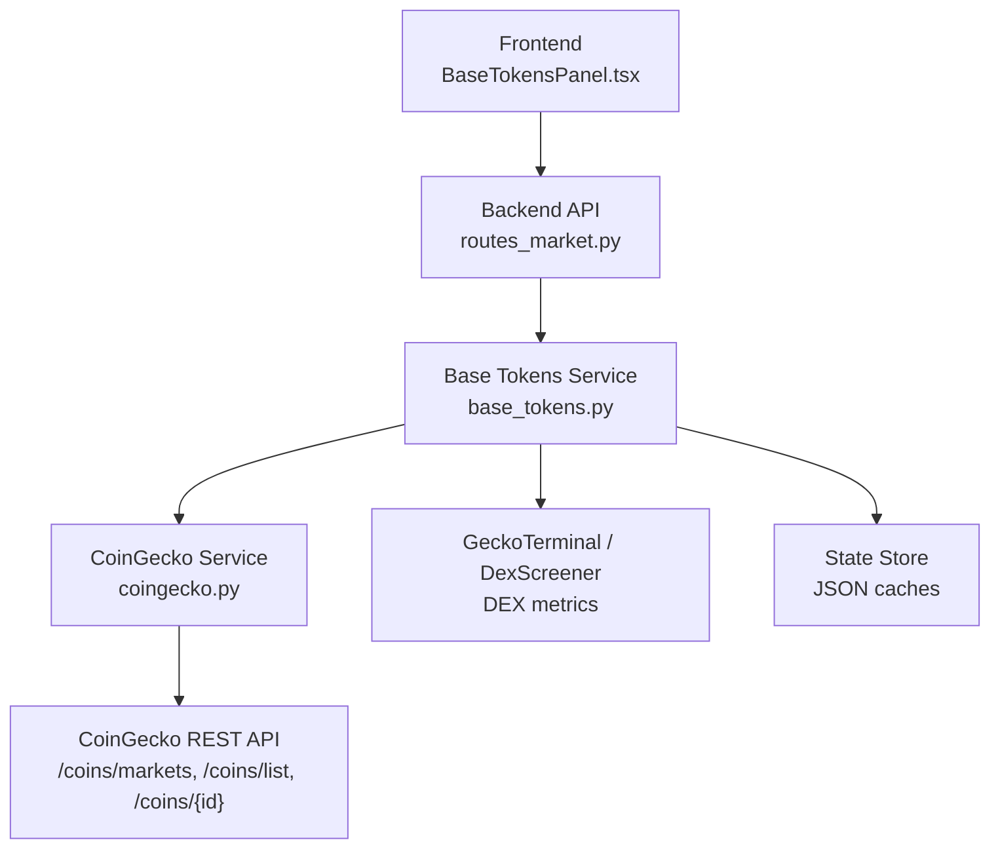
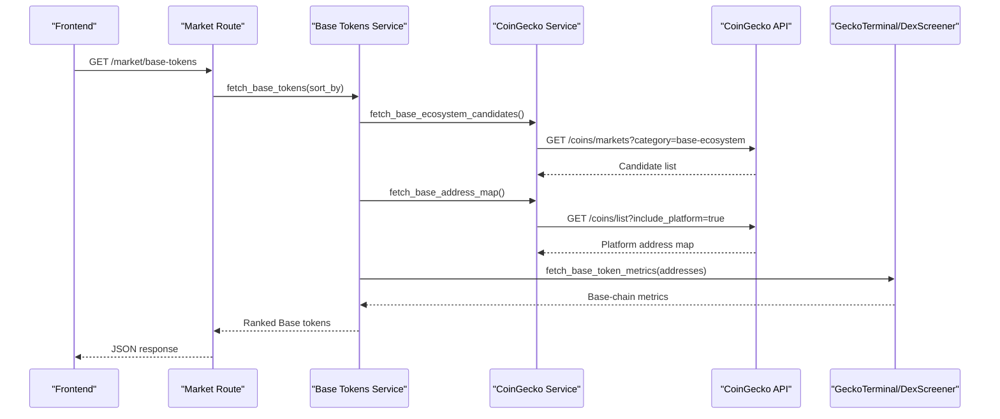
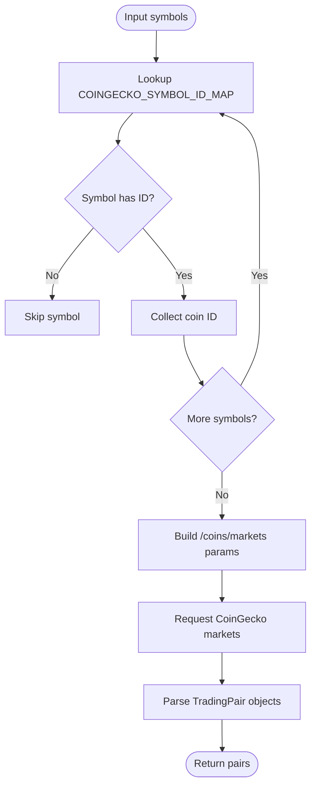
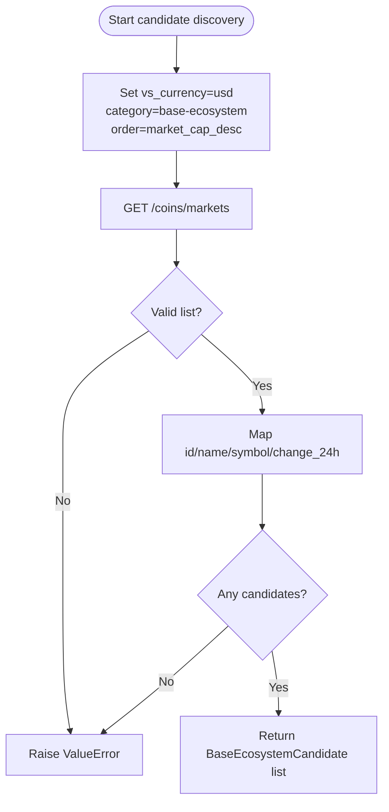
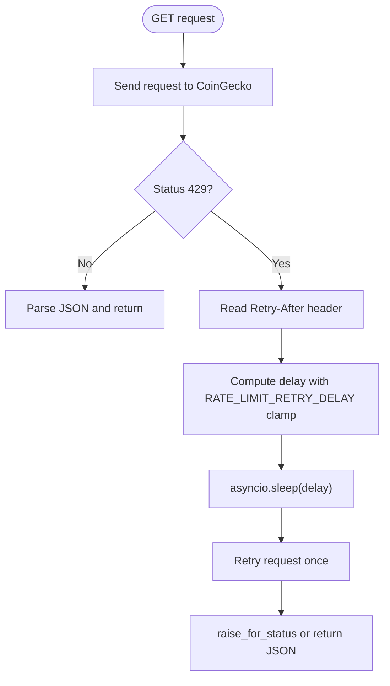
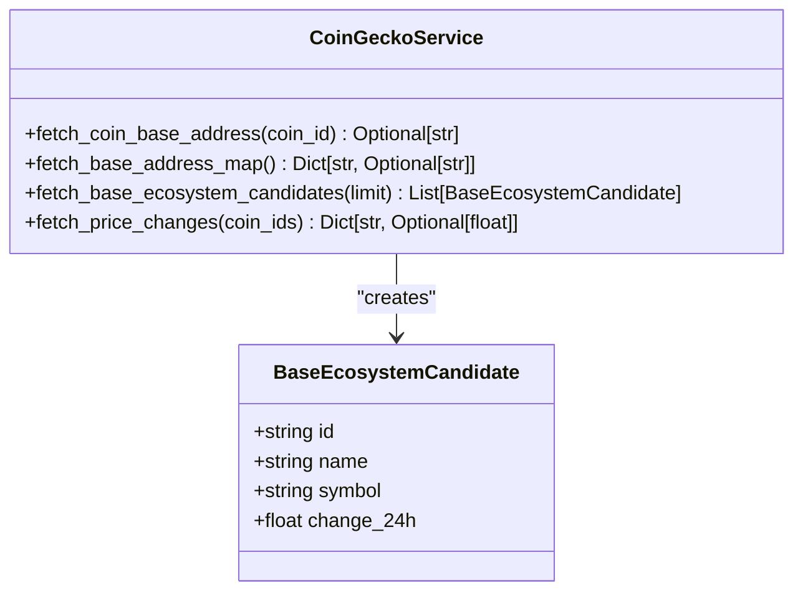
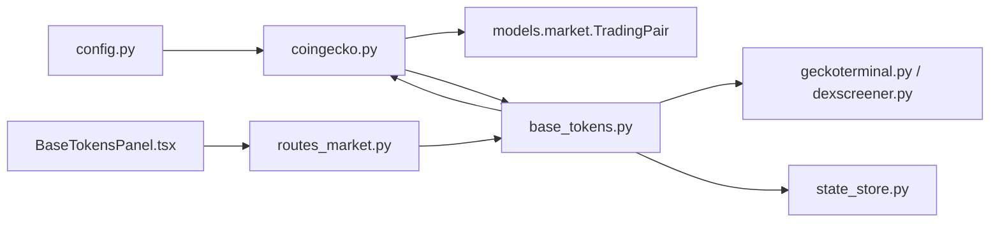

# CoinGecko API Integration

<cite>
**Referenced Files in This Document**
- [coingecko.py](file://backend/app/services/coingecko.py)
- [base_tokens.py](file://backend/app/services/base_tokens.py)
- [config.py](file://backend/app/core/config.py)
- [routes_market.py](file://backend/app/api/routes_market.py)
- [BaseTokensPanel.tsx](file://frontend/components/BaseTokensPanel.tsx)
- [test_base_market.py](file://backend/test_base_market.py)
</cite>

## Table of Contents
1. [Introduction](#introduction)
2. [Project Structure](#project-structure)
3. [Core Components](#core-components)
4. [Architecture Overview](#architecture-overview)
5. [Detailed Component Analysis](#detailed-component-analysis)
6. [Dependency Analysis](#dependency-analysis)
7. [Performance Considerations](#performance-considerations)
8. [Troubleshooting Guide](#troubleshooting-guide)
9. [Conclusion](#conclusion)

## Introduction
This document explains the CoinGecko API integration used by the project to obtain market data, map trading symbols to stable CoinGecko identifiers, discover Base ecosystem tokens, resolve Base chain contract addresses, and handle rate limiting safely. It also covers demo API key configuration, error handling strategies, and caching approaches for large-scale token queries.

The integration is primarily implemented in the backend service layer and consumed through API routes that expose market and Base token endpoints to the frontend.

## Project Structure
The relevant parts of the codebase are organized as follows:

- Backend service layer:
  - `backend/app/services/coingecko.py`: Core CoinGecko HTTP client, symbol mapping, rate-limited requests, Base address resolution, and price change fetching.
  - `backend/app/services/base_tokens.py`: Candidate discovery, Base address resolution with caching, and ranking logic combining CoinGecko and DEX metrics providers.
  - `backend/app/core/config.py`: Environment-based configuration, including the optional CoinGecko demo API key.
- API layer:
  - `backend/app/api/routes_market.py`: Exposes market and Base token endpoints to the frontend.
- Frontend:
  - `frontend/components/BaseTokensPanel.tsx`: UI component that fetches and displays Base ecosystem tokens.

**Diagram sources**
- [BaseTokensPanel.tsx:34-57](file://frontend/components/BaseTokensPanel.tsx#L34-L57)
- [routes_market.py](file://backend/app/api/routes_market.py)
- [base_tokens.py:315-320](file://backend/app/services/base_tokens.py#L315-L320)
- [coingecko.py:11-174](file://backend/app/services/coingecko.py#L11-L174)

**Section sources**
- [coingecko.py:1-303](file://backend/app/services/coingecko.py#L1-L303)
- [base_tokens.py:1-321](file://backend/app/services/base_tokens.py#L1-L321)
- [config.py:1-17](file://backend/app/core/config.py#L1-L17)
- [BaseTokensPanel.tsx:1-144](file://frontend/components/BaseTokensPanel.tsx#L1-L144)

## Core Components
This section summarizes the main responsibilities of each core module involved in the CoinGecko integration.

- Symbol-to-ID mapping:
  - `COINGECKO_SYMBOL_ID_MAP` maps human-readable trading symbols such as BTC, ETH, USDC, AERO, DEGEN, and others to stable CoinGecko coin IDs.
  - Used when converting a list of trading symbols into CoinGecko-compatible IDs before calling `/coins/markets`.

- Base ecosystem candidate discovery:
  - `fetch_base_ecosystem_candidates` calls `/coins/markets` with `category=base-ecosystem`, returning top candidates ranked by global market cap.
  - These candidates form a pool; actual Base-chain metrics are resolved later via GeckoTerminal or DexScreener.

- Rate limiting and retry logic:
  - `_get_json` retries once on HTTP 429 responses.
  - `_retry_delay` reads the `Retry-After` header and clamps delays between zero and `MAX_RETRY_AFTER`.
  - `RATE_LIMIT_RETRY_DELAY` provides a default delay when no header is present.

- Base chain address resolution:
  - `fetch_coin_base_address` resolves a single coin’s Base contract address from its detail endpoint.
  - `fetch_base_address_map` fetches the full catalogue with platform addresses in one request, avoiding per-coin detail calls.

- Price changes:
  - `fetch_price_changes` returns 24-hour percentage changes for a list of CoinGecko coin IDs using `/coins/markets`.

- Demo API key configuration:
  - The optional `COINGECKO_API_KEY` environment variable is read from configuration and attached as the `x-cg-demo-api-key` header.

**Section sources**
- [coingecko.py:18-66](file://backend/app/services/coingecko.py#L18-L66)
- [coingecko.py:155-174](file://backend/app/services/coingecko.py#L155-L174)
- [coingecko.py:226-302](file://backend/app/services/coingecko.py#L226-L302)
- [coingecko.py:250-269](file://backend/app/services/coingecko.py#L250-L269)
- [config.py:9-10](file://backend/app/core/config.py#L9-L10)

## Architecture Overview
The integration follows a layered architecture:

1. Frontend requests Base tokens through a backend route.
2. The backend service composes data from:
   - CoinGecko for candidate discovery, price changes, and Base address metadata.
   - GeckoTerminal or DexScreener for Base-chain DEX metrics.
3. Address resolution uses a two-tier strategy:
   - A bulk platform map fetched once per TTL.
   - Per-coin fallback for unknown IDs.
4. Rate limiting is handled at the CoinGecko HTTP layer with a polite retry.

**Diagram sources**
- [BaseTokensPanel.tsx:34-57](file://frontend/components/BaseTokensPanel.tsx#L34-L57)
- [base_tokens.py:189-228](file://backend/app/services/base_tokens.py#L189-L228)
- [coingecko.py:185-223](file://backend/app/services/coingecko.py#L185-L223)
- [coingecko.py:272-302](file://backend/app/services/coingecko.py#L272-L302)

## Detailed Component Analysis

### Symbol-to-ID Mapping System
The symbol-to-ID mapping system converts trading symbols into stable CoinGecko coin identifiers. This mapping is essential because CoinGecko endpoints require canonical coin IDs rather than exchange-specific symbols.

Key behaviors:
- `COINGECKO_SYMBOL_ID_MAP` contains mappings for major assets and several Base ecosystem tokens.
- `fetch_coingecko_pairs` filters out unsupported symbols and builds an ID list for batch querying.
- Unsupported symbols are silently skipped, returning an empty result if none are mapped.

**Diagram sources**
- [coingecko.py:18-66](file://backend/app/services/coingecko.py#L18-L66)
- [coingecko.py:69-111](file://backend/app/services/coingecko.py#L69-L111)

**Section sources**
- [coingecko.py:18-66](file://backend/app/services/coingecko.py#L18-L66)
- [coingecko.py:69-111](file://backend/app/services/coingecko.py#L69-L111)

### Base Ecosystem Candidate Discovery
Base ecosystem candidate discovery uses CoinGecko’s category filtering to assemble a candidate pool of tokens associated with the Base ecosystem.

Important details:
- Endpoint: `/coins/markets`
- Category: `base-ecosystem`
- Ordering: global market cap descending
- Limit: configurable, defaulting to a candidate pool size
- Sparkline data is disabled to reduce payload size

The returned candidates include CoinGecko identity fields and global 24-hour price change. Actual Base-chain metrics are resolved separately.

**Diagram sources**
- [coingecko.py:185-223](file://backend/app/services/coingecko.py#L185-L223)

**Section sources**
- [coingecko.py:185-223](file://backend/app/services/coingecko.py#L185-L223)
- [base_tokens.py:189-228](file://backend/app/services/base_tokens.py#L189-L228)

### Rate Limiting and Retry Logic
Rate limiting is implemented around CoinGecko HTTP requests to avoid long UI hangs and respect provider constraints.

Core elements:
- `RATE_LIMIT_RETRY_DELAY`: default delay when no `Retry-After` header is provided.
- `MAX_RETRY_AFTER`: maximum allowed retry delay.
- `_retry_delay(response)`: extracts and clamps the delay value.
- `_get_json(client, path, params)`: performs a GET request and retries once on HTTP 429.

**Diagram sources**
- [coingecko.py:13-16](file://backend/app/services/coingecko.py#L13-L16)
- [coingecko.py:155-174](file://backend/app/services/coingecko.py#L155-L174)

**Section sources**
- [coingecko.py:13-16](file://backend/app/services/coingecko.py#L13-L16)
- [coingecko.py:155-174](file://backend/app/services/coingecko.py#L155-L174)

### Base Chain Address Resolution Methods
Address resolution supports both single-coin and bulk scenarios:

- `fetch_coin_base_address(coin_id)`:
  - Calls `/coins/{coin_id}` with minimal fields.
  - Extracts the Base platform address if present and valid.
  - Returns `None` when no Base deployment exists.

- `fetch_base_address_map()`:
  - Calls `/coins/list?include_platform=true`.
  - Builds a dictionary mapping every CoinGecko coin ID to its Base address or `None`.
  - Designed to avoid per-coin detail calls that can trigger rate limits.

**Diagram sources**
- [coingecko.py:177-183](file://backend/app/services/coingecko.py#L177-L183)
- [coingecko.py:226-247](file://backend/app/services/coingecko.py#L226-L247)
- [coingecko.py:272-302](file://backend/app/services/coingecko.py#L272-L302)

**Section sources**
- [coingecko.py:226-247](file://backend/app/services/coingecko.py#L226-L247)
- [coingecko.py:272-302](file://backend/app/services/coingecko.py#L272-L302)

### Examples of Common Operations

#### Fetching Trading Pairs
To fetch trading pairs:
- Provide a list of supported symbols.
- The service maps them to CoinGecko IDs.
- It calls `/coins/markets` with the target currency.
- It parses results into `TradingPair` objects containing price, 24-hour change, volume, and CoinGecko URL.

Reference paths:
- [coingecko.py:69-111](file://backend/app/services/coingecko.py#L69-L111)
- [coingecko.py:114-135](file://backend/app/services/coingecko.py#L114-L135)

#### Fetching Price Changes
To fetch 24-hour price changes:
- Provide a list of CoinGecko coin IDs.
- The service calls `/coins/markets` with those IDs.
- It returns a dictionary mapping coin IDs to their 24-hour percentage change.

Reference paths:
- [coingecko.py:250-269](file://backend/app/services/coingecko.py#L250-L269)

#### Discovering Base Ecosystem Tokens
To discover Base ecosystem tokens:
- Use `fetch_base_ecosystem_candidates` to get a candidate pool filtered by the Base ecosystem category.
- Resolve Base addresses using the platform map or per-coin fallback.
- Combine with DEX metrics from GeckoTerminal or DexScreener.
- Rank by FDV or 24-hour volume depending on the requested sort mode.

Reference paths:
- [coingecko.py:185-223](file://backend/app/services/coingecko.py#L185-L223)
- [base_tokens.py:189-228](file://backend/app/services/base_tokens.py#L189-L228)
- [base_tokens.py:270-312](file://backend/app/services/base_tokens.py#L270-L312)

**Section sources**
- [coingecko.py:69-135](file://backend/app/services/coingecko.py#L69-L135)
- [coingecko.py:250-269](file://backend/app/services/coingecko.py#L250-L269)
- [coingecko.py:185-223](file://backend/app/services/coingecko.py#L185-L223)
- [base_tokens.py:189-228](file://backend/app/services/base_tokens.py#L189-L228)
- [base_tokens.py:270-312](file://backend/app/services/base_tokens.py#L270-L312)

### Demo API Key Configuration
The demo API key is configured through the `COINGECKO_API_KEY` environment variable. When present, it is attached as the `x-cg-demo-api-key` header on CoinGecko requests.

Key points:
- The header name uses hyphens, not underscores, because CoinGecko’s CDN drops underscore variants.
- If the key is absent, requests proceed anonymously but may be subject to stricter rate limits.
- Tests verify that the header is included and that the key does not leak into URLs.

Configuration reference:
- [config.py:9-10](file://backend/app/core/config.py#L9-L10)
- [coingecko.py:85-90](file://backend/app/services/coingecko.py#L85-L90)
- [coingecko.py:148-152](file://backend/app/services/coingecko.py#L148-L152)
- [test_base_market.py:281-284](file://backend/test_base_market.py#L281-L284)

**Section sources**
- [config.py:9-10](file://backend/app/core/config.py#L9-L10)
- [coingecko.py:85-90](file://backend/app/services/coingecko.py#L85-L90)
- [coingecko.py:148-152](file://backend/app/services/coingecko.py#L148-L152)
- [test_base_market.py:281-284](file://backend/test_base_market.py#L281-L284)

### Error Handling Strategies
Error handling is applied at multiple layers:

- CoinGecko HTTP layer:
  - Non-200 responses are logged.
  - Exceptions during network calls are caught and printed.
  - HTTP 429 triggers a single retry after respecting `Retry-After`.

- Data validation:
  - Invalid payloads raise `ValueError` with descriptive messages.
  - Missing or malformed fields cause early rejection of invalid entries.

- Provider resilience:
  - GeckoTerminal failures fall back to DexScreener.
  - CoinGecko enrichment failures do not break the Base token ranking.

Reference paths:
- [coingecko.py:100-111](file://backend/app/services/coingecko.py#L100-L111)
- [coingecko.py:155-174](file://backend/app/services/coingecko.py#L155-L174)
- [coingecko.py:203-223](file://backend/app/services/coingecko.py#L203-L223)
- [base_tokens.py:173-186](file://backend/app/services/base_tokens.py#L173-L186)
- [base_tokens.py:304-312](file://backend/app/services/base_tokens.py#L304-L312)

**Section sources**
- [coingecko.py:100-111](file://backend/app/services/coingecko.py#L100-L111)
- [coingecko.py:155-174](file://backend/app/services/coingecko.py#L155-L174)
- [coingecko.py:203-223](file://backend/app/services/coingecko.py#L203-L223)
- [base_tokens.py:173-186](file://backend/app/services/base_tokens.py#L173-L186)
- [base_tokens.py:304-312](file://backend/app/services/base_tokens.py#L304-L312)

## Dependency Analysis
The following diagram shows how the modules depend on each other:

**Diagram sources**
- [config.py:9-10](file://backend/app/core/config.py#L9-L10)
- [coingecko.py:7-8](file://backend/app/services/coingecko.py#L7-L8)
- [base_tokens.py:10-21](file://backend/app/services/base_tokens.py#L10-L21)
- [BaseTokensPanel.tsx:34-57](file://frontend/components/BaseTokensPanel.tsx#L34-L57)

**Section sources**
- [config.py:1-17](file://backend/app/core/config.py#L1-L17)
- [coingecko.py:1-303](file://backend/app/services/coingecko.py#L1-L303)
- [base_tokens.py:1-321](file://backend/app/services/base_tokens.py#L1-L321)

## Performance Considerations
For large-scale token queries, the integration uses several performance-oriented strategies:

- Bulk platform map:
  - `fetch_base_address_map` fetches all platform addresses in one request instead of making many per-coin detail calls.
  - Reduces CoinGecko rate limit pressure and improves steady-state performance.

- In-memory and disk-backed caches:
  - `_platform_map` and `_address_cache` keep recent resolutions in memory.
  - `PLATFORM_MAP_TTL` controls refresh frequency.
  - Persistent JSON files survive container restarts to avoid burst re-resolution.

- Concurrency budgets:
  - Metrics fetching is bounded by timeouts to prevent slow providers from stalling the UI.
  - Volume ranking falls back to candidate-based ranking when GeckoTerminal pools are too slow.

- Minimal payloads:
  - Sparkline data is disabled where unnecessary.
  - Only required fields are requested from CoinGecko.

Recommended practices:
- Cache frequently accessed symbol-to-ID mappings at the application level if reused across services.
- Avoid repeated per-coin detail calls; prefer bulk endpoints when available.
- Respect `Retry-After` headers and avoid aggressive retry loops.
- Monitor provider availability and maintain fallback providers like DexScreener.

**Section sources**
- [coingecko.py:272-302](file://backend/app/services/coingecko.py#L272-L302)
- [base_tokens.py:24-45](file://backend/app/services/base_tokens.py#L24-L45)
- [base_tokens.py:116-136](file://backend/app/services/base_tokens.py#L116-L136)
- [base_tokens.py:173-186](file://backend/app/services/base_tokens.py#L173-L186)
- [base_tokens.py:270-312](file://backend/app/services/base_tokens.py#L270-L312)

## Troubleshooting Guide
Common issues and resolutions:

- 403 Forbidden from CoinGecko:
  - Cause: Anonymous requests behind CloudFront may be blocked.
  - Fix: Set `COINGECKO_API_KEY` so the `x-cg-demo-api-key` header is sent.
  - Verify header name uses hyphens, not underscores.

- Rate limit errors:
  - Symptom: HTTP 429 responses.
  - Behavior: One polite retry after reading `Retry-After`.
  - Mitigation: Reduce request frequency, use cached platform maps, and avoid per-coin detail calls.

- No Base tokens displayed:
  - Cause: No usable Base token metrics or missing Base addresses.
  - Check: Candidate pool, address resolution, and DEX metrics provider availability.
  - Fallback: Volume ranking switches to candidate-based ranking when GeckoTerminal is unavailable.

- Stale or missing cache data:
  - Cause: Disk cache corruption or TTL expiration.
  - Behavior: Caches are best-effort; failures do not block requests.
  - Action: Clear state directory caches if necessary and allow regeneration.

**Section sources**
- [coingecko.py:85-90](file://backend/app/services/coingecko.py#L85-L90)
- [coingecko.py:155-174](file://backend/app/services/coingecko.py#L155-L174)
- [base_tokens.py:173-186](file://backend/app/services/base_tokens.py#L173-L186)
- [base_tokens.py:270-312](file://backend/app/services/base_tokens.py#L270-L312)

## Conclusion
The CoinGecko integration provides a robust foundation for market data and Base ecosystem token discovery. It combines stable symbol-to-ID mapping, category-based candidate selection, efficient address resolution, and resilient rate-limit handling. For production-scale usage, rely on bulk endpoints, persistent caching, and fallback providers to maintain responsiveness under load and provider instability.