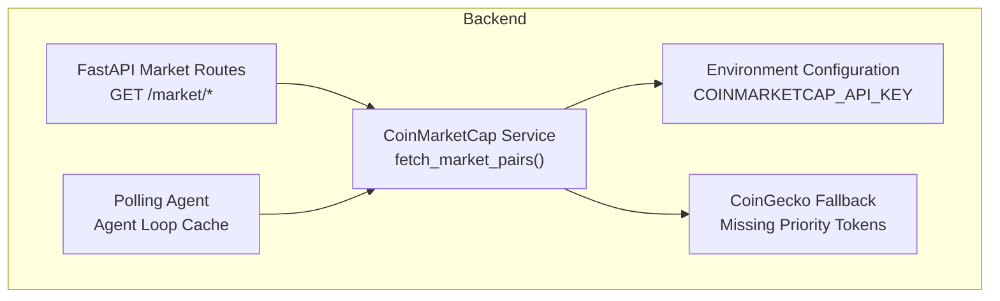
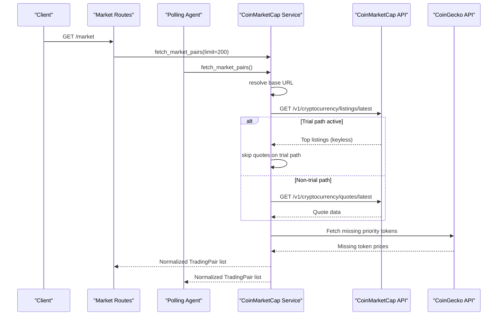
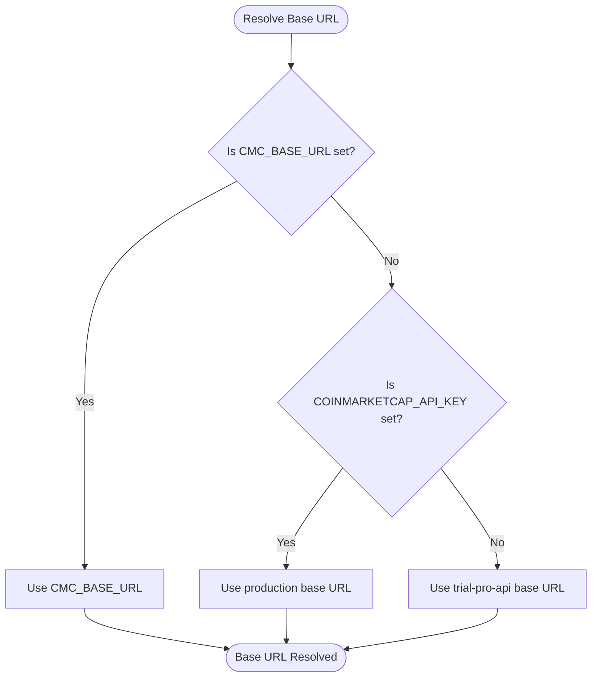
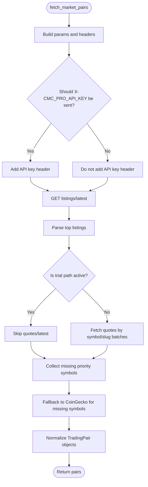
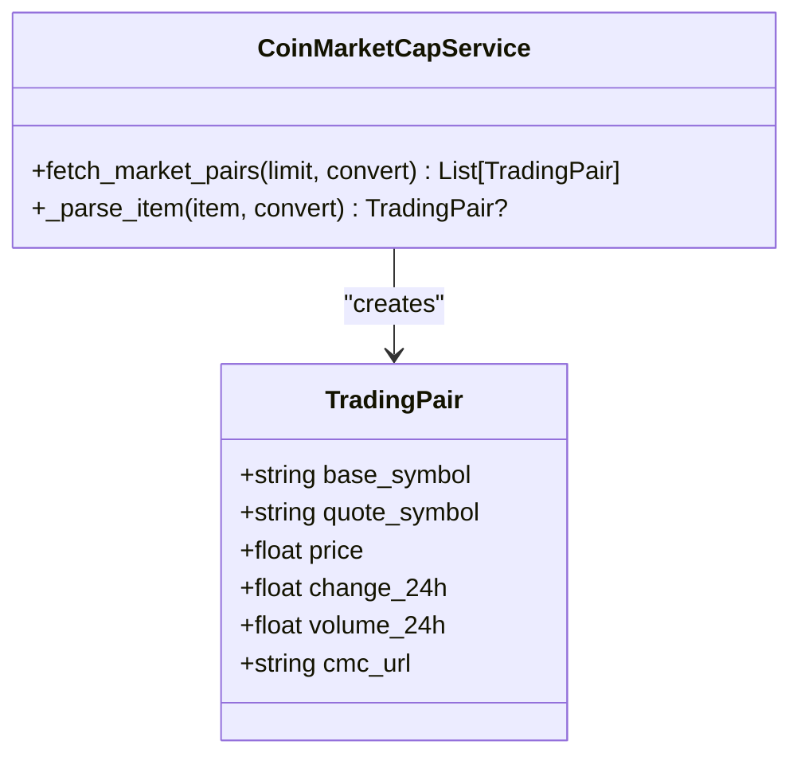
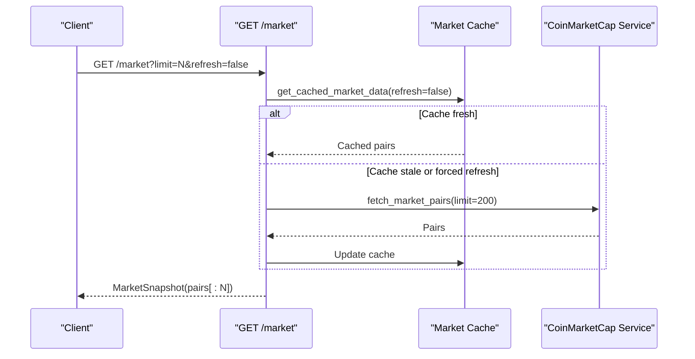
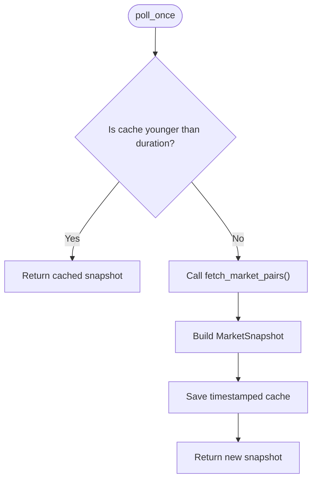
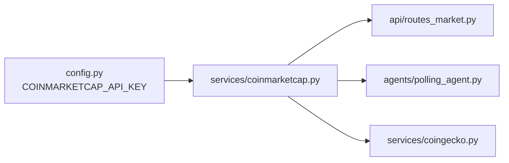

# CoinMarketCap Trial API Integration

<cite>
**Referenced Files in This Document**
- [coinmarketcap.py](file://backend/app/services/coinmarketcap.py)
- [config.py](file://backend/app/core/config.py)
- [routes_market.py](file://backend/app/api/routes_market.py)
- [polling_agent.py](file://backend/app/agents/polling_agent.py)
- [README.md](file://README.md)
</cite>

## Table of Contents
1. [Introduction](#introduction)
2. [Project Structure](#project-structure)
3. [Core Components](#core-components)
4. [Architecture Overview](#architecture-overview)
5. [Detailed Component Analysis](#detailed-component-analysis)
6. [Dependency Analysis](#dependency-analysis)
7. [Performance Considerations](#performance-considerations)
8. [Troubleshooting Guide](#troubleshooting-guide)
9. [Conclusion](#conclusion)

## Introduction
This document explains how the project integrates with CoinMarketCap’s trial API, including authentication behavior, base URL selection, request formatting, response parsing, fallbacks, and rate-limit-aware caching. It focuses on the trial tier constraints documented in the code: a keyless trial endpoint that is aggressively rate limited, restricted to specific endpoints, and returns errors for authenticated-only endpoints such as quotes when accessed through the trial path.

The integration defaults to the trial base URL unless an explicit override is provided or a non-trial base URL is configured. When using the trial path, the implementation avoids sending an API key and falls back to another provider for data that the trial API does not support.

## Project Structure
The CoinMarketCap integration lives under the backend services layer and is consumed by both the public market API and the internal agent polling loop.

**Diagram sources**
- [routes_market.py:10-13](file://backend/app/api/routes_market.py#L10-L13)
- [polling_agent.py:1-2](file://backend/app/agents/polling_agent.py#L1-L2)
- [coinmarketcap.py:6-7](file://backend/app/services/coinmarketcap.py#L6-L7)
- [config.py:9](file://backend/app/core/config.py#L9)

**Section sources**
- [coinmarketcap.py:1-212](file://backend/app/services/coinmarketcap.py#L1-L212)
- [routes_market.py:1-173](file://backend/app/api/routes_market.py#L1-L173)
- [polling_agent.py:1-44](file://backend/app/agents/polling_agent.py#L1-L44)
- [config.py:1-17](file://backend/app/core/config.py#L1-L17)
- [README.md:15-31](file://README.md#L15-L31)

## Core Components
- CoinMarketCap service: resolves the base URL, builds requests, parses responses, and applies fallback logic.
- Environment configuration: loads `COINMARKETCAP_API_KEY` from `.env`.
- Market routes: expose cached market data and apply limits to returned pairs.
- Polling agent: maintains a short-lived cache for strategy consumption.

Key responsibilities:
- Selecting between the production base URL and the trial base URL.
- Avoiding sending an API key on the trial path.
- Fetching top listings and priority tokens where supported.
- Falling back to CoinGecko when the trial API cannot provide required data.

**Section sources**
- [coinmarketcap.py:10-24](file://backend/app/services/coinmarketcap.py#L10-L24)
- [coinmarketcap.py:71-187](file://backend/app/services/coinmarketcap.py#L71-L187)
- [config.py:9](file://backend/app/core/config.py#L9)
- [routes_market.py:17-51](file://backend/app/api/routes_market.py#L17-L51)
- [polling_agent.py:5-43](file://backend/app/agents/polling_agent.py#L5-L43)

## Architecture Overview
The integration follows a layered approach:
- The FastAPI route calls the service to fetch market pairs.
- The service chooses the base URL based on environment configuration.
- The service attempts to fetch top listings from CoinMarketCap.
- For missing priority tokens, it tries additional CoinMarketCap endpoints only when not using the trial path.
- Any still-missing priority tokens are fetched from CoinGecko.
- Results are normalized into trading pair models and returned to callers.

**Diagram sources**
- [coinmarketcap.py:17-24](file://backend/app/services/coinmarketcap.py#L17-L24)
- [coinmarketcap.py:82-187](file://backend/app/services/coinmarketcap.py#L82-L187)
- [routes_market.py:45-51](file://backend/app/api/routes_market.py#L45-L51)
- [polling_agent.py:37-43](file://backend/app/agents/polling_agent.py#L37-L43)

## Detailed Component Analysis

### Base URL Resolution and Trial Mode
The service defines two base URLs:
- Production base URL for authenticated access.
- Trial base URL for keyless access.

Resolution rules:
- If `CMC_BASE_URL` is set via environment, use it.
- Otherwise, use the production base URL if an API key is configured.
- Otherwise, use the trial base URL.

Important behavior:
- On the trial path, the service does not send `X-CMC_PRO_API_KEY`.
- Sending an invalid or expired key on the trial path can cause unauthorized errors.

**Diagram sources**
- [coinmarketcap.py:17-24](file://backend/app/services/coinmarketcap.py#L17-L24)
- [config.py:9](file://backend/app/core/config.py#L9)

**Section sources**
- [coinmarketcap.py:10-24](file://backend/app/services/coinmarketcap.py#L10-L24)
- [config.py:9](file://backend/app/core/config.py#L9)

### Authentication Requirements and API Key Behavior
- The environment variable `COINMARKETCAP_API_KEY` is loaded from `.env`.
- The header `X-CMC_PRO_API_KEY` is sent only when:
  - An API key exists.
  - The resolved base URL is not the trial path.
- The trial path is intentionally keyless; sending a key there is avoided to prevent unauthorized responses.

Configuration reference:
- `COINMARKETCAP_API_KEY` is read at startup and used to decide whether to include the header.

**Section sources**
- [config.py:9](file://backend/app/core/config.py#L9)
- [coinmarketcap.py:71-77](file://backend/app/services/coinmarketcap.py#L71-L77)

### Trial API Limitations and Constraints
The code documents these trial constraints:
- The keyless trial path is aggressively rate limited.
- Only certain endpoints are available on the trial path.
- The trial path supports `listings/latest`.
- The trial path returns errors for `quotes/latest`, so the service skips quote requests when using the trial base URL.
- Missing priority tokens are filled from CoinGecko instead of relying on unsupported trial endpoints.

Operational implications:
- Expect stricter rate limits on the trial endpoint.
- Do not rely on `quotes/latest` when using the trial path.
- Monitor upstream changes because the README notes that upstream API behavior was not re-verified.

**Section sources**
- [coinmarketcap.py:10-14](file://backend/app/services/coinmarketcap.py#L10-L14)
- [coinmarketcap.py:102-109](file://backend/app/services/coinmarketcap.py#L102-L109)
- [README.md:15-15](file://README.md#L15-L15)
- [README.md:185-190](file://README.md#L185-L190)

### Fetching Market Data and Trading Pairs
The main function `fetch_market_pairs`:
- Builds query parameters for start, limit, and currency conversion.
- Initializes headers and conditionally adds the API key.
- Uses an asynchronous HTTP client with a timeout.
- Fetches top listings first.
- Skips additional quote requests when the trial path is active.
- Falls back to CoinGecko for any still-missing priority symbols.
- Parses each item into a normalized trading pair model.

**Diagram sources**
- [coinmarketcap.py:71-187](file://backend/app/services/coinmarketcap.py#L71-L187)

**Section sources**
- [coinmarketcap.py:71-187](file://backend/app/services/coinmarketcap.py#L71-L187)

### Response Parsing and Data Model
Each parsed item extracts:
- Symbol.
- Price in the requested convert currency.
- 24-hour percentage change.
- 24-hour volume.
- Slug-derived CoinMarketCap URL.

If essential fields like symbol or price are missing, the parser returns no pair for that item.

**Diagram sources**
- [coinmarketcap.py:189-211](file://backend/app/services/coinmarketcap.py#L189-L211)

**Section sources**
- [coinmarketcap.py:189-211](file://backend/app/services/coinmarketcap.py#L189-L211)

### API Consumption Patterns

#### Public Market Route
- Exposes `GET /market` with a configurable limit.
- Uses a process-level cache with a one-hour duration.
- Calls `fetch_market_pairs(limit=200)` for dashboard data.
- Applies the requested limit to the cached result before returning.

**Diagram sources**
- [routes_market.py:17-58](file://backend/app/api/routes_market.py#L17-L58)
- [coinmarketcap.py:71-187](file://backend/app/services/coinmarketcap.py#L71-L187)

**Section sources**
- [routes_market.py:17-58](file://backend/app/api/routes_market.py#L17-L58)

#### Agent Polling Cache
- Maintains its own cache for the strategy loop.
- Enforces a minimum cache duration of 60 seconds.
- Calls `fetch_market_pairs()` without an explicit limit, using the default.

**Diagram sources**
- [polling_agent.py:5-43](file://backend/app/agents/polling_agent.py#L5-L43)

**Section sources**
- [polling_agent.py:5-43](file://backend/app/agents/polling_agent.py#L5-L43)

### Error Handling Strategies for Trial API Limitations
- The service wraps listing and quote requests in try/except blocks and logs errors rather than failing the entire pipeline.
- On the trial path, quote requests are skipped entirely to avoid 403 responses.
- Missing priority tokens are recovered through CoinGecko.
- The market route uses a long-lived cache to reduce repeated upstream calls.
- Other endpoints demonstrate rate-limit-aware fallback patterns, such as serving stale cached data when a downstream provider returns 429.

Recommended practices derived from the code:
- Prefer the trial path only when you accept aggressive rate limits and restricted endpoints.
- Avoid sending an API key on the trial path.
- Rely on caching to stay within trial limits.
- Treat missing tokens as expected when using the trial API and depend on fallback providers.

**Section sources**
- [coinmarketcap.py:82-100](file://backend/app/services/coinmarketcap.py#L82-L100)
- [coinmarketcap.py:102-109](file://backend/app/services/coinmarketcap.py#L102-L109)
- [coinmarketcap.py:177-187](file://backend/app/services/coinmarketcap.py#L177-L187)
- [routes_market.py:17-51](file://backend/app/api/routes_market.py#L17-L51)
- [routes_market.py:76-105](file://backend/app/api/routes_market.py#L76-L105)

### Request Formatting Examples
Because this documentation avoids embedding source code, refer to these paths for exact request construction:
- Base URL resolution and trial vs production selection: [coinmarketcap.py:17-24](file://backend/app/services/coinmarketcap.py#L17-L24)
- Header building and conditional API key inclusion: [coinmarketcap.py:71-77](file://backend/app/services/coinmarketcap.py#L71-L77)
- Listings request parameters and endpoint: [coinmarketcap.py:72-90](file://backend/app/services/coinmarketcap.py#L72-L90)
- Quote request batching and endpoint usage (non-trial): [coinmarketcap.py:120-175](file://backend/app/services/coinmarketcap.py#L120-L175)

### Response Parsing Examples
Refer to these paths for normalization and error-safe parsing:
- Item parsing and field extraction: [coinmarketcap.py:189-211](file://backend/app/services/coinmarketcap.py#L189-L211)
- Trading pair creation with optional fields: [coinmarketcap.py:204-211](file://backend/app/services/coinmarketcap.py#L204-L211)

### Fallback Mechanisms When Trial Quotas Are Exceeded
- Skip unsupported trial endpoints instead of retrying them repeatedly.
- Fall back to CoinGecko for missing priority tokens.
- Use caches to reduce repeated requests during rate-limited periods.
- Log errors and continue processing partial results where possible.

**Section sources**
- [coinmarketcap.py:102-109](file://backend/app/services/coinmarketcap.py#L102-L109)
- [coinmarketcap.py:177-187](file://backend/app/services/coinmarketcap.py#L177-L187)
- [routes_market.py:17-51](file://backend/app/api/routes_market.py#L17-L51)

### Guidance for Optimizing Requests Within Trial Limits
- Keep the dashboard cache enabled to avoid frequent full-market refreshes.
- Use the agent cache duration to balance freshness against rate limits.
- Avoid forcing refreshes unless necessary.
- Prefer batch operations where supported and avoid unnecessary retries.
- Monitor which priority tokens are missing and ensure they are covered by fallback providers.

**Section sources**
- [routes_market.py:17-51](file://backend/app/api/routes_market.py#L17-L51)
- [polling_agent.py:5-43](file://backend/app/agents/polling_agent.py#L5-L43)

## Dependency Analysis
The following diagram shows how components depend on each other for market data.

**Diagram sources**
- [config.py:9](file://backend/app/core/config.py#L9)
- [coinmarketcap.py:6-7](file://backend/app/services/coinmarketcap.py#L6-L7)
- [routes_market.py:10-13](file://backend/app/api/routes_market.py#L10-L13)
- [polling_agent.py:1-2](file://backend/app/agents/polling_agent.py#L1-L2)

**Section sources**
- [coinmarketcap.py:6-7](file://backend/app/services/coinmarketcap.py#L6-L7)
- [routes_market.py:10-13](file://backend/app/api/routes_market.py#L10-L13)
- [polling_agent.py:1-2](file://backend/app/agents/polling_agent.py#L1-L2)
- [config.py:9](file://backend/app/core/config.py#L9)

## Performance Considerations
- The trial API is aggressively rate limited; minimize repeated calls by using caches.
- Dashboard data is cached for one hour.
- Agent data is cached for at least 60 seconds.
- The service uses timeouts and graceful error handling to avoid blocking indefinitely.
- Batch requests are used for non-trial quote fetching to reduce overhead.

[No sources needed since this section provides general guidance]

## Troubleshooting Guide
Common issues and recommended actions:
- **Unauthorized or unexpected 401 on trial path**: Ensure no API key header is sent when using the trial base URL.
- **403 on quotes via trial path**: This is expected; the service skips quote requests on the trial path and relies on CoinGecko for missing tokens.
- **Rate limiting**: Reduce refresh frequency, rely on caches, and avoid force-refresh loops.
- **Missing tokens**: Verify that priority tokens are covered by fallback providers and that slug mappings remain valid.
- **Stale data**: Adjust cache durations carefully; too-long caches reduce freshness, too-short caches increase upstream load.

**Section sources**
- [coinmarketcap.py:74-77](file://backend/app/services/coinmarketcap.py#L74-L77)
- [coinmarketcap.py:102-109](file://backend/app/services/coinmarketcap.py#L102-L109)
- [routes_market.py:17-51](file://backend/app/api/routes_market.py#L17-L51)
- [polling_agent.py:13-19](file://backend/app/agents/polling_agent.py#L13-L19)

## Conclusion
The CoinMarketCap trial API integration is designed to work without an API key while respecting strict trial constraints. It selects the trial base URL by default, avoids sending credentials on the trial path, fetches supported endpoints, and falls back to CoinGecko for missing priority tokens. Caching at both the route and agent levels helps stay within trial limits. When upgrading beyond the trial tier, configure a non-trial base URL and API key to unlock additional endpoints and higher limits.

[No sources needed since this section summarizes without analyzing specific files]