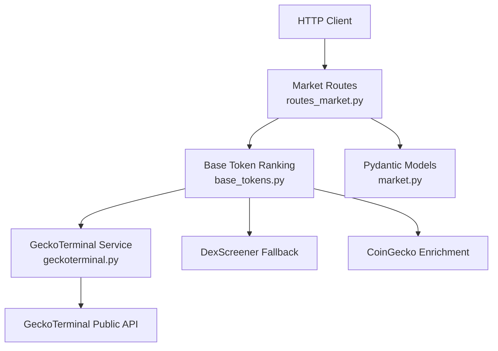
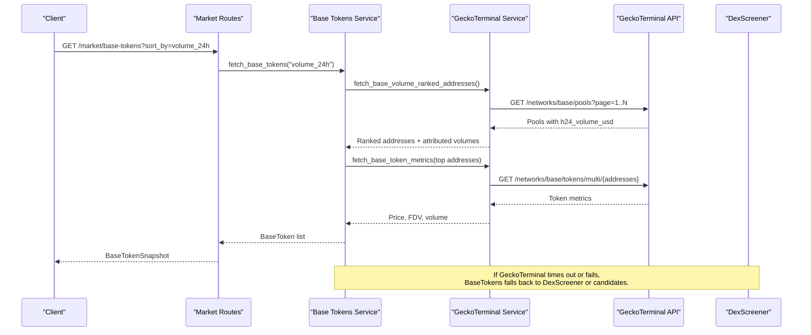
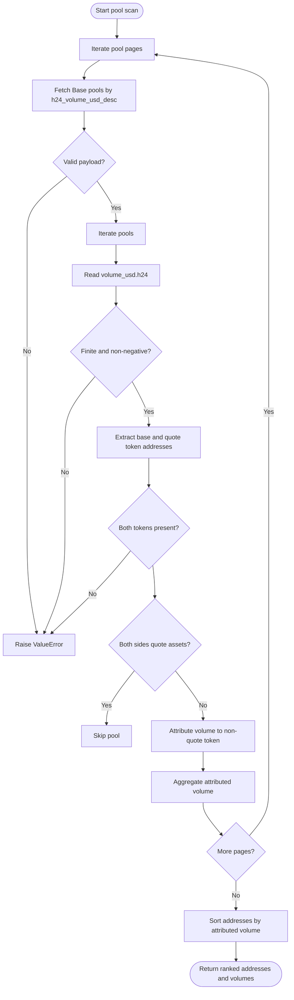
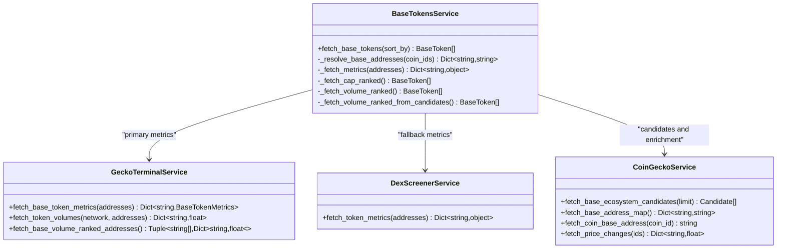
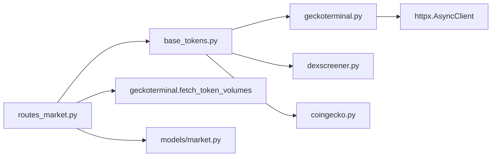

# GeckoTerminal DEX Pool Data Service

<cite>
**Referenced Files in This Document**   
- [geckoterminal.py](file://backend/app/services/geckoterminal.py)
- [base_tokens.py](file://backend/app/services/base_tokens.py)
- [routes_market.py](file://backend/app/api/routes_market.py)
- [market.py](file://backend/app/models/market.py)
</cite>

## Table of Contents
1. [Introduction](#introduction)
2. [Project Structure](#project-structure)
3. [Core Components](#core-components)
4. [Architecture Overview](#architecture-overview)
5. [Detailed Component Analysis](#detailed-component-analysis)
6. [Dependency Analysis](#dependency-analysis)
7. [Performance Considerations](#performance-considerations)
8. [Troubleshooting Guide](#troubleshooting-guide)
9. [Conclusion](#conclusion)

## Introduction
This document explains the GeckoTerminal DEX pool data service integration used by the DexTrader application to retrieve on-chain liquidity and volume data for decentralized exchange pools, with a focus on the Base network. It covers how Base pools are discovered, how liquidity metrics and 24-hour volumes are extracted, how real-time price feeds are derived from DEX pools, and how the system handles rate limits, provider outages, and inconsistent upstream data. It also provides guidance on caching strategies and performance optimization for high-frequency DEX queries.

The integration is implemented as an asynchronous HTTP client layer over the GeckoTerminal public API, wrapped by higher-level services that expose Base token rankings, per-token DEX volumes, and resilient fallbacks when GeckoTerminal is unavailable or slow.

## Project Structure
The relevant code lives under the backend FastAPI application:

- `backend/app/services/geckoterminal.py` implements direct GeckoTerminal API access, including Base pool scanning, token metric parsing, and volume attribution logic.
- `backend/app/services/base_tokens.py` composes GeckoTerminal with other providers (DexScreener, CoinGecko) to produce ranked Base token lists and enriches them with prices, FDV, and volume.
- `backend/app/api/routes_market.py` exposes REST endpoints for market snapshots, Base token rankings, and per-token DEX volumes, including request validation and process-wide caches.
- `backend/app/models/market.py` defines Pydantic models for API responses such as trading pairs, Base tokens, and token volume snapshots.

**Diagram sources**
- [routes_market.py:10-15](file://backend/app/api/routes_market.py#L10-L15)
- [base_tokens.py:10-21](file://backend/app/services/base_tokens.py#L10-L21)
- [geckoterminal.py:9-33](file://backend/app/services/geckoterminal.py#L9-L33)
- [market.py:1-42](file://backend/app/models/market.py#L1-L42)

**Section sources**
- [geckoterminal.py:1-33](file://backend/app/services/geckoterminal.py#L1-L33)
- [base_tokens.py:1-35](file://backend/app/services/base_tokens.py#L1-L35)
- [routes_market.py:1-25](file://backend/app/api/routes_market.py#L1-L25)
- [market.py:1-42](file://backend/app/models/market.py#L1-L42)

## Core Components
The GeckoTerminal integration consists of three main responsibilities:

1. **Base pool discovery and ranking**
   - Scans the top Base pools by 24-hour USD volume.
   - Attributes each pool’s volume to its non-quote-side token so quote assets do not absorb all volume.
   - Returns ranked addresses and attributed volumes.

2. **Token metric extraction**
   - Fetches Base-chain token metadata, including address, name, symbol, price, fully diluted value, and 24-hour DEX volume.
   - Normalizes addresses and validates numeric fields.

3. **Per-token DEX volume retrieval**
   - Returns chain-local 24-hour DEX USD volumes for arbitrary token addresses.
   - Supports multiple networks but is primarily used for Base.

Key implementation details:

- The GeckoTerminal base URL is `https://api.geckoterminal.com/api/v2`.
- Requests use a custom User-Agent and JSON Accept header to avoid Cloudflare challenges.
- Address batching limits requests to 30 addresses per call.
- Pool scanning uses pagination with a two-second delay between pages to respect public API rate limits.
- Quote asset filtering prevents WETH, USDC, USDbC, DAI, and USDT from absorbing volume across every pool they quote.

**Section sources**
- [geckoterminal.py:9-33](file://backend/app/services/geckoterminal.py#L9-L33)
- [geckoterminal.py:110-146](file://backend/app/services/geckoterminal.py#L110-L146)
- [geckoterminal.py:149-176](file://backend/app/services/geckoterminal.py#L149-L176)
- [geckoterminal.py:195-241](file://backend/app/services/geckoterminal.py#L195-L241)

## Architecture Overview
The end-to-end flow for Base DEX pool data starts at the market routes and flows through the Base token ranking service into GeckoTerminal. When GeckoTerminal is unavailable or too slow, the system falls back to DexScreener or candidate-based ranking.

**Diagram sources**
- [routes_market.py:82-109](file://backend/app/api/routes_market.py#L82-L109)
- [base_tokens.py:270-312](file://backend/app/services/base_tokens.py#L270-L312)
- [geckoterminal.py:195-241](file://backend/app/services/geckoterminal.py#L195-L241)
- [geckoterminal.py:149-162](file://backend/app/services/geckoterminal.py#L149-L162)

## Detailed Component Analysis

### GeckoTerminal Service
The GeckoTerminal service is the lowest-level integration point. It performs:

- Network validation.
- Address normalization and deduplication.
- Batched token metadata fetching.
- Volume-only fetching independent of price/metadata.
- Base pool scanning with pagination and rate-limit delays.
- Volume attribution to non-quote tokens.

#### Base Token Metrics
`fetch_base_token_metrics` returns a dictionary mapping normalized Base contract addresses to `BaseTokenMetrics`, which includes:

| Field | Type | Meaning |
|---|---|---|
| `address` | string | Lowercase Base contract address |
| `name` | string | Token display name |
| `symbol` | string | Token symbol |
| `price` | float | Base-chain DEX-derived price in USD |
| `fdv` | optional float | Fully diluted value based on Base supply and price |
| `volume_24h` | optional float | Base-chain DEX 24-hour volume |
| `coingecko_id` | optional string | CoinGecko identifier for enrichment |

Validation rules:

- Boolean values are rejected as numbers.
- Negative prices are rejected; negative FDV is treated as missing.
- Negative 24-hour volume is treated as missing.
- Missing or invalid CoinGecko IDs are stored as `None`.

**Section sources**
- [geckoterminal.py:36-43](file://backend/app/services/geckoterminal.py#L36-L43)
- [geckoterminal.py:46-107](file://backend/app/services/geckoterminal.py#L46-L107)
- [geckoterminal.py:149-162](file://backend/app/services/geckoterminal.py#L149-L162)

#### Per-Token DEX Volumes
`fetch_token_volumes` returns a dictionary mapping requested addresses to optional 24-hour USD volumes. It does not require price or metadata and can be used independently for volume checks.

Supported networks include `eth`, `base`, and `arbitrum`; unsupported networks raise a validation error.

**Section sources**
- [geckoterminal.py:121-146](file://backend/app/services/geckoterminal.py#L121-L146)
- [geckoterminal.py:165-176](file://backend/app/services/geckoterminal.py#L165-L176)

#### Base Pool Discovery and Volume Attribution
`fetch_base_volume_ranked_addresses` scans up to ten pages of Base pools sorted by descending 24-hour USD volume. For each pool:

1. Validates the pool payload structure.
2. Extracts the 24-hour USD volume.
3. Extracts the base and quote token addresses.
4. Skips pools where both sides are quote assets.
5. Attributes the pool’s volume to the non-quote token.
6. Aggregates attributed volume per address.
7. Sorts addresses by aggregated volume.

**Diagram sources**
- [geckoterminal.py:195-241](file://backend/app/services/geckoterminal.py#L195-L241)

**Section sources**
- [geckoterminal.py:179-192](file://backend/app/services/geckoterminal.py#L179-L192)
- [geckoterminal.py:195-241](file://backend/app/services/geckoterminal.py#L195-L241)

### Base Token Ranking Service
The Base token ranking service orchestrates multiple data sources:

- **CoinGecko ecosystem candidates**: Provides a curated set of Base tokens.
- **Address resolution**: Maps CoinGecko IDs to Base contract addresses using a disk-backed platform map and per-coin detail fallback.
- **GeckoTerminal metrics**: Primary source for Base-chain price, FDV, and volume.
- **DexScreener fallback**: Used when GeckoTerminal times out or raises HTTP/validation errors.
- **Candidate-based ranking**: Used when GeckoTerminal pool scanning is too slow or fails.

**Diagram sources**
- [base_tokens.py:173-186](file://backend/app/services/base_tokens.py#L173-L186)
- [base_tokens.py:189-228](file://backend/app/services/base_tokens.py#L189-L228)
- [base_tokens.py:270-312](file://backend/app/services/base_tokens.py#L270-L312)

**Section sources**
- [base_tokens.py:24-45](file://backend/app/services/base_tokens.py#L24-L45)
- [base_tokens.py:116-170](file://backend/app/services/base_tokens.py#L116-L170)
- [base_tokens.py:173-186](file://backend/app/services/base_tokens.py#L173-L186)
- [base_tokens.py:189-228](file://backend/app/services/base_tokens.py#L189-L228)
- [base_tokens.py:231-267](file://backend/app/services/base_tokens.py#L231-L267)
- [base_tokens.py:270-312](file://backend/app/services/base_tokens.py#L270-L312)
- [base_tokens.py:315-321](file://backend/app/services/base_tokens.py#L315-L321)

### Market API Routes
The market routes expose:

- `/market/`: Trading pair snapshot.
- `/market/gainers-losers`: Top gainers and losers by 24-hour change.
- `/market/base-tokens`: Base token ranking by market cap or 24-hour volume.
- `/market/token-volumes`: Chain-local DEX USD volumes for specified token addresses.

For Base tokens, the route:

- Caches results per sort key.
- Uses an async lock to prevent duplicate concurrent calls.
- Falls back to stale cached data when a refresh is rate limited.
- Returns a 502 error when fresh data cannot be fetched and no cache exists.

For token volumes, the route:

- Validates chain ID and address format.
- Limits query length and number of addresses.
- Deduplicates addresses.
- Caches per `(chain_id, address)` tuple.
- Uses an LRU-style ordered dictionary with a maximum entry count.
- Raises a 502 error when the GeckoTerminal volume fetch fails.

**Section sources**
- [routes_market.py:17-51](file://backend/app/api/routes_market.py#L17-L51)
- [routes_market.py:53-67](file://backend/app/api/routes_market.py#L53-L67)
- [routes_market.py:70-109](file://backend/app/api/routes_market.py#L70-L109)
- [routes_market.py:112-172](file://backend/app/api/routes_market.py#L112-L172)

### API Models
The response models define the shape of data returned to clients:

| Model | Fields | Purpose |
|---|---|---|
| `TradingPair` | `base_symbol`, `quote_symbol`, `price`, `change_24h`, `volume_24h`, `cmc_url` | Generic trading pair representation |
| `MarketSnapshot` | `pairs`, `timestamp` | Market overview |
| `GainersLosers` | `gainers`, `losers` | Sorted gainers and losers |
| `BaseToken` | `id`, `name`, `symbol`, `price`, `change_24h`, `volume_24h`, `market_cap` | Base token ranking item |
| `BaseTokenSnapshot` | `tokens` | Base token list response |
| `TokenVolumesSnapshot` | `chain_id`, `volumes` | Per-token DEX volume response |

**Section sources**
- [market.py:5-42](file://backend/app/models/market.py#L5-L42)

## Dependency Analysis
The integration has clear layering:

- Routes depend on services.
- Base token ranking depends on GeckoTerminal, DexScreener, and CoinGecko.
- GeckoTerminal depends only on HTTP transport and JSON parsing.
- Models are consumed by routes and tests.

**Diagram sources**
- [routes_market.py:10-13](file://backend/app/api/routes_market.py#L10-L13)
- [base_tokens.py:10-21](file://backend/app/services/base_tokens.py#L10-L21)
- [geckoterminal.py:4-6](file://backend/app/services/geckoterminal.py#L4-L6)
- [market.py:1-42](file://backend/app/models/market.py#L1-L42)

**Section sources**
- [routes_market.py:10-13](file://backend/app/api/routes_market.py#L10-L13)
- [base_tokens.py:10-21](file://backend/app/services/base_tokens.py#L10-L21)
- [geckoterminal.py:4-6](file://backend/app/services/geckoterminal.py#L4-L6)
- [market.py:1-42](file://backend/app/models/market.py#L1-L42)

## Performance Considerations
The integration includes several performance-oriented mechanisms:

- **Rate limiting and retries**
  - GeckoTerminal token requests retry once on HTTP 429 after a short delay.
  - Pool page scanning sleeps between pages to stay within public API limits.

- **Batching**
  - Token metadata is fetched in batches of up to 30 addresses.
  - Pool scanning paginates rather than requesting all pools at once.

- **Timeout budgets**
  - GeckoTerminal metrics fetching has a timeout budget.
  - GeckoTerminal pool scanning has a separate timeout budget.
  - Exceeding these budgets triggers fallback behavior.

- **Process-wide caches**
  - Market data cache with one-hour TTL.
  - Base token ranking cache per sort key with five-minute TTL.
  - Token volume cache keyed by chain ID and address with five-minute TTL and LRU eviction.

- **Provider resilience**
  - GeckoTerminal metrics fall back to DexScreener on failure.
  - GeckoTerminal pool ranking falls back to candidate-based ranking on timeout or failure.
  - CoinGecko enrichment failures do not fail the ranking.

Recommendations for high-frequency DEX queries:

- Prefer batched token volume queries over per-address calls.
- Use the existing process-wide caches before issuing new requests.
- Avoid forcing refresh unless necessary; rely on TTL expiration.
- Monitor 429 responses and reduce request frequency if rate-limited.
- Consider external caching layers for read-heavy deployments.

**Section sources**
- [geckoterminal.py:11-16](file://backend/app/services/geckoterminal.py#L11-L16)
- [geckoterminal.py:110-118](file://backend/app/services/geckoterminal.py#L110-L118)
- [geckoterminal.py:204-207](file://backend/app/services/geckoterminal.py#L204-L207)
- [base_tokens.py:29-34](file://backend/app/services/base_tokens.py#L29-L34)
- [base_tokens.py:173-186](file://backend/app/services/base_tokens.py#L173-L186)
- [base_tokens.py:270-280](file://backend/app/services/base_tokens.py#L270-L280)
- [routes_market.py:17-25](file://backend/app/api/routes_market.py#L17-L25)
- [routes_market.py:70-73](file://backend/app/api/routes_market.py#L70-L73)
- [routes_market.py:112-118](file://backend/app/api/routes_market.py#L112-L118)

## Troubleshooting Guide

### DEX Unavailability
Symptoms:

- Base token ranking returns stale data instead of failing during a refresh.
- Token volume endpoint returns 502.
- Pool ranking falls back to candidate-based ranking.

Likely causes:

- GeckoTerminal API is down or rate-limited.
- Cloudflare blocks automated clients without proper headers.
- Network timeouts exceed configured budgets.

Actions:

- Check whether the request was a forced refresh; stale cache may be serving.
- Inspect logs for messages indicating GeckoTerminal unavailability or fallback to DexScreener.
- Verify that the User-Agent and Accept headers are present.
- Reduce request frequency if 429 responses occur.

**Section sources**
- [routes_market.py:93-105](file://backend/app/api/routes_market.py#L93-L105)
- [routes_market.py:156-159](file://backend/app/api/routes_market.py#L156-L159)
- [base_tokens.py:173-186](file://backend/app/services/base_tokens.py#L173-L186)
- [base_tokens.py:270-280](file://backend/app/services/base_tokens.py#L270-L280)
- [geckoterminal.py:18-23](file://backend/app/services/geckoterminal.py#L18-L23)

### Pool Migration Scenarios
When a token migrates contracts or changes its Base address:

- The address resolution layer maintains a persistent CoinGecko ID to Base address map.
- Unknown addresses trigger per-coin detail resolution.
- Results are saved to disk to avoid repeated resolution.
- Platform maps have a 12-hour TTL and are refreshed lazily.

Actions:

- Ensure the CoinGecko ID still resolves to the expected Base address.
- Clear or allow the disk cache to refresh if the address changed.
- Verify that the new address appears in GeckoTerminal token metrics.

**Section sources**
- [base_tokens.py:24-45](file://backend/app/services/base_tokens.py#L24-L45)
- [base_tokens.py:48-75](file://backend/app/services/base_tokens.py#L48-L75)
- [base_tokens.py:78-113](file://backend/app/services/base_tokens.py#L78-L113)
- [base_tokens.py:116-170](file://backend/app/services/base_tokens.py#L116-L170)

### Data Consistency Checks
Consistency issues can arise from:

- Invalid or malformed GeckoTerminal payloads.
- Missing or negative numeric fields.
- Pools with unexpected base/quote relationships.
- Quote-only pools inflating volume attribution.

Validation points:

- `_finite_number` rejects booleans, non-numeric values, and infinite values.
- Token parsing requires valid address, name, symbol, and non-negative price.
- Pool parsing validates attributes, volume structure, and token relationships.
- Quote-only pools are skipped during volume attribution.

Actions:

- Treat missing or negative volumes as unknown rather than zero.
- Investigate malformed pool entries before aggregating volumes.
- Confirm that the target token is not a quote asset when attributing volume.

**Section sources**
- [geckoterminal.py:36-43](file://backend/app/services/geckoterminal.py#L36-L43)
- [geckoterminal.py:66-107](file://backend/app/services/geckoterminal.py#L66-L107)
- [geckoterminal.py:179-192](file://backend/app/services/geckoterminal.py#L179-L192)
- [geckoterminal.py:214-236](file://backend/app/services/geckoterminal.py#L214-L236)

### Examples of Usage Patterns

#### Fetching Pool Information
Use the Base token ranking endpoint to discover active Base tokens by volume:

- Endpoint: `GET /market/base-tokens?sort_by=volume_24h`
- Response model: `BaseTokenSnapshot`
- Behavior: Uses GeckoTerminal pool ranking with fallbacks.

**Section sources**
- [routes_market.py:82-109](file://backend/app/api/routes_market.py#L82-L109)
- [base_tokens.py:270-312](file://backend/app/services/base_tokens.py#L270-L312)
- [market.py:24-36](file://backend/app/models/market.py#L24-L36)

#### Fetching Liquidity Ratios
Liquidity ratios are not directly exposed by the current GeckoTerminal integration. The service provides:

- Token price from Base DEX pools.
- 24-hour DEX volume.
- FDV as a proxy for market size.

To estimate liquidity-related signals:

- Compare price stability with volume.
- Use FDV as a relative size indicator.
- Combine with external liquidity depth data if available.

**Section sources**
- [geckoterminal.py:46-107](file://backend/app/services/geckoterminal.py#L46-L107)
- [base_tokens.py:189-228](file://backend/app/services/base_tokens.py#L189-L228)

#### Estimating Swap Execution Costs
Swap execution cost estimation is not implemented in the GeckoTerminal service. The closest available signals are:

- 24-hour DEX volume per token.
- Token price from Base DEX pools.
- Optional CoinGecko 24-hour price change.

Recommended approach:

- Use 24-hour volume as a liquidity proxy.
- Apply slippage assumptions based on trade size relative to volume.
- Incorporate gas costs via the gas service if available.

**Section sources**
- [geckoterminal.py:165-176](file://backend/app/services/geckoterminal.py#L165-L176)
- [geckoterminal.py:149-162](file://backend/app/services/geckoterminal.py#L149-L162)
- [market.py:24-36](file://backend/app/models/market.py#L24-L36)

### Caching Strategies for Pool Data
Current caching behavior:

- Market snapshot cache: one hour.
- Base token ranking cache: five minutes per sort key.
- Token volume cache: five minutes per chain ID and address, with LRU eviction.

Guidance:

- Do not bypass the cache unless you need fresh data.
- Use `refresh=true` sparingly to avoid provider rate limits.
- Monitor cache hit rates and adjust TTLs based on deployment load.
- Persist state in a mounted volume to survive container restarts.

**Section sources**
- [routes_market.py:17-25](file://backend/app/api/routes_market.py#L17-L25)
- [routes_market.py:70-73](file://backend/app/api/routes_market.py#L70-L73)
- [routes_market.py:112-118](file://backend/app/api/routes_market.py#L112-L118)
- [routes_market.py:143-172](file://backend/app/api/routes_market.py#L143-L172)
- [base_tokens.py:24-35](file://backend/app/services/base_tokens.py#L24-L35)

## Conclusion
The GeckoTerminal DEX pool data service provides a robust foundation for Base network DEX analytics. It discovers pools by 24-hour volume, extracts token prices and volumes from Base DEX pools, and attributes volume to non-quote tokens to avoid skewing rankings. The system is designed for resilience: it retries rate-limited requests, paginates pool scans, enforces timeout budgets, and falls back to DexScreener or candidate-based ranking when GeckoTerminal is unavailable. Process-wide caches reduce redundant API calls, while strict input validation and data sanitization protect against malformed upstream responses.

For production use, monitor provider availability, tune cache durations to workload patterns, and extend the service with explicit liquidity depth and slippage modeling if swap cost estimation becomes a requirement.