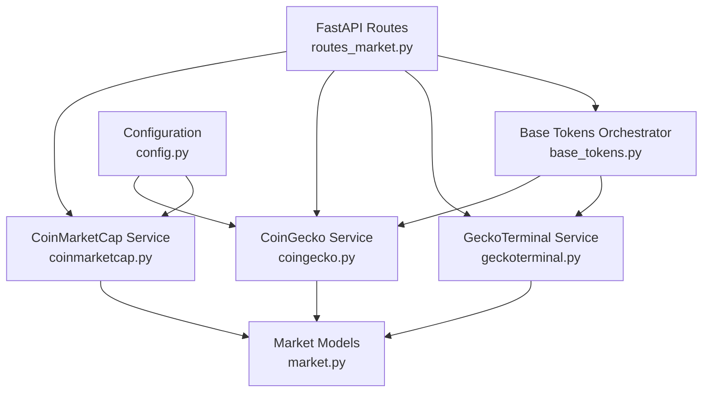
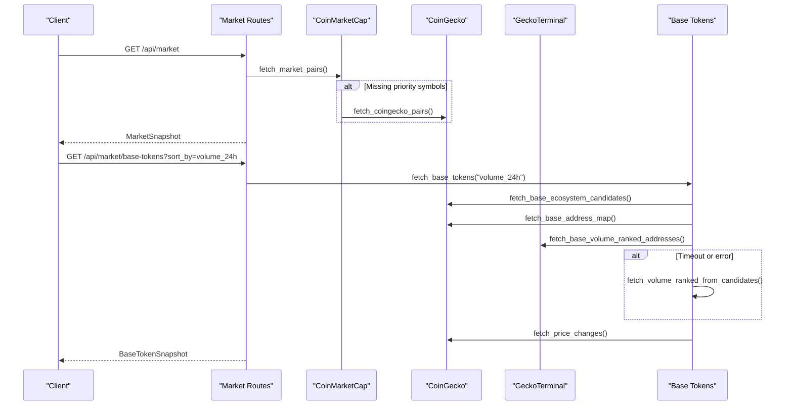
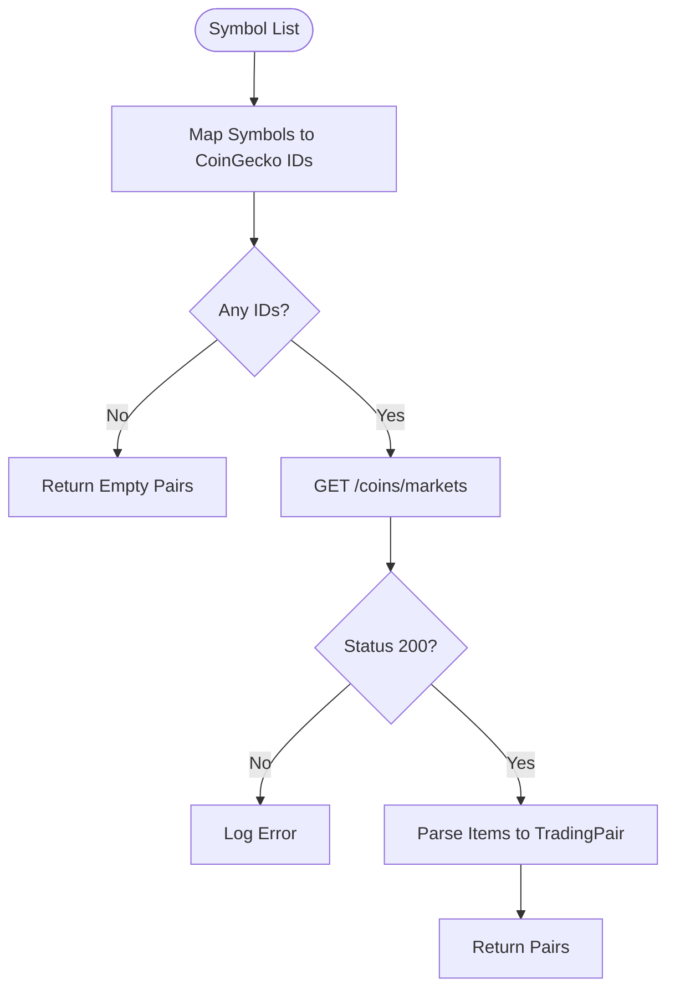
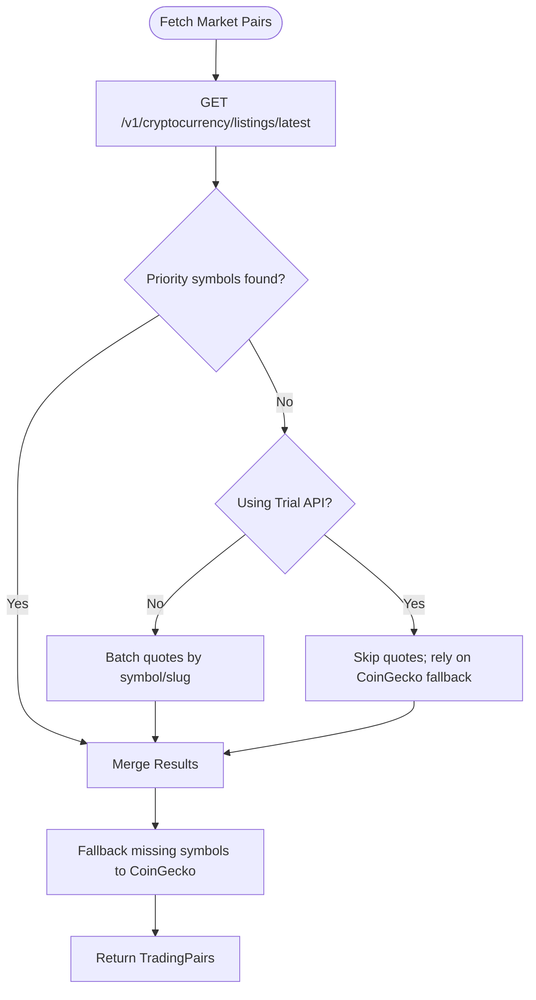
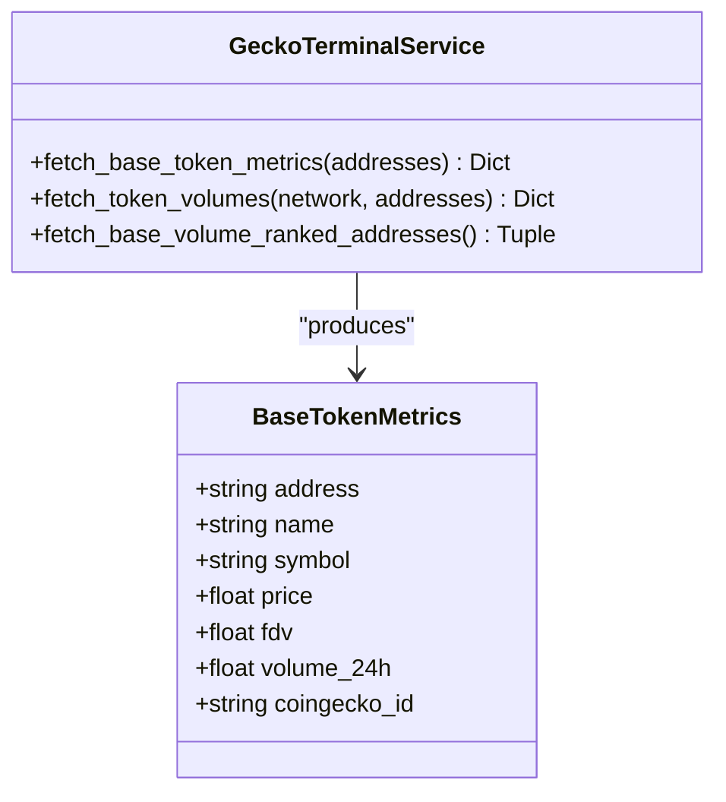
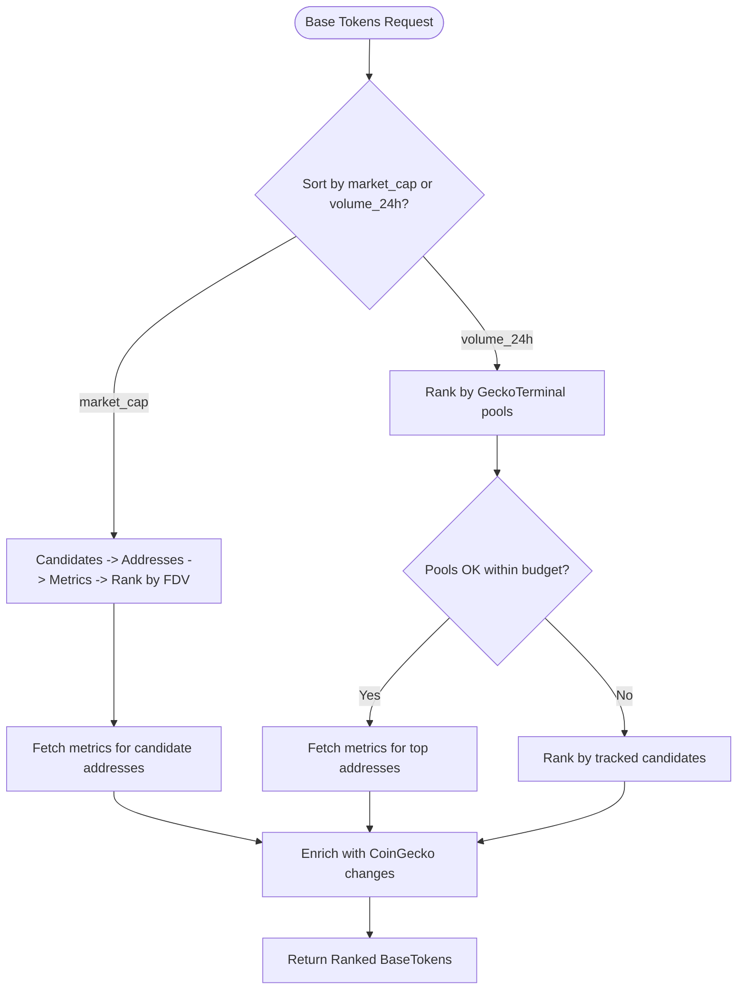
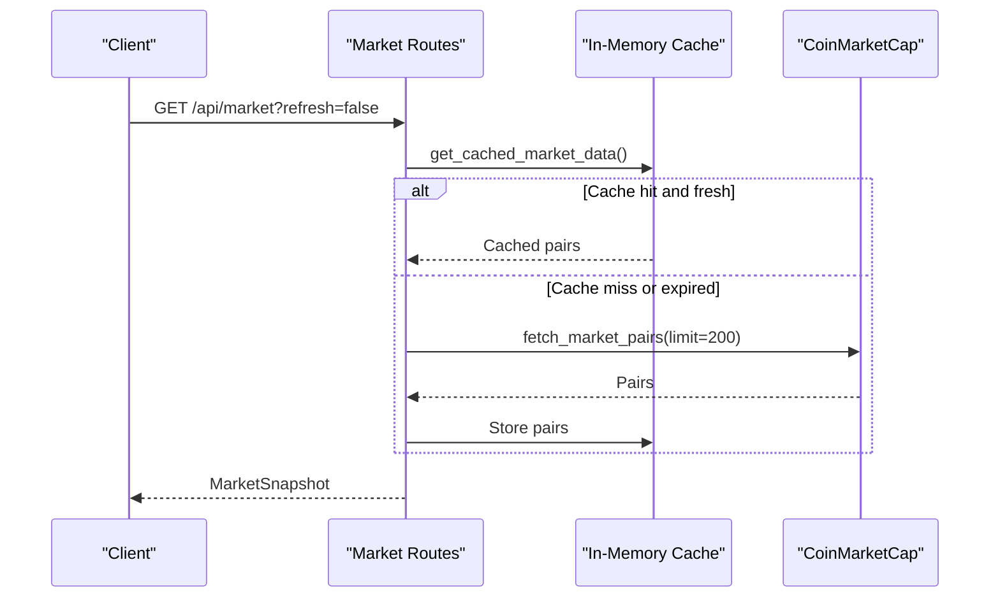
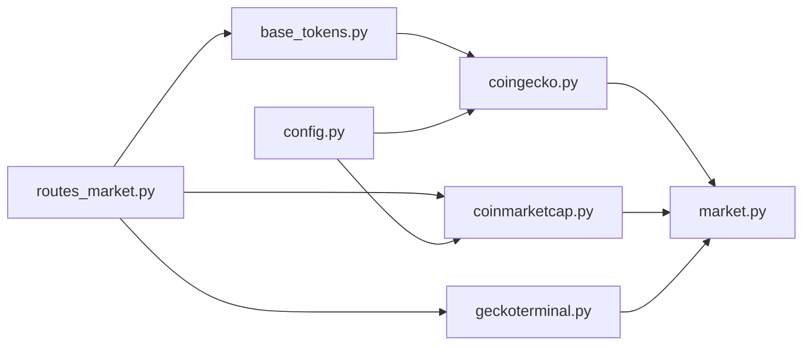

# Market Data Providers

<cite>
**Referenced Files in This Document**
- [coingecko.py](file://backend/app/services/coingecko.py)
- [coinmarketcap.py](file://backend/app/services/coinmarketcap.py)
- [geckoterminal.py](file://backend/app/services/geckoterminal.py)
- [base_tokens.py](file://backend/app/services/base_tokens.py)
- [routes_market.py](file://backend/app/api/routes_market.py)
- [config.py](file://backend/app/core/config.py)
- [market.py](file://backend/app/models/market.py)
</cite>

## Table of Contents
1. [Introduction](#introduction)
2. [Project Structure](#project-structure)
3. [Core Components](#core-components)
4. [Architecture Overview](#architecture-overview)
5. [Detailed Component Analysis](#detailed-component-analysis)
6. [Dependency Analysis](#dependency-analysis)
7. [Performance Considerations](#performance-considerations)
8. [Troubleshooting Guide](#troubleshooting-guide)
9. [Conclusion](#conclusion)
10. [Appendices](#appendices)

## Introduction
This document explains the market data provider integrations used by the application: CoinGecko, CoinMarketCap, and GeckoTerminal. It covers symbol-to-ID mapping, rate limiting and retry behavior, Base ecosystem candidate discovery, on-chain liquidity ranking, API key configuration, error handling, fallback mechanisms, caching strategies, and the service abstractions that make providers swappable and testable. It also provides practical examples for fetching trading pairs, price changes, and Base chain token addresses.

## Project Structure
The market data logic is implemented as backend services under `backend/app/services`, exposed through FastAPI routes under `backend/app/api`, with shared Pydantic models under `backend/app/models` and environment-driven configuration under `backend/app/core`.

**Diagram sources**
- [routes_market.py:1-173](file://backend/app/api/routes_market.py#L1-L173)
- [coinmarketcap.py:1-212](file://backend/app/services/coinmarketcap.py#L1-L212)
- [coingecko.py:1-303](file://backend/app/services/coingecko.py#L1-L303)
- [geckoterminal.py:1-242](file://backend/app/services/geckoterminal.py#L1-L242)
- [base_tokens.py:1-321](file://backend/app/services/base_tokens.py#L1-L321)
- [market.py:1-42](file://backend/app/models/market.py#L1-L42)
- [config.py:1-17](file://backend/app/core/config.py#L1-L17)

**Section sources**
- [routes_market.py:1-173](file://backend/app/api/routes_market.py#L1-L173)
- [coingecko.py:1-303](file://backend/app/services/coingecko.py#L1-L303)
- [coinmarketcap.py:1-212](file://backend/app/services/coinmarketcap.py#L1-L212)
- [geckoterminal.py:1-242](file://backend/app/services/geckoterminal.py#L1-L242)
- [base_tokens.py:1-321](file://backend/app/services/base_tokens.py#L1-L321)
- [market.py:1-42](file://backend/app/models/market.py#L1-L42)
- [config.py:1-17](file://backend/app/core/config.py#L1-L17)

## Core Components
- CoinGecko service: symbol-to-ID mapping, global market data, Base ecosystem candidates, Base address resolution, and 24h price change enrichment.
- CoinMarketCap service: top listings, priority token coverage via quotes, trial vs pro endpoint selection, and fallback to CoinGecko.
- GeckoTerminal service: Base DEX pool scanning, per-token volume attribution, and Base-chain metrics.
- Base tokens orchestrator: candidate discovery, address resolution, metrics aggregation, ranking, and multi-source fallbacks.
- Market routes: HTTP endpoints exposing market pairs, gainers/losers, Base token rankings, and token volumes with request-level caching.
- Shared models: standardized data structures for trading pairs, snapshots, and Base tokens.
- Configuration: environment variables for API keys and demo mode.

**Section sources**
- [coingecko.py:18-66](file://backend/app/services/coingecko.py#L18-L66)
- [coinmarketcap.py:26-69](file://backend/app/services/coinmarketcap.py#L26-L69)
- [geckoterminal.py:25-33](file://backend/app/services/geckoterminal.py#L25-L33)
- [base_tokens.py:24-45](file://backend/app/services/base_tokens.py#L24-L45)
- [routes_market.py:17-24](file://backend/app/api/routes_market.py#L17-L24)
- [market.py:5-40](file://backend/app/models/market.py#L5-L40)
- [config.py:9-15](file://backend/app/core/config.py#L9-L15)

## Architecture Overview
The system composes multiple external providers into a unified interface:

- Trading pair data: CoinMarketCap is the primary source; missing priority symbols fall back to CoinGecko.
- Base ecosystem ranking: CoinGecko supplies category-based candidates; GeckoTerminal (or DexScreener fallback) supplies Base-chain metrics; CoinGecko enriches 24h price changes when possible.
- On-chain liquidity: GeckoTerminal ranks Base pools by 24h volume and attributes volume to non-quote tokens.
- Caching: In-memory route caches reduce repeated provider calls; disk-backed caches persist address mappings and platform maps across restarts.

**Diagram sources**
- [routes_market.py:53-109](file://backend/app/api/routes_market.py#L53-L109)
- [coinmarketcap.py:71-187](file://backend/app/services/coinmarketcap.py#L71-L187)
- [coingecko.py:185-223](file://backend/app/services/coingecko.py#L185-L223)
- [coingecko.py:272-302](file://backend/app/services/coingecko.py#L272-L302)
- [geckoterminal.py:195-241](file://backend/app/services/geckoterminal.py#L195-L241)
- [base_tokens.py:270-312](file://backend/app/services/base_tokens.py#L270-L312)

## Detailed Component Analysis

### CoinGecko Integration
- Symbol-to-ID mapping: A static map translates trading symbols to stable CoinGecko coin IDs for the `/coins/markets` endpoint.
- Rate limiting and retries: A helper performs one polite retry on 429 responses, respecting `Retry-After` headers with bounded delay.
- Base ecosystem candidates: The `base-ecosystem` category returns top coins by global market cap; these are candidates, not Base-chain metrics.
- Base address resolution: Two approaches exist:
  - Per-coin detail call for a single ID.
  - Bulk catalogue snapshot via `/coins/list?include_platform=true` to resolve many IDs efficiently.
- Price changes: Global 24h price changes are fetched per coin ID and reused as an approximation for Base-market changes.

**Diagram sources**
- [coingecko.py:69-111](file://backend/app/services/coingecko.py#L69-L111)
- [coingecko.py:114-135](file://backend/app/services/coingecko.py#L114-L135)

**Section sources**
- [coingecko.py:18-66](file://backend/app/services/coingecko.py#L18-L66)
- [coingecko.py:69-111](file://backend/app/services/coingecko.py#L69-L111)
- [coingecko.py:148-174](file://backend/app/services/coingecko.py#L148-L174)
- [coingecko.py:185-223](file://backend/app/services/coingecko.py#L185-L223)
- [coingecko.py:226-247](file://backend/app/services/coingecko.py#L226-L247)
- [coingecko.py:250-269](file://backend/app/services/coingecko.py#L250-L269)
- [coingecko.py:272-302](file://backend/app/services/coingecko.py#L272-L302)

### CoinMarketCap Trial and Pro API
- Endpoint selection:
  - If `COINMARKETCAP_API_KEY` is set, use the pro base URL.
  - Otherwise, use the trial path `/trial-pro-api`, which only supports keyless listings.
- Authentication:
  - For pro endpoints, send `X-CMC_PRO_API_KEY`.
  - Do not send an API key on the trial path; it causes 401/403 errors.
- Data limitations:
  - Trial path does not support `quotes/latest`; the integration skips quote requests when using trial and falls back to CoinGecko for missing priority symbols.
- Priority coverage:
  - A curated list of priority symbols ensures important tokens appear even if they are not in the top listings.
  - Ambiguous symbols are resolved via explicit slug mappings.
- Fallback:
  - After top listings and optional quotes, any still-missing priority symbols are fetched from CoinGecko.

**Diagram sources**
- [coinmarketcap.py:17-24](file://backend/app/services/coinmarketcap.py#L17-L24)
- [coinmarketcap.py:71-187](file://backend/app/services/coinmarketcap.py#L71-L187)

**Section sources**
- [coinmarketcap.py:10-24](file://backend/app/services/coinmarketcap.py#L10-L24)
- [coinmarketcap.py:26-69](file://backend/app/services/coinmarketcap.py#L26-L69)
- [coinmarketcap.py:71-187](file://backend/app/services/coinmarketcap.py#L71-L187)
- [coinmarketcap.py:189-211](file://backend/app/services/coinmarketcap.py#L189-L211)

### GeckoTerminal DEX Pool Data Service
- Purpose: Provide Base-chain DEX liquidity information, including per-token 24h volume and ranked pool scanning.
- Rate limiting:
  - Public API allows approximately 30 calls per minute.
  - Page-by-page polling includes delays and one retry on 429.
- Token metrics:
  - Batch fetch Base token metadata, price, FDV, and 24h volume.
  - Gracefully handles unknown tokens and invalid fields.
- Volume attribution:
  - Scans top Base pools by 24h volume.
  - Attributes each pool’s volume to the non-quote-side token to avoid double-counting quote assets like WETH and USDC.
- Headers:
  - Includes a friendly User-Agent and JSON Accept header to pass Cloudflare checks.

**Diagram sources**
- [geckoterminal.py:46-107](file://backend/app/services/geckoterminal.py#L46-L107)
- [geckoterminal.py:149-176](file://backend/app/services/geckoterminal.py#L149-L176)
- [geckoterminal.py:195-241](file://backend/app/services/geckoterminal.py#L195-L241)

**Section sources**
- [geckoterminal.py:9-33](file://backend/app/services/geckoterminal.py#L9-L33)
- [geckoterminal.py:36-43](file://backend/app/services/geckoterminal.py#L36-L43)
- [geckoterminal.py:110-118](file://backend/app/services/geckoterminal.py#L110-L118)
- [geckoterminal.py:121-146](file://backend/app/services/geckoterminal.py#L121-L146)
- [geckoterminal.py:149-176](file://backend/app/services/geckoterminal.py#L149-L176)
- [geckoterminal.py:179-192](file://backend/app/services/geckoterminal.py#L179-L192)
- [geckoterminal.py:195-241](file://backend/app/services/geckoterminal.py#L195-L241)

### Base Ecosystem Candidate Discovery and Ranking
- Candidate discovery:
  - Uses CoinGecko’s `base-ecosystem` category to obtain a candidate pool.
- Address resolution:
  - First attempts a bulk platform map snapshot (`/coins/list?include_platform=true`) cached on disk with TTL.
  - Falls back to per-coin detail calls for unknown IDs, with persistent address cache.
- Metrics aggregation:
  - Prefers GeckoTerminal for Base-chain metrics; if unavailable, falls back to DexScreener.
- Ranking modes:
  - By market cap: uses Base FDV from GeckoTerminal/DexScreener.
  - By volume: scans top Base pools via GeckoTerminal; if too slow or failing, ranks tracked candidates by their 24h volume.
- Enrichment:
  - Optionally enriches results with CoinGecko 24h price changes without failing the ranking if CoinGecko is down.

**Diagram sources**
- [base_tokens.py:189-228](file://backend/app/services/base_tokens.py#L189-L228)
- [base_tokens.py:231-267](file://backend/app/services/base_tokens.py#L231-L267)
- [base_tokens.py:270-312](file://backend/app/services/base_tokens.py#L270-L312)

**Section sources**
- [base_tokens.py:24-45](file://backend/app/services/base_tokens.py#L24-L45)
- [base_tokens.py:48-113](file://backend/app/services/base_tokens.py#L48-L113)
- [base_tokens.py:116-170](file://backend/app/services/base_tokens.py#L116-L170)
- [base_tokens.py:173-186](file://backend/app/services/base_tokens.py#L173-L186)
- [base_tokens.py:189-228](file://backend/app/services/base_tokens.py#L189-L228)
- [base_tokens.py:231-267](file://backend/app/services/base_tokens.py#L231-L267)
- [base_tokens.py:270-312](file://backend/app/services/base_tokens.py#L270-L312)
- [base_tokens.py:315-321](file://backend/app/services/base_tokens.py#L315-L321)

### API Endpoints and Caching
- Market pairs:
  - `GET /api/market`: Returns top market pairs with in-process caching for up to one hour.
  - `GET /api/market/gainers-losers`: Derives gainers and losers from cached pairs.
- Base tokens:
  - `GET /api/market/base-tokens`: Returns ranked Base tokens with per-mode caching and stale-on-rate-limit behavior.
- Token volumes:
  - `GET /api/market/token-volumes`: Validates inputs, batches requests, and caches per-address volumes with LRU eviction.

**Diagram sources**
- [routes_market.py:26-51](file://backend/app/api/routes_market.py#L26-L51)
- [routes_market.py:53-67](file://backend/app/api/routes_market.py#L53-L67)
- [routes_market.py:82-109](file://backend/app/api/routes_market.py#L82-L109)
- [routes_market.py:121-172](file://backend/app/api/routes_market.py#L121-L172)

**Section sources**
- [routes_market.py:17-51](file://backend/app/api/routes_market.py#L17-L51)
- [routes_market.py:53-67](file://backend/app/api/routes_market.py#L53-L67)
- [routes_market.py:70-109](file://backend/app/api/routes_market.py#L70-L109)
- [routes_market.py:112-172](file://backend/app/api/routes_market.py#L112-L172)

## Dependency Analysis
- Provider coupling:
  - Market routes depend on CoinMarketCap, GeckoTerminal, and Base tokens orchestrator.
  - Base tokens orchestrator depends on CoinGecko and GeckoTerminal (with DexScreener fallback).
- External dependencies:
  - httpx for async HTTP requests.
  - Environment variables for API keys.
- Potential circular dependencies:
  - None observed; services import models and config but do not import routes.

**Diagram sources**
- [routes_market.py:1-173](file://backend/app/api/routes_market.py#L1-L173)
- [coinmarketcap.py:1-212](file://backend/app/services/coinmarketcap.py#L1-L212)
- [geckoterminal.py:1-242](file://backend/app/services/geckoterminal.py#L1-L242)
- [base_tokens.py:1-321](file://backend/app/services/base_tokens.py#L1-L321)
- [coingecko.py:1-303](file://backend/app/services/coingecko.py#L1-L303)
- [market.py:1-42](file://backend/app/models/market.py#L1-L42)
- [config.py:1-17](file://backend/app/core/config.py#L1-L17)

**Section sources**
- [routes_market.py:1-173](file://backend/app/api/routes_market.py#L1-L173)
- [base_tokens.py:1-321](file://backend/app/services/base_tokens.py#L1-L321)
- [coingecko.py:1-303](file://backend/app/services/coingecko.py#L1-L303)
- [coinmarketcap.py:1-212](file://backend/app/services/coinmarketcap.py#L1-L212)
- [geckoterminal.py:1-242](file://backend/app/services/geckoterminal.py#L1-L242)

## Performance Considerations
- Rate limiting:
  - CoinGecko: one polite retry on 429 with bounded delay.
  - GeckoTerminal: page delays and one retry on 429; overall ~30 calls/min limit respected.
- Budgeted operations:
  - Base token metrics and pool ranking have timeout budgets to prevent long UI stalls.
- Caching:
  - Route-level caches reduce repeated provider calls.
  - Disk-backed caches persist address mappings and platform maps across container restarts.
- Batching:
  - GeckoTerminal token metrics batch up to 30 addresses per request.
  - CoinMarketCap quotes are split into small batches to isolate failures.

[No sources needed since this section provides general guidance]

## Troubleshooting Guide
- API key configuration:
  - Ensure `COINGECKO_API_KEY` and `COINMARKETCAP_API_KEY` are set in the environment.
  - For CoinGecko demo API, the key is sent via the `x-cg-demo-api-key` header.
  - For CoinMarketCap pro API, the key is sent via `X-CMC_PRO_API_KEY`; do not send it on the trial path.
- Common errors:
  - 429 Too Many Requests:
    - CoinGecko and GeckoTerminal implement limited retries; consider reducing request frequency or enabling longer cache durations.
  - 401/403 Unauthorized:
    - Avoid sending CoinMarketCap API key on trial endpoints.
    - Verify CoinGecko demo API key validity.
- Fallback behavior:
  - If GeckoTerminal is unavailable, Base token metrics fall back to DexScreener.
  - If GeckoTerminal pool ranking times out, Base tokens rank by tracked candidates.
  - If CoinMarketCap trial cannot provide quotes, missing priority symbols fall back to CoinGecko.
- Validation:
  - Token volume endpoint validates chain IDs and contract addresses before calling providers.

**Section sources**
- [config.py:9-15](file://backend/app/core/config.py#L9-L15)
- [coingecko.py:86-90](file://backend/app/services/coingecko.py#L86-L90)
- [coingecko.py:148-174](file://backend/app/services/coingecko.py#L148-L174)
- [coinmarketcap.py:17-24](file://backend/app/services/coinmarketcap.py#L17-L24)
- [coinmarketcap.py:71-187](file://backend/app/services/coinmarketcap.py#L71-L187)
- [geckoterminal.py:110-118](file://backend/app/services/geckoterminal.py#L110-L118)
- [base_tokens.py:173-186](file://backend/app/services/base_tokens.py#L173-L186)
- [base_tokens.py:270-280](file://backend/app/services/base_tokens.py#L270-L280)
- [routes_market.py:121-172](file://backend/app/api/routes_market.py#L121-L172)

## Conclusion
The market data layer integrates three providers to deliver robust trading pair data, Base ecosystem rankings, and on-chain liquidity insights. It balances reliability with performance through careful rate limiting, retries, batching, and layered caching. Fallbacks ensure continuity when providers are constrained or unavailable, while configuration and validation keep the system secure and predictable.

[No sources needed since this section summarizes without analyzing specific files]

## Appendices

### API Key Configuration
- Set environment variables:
  - `COINGECKO_API_KEY`
  - `COINMARKETCAP_API_KEY`
- Demo mode:
  - `DEMO_MODE` toggles simulated portfolio behavior; market data remains real.

**Section sources**
- [config.py:9-15](file://backend/app/core/config.py#L9-L15)

### Examples

- Fetch trading pairs:
  - Use the market route to retrieve top pairs; the service prioritizes CoinMarketCap and falls back to CoinGecko for missing priority symbols.
  - Reference: [routes_market.py:53-58](file://backend/app/api/routes_market.py#L53-L58), [coinmarketcap.py:71-187](file://backend/app/services/coinmarketcap.py#L71-L187)

- Fetch price changes:
  - Use CoinGecko’s price change endpoint by coin ID to enrich Base token rankings.
  - Reference: [coingecko.py:250-269](file://backend/app/services/coingecko.py#L250-L269), [base_tokens.py:304-312](file://backend/app/services/base_tokens.py#L304-L312)

- Resolve Base chain token addresses:
  - Resolve a single coin’s Base address via CoinGecko detail endpoint.
  - Or resolve many IDs efficiently via the full coin list with platform addresses.
  - Reference: [coingecko.py:226-247](file://backend/app/services/coingecko.py#L226-L247), [coingecko.py:272-302](file://backend/app/services/coingecko.py#L272-L302)