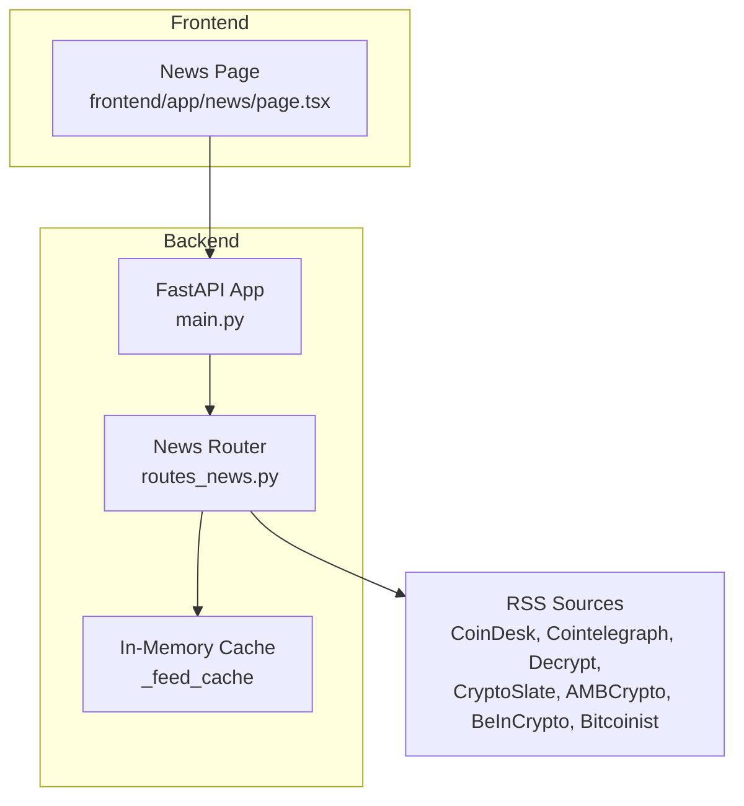
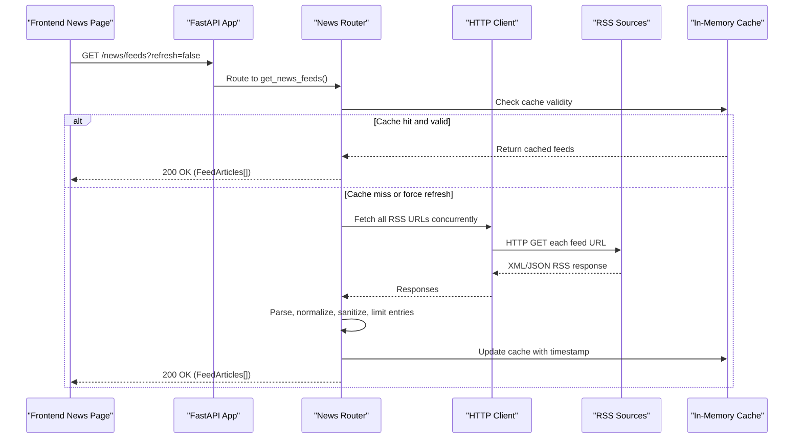
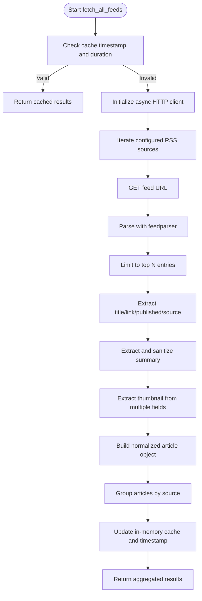
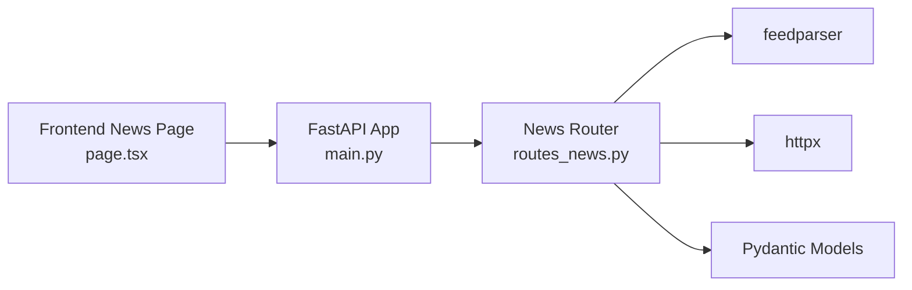

# News Feed Aggregation

<cite>
**Referenced Files in This Document**
- [routes_news.py](file://backend/app/api/routes_news.py)
- [main.py](file://backend/app/main.py)
- [page.tsx](file://frontend/app/news/page.tsx)
</cite>

## Table of Contents
1. [Introduction](#introduction)
2. [Project Structure](#project-structure)
3. [Core Components](#core-components)
4. [Architecture Overview](#architecture-overview)
5. [Detailed Component Analysis](#detailed-component-analysis)
6. [Dependency Analysis](#dependency-analysis)
7. [Performance Considerations](#performance-considerations)
8. [Troubleshooting Guide](#troubleshooting-guide)
9. [Conclusion](#conclusion)

## Introduction
This document describes the news feed aggregation service that collects cryptocurrency news from multiple RSS sources, normalizes and sanitizes content, caches results for performance, and exposes an API to retrieve aggregated feeds. It also explains how the frontend consumes this data and provides guidance on extending the system with filtering by topic or sentiment and integrating news context into trading agent decision-making.

## Project Structure
The news aggregation feature is implemented as a FastAPI router with in-memory caching and consumed by a Next.js frontend page. The backend registers the news router under the /news prefix and pre-populates the cache at startup.

**Diagram sources**
- [main.py:34-38](file://backend/app/main.py#L34-L38)
- [routes_news.py:56-67](file://backend/app/api/routes_news.py#L56-L67)
- [page.tsx:44-54](file://frontend/app/news/page.tsx#L44-L54)

**Section sources**
- [main.py:34-38](file://backend/app/main.py#L34-L38)
- [routes_news.py:56-67](file://backend/app/api/routes_news.py#L56-L67)
- [page.tsx:44-54](file://frontend/app/news/page.tsx#L44-L54)

## Core Components
- News API routes and feed aggregator:
  - Defines models for articles and grouped feed responses.
  - Implements fetching, parsing, normalization, and caching of RSS feeds.
  - Exposes an endpoint to retrieve all feeds with optional refresh.
- Startup pre-fetching:
  - On application startup, triggers background task to populate the news cache.
- Frontend news consumer:
  - Calls the backend endpoint, supports source filtering and chronological sorting.

Key responsibilities:
- RSS parsing and normalization via feedparser.
- Content sanitization (HTML stripping and entity decoding).
- Thumbnail extraction from various feed formats.
- In-memory caching with time-based expiration.
- Graceful error handling per feed source.

**Section sources**
- [routes_news.py:70-82](file://backend/app/api/routes_news.py#L70-L82)
- [routes_news.py:84-152](file://backend/app/api/routes_news.py#L84-L152)
- [main.py:41-54](file://backend/app/main.py#L41-L54)
- [page.tsx:44-83](file://frontend/app/news/page.tsx#L44-L83)

## Architecture Overview
The service follows a simple request-driven architecture:
- Client requests news via HTTP.
- Backend checks in-memory cache; if stale or forced refresh, fetches from configured RSS sources.
- Each feed is parsed, normalized, sanitized, and limited to top entries.
- Results are cached and returned to the client.

**Diagram sources**
- [routes_news.py:84-152](file://backend/app/api/routes_news.py#L84-L152)
- [routes_news.py:155-162](file://backend/app/api/routes_news.py#L155-L162)
- [main.py:41-54](file://backend/app/main.py#L41-L54)

## Detailed Component Analysis

### RSS Feed Parsing and Normalization
- Parsing: Uses feedparser to parse RSS/Atom feeds.
- Entry selection: Limits to the first 10 entries per feed.
- Summary extraction: Tries summary, description, and content fields; strips HTML tags and decodes common entities; truncates to a fixed length.
- Thumbnail extraction: Supports media_thumbnail, media_content, enclosures, and image fields.
- Normalized model: Produces structured article objects with title, link, published date, source name, summary, and thumbnail.

**Diagram sources**
- [routes_news.py:84-152](file://backend/app/api/routes_news.py#L84-L152)
- [routes_news.py:16-31](file://backend/app/api/routes_news.py#L16-L31)
- [routes_news.py:34-54](file://backend/app/api/routes_news.py#L34-L54)

**Section sources**
- [routes_news.py:16-31](file://backend/app/api/routes_news.py#L16-L31)
- [routes_news.py:34-54](file://backend/app/api/routes_news.py#L34-L54)
- [routes_news.py:101-146](file://backend/app/api/routes_news.py#L101-L146)

### News Source Configuration
- Supported sources are defined in a dictionary mapping friendly names to RSS URLs.
- Current supported sources:
  - CoinDesk
  - Cointelegraph
  - Decrypt
  - CryptoSlate
  - AMBCrypto
  - BeInCrypto
  - Bitcoinist

These can be extended by adding new key-value pairs to the configuration map.

**Section sources**
- [routes_news.py:58-67](file://backend/app/api/routes_news.py#L58-L67)

### Content Filtering and Sanitization
- HTML tag removal and whitespace trimming.
- Common HTML entity decoding (e.g., &nbsp;, &amp;, &lt;, &gt;, &quot;, &#39;).
- Summary length limiting to reduce payload size.
- No explicit topic or sentiment filters are implemented in the backend; filtering occurs in the frontend by source and view mode.

**Section sources**
- [routes_news.py:16-31](file://backend/app/api/routes_news.py#L16-L31)
- [routes_news.py:34-54](file://backend/app/api/routes_news.py#L34-L54)
- [page.tsx:62-83](file://frontend/app/news/page.tsx#L62-L83)

### Deduplication and Categorization by Relevance
- Deduplication: Not implemented; each feed returns independent articles.
- Categorization by relevance to trading signals: Not implemented in the current codebase.
- Integration with trading agents: The news module does not currently pass news context into signal generation.

Recommendations:
- Add deduplication by canonicalizing links or titles before returning results.
- Implement topic tagging (e.g., regulation, technology, market) and sentiment scoring (positive/negative/neutral) using an LLM or classifier.
- Expose additional query parameters to filter by topic/sentiment and integrate with the signals pipeline.

[No sources needed since this section proposes extensions without analyzing specific files]

### API Endpoints
- GET /news/feeds
  - Query parameter: refresh (boolean)
  - Behavior: Returns aggregated feeds from all configured sources; uses cache unless refresh=true.
  - Response: Array of grouped feed objects containing source and list of articles.

Example usage:
- Frontend calls GET /news/feeds to load initial data.
- Optional refresh=true forces re-fetching from sources.

**Section sources**
- [routes_news.py:155-162](file://backend/app/api/routes_news.py#L155-L162)
- [page.tsx:44-54](file://frontend/app/news/page.tsx#L44-L54)

### Update Frequency Settings
- Cache duration: Configured constant controls how long cached results remain valid.
- Pre-population: On application startup, a background task attempts to populate the cache immediately.

Operational notes:
- Adjust cache duration to balance freshness vs. performance.
- Use refresh=true when clients need immediate updates.

**Section sources**
- [routes_news.py:10-13](file://backend/app/api/routes_news.py#L10-L13)
- [routes_news.py:92-97](file://backend/app/api/routes_news.py#L92-L97)
- [main.py:41-54](file://backend/app/main.py#L41-L54)

### Error Handling for Broken Feeds
- Per-source exception handling: If a feed fails to fetch or parse, the error is logged and an empty article list is returned for that source.
- Overall behavior: Other feeds continue processing unaffected.

Best practices:
- Consider logging structured errors and metrics for failed sources.
- Implement retry logic with exponential backoff for transient failures.

**Section sources**
- [routes_news.py:140-146](file://backend/app/api/routes_news.py#L140-L146)

### Rate Limiting for Feed Sources
- Current implementation: No rate limiting between concurrent feed requests.
- Risk: Potential overloading of external RSS providers.

Recommendations:
- Introduce a concurrency limiter or semaphore to throttle requests per source.
- Add per-source delay or jitter to avoid thundering herds.
- Consider implementing circuit breaker patterns for failing sources.

[No sources needed since this section provides general guidance]

### Caching Strategies
- In-memory cache: Stores aggregated results and a timestamp.
- Cache validation: Checks elapsed time against configured duration.
- Forced refresh: Bypasses cache when requested.

Enhancements:
- Persist cache across process restarts using Redis or a file-backed store.
- Implement invalidation strategies based on source-specific update frequencies.
- Add cache statistics (hit/miss ratios) for monitoring.

**Section sources**
- [routes_news.py:10-13](file://backend/app/api/routes_news.py#L10-L13)
- [routes_news.py:92-97](file://backend/app/api/routes_news.py#L92-L97)
- [routes_news.py:148-152](file://backend/app/api/routes_news.py#L148-L152)

### Integrating News Context into Trading Agent Decision-Making
- Current state: News aggregation is isolated from the signals pipeline.
- Proposed integration:
  - Compute topic tags and sentiment scores for each article.
  - Aggregate sentiment by token pair or market segment.
  - Pass aggregated news context to the signal generator alongside market data.
  - Adjust confidence scores or explanations based on news sentiment and relevance.

Implementation outline:
- Extend the aggregator to compute metadata (topics, sentiment).
- Modify the signals route to accept optional news context.
- Update prompt templates to include relevant news summaries.

[No sources needed since this section proposes extensions without analyzing specific files]

## Dependency Analysis
The news aggregation feature depends on:
- FastAPI routing and Pydantic models for request/response validation.
- feedparser for RSS parsing.
- httpx for asynchronous HTTP requests.
- Frontend Next.js page for UI consumption.

**Diagram sources**
- [routes_news.py:1-8](file://backend/app/api/routes_news.py#L1-L8)
- [main.py:4-11](file://backend/app/main.py#L4-L11)
- [page.tsx:1-18](file://frontend/app/news/page.tsx#L1-L18)

**Section sources**
- [routes_news.py:1-8](file://backend/app/api/routes_news.py#L1-L8)
- [main.py:4-11](file://backend/app/main.py#L4-L11)
- [page.tsx:1-18](file://frontend/app/news/page.tsx#L1-L18)

## Performance Considerations
- Concurrency: All RSS sources are fetched concurrently within a single HTTP client session.
- Payload size: Summaries are truncated to a fixed length.
- Cache hits: Reduce external network calls during cache lifetime.
- Recommendations:
  - Monitor memory usage for large caches.
  - Tune cache duration based on source update cadence.
  - Add timeouts and retries to handle slow or flaky sources.

[No sources needed since this section provides general guidance]

## Troubleshooting Guide
Common issues and resolutions:
- Empty articles for a source:
  - Cause: Network error, malformed RSS, or source unavailable.
  - Action: Check logs for per-source errors; verify RSS URL availability.
- Stale data:
  - Cause: Cache still valid.
  - Action: Call endpoint with refresh=true.
- Frontend display errors:
  - Cause: Backend returns non-OK status or malformed JSON.
  - Action: Inspect network tab; ensure correct endpoint and CORS settings.

Operational tips:
- Validate RSS endpoints periodically.
- Add health checks for external dependencies.
- Instrument cache hit rates and latency.

**Section sources**
- [routes_news.py:140-146](file://backend/app/api/routes_news.py#L140-L146)
- [page.tsx:44-59](file://frontend/app/news/page.tsx#L44-L59)

## Conclusion
The news feed aggregation service provides a robust foundation for collecting and presenting cryptocurrency news from multiple RSS sources. It includes content sanitization, basic normalization, and in-memory caching. While topic/sentiment filtering and deduplication are not yet implemented, the modular design allows straightforward extension. Integrating news context into the trading agent pipeline can enhance decision quality by incorporating market-moving information alongside technical signals.