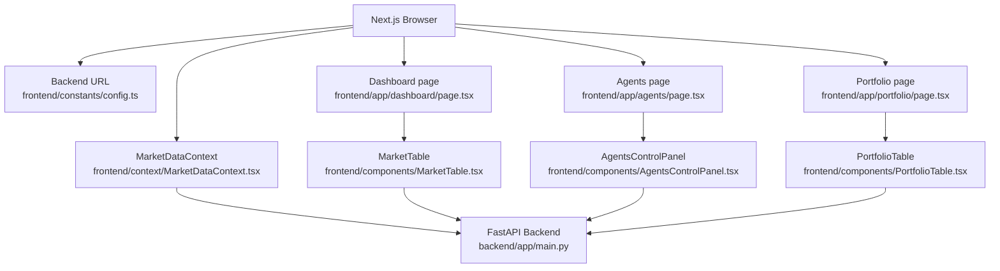
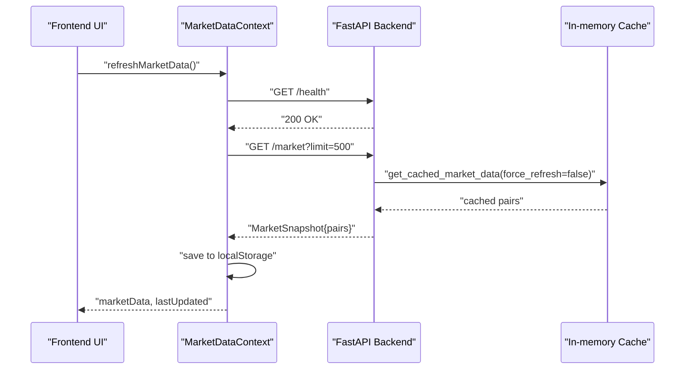
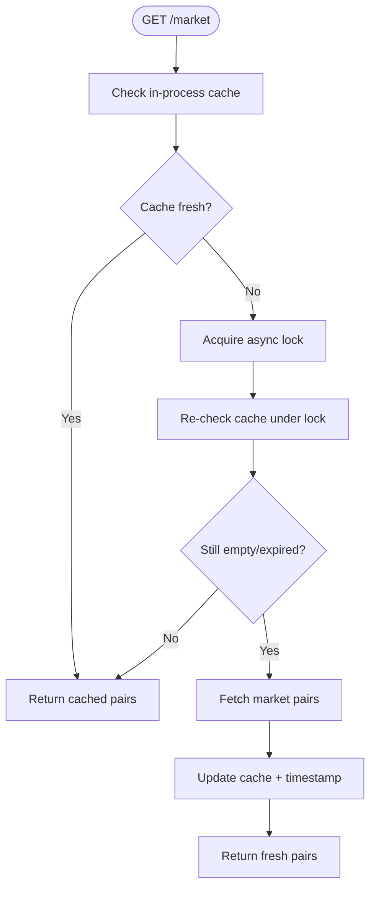
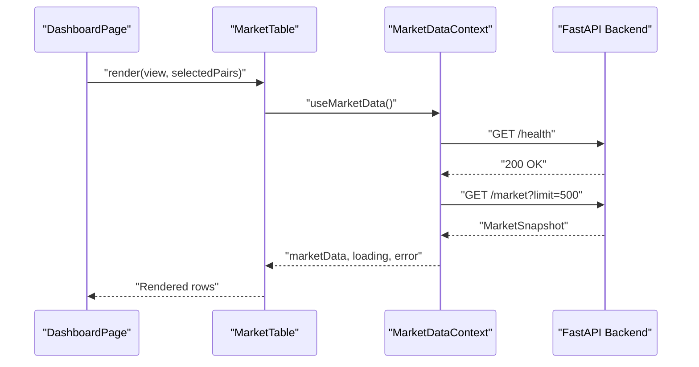
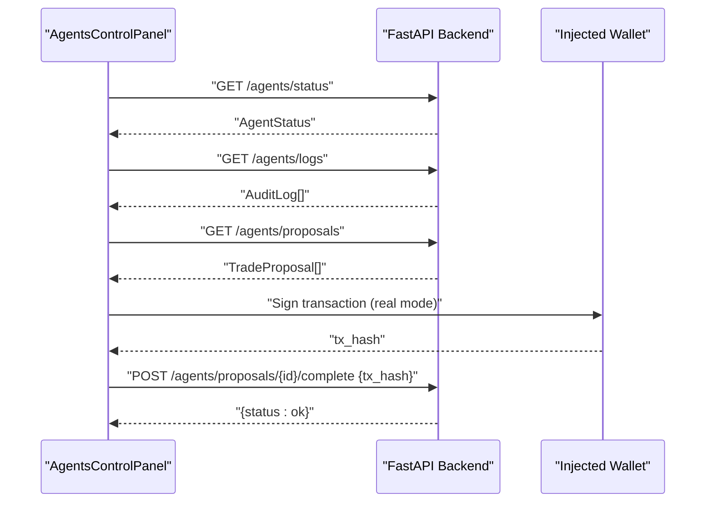
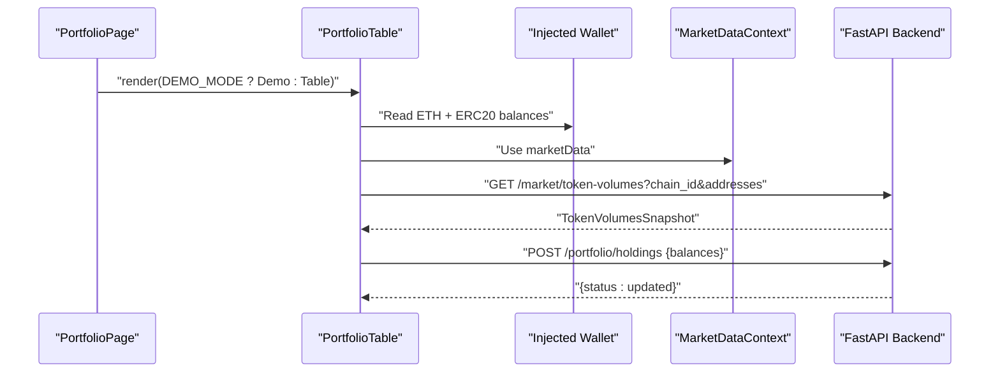
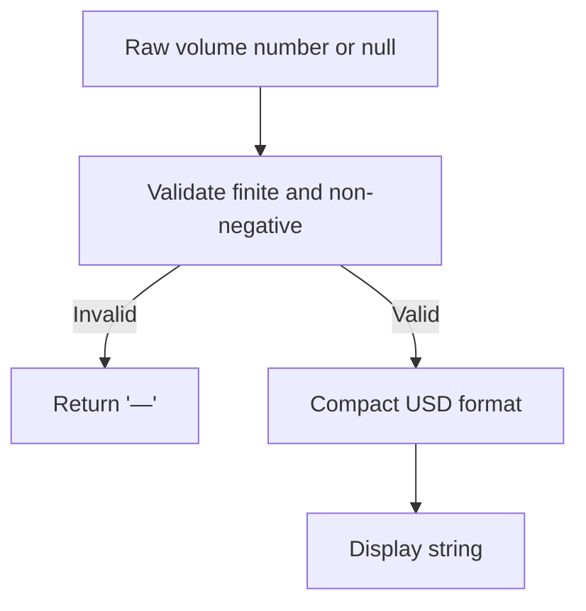
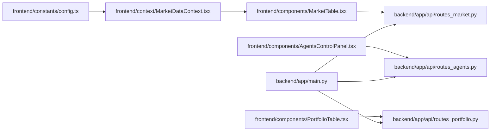

# API Integration & Data Fetching

<cite>
**Referenced Files in This Document**
- [README.md](file://README.md)
- [backend/app/main.py](file://backend/app/main.py)
- [backend/app/api/routes_market.py](file://backend/app/api/routes_market.py)
- [backend/app/api/routes_portfolio.py](file://backend/app/api/routes_portfolio.py)
- [backend/app/api/routes_agents.py](file://backend/app/api/routes_agents.py)
- [frontend/constants/config.ts](file://frontend/constants/config.ts)
- [frontend/context/MarketDataContext.tsx](file://frontend/context/MarketDataContext.tsx)
- [frontend/components/MarketTable.tsx](file://frontend/components/MarketTable.tsx)
- [frontend/components/AgentsControlPanel.tsx](file://frontend/components/AgentsControlPanel.tsx)
- [frontend/components/PortfolioTable.tsx](file://frontend/components/PortfolioTable.tsx)
- [frontend/lib/marketFormatting.ts](file://frontend/lib/marketFormatting.ts)
</cite>

## Table of Contents
1. [Introduction](#introduction)
2. [Project Structure](#project-structure)
3. [Core Components](#core-components)
4. [Architecture Overview](#architecture-overview)
5. [Detailed Component Analysis](#detailed-component-analysis)
6. [Dependency Analysis](#dependency-analysis)
7. [Performance Considerations](#performance-considerations)
8. [Troubleshooting Guide](#troubleshooting-guide)
9. [Conclusion](#conclusion)

## Introduction
This document explains how the Next.js frontend integrates with the FastAPI backend to fetch market data, manage agent proposals, and record portfolio activity. It covers request/response handling, error management, data transformation, caching, real-time polling, optimistic updates, authentication posture, rate limiting considerations, and performance optimization techniques. The focus is on the Dashboard, Agents, and Portfolio sections.

The application is intentionally unauthenticated at the API layer: CORS controls browser access, but there is no user identity or authorization middleware. Security relies on localhost defaults and deployment boundaries.

**Section sources**
- [README.md:101-114](file://README.md#L101-L114)
- [backend/app/main.py:16-32](file://backend/app/main.py#L16-L32)

## Project Structure
At a high level:
- Backend: FastAPI app registers routers for `/market`, `/portfolio`, `/agents`, `/signals`, and `/news`. Startup pre-warms market and news caches.
- Frontend: Next.js App Router pages compose UI components that consume React contexts and call the backend through `NEXT_PUBLIC_BACKEND_URL`.

**Diagram sources**
- [backend/app/main.py:34-38](file://backend/app/main.py#L34-L38)
- [frontend/constants/config.ts:1-7](file://frontend/constants/config.ts#L1-L7)
- [frontend/context/MarketDataContext.tsx:28-64](file://frontend/context/MarketDataContext.tsx#L28-L64)
- [frontend/components/MarketTable.tsx:21-23](file://frontend/components/MarketTable.tsx#L21-L23)
- [frontend/components/AgentsControlPanel.tsx:51-68](file://frontend/components/AgentsControlPanel.tsx#L51-L68)
- [frontend/components/PortfolioTable.tsx:28-44](file://frontend/components/PortfolioTable.tsx#L28-L44)

**Section sources**
- [README.md:116-144](file://README.md#L116-L144)
- [backend/app/main.py:34-38](file://backend/app/main.py#L34-L38)
- [frontend/constants/config.ts:1-7](file://frontend/constants/config.ts#L1-L7)

## Core Components
- Backend entrypoint and CORS configuration.
- Market data router with in-process caching and rate-limit-aware fallbacks.
- Agent control router exposing lifecycle, state, logs, and proposal completion/rejection.
- Portfolio router for trade recording, trade listing, CSV export, and demo-mode endpoints.
- Frontend market context providing health checks, localStorage-backed persistence, and refresh.
- Page-specific components: MarketTable, AgentsControlPanel, PortfolioTable.
- Formatting utility for compact USD values.

Key responsibilities:
- Backend routes validate inputs, cache upstream results, and return typed responses.
- Frontend contexts and components handle loading states, errors, polling, and optimistic UX.
- Data transformation occurs both server-side (Pydantic models) and client-side (React state).

**Section sources**
- [backend/app/main.py:14-38](file://backend/app/main.py#L14-L38)
- [backend/app/api/routes_market.py:15-58](file://backend/app/api/routes_market.py#L15-L58)
- [backend/app/api/routes_agents.py:9-149](file://backend/app/api/routes_agents.py#L9-L149)
- [backend/app/api/routes_portfolio.py:15-155](file://backend/app/api/routes_portfolio.py#L15-L155)
- [frontend/context/MarketDataContext.tsx:28-150](file://frontend/context/MarketDataContext.tsx#L28-L150)
- [frontend/components/MarketTable.tsx:21-107](file://frontend/components/MarketTable.tsx#L21-L107)
- [frontend/components/AgentsControlPanel.tsx:51-174](file://frontend/components/AgentsControlPanel.tsx#L51-L174)
- [frontend/components/PortfolioTable.tsx:28-97](file://frontend/components/PortfolioTable.tsx#L28-L97)
- [frontend/lib/marketFormatting.ts:1-12](file://frontend/lib/marketFormatting.ts#L1-L12)

## Architecture Overview
The frontend communicates with the backend over HTTP using `fetch`. There is no authentication middleware; CORS is configured by environment variables. The backend exposes REST endpoints grouped by feature.

**Diagram sources**
- [frontend/context/MarketDataContext.tsx:66-121](file://frontend/context/MarketDataContext.tsx#L66-L121)
- [backend/app/api/routes_market.py:26-58](file://backend/app/api/routes_market.py#L26-L58)
- [backend/app/main.py:57-59](file://backend/app/main.py#L57-L59)

## Detailed Component Analysis

### Market Data Pipeline
The market pipeline combines an in-process cache with a short health check and optional forced refresh.

- Backend cache:
  - Global list cache with timestamp and lock.
  - 3,600-second default duration.
  - Lock prevents duplicate upstream calls during warm-up.
- Endpoints:
  - `GET /market` returns limited pairs from cache.
  - `GET /gainers-losers` sorts cached pairs by 24h change.
  - `GET /base-tokens` serves cached ranking or falls back to stale snapshot on 429.
  - `GET /market/token-volumes` validates chain_id and addresses, batches missing volumes, and caps cache size.

**Diagram sources**
- [backend/app/api/routes_market.py:17-51](file://backend/app/api/routes_market.py#L17-L51)

**Section sources**
- [backend/app/api/routes_market.py:17-58](file://backend/app/api/routes_market.py#L17-L58)
- [backend/app/api/routes_market.py:70-109](file://backend/app/api/routes_market.py#L70-L109)
- [backend/app/api/routes_market.py:112-172](file://backend/app/api/routes_market.py#L112-L172)

### Dashboard Integration
The Dashboard composes the MarketTable and SignalsPanel. MarketTable consumes `useMarketData` and supports search, sorting, tracked pairs, gainers/losers, and volume views.

- Loading and error states are surfaced directly in the table.
- Manual refresh triggers `refreshMarketData`, which performs a health check then fetches `/market`.
- LocalStorage provides instant display while fresh data loads.

**Diagram sources**
- [frontend/app/dashboard/page.tsx:11-75](file://frontend/app/dashboard/page.tsx#L11-L75)
- [frontend/components/MarketTable.tsx:21-107](file://frontend/components/MarketTable.tsx#L21-L107)
- [frontend/context/MarketDataContext.tsx:66-121](file://frontend/context/MarketDataContext.tsx#L66-L121)

**Section sources**
- [frontend/app/dashboard/page.tsx:11-75](file://frontend/app/dashboard/page.tsx#L11-L75)
- [frontend/components/MarketTable.tsx:21-107](file://frontend/components/MarketTable.tsx#L21-L107)
- [frontend/context/MarketDataContext.tsx:28-150](file://frontend/context/MarketDataContext.tsx#L28-L150)

### Agents Integration
The Agents page renders `AgentsControlPanel`, which polls backend status, logs, and proposals every two seconds. It also syncs wallet-derived holdings to the backend so agents can use current balances.

Key flows:
- Polling loop: status, logs, proposals.
- Start/stop agents with optional monitored tokens and holdings.
- Proposal execution path:
  - Demo mode: simulate fill via `/agents/proposals/{id}/complete`.
  - Real mode: open TradePreviewModal, sign transaction, then POST tx_hash to complete.
- Kill switch: halt/resume trading.

**Diagram sources**
- [frontend/components/AgentsControlPanel.tsx:140-174](file://frontend/components/AgentsControlPanel.tsx#L140-L174)
- [frontend/components/AgentsControlPanel.tsx:207-267](file://frontend/components/AgentsControlPanel.tsx#L207-L267)
- [backend/app/api/routes_agents.py:87-116](file://backend/app/api/routes_agents.py#L87-L116)

**Section sources**
- [frontend/app/agents/page.tsx:1-17](file://frontend/app/agents/page.tsx#L1-L17)
- [frontend/components/AgentsControlPanel.tsx:51-174](file://frontend/components/AgentsControlPanel.tsx#L51-L174)
- [frontend/components/AgentsControlPanel.tsx:176-280](file://frontend/components/AgentsControlPanel.tsx#L176-L280)
- [backend/app/api/routes_agents.py:20-149](file://backend/app/api/routes_agents.py#L20-L149)

### Portfolio Integration
The Portfolio page shows either a simulated demo portfolio or a live holdings table. Holdings are read from the injected wallet, priced using market data from context, and optionally enriched with DEX volume from `/market/token-volumes`.

Important behaviors:
- Wallet balance reads occur per token contract.
- Prices come from `useMarketData` rather than direct API calls.
- Volume requests are aborted when holdings change.
- Holdings are synced to the backend for agent risk calculations.

**Diagram sources**
- [frontend/app/portfolio/page.tsx:1-17](file://frontend/app/portfolio/page.tsx#L1-L17)
- [frontend/components/PortfolioTable.tsx:82-97](file://frontend/components/PortfolioTable.tsx#L82-L97)
- [frontend/components/PortfolioTable.tsx:64-80](file://frontend/components/PortfolioTable.tsx#L64-L80)
- [frontend/components/PortfolioTable.tsx:272-283](file://frontend/components/PortfolioTable.tsx#L272-L283)
- [backend/app/api/routes_portfolio.py:63-68](file://backend/app/api/routes_portfolio.py#L63-L68)

**Section sources**
- [frontend/app/portfolio/page.tsx:1-17](file://frontend/app/portfolio/page.tsx#L1-L17)
- [frontend/components/PortfolioTable.tsx:28-97](file://frontend/components/PortfolioTable.tsx#L28-L97)
- [frontend/components/PortfolioTable.tsx:64-80](file://frontend/components/PortfolioTable.tsx#L64-L80)
- [frontend/components/PortfolioTable.tsx:272-283](file://frontend/components/PortfolioTable.tsx#L272-L283)
- [backend/app/api/routes_portfolio.py:63-68](file://backend/app/api/routes_portfolio.py#L63-L68)

### Data Transformation Utilities
- Compact USD formatting for volume columns uses `Intl.NumberFormat` with compact notation.
- Market data shapes are normalized by Pydantic models on the backend and consumed as plain objects in React.

**Diagram sources**
- [frontend/lib/marketFormatting.ts:1-12](file://frontend/lib/marketFormatting.ts#L1-L12)

**Section sources**
- [frontend/lib/marketFormatting.ts:1-12](file://frontend/lib/marketFormatting.ts#L1-L12)

## Dependency Analysis
The frontend depends on:
- `NEXT_PUBLIC_BACKEND_URL` for all backend calls.
- React contexts for shared state (`MarketDataContext`).
- Wallet provider for balances and signing.

The backend depends on:
- FastAPI routers for each domain.
- In-process caches for market data and token volumes.
- External services (CoinMarketCap, CoinGecko, GeckoTerminal) behind service modules.

**Diagram sources**
- [frontend/constants/config.ts:1-7](file://frontend/constants/config.ts#L1-L7)
- [frontend/context/MarketDataContext.tsx:28-64](file://frontend/context/MarketDataContext.tsx#L28-L64)
- [frontend/components/MarketTable.tsx:21-23](file://frontend/components/MarketTable.tsx#L21-L23)
- [frontend/components/AgentsControlPanel.tsx:140-174](file://frontend/components/AgentsControlPanel.tsx#L140-L174)
- [frontend/components/PortfolioTable.tsx:82-97](file://frontend/components/PortfolioTable.tsx#L82-L97)
- [backend/app/main.py:34-38](file://backend/app/main.py#L34-L38)
- [backend/app/api/routes_market.py:15-58](file://backend/app/api/routes_market.py#L15-L58)
- [backend/app/api/routes_agents.py:9-149](file://backend/app/api/routes_agents.py#L9-L149)
- [backend/app/api/routes_portfolio.py:15-155](file://backend/app/api/routes_portfolio.py#L15-L155)

**Section sources**
- [frontend/constants/config.ts:1-7](file://frontend/constants/config.ts#L1-L7)
- [backend/app/main.py:34-38](file://backend/app/main.py#L34-L38)

## Performance Considerations
- Backend startup pre-warms market and news caches to reduce first-request latency.
- Market data cache avoids repeated upstream calls for up to one hour.
- Base-token rankings and token volumes have shorter caches (five minutes) to keep dashboards responsive.
- Token volume endpoint validates input early to avoid unnecessary upstream calls and caps cache entries.
- Frontend market context persists data to localStorage for instant display and retries background refresh.
- Agents panel polls every two seconds; consider adjusting polling frequency based on network conditions.
- Portfolio volume requests are aborted on new holdings fetches to prevent race conditions and wasted work.

Recommendations:
- Use `force_refresh` sparingly; rely on cache for normal dashboard updates.
- Debounce manual refresh actions if users trigger them frequently.
- For large proposal lists, paginate or limit on the backend before rendering.
- Avoid re-fetching volumes when the chain changes; reuse valid cached entries.

**Section sources**
- [backend/app/main.py:41-54](file://backend/app/main.py#L41-L54)
- [backend/app/api/routes_market.py:17-51](file://backend/app/api/routes_market.py#L17-L51)
- [backend/app/api/routes_market.py:70-109](file://backend/app/api/routes_market.py#L70-L109)
- [backend/app/api/routes_market.py:112-172](file://backend/app/api/routes_market.py#L112-L172)
- [frontend/context/MarketDataContext.tsx:34-64](file://frontend/context/MarketDataContext.tsx#L34-L64)
- [frontend/components/AgentsControlPanel.tsx:168-174](file://frontend/components/AgentsControlPanel.tsx#L168-L174)
- [frontend/components/PortfolioTable.tsx:64-80](file://frontend/components/PortfolioTable.tsx#L64-L80)

## Troubleshooting Guide
Common issues and resolutions:
- Backend not ready:
  - Frontend health check fails; show a friendly message and retry later.
  - Ensure the backend process is running and CORS allows the dev origin.
- Rate-limited base-token ranking:
  - Backend serves the previous successful snapshot instead of failing the tab.
  - Retry after a delay or disable force refresh.
- Invalid token volume query:
  - Ensure `chain_id` is one of the supported networks and `addresses` contains unique, well-formed Ethereum addresses.
- No proposals showing:
  - Verify `/agents/proposals` returns data and the polling interval is active.
  - Check logs for rejected proposals.
- Portfolio volume column blank:
  - Confirm the wallet chain matches a supported chain and the address list is non-empty.
  - Abort controller should cancel stale requests on new holdings fetch.

Operational notes:
- All routes are unauthenticated; do not expose the API without adding auth in front.
- CORS defaults to local origins; set `CORS_ORIGINS` carefully when deploying.
- Demo mode disables real trade recording and replaces certain flows with simulated behavior.

**Section sources**
- [frontend/context/MarketDataContext.tsx:66-121](file://frontend/context/MarketDataContext.tsx#L66-L121)
- [backend/app/api/routes_market.py:76-109](file://backend/app/api/routes_market.py#L76-L109)
- [backend/app/api/routes_market.py:121-140](file://backend/app/api/routes_market.py#L121-L140)
- [frontend/components/AgentsControlPanel.tsx:140-174](file://frontend/components/AgentsControlPanel.tsx#L140-L174)
- [frontend/components/PortfolioTable.tsx:64-80](file://frontend/components/PortfolioTable.tsx#L64-L80)
- [README.md:101-114](file://README.md#L101-L114)

## Conclusion
The DexTrader integration pattern separates concerns cleanly:
- The backend owns data acquisition, validation, caching, and agent state.
- The frontend owns presentation, user interactions, and lightweight orchestration such as polling and optimistic updates.
- Market data is cached aggressively on the server and persisted locally for resilience.
- Real-time updates are achieved through periodic polling for agent state and proposals.
- Error handling is explicit: health checks, graceful fallbacks on rate limits, and clear UI states for loading and failures.
- Authentication is absent at the API layer; security must be enforced at the deployment boundary.

For production hardening, consider adding API authentication, request throttling, pagination for large datasets, and more robust error boundaries in the frontend.