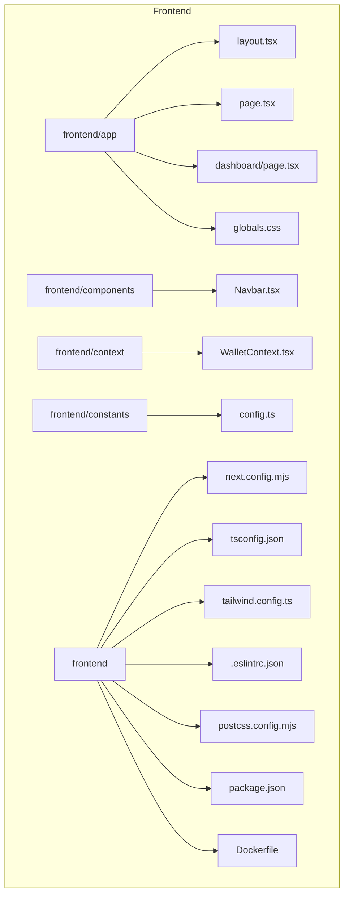
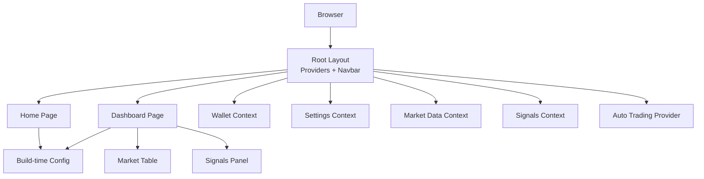
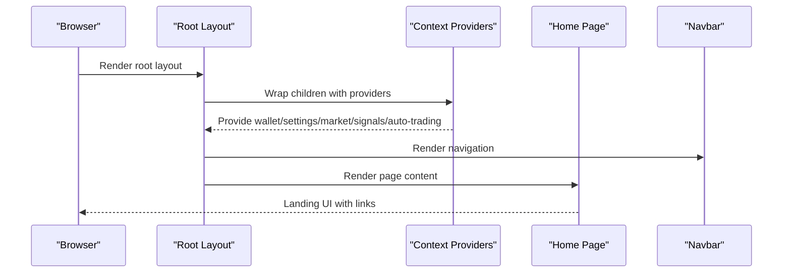
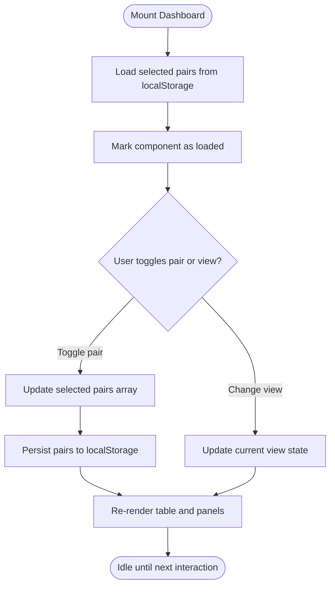
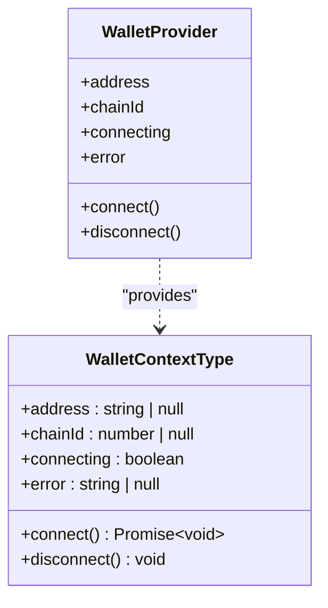
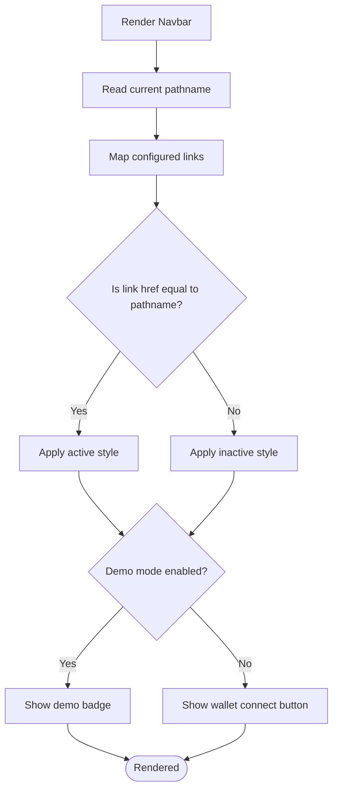
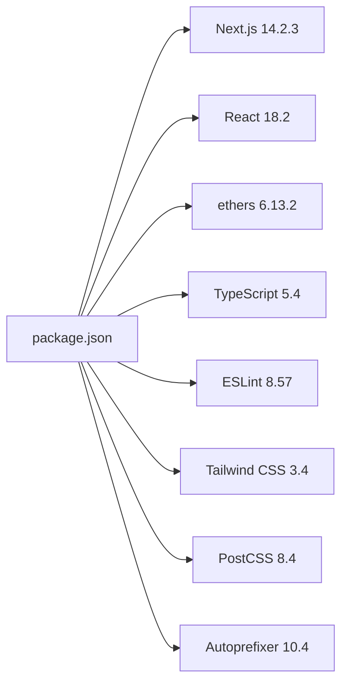

# Application Structure & Architecture

<cite>
**Referenced Files in This Document**
- [next.config.mjs](file://frontend/next.config.mjs)
- [package.json](file://frontend/package.json)
- [tsconfig.json](file://frontend/tsconfig.json)
- [tailwind.config.ts](file://frontend/tailwind.config.ts)
- [.eslintrc.json](file://frontend/.eslintrc.json)
- [postcss.config.mjs](file://frontend/postcss.config.mjs)
- [app/layout.tsx](file://frontend/app/layout.tsx)
- [app/page.tsx](file://frontend/app/page.tsx)
- [app/globals.css](file://frontend/app/globals.css)
- [components/Navbar.tsx](file://frontend/components/Navbar.tsx)
- [constants/config.ts](file://frontend/constants/config.ts)
- [context/WalletContext.tsx](file://frontend/context/WalletContext.tsx)
- [app/dashboard/page.tsx](file://frontend/app/dashboard/page.tsx)
- [Dockerfile](file://frontend/Dockerfile)
- [docker-compose.yml](file://docker-compose.yml)
- [README.md](file://README.md)
</cite>

## Table of Contents
1. [Introduction](#introduction)
2. [Project Structure](#project-structure)
3. [Core Components](#core-components)
4. [Architecture Overview](#architecture-overview)
5. [Detailed Component Analysis](#detailed-component-analysis)
6. [Dependency Analysis](#dependency-analysis)
7. [Performance Considerations](#performance-considerations)
8. [Troubleshooting Guide](#troubleshooting-guide)
9. [Conclusion](#conclusion)
10. [Appendices](#appendices)

## Introduction
This document explains the Next.js frontend architecture for DexTrader, focusing on the App Router setup, layout hierarchy, page organization, configuration files, TypeScript and ESLint settings, Tailwind CSS styling approach, build and deployment configuration, and development workflow. The goal is to make the structure understandable for both new contributors and experienced developers.

## Project Structure
The Next.js application lives under `frontend/` and uses the App Router with a clear separation between pages, shared components, global contexts, constants, and utilities.

**Diagram sources**
- [app/layout.tsx:1-41](file://frontend/app/layout.tsx#L1-L41)
- [app/page.tsx:1-40](file://frontend/app/page.tsx#L1-L40)
- [app/dashboard/page.tsx:1-76](file://frontend/app/dashboard/page.tsx#L1-L76)
- [components/Navbar.tsx:1-54](file://frontend/components/Navbar.tsx#L1-L54)
- [context/WalletContext.tsx:1-118](file://frontend/context/WalletContext.tsx#L1-L118)
- [constants/config.ts:1-8](file://frontend/constants/config.ts#L1-L8)
- [next.config.mjs:1-5](file://frontend/next.config.mjs#L1-L5)
- [tsconfig.json:1-41](file://frontend/tsconfig.json#L1-L41)
- [tailwind.config.ts:1-29](file://frontend/tailwind.config.ts#L1-L29)
- [.eslintrc.json:1-4](file://frontend/.eslintrc.json#L1-L4)
- [postcss.config.mjs:1-8](file://frontend/postcss.config.mjs#L1-L8)
- [package.json:1-31](file://frontend/package.json#L1-L31)
- [Dockerfile:1-25](file://frontend/Dockerfile#L1-L25)

Key observations:
- Pages are defined under `frontend/app` using Next.js App Router conventions.
- Shared UI logic is placed in `frontend/components`.
- Global state providers live in `frontend/context`.
- Build-time environment variables are centralized in `frontend/constants/config.ts`.
- Styling is powered by Tailwind CSS with PostCSS and Autoprefixer.

**Section sources**
- [README.md:116-144](file://README.md#L116-L144)
- [package.json:1-31](file://frontend/package.json#L1-L31)

## Core Components
This section summarizes the most important building blocks of the frontend.

- Root layout and providers
  - The root layout defines metadata, wraps the app in multiple context providers, and renders the navigation bar and main content area.
  - Providers include wallet connectivity, settings, market data, signals, and auto-trading state.

- Home page
  - The home page provides an entry point with links to the dashboard and portfolio, and conditionally shows a wallet connection button depending on demo mode.

- Navigation
  - The navbar renders route links, highlights the active path, and switches between a wallet connect button or a demo-mode badge based on build-time configuration.

- Dashboard page
  - The dashboard manages local view state (all/gainers/losers/tracked/volume), persists selected pairs to localStorage, and composes the market table and signals panel.

- Wallet context
  - The wallet context integrates with the injected Ethereum provider, tracks address and chain changes, and exposes connect/disconnect methods.

- Configuration
  - Backend URL and demo mode flags are exposed as public environment variables at build time.

**Section sources**
- [app/layout.tsx:11-40](file://frontend/app/layout.tsx#L11-L40)
- [app/page.tsx:5-39](file://frontend/app/page.tsx#L5-L39)
- [components/Navbar.tsx:7-52](file://frontend/components/Navbar.tsx#L7-L52)
- [app/dashboard/page.tsx:11-75](file://frontend/app/dashboard/page.tsx#L11-L75)
- [context/WalletContext.tsx:21-117](file://frontend/context/WalletContext.tsx#L21-L117)
- [constants/config.ts:1-8](file://frontend/constants/config.ts#L1-L8)

## Architecture Overview
The frontend follows a layered client-side architecture:
- App Router pages render UI and coordinate data fetching through components and contexts.
- Contexts provide cross-cutting state such as wallet connectivity and settings.
- Components encapsulate reusable UI logic.
- Constants centralize build-time configuration.
- Styling is applied via Tailwind utility classes and a small set of custom theme tokens.

**Diagram sources**
- [app/layout.tsx:16-39](file://frontend/app/layout.tsx#L16-L39)
- [app/page.tsx:5-39](file://frontend/app/page.tsx#L5-L39)
- [app/dashboard/page.tsx:11-75](file://frontend/app/dashboard/page.tsx#L11-L75)
- [context/WalletContext.tsx:21-117](file://frontend/context/WalletContext.tsx#L21-L117)
- [constants/config.ts:1-8](file://frontend/constants/config.ts#L1-L8)

## Detailed Component Analysis

### App Router and Layout Hierarchy
- The root layout sets global metadata, applies the base body styles, and nests all providers around the rendered children.
- It includes a banner, navigation header, and a responsive main container.
- The home page is a simple landing that routes users to the dashboard and portfolio.

**Diagram sources**
- [app/layout.tsx:11-40](file://frontend/app/layout.tsx#L11-L40)
- [app/page.tsx:5-39](file://frontend/app/page.tsx#L5-L39)
- [components/Navbar.tsx:16-52](file://frontend/components/Navbar.tsx#L16-L52)

**Section sources**
- [app/layout.tsx:11-40](file://frontend/app/layout.tsx#L11-L40)
- [app/page.tsx:5-39](file://frontend/app/page.tsx#L5-L39)

### Dashboard Page State Flow
The dashboard manages user-selected pairs and view filters, persisting selections to localStorage.

**Diagram sources**
- [app/dashboard/page.tsx:11-75](file://frontend/app/dashboard/page.tsx#L11-L75)

**Section sources**
- [app/dashboard/page.tsx:11-75](file://frontend/app/dashboard/page.tsx#L11-L75)

### Wallet Context Integration
The wallet context connects to the injected Ethereum provider, listens for account and chain changes, and exposes connect/disconnect operations.

**Diagram sources**
- [context/WalletContext.tsx:4-117](file://frontend/context/WalletContext.tsx#L4-L117)

**Section sources**
- [context/WalletContext.tsx:21-117](file://frontend/context/WalletContext.tsx#L21-L117)

### Navigation Behavior
The navbar highlights the active route and adapts its controls based on demo mode.

**Diagram sources**
- [components/Navbar.tsx:7-52](file://frontend/components/Navbar.tsx#L7-L52)
- [constants/config.ts:1-8](file://frontend/constants/config.ts#L1-L8)

**Section sources**
- [components/Navbar.tsx:16-52](file://frontend/components/Navbar.tsx#L16-L52)
- [constants/config.ts:1-8](file://frontend/constants/config.ts#L1-L8)

## Dependency Analysis
The frontend depends on Next.js, React, ethers, Tailwind CSS, PostCSS, Autoprefixer, TypeScript, and ESLint.

**Diagram sources**
- [package.json:12-28](file://frontend/package.json#L12-L28)

**Section sources**
- [package.json:1-31](file://frontend/package.json#L1-L31)

## Performance Considerations
- Use static generation where possible for pages that do not require runtime data.
- Keep client-only code inside `"use client"` components to avoid unnecessary server rendering.
- Prefer memoization and minimal re-renders in interactive pages like the dashboard.
- Avoid heavy computations in the render path; offload to Web Workers if needed.
- Leverage Tailwind’s purge strategy to minimize CSS size.

[No sources needed since this section provides general guidance]

## Troubleshooting Guide
- Environment variables not taking effect
  - Public variables must be prefixed with `NEXT_PUBLIC_` and are baked into the build.
  - Verify values in Docker build args and compose file when deploying.

- Wallet integration issues
  - Ensure an injected provider is available.
  - Check error messages from the wallet context and confirm network selection in settings.

- Build errors
  - Run type checks and linting before building.
  - Confirm Tailwind content paths include all relevant directories.

- Deployment mismatches
  - Make sure backend URL and demo mode flags match between frontend build and backend configuration.

**Section sources**
- [constants/config.ts:1-8](file://frontend/constants/config.ts#L1-L8)
- [Dockerfile:10-16](file://frontend/Dockerfile#L10-L16)
- [docker-compose.yml:22-32](file://docker-compose.yml#L22-L32)

## Conclusion
The DexTrader frontend is a well-structured Next.js App Router application with clear separation between pages, components, contexts, and configuration. It uses Tailwind CSS for responsive design, TypeScript for type safety, and ESLint for code quality. The build process supports containerized deployment with explicit environment variables for backend connectivity and demo behavior.

[No sources needed since this section summarizes without analyzing specific files]

## Appendices

### Configuration Files Summary
- Next.js configuration
  - Minimal Next.js config with default export.

- TypeScript configuration
  - Strict mode enabled, module resolution set to bundler, JSX preserved, path aliases configured.

- Tailwind CSS configuration
  - Content paths cover app and components directories.
  - Custom color tokens for background, foreground, primary, and secondary.

- PostCSS configuration
  - Enables Tailwind CSS and Autoprefixer.

- ESLint configuration
  - Extends Next.js recommended web vitals rules.

- Package scripts
  - Development, build, start, lint, and test commands.

**Section sources**
- [next.config.mjs:1-5](file://frontend/next.config.mjs#L1-L5)
- [tsconfig.json:1-41](file://frontend/tsconfig.json#L1-L41)
- [tailwind.config.ts:1-29](file://frontend/tailwind.config.ts#L1-L29)
- [postcss.config.mjs:1-8](file://frontend/postcss.config.mjs#L1-L8)
- [.eslintrc.json:1-4](file://frontend/.eslintrc.json#L1-L4)
- [package.json:5-10](file://frontend/package.json#L5-L10)

### Build and Deployment
- Local development
  - Install dependencies and run the development server.

- Building
  - Create a production build with Next.js.

- Containerization
  - Multi-stage Dockerfile installs dependencies, builds the app, and runs it in a minimal runner image.
  - Compose file defines frontend and backend services, binds them to loopback, and passes environment variables.

**Section sources**
- [README.md:35-64](file://README.md#L35-L64)
- [Dockerfile:1-25](file://frontend/Dockerfile#L1-L25)
- [docker-compose.yml:1-36](file://docker-compose.yml#L1-L36)

### Responsive Design Approach
- Mobile-first principles
  - Utility classes are used throughout to ensure layouts adapt across screen sizes.
- Theme tokens
  - Background and foreground colors, plus primary and secondary palettes, are defined in Tailwind configuration.
- Global styles
  - Base Tailwind directives are imported and applied to the body for consistent typography and colors.

**Section sources**
- [tailwind.config.ts:3-24](file://frontend/tailwind.config.ts#L3-L24)
- [app/globals.css:1-9](file://frontend/app/globals.css#L1-L9)