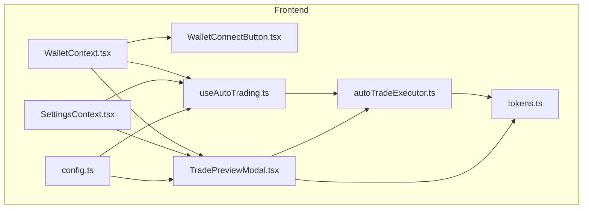
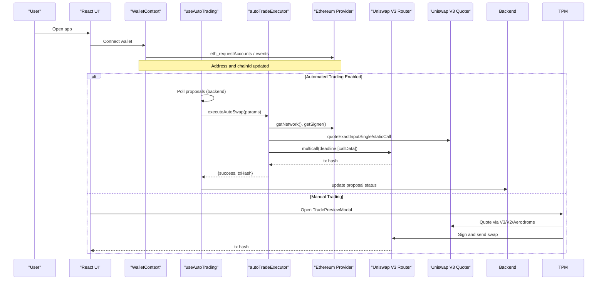
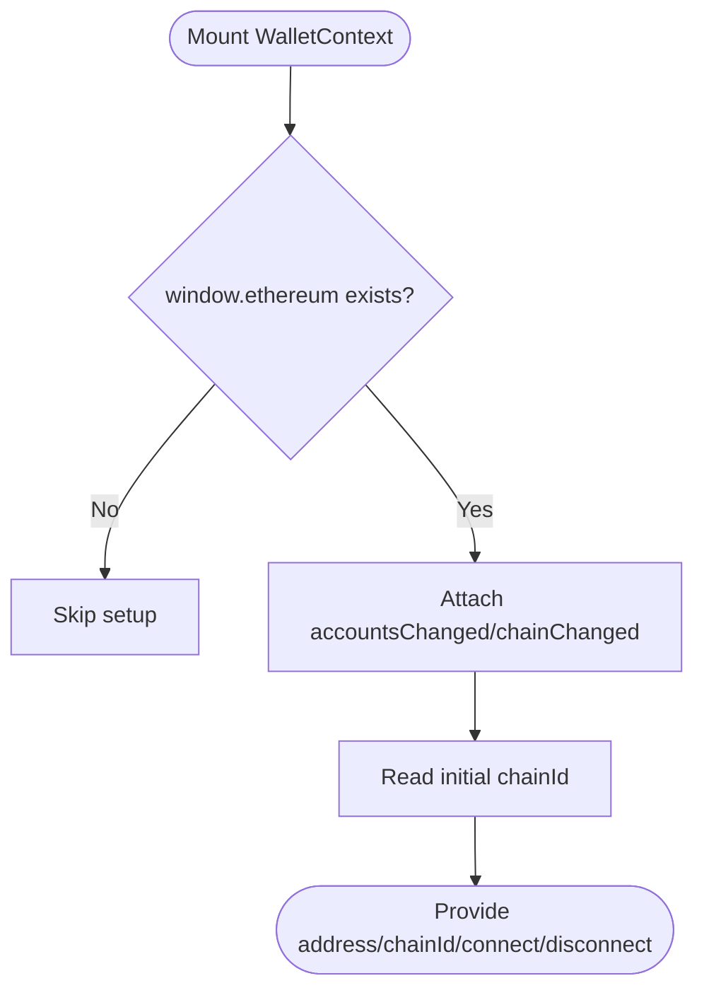
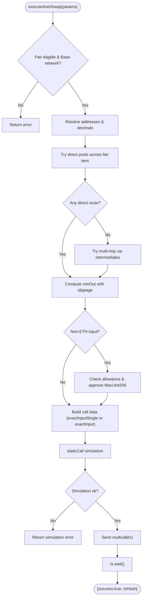
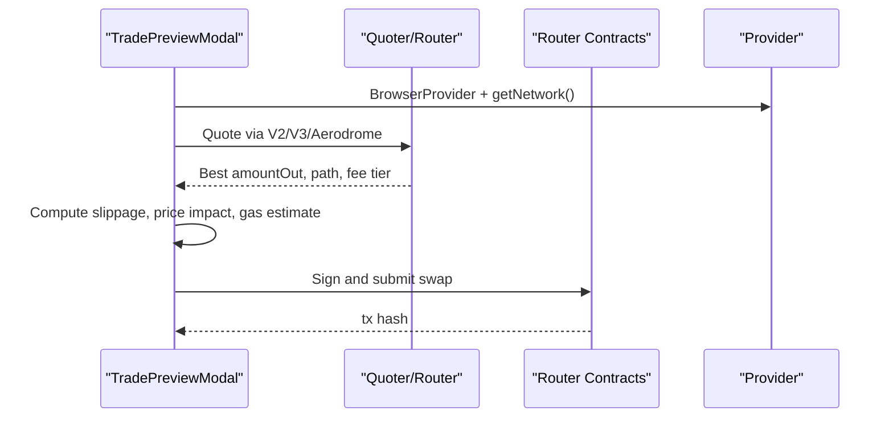
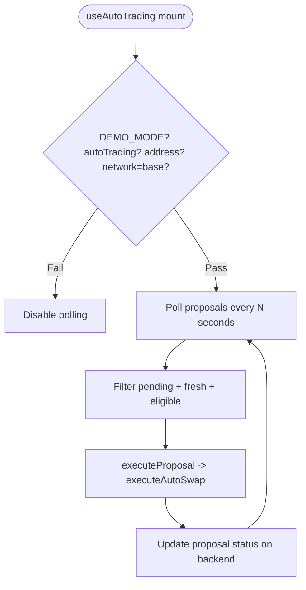
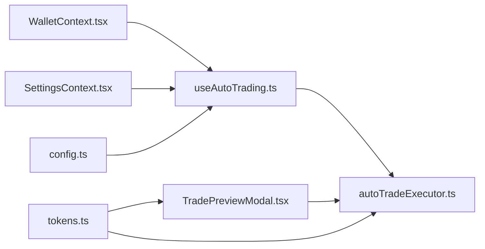

# Blockchain Integration Layer

<cite>
**Referenced Files in This Document**
- [autoTradeExecutor.ts](file://frontend/lib/autoTradeExecutor.ts)
- [TradePreviewModal.tsx](file://frontend/components/TradePreviewModal.tsx)
- [WalletContext.tsx](file://frontend/context/WalletContext.tsx)
- [WalletConnectButton.tsx](file://frontend/components/WalletConnectButton.tsx)
- [useAutoTrading.ts](file://frontend/hooks/useAutoTrading.ts)
- [SettingsContext.tsx](file://frontend/context/SettingsContext.tsx)
- [tokens.ts](file://frontend/constants/tokens.ts)
- [config.ts](file://frontend/constants/config.ts)
</cite>

## Table of Contents
1. [Introduction](#introduction)
2. [Project Structure](#project-structure)
3. [Core Components](#core-components)
4. [Architecture Overview](#architecture-overview)
5. [Detailed Component Analysis](#detailed-component-analysis)
6. [Dependency Analysis](#dependency-analysis)
7. [Performance Considerations](#performance-considerations)
8. [Troubleshooting Guide](#troubleshooting-guide)
9. [Conclusion](#conclusion)

## Introduction
This document explains the blockchain integration layer built with ethers.js for automated and manual trading across multiple networks. It covers wallet connection handling, account management, network switching, automated trade execution via Uniswap V3, transaction signing workflows, gas optimization strategies, TradePreviewModal approval flows, error handling and retry patterns, slippage tolerance, security considerations, transaction monitoring, and debugging guidance.

## Project Structure
The blockchain integration lives primarily in the frontend:
- Wallet connection and state are managed by a React context and a small UI button.
- Automated trading is orchestrated by a hook that polls proposals and executes swaps through an executor module.
- Manual trading uses a modal component that quotes from multiple DEXs (Uniswap V2/V3, Aerodrome) and executes trades.
- Network-specific token addresses and router/quoter contracts are centralized in constants.

**Diagram sources**
- [WalletContext.tsx:1-118](file://frontend/context/WalletContext.tsx#L1-L118)
- [WalletConnectButton.tsx:1-31](file://frontend/components/WalletConnectButton.tsx#L1-L31)
- [SettingsContext.tsx:1-201](file://frontend/context/SettingsContext.tsx#L1-L201)
- [useAutoTrading.ts:1-208](file://frontend/hooks/useAutoTrading.ts#L1-L208)
- [autoTradeExecutor.ts:1-298](file://frontend/lib/autoTradeExecutor.ts#L1-L298)
- [TradePreviewModal.tsx:1-800](file://frontend/components/TradePreviewModal.tsx#L1-L800)
- [tokens.ts:1-128](file://frontend/constants/tokens.ts#L1-L128)
- [config.ts:1-8](file://frontend/constants/config.ts#L1-L8)

**Section sources**
- [WalletContext.tsx:1-118](file://frontend/context/WalletContext.tsx#L1-L118)
- [WalletConnectButton.tsx:1-31](file://frontend/components/WalletConnectButton.tsx#L1-L31)
- [SettingsContext.tsx:1-201](file://frontend/context/SettingsContext.tsx#L1-L201)
- [useAutoTrading.ts:1-208](file://frontend/hooks/useAutoTrading.ts#L1-L208)
- [autoTradeExecutor.ts:1-298](file://frontend/lib/autoTradeExecutor.ts#L1-L298)
- [TradePreviewModal.tsx:1-800](file://frontend/components/TradePreviewModal.tsx#L1-L800)
- [tokens.ts:1-128](file://frontend/constants/tokens.ts#L1-L128)
- [config.ts:1-8](file://frontend/constants/config.ts#L1-L8)

## Core Components
- Wallet connection and account management: WalletContext provides address, chainId, connecting/error states, connect/disconnect, and listens to injected provider events.
- Network settings: SettingsContext persists user-selected network and auto-trading toggles/intervals.
- Automated trading: useAutoTrading polls backend proposals and delegates execution to autoTradeExecutor when eligible.
- Auto-trade executor: autoTradeExecutor performs quote discovery on Uniswap V3, handles approvals, simulates calls, signs transactions, and returns results.
- Manual trading: TradePreviewModal quotes across V2/V3/Aerodrome, shows price impact and gas estimates, and executes trades with safety checks.

**Section sources**
- [WalletContext.tsx:1-118](file://frontend/context/WalletContext.tsx#L1-L118)
- [SettingsContext.tsx:1-201](file://frontend/context/SettingsContext.tsx#L1-L201)
- [useAutoTrading.ts:1-208](file://frontend/hooks/useAutoTrading.ts#L1-L208)
- [autoTradeExecutor.ts:1-298](file://frontend/lib/autoTradeExecutor.ts#L1-L298)
- [TradePreviewModal.tsx:1-800](file://frontend/components/TradePreviewModal.tsx#L1-L800)

## Architecture Overview
The system integrates with Ethereum-compatible chains via an injected provider (e.g., MetaMask). The flow supports both automated and manual trading paths:

**Diagram sources**
- [WalletContext.tsx:38-72](file://frontend/context/WalletContext.tsx#L38-L72)
- [useAutoTrading.ts:124-203](file://frontend/hooks/useAutoTrading.ts#L124-L203)
- [autoTradeExecutor.ts:44-282](file://frontend/lib/autoTradeExecutor.ts#L44-L282)
- [TradePreviewModal.tsx:174-780](file://frontend/components/TradePreviewModal.tsx#L174-L780)

## Detailed Component Analysis

### Wallet Connection and Account Management
- WalletContext initializes by checking existing accounts and listening to accountsChanged and chainChanged events. It exposes connect/disconnect and reactive state for address, chainId, connecting, and error.
- WalletConnectButton renders a simple connect button and displays truncated address or errors.

Key behaviors:
- Reads chainId via eth_chainId and parses hex values safely.
- On connect, requests accounts and updates address; reads chainId post-connect.
- Cleans up event listeners on unmount.

**Diagram sources**
- [WalletContext.tsx:21-72](file://frontend/context/WalletContext.tsx#L21-L72)
- [WalletConnectButton.tsx:4-30](file://frontend/components/WalletConnectButton.tsx#L4-L30)

**Section sources**
- [WalletContext.tsx:15-118](file://frontend/context/WalletContext.tsx#L15-L118)
- [WalletConnectButton.tsx:1-31](file://frontend/components/WalletConnectButton.tsx#L1-L31)

### Network Switching and Settings
- SettingsContext persists selected network (sepolia/mainnet/base/arbitrum), auto-trading toggle, and polling intervals.
- Auto-trading enforces Base network requirement before starting the polling loop.

Important points:
- Network selection is stored in localStorage and used to choose token/route configurations.
- Auto-trading disables itself if not on Base or if wallet is disconnected.

**Section sources**
- [SettingsContext.tsx:28-118](file://frontend/context/SettingsContext.tsx#L28-L118)
- [useAutoTrading.ts:89-121](file://frontend/hooks/useAutoTrading.ts#L89-L121)

### AutoTradeExecutor: Automated Swap Execution
Responsibilities:
- Validate pair eligibility and required network (Base).
- Resolve token addresses and decimals.
- Discover best route using Uniswap V3 Quoter across fee tiers and multi-hop intermediates.
- Handle token approvals for non-ETH inputs.
- Simulate execution via staticCall before opening wallet confirmation.
- Build and sign transactions with optimized gas parameters.
- Return structured results with txHash or error messages.

Key implementation highlights:
- Fee tier exploration: 0.01%, 0.05%, 0.3%, 1%.
- Multi-hop routing via high-liquidity intermediates (WETH, USDC, AERO, VIRTUAL, CBBTC).
- Slippage floor for volatile tokens to avoid reverts during confirmation windows.
- Gas strategy:
  - If user-specified gasPriceGwei is provided, compute maxFeePerGas/maxPriorityFeePerGas ensuring they meet network requirements; otherwise fallback to legacy gasPrice.
  - Avoid pinning nonce to support wallet relay paths.
  - Use multicall with deadline to cap mempool lifetime.
- Pre-execution simulation to fail fast off-chain.

**Diagram sources**
- [autoTradeExecutor.ts:44-282](file://frontend/lib/autoTradeExecutor.ts#L44-L282)

**Section sources**
- [autoTradeExecutor.ts:1-298](file://frontend/lib/autoTradeExecutor.ts#L1-L298)

### TradePreviewModal: Transaction Approval Flow
Responsibilities:
- Provide a user-facing interface to preview and confirm trades.
- Quote from Uniswap V2, V3, and Aerodrome (Base).
- Compute price impact and estimate gas costs.
- Enforce slippage rules and handle wrap/unwrap edge cases.
- Execute trades and display results.

Quote discovery logic:
- V2: Tries direct and common intermediate paths (WETH, USDC, USDT, DAI) and selects best amountOut.
- V3: Uses QuoterV2 to explore single-hop and multi-hop routes across fee tiers; avoids pool boundary hits.
- Aerodrome (Base): Attempts to find pools via factory and computes output based on reserves; supports multi-hop via WETH.

Safety and UX:
- Recommended slippage for high-tax meme tokens.
- Price impact calculation for V2 direct pairs and V3 spot-rate approximation.
- Gas cost estimation per protocol path.
- Error propagation to UI with actionable messages.

**Diagram sources**
- [TradePreviewModal.tsx:174-780](file://frontend/components/TradePreviewModal.tsx#L174-L780)

**Section sources**
- [TradePreviewModal.tsx:1-800](file://frontend/components/TradePreviewModal.tsx#L1-L800)

### Automated Trading Hook: Proposal Polling and Execution
Responsibilities:
- Poll backend for pending proposals at a configurable interval.
- Skip stale proposals beyond a time threshold.
- Filter eligible tokens and delegate to autoTradeExecutor.
- Update proposal status on success.

Key safeguards:
- Demo mode disables any wallet interaction.
- Requires Base network and connected wallet.
- Tracks processed IDs to avoid duplicate executions.

**Diagram sources**
- [useAutoTrading.ts:21-208](file://frontend/hooks/useAutoTrading.ts#L21-L208)

**Section sources**
- [useAutoTrading.ts:1-208](file://frontend/hooks/useAutoTrading.ts#L1-L208)

### Token and Network Configuration
Centralized configuration includes:
- Token address maps per network (Sepolia, Mainnet, Base, Arbitrum).
- Router and Quoter contract addresses for V2 and V3.
- Aerodrome router/factory for Base.
- Helper to resolve token addresses by symbol and network.

Usage:
- Components select token sets and routers based on current chainId or settings.
- Executor and modal rely on these constants for quoting and execution.

**Section sources**
- [tokens.ts:1-128](file://frontend/constants/tokens.ts#L1-L128)

## Dependency Analysis
High-level dependencies:
- WalletContext depends on window.ethereum and emits events for account and chain changes.
- useAutoTrading depends on WalletContext, SettingsContext, config, and autoTradeExecutor.
- autoTradeExecutor depends on ethers.js, tokens constants, and interacts with Uniswap V3 Router/Quoter.
- TradePreviewModal depends on ethers.js, tokens constants, and optionally Aerodrome factory/router.

**Diagram sources**
- [WalletContext.tsx:1-118](file://frontend/context/WalletContext.tsx#L1-L118)
- [SettingsContext.tsx:1-201](file://frontend/context/SettingsContext.tsx#L1-L201)
- [config.ts:1-8](file://frontend/constants/config.ts#L1-L8)
- [useAutoTrading.ts:1-208](file://frontend/hooks/useAutoTrading.ts#L1-L208)
- [autoTradeExecutor.ts:1-298](file://frontend/lib/autoTradeExecutor.ts#L1-L298)
- [TradePreviewModal.tsx:1-800](file://frontend/components/TradePreviewModal.tsx#L1-L800)
- [tokens.ts:1-128](file://frontend/constants/tokens.ts#L1-L128)

**Section sources**
- [WalletContext.tsx:1-118](file://frontend/context/WalletContext.tsx#L1-L118)
- [SettingsContext.tsx:1-201](file://frontend/context/SettingsContext.tsx#L1-L201)
- [config.ts:1-8](file://frontend/constants/config.ts#L1-L8)
- [useAutoTrading.ts:1-208](file://frontend/hooks/useAutoTrading.ts#L1-L208)
- [autoTradeExecutor.ts:1-298](file://frontend/lib/autoTradeExecutor.ts#L1-L298)
- [TradePreviewModal.tsx:1-800](file://frontend/components/TradePreviewModal.tsx#L1-L800)
- [tokens.ts:1-128](file://frontend/constants/tokens.ts#L1-L128)

## Performance Considerations
- Quote caching: Decimals are cached per token address to reduce repeated calls.
- Static calls: Both autoTradeExecutor and TradePreviewModal use staticCall for simulations to avoid unnecessary on-chain costs.
- Gas optimization:
  - Prefer EIP-1559 fields (maxFeePerGas, maxPriorityFeePerGas) when available.
  - Avoid pinned nonces to support wallet relays.
  - Use multicall with deadlines to bound mempool exposure.
- Route selection:
  - Explore multiple fee tiers and intermediates to maximize output while minimizing slippage.
  - Avoid pool boundary hits to prevent partial fills.

[No sources needed since this section provides general guidance]

## Troubleshooting Guide
Common issues and resolutions:
- No wallet detected: Ensure an injected provider is present; WalletContext surfaces an error message.
- Wrong network: Auto-trade requires Base; ensure the user’s wallet is on the correct chain.
- Insufficient liquidity: The executor and modal will report no route found; try different amounts or tokens.
- Simulation failures: Pre-execution simulation catches likely revert conditions; adjust slippage or amount.
- Gas issues: If maxFeePerGas is below network requirements, transactions may be stuck; allow default fee computation or increase gasPriceGwei.
- Approval problems: For non-ETH inputs, ensure sufficient allowance; the executor approves MaxUint256 when needed.

Operational tips:
- Monitor console logs prefixed with “[AutoTrading]” for detailed execution traces.
- Check backend proposal status endpoints to verify execution outcomes.
- Use browser dev tools to inspect provider calls and contract interactions.

**Section sources**
- [WalletContext.tsx:74-98](file://frontend/context/WalletContext.tsx#L74-L98)
- [useAutoTrading.ts:89-121](file://frontend/hooks/useAutoTrading.ts#L89-L121)
- [autoTradeExecutor.ts:44-282](file://frontend/lib/autoTradeExecutor.ts#L44-L282)
- [TradePreviewModal.tsx:174-780](file://frontend/components/TradePreviewModal.tsx#L174-L780)

## Conclusion
The blockchain integration layer combines robust wallet management, flexible network configuration, and sophisticated DEX routing to support both automated and manual trading. It emphasizes safety through pre-execution simulation, slippage floors for volatile assets, and careful gas parameterization. The modular design allows easy extension to additional networks and protocols while maintaining clear error handling and user feedback.

[No sources needed since this section summarizes without analyzing specific files]