# Frontend Application

<cite>
**Referenced Files in This Document**
- [layout.tsx](file://frontend/app/layout.tsx)
- [page.tsx](file://frontend/app/page.tsx)
- [Navbar.tsx](file://frontend/components/Navbar.tsx)
- [WalletContext.tsx](file://frontend/context/WalletContext.tsx)
- [MarketDataContext.tsx](file://frontend/context/MarketDataContext.tsx)
- [SettingsContext.tsx](file://frontend/context/SettingsContext.tsx)
- [SignalsContext.tsx](file://frontend/context/SignalsContext.tsx)
- [useAutoTrading.ts](file://frontend/hooks/useAutoTrading.ts)
- [autoTradeExecutor.ts](file://frontend/lib/autoTradeExecutor.ts)
- [AgentsControlPanel.tsx](file://frontend/components/AgentsControlPanel.tsx)
- [MarketTable.tsx](file://frontend/components/MarketTable.tsx)
- [PortfolioTable.tsx](file://frontend/components/PortfolioTable.tsx)
- [SettingsForm.tsx](file://frontend/components/SettingsForm.tsx)
- [SignalsPanel.tsx](file://frontend/components/SignalsPanel.tsx)
- [TradePreviewModal.tsx](file://frontend/components/TradePreviewModal.tsx)
</cite>

## Table of Contents
1. [Introduction](#introduction)
2. [Project Structure](#project-structure)
3. [Core Components](#core-components)
4. [Architecture Overview](#architecture-overview)
5. [Detailed Component Analysis](#detailed-component-analysis)
6. [Dependency Analysis](#dependency-analysis)
7. [Performance Considerations](#performance-considerations)
8. [Troubleshooting Guide](#troubleshooting-guide)
9. [Conclusion](#conclusion)

## Introduction
This document describes the Next.js frontend application for DexTrader. It explains the React component hierarchy, global state management using Context providers, and real-time data updates from the backend. It also documents the main pages: Dashboard (market overview), Agents control panel, Portfolio tracking, Reports generation, News feed, and Settings configuration. The wallet integration uses ethers.js to interact with wallets, sign transactions, and execute Uniswap swaps on supported networks. Responsive design patterns, Tailwind CSS styling, accessibility considerations, component composition, API integration strategies, error handling approaches, auto-trading implementation, and the trade preview modal workflow are covered.

## Project Structure
The frontend is a Next.js App Router application. Providers wrap the entire app to share state across pages. Pages render feature-specific components that consume contexts and call backend APIs.

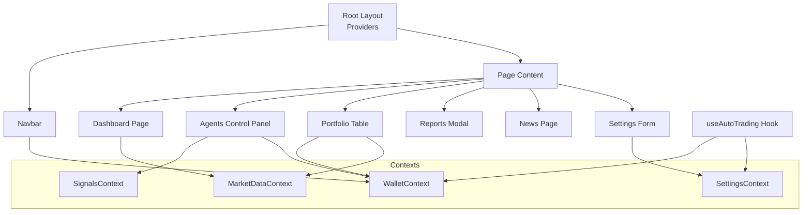

**Diagram sources**
- [layout.tsx:16-39](file://frontend/app/layout.tsx#L16-L39)
- [Navbar.tsx:16-52](file://frontend/components/Navbar.tsx#L16-L52)
- [WalletContext.tsx:21-108](file://frontend/context/WalletContext.tsx#L21-L108)
- [MarketDataContext.tsx:28-141](file://frontend/context/MarketDataContext.tsx#L28-L141)
- [SignalsContext.tsx:34-90](file://frontend/context/SignalsContext.tsx#L34-L90)
- [SettingsContext.tsx:28-191](file://frontend/context/SettingsContext.tsx#L28-L191)

**Section sources**
- [layout.tsx:16-39](file://frontend/app/layout.tsx#L16-L39)
- [page.tsx:5-39](file://frontend/app/page.tsx#L5-L39)
- [Navbar.tsx:16-52](file://frontend/components/Navbar.tsx#L16-L52)

## Core Components
- Root layout wraps all providers: WalletProvider, SettingsProvider, MarketDataProvider, SignalsProvider, and AutoTradingProvider. It renders the shared Navbar and page content.
- Navbar provides navigation links and shows the wallet connect button or demo mode badge.
- Contexts provide global state:
  - WalletContext: address, chainId, connection lifecycle, and events.
  - MarketDataContext: market pairs, loading/error states, last updated timestamp, refresh function, and localStorage caching.
  - SignalsContext: agent signals, polling interval, and refresh logic.
  - SettingsContext: currency, network, polling intervals, cache duration, auto trading toggle and interval, exchange rate, and formatting utility.
- Feature components:
  - AgentsControlPanel: controller UI, logs, proposals, holdings sync, and proposal execution flow.
  - MarketTable: sortable/filterable market table powered by MarketDataContext.
  - PortfolioTable: on-chain holdings, price lookup via market data, volume fetch, and trade initiation.
  - SettingsForm: settings controls, report generator modal.
  - SignalsPanel: signal list and trade preview trigger.
  - TradePreviewModal: quote routing (V2/V3/Aerodrome), gas estimation, approval, swap execution, and success handling.

**Section sources**
- [layout.tsx:16-39](file://frontend/app/layout.tsx#L16-L39)
- [Navbar.tsx:16-52](file://frontend/components/Navbar.tsx#L16-L52)
- [WalletContext.tsx:21-108](file://frontend/context/WalletContext.tsx#L21-L108)
- [MarketDataContext.tsx:28-141](file://frontend/context/MarketDataContext.tsx#L28-L141)
- [SignalsContext.tsx:34-90](file://frontend/context/SignalsContext.tsx#L34-L90)
- [SettingsContext.tsx:28-191](file://frontend/context/SettingsContext.tsx#L28-L191)
- [AgentsControlPanel.tsx:51-174](file://frontend/components/AgentsControlPanel.tsx#L51-L174)
- [MarketTable.tsx:21-107](file://frontend/components/MarketTable.tsx#L21-L107)
- [PortfolioTable.tsx:28-97](file://frontend/components/PortfolioTable.tsx#L28-L97)
- [SettingsForm.tsx:31-58](file://frontend/components/SettingsForm.tsx#L31-L58)
- [SignalsPanel.tsx:6-39](file://frontend/components/SignalsPanel.tsx#L6-L39)
- [TradePreviewModal.tsx:34-172](file://frontend/components/TradePreviewModal.tsx#L34-L172)

## Architecture Overview
The application follows a provider-driven architecture where contexts supply shared state and behavior. Data flows from backend APIs into contexts, which then update UI components reactively. Real-time updates are achieved through polling intervals configured in SettingsContext and consumed by SignalsContext and MarketDataContext.

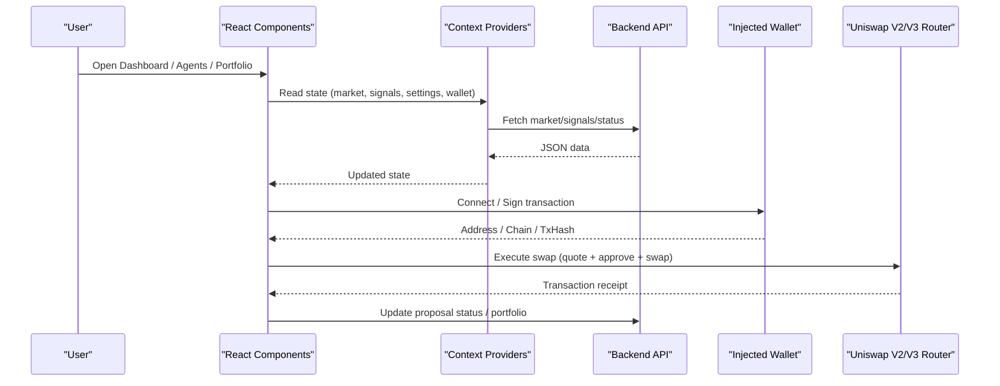

**Diagram sources**
- [MarketDataContext.tsx:66-121](file://frontend/context/MarketDataContext.tsx#L66-L121)
- [SignalsContext.tsx:43-83](file://frontend/context/SignalsContext.tsx#L43-L83)
- [WalletContext.tsx:74-102](file://frontend/context/WalletContext.tsx#L74-L102)
- [TradePreviewModal.tsx:174-779](file://frontend/components/TradePreviewModal.tsx#L174-L779)
- [autoTradeExecutor.ts:45-281](file://frontend/lib/autoTradeExecutor.ts#L45-L281)

## Detailed Component Analysis

### Root Layout and Navigation
- RootLayout composes providers and renders Navbar plus page content.
- Navbar renders navigation links and conditionally shows WalletConnectButton or Demo mode badge based on environment.

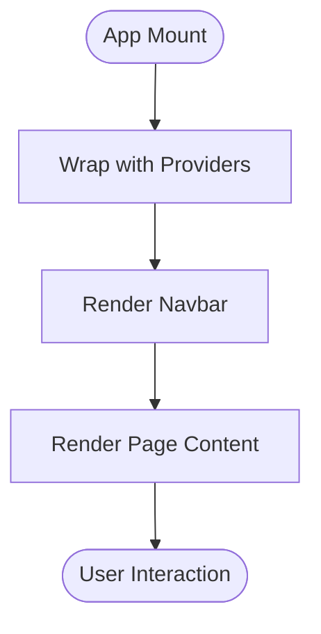

**Diagram sources**
- [layout.tsx:16-39](file://frontend/app/layout.tsx#L16-L39)
- [Navbar.tsx:16-52](file://frontend/components/Navbar.tsx#L16-L52)

**Section sources**
- [layout.tsx:16-39](file://frontend/app/layout.tsx#L16-L39)
- [page.tsx:5-39](file://frontend/app/page.tsx#L5-L39)
- [Navbar.tsx:16-52](file://frontend/components/Navbar.tsx#L16-L52)

### Wallet Integration (ethers.js)
- WalletContext manages connection lifecycle, listens to accountsChanged and chainChanged, exposes connect/disconnect, and tracks address and chainId.
- Components use BrowserProvider and Contract from ethers.js to read balances, decimals, and execute transactions.

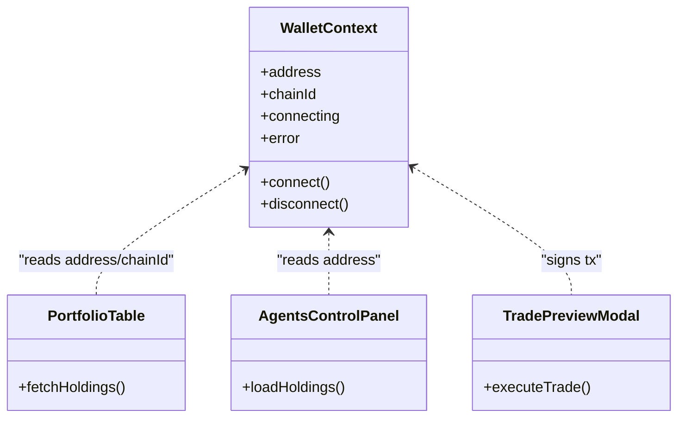

**Diagram sources**
- [WalletContext.tsx:21-108](file://frontend/context/WalletContext.tsx#L21-L108)
- [PortfolioTable.tsx:82-118](file://frontend/components/PortfolioTable.tsx#L82-L118)
- [AgentsControlPanel.tsx:71-118](file://frontend/components/AgentsControlPanel.tsx#L71-L118)
- [TradePreviewModal.tsx:174-779](file://frontend/components/TradePreviewModal.tsx#L174-L779)

**Section sources**
- [WalletContext.tsx:21-108](file://frontend/context/WalletContext.tsx#L21-L108)
- [PortfolioTable.tsx:82-118](file://frontend/components/PortfolioTable.tsx#L82-L118)
- [AgentsControlPanel.tsx:71-118](file://frontend/components/AgentsControlPanel.tsx#L71-L118)

### Market Data and Real-Time Updates
- MarketDataContext loads cached data from localStorage, performs health check, fetches market pairs, persists results, and exposes refreshMarketData.
- MarketTable consumes context to display rows, supports search, sorting, and view filters (tracked, volume, gainers, losers).

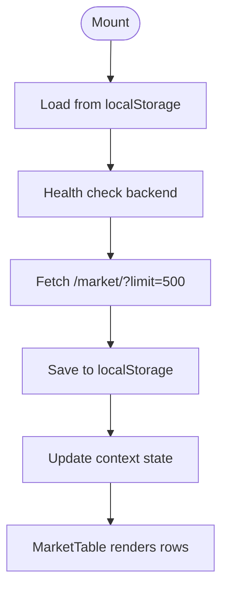

**Diagram sources**
- [MarketDataContext.tsx:34-121](file://frontend/context/MarketDataContext.tsx#L34-L121)
- [MarketTable.tsx:21-107](file://frontend/components/MarketTable.tsx#L21-L107)

**Section sources**
- [MarketDataContext.tsx:34-121](file://frontend/context/MarketDataContext.tsx#L34-L121)
- [MarketTable.tsx:21-107](file://frontend/components/MarketTable.tsx#L21-L107)

### Signals and Agent Status
- SignalsContext polls /signals at an interval defined in SettingsContext, exposing refresh and lastUpdated.
- SignalsPanel displays signals sorted by confidence and opens TradePreviewModal for actionable signals.

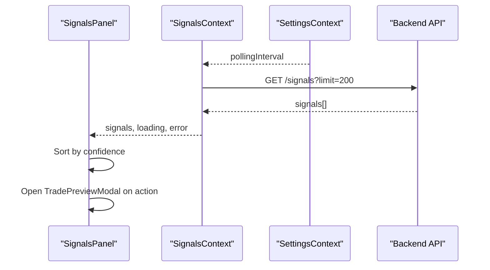

**Diagram sources**
- [SignalsContext.tsx:34-90](file://frontend/context/SignalsContext.tsx#L34-L90)
- [SignalsPanel.tsx:6-39](file://frontend/components/SignalsPanel.tsx#L6-L39)

**Section sources**
- [SignalsContext.tsx:34-90](file://frontend/context/SignalsContext.tsx#L34-L90)
- [SignalsPanel.tsx:6-39](file://frontend/components/SignalsPanel.tsx#L6-L39)

### Agents Control Panel
- Loads holdings from wallet, syncs to backend, polls status/logs/proposals, toggles agents, and handles proposal execution via TradePreviewModal.
- In demo mode, simulates proposal completion without wallet interaction.

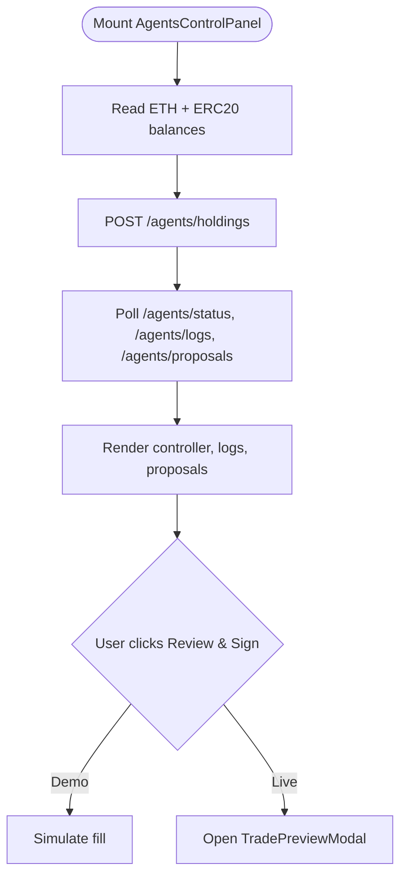

**Diagram sources**
- [AgentsControlPanel.tsx:71-174](file://frontend/components/AgentsControlPanel.tsx#L71-L174)
- [AgentsControlPanel.tsx:207-234](file://frontend/components/AgentsControlPanel.tsx#L207-L234)

**Section sources**
- [AgentsControlPanel.tsx:71-174](file://frontend/components/AgentsControlPanel.tsx#L71-L174)
- [AgentsControlPanel.tsx:207-234](file://frontend/components/AgentsControlPanel.tsx#L207-L234)

### Portfolio Tracking
- Reads wallet balances and token balances, maps prices from MarketDataContext, computes total value and buying power, fetches DEX volumes when supported, and triggers TradePreviewModal for trades.

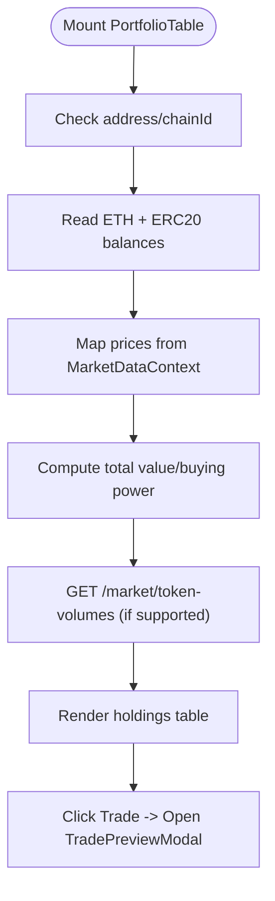

**Diagram sources**
- [PortfolioTable.tsx:82-289](file://frontend/components/PortfolioTable.tsx#L82-L289)
- [PortfolioTable.tsx:304-323](file://frontend/components/PortfolioTable.tsx#L304-L323)

**Section sources**
- [PortfolioTable.tsx:82-289](file://frontend/components/PortfolioTable.tsx#L82-L289)
- [PortfolioTable.tsx:304-323](file://frontend/components/PortfolioTable.tsx#L304-L323)

### Reports Generation
- SettingsForm includes a report modal that filters trades by network, action, and date range, calls backend, and presents results with print/export options.

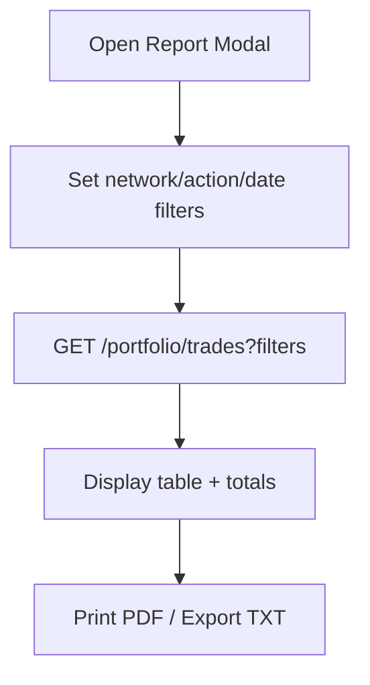

**Diagram sources**
- [SettingsForm.tsx:399-676](file://frontend/components/SettingsForm.tsx#L399-L676)

**Section sources**
- [SettingsForm.tsx:399-676](file://frontend/components/SettingsForm.tsx#L399-L676)

### Settings Configuration
- SettingsContext persists currency, network, polling intervals, cache duration, auto trading toggle and interval, and provides format utility.
- SettingsForm binds UI controls to setters and sends some settings to backend.

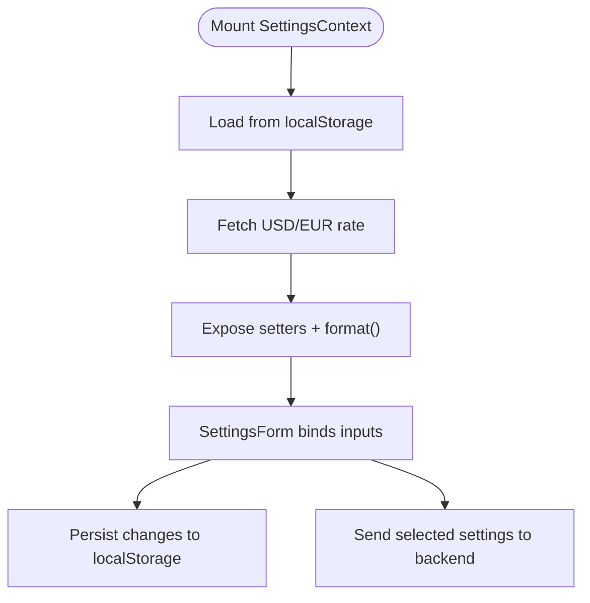

**Diagram sources**
- [SettingsContext.tsx:38-104](file://frontend/context/SettingsContext.tsx#L38-L104)
- [SettingsContext.tsx:106-191](file://frontend/context/SettingsContext.tsx#L106-L191)
- [SettingsForm.tsx:31-58](file://frontend/components/SettingsForm.tsx#L31-L58)

**Section sources**
- [SettingsContext.tsx:38-104](file://frontend/context/SettingsContext.tsx#L38-L104)
- [SettingsContext.tsx:106-191](file://frontend/context/SettingsContext.tsx#L106-L191)
- [SettingsForm.tsx:31-58](file://frontend/components/SettingsForm.tsx#L31-L58)

### Auto-Trading Implementation
- useAutoTrading hook monitors settings and wallet state, polls proposals, enforces eligibility rules, executes swaps via autoTradeExecutor, and updates backend upon success.
- autoTradeExecutor implements Uniswap V3 quoting, multi-hop routing, slippage calculation, approvals, multicall wrapping, pre-execution simulation, and transaction submission.

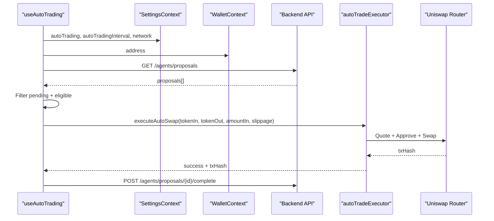

**Diagram sources**
- [useAutoTrading.ts:21-207](file://frontend/hooks/useAutoTrading.ts#L21-L207)
- [autoTradeExecutor.ts:45-281](file://frontend/lib/autoTradeExecutor.ts#L45-L281)

**Section sources**
- [useAutoTrading.ts:21-207](file://frontend/hooks/useAutoTrading.ts#L21-L207)
- [autoTradeExecutor.ts:45-281](file://frontend/lib/autoTradeExecutor.ts#L45-L281)

### Trade Preview Modal Workflow
- TradePreviewModal orchestrates quoting across Uniswap V2, V3, and Aerodrome; calculates price impact; estimates gas; handles approvals; and submits swaps. It integrates with WalletContext and SettingsContext.

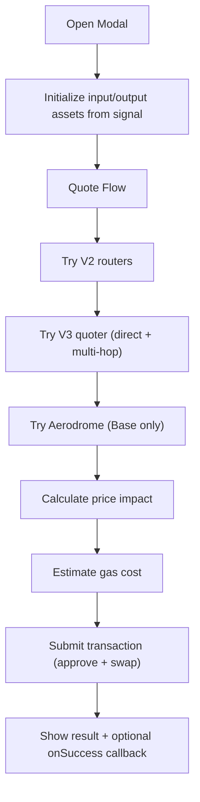

**Diagram sources**
- [TradePreviewModal.tsx:174-779](file://frontend/components/TradePreviewModal.tsx#L174-L779)

**Section sources**
- [TradePreviewModal.tsx:174-779](file://frontend/components/TradePreviewModal.tsx#L174-L779)

## Dependency Analysis
The following diagram highlights key dependencies between components and contexts.

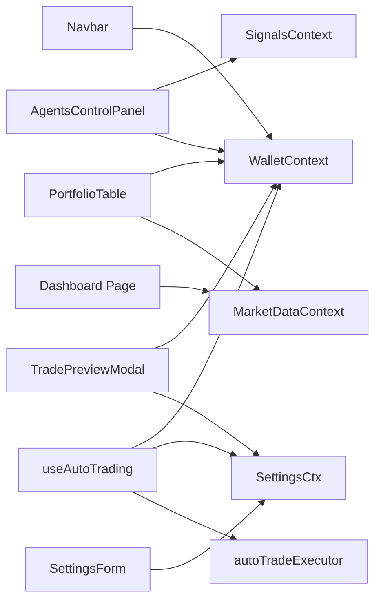

**Diagram sources**
- [Navbar.tsx:16-52](file://frontend/components/Navbar.tsx#L16-L52)
- [MarketDataContext.tsx:28-141](file://frontend/context/MarketDataContext.tsx#L28-L141)
- [SignalsContext.tsx:34-90](file://frontend/context/SignalsContext.tsx#L34-L90)
- [WalletContext.tsx:21-108](file://frontend/context/WalletContext.tsx#L21-L108)
- [SettingsContext.tsx:28-191](file://frontend/context/SettingsContext.tsx#L28-L191)
- [useAutoTrading.ts:21-207](file://frontend/hooks/useAutoTrading.ts#L21-L207)
- [autoTradeExecutor.ts:45-281](file://frontend/lib/autoTradeExecutor.ts#L45-L281)
- [TradePreviewModal.tsx:34-172](file://frontend/components/TradePreviewModal.tsx#L34-L172)

**Section sources**
- [Navbar.tsx:16-52](file://frontend/components/Navbar.tsx#L16-L52)
- [MarketDataContext.tsx:28-141](file://frontend/context/MarketDataContext.tsx#L28-L141)
- [SignalsContext.tsx:34-90](file://frontend/context/SignalsContext.tsx#L34-L90)
- [WalletContext.tsx:21-108](file://frontend/context/WalletContext.tsx#L21-L108)
- [SettingsContext.tsx:28-191](file://frontend/context/SettingsContext.tsx#L28-L191)
- [useAutoTrading.ts:21-207](file://frontend/hooks/useAutoTrading.ts#L21-L207)
- [autoTradeExecutor.ts:45-281](file://frontend/lib/autoTradeExecutor.ts#L45-L281)
- [TradePreviewModal.tsx:34-172](file://frontend/components/TradePreviewModal.tsx#L34-L172)

## Performance Considerations
- Market data caching: MarketDataContext persists data to localStorage and serves it immediately while fetching fresh data, improving perceived performance.
- Polling intervals: SignalsContext and SettingsContext allow configuring polling frequency to balance freshness and network load.
- Volume fetching: PortfolioTable uses AbortController to cancel stale volume requests and avoids unnecessary calls when unsupported.
- Gas estimation: TradePreviewModal estimates gas costs per protocol path to inform users before signing.
- Pre-execution simulation: autoTradeExecutor runs staticCall simulations to fail fast before opening wallet confirmations.

[No sources needed since this section provides general guidance]

## Troubleshooting Guide
- No injected wallet detected:
  - Ensure MetaMask or another wallet is installed and unlocked.
  - Verify the correct network is selected for the intended operation.
- Backend not ready:
  - MarketDataContext checks /health and surfaces a friendly message during startup.
- Wrong network for auto-trading:
  - useAutoTrading requires Base network; verify SettingsContext network and wallet chainId.
- No route found:
  - TradePreviewModal tries V2, V3, and Aerodrome; ensure tokens exist on the current network and have liquidity.
- Proposal not executing automatically:
  - Confirm autoTrading is enabled, address is connected, and proposal is within staleness window.
- Error updating proposal status:
  - Network issues may prevent posting to /agents/proposals/{id}/complete; retry after connectivity restores.

**Section sources**
- [WalletContext.tsx:74-102](file://frontend/context/WalletContext.tsx#L74-L102)
- [MarketDataContext.tsx:70-121](file://frontend/context/MarketDataContext.tsx#L70-L121)
- [useAutoTrading.ts:89-121](file://frontend/hooks/useAutoTrading.ts#L89-L121)
- [TradePreviewModal.tsx:174-779](file://frontend/components/TradePreviewModal.tsx#L174-L779)
- [autoTradeExecutor.ts:45-281](file://frontend/lib/autoTradeExecutor.ts#L45-L281)

## Conclusion
The DexTrader frontend combines a provider-based architecture with robust context management to deliver real-time market insights, agent-driven signals, portfolio visibility, and automated trading workflows. Wallet integration via ethers.js enables secure, non-custodial interactions with Uniswap across multiple networks. Responsive Tailwind CSS styling and accessible UI patterns improve usability. The system emphasizes safety through pre-execution simulation, slippage floors, and clear error messaging, while offering flexible configuration for polling, caching, and auto-trading intervals.