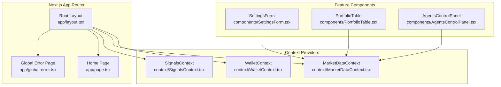
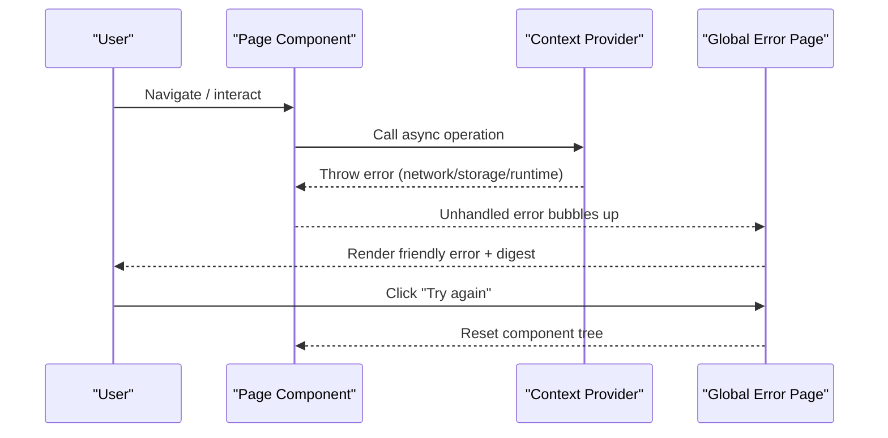
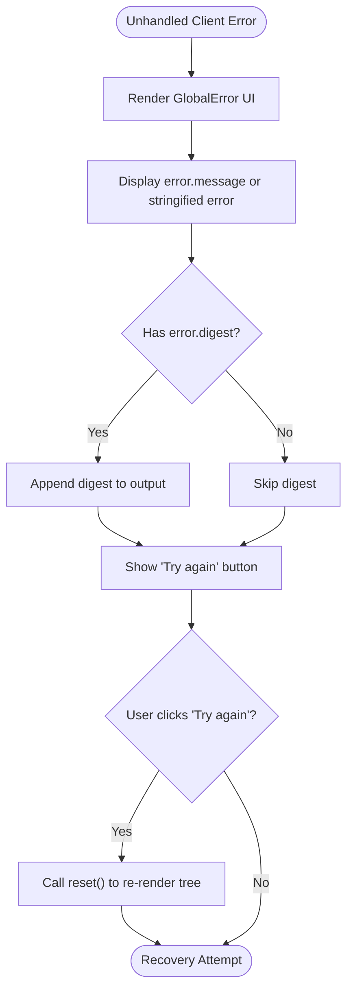
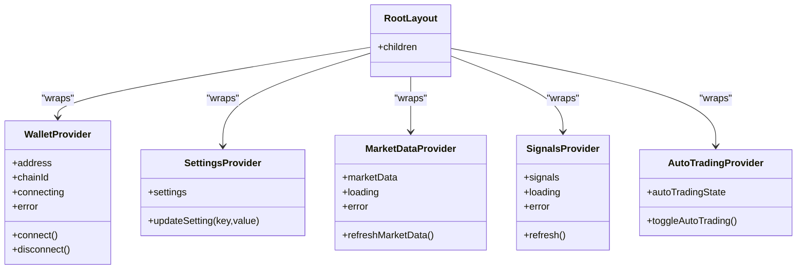
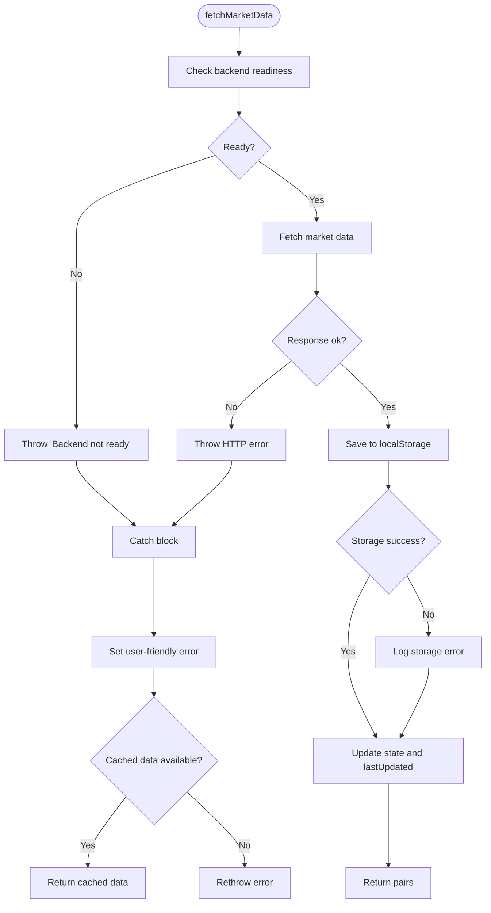
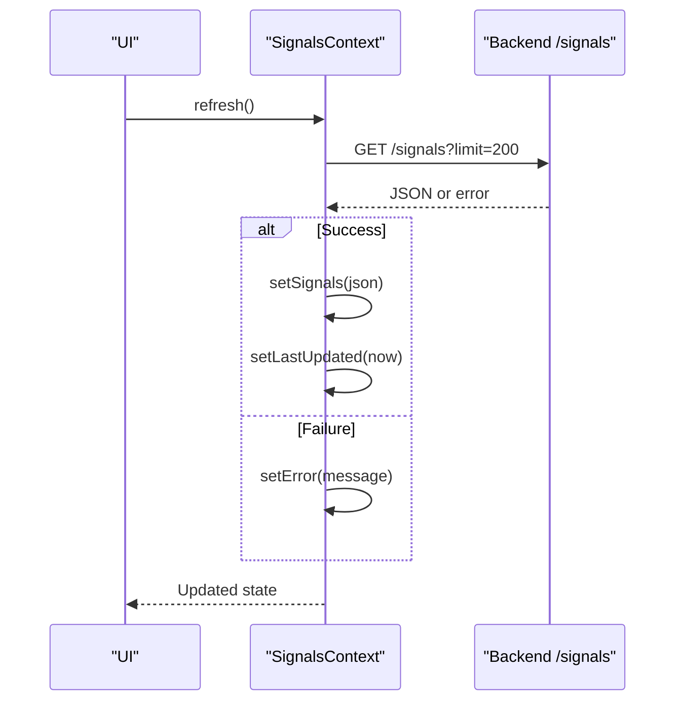
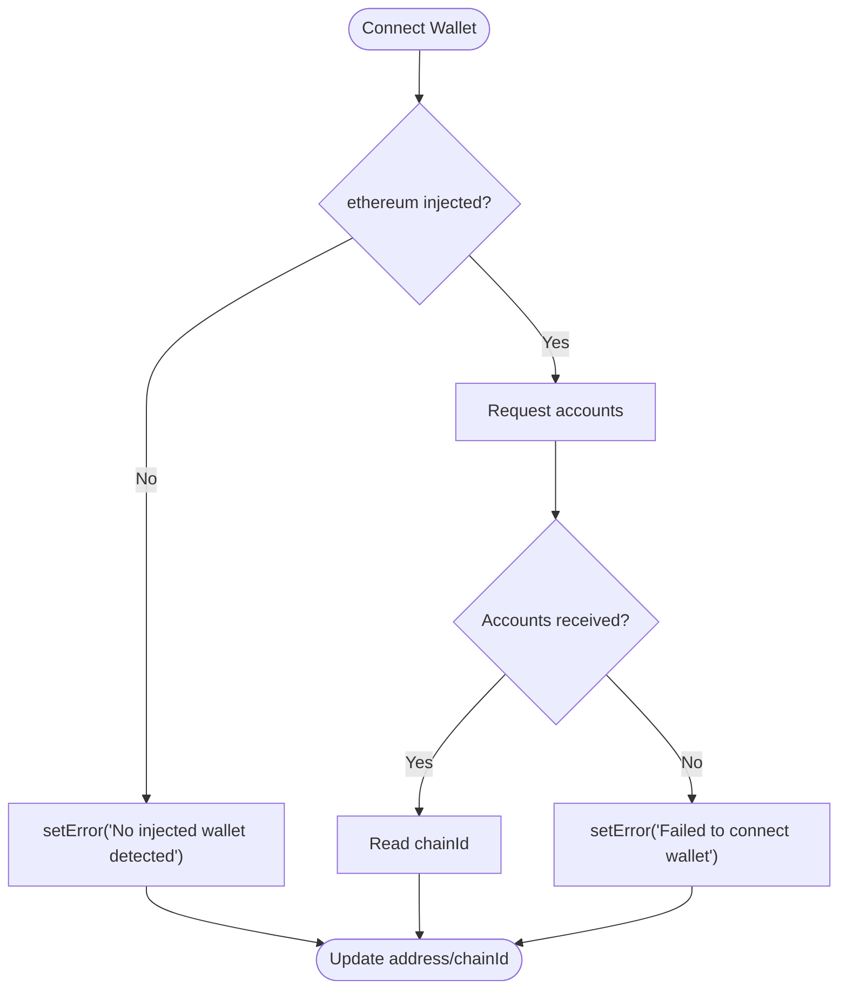
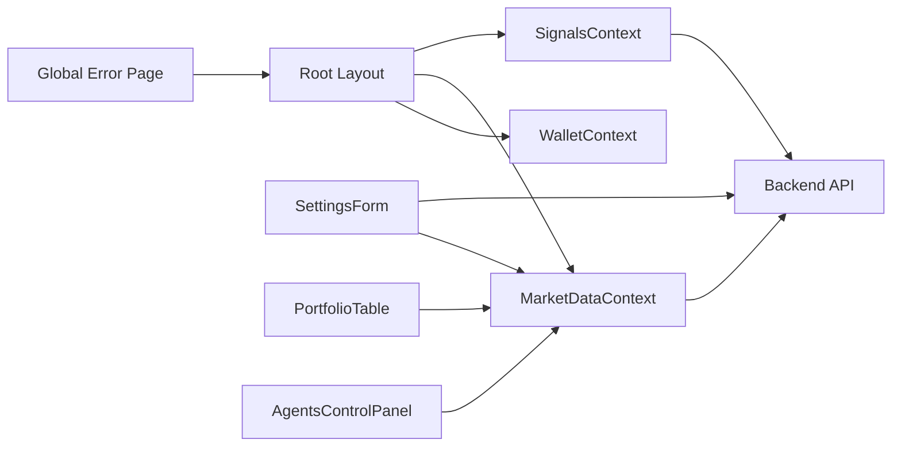

# Global Error Boundary

<cite>
**Referenced Files in This Document**
- [global-error.tsx](file://frontend/app/global-error.tsx)
- [layout.tsx](file://frontend/app/layout.tsx)
- [page.tsx](file://frontend/app/page.tsx)
- [MarketDataContext.tsx](file://frontend/context/MarketDataContext.tsx)
- [SignalsContext.tsx](file://frontend/context/SignalsContext.tsx)
- [WalletContext.tsx](file://frontend/context/WalletContext.tsx)
- [SettingsForm.tsx](file://frontend/components/SettingsForm.tsx)
- [PortfolioTable.tsx](file://frontend/components/PortfolioTable.tsx)
- [AgentsControlPanel.tsx](file://frontend/components/AgentsControlPanel.tsx)
- [config.ts](file://frontend/constants/config.ts)
</cite>

## Table of Contents
1. [Introduction](#introduction)
2. [Project Structure](#project-structure)
3. [Core Components](#core-components)
4. [Architecture Overview](#architecture-overview)
5. [Detailed Component Analysis](#detailed-component-analysis)
6. [Dependency Analysis](#dependency-analysis)
7. [Performance Considerations](#performance-considerations)
8. [Troubleshooting Guide](#troubleshooting-guide)
9. [Conclusion](#conclusion)

## Introduction
This document explains the frontend’s global error boundary strategy in DexTrader. It focuses on how unhandled client-side errors are surfaced to users, how application context providers manage runtime errors, and how the root layout integrates these pieces into a resilient user experience. The goal is to make failures visible, actionable, and recoverable without exposing raw stack traces by default.

## Project Structure
The relevant frontend structure for error handling centers around:
- A Next.js App Router root layout that wraps all pages with providers.
- A global error page that renders when an uncaught client error occurs.
- Context providers that encapsulate data fetching, wallet state, and settings, each with their own error states and recovery paths.
- Feature components that handle API calls and user interactions with localized try/catch blocks.

**Diagram sources**
- [layout.tsx:16-39](file://frontend/app/layout.tsx#L16-L39)
- [global-error.tsx:9-66](file://frontend/app/global-error.tsx#L9-L66)
- [page.tsx:5-39](file://frontend/app/page.tsx#L5-L39)
- [WalletContext.tsx:21-109](file://frontend/context/WalletContext.tsx#L21-L109)
- [MarketDataContext.tsx:105-150](file://frontend/context/MarketDataContext.tsx#L105-L150)
- [SignalsContext.tsx:43-98](file://frontend/context/SignalsContext.tsx#L43-L98)
- [SettingsForm.tsx:57-290](file://frontend/components/SettingsForm.tsx#L57-L290)
- [PortfolioTable.tsx:392-393](file://frontend/components/PortfolioTable.tsx#L392-L393)
- [AgentsControlPanel.tsx:104-278](file://frontend/components/AgentsControlPanel.tsx#L104-L278)

**Section sources**
- [layout.tsx:16-39](file://frontend/app/layout.tsx#L16-L39)
- [global-error.tsx:9-66](file://frontend/app/global-error.tsx#L9-L66)
- [page.tsx:5-39](file://frontend/app/page.tsx#L5-L39)

## Core Components
- Global error page: Provides a readable failure screen with the actual error message and digest, plus a “Try again” action that resets the component tree.
- Root layout: Wraps the app with providers (wallet, settings, market data, signals, auto-trading), ensuring consistent UI shell and shared state.
- Context providers: Each manages its own loading/error state and exposes refresh functions; they catch network and storage errors and surface user-friendly messages.
- Feature components: Handle specific operations like settings updates, portfolio display, and agent controls, catching errors locally and logging them.

Key responsibilities:
- Surface meaningful errors to users.
- Avoid leaking internal details unless necessary.
- Provide recovery actions where possible (e.g., retry).
- Keep UI responsive even when parts fail.

**Section sources**
- [global-error.tsx:9-66](file://frontend/app/global-error.tsx#L9-L66)
- [layout.tsx:16-39](file://frontend/app/layout.tsx#L16-L39)
- [MarketDataContext.tsx:105-150](file://frontend/context/MarketDataContext.tsx#L105-L150)
- [SignalsContext.tsx:43-98](file://frontend/context/SignalsContext.tsx#L43-L98)
- [WalletContext.tsx:21-109](file://frontend/context/WalletContext.tsx#L21-L109)

## Architecture Overview
The global error boundary is implemented via Next.js App Router’s global error page. It catches unhandled client-side exceptions that bubble up from any child component or provider. The root layout composes providers that encapsulate domain logic and error states. Feature components perform local error handling for predictable failures, while unexpected errors propagate to the global boundary.

**Diagram sources**
- [global-error.tsx:9-66](file://frontend/app/global-error.tsx#L9-L66)
- [layout.tsx:16-39](file://frontend/app/layout.tsx#L16-L39)

## Detailed Component Analysis

### Global Error Page
Purpose:
- Replace Next.js’ generic client error screen with a readable, branded failure view.
- Display the error message and optional digest for diagnostics.
- Offer a “Try again” button to reset the component tree and attempt recovery.

Behavior:
- Renders minimal HTML/CSS for clarity on small screens.
- Shows the error message and digest if present.
- Resets the React tree on user action.

**Diagram sources**
- [global-error.tsx:9-66](file://frontend/app/global-error.tsx#L9-L66)

**Section sources**
- [global-error.tsx:9-66](file://frontend/app/global-error.tsx#L9-L66)

### Root Layout and Providers
Purpose:
- Establish the application shell and wrap all routes with providers.
- Ensure consistent navigation, banners, and main content area.
- Provide contexts for wallet, settings, market data, signals, and auto-trading.

Structure:
- Providers are nested to ensure dependencies are available where needed.
- The layout does not implement error boundaries itself; it relies on the global error page for unhandled exceptions.

**Diagram sources**
- [layout.tsx:16-39](file://frontend/app/layout.tsx#L16-L39)
- [WalletContext.tsx:21-109](file://frontend/context/WalletContext.tsx#L21-L109)
- [MarketDataContext.tsx:105-150](file://frontend/context/MarketDataContext.tsx#L105-L150)
- [SignalsContext.tsx:43-98](file://frontend/context/SignalsContext.tsx#L43-L98)

**Section sources**
- [layout.tsx:16-39](file://frontend/app/layout.tsx#L16-L39)

### Market Data Context
Responsibilities:
- Fetch market data from the backend.
- Persist data to localStorage when successful.
- Normalize and display user-friendly errors (e.g., “Backend starting up…”).
- Return cached data when fresh fetch fails but cache exists.

Error Handling:
- Catches storage write failures and logs them.
- Throws explicit errors for backend readiness and HTTP failures.
- Sets error state for UI consumption.

**Diagram sources**
- [MarketDataContext.tsx:95-136](file://frontend/context/MarketDataContext.tsx#L95-L136)
- [MarketDataContext.tsx:105-150](file://frontend/context/MarketDataContext.tsx#L105-L150)

**Section sources**
- [MarketDataContext.tsx:95-136](file://frontend/context/MarketDataContext.tsx#L95-L136)
- [MarketDataContext.tsx:105-150](file://frontend/context/MarketDataContext.tsx#L105-L150)

### Signals Context
Responsibilities:
- Poll backend for trading signals at a configurable interval.
- Manage loading, error, and initialization state.
- Expose a refresh function for manual updates.

Error Handling:
- Converts non-OK responses into user-facing errors.
- Normalizes unknown errors to a safe message.
- Ensures loading state is cleared in finally blocks.

**Diagram sources**
- [SignalsContext.tsx:43-98](file://frontend/context/SignalsContext.tsx#L43-L98)

**Section sources**
- [SignalsContext.tsx:43-98](file://frontend/context/SignalsContext.tsx#L43-L98)

### Wallet Context
Responsibilities:
- Connect/disconnect wallets via injected Ethereum provider.
- Track address, chain ID, connection status, and errors.
- Read chain ID safely and update state only on current revision.

Error Handling:
- Sets user-friendly error messages for missing wallet or failed requests.
- Clears connecting state after attempts.

**Diagram sources**
- [WalletContext.tsx:75-98](file://frontend/context/WalletContext.tsx#L75-L98)

**Section sources**
- [WalletContext.tsx:21-109](file://frontend/context/WalletContext.tsx#L21-L109)

### Feature Components
- SettingsForm: Handles settings persistence and rate fetching; catches and logs errors during save and fetch operations.
- PortfolioTable: Displays portfolio data; catches and logs errors when loading or syncing holdings.
- AgentsControlPanel: Manages agent control flows; catches and logs errors across multiple endpoints and operations.

These components demonstrate localized error handling patterns:
- Try/catch around async operations.
- Logging via console.error for diagnostics.
- Updating UI state to reflect partial failures.

**Section sources**
- [SettingsForm.tsx:57-290](file://frontend/components/SettingsForm.tsx#L57-L290)
- [PortfolioTable.tsx:392-393](file://frontend/components/PortfolioTable.tsx#L392-L393)
- [AgentsControlPanel.tsx:104-278](file://frontend/components/AgentsControlPanel.tsx#L104-L278)

### Configuration
- BACKEND_URL: Determines the backend endpoint used by the frontend.
- DEMO_MODE: Enables demo behavior where no real wallet is involved.

These constants influence error scenarios:
- Incorrect BACKEND_URL leads to network errors surfaced by contexts.
- DEMO_MODE changes UI flow and may suppress wallet-related errors.

**Section sources**
- [config.ts:1-7](file://frontend/constants/config.ts#L1-L7)

## Dependency Analysis
The global error boundary depends on Next.js App Router conventions and the presence of a root layout. Context providers depend on backend services and browser APIs (localStorage, window.ethereum). Feature components depend on contexts and backend endpoints.

**Diagram sources**
- [global-error.tsx:9-66](file://frontend/app/global-error.tsx#L9-L66)
- [layout.tsx:16-39](file://frontend/app/layout.tsx#L16-L39)
- [MarketDataContext.tsx:105-150](file://frontend/context/MarketDataContext.tsx#L105-L150)
- [SignalsContext.tsx:43-98](file://frontend/context/SignalsContext.tsx#L43-L98)
- [SettingsForm.tsx:57-290](file://frontend/components/SettingsForm.tsx#L57-L290)
- [PortfolioTable.tsx:392-393](file://frontend/components/PortfolioTable.tsx#L392-L393)
- [AgentsControlPanel.tsx:104-278](file://frontend/components/AgentsControlPanel.tsx#L104-L278)

**Section sources**
- [global-error.tsx:9-66](file://frontend/app/global-error.tsx#L9-L66)
- [layout.tsx:16-39](file://frontend/app/layout.tsx#L16-L39)

## Performance Considerations
- Global error rendering is lightweight and avoids heavy computations to keep recovery fast.
- Context providers use polling intervals for signals; ensure intervals are reasonable to avoid excessive network calls.
- LocalStorage writes are wrapped in try/catch to prevent blocking UI on storage failures.
- Errors are normalized to concise messages to reduce UI overhead.

[No sources needed since this section provides general guidance]

## Troubleshooting Guide
Common issues and resolutions:
- Backend not ready:
  - Symptom: Market data shows “Backend starting up… Please wait a moment and try again.”
  - Cause: Backend service is initializing or unreachable.
  - Resolution: Wait for backend startup; verify BACKEND_URL configuration.
- No injected wallet:
  - Symptom: Wallet connection displays “No injected wallet detected”.
  - Cause: Browser lacks a crypto wallet extension.
  - Resolution: Install a supported wallet extension and reload.
- Network errors:
  - Symptom: Signals or settings operations fail with generic messages.
  - Cause: Backend unavailable or CORS/network issues.
  - Resolution: Check network connectivity and backend health; review console logs.
- Unhandled client errors:
  - Symptom: Generic Next.js error screen appears.
  - Cause: Exception not caught in component/provider code.
  - Resolution: Add try/catch in the failing path or improve error propagation; check global error page for message and digest.

**Section sources**
- [MarketDataContext.tsx:122-136](file://frontend/context/MarketDataContext.tsx#L122-L136)
- [WalletContext.tsx:75-98](file://frontend/context/WalletContext.tsx#L75-L98)
- [SignalsContext.tsx:43-98](file://frontend/context/SignalsContext.tsx#L43-L98)
- [global-error.tsx:9-66](file://frontend/app/global-error.tsx#L9-L66)

## Conclusion
DexTrader’s frontend uses a layered approach to error handling:
- Global error boundary ensures unhandled client errors are visible and actionable.
- Root layout composes providers that encapsulate domain logic and expose user-friendly error states.
- Contexts and components handle expected failures gracefully, logging diagnostics and preserving UI stability.
This design balances robustness with clarity, helping users understand and recover from failures without overwhelming them with technical details.