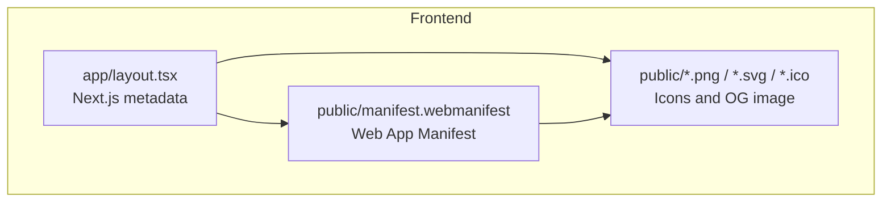
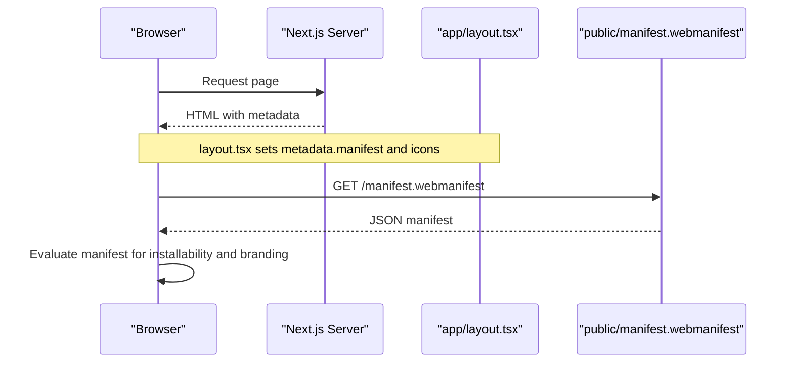
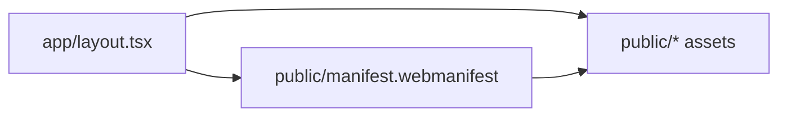

# PWA Support & Web App Configuration

<cite>
**Referenced Files in This Document**   
- [manifest.webmanifest](file://frontend/public/manifest.webmanifest)
- [layout.tsx](file://frontend/app/layout.tsx)
- [next.config.mjs](file://frontend/next.config.mjs)
- [README.md](file://README.md)
</cite>

## Table of Contents
1. [Introduction](#introduction)
2. [Project Structure](#project-structure)
3. [Core Components](#core-components)
4. [Architecture Overview](#architecture-overview)
5. [Detailed Component Analysis](#detailed-component-analysis)
6. [Dependency Analysis](#dependency-analysis)
7. [Performance Considerations](#performance-considerations)
8. [Troubleshooting Guide](#troubleshooting-guide)
9. [Conclusion](#conclusion)

## Introduction
This document explains how the frontend is configured as a Progressive Web App (PWA) and how web app metadata is declared for installability, branding, and social sharing. It focuses on the web manifest, Next.js metadata configuration, asset declarations, and deployment considerations.

## Project Structure
The PWA-related assets and configuration live under the frontend:

- `frontend/public/manifest.webmanifest` declares the app identity, start URL, display mode, theme colors, and icons.
- `frontend/app/layout.tsx` configures Next.js metadata, including the manifest link and multiple icon variants for browsers and Apple devices.
- `frontend/public/` contains all static assets referenced by the manifest and metadata (icons, favicon, OG image).
- `frontend/next.config.mjs` is present but currently empty; no additional Next.js PWA plugin or custom headers are configured here.

**Diagram sources**
- [layout.tsx:15-43](file://frontend/app/layout.tsx#L15-L43)
- [manifest.webmanifest:1-22](file://frontend/public/manifest.webmanifest#L1-L22)

**Section sources**
- [layout.tsx:15-43](file://frontend/app/layout.tsx#L15-L43)
- [manifest.webmanifest:1-22](file://frontend/public/manifest.webmanifest#L1-L22)

## Core Components
- Web App Manifest (`manifest.webmanifest`)
  - Defines app name, short name, description, start URL, display mode, background/theme colors, and icons.
- Next.js Metadata (`app/layout.tsx`)
  - Sets site title, description, base URL, Open Graph and Twitter card metadata, and links to icons and the manifest.
- Static Assets (`public/`)
  - Includes SVG/PNG icons, Apple touch icon, ICO file, and social preview image.

Key behaviors:
- Installability: The presence of a valid manifest with required fields enables the browser’s “Add to Home Screen” prompt when appropriate.
- Branding: Theme and background colors control the app chrome appearance in standalone mode.
- Social Sharing: Open Graph and Twitter metadata define how links look when shared.

**Section sources**
- [manifest.webmanifest:1-22](file://frontend/public/manifest.webmanifest#L1-L22)
- [layout.tsx:15-43](file://frontend/app/layout.tsx#L15-L43)

## Architecture Overview
The PWA configuration is declarative and driven by two layers:

1. Browser layer: Reads the manifest at `/manifest.webmanifest` and applies it to the installed web app.
2. Framework layer: Next.js injects `<link rel="manifest">` and other meta tags via the metadata API in `layout.tsx`.

**Diagram sources**
- [layout.tsx:15-43](file://frontend/app/layout.tsx#L15-L43)
- [manifest.webmanifest:1-22](file://frontend/public/manifest.webmanifest#L1-L22)

## Detailed Component Analysis

### Web App Manifest
Responsibilities:
- Identifies the application and its short name.
- Declares the start URL and display mode for standalone behavior.
- Sets theme and background colors for immersive UI.
- Provides icons for different sizes and purposes.

Validation checklist:
- Required fields: name, short_name, start_url, display.
- Icons: include at least one large PNG (e.g., 512x512) for installation prompts.
- Colors: ensure contrast and consistency with the app’s design.

**Section sources**
- [manifest.webmanifest:1-22](file://frontend/public/manifest.webmanifest#L1-L22)

### Next.js Metadata and Asset Links
Responsibilities:
- Declares the manifest path so the browser can locate it.
- Registers multiple icon variants for favicons and Apple touch icons.
- Configures Open Graph and Twitter Card metadata for link previews.

Important notes:
- The manifest path must be reachable at runtime (e.g., `/manifest.webmanifest`).
- All referenced images must exist under `public/` and be served correctly.

**Section sources**
- [layout.tsx:15-43](file://frontend/app/layout.tsx#L15-L43)

### Static Assets
Assets under `frontend/public/`:
- Favicon variants (SVG, 32px PNG, 48px PNG), ICO file.
- Apple touch icon.
- 512px PNG icon referenced by the manifest.
- Social preview image (OG image).

Asset mapping:
- Manifest references the 512px PNG and an SVG icon.
- Layout metadata references favicon variants, Apple touch icon, and OG image.

**Section sources**
- [manifest.webmanifest:9-20](file://frontend/public/manifest.webmanifest#L9-L20)
- [layout.tsx:19-28](file://frontend/app/layout.tsx#L19-L28)
- [README.md:147-147](file://README.md#L147-L147)

### Service Worker and Offline Behavior
Current state:
- No explicit service worker registration was found in the frontend codebase.
- No Next.js PWA plugin or custom service worker setup is visible in `next.config.mjs`.

Implications:
- The app can still be installed if the manifest is valid and meets browser requirements.
- Offline caching and background sync are not provided out of the box.

Recommendations:
- If offline support is desired, integrate a Next.js-compatible PWA solution (for example, a service worker plugin) and configure cache strategies for critical routes and assets.
- Ensure the service worker is registered after the app mounts and handles install/update events appropriately.

[No sources needed since this section provides general guidance]

## Dependency Analysis
The PWA configuration has minimal coupling:

- `layout.tsx` depends on:
  - `public/manifest.webmanifest` (via metadata.manifest).
  - Static assets under `public/` (icons and OG image).
- `manifest.webmanifest` depends on:
  - Static assets under `public/` (icons).

**Diagram sources**
- [layout.tsx:15-43](file://frontend/app/layout.tsx#L15-L43)
- [manifest.webmanifest:1-22](file://frontend/public/manifest.webmanifest#L1-L22)

**Section sources**
- [layout.tsx:15-43](file://frontend/app/layout.tsx#L15-L43)
- [manifest.webmanifest:1-22](file://frontend/public/manifest.webmanifest#L1-L22)

## Performance Considerations
- Keep icons optimized: use modern formats (AVIF/WebP) where supported and provide fallbacks.
- Avoid unnecessary network requests: serve only the icons actually used by the manifest and metadata.
- Prefer SVG for scalable icons where possible to reduce payload size.
- If adding a service worker later, implement selective caching for static assets and API responses to improve perceived performance.

[No sources needed since this section provides general guidance]

## Troubleshooting Guide
Common issues and resolutions:

- Install prompt does not appear
  - Verify that `manifest.webmanifest` is reachable at `/manifest.webmanifest`.
  - Ensure required fields are present (name, short_name, start_url, display).
  - Confirm that a large icon (e.g., 512x512 PNG) exists and is referenced.

- Incorrect branding or missing icons
  - Check that all paths in `layout.tsx` and `manifest.webmanifest` match actual files under `public/`.
  - Validate that the server serves these files without redirects or authentication.

- Social preview not showing
  - Ensure the OG image path in `layout.tsx` points to a publicly accessible image.
  - Confirm dimensions and format meet platform guidelines.

- Private browsing or storage restrictions
  - Some environments restrict localStorage access; this does not affect PWA installability but may impact local state persistence.

**Section sources**
- [layout.tsx:15-43](file://frontend/app/layout.tsx#L15-L43)
- [manifest.webmanifest:1-22](file://frontend/public/manifest.webmanifest#L1-L22)

## Conclusion
The project implements PWA support primarily through a well-formed web manifest and comprehensive Next.js metadata configuration. While there is no explicit service worker implementation today, the app is positioned for installability and consistent branding across platforms. Future enhancements can introduce offline capabilities and advanced caching strategies while preserving the current declarative configuration.