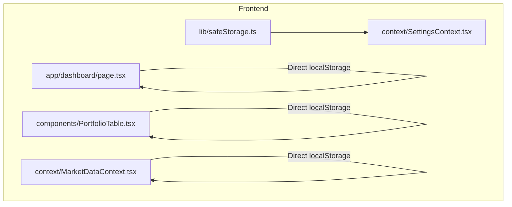
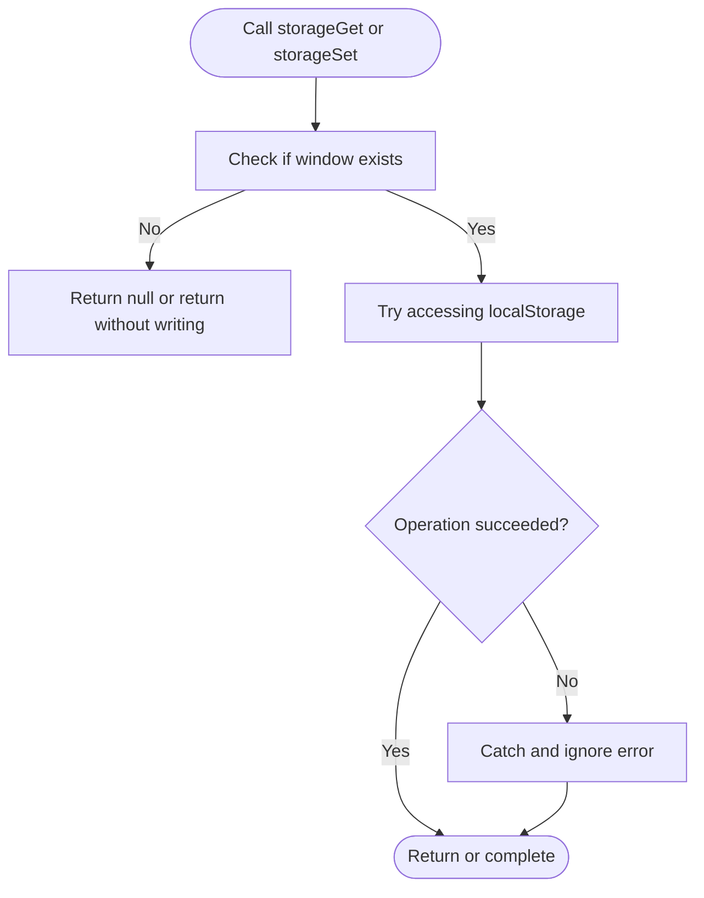
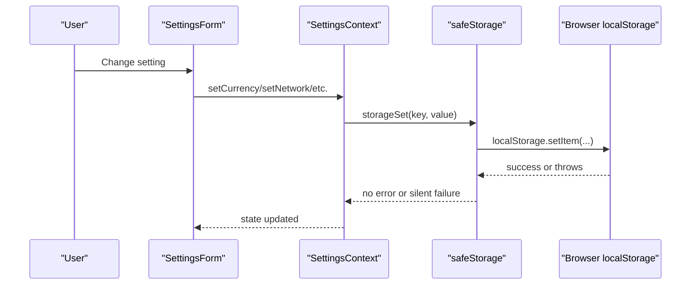
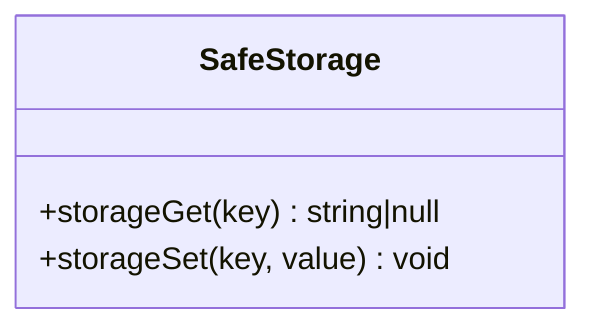
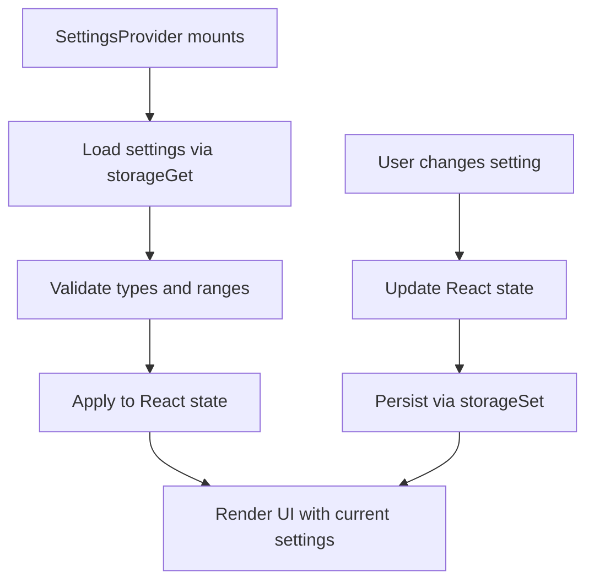
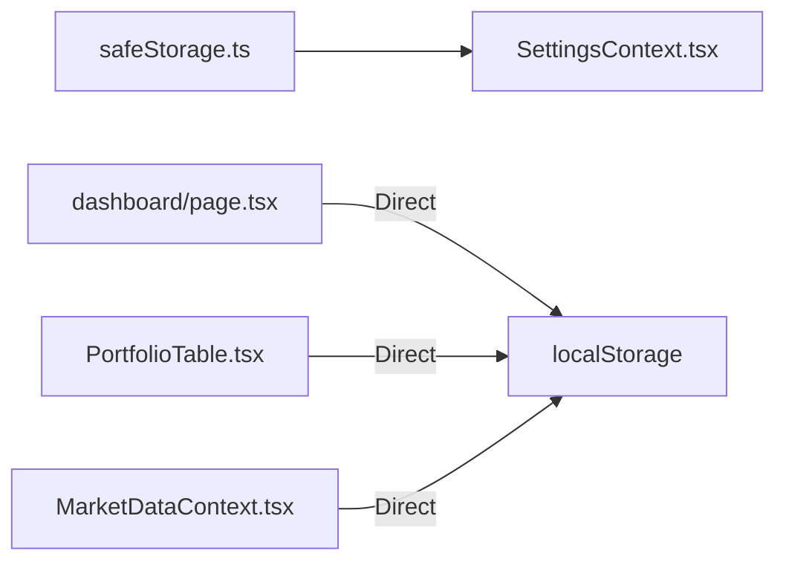

# Safe Storage Abstraction

<cite>
**Referenced Files in This Document**
- [safeStorage.ts](file://frontend/lib/safeStorage.ts)
- [SettingsContext.tsx](file://frontend/context/SettingsContext.tsx)
- [dashboard/page.tsx](file://frontend/app/dashboard/page.tsx)
- [PortfolioTable.tsx](file://frontend/components/PortfolioTable.tsx)
- [MarketDataContext.tsx](file://frontend/context/MarketDataContext.tsx)
</cite>

## Table of Contents
1. [Introduction](#introduction)
2. [Project Structure](#project-structure)
3. [Core Components](#core-components)
4. [Architecture Overview](#architecture-overview)
5. [Detailed Component Analysis](#detailed-component-analysis)
6. [Dependency Analysis](#dependency-analysis)
7. [Performance Considerations](#performance-considerations)
8. [Troubleshooting Guide](#troubleshooting-guide)
9. [Conclusion](#conclusion)

## Introduction
This document explains the Safe Storage Abstraction used by the frontend to persist user settings and UI state while remaining resilient against browsers that block or restrict local storage access. It covers how the abstraction is implemented, where it is used, how data flows through the application, and how to troubleshoot common issues.

The goal is to make the storage behavior predictable across environments such as Brave with strict privacy settings, Safari private mode, and certain Android configurations where direct access to `localStorage` can throw security errors.

## Project Structure
The safe storage feature lives in the frontend layer:

- The abstraction itself is a small utility module providing guarded read/write helpers.
- The settings context uses the abstraction for all persistent user preferences.
- Several components still directly access `localStorage`, which should be migrated to the abstraction for consistency and safety.

**Diagram sources**
- [safeStorage.ts:10-26](file://frontend/lib/safeStorage.ts#L10-L26)
- [SettingsContext.tsx:3-154](file://frontend/context/SettingsContext.tsx#L3-L154)
- [dashboard/page.tsx:16-44](file://frontend/app/dashboard/page.tsx#L16-L44)
- [PortfolioTable.tsx:51-59](file://frontend/components/PortfolioTable.tsx#L51-L59)
- [MarketDataContext.tsx:50-111](file://frontend/context/MarketDataContext.tsx#L50-L111)

**Section sources**
- [safeStorage.ts:1-27](file://frontend/lib/safeStorage.ts#L1-L27)
- [SettingsContext.tsx:1-202](file://frontend/context/SettingsContext.tsx#L1-L202)
- [dashboard/page.tsx:1-76](file://frontend/app/dashboard/page.tsx#L1-L76)
- [PortfolioTable.tsx:1-654](file://frontend/components/PortfolioTable.tsx#L1-L654)
- [MarketDataContext.tsx:50-111](file://frontend/context/MarketDataContext.tsx#L50-L111)

## Core Components
The core component is the safe storage utility. It provides two functions:

- `storageGet(key)`: Safely reads a value from `localStorage`. Returns `null` if unavailable or if an error occurs.
- `storageSet(key, value)`: Safely writes a string value to `localStorage`. Silently ignores failures.

Key behaviors:
- Guards against server-side rendering by checking for `window`.
- Wraps storage calls in try/catch to avoid crashing React effects.
- Treats storage failure as non-fatal; in-memory state remains functional.

**Diagram sources**
- [safeStorage.ts:10-26](file://frontend/lib/safeStorage.ts#L10-L26)

**Section sources**
- [safeStorage.ts:1-27](file://frontend/lib/safeStorage.ts#L1-L27)

## Architecture Overview
The safe storage abstraction is intended to be the single point of truth for persistent storage operations. Currently, only the settings context consistently uses it. Other parts of the app still call `localStorage` directly, which bypasses the safety wrapper.

**Diagram sources**
- [SettingsContext.tsx:107-154](file://frontend/context/SettingsContext.tsx#L107-L154)
- [safeStorage.ts:19-26](file://frontend/lib/safeStorage.ts#L19-L26)

## Detailed Component Analysis

### Safe Storage Utility
Responsibilities:
- Provide safe wrappers around browser storage APIs.
- Avoid throwing exceptions during React effect lifecycles.
- Support both read and write operations with consistent error handling.

Design notes:
- Read returns `null` on missing keys or errors.
- Write silently fails when storage is blocked or full.
- No serialization logic is included; callers must pass strings.

**Diagram sources**
- [safeStorage.ts:10-26](file://frontend/lib/safeStorage.ts#L10-L26)

**Section sources**
- [safeStorage.ts:1-27](file://frontend/lib/safeStorage.ts#L1-L27)

### Settings Context Integration
The settings context loads and persists several user preferences:
- Currency
- Network
- Polling interval
- Market refresh interval
- Agent cache duration
- Auto trading toggle
- Auto trading interval

It uses `storageGet` and `storageSet` for all persistence, ensuring resilience against restricted storage environments.

Data flow:
- On mount, load persisted values using `storageGet`.
- Validate loaded values before applying them to state.
- On change, update state and persist via `storageSet`.

**Diagram sources**
- [SettingsContext.tsx:39-94](file://frontend/context/SettingsContext.tsx#L39-L94)
- [SettingsContext.tsx:107-154](file://frontend/context/SettingsContext.tsx#L107-L154)

**Section sources**
- [SettingsContext.tsx:1-202](file://frontend/context/SettingsContext.tsx#L1-L202)

### Dashboard Page Direct LocalStorage Usage
The dashboard page persists the list of tracked pairs directly to `localStorage`. This path does not use the safe storage abstraction and may fail under restrictive browser policies.

Behavior:
- Reads stored pairs on mount.
- Writes selected pairs whenever they change.
- Uses try/catch blocks to prevent crashes, but still bypasses the centralized abstraction.

Recommendation:
- Replace direct `localStorage.getItem` and `setItem` calls with `storageGet` and `storageSet`.

**Section sources**
- [dashboard/page.tsx:16-44](file://frontend/app/dashboard/page.tsx#L16-L44)

### Portfolio Table Direct LocalStorage Usage
The portfolio table persists a list of tokens added to MetaMask directly to `localStorage`. This also bypasses the safe storage abstraction.

Behavior:
- Loads added tokens on mount.
- Updates the list after adding a token to MetaMask.
- Uses try/catch to handle potential errors.

Recommendation:
- Migrate to `storageGet` and `storageSet` for consistency and safety.

**Section sources**
- [PortfolioTable.tsx:51-59](file://frontend/components/PortfolioTable.tsx#L51-L59)
- [PortfolioTable.tsx:388-391](file://frontend/components/PortfolioTable.tsx#L388-L391)

### Market Data Context Direct LocalStorage Usage
The market data context loads cached market data and timestamps directly from `localStorage`, then fetches fresh data from the backend.

Behavior:
- Reads cached data and timestamp on mount.
- Saves new market data and timestamp after successful fetch.
- Does not use the safe storage abstraction.

Recommendation:
- Use `storageGet` and `storageSet` to centralize error handling and future migration paths.

**Section sources**
- [MarketDataContext.tsx:50-111](file://frontend/context/MarketDataContext.tsx#L50-L111)

## Dependency Analysis
The safe storage abstraction has minimal dependencies:
- It depends only on the browser’s `window` and `localStorage`.
- It is imported by the settings context.
- Other modules currently import it indirectly through the settings context rather than calling it directly.

**Diagram sources**
- [safeStorage.ts:10-26](file://frontend/lib/safeStorage.ts#L10-L26)
- [SettingsContext.tsx:3](file://frontend/context/SettingsContext.tsx#L3)
- [dashboard/page.tsx:21](file://frontend/app/dashboard/page.tsx#L21)
- [PortfolioTable.tsx:53](file://frontend/components/PortfolioTable.tsx#L53)
- [MarketDataContext.tsx:55](file://frontend/context/MarketDataContext.tsx#L55)

**Section sources**
- [safeStorage.ts:1-27](file://frontend/lib/safeStorage.ts#L1-L27)
- [SettingsContext.tsx:1-202](file://frontend/context/SettingsContext.tsx#L1-L202)
- [dashboard/page.tsx:1-76](file://frontend/app/dashboard/page.tsx#L1-L76)
- [PortfolioTable.tsx:1-654](file://frontend/components/PortfolioTable.tsx#L1-L654)
- [MarketDataContext.tsx:50-111](file://frontend/context/MarketDataContext.tsx#L50-L111)

## Performance Considerations
- The safe storage wrapper adds negligible overhead compared to direct `localStorage` access.
- Centralizing storage access makes it easier to add caching, logging, or migration logic later.
- Avoid storing large payloads in `localStorage`; prefer lightweight configuration and rely on memory or backend caches for larger data.
- For market data, consider validating expiration at read time to reduce unnecessary network requests.

[No sources needed since this section provides general guidance]

## Troubleshooting Guide
Common symptoms and resolutions:

- Settings do not persist across sessions:
  - Verify that `storageSet` is called when settings change.
  - Check browser privacy settings that may block `localStorage`.
  - Confirm that the key names match between read and write operations.

- UI crashes when loading settings:
  - Ensure all storage reads go through `storageGet`.
  - Validate parsed values before applying them to state.

- Tracked pairs or added tokens reset unexpectedly:
  - Review direct `localStorage` usage in dashboard and portfolio components.
  - Migrate those usages to the safe storage abstraction.

- Market data cache not updating:
  - Inspect the stored timestamp and compare it with the current time.
  - Clear stale cache entries if necessary.

**Section sources**
- [SettingsContext.tsx:39-94](file://frontend/context/SettingsContext.tsx#L39-L94)
- [dashboard/page.tsx:16-44](file://frontend/app/dashboard/page.tsx#L16-L44)
- [PortfolioTable.tsx:51-59](file://frontend/components/PortfolioTable.tsx#L51-L59)
- [MarketDataContext.tsx:50-111](file://frontend/context/MarketDataContext.tsx#L50-L111)

## Conclusion
The Safe Storage Abstraction provides a resilient foundation for persisting user preferences in environments where browser storage may be restricted. The settings context already follows this pattern, but other components still access `localStorage` directly. Migrating those usages to the abstraction will improve reliability, simplify maintenance, and ensure consistent error handling across the application.

[No sources needed since this section summarizes without analyzing specific files]