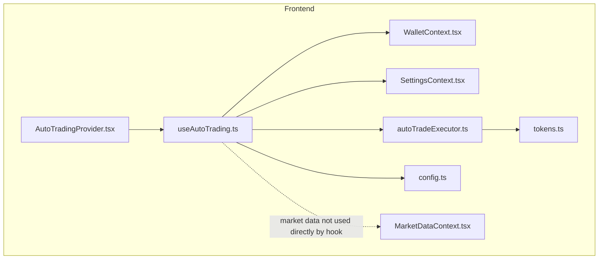
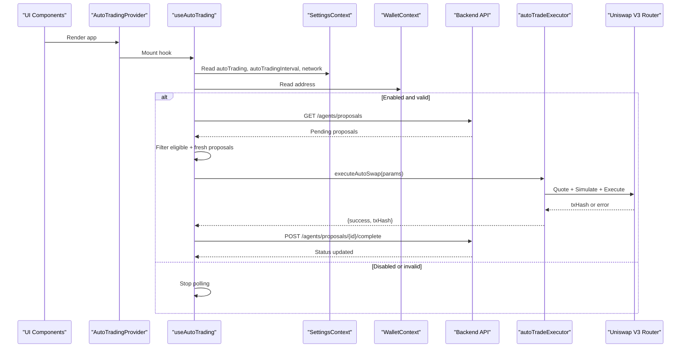
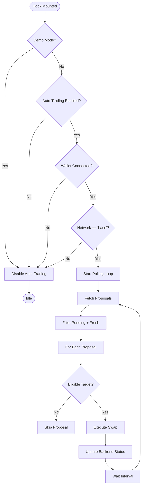
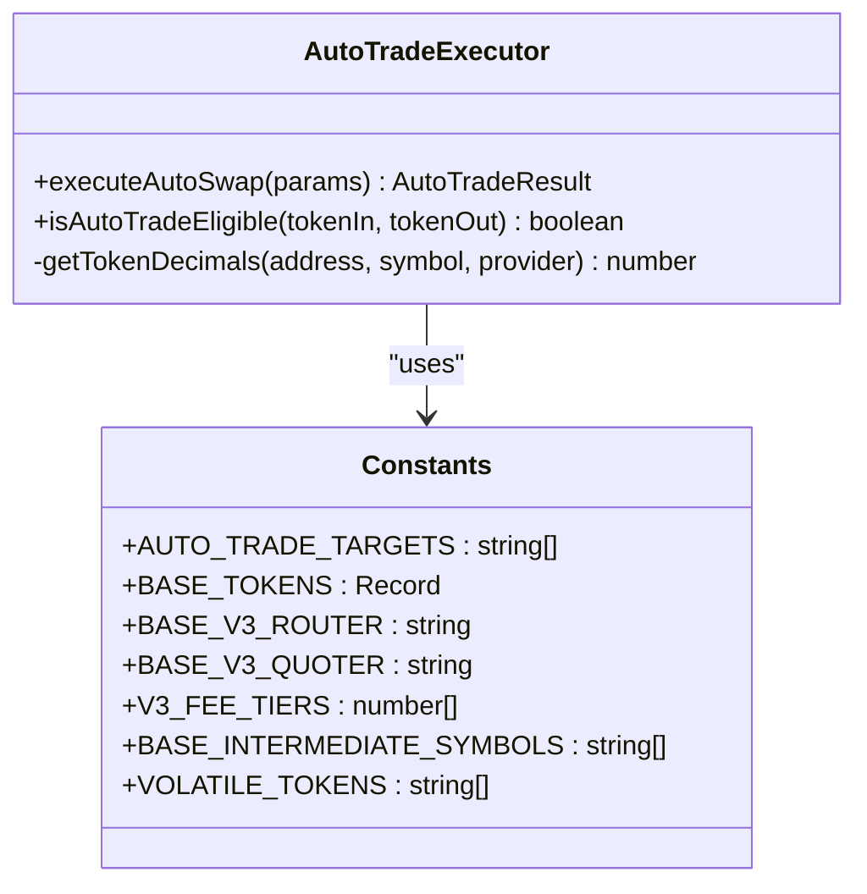
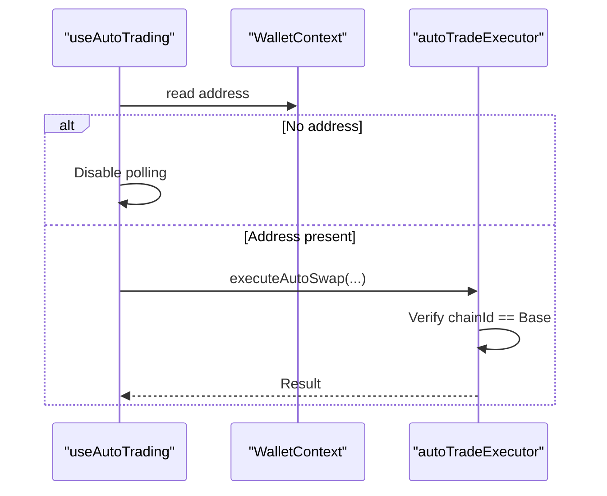
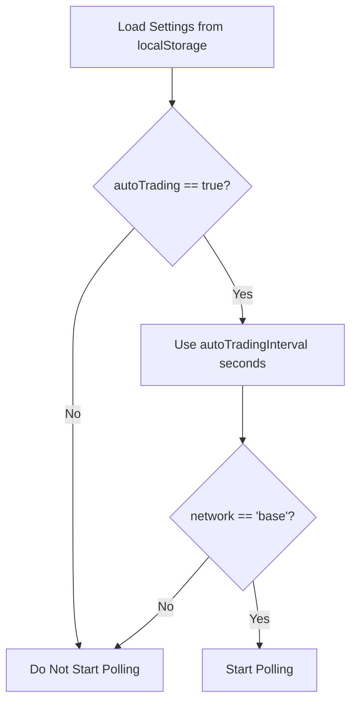
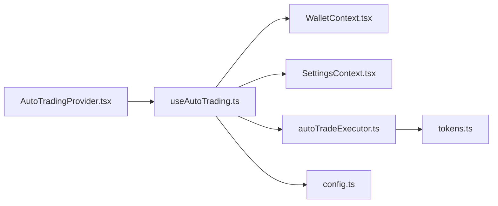

# Auto Trading Hook

<cite>
**Referenced Files in This Document**
- [useAutoTrading.ts](file://frontend/hooks/useAutoTrading.ts)
- [autoTradeExecutor.ts](file://frontend/lib/autoTradeExecutor.ts)
- [WalletContext.tsx](file://frontend/context/WalletContext.tsx)
- [MarketDataContext.tsx](file://frontend/context/MarketDataContext.tsx)
- [SettingsContext.tsx](file://frontend/context/SettingsContext.tsx)
- [config.ts](file://frontend/constants/config.ts)
- [tokens.ts](file://frontend/constants/tokens.ts)
- [AutoTradingProvider.tsx](file://frontend/components/AutoTradingProvider.tsx)
</cite>

## Table of Contents
1. [Introduction](#introduction)
2. [Project Structure](#project-structure)
3. [Core Components](#core-components)
4. [Architecture Overview](#architecture-overview)
5. [Detailed Component Analysis](#detailed-component-analysis)
6. [Dependency Analysis](#dependency-analysis)
7. [Performance Considerations](#performance-considerations)
8. [Troubleshooting Guide](#troubleshooting-guide)
9. [Conclusion](#conclusion)

## Introduction
This document explains the `useAutoTrading` custom hook that orchestrates automatic trade execution in the DexTrader frontend. It polls backend trading proposals, validates eligibility, executes on-chain swaps via Uniswap V3 on Base, and updates proposal status with the backend. The hook integrates with:
- Wallet context for account and network awareness
- Settings context for auto-trading toggles and polling intervals
- On-chain contracts through an executor utility
- Backend APIs for proposal lifecycle management

The goal is to provide a clear mental model of how automatic trades are discovered, validated, executed, and tracked, while addressing error handling, edge cases, and performance considerations.

## Project Structure
The auto-trading feature spans several frontend modules:
- Hook: `hooks/useAutoTrading.ts`
- Executor: `lib/autoTradeExecutor.ts`
- Contexts: `context/WalletContext.tsx`, `context/SettingsContext.tsx`, `context/MarketDataContext.tsx`
- Constants: `constants/config.ts`, `constants/tokens.ts`
- Provider: `components/AutoTradingProvider.tsx`

**Diagram sources**
- [AutoTradingProvider.tsx:1-9](file://frontend/components/AutoTradingProvider.tsx#L1-L9)
- [useAutoTrading.ts:1-208](file://frontend/hooks/useAutoTrading.ts#L1-L208)
- [autoTradeExecutor.ts:1-298](file://frontend/lib/autoTradeExecutor.ts#L1-L298)
- [WalletContext.tsx:1-118](file://frontend/context/WalletContext.tsx#L1-L118)
- [SettingsContext.tsx:1-201](file://frontend/context/SettingsContext.tsx#L1-L201)
- [MarketDataContext.tsx:1-150](file://frontend/context/MarketDataContext.tsx#L1-L150)
- [config.ts:1-8](file://frontend/constants/config.ts#L1-L8)
- [tokens.ts:1-128](file://frontend/constants/tokens.ts#L1-L128)

**Section sources**
- [AutoTradingProvider.tsx:1-9](file://frontend/components/AutoTradingProvider.tsx#L1-L9)
- [useAutoTrading.ts:1-208](file://frontend/hooks/useAutoTrading.ts#L1-L208)

## Core Components
- `useAutoTrading`: A side-effect-driven hook that starts/stops a polling loop based on settings and wallet state. It fetches pending proposals from the backend, filters eligible ones, and executes them using the executor.
- `autoTradeExecutor`: Low-level logic for quoting and executing Uniswap V3 swaps on Base, including multi-hop routing, slippage calculation, approvals, gas strategy, and pre-execution simulation.
- `WalletContext`: Provides connected address and chain events; used by the hook to gate execution when no wallet is connected or wrong network is selected.
- `SettingsContext`: Provides auto-trading toggle, polling interval, and current network selection.
- `MarketDataContext`: Supplies market data to UI components; not directly consumed by the hook but relevant for understanding price context around trades.
- `config` and `tokens`: Provide backend URL, demo mode flag, token addresses, and router/quoter constants.

Key responsibilities:
- Lifecycle control: start polling when enabled and conditions met; stop on disable or unmount.
- Eligibility checks: ensure allowed tokens, correct network, and fresh proposals.
- Execution pipeline: quote best route, simulate, execute, and update backend.
- Error handling: log warnings/errors, skip stale proposals, and continue polling.

**Section sources**
- [useAutoTrading.ts:21-208](file://frontend/hooks/useAutoTrading.ts#L21-L208)
- [autoTradeExecutor.ts:30-298](file://frontend/lib/autoTradeExecutor.ts#L30-L298)
- [WalletContext.tsx:1-118](file://frontend/context/WalletContext.tsx#L1-L118)
- [SettingsContext.tsx:1-201](file://frontend/context/SettingsContext.tsx#L1-L201)
- [MarketDataContext.tsx:1-150](file://frontend/context/MarketDataContext.tsx#L1-L150)
- [config.ts:1-8](file://frontend/constants/config.ts#L1-L8)
- [tokens.ts:108-128](file://frontend/constants/tokens.ts#L108-L128)

## Architecture Overview
The auto-trading flow connects React state, backend APIs, and on-chain contracts:

**Diagram sources**
- [useAutoTrading.ts:89-204](file://frontend/hooks/useAutoTrading.ts#L89-L204)
- [autoTradeExecutor.ts:45-282](file://frontend/lib/autoTradeExecutor.ts#L45-L282)
- [config.ts:1-8](file://frontend/constants/config.ts#L1-L8)

## Detailed Component Analysis

### useAutoTrading Hook
Responsibilities:
- Initialize refs for run state, processed IDs, and poll count.
- Define `executeProposal` callback that:
  - Computes input/output tokens and amounts based on action (buy/sell).
  - Checks pair eligibility against allowed targets.
  - Calls executor to perform swap.
  - Updates backend proposal status upon success.
- Manage effect lifecycle:
  - Guard against demo mode, disabled toggle, missing wallet, and wrong network.
  - Start polling loop immediately then at configured interval.
  - Fetch proposals, filter pending and non-processed, apply staleness guard, and execute eligible ones.
  - Clean up interval and flags on unmount.

Parameters and dependencies:
- Reads from `useWallet()` and `useSettings()`.
- Uses constants from `config.ts` (`BACKEND_URL`, `DEMO_MODE`).
- Imports executor functions and constants from `autoTradeExecutor.ts`.

Return value:
- Returns `null`; intended as a side-effect-only hook.

Internal state:
- `isRunningRef`: controls polling loop.
- `processedIdsRef`: tracks already handled proposal IDs.
- `pollCountRef`: counts polls for logging/debugging.

Error handling:
- Logs warnings for backend errors and proposal update failures.
- Skips stale proposals beyond max age threshold.
- Continues polling after transient errors.

Edge cases:
- Demo mode disables all wallet interactions.
- Wrong network prevents execution.
- Stale proposals are dropped to avoid surprise confirmations after sleep/wake.

**Diagram sources**
- [useAutoTrading.ts:89-204](file://frontend/hooks/useAutoTrading.ts#L89-L204)

**Section sources**
- [useAutoTrading.ts:21-208](file://frontend/hooks/useAutoTrading.ts#L21-L208)

### autoTradeExecutor Utility
Responsibilities:
- Validate auto-trade eligibility for token pairs.
- Connect to injected wallet and verify Base network.
- Resolve token addresses and decimals.
- Quote best route across direct pools and multi-hop intermediaries.
- Compute slippage floor, especially for volatile tokens.
- Approve token allowances if needed.
- Build call data for Uniswap V3 Router and wrap in multicall with deadline.
- Pre-simulate to fail fast before opening MetaMask.
- Execute transaction and return result.

Key interfaces:
- `AutoTradeParams`: tokenIn, tokenOut, amountIn, slippage, gasPriceGwei.
- `AutoTradeResult`: success, optional txHash, optional error.

Important behaviors:
- Enforces distinct symbols and USDC settlement rules.
- Uses `BASE_V3_QUOTER` and `BASE_V3_ROUTER` constants.
- Supports multiple fee tiers and intermediate tokens for liquidity.
- Applies higher slippage floor for volatile tokens.
- Avoids pinning nonce to support MetaMask relay paths.
- Wraps calls in multicall with deadline to limit mempool lifetime.

**Diagram sources**
- [autoTradeExecutor.ts:1-298](file://frontend/lib/autoTradeExecutor.ts#L1-L298)
- [tokens.ts:40-128](file://frontend/constants/tokens.ts#L40-L128)

**Section sources**
- [autoTradeExecutor.ts:30-298](file://frontend/lib/autoTradeExecutor.ts#L30-L298)
- [tokens.ts:40-128](file://frontend/constants/tokens.ts#L40-L128)

### WalletContext Integration
The hook relies on `useWallet()` to determine whether a wallet is connected and which network is active. While the hook itself only reads `address`, the executor verifies the actual chain ID against Base.

Integration points:
- Hook gates polling if `address` is null.
- Executor enforces Base chainId and fails early otherwise.
- Wallet events (accountsChanged, chainChanged) keep context consistent.

**Diagram sources**
- [useAutoTrading.ts:21-24](file://frontend/hooks/useAutoTrading.ts#L21-L24)
- [autoTradeExecutor.ts:55-63](file://frontend/lib/autoTradeExecutor.ts#L55-L63)
- [WalletContext.tsx:21-118](file://frontend/context/WalletContext.tsx#L21-L118)

**Section sources**
- [WalletContext.tsx:1-118](file://frontend/context/WalletContext.tsx#L1-L118)
- [useAutoTrading.ts:21-24](file://frontend/hooks/useAutoTrading.ts#L21-L24)
- [autoTradeExecutor.ts:55-63](file://frontend/lib/autoTradeExecutor.ts#L55-L63)

### SettingsContext Integration
The hook consumes:
- `autoTrading`: enables/disables polling.
- `autoTradingInterval`: determines poll frequency.
- `network`: used as a quick gate (must be "base").

Settings persistence ensures user preferences survive reloads.

**Diagram sources**
- [SettingsContext.tsx:28-93](file://frontend/context/SettingsContext.tsx#L28-L93)
- [useAutoTrading.ts:21-24](file://frontend/hooks/useAutoTrading.ts#L21-L24)
- [useAutoTrading.ts:103-117](file://frontend/hooks/useAutoTrading.ts#L103-L117)

**Section sources**
- [SettingsContext.tsx:1-201](file://frontend/context/SettingsContext.tsx#L1-L201)
- [useAutoTrading.ts:21-24](file://frontend/hooks/useAutoTrading.ts#L21-L24)

### MarketDataContext Relationship
Although the hook does not consume market data directly, it is important to understand that:
- Market data provides price context for strategies and UI.
- The executor uses on-chain quotes rather than cached prices.
- UI components can display market trends alongside auto-trading status.

Conceptual relationship:
- Strategies may generate proposals based on market signals.
- The hook executes proposals regardless of current UI market data.
- For debugging, correlating market changes with proposal timestamps helps explain behavior.

[No sources needed since this section doesn't analyze specific source files]

### AutoTradingProvider
A minimal client component that mounts the hook once at the app level to ensure polling runs globally.

Usage pattern:
- Wrap application children with `AutoTradingProvider`.
- The hook runs automatically without returning values to consumers.

**Section sources**
- [AutoTradingProvider.tsx:1-9](file://frontend/components/AutoTradingProvider.tsx#L1-L9)

## Dependency Analysis
High-level dependency relationships:

**Diagram sources**
- [useAutoTrading.ts:1-6](file://frontend/hooks/useAutoTrading.ts#L1-L6)
- [autoTradeExecutor.ts:1-2](file://frontend/lib/autoTradeExecutor.ts#L1-L2)
- [AutoTradingProvider.tsx:1-7](file://frontend/components/AutoTradingProvider.tsx#L1-L7)

Coupling and cohesion:
- `useAutoTrading` is cohesive around polling and lifecycle; it delegates execution to `autoTradeExecutor`.
- `autoTradeExecutor` encapsulates all on-chain logic, improving separation of concerns.
- Contexts are decoupled from the hook except for reading values.

Potential circular dependencies:
- None observed; imports are one-directional.

External integrations:
- Backend REST endpoints for proposals and status updates.
- Ethereum provider via injected wallet for on-chain operations.

**Section sources**
- [useAutoTrading.ts:1-6](file://frontend/hooks/useAutoTrading.ts#L1-L6)
- [autoTradeExecutor.ts:1-2](file://frontend/lib/autoTradeExecutor.ts#L1-L2)

## Performance Considerations
- Polling interval: Adjust `autoTradingInterval` to balance responsiveness and network load. Shorter intervals increase API calls and potential redundant work.
- Staleness guard: Prevents executing outdated proposals after sleep/wake by skipping those older than `max(2x interval, 10 minutes)`.
- Route optimization: Executor tries direct pools first, then multi-hop routes; best quote selection reduces slippage impact.
- Gas strategy: Uses provided gas price with fallbacks and avoids pinning nonce to support modern wallet relays.
- Simulation: Pre-execution simulation avoids unnecessary MetaMask prompts and failed transactions.
- Decimals caching: Token decimals are cached to reduce repeated contract calls.

Recommendations:
- Tune `autoTradingInterval` based on expected proposal volume and user tolerance for latency.
- Monitor console logs for poll counts and skipped proposals to diagnose performance issues.
- Use appropriate slippage settings for volatile tokens to reduce reverts.

[No sources needed since this section provides general guidance]

## Troubleshooting Guide
Common issues and resolutions:
- Auto-trading not starting:
  - Ensure `autoTrading` is enabled in settings.
  - Confirm wallet is connected and network is Base.
  - Verify demo mode is disabled if real execution is expected.
- No proposals executed:
  - Check backend `/agents/proposals` returns pending proposals.
  - Verify proposal tokens are in `AUTO_TRADE_TARGETS`.
  - Ensure proposals are not marked as not auto-tradeable.
- Failed transactions:
  - Review executor logs for quote failures, approval issues, or simulation errors.
  - Check slippage settings for volatile tokens.
  - Confirm sufficient allowance and gas price configuration.
- Backend status not updated:
  - Inspect network tab for POST to `/agents/proposals/{id}/complete`.
  - Handle transient network errors gracefully; hook continues polling.

Debugging tips:
- Console logs include detailed steps for each poll and proposal execution.
- Track `pollCountRef` to identify rapid polling or stuck loops.
- Correlate proposal timestamps with staleness thresholds.

**Section sources**
- [useAutoTrading.ts:89-204](file://frontend/hooks/useAutoTrading.ts#L89-L204)
- [autoTradeExecutor.ts:45-282](file://frontend/lib/autoTradeExecutor.ts#L45-L282)

## Conclusion
The `useAutoTrading` hook provides a robust foundation for automated trading by combining React lifecycle management, backend proposal polling, and on-chain execution via Uniswap V3. Its design emphasizes safety through eligibility checks, staleness guards, and pre-execution simulation, while remaining flexible through configurable intervals and settings. Integrating with wallet and settings contexts ensures seamless operation within the broader DexTrader application. Proper tuning of intervals, slippage, and gas parameters, along with careful monitoring of logs and backend responses, will help maintain reliable auto-trading behavior under varying network and market conditions.