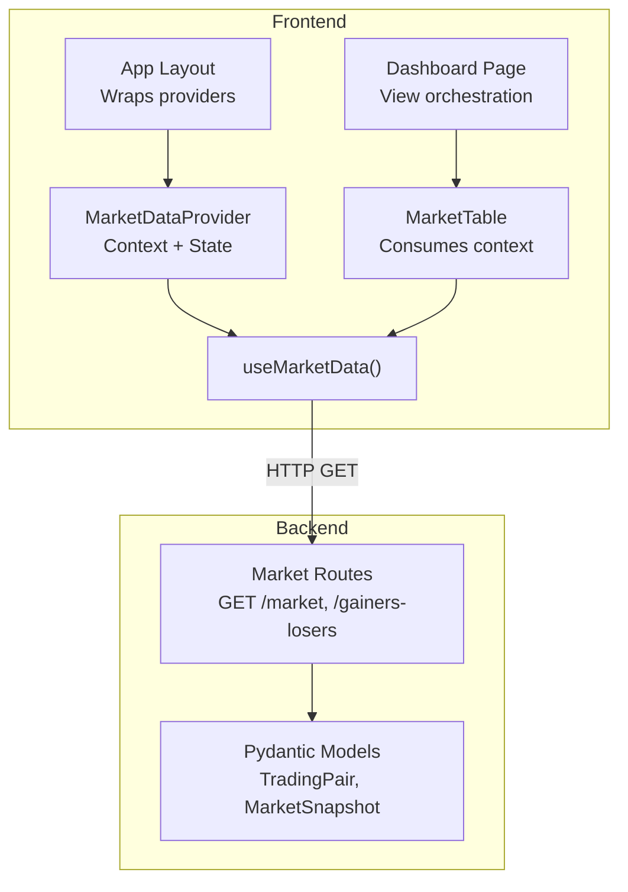
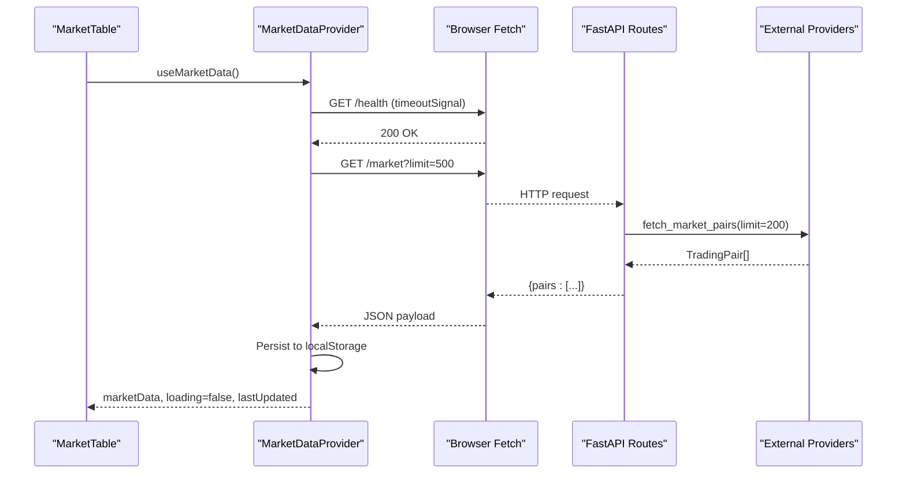
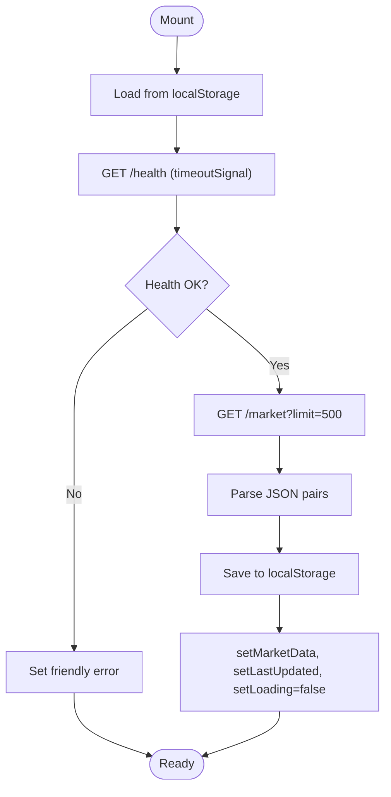
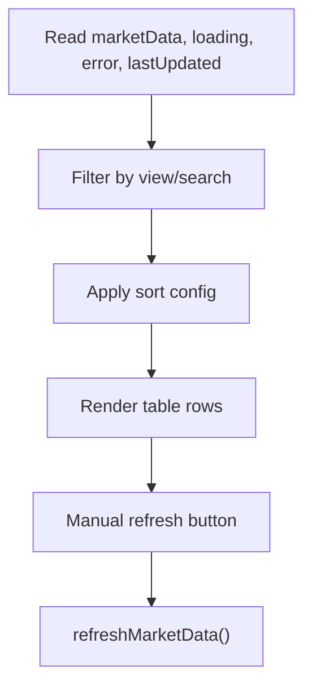
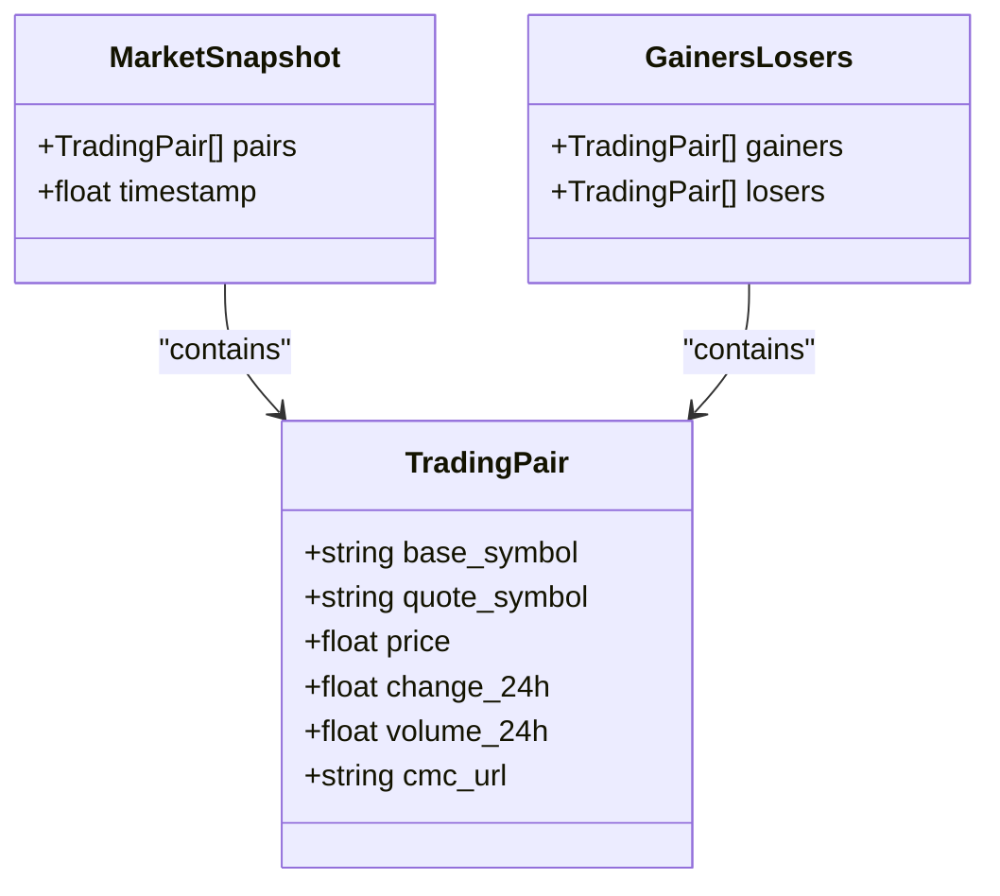
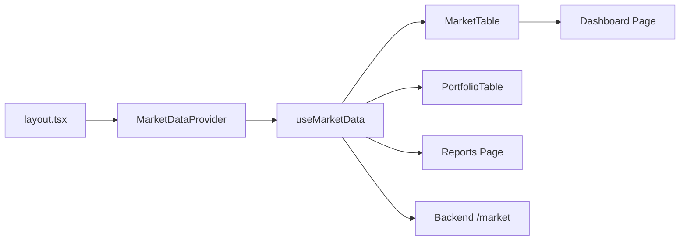

# Market Data Context

<cite>
**Referenced Files in This Document**
- [MarketDataContext.tsx](file://frontend/context/MarketDataContext.tsx)
- [routes_market.py](file://backend/app/api/routes_market.py)
- [market.py](file://backend/app/models/market.py)
- [MarketTable.tsx](file://frontend/components/MarketTable.tsx)
- [dashboard/page.tsx](file://frontend/app/dashboard/page.tsx)
- [layout.tsx](file://frontend/app/layout.tsx)
</cite>

## Update Summary
**Changes Made**
- Updated Network Timeouts section to document enhanced timeoutSignal function with browser compatibility improvements
- Added detailed explanation of AbortSignal.timeout() fallback mechanism for older mobile Chromium versions
- Enhanced troubleshooting guide with browser-specific compatibility information

## Table of Contents
1. [Introduction](#introduction)
2. [Project Structure](#project-structure)
3. [Core Components](#core-components)
4. [Architecture Overview](#architecture-overview)
5. [Detailed Component Analysis](#detailed-component-analysis)
6. [Dependency Analysis](#dependency-analysis)
7. [Performance Considerations](#performance-considerations)
8. [Troubleshooting Guide](#troubleshooting-guide)
9. [Conclusion](#conclusion)

## Introduction
This document explains the Market Data Context implementation that powers real-time market data across the application. It covers how price updates, volume information, and market statistics are managed; how the context provider initializes state and fetches data; how the frontend integrates with backend endpoints; and how components consume, display, refresh, and handle errors for market data. It also documents relationships with other contexts and outlines performance considerations such as caching and efficient re-renders.

## Project Structure
The market data feature spans both frontend and backend:
- Frontend:
  - Context provider and hook for market data
  - Dashboard page orchestrating views
  - Market table component consuming context
  - Root layout wrapping the app with the provider
- Backend:
  - API routes exposing market data endpoints
  - Pydantic models defining response shapes



**Diagram sources**
- [layout.tsx:8-34](file://frontend/app/layout.tsx#L8-L34)
- [MarketDataContext.tsx:28-142](file://frontend/context/MarketDataContext.tsx#L28-L142)
- [MarketTable.tsx:21-23](file://frontend/components/MarketTable.tsx#L21-L23)
- [dashboard/page.tsx:11-75](file://frontend/app/dashboard/page.tsx#L11-L75)
- [routes_market.py:53-67](file://backend/app/api/routes_market.py#L53-L67)
- [market.py:5-21](file://backend/app/models/market.py#L5-L21)

**Section sources**
- [layout.tsx:8-34](file://frontend/app/layout.tsx#L8-L34)
- [MarketDataContext.tsx:28-142](file://frontend/context/MarketDataContext.tsx#L28-L142)
- [MarketTable.tsx:21-23](file://frontend/components/MarketTable.tsx#L21-L23)
- [dashboard/page.tsx:11-75](file://frontend/app/dashboard/page.tsx#L11-L75)
- [routes_market.py:53-67](file://backend/app/api/routes_market.py#L53-L67)
- [market.py:5-21](file://backend/app/models/market.py#L5-L21)

## Core Components
- MarketDataProvider: React context provider managing market data state (list of trading pairs), loading, error, last updated timestamp, and a refresh function. It hydrates from localStorage on mount, performs a health check, then fetches fresh data from the backend, persists to localStorage, and updates state.
- useMarketData: Custom hook to access the context safely within any child component.
- MarketTable: UI component that consumes market data, supports search, sorting, view modes (all, gainers, losers, tracked, volume), and manual refresh.
- Dashboard Page: Orchestrates view mode and selected pairs, passing them to MarketTable.
- Backend Market Routes: Provide endpoints for market pairs and derived views like gainers/losers, with server-side caching and rate-limit handling.

Key responsibilities:
- Data fetching: Health check followed by market data retrieval.
- Caching: Client-side localStorage persistence; server-side in-memory cache with TTL.
- Error management: User-friendly messages and fallback to cached data when possible.
- UI integration: Loading indicators, error banners, and refresh controls.

**Section sources**
- [MarketDataContext.tsx:28-142](file://frontend/context/MarketDataContext.tsx#L28-L142)
- [MarketTable.tsx:21-107](file://frontend/components/MarketTable.tsx#L21-L107)
- [dashboard/page.tsx:11-75](file://frontend/app/dashboard/page.tsx#L11-L75)
- [routes_market.py:53-67](file://backend/app/api/routes_market.py#L53-L67)

## Architecture Overview
The system uses a client-server architecture where the frontend context layer abstracts network calls and provides reactive state to UI components. The backend exposes REST endpoints with in-memory caching to reduce external API load.



**Diagram sources**
- [MarketDataContext.tsx:66-121](file://frontend/context/MarketDataContext.tsx#L66-L121)
- [routes_market.py:26-58](file://backend/app/api/routes_market.py#L26-L58)

## Detailed Component Analysis

### MarketDataProvider and useMarketData
Responsibilities:
- Initialize state: marketData array, loading flag, error message, lastUpdated timestamp.
- Hydrate from localStorage on mount to show instant content.
- Perform a health check with a short timeout before fetching market data.
- Fetch market data from backend, persist to localStorage, update state, and return promise.
- Expose refreshMarketData for manual refresh.

State shape:
- marketData: list of trading pairs with fields base_symbol, quote_symbol, price, change_24h, optional volume_24h and cmc_url.
- loading: boolean indicating active fetch.
- error: string or null for user-facing error messages.
- lastUpdated: numeric timestamp of last successful fetch.

Error handling:
- If backend is not ready, set a friendly error and do not throw if cached data exists.
- On network or parsing errors, set error and disable loading.

Caching strategy:
- Client-side: localStorage stores pairs and timestamp.
- Server-side: in-memory cache with TTL and lock to prevent thundering herd.



**Diagram sources**
- [MarketDataContext.tsx:34-121](file://frontend/context/MarketDataContext.tsx#L34-L121)

**Section sources**
- [MarketDataContext.tsx:28-150](file://frontend/context/MarketDataContext.tsx#L28-L150)

### Enhanced Browser Compatibility: timeoutSignal Function
**Updated** Enhanced timeoutSignal function with improved browser compatibility for older mobile Chromium versions.

The timeoutSignal function now includes a robust fallback mechanism to handle environments where `AbortSignal.timeout()` is not available:

```typescript
function timeoutSignal(ms: number): AbortSignal {
  const factory = (AbortSignal as any)?.timeout;
  if (typeof factory === "function") {
    try {
      return factory.call(AbortSignal, ms);
    } catch {
      // fall through
    }
  }
  const controller = new AbortController();
  setTimeout(() => controller.abort(), ms);
  return controller.signal;
}
```

Key features:
- **Primary path**: Uses native `AbortSignal.timeout()` when available for optimal performance
- **Fallback mechanism**: Falls back to `AbortController` with `setTimeout` when native support is missing
- **Error handling**: Gracefully handles exceptions during native timeout creation
- **Mobile compatibility**: Ensures functionality on older mobile Chromium versions (< 103)

Usage in market data fetching:
- Health checks use `timeoutSignal(3000)` for 3-second timeouts
- Provides consistent timeout behavior across all browsers and devices

**Section sources**
- [MarketDataContext.tsx:28-42](file://frontend/context/MarketDataContext.tsx#L28-L42)
- [MarketDataContext.tsx:88-92](file://frontend/context/MarketDataContext.tsx#L88-L92)

### MarketTable
Responsibilities:
- Consume context via useMarketData.
- Support multiple views: all, gainers, losers, tracked, volume.
- Implement search filtering by symbol.
- Sort by pair, price, change_24h, volume_24h.
- Display loading, error, empty states.
- Trigger manual refresh via refreshMarketData.

Data flow:
- Reads marketData from context.
- Computes rows based on view and filters.
- Renders table with formatted values and links.



**Diagram sources**
- [MarketTable.tsx:21-107](file://frontend/components/MarketTable.tsx#L21-L107)

**Section sources**
- [MarketTable.tsx:21-259](file://frontend/components/MarketTable.tsx#L21-L259)

### Dashboard Page
Responsibilities:
- Manage view mode (all, gainers, losers, tracked, volume).
- Persist selected pairs to localStorage.
- Pass view and selectedPairs to MarketTable.

Relationship to Market Data:
- Does not directly fetch data; relies on MarketDataProvider to supply marketData.

**Section sources**
- [dashboard/page.tsx:11-75](file://frontend/app/dashboard/page.tsx#L11-L75)

### Backend Market Routes
Endpoints:
- GET /market?limit=N&refresh=bool: Returns limited list of trading pairs. Uses server-side cache with TTL and concurrency lock.
- GET /gainers-losers?limit=N&refresh=bool: Returns top gainers and losers sorted by change_24h.

Models:
- TradingPair: base_symbol, quote_symbol, price, change_24h, optional volume_24h, cmc_url.
- MarketSnapshot: pairs array and optional timestamp.
- GainersLosers: arrays of gainers and losers.

Caching and resilience:
- In-memory cache with 1-hour TTL for market pairs.
- Async lock prevents duplicate upstream calls.
- Rate limiting handling for related endpoints (base tokens, token volumes).



**Diagram sources**
- [market.py:5-21](file://backend/app/models/market.py#L5-L21)

**Section sources**
- [routes_market.py:26-67](file://backend/app/api/routes_market.py#L26-L67)
- [market.py:5-21](file://backend/app/models/market.py#L5-L21)

## Dependency Analysis
- App layout wraps the entire application with MarketDataProvider, making market data available globally.
- MarketTable and other components consume market data through useMarketData.
- Dashboard coordinates UI state and delegates data consumption to MarketTable.
- Backend routes depend on services to fetch external market data and expose it via FastAPI.



**Diagram sources**
- [layout.tsx:8-34](file://frontend/app/layout.tsx#L8-L34)
- [MarketDataContext.tsx:28-142](file://frontend/context/MarketDataContext.tsx#L28-L142)
- [MarketTable.tsx:21-23](file://frontend/components/MarketTable.tsx#L21-L23)
- [routes_market.py:53-67](file://backend/app/api/routes_market.py#L53-L67)

**Section sources**
- [layout.tsx:8-34](file://frontend/app/layout.tsx#L8-L34)
- [MarketDataContext.tsx:28-142](file://frontend/context/MarketDataContext.tsx#L28-L142)
- [MarketTable.tsx:21-23](file://frontend/components/MarketTable.tsx#L21-L23)
- [routes_market.py:53-67](file://backend/app/api/routes_market.py#L53-L67)

## Performance Considerations
- Client-side caching:
  - localStorage is used to store pairs and last updated timestamp, enabling instant display on reload and reducing perceived latency.
  - Storage operations are wrapped in try/catch to avoid blocking UI.
- Debouncing and throttling:
  - No explicit debounce/throttle is implemented in the current code. For high-frequency refresh scenarios, consider debouncing refresh triggers at the UI level.
- Efficient re-renders:
  - Context value includes stable references for functions (refreshMarketData) and primitive/state values. To minimize re-renders in large trees, consider memoizing derived values in consumers or splitting context into smaller slices if needed.
- Server-side caching:
  - In-memory cache with TTL reduces external API calls and stabilizes response times.
  - Concurrency lock prevents thundering herd during cache misses.
- Network timeouts:
  - Health check uses enhanced timeoutSignal function with 3-second timeout for reliable failure detection.
  - Fallback mechanism ensures timeout functionality works across all browsers including older mobile Chromium versions.

Recommendations:
- Add explicit refresh intervals with backoff and jitter to avoid bursts.
- Consider using AbortController to cancel stale requests when new ones are triggered.
- Use React.memo or useMemo in heavy consumers to avoid unnecessary renders.
- Monitor browser compatibility metrics to ensure timeoutSignal fallback usage remains minimal.

**Section sources**
- [MarketDataContext.tsx:28-42](file://frontend/context/MarketDataContext.tsx#L28-L42)
- [MarketDataContext.tsx:88-92](file://frontend/context/MarketDataContext.tsx#L88-L92)

## Troubleshooting Guide
Common issues and resolutions:
- Backend not ready:
  - Symptom: Friendly error message indicating backend startup.
  - Cause: Health check fails due to slow startup.
  - Resolution: Wait briefly and retry; ensure backend service is running.
- Network errors:
  - Symptom: Error banner showing status code or generic failure.
  - Cause: Backend unavailable or malformed response.
  - Resolution: Check network connectivity and backend logs; verify endpoint paths.
- Empty data:
  - Symptom: "No market data available" message.
  - Cause: Backend returned empty pairs or filter conditions eliminated rows.
  - Resolution: Verify backend returns non-empty pairs; adjust view/filter settings.
- Stale data:
  - Symptom: Outdated prices/volumes.
  - Cause: Cached data still displayed after refresh failed.
  - Resolution: Manually trigger refresh; clear localStorage if necessary.
- Browser compatibility issues:
  - Symptom: Timeout failures on older mobile devices.
  - Cause: Missing AbortSignal.timeout() support in older mobile Chromium versions.
  - Resolution: Enhanced timeoutSignal function automatically falls back to AbortController; no action required.

Operational tips:
- Inspect localStorage keys for market data and timestamp to validate client-side caching.
- Monitor backend logs for upstream provider rate limits and cache invalidation events.
- Test timeout functionality across different browsers and devices to ensure fallback mechanism works correctly.

**Section sources**
- [MarketDataContext.tsx:105-121](file://frontend/context/MarketDataContext.tsx#L105-L121)
- [MarketTable.tsx:138-154](file://frontend/components/MarketTable.tsx#L138-L154)
- [MarketDataContext.tsx:28-42](file://frontend/context/MarketDataContext.tsx#L28-L42)

## Conclusion
The Market Data Context provides a robust foundation for displaying real-time market data across the application. It combines client-side caching for responsiveness with server-side caching for efficiency, while offering clear error handling and straightforward refresh mechanisms. The enhanced timeoutSignal function ensures reliable timeout functionality across all browsers and devices, including older mobile Chromium versions. Components consume the context declaratively, enabling flexible views and interactions. With additional debouncing, request cancellation, and fine-grained context slicing, the solution can scale further for high-frequency updates and complex dashboards.