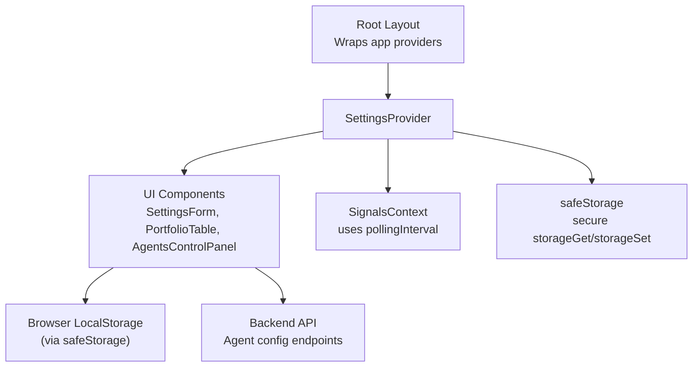
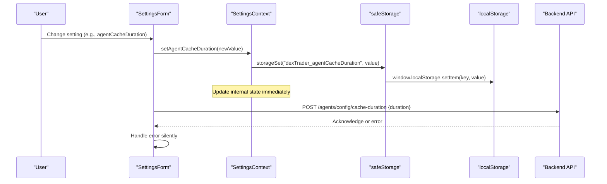
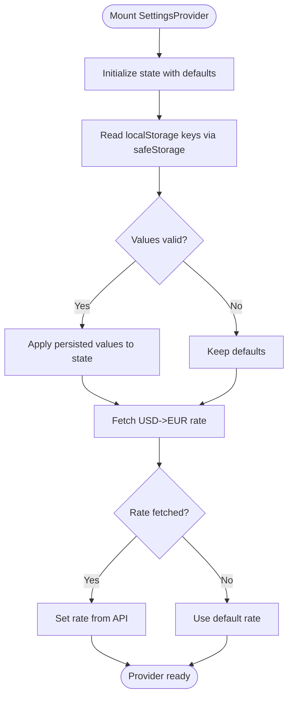
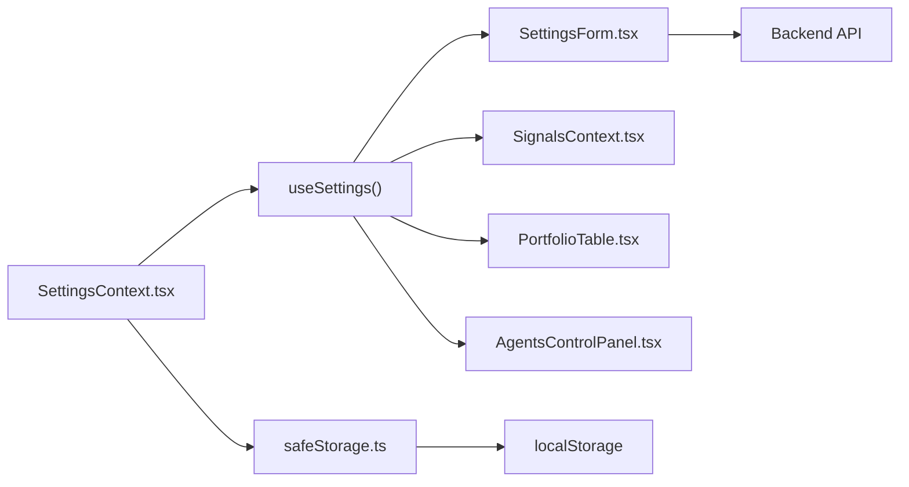

# Settings Context

<cite>
**Referenced Files in This Document**
- [SettingsContext.tsx](file://frontend/context/SettingsContext.tsx)
- [safeStorage.ts](file://frontend/lib/safeStorage.ts)
- [SettingsForm.tsx](file://frontend/components/SettingsForm.tsx)
- [layout.tsx](file://frontend/app/layout.tsx)
- [SignalsContext.tsx](file://frontend/context/SignalsContext.tsx)
- [PortfolioTable.tsx](file://frontend/components/PortfolioTable.tsx)
- [AgentsControlPanel.tsx](file://frontend/components/AgentsControlPanel.tsx)
- [config.ts](file://frontend/constants/config.ts)
</cite>

## Update Summary
**Changes Made**
- Updated persistence mechanism section to reflect safeStorage abstraction usage
- Added new section documenting the safeStorage abstraction and its benefits
- Updated architecture diagrams to show safeStorage integration
- Enhanced security considerations section with storage safety details
- Updated troubleshooting guide to address storage-related issues

## Table of Contents
1. [Introduction](#introduction)
2. [Project Structure](#project-structure)
3. [Core Components](#core-components)
4. [Architecture Overview](#architecture-overview)
5. [Detailed Component Analysis](#detailed-component-analysis)
6. [Safe Storage Abstraction](#safe-storage-abstraction)
7. [Dependency Analysis](#dependency-analysis)
8. [Performance Considerations](#performance-considerations)
9. [Troubleshooting Guide](#troubleshooting-guide)
10. [Conclusion](#conclusion)

## Introduction
This document explains the SettingsContext that centralizes application preferences and user configurations for the DexTrader frontend. It covers how settings are stored using a secure storage abstraction, validated, synchronized across components, and persisted to the browser's local storage. It also documents available configuration options, default values, validation rules, persistence mechanisms, usage examples, security considerations, and best practices for managing nested or complex settings structures.

## Project Structure
The SettingsContext is a React context provider that exposes:
- Currency preference (USD/EUR)
- Blockchain network selection
- Polling intervals for signals and market data
- Agent cache duration
- Auto-trading toggle and interval
- Exchange rate used for currency formatting
- A helper function to format values based on selected currency

It is mounted at the root layout so all child components can access settings via a custom hook.



**Diagram sources**
- [layout.tsx:17-35](file://frontend/app/layout.tsx#L17-L35)
- [SettingsContext.tsx:28-190](file://frontend/context/SettingsContext.tsx#L28-L190)
- [SignalsContext.tsx:34-83](file://frontend/context/SignalsContext.tsx#L34-L83)
- [SettingsForm.tsx:31-40](file://frontend/components/SettingsForm.tsx#L31-L40)
- [safeStorage.ts:10-26](file://frontend/lib/safeStorage.ts#L10-L26)

**Section sources**
- [layout.tsx:17-35](file://frontend/app/layout.tsx#L17-L35)
- [SettingsContext.tsx:28-190](file://frontend/context/SettingsContext.tsx#L28-L190)

## Core Components
- SettingsContext and SettingsProvider: Manage state, provide setters, persist to localStorage via safeStorage, fetch exchange rates, and expose a formatter.
- useSettings hook: Typed accessor for consuming settings throughout the app.
- SettingsForm: Primary UI for editing settings; also sends some settings to backend when applicable.
- SignalsContext: Consumes pollingInterval from SettingsContext to schedule periodic signal refreshes.
- PortfolioTable and AgentsControlPanel: Consume network and autoTrading to adapt behavior and UI.
- safeStorage: Secure abstraction layer for localStorage operations with error handling.

Key responsibilities:
- State ownership: All settings live in SettingsProvider.
- Persistence: Each setting is saved to localStorage with a consistent key prefix using safeStorage functions.
- Validation: Values are validated during load and update to ensure safe defaults and constraints.
- Synchronization: Some settings are sent to backend endpoints (e.g., agent cache duration).
- Security: All storage operations go through safeStorage to handle browser restrictions gracefully.

**Section sources**
- [SettingsContext.tsx:4-24](file://frontend/context/SettingsContext.tsx#L4-L24)
- [SettingsContext.tsx:28-190](file://frontend/context/SettingsContext.tsx#L28-L190)
- [SettingsForm.tsx:31-40](file://frontend/components/SettingsForm.tsx#L31-L40)
- [SignalsContext.tsx:34-83](file://frontend/context/SignalsContext.tsx#L34-L83)
- [PortfolioTable.tsx:28-31](file://frontend/components/PortfolioTable.tsx#L28-L31)
- [AgentsControlPanel.tsx:51-54](file://frontend/components/AgentsControlPanel.tsx#L51-L54)
- [safeStorage.ts:10-26](file://frontend/lib/safeStorage.ts#L10-L26)

## Architecture Overview
The SettingsContext acts as the single source of truth for user preferences. Components subscribe to relevant fields via useSettings. Changes propagate through React re-renders and are persisted to localStorage via the safeStorage abstraction. Certain settings trigger backend updates.



**Diagram sources**
- [SettingsForm.tsx:243-307](file://frontend/components/SettingsForm.tsx#L243-L307)
- [SettingsContext.tsx:134-139](file://frontend/context/SettingsContext.tsx#L134-L139)
- [safeStorage.ts:19-26](file://frontend/lib/safeStorage.ts#L19-L26)

## Detailed Component Analysis

### SettingsContext and SettingsProvider
Responsibilities:
- Define typed settings and setter functions.
- Initialize state with defaults.
- Load persisted values from localStorage via safeStorage on mount.
- Fetch exchange rate for USD→EUR conversion.
- Provide a format function that renders values in the selected currency.

Data model and defaults:
- currency: "USD" | "EUR", default "USD"
- network: "sepolia" | "mainnet" | "base" | "arbitrum", default "base"
- pollingInterval: number seconds, default 30
- marketRefreshInterval: number seconds, default 60
- agentCacheDuration: number seconds, default 300
- autoTrading: boolean, default false
- autoTradingInterval: number seconds, default 300
- rate: number, default 0.85 (fallback), updated from external API if available
- format(usdValue): string, formats value according to currency and rate

Validation rules:
- On load:
  - currency must be one of the allowed values.
  - network must be one of the allowed values.
  - pollingInterval, marketRefreshInterval, agentCacheDuration must be positive numbers.
  - autoTradingInterval must be at least 30.
- On update:
  - Setters write to both state and localStorage synchronously via safeStorage.
  - No additional client-side validation is applied in setters; consumers should validate inputs before calling setters.

Persistence mechanism:
- Keys are prefixed with "dexTrader_" and stored under localStorage via safeStorage.
- Boolean values are stored as strings ("true"/"false").
- Numeric values are stored as strings and parsed back to numbers.
- All storage operations are wrapped in try-catch blocks to handle browser restrictions.

Exchange rate handling:
- On mount, attempts to fetch USD→EUR rate from a public API.
- If fetching fails, retains the default fallback rate.



**Diagram sources**
- [SettingsContext.tsx:28-104](file://frontend/context/SettingsContext.tsx#L28-L104)

**Section sources**
- [SettingsContext.tsx:4-24](file://frontend/context/SettingsContext.tsx#L4-L24)
- [SettingsContext.tsx:28-104](file://frontend/context/SettingsContext.tsx#L28-L104)
- [SettingsContext.tsx:106-166](file://frontend/context/SettingsContext.tsx#L106-L166)
- [SettingsContext.tsx:168-200](file://frontend/context/SettingsContext.tsx#L168-L200)

### SettingsForm
Responsibilities:
- Render controls for all settings exposed by SettingsContext.
- Update settings via setters provided by useSettings.
- Persist changes to localStorage automatically via setters.
- Send certain settings to backend (agent cache duration).
- Display current exchange rate when EUR is selected.

Notable behaviors:
- Network selection buttons call setNetwork with allowed values.
- Currency selection calls setCurrency with allowed values.
- Polling and market refresh intervals accept numeric input and disable auto-refresh when set to 0.
- Agent cache duration supports manual input and quick toggles; it also posts to backend endpoint.
- Auto-trading toggle enables/disables additional interval selection.

Example interactions:
- Changing network: Calls setNetwork("base") or other allowed networks.
- Changing currency: Calls setCurrency("EUR") or "USD".
- Updating agent cache duration: Updates local state, persists to localStorage via safeStorage, and sends a POST request to the backend.

Security note:
- The form does not handle sensitive credentials; it only manages non-sensitive UI/runtime preferences.

**Section sources**
- [SettingsForm.tsx:31-40](file://frontend/components/SettingsForm.tsx#L31-L40)
- [SettingsForm.tsx:77-166](file://frontend/components/SettingsForm.tsx#L77-L166)
- [SettingsForm.tsx:178-352](file://frontend/components/SettingsForm.tsx#L178-L352)
- [SettingsForm.tsx:243-307](file://frontend/components/SettingsForm.tsx#L243-L307)

### SignalsContext Integration
SignalsContext uses pollingInterval from SettingsContext to control how often it polls for new signals. When pollingInterval changes, the timer is reset accordingly.

Behavior:
- Initial refresh occurs when initialized and pollingInterval > 0.
- Interval-based refresh uses setInterval(pollingInterval * 1000).
- Timer cleanup prevents leaks when component unmounts or pollingInterval changes.

**Section sources**
- [SignalsContext.tsx:34-83](file://frontend/context/SignalsContext.tsx#L34-L83)

### PortfolioTable Integration
PortfolioTable consumes:
- format: For displaying token values in the selected currency.
- currency: To reflect display currency.
- network and setNetwork: To align trading behavior with the selected network and allow quick switching.

Behavior:
- Uses format() to render holdings values and prices.
- Warns about network mismatch between wallet and app network.
- Allows switching app network to match wallet chain.

**Section sources**
- [PortfolioTable.tsx:28-31](file://frontend/components/PortfolioTable.tsx#L28-L31)
- [PortfolioTable.tsx:419-479](file://frontend/components/PortfolioTable.tsx#L419-L479)

### AgentsControlPanel Integration
AgentsControlPanel consumes:
- network: To select token lists and determine supported tokens per chain.
- autoTrading: To show auto-trading status and enable/disable related UI.

Behavior:
- Chooses token constants based on network.
- Displays auto-trading active indicator when enabled.

**Section sources**
- [AgentsControlPanel.tsx:51-54](file://frontend/components/AgentsControlPanel.tsx#L51-L54)

## Safe Storage Abstraction

### Overview
The safeStorage abstraction provides a secure interface for accessing browser localStorage, addressing compatibility issues with browsers that restrict storage access (Brave with Shields, Safari private mode, Android configurations).

### Implementation Details
The safeStorage module exports two main functions:

- `storageGet(key: string)`: Safely retrieves values from localStorage with error handling
- `storageSet(key: string, value: string)`: Safely stores values to localStorage with error handling

Both functions include:
- Environment checks (`typeof window !== "undefined"`)
- Try-catch blocks to handle SecurityError exceptions
- Graceful fallbacks when storage is unavailable

### Benefits
- **Browser Compatibility**: Works across different browser environments and privacy modes
- **Error Resilience**: Prevents application crashes due to storage restrictions
- **Consistent Interface**: Provides uniform access patterns for all storage operations
- **Type Safety**: Maintains TypeScript type safety for storage operations

### Usage Pattern
All SettingsContext storage operations now use safeStorage instead of direct localStorage calls:

```typescript
// Reading settings
const savedValue = storageGet("dexTrader_key");

// Writing settings  
storageSet("dexTrader_key", value.toString());
```

**Section sources**
- [safeStorage.ts:1-27](file://frontend/lib/safeStorage.ts#L1-L27)
- [SettingsContext.tsx:3](file://frontend/context/SettingsContext.tsx#L3)
- [SettingsContext.tsx:42-94](file://frontend/context/SettingsContext.tsx#L42-L94)
- [SettingsContext.tsx:107-154](file://frontend/context/SettingsContext.tsx#L107-L154)

## Dependency Analysis
The following diagram shows how components depend on SettingsContext and how settings flow into other contexts and UI logic, with safeStorage providing secure storage access.



**Diagram sources**
- [SettingsContext.tsx:194-200](file://frontend/context/SettingsContext.tsx#L194-L200)
- [SettingsForm.tsx:31-40](file://frontend/components/SettingsForm.tsx#L31-L40)
- [SignalsContext.tsx:34-83](file://frontend/context/SignalsContext.tsx#L34-L83)
- [PortfolioTable.tsx:28-31](file://frontend/components/PortfolioTable.tsx#L28-L31)
- [AgentsControlPanel.tsx:51-54](file://frontend/components/AgentsControlPanel.tsx#L51-L54)
- [safeStorage.ts:10-26](file://frontend/lib/safeStorage.ts#L10-L26)

**Section sources**
- [SettingsContext.tsx:194-200](file://frontend/context/SettingsContext.tsx#L194-L200)
- [SettingsForm.tsx:31-40](file://frontend/components/SettingsForm.tsx#L31-L40)
- [SignalsContext.tsx:34-83](file://frontend/context/SignalsContext.tsx#L34-L83)
- [PortfolioTable.tsx:28-31](file://frontend/components/PortfolioTable.tsx#L28-L31)
- [AgentsControlPanel.tsx:51-54](file://frontend/components/AgentsControlPanel.tsx#L51-L54)
- [safeStorage.ts:10-26](file://frontend/lib/safeStorage.ts#L10-L26)

## Performance Considerations
- LocalStorage reads occur once on mount via safeStorage; subsequent updates are synchronous writes through safeStorage.
- Exchange rate fetch happens once on mount; failures fall back to a default rate.
- Avoid excessive re-renders by consuming only needed fields from useSettings in each component.
- For large nested settings, consider splitting into multiple contexts or using a state management library to reduce prop drilling and unnecessary updates.
- safeStorage adds minimal overhead while providing robust error handling for storage operations.

## Troubleshooting Guide
Common issues and resolutions:
- Settings not persisting:
  - Ensure you are running in a browser environment where localStorage is available.
  - Verify that the setter functions are being called and that no code clears localStorage unexpectedly.
  - Check if browser privacy settings are blocking storage access (Brave Shields, Safari Private Mode).
- Incorrect values after reload:
  - Check localStorage keys prefixed with "dexTrader_".
  - Confirm that values pass validation rules (positive numbers, allowed enums).
  - Verify safeStorage is functioning correctly in the current browser environment.
- Exchange rate not updating:
  - External API may be unavailable; the default fallback rate will be used.
- Signals not refreshing:
  - Ensure pollingInterval is greater than 0.
  - Check that SignalsContext is wrapped within SettingsProvider.
- Network mismatch warnings:
  - Align the app network with the connected wallet chain or switch the app network to match the wallet.
- Storage permission errors:
  - safeStorage handles these gracefully, but check browser console for SecurityError messages.
  - Users may need to adjust browser privacy settings to allow local storage.

**Section sources**
- [SettingsContext.tsx:38-104](file://frontend/context/SettingsContext.tsx#L38-L104)
- [SignalsContext.tsx:63-83](file://frontend/context/SignalsContext.tsx#L63-L83)
- [PortfolioTable.tsx:457-479](file://frontend/components/PortfolioTable.tsx#L457-L479)
- [safeStorage.ts:1-27](file://frontend/lib/safeStorage.ts#L1-L27)

## Conclusion
SettingsContext centralizes application preferences, providing a robust foundation for currency display, network selection, polling intervals, caching, and auto-trading configuration. It persists user choices to localStorage via the secure safeStorage abstraction, validates inputs, and integrates with other contexts and UI components. The safeStorage abstraction ensures compatibility across different browser environments and privacy modes while maintaining application stability. By adhering to the documented patterns and validation rules, developers can extend and manage settings safely and predictably.