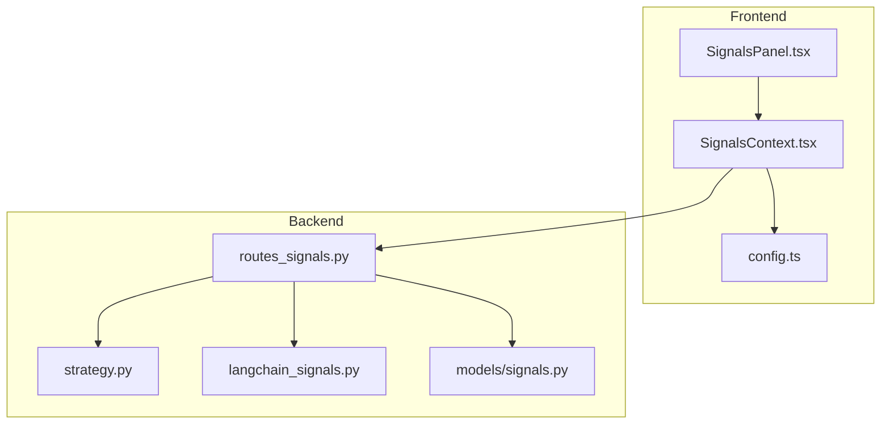
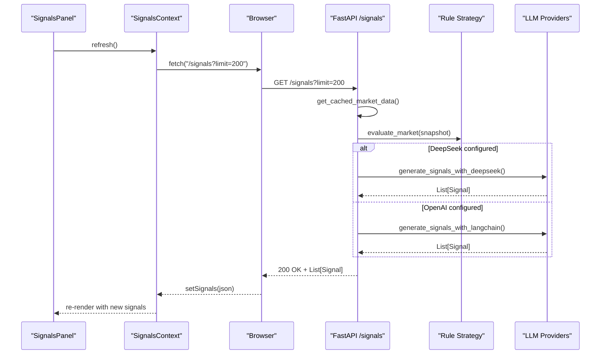
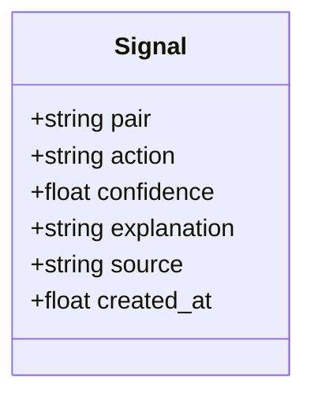
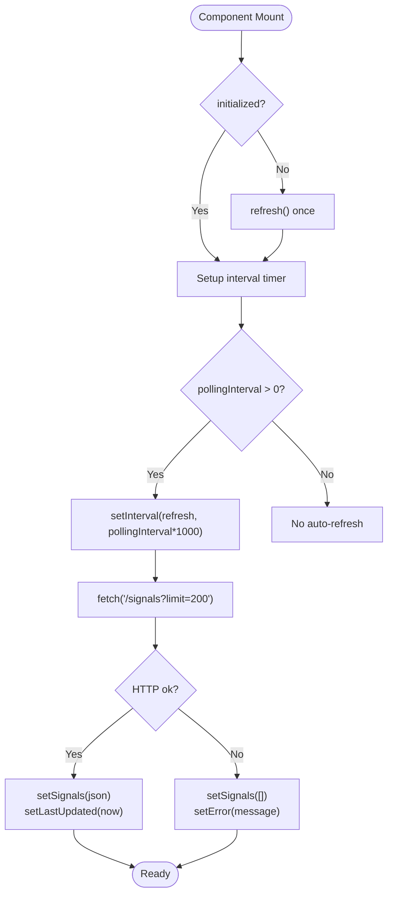
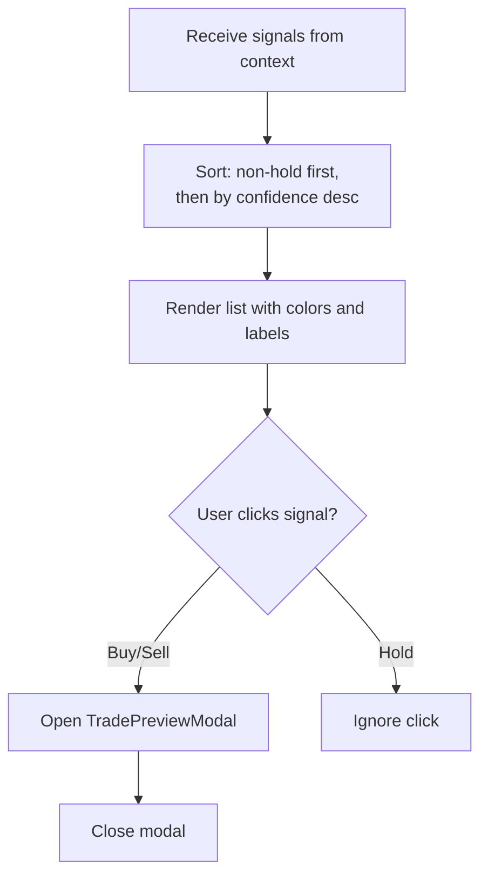
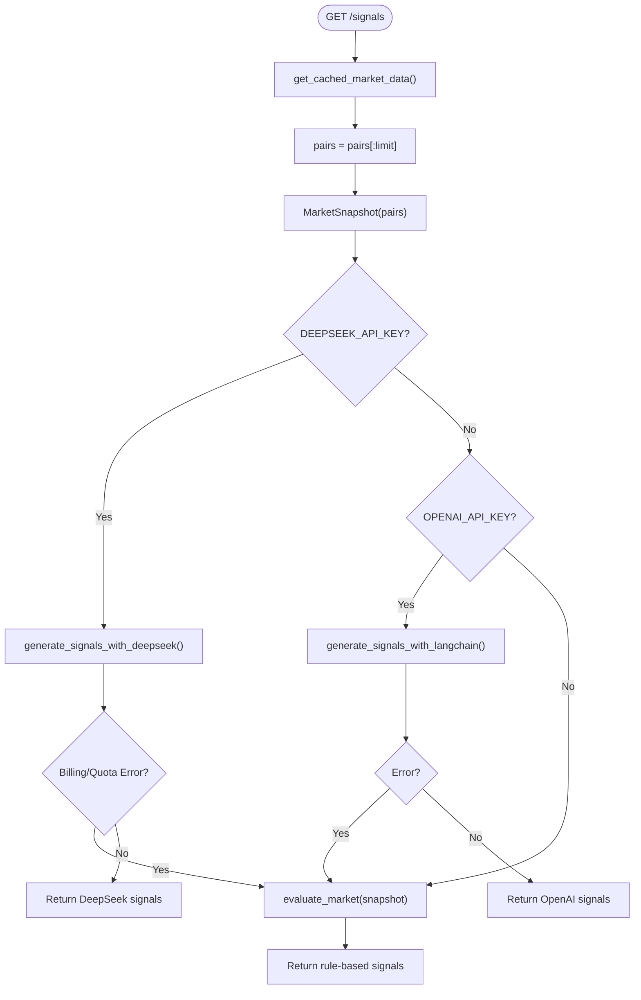
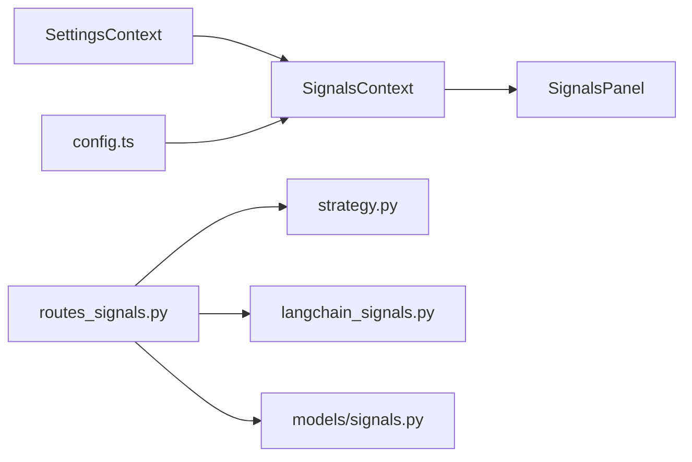

# Signals Context

<cite>
**Referenced Files in This Document**
- [SignalsContext.tsx](file://frontend/context/SignalsContext.tsx)
- [SignalsPanel.tsx](file://frontend/components/SignalsPanel.tsx)
- [routes_signals.py](file://backend/app/api/routes_signals.py)
- [signals.py](file://backend/app/models/signals.py)
- [strategy.py](file://backend/app/services/strategy.py)
- [langchain_signals.py](file://backend/app/agents/langchain_signals.py)
- [config.ts](file://frontend/constants/config.ts)
</cite>

## Table of Contents
1. [Introduction](#introduction)
2. [Project Structure](#project-structure)
3. [Core Components](#core-components)
4. [Architecture Overview](#architecture-overview)
5. [Detailed Component Analysis](#detailed-component-analysis)
6. [Dependency Analysis](#dependency-analysis)
7. [Performance Considerations](#performance-considerations)
8. [Troubleshooting Guide](#troubleshooting-guide)
9. [Conclusion](#conclusion)

## Introduction
This document explains how trading signals are produced, delivered, and displayed in the application. It focuses on the frontend SignalsContext that owns signal state and polling, the backend signal generation pipeline (rule-based and LLM-based), and the UI component SignalsPanel that renders and interacts with signals. It also covers the signal data model, filtering and sorting behavior, real-time update strategy, integration points, and performance considerations for large volumes of signals.

## Project Structure
The signals feature spans both frontend and backend:
- Frontend
  - SignalsContext manages fetching, polling, error handling, and exposes a hook to consumers.
  - SignalsPanel consumes the context to render actionable signals and open a trade preview modal.
- Backend
  - routes_signals exposes an HTTP endpoint that returns signals.
  - strategy provides rule-based signals.
  - langchain_signals implements LLM-based signal generation via OpenAI and DeepSeek.
  - models.signals defines the canonical Signal type.

**Diagram sources**
- [SignalsContext.tsx:1-100](file://frontend/context/SignalsContext.tsx#L1-L100)
- [SignalsPanel.tsx:1-154](file://frontend/components/SignalsPanel.tsx#L1-L154)
- [routes_signals.py:1-55](file://backend/app/api/routes_signals.py#L1-L55)
- [strategy.py:1-39](file://backend/app/services/strategy.py#L1-L39)
- [langchain_signals.py:1-123](file://backend/app/agents/langchain_signals.py#L1-L123)
- [signals.py:1-16](file://backend/app/models/signals.py#L1-L16)
- [config.ts:1-8](file://frontend/constants/config.ts#L1-L8)

**Section sources**
- [SignalsContext.tsx:1-100](file://frontend/context/SignalsContext.tsx#L1-L100)
- [SignalsPanel.tsx:1-154](file://frontend/components/SignalsPanel.tsx#L1-L154)
- [routes_signals.py:1-55](file://backend/app/api/routes_signals.py#L1-L55)
- [strategy.py:1-39](file://backend/app/services/strategy.py#L1-L39)
- [langchain_signals.py:1-123](file://backend/app/agents/langchain_signals.py#L1-L123)
- [signals.py:1-16](file://backend/app/models/signals.py#L1-L16)
- [config.ts:1-8](file://frontend/constants/config.ts#L1-L8)

## Core Components
- SignalsContext
  - Owns the list of signals, loading/error states, last updated timestamp, and a refresh function.
  - Polls the backend at a configurable interval from SettingsContext.
  - Exposes useSignals() hook for components.
- SignalsPanel
  - Displays signals, sorts them by action priority and confidence, shows source labels, and opens TradePreviewModal for non-hold actions.
- Backend Signal API
  - GET /signals returns a list of Signal objects.
  - Applies limit to market pairs before generating signals.
  - Tries DeepSeek first if configured; falls back to OpenAI or rules depending on configuration and errors.
- Rule-Based Strategy
  - Generates signals based on 24h price change thresholds.
- LLM-Based Strategy
  - Uses LangChain/OpenAI or direct DeepSeek calls to generate structured signals.

**Section sources**
- [SignalsContext.tsx:13-28](file://frontend/context/SignalsContext.tsx#L13-L28)
- [SignalsPanel.tsx:6-18](file://frontend/components/SignalsPanel.tsx#L6-L18)
- [routes_signals.py:20-53](file://backend/app/api/routes_signals.py#L20-L53)
- [strategy.py:8-38](file://backend/app/services/strategy.py#L8-L38)
- [langchain_signals.py:40-58](file://backend/app/agents/langchain_signals.py#L40-L58)
- [langchain_signals.py:61-122](file://backend/app/agents/langchain_signals.py#L61-L122)

## Architecture Overview
The system uses HTTP polling rather than WebSockets. The frontend periodically requests the latest signals from the backend. The backend composes a market snapshot and generates signals either through rule-based logic or LLM providers.

**Diagram sources**
- [SignalsContext.tsx:43-61](file://frontend/context/SignalsContext.tsx#L43-L61)
- [routes_signals.py:20-53](file://backend/app/api/routes_signals.py#L20-L53)
- [strategy.py:8-38](file://backend/app/services/strategy.py#L8-L38)
- [langchain_signals.py:40-58](file://backend/app/agents/langchain_signals.py#L40-L58)
- [langchain_signals.py:61-122](file://backend/app/agents/langchain_signals.py#L61-L122)

## Detailed Component Analysis

### Signal Data Model
The canonical signal structure is defined in the backend and mirrored in the frontend types.

- Fields
  - pair: Trading pair identifier string.
  - action: One of buy, sell, hold.
  - confidence: Float between 0.0 and 1.0.
  - explanation: Optional human-readable reasoning.
  - source: Optional provider label such as llm, rules, or deepseek.
  - created_at: Optional Unix timestamp indicating when the signal was generated.

**Diagram sources**
- [signals.py:5-15](file://backend/app/models/signals.py#L5-L15)
- [SignalsContext.tsx:13-20](file://frontend/context/SignalsContext.tsx#L13-L20)

**Section sources**
- [signals.py:1-16](file://backend/app/models/signals.py#L1-L16)
- [SignalsContext.tsx:13-20](file://frontend/context/SignalsContext.tsx#L13-L20)

### SignalsContext: State, Fetching, and Polling
Responsibilities:
- Maintain signals array, loading flag, error message, lastUpdated timestamp, and initialized flag.
- Provide refresh() to fetch signals from the backend.
- Auto-poll using setInterval based on pollingInterval from SettingsContext.
- Expose useSignals() hook.

Key behaviors:
- Initial fetch occurs once after initialization if pollingInterval > 0.
- Subsequent polling runs at pollingInterval seconds.
- On success, sets signals and updates lastUpdated.
- On failure, clears signals and records error.

**Diagram sources**
- [SignalsContext.tsx:34-83](file://frontend/context/SignalsContext.tsx#L34-L83)

**Section sources**
- [SignalsContext.tsx:34-83](file://frontend/context/SignalsContext.tsx#L34-L83)

### SignalsPanel: Display, Sorting, and Interaction
Responsibilities:
- Consume signals via useSignals().
- Sort signals: prioritize non-hold actions, then sort by descending confidence.
- Show header label based on first signal’s source.
- Render each signal with color-coded action, confidence percentage, optional explanation, and source/time metadata.
- Open TradePreviewModal for actionable signals (buy/sell).

Filtering and sorting:
- Sorting is implemented locally in the panel.
- No explicit client-side filtering by source or time is present.

Interaction:
- Clicking a non-hold signal opens the trade preview modal with pair, action, and confidence.

**Diagram sources**
- [SignalsPanel.tsx:11-18](file://frontend/components/SignalsPanel.tsx#L11-L18)
- [SignalsPanel.tsx:28-39](file://frontend/components/SignalsPanel.tsx#L28-L39)
- [SignalsPanel.tsx:81-136](file://frontend/components/SignalsPanel.tsx#L81-L136)

**Section sources**
- [SignalsPanel.tsx:6-18](file://frontend/components/SignalsPanel.tsx#L6-L18)
- [SignalsPanel.tsx:28-39](file://frontend/components/SignalsPanel.tsx#L28-L39)
- [SignalsPanel.tsx:81-136](file://frontend/components/SignalsPanel.tsx#L81-L136)

### Backend Signal Generation Pipeline
Endpoint:
- GET /signals with query parameter limit (default 50, range 1–500).
- Returns List[Signal].

Pipeline:
- Retrieve cached market data and slice to limit pairs.
- Build MarketSnapshot.
- Try DeepSeek if configured; on billing/quota errors, fall back to rules.
- If DeepSeek not configured or fails, try OpenAI via LangChain; on error, fall back to rules.
- If neither LLM is available, return rule-based signals.

**Diagram sources**
- [routes_signals.py:20-53](file://backend/app/api/routes_signals.py#L20-L53)
- [strategy.py:8-38](file://backend/app/services/strategy.py#L8-L38)
- [langchain_signals.py:40-58](file://backend/app/agents/langchain_signals.py#L40-L58)
- [langchain_signals.py:61-122](file://backend/app/agents/langchain_signals.py#L61-L122)

**Section sources**
- [routes_signals.py:1-55](file://backend/app/api/routes_signals.py#L1-L55)
- [strategy.py:1-39](file://backend/app/services/strategy.py#L1-L39)
- [langchain_signals.py:1-123](file://backend/app/agents/langchain_signals.py#L1-L123)

### Real-Time Updates and WebSocket Integration
Current implementation:
- Uses HTTP polling via setInterval controlled by pollingInterval from SettingsContext.
- No WebSocket connection is used for signals.

Implications:
- Updates are periodic, not instantaneous.
- Latency depends on pollingInterval and network conditions.

Recommendations:
- For lower latency, consider adding a WebSocket endpoint for live signals and updating SignalsContext to manage a persistent connection.

**Section sources**
- [SignalsContext.tsx:63-83](file://frontend/context/SignalsContext.tsx#L63-L83)

### Consuming Signals in Components
Example usage pattern:
- Wrap your app or page with SignalsProvider.
- Use useSignals() to access signals, loading, error, refresh, and lastUpdated.
- Implement custom filters or additional sorting in your component if needed.

Reference paths:
- Hook definition and provider: [SignalsContext.tsx:34-98](file://frontend/context/SignalsContext.tsx#L34-L98)
- Example consumption in SignalsPanel: [SignalsPanel.tsx:6-18](file://frontend/components/SignalsPanel.tsx#L6-L18)

**Section sources**
- [SignalsContext.tsx:34-98](file://frontend/context/SignalsContext.tsx#L34-L98)
- [SignalsPanel.tsx:6-18](file://frontend/components/SignalsPanel.tsx#L6-L18)

### Filtering, Sorting, and Expiration Handling
- Sorting: Implemented in SignalsPanel to prioritize non-hold actions and sort by descending confidence.
- Filtering: Not implemented in the current codebase; can be added in consuming components.
- Expiration: Signals include created_at timestamps; no automatic expiration logic exists. Consumers can implement time-based filtering or visual indicators.

Implementation references:
- Sorting logic: [SignalsPanel.tsx:11-18](file://frontend/components/SignalsPanel.tsx#L11-L18)
- Timestamp usage: [SignalsPanel.tsx:120-124](file://frontend/components/SignalsPanel.tsx#L120-L124)

**Section sources**
- [SignalsPanel.tsx:11-18](file://frontend/components/SignalsPanel.tsx#L11-L18)
- [SignalsPanel.tsx:120-124](file://frontend/components/SignalsPanel.tsx#L120-L124)

## Dependency Analysis
High-level dependencies:
- SignalsContext depends on SettingsContext for pollingInterval and on config.ts for BACKEND_URL.
- SignalsPanel depends on SignalsContext and TradePreviewModal.
- Backend routes depend on market cache, strategy, and LLM agents.

**Diagram sources**
- [SignalsContext.tsx:10-11](file://frontend/context/SignalsContext.tsx#L10-L11)
- [config.ts:1-1](file://frontend/constants/config.ts#L1-L1)
- [routes_signals.py:6-11](file://backend/app/api/routes_signals.py#L6-L11)

**Section sources**
- [SignalsContext.tsx:10-11](file://frontend/context/SignalsContext.tsx#L10-L11)
- [config.ts:1-8](file://frontend/constants/config.ts#L1-L8)
- [routes_signals.py:6-11](file://backend/app/api/routes_signals.py#L6-L11)

## Performance Considerations
- Limiting payload size
  - Frontend requests limit=200; backend supports up to 500. Adjust according to UI needs.
- Reducing LLM costs and latency
  - LLM generators slice market data to 10 pairs before prompting.
- Polling frequency
  - Control pollingInterval in SettingsContext to balance freshness vs. resource usage.
- Rendering optimization
  - SignalsPanel performs local sorting on every render; consider memoization or virtualization for very large lists.
- Error resilience
  - Backend gracefully falls back to rule-based signals when LLM providers fail or are unavailable.

Optimization recommendations:
- Debounce refresh triggers to avoid rapid successive polls.
- Add pagination or incremental updates if signals grow beyond hundreds.
- Introduce client-side caching with stale-while-revalidate semantics.
- Consider WebSocket for real-time updates to reduce polling overhead.

**Section sources**
- [routes_signals.py:22-25](file://backend/app/api/routes_signals.py#L22-L25)
- [langchain_signals.py:44-47](file://backend/app/agents/langchain_signals.py#L44-L47)
- [langchain_signals.py:65-67](file://backend/app/agents/langchain_signals.py#L65-L67)
- [SignalsContext.tsx:69-83](file://frontend/context/SignalsContext.tsx#L69-L83)

## Troubleshooting Guide
Common issues and resolutions:
- No signals displayed
  - Verify backend is reachable and returning a 200 response.
  - Check pollingInterval is greater than zero to enable auto-refresh.
  - Confirm initial fetch runs after initialization.
- Errors shown in UI
  - Inspect error state set by SignalsContext on failed fetches.
  - Ensure BACKEND_URL is correctly configured.
- LLM fallback behavior
  - Billing or quota errors from DeepSeek trigger fallback to rule-based signals.
  - OpenAI failures also fall back to rules.
- Time display inconsistencies
  - created_at is expected to be Unix seconds; ensure backend sets it appropriately.

Relevant references:
- Error handling in context: [SignalsContext.tsx:43-61](file://frontend/context/SignalsContext.tsx#L43-L61)
- Fallback logic in backend: [routes_signals.py:28-53](file://backend/app/api/routes_signals.py#L28-L53)
- Rule-based timestamp assignment: [strategy.py:35-36](file://backend/app/services/strategy.py#L35-L36)

**Section sources**
- [SignalsContext.tsx:43-61](file://frontend/context/SignalsContext.tsx#L43-L61)
- [routes_signals.py:28-53](file://backend/app/api/routes_signals.py#L28-L53)
- [strategy.py:35-36](file://backend/app/services/strategy.py#L35-L36)

## Conclusion
SignalsContext centralizes signal state management and polling, while SignalsPanel presents actionable insights to users. The backend composes market snapshots and generates signals via rule-based logic or LLM providers, with robust fallbacks. The current architecture relies on HTTP polling; for higher-frequency updates, consider introducing WebSocket support. For large datasets, apply client-side optimizations like memoization, virtualization, and pagination, and tune polling intervals to balance performance and freshness.