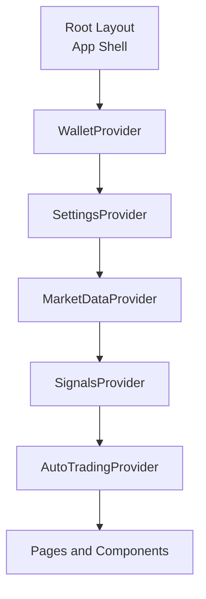
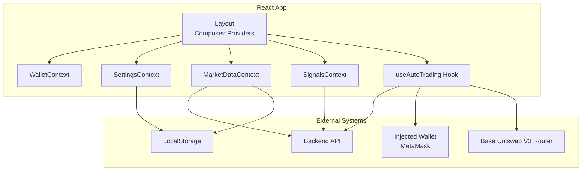
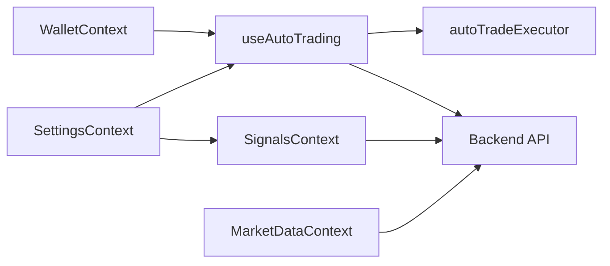

# State Management & Context

<cite>
**Referenced Files in This Document**
- [layout.tsx](file://frontend/app/layout.tsx)
- [MarketDataContext.tsx](file://frontend/context/MarketDataContext.tsx)
- [SettingsContext.tsx](file://frontend/context/SettingsContext.tsx)
- [SignalsContext.tsx](file://frontend/context/SignalsContext.tsx)
- [WalletContext.tsx](file://frontend/context/WalletContext.tsx)
- [useAutoTrading.ts](file://frontend/hooks/useAutoTrading.ts)
- [autoTradeExecutor.ts](file://frontend/lib/autoTradeExecutor.ts)
- [config.ts](file://frontend/constants/config.ts)
- [AutoTradingProvider.tsx](file://frontend/components/AutoTradingProvider.tsx)
</cite>

## Table of Contents
1. [Introduction](#introduction)
2. [Project Structure](#project-structure)
3. [Core Components](#core-components)
4. [Architecture Overview](#architecture-overview)
5. [Detailed Component Analysis](#detailed-component-analysis)
6. [Dependency Analysis](#dependency-analysis)
7. [Performance Considerations](#performance-considerations)
8. [Troubleshooting Guide](#troubleshooting-guide)
9. [Conclusion](#conclusion)

## Introduction
This document explains the React Context-based state management system used by the frontend application. It covers:
- Market data synchronization with the backend
- Application settings and preferences persistence
- Trading signals polling and refresh
- Blockchain wallet connection and chain events
- Auto-trading orchestration using a custom hook
- Provider composition, state synchronization patterns, performance considerations, and error handling strategies

The goal is to help both new and experienced developers understand how contexts are composed, how data flows between UI components and the backend, and how auto-trading integrates with wallet and settings state.

## Project Structure
The context providers are composed at the root layout so that all pages can consume them through hooks. The provider order matters because some contexts depend on others (for example, Signals depends on Settings).

**Diagram sources**
- [layout.tsx:16-38](file://frontend/app/layout.tsx#L16-L38)

**Section sources**
- [layout.tsx:1-38](file://frontend/app/layout.tsx#L1-L38)

## Core Components
The application uses four primary contexts and one orchestrating hook:
- MarketDataContext: Real-time market pairs, loading/error states, and local caching
- SettingsContext: Currency, network, polling intervals, auto-trading toggle, and formatting helpers
- SignalsContext: Agent-generated trading signals with periodic refresh
- WalletContext: Injected wallet connection, address, chainId, and event listeners
- useAutoTrading hook: Orchestrates proposal polling, eligibility checks, and on-chain swap execution

Key responsibilities:
- Providers encapsulate state and side effects
- Hooks expose typed context values
- LocalStorage persists user preferences and cached market data
- Backend APIs provide live market data and signals
- Wallet integration enables on-chain auto-trading

**Section sources**
- [MarketDataContext.tsx:1-150](file://frontend/context/MarketDataContext.tsx#L1-L150)
- [SettingsContext.tsx:1-201](file://frontend/context/SettingsContext.tsx#L1-L201)
- [SignalsContext.tsx:1-100](file://frontend/context/SignalsContext.tsx#L1-L100)
- [WalletContext.tsx:1-118](file://frontend/context/WalletContext.tsx#L1-L118)
- [useAutoTrading.ts:1-208](file://frontend/hooks/useAutoTrading.ts#L1-L208)

## Architecture Overview
The following diagram shows how contexts compose and interact with external systems:

**Diagram sources**
- [layout.tsx:16-38](file://frontend/app/layout.tsx#L16-L38)
- [MarketDataContext.tsx:66-121](file://frontend/context/MarketDataContext.tsx#L66-L121)
- [SignalsContext.tsx:43-83](file://frontend/context/SignalsContext.tsx#L43-L83)
- [useAutoTrading.ts:21-204](file://frontend/hooks/useAutoTrading.ts#L21-L204)
- [autoTradeExecutor.ts:45-282](file://frontend/lib/autoTradeExecutor.ts#L45-L282)
- [WalletContext.tsx:21-109](file://frontend/context/WalletContext.tsx#L21-L109)

## Detailed Component Analysis

### MarketDataContext
Responsibilities:
- Fetches market pairs from the backend
- Caches data and last updated timestamp in LocalStorage
- Provides loading, error, and lastUpdated metadata
- Exposes a refresh function for manual updates

Data flow:
- On mount, load cached data first for instant display
- Then fetch fresh data; save to LocalStorage if successful
- Health-check endpoint ensures backend readiness before fetching market data
- Errors are normalized and surfaced via context state

Error handling:
- Backend not ready returns a friendly message
- Network or parsing errors set error state without crashing
- Cached data remains available when API fails

Performance:
- Initial cache avoids blank screens
- Single source of truth for market pairs
- Refresh function allows explicit re-fetching

Consumption pattern:
- Use the provided hook to access marketData, loading, error, lastUpdated, and refreshMarketData

**Section sources**
- [MarketDataContext.tsx:1-150](file://frontend/context/MarketDataContext.tsx#L1-L150)

### SettingsContext
Responsibilities:
- Manages currency, blockchain network, polling intervals, agent cache duration, auto-trading toggle, and auto-trading interval
- Persists settings to LocalStorage
- Loads exchange rate and provides a format helper for USD/EUR conversion

State synchronization:
- On initialization, reads persisted values and validates types/ranges
- Each setter updates both React state and LocalStorage
- Exchange rate is fetched once and used for EUR formatting

Error handling:
- Fallback rate is used if exchange rate API fails
- Invalid persisted values are ignored safely

Consumption pattern:
- Use the provided hook to read settings and call setters to update preferences

**Section sources**
- [SettingsContext.tsx:1-201](file://frontend/context/SettingsContext.tsx#L1-L201)

### SignalsContext
Responsibilities:
- Polls backend for trading signals
- Uses SettingsContext pollingInterval to schedule refreshes
- Tracks loading, error, and lastUpdated timestamps
- Ensures cleanup of timers on unmount or interval changes

Synchronization:
- First refresh occurs after initial mount when initialized flag is false
- Subsequent refreshes occur at configured pollingInterval seconds
- Timer is cleared and recreated when pollingInterval changes

Error handling:
- Sets error state and clears signals on failure
- Initializes component state even on error to avoid repeated retries

Consumption pattern:
- Use the provided hook to access signals, loading, error, lastUpdated, and refresh

**Section sources**
- [SignalsContext.tsx:1-100](file://frontend/context/SignalsContext.tsx#L1-L100)

### WalletContext
Responsibilities:
- Connects to injected wallets (e.g., MetaMask)
- Tracks connected address and chainId
- Listens to accountsChanged and chainChanged events
- Provides connect/disconnect functions and connecting/error states

Event handling:
- Reads current accounts on mount
- Updates address when accounts change
- Parses and validates chainId from hex string
- Cleans up event listeners on unmount

Error handling:
- Reports missing injected wallet
- Captures connection errors and exposes them via error state

Consumption pattern:
- Use the provided hook to access address, chainId, connecting, error, connect, disconnect

**Section sources**
- [WalletContext.tsx:1-118](file://frontend/context/WalletContext.tsx#L1-L118)

### useAutoTrading Hook
Responsibilities:
- Orchestrates automatic trading based on backend proposals
- Validates environment: demo mode disabled, autoTrading enabled, wallet connected, correct network
- Polls backend for pending proposals at configured interval
- Executes eligible trades on-chain via autoTradeExecutor
- Updates backend proposal status upon successful transaction

Execution flow:
- Determine tokenIn/tokenOut and amountIn based on action
- Check eligibility against allowed targets
- Execute swap via Base Uniswap V3 Router with slippage and gas price controls
- On success, notify backend to mark proposal as executed
- Skip stale proposals to prevent surprise confirmations after sleep/wake

Safety features:
- Demo mode hard stop prevents any wallet interaction
- Staleness guard drops old proposals beyond max age threshold
- Only processes proposals marked auto_tradeable and within allowed target list
- Uses pre-execution simulation to reduce failed on-chain transactions

Consumption pattern:
- Wrap app content with AutoTradingProvider to activate the hook lifecycle

**Section sources**
- [useAutoTrading.ts:1-208](file://frontend/hooks/useAutoTrading.ts#L1-L208)
- [autoTradeExecutor.ts:45-282](file://frontend/lib/autoTradeExecutor.ts#L45-L282)
- [config.ts:1-8](file://frontend/constants/config.ts#L1-L8)
- [AutoTradingProvider.tsx:1-9](file://frontend/components/AutoTradingProvider.tsx#L1-L9)

### AutoTradeExecutor Library
Responsibilities:
- Encapsulates on-chain swap logic for Base Uniswap V3
- Resolves token addresses and decimals
- Chooses best route among direct pools and multi-hop paths
- Handles approvals, slippage, gas pricing, and multicall wrapping
- Performs pre-execution simulation and waits for confirmation

Key behaviors:
- Enforces eligible token pairs and distinct input/output tokens
- Requires Base network chainId
- Supports ETH and ERC-20 inputs with proper decimal handling
- Calculates minOut using effective slippage, higher for volatile tokens
- Wraps router calls in multicall with deadline to limit mempool lifetime

Consumption pattern:
- Called by useAutoTrading to execute swaps programmatically

**Section sources**
- [autoTradeExecutor.ts:1-298](file://frontend/lib/autoTradeExecutor.ts#L1-L298)

## Dependency Analysis
The contexts have clear dependency relationships:
- SignalsContext depends on SettingsContext for pollingInterval
- useAutoTrading depends on WalletContext, SettingsContext, and autoTradeExecutor
- All contexts are composed in layout.tsx, establishing a top-down provider hierarchy

**Diagram sources**
- [SignalsContext.tsx:34-83](file://frontend/context/SignalsContext.tsx#L34-L83)
- [useAutoTrading.ts:21-204](file://frontend/hooks/useAutoTrading.ts#L21-L204)
- [autoTradeExecutor.ts:45-282](file://frontend/lib/autoTradeExecutor.ts#L45-L282)
- [MarketDataContext.tsx:66-121](file://frontend/context/MarketDataContext.tsx#L66-L121)

**Section sources**
- [SignalsContext.tsx:1-100](file://frontend/context/SignalsContext.tsx#L1-L100)
- [useAutoTrading.ts:1-208](file://frontend/hooks/useAutoTrading.ts#L1-L208)
- [MarketDataContext.tsx:1-150](file://frontend/context/MarketDataContext.tsx#L1-L150)

## Performance Considerations
- Initial cache for market data reduces perceived latency and blank screens
- Polling intervals are configurable via SettingsContext to balance freshness vs. network cost
- SignalsContext cleans up timers when intervals change or component unmounts
- AutoTrading uses staleness guards to avoid executing outdated proposals
- Pre-execution simulation in autoTradeExecutor reduces failed on-chain transactions
- LocalStorage writes are guarded and logged to avoid blocking UI
- Avoid unnecessary re-renders by keeping context values stable and minimizing frequent state updates

[No sources needed since this section provides general guidance]

## Troubleshooting Guide
Common issues and resolutions:
- Backend not ready: MarketDataContext displays a friendly message; wait for backend startup and retry
- No injected wallet: WalletContext reports missing wallet; install MetaMask or another injected wallet
- Wrong network: AutoTrading disables itself unless network is Base; switch wallet network to Base
- Demo mode: AutoTrading is disabled in demo builds; no wallet interactions will occur
- Stale proposals: AutoTrading skips proposals older than a calculated threshold to prevent surprise confirmations
- Rate API failure: SettingsContext falls back to default exchange rate; formatting still works
- Signal polling failures: SignalsContext sets error state and clears signals; check backend availability

Operational tips:
- Verify BACKEND_URL configuration in constants/config.ts
- Ensure localStorage is available and not blocked by browser policies
- Monitor console logs emitted by useAutoTrading and autoTradeExecutor for detailed diagnostics
- Use refresh functions exposed by contexts to manually trigger updates when needed

**Section sources**
- [MarketDataContext.tsx:66-121](file://frontend/context/MarketDataContext.tsx#L66-L121)
- [WalletContext.tsx:74-98](file://frontend/context/WalletContext.tsx#L74-L98)
- [useAutoTrading.ts:89-204](file://frontend/hooks/useAutoTrading.ts#L89-L204)
- [autoTradeExecutor.ts:45-282](file://frontend/lib/autoTradeExecutor.ts#L45-L282)
- [config.ts:1-8](file://frontend/constants/config.ts#L1-L8)

## Conclusion
The context-based architecture cleanly separates concerns:
- Market data is cached and refreshed with robust error handling
- Settings persist across sessions and drive global behavior like polling and formatting
- Signals are polled and displayed with safe timer management
- Wallet state integrates with injected providers and chain events
- Auto-trading orchestrates proposal polling, eligibility checks, and on-chain execution safely

By composing providers at the root and consuming contexts via typed hooks, the application maintains predictable data flow, strong separation of responsibilities, and scalable extensibility for future features.

[No sources needed since this section summarizes without analyzing specific files]