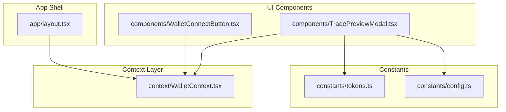
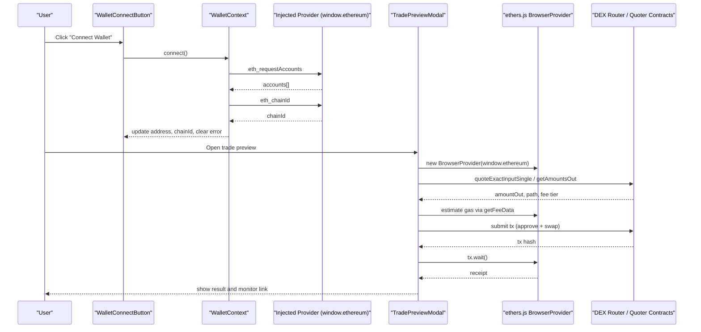
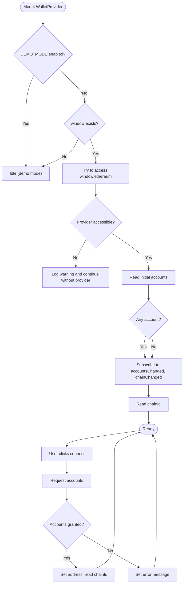
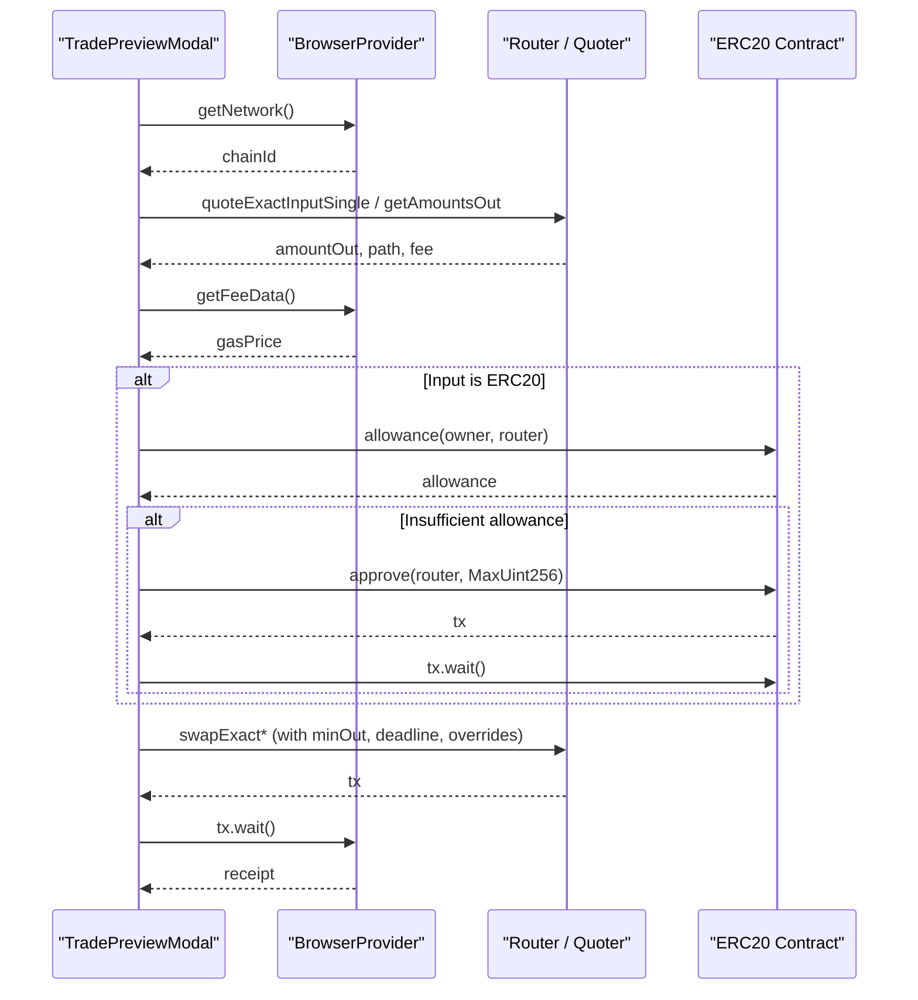
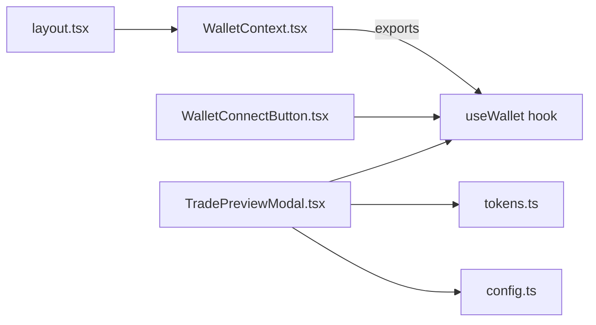

# Wallet Context

<cite>
**Referenced Files in This Document**
- [WalletContext.tsx](file://frontend/context/WalletContext.tsx)
- [WalletConnectButton.tsx](file://frontend/components/WalletConnectButton.tsx)
- [TradePreviewModal.tsx](file://frontend/components/TradePreviewModal.tsx)
- [tokens.ts](file://frontend/constants/tokens.ts)
- [config.ts](file://frontend/constants/config.ts)
- [layout.tsx](file://frontend/app/layout.tsx)
- [safeStorage.ts](file://frontend/lib/safeStorage.ts)
</cite>

## Update Summary
**Changes Made**
- Enhanced Brave Wallet compatibility for Android devices with improved error handling
- Added comprehensive try/catch blocks around wallet provider interactions
- Implemented demo mode support to prevent crashes when wallet providers are unavailable
- Updated error handling patterns throughout the wallet connection lifecycle

## Table of Contents
1. [Introduction](#introduction)
2. [Project Structure](#project-structure)
3. [Core Components](#core-components)
4. [Architecture Overview](#architecture-overview)
5. [Detailed Component Analysis](#detailed-component-analysis)
6. [Dependency Analysis](#dependency-analysis)
7. [Performance Considerations](#performance-considerations)
8. [Troubleshooting Guide](#troubleshooting-guide)
9. [Conclusion](#conclusion)

## Introduction
This document explains the WalletContext that manages blockchain wallet state and interactions in the frontend application. It covers the wallet connection lifecycle, account management, network switching capabilities, integration with ethers.js for blockchain interactions, transaction signing, smart contract calls, state synchronization, error handling, and network-specific configurations. It also documents how components like WalletConnectButton and TradePreviewModal consume the context to connect wallets, read balances, execute trades, and handle events.

**Updated** Enhanced with improved Brave Wallet compatibility and robust error handling for Android devices.

## Project Structure
The wallet-related logic is primarily implemented in a React context provider and consumed by UI components:
- WalletContext provides global wallet state (address, chainId), connection lifecycle methods (connect, disconnect), and event-driven updates from the injected Ethereum provider.
- WalletConnectButton is a simple UI component that triggers connection and displays status and errors.
- TradePreviewModal integrates with ethers.js to perform quotes, gas estimation, approvals, and transactions against DEX routers and quoter contracts across multiple networks.
- Constants define token addresses and router/quoter addresses per network.
- The app layout wraps the application with WalletProvider so all components can access wallet state.

**Diagram sources**
- [layout.tsx:5-36](file://frontend/app/layout.tsx#L5-L36)
- [WalletContext.tsx:22-129](file://frontend/context/WalletContext.tsx#L22-L129)
- [WalletConnectButton.tsx:1-31](file://frontend/components/WalletConnectButton.tsx#L1-L31)
- [TradePreviewModal.tsx:1-10](file://frontend/components/TradePreviewModal.tsx#L1-L10)
- [tokens.ts:98-120](file://frontend/constants/tokens.ts#L98-L120)
- [config.ts:1-8](file://frontend/constants/config.ts#L1-L8)

**Section sources**
- [layout.tsx:5-36](file://frontend/app/layout.tsx#L5-L36)
- [WalletContext.tsx:1-138](file://frontend/context/WalletContext.tsx#L1-L138)
- [WalletConnectButton.tsx:1-31](file://frontend/components/WalletConnectButton.tsx#L1-L31)
- [TradePreviewModal.tsx:1-10](file://frontend/components/TradePreviewModal.tsx#L1-L10)
- [tokens.ts:1-128](file://frontend/constants/tokens.ts#L1-L128)
- [config.ts:1-8](file://frontend/constants/config.ts#L1-L8)

## Core Components
- WalletContext
  - Provides address, chainId, connecting flag, error message, connect(), and disconnect().
  - Subscribes to injected provider events accountsChanged and chainChanged to keep state synchronized.
  - Uses eth_requestAccounts to initiate connection and reads current accounts and chainId on mount.
  - **Enhanced** with comprehensive error handling and demo mode support to prevent crashes on incompatible wallet providers.
- WalletConnectButton
  - Displays a button labeled Connect Wallet or the connected address snippet.
  - Shows connecting state and error messages surfaced by WalletContext.
- TradePreviewModal
  - Uses ethers.js BrowserProvider and Contract to interact with DEX routers and quoter contracts.
  - Performs quoting via Uniswap V2 getAmountsOut, V3 QuoterV2 staticCall, and Aerodrome pool queries on Base.
  - Handles approvals, transaction submission, and receipt monitoring.
  - Estimates gas costs using provider.getFeeData and fixed heuristics.

**Section sources**
- [WalletContext.tsx:4-138](file://frontend/context/WalletContext.tsx#L4-L138)
- [WalletConnectButton.tsx:1-31](file://frontend/components/WalletConnectButton.tsx#L1-L31)
- [TradePreviewModal.tsx:1-10](file://frontend/components/TradePreviewModal.tsx#L1-L10)

## Architecture Overview
The architecture centers around a client-side context that abstracts the injected Ethereum provider and exposes a minimal API to the rest of the application. Downstream components use ethers.js directly for advanced operations such as quoting and executing trades.

**Diagram sources**
- [WalletContext.tsx:94-118](file://frontend/context/WalletContext.tsx#L94-L118)
- [WalletConnectButton.tsx:4-29](file://frontend/components/WalletConnectButton.tsx#L4-L29)
- [TradePreviewModal.tsx:174-219](file://frontend/components/TradePreviewModal.tsx#L174-L219)
- [TradePreviewModal.tsx:399-570](file://frontend/components/TradePreviewModal.tsx#L399-L570)
- [TradePreviewModal.tsx:1544-1705](file://frontend/components/TradePreviewModal.tsx#L1544-L1705)

## Detailed Component Analysis

### WalletContext
Responsibilities:
- Manage connection lifecycle: detect injected provider, request accounts, set address, read chainId.
- Synchronize state with provider events: accountsChanged updates address; chainChanged updates chainId.
- Expose connect/disconnect and derived UI flags (connecting, error).

Key implementation details:
- parseChainId validates hex-encoded chain IDs and ensures safe integer conversion.
- readChainId uses a revision counter to avoid race conditions when chain changes occur during async requests.
- Initial effect checks existing accounts and subscribes to provider events; cleanup removes listeners.
- connect sets connecting state, clears previous errors, requests accounts, and reads chainId upon success.
- disconnect resets address to null.

**Enhanced Error Handling**:
- Comprehensive try/catch blocks around all wallet provider interactions to prevent application crashes.
- Demo mode support via DEMO_MODE constant prevents wallet provider access in demo builds.
- Graceful handling of Brave Wallet proxy issues on Android devices that throw errors on property access.
- Fallback behavior when wallet providers are unavailable or incompatible.

**Diagram sources**
- [WalletContext.tsx:39-92](file://frontend/context/WalletContext.tsx#L39-L92)
- [WalletContext.tsx:94-118](file://frontend/context/WalletContext.tsx#L94-L118)

Security considerations:
- Connection relies on user approval via the injected provider; no private keys are handled in this context.
- Error messages are surfaced without exposing sensitive data.
- Demo mode completely bypasses wallet interactions for security in public demo builds.

Network switching:
- The context listens to chainChanged and updates chainId accordingly.
- There is no explicit switchNetwork method here; consumers should prompt users to switch networks if needed.

**Updated** Enhanced with robust error handling and demo mode support to prevent crashes on incompatible wallet providers.

**Section sources**
- [WalletContext.tsx:15-20](file://frontend/context/WalletContext.tsx#L15-L20)
- [WalletContext.tsx:39-92](file://frontend/context/WalletContext.tsx#L39-L92)
- [WalletContext.tsx:94-118](file://frontend/context/WalletContext.tsx#L94-L118)
- [config.ts:3-7](file://frontend/constants/config.ts#L3-L7)

### WalletConnectButton
Responsibilities:
- Provide a simple UI to trigger connect and display status.
- Show truncated connected address and error messages.

Behavior:
- Label adapts based on address presence and connecting state.
- onClick invokes connect from WalletContext.
- Renders error text when present.

**Section sources**
- [WalletConnectButton.tsx:4-29](file://frontend/components/WalletConnectButton.tsx#L4-L29)

### TradePreviewModal
Responsibilities:
- Quote trades across multiple protocols and networks (Uniswap V2, V3, Aerodrome).
- Estimate gas and compute price impact.
- Handle approvals and execute transactions.
- Monitor transaction receipts and surface results.

Integration with ethers.js:
- Creates BrowserProvider from window.ethereum.
- Constructs Contract instances for routers and quoter contracts.
- Uses parseUnits/formatUnits for precise decimal handling.
- Uses MaxUint256 for approvals and deadline calculations.

Quoting flow:
- Determines tokens and router/quoter addresses based on detected chainId or settings.
- For V2: tries direct and multi-hop paths via getAmountsOut.
- For V3: uses QuoterV2 staticCall to simulate quotes across fee tiers and multi-hop routes.
- For Base: attempts Aerodrome pool discovery and reserve-based quoting.

Gas estimation:
- Uses provider.getFeeData.gasPrice with heuristic gas limits per protocol to estimate cost in ETH.

Transaction execution:
- Approves ERC20 allowances when input is not ETH.
- Calls appropriate router swap functions depending on input/output types.
- Waits for transaction receipt and handles specific error patterns.

**Diagram sources**
- [TradePreviewModal.tsx:174-219](file://frontend/components/TradePreviewModal.tsx#L174-L219)
- [TradePreviewModal.tsx:399-570](file://frontend/components/TradePreviewModal.tsx#L399-L570)
- [TradePreviewModal.tsx:1544-1705](file://frontend/components/TradePreviewModal.tsx#L1544-L1705)

Network-specific configurations:
- Token maps and router/quoter addresses are defined per network in constants.
- Chain detection drives selection of token sets and routing strategy.

Error handling:
- Catches quoting failures and surfaces user-friendly messages.
- Handles specific wait errors (e.g., nonce undefined patterns) and logs warnings.

**Section sources**
- [TradePreviewModal.tsx:174-219](file://frontend/components/TradePreviewModal.tsx#L174-L219)
- [TradePreviewModal.tsx:399-570](file://frontend/components/TradePreviewModal.tsx#L399-L570)
- [TradePreviewModal.tsx:1544-1705](file://frontend/components/TradePreviewModal.tsx#L1544-L1705)
- [tokens.ts:98-120](file://frontend/constants/tokens.ts#L98-L120)

## Dependency Analysis
- WalletContext depends only on React and the injected Ethereum provider.
- WalletConnectButton depends on WalletContext.
- TradePreviewModal depends on WalletContext, ethers.js, and token/router constants.
- App layout provides WalletProvider at the root level.

**Diagram sources**
- [WalletContext.tsx:131-137](file://frontend/context/WalletContext.tsx#L131-L137)
- [WalletConnectButton.tsx:1-31](file://frontend/components/WalletConnectButton.tsx#L1-L31)
- [TradePreviewModal.tsx:1-10](file://frontend/components/TradePreviewModal.tsx#L1-L10)
- [tokens.ts:98-120](file://frontend/constants/tokens.ts#L98-L120)
- [config.ts:1-8](file://frontend/constants/config.ts#L1-L8)
- [layout.tsx:5-36](file://frontend/app/layout.tsx#L5-L36)

**Section sources**
- [WalletContext.tsx:131-137](file://frontend/context/WalletContext.tsx#L131-L137)
- [WalletConnectButton.tsx:1-31](file://frontend/components/WalletConnectButton.tsx#L1-L31)
- [TradePreviewModal.tsx:1-10](file://frontend/components/TradePreviewModal.tsx#L1-L10)
- [tokens.ts:98-120](file://frontend/constants/tokens.ts#L98-L120)
- [config.ts:1-8](file://frontend/constants/config.ts#L1-L8)
- [layout.tsx:5-36](file://frontend/app/layout.tsx#L5-L36)

## Performance Considerations
- Avoid unnecessary re-renders by keeping WalletContext state minimal (address, chainId, connecting, error).
- Use staticCall for V3 quotes to prevent network writes and reduce gas costs during quoting.
- Cache token decimals where possible; the modal fetches decimals dynamically but may be optimized with memoization.
- Limit path exploration for V2/V3 quoting to essential intermediates to reduce RPC calls.
- Debounce quoting triggers to avoid excessive RPC requests when inputs change rapidly.
- **Enhanced** Demo mode prevents unnecessary wallet provider initialization overhead in production builds.

[No sources needed since this section provides general guidance]

## Troubleshooting Guide
Common issues and resolutions:
- No injected wallet detected
  - Symptom: Error message from WalletContext.connect indicates no injected provider.
  - Resolution: Install a compatible browser extension (e.g., MetaMask) and ensure it is enabled.
- Failed to connect wallet
  - Symptom: Generic error after calling connect.
  - Resolution: Verify user approved account access; check console for provider-specific errors.
- Network mismatch
  - Symptom: Quotes fail because the selected network does not match token/router configuration.
  - Resolution: Switch the wallet to the correct network (e.g., Mainnet, Base, Arbitrum, Sepolia) before trading.
- Insufficient balance or allowance
  - Symptom: Execution fails due to insufficient funds or allowance.
  - Resolution: Ensure sufficient native or token balance; approve the router for the token amount.
- Gas estimation failures
  - Symptom: Gas cost not displayed or transaction fails due to gas issues.
  - Resolution: Increase gas limit manually or adjust slippage; verify network congestion and fees.
- Transaction wait errors
  - Symptom: Receipt waiting throws errors with nonce-related messages.
  - Resolution: The modal includes handling for known false-positive patterns; retry or refresh the page if necessary.
- Brave Wallet Android compatibility issues
  - Symptom: Application crashes when accessing wallet properties on Android devices with Brave Wallet.
  - Resolution: The enhanced error handling automatically detects and gracefully handles incompatible wallet providers. The application continues to function without wallet features.
- Demo mode conflicts
  - Symptom: Wallet features not working in demo builds.
  - Resolution: This is expected behavior - demo mode intentionally bypasses wallet interactions. Build with NEXT_PUBLIC_DEMO_MODE=0 to enable wallet features.

**Updated** Added troubleshooting for Brave Wallet compatibility and demo mode issues.

**Section sources**
- [WalletContext.tsx:39-92](file://frontend/context/WalletContext.tsx#L39-L92)
- [WalletContext.tsx:94-118](file://frontend/context/WalletContext.tsx#L94-L118)
- [TradePreviewModal.tsx:1710-1726](file://frontend/components/TradePreviewModal.tsx#L1710-L1726)
- [config.ts:3-7](file://frontend/constants/config.ts#L3-L7)

## Conclusion
WalletContext centralizes wallet connection and state synchronization, providing a clean interface for components to interact with the blockchain. Combined with TradePreviewModal's ethers.js integration, the application supports robust quoting, gas estimation, approvals, and transaction execution across multiple networks and DEX protocols. 

**Enhanced** The recent improvements include comprehensive error handling for Brave Wallet compatibility on Android devices, demo mode support to prevent crashes when wallet providers are unavailable, and robust try/catch blocks throughout the wallet interaction lifecycle. These enhancements ensure the application remains stable and functional even with incompatible or problematic wallet providers, while maintaining full functionality for standard wallet implementations.

Proper error handling, network awareness, and security practices ensure a reliable user experience while minimizing risks associated with blockchain interactions.

[No sources needed since this section summarizes without analyzing specific files]