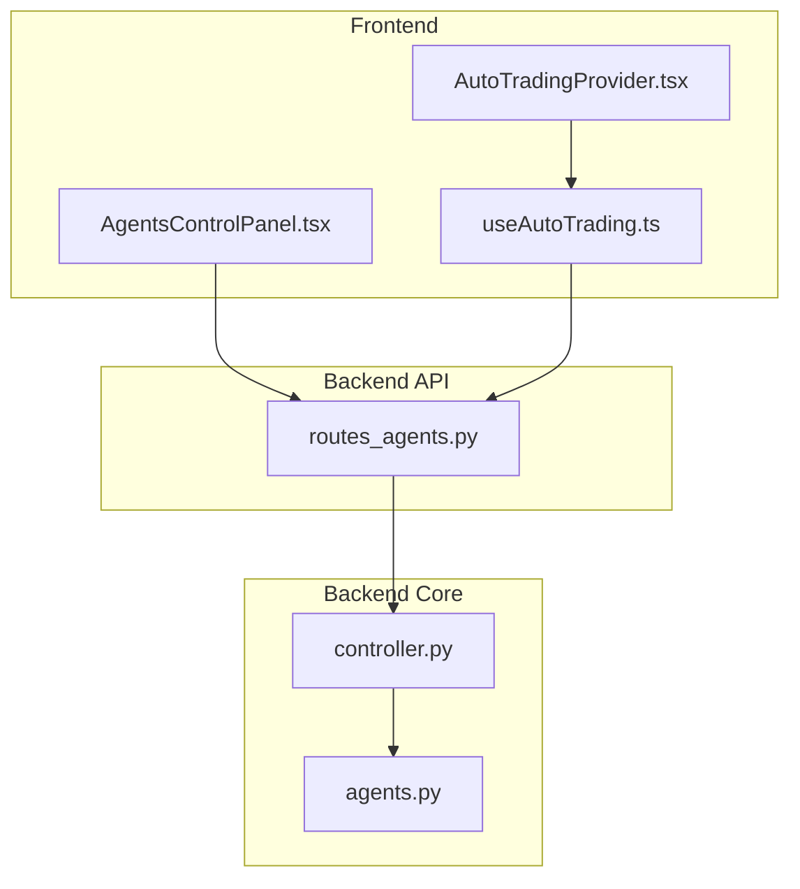
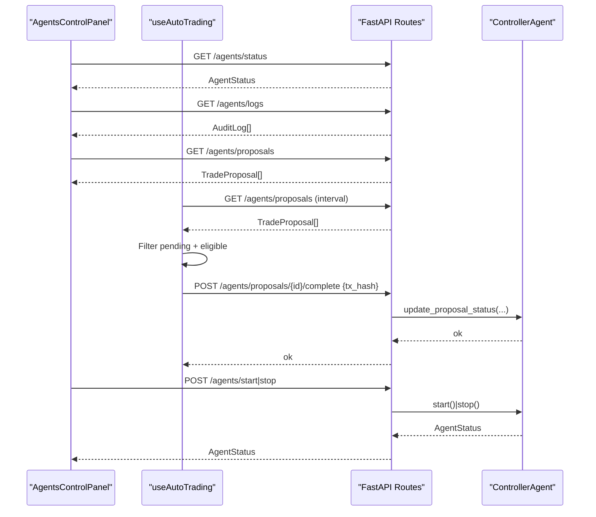
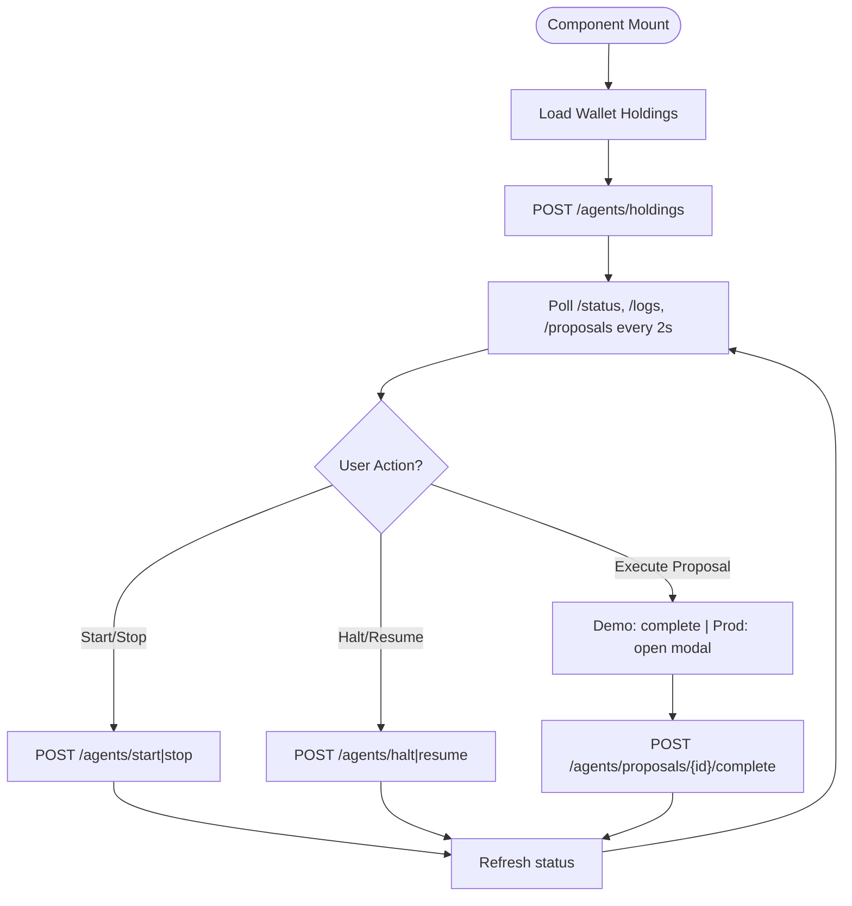
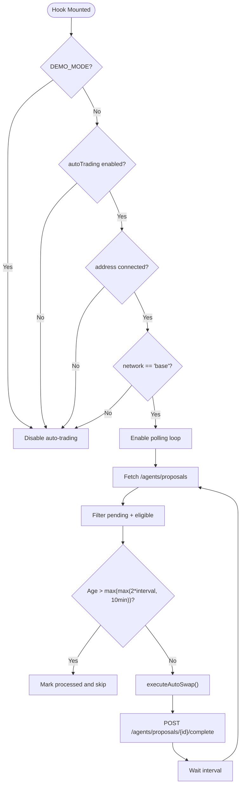
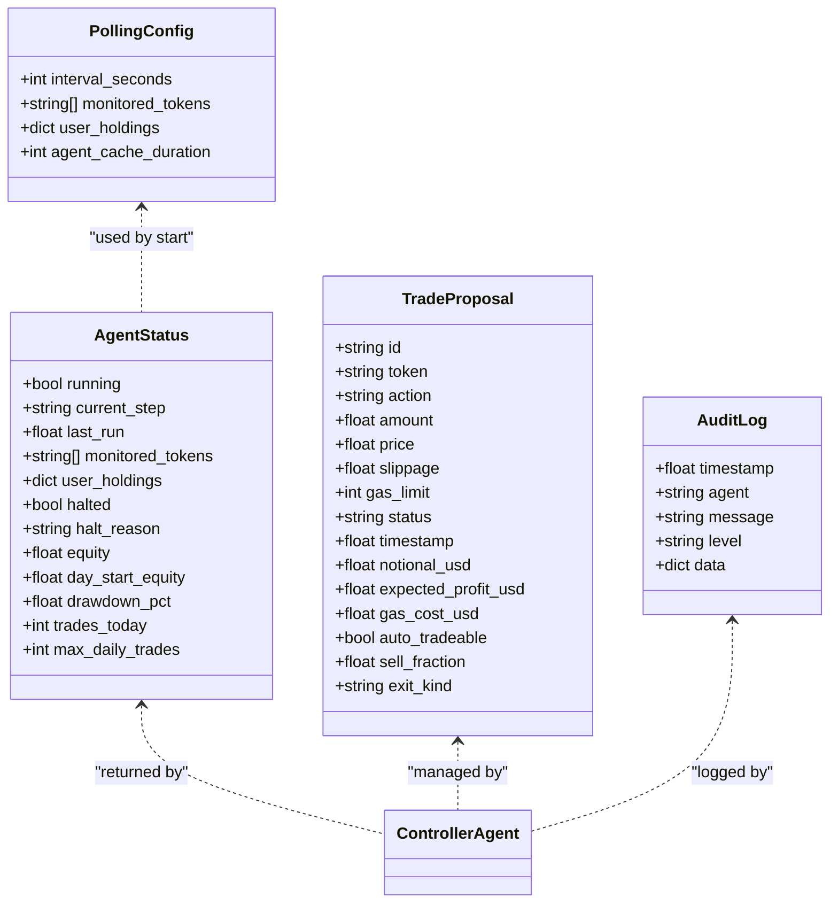
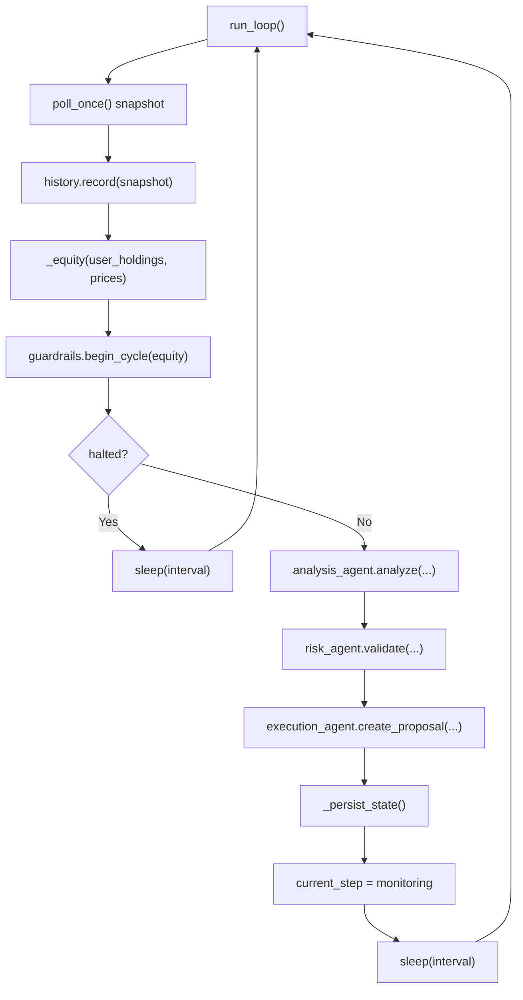

# Agent Control Components

<cite>
**Referenced Files in This Document**   
- [AgentsControlPanel.tsx](file://frontend/components/AgentsControlPanel.tsx)
- [AutoTradingProvider.tsx](file://frontend/components/AutoTradingProvider.tsx)
- [useAutoTrading.ts](file://frontend/hooks/useAutoTrading.ts)
- [routes_agents.py](file://backend/app/api/routes_agents.py)
- [agents.py](file://backend/app/models/agents.py)
- [controller.py](file://backend/app/agents/controller.py)
</cite>

## Table of Contents
1. [Introduction](#introduction)
2. [Project Structure](#project-structure)
3. [Core Components](#core-components)
4. [Architecture Overview](#architecture-overview)
5. [Detailed Component Analysis](#detailed-component-analysis)
6. [Dependency Analysis](#dependency-analysis)
7. [Performance Considerations](#performance-considerations)
8. [Troubleshooting Guide](#troubleshooting-guide)
9. [Conclusion](#conclusion)

## Introduction
This document explains the agent control and management components that let users start, stop, monitor, and interact with automated trading agents. It covers:
- The AgentsControlPanel user interface for lifecycle control, status monitoring, logs, and trade proposals.
- The AutoTradingProvider context and useAutoTrading hook for automatic execution of eligible proposals.
- Backend integration patterns via FastAPI routes and the ControllerAgent orchestration layer.
- Real-time polling, state synchronization, loading states, error handling, and recovery strategies.

## Project Structure
The agent control system spans frontend React components and hooks, and a backend FastAPI service with an in-process controller orchestrating analysis, risk, execution, and audit agents.

**Diagram sources**
- [AgentsControlPanel.tsx:1-554](file://frontend/components/AgentsControlPanel.tsx#L1-L554)
- [AutoTradingProvider.tsx:1-9](file://frontend/components/AutoTradingProvider.tsx#L1-L9)
- [useAutoTrading.ts:1-208](file://frontend/hooks/useAutoTrading.ts#L1-L208)
- [routes_agents.py:1-150](file://backend/app/api/routes_agents.py#L1-L150)
- [controller.py:1-683](file://backend/app/agents/controller.py#L1-L683)
- [agents.py:1-81](file://backend/app/models/agents.py#L1-L81)

**Section sources**
- [AgentsControlPanel.tsx:1-554](file://frontend/components/AgentsControlPanel.tsx#L1-L554)
- [AutoTradingProvider.tsx:1-9](file://frontend/components/AutoTradingProvider.tsx#L1-L9)
- [useAutoTrading.ts:1-208](file://frontend/hooks/useAutoTrading.ts#L1-L208)
- [routes_agents.py:1-150](file://backend/app/api/routes_agents.py#L1-L150)
- [controller.py:1-683](file://backend/app/agents/controller.py#L1-L683)
- [agents.py:1-81](file://backend/app/models/agents.py#L1-L81)

## Core Components
- AgentsControlPanel: UI for starting/stopping agents, viewing live status/logs/proposals, managing monitored tokens, and executing or rejecting trade proposals.
- AutoTradingProvider + useAutoTrading: Context provider that initializes auto-trading behavior; hook that polls for pending proposals and executes them automatically when conditions are met.
- Backend routes: REST endpoints to start/stop/halt/resume agents, fetch status/logs/proposals, update holdings, and mark proposals complete or rejected.
- ControllerAgent: Orchestrates market data polling, analysis, risk checks, proposal creation, position state updates, guardrails, and persistence.

Key responsibilities:
- Lifecycle control: start, stop, halt, resume.
- Status and metrics: running state, current step, last run time, equity, drawdown, trades today.
- Proposal workflow: create, approve/reject by user, execute on-chain, mark executed.
- Real-time updates: polling-based sync between frontend and backend.
- Error handling: network errors, wallet constraints, stale proposals, demo mode safeguards.

**Section sources**
- [AgentsControlPanel.tsx:51-297](file://frontend/components/AgentsControlPanel.tsx#L51-L297)
- [useAutoTrading.ts:21-207](file://frontend/hooks/useAutoTrading.ts#L21-L207)
- [routes_agents.py:20-116](file://backend/app/api/routes_agents.py#L20-L116)
- [controller.py:224-266](file://backend/app/agents/controller.py#L224-L266)

## Architecture Overview
The system uses a polling-based architecture where the frontend periodically requests status, logs, and proposals from the backend. The backend controller runs an asynchronous loop that collects market data, analyzes opportunities, applies risk controls, creates proposals, and persists state.

**Diagram sources**
- [AgentsControlPanel.tsx:140-205](file://frontend/components/AgentsControlPanel.tsx#L140-L205)
- [useAutoTrading.ts:124-187](file://frontend/hooks/useAutoTrading.ts#L124-L187)
- [routes_agents.py:30-116](file://backend/app/api/routes_agents.py#L30-L116)
- [controller.py:224-266](file://backend/app/agents/controller.py#L224-L266)

## Detailed Component Analysis

### AgentsControlPanel Interface
Responsibilities:
- Fetch and display agent status, logs, and active proposals.
- Start/stop agents with optional configuration (monitored tokens, interval, user holdings).
- Toggle kill switch (halt/resume).
- Execute or reject trade proposals; open a preview modal for signing transactions.
- Sync wallet holdings to backend so agents operate on accurate balances.

Key behaviors:
- Polling: every 2 seconds to refresh status, logs, and proposals.
- Holdings sync: reads on-chain balances and posts them to the backend holdings endpoint.
- Proposal actions: simulate in demo mode or prompt wallet signature in production; then mark proposal executed.
- Loading and disabled states: prevent conflicting operations while requests are in flight.

**Diagram sources**
- [AgentsControlPanel.tsx:71-138](file://frontend/components/AgentsControlPanel.tsx#L71-L138)
- [AgentsControlPanel.tsx:140-205](file://frontend/components/AgentsControlPanel.tsx#L140-L205)
- [AgentsControlPanel.tsx:207-280](file://frontend/components/AgentsControlPanel.tsx#L207-L280)

**Section sources**
- [AgentsControlPanel.tsx:51-297](file://frontend/components/AgentsControlPanel.tsx#L51-L297)

### AutoTradingProvider and useAutoTrading Hook
Responsibilities:
- Provide global auto-trading behavior across the app.
- Enforce constraints: demo mode disabled, auto-trading toggle enabled, wallet connected, correct network (Base), allowed targets.
- Poll backend proposals at a configurable interval.
- Skip stale proposals after sleep/wake to avoid outdated market context.
- Execute eligible proposals via on-chain swap and report tx hash back to backend.

Lifecycle:
- Provider mounts hook once.
- Hook sets up polling only when all conditions pass.
- On cleanup, stops polling and clears references.

**Diagram sources**
- [useAutoTrading.ts:21-207](file://frontend/hooks/useAutoTrading.ts#L21-L207)

**Section sources**
- [AutoTradingProvider.tsx:1-9](file://frontend/components/AutoTradingProvider.tsx#L1-L9)
- [useAutoTrading.ts:1-208](file://frontend/hooks/useAutoTrading.ts#L1-L208)

### Backend Integration Patterns
Endpoints used by the frontend:
- POST /agents/holdings: update user holdings.
- POST /agents/start: start agents with config (interval, monitored_tokens, user_holdings).
- POST /agents/stop: stop agents.
- POST /agents/halt: kill switch to pause new trades.
- POST /agents/resume: resume trading after halt.
- GET /agents/status: current agent status and metrics.
- GET /agents/logs: audit log entries.
- GET /agents/proposals: list of trade proposals.
- POST /agents/proposals/{id}/complete: mark proposal executed with optional tx_hash.
- POST /agents/proposals/{id}/reject: reject a proposal.

Data models:
- PollingConfig: interval_seconds, monitored_tokens, user_holdings, agent_cache_duration.
- AgentStatus: running, current_step, last_run, monitored_tokens, halted, halt_reason, equity, day_start_equity, drawdown_pct, trades_today, max_daily_trades.
- TradeProposal: id, token, action, amount, price, slippage, gas_limit, status, timestamp, notional_usd, expected_profit_usd, gas_cost_usd, auto_tradeable, sell_fraction, exit_kind.
- AuditLog: timestamp, agent, message, level, data.

**Diagram sources**
- [agents.py:5-79](file://backend/app/models/agents.py#L5-L79)
- [controller.py:24-66](file://backend/app/agents/controller.py#L24-L66)

**Section sources**
- [routes_agents.py:1-150](file://backend/app/api/routes_agents.py#L1-L150)
- [agents.py:1-81](file://backend/app/models/agents.py#L1-L81)

### ControllerAgent Orchestration
Responsibilities:
- Manage lifecycle: start, stop, halt, resume.
- Run main loop: fetch market data, record history, compute equity, apply guardrails, analyze opportunities, validate risk, create proposals, persist state.
- Maintain position states, simulated positions, and user holdings.
- Persist proposals, position states, guardrails, and trade timing to disk.
- Handle demo mode portfolio reconstruction and fills.

Key flows:
- Market data polling and filtering based on monitored tokens and holdings.
- Guardrail checks: halt/resume, daily trade limits, drawdown thresholds.
- Proposal deduplication and throttling per token.
- Execution proposal creation and status transitions.

**Diagram sources**
- [controller.py:499-679](file://backend/app/agents/controller.py#L499-L679)

**Section sources**
- [controller.py:24-66](file://backend/app/agents/controller.py#L24-L66)
- [controller.py:224-266](file://backend/app/agents/controller.py#L224-L266)
- [controller.py:499-679](file://backend/app/agents/controller.py#L499-L679)

## Dependency Analysis
- AgentsControlPanel depends on:
  - WalletContext for address.
  - SettingsContext for network and autoTrading flag.
  - Ethers.js BrowserProvider for on-chain balance reading.
  - BACKEND_URL for API calls.
- useAutoTrading depends on:
  - WalletContext and SettingsContext.
  - autoTradeExecutor for eligibility and swap execution.
  - BACKEND_URL for proposal polling and completion.
- Backend routes depend on:
  - ControllerAgent for business logic.
  - Models for request/response schemas.

Coupling and cohesion:
- Frontend components are cohesive around their UI concerns and delegate state changes to backend APIs.
- Backend routes are thin controllers delegating to ControllerAgent.
- ControllerAgent encapsulates complex orchestration and state management.

Potential circular dependencies:
- None observed between modules; clear separation between UI, hooks, API, and core controller.

External integrations:
- Blockchain interactions via ethers.js and wallet provider.
- Market data via polling agent services (not shown here but referenced by controller).
- Gas price estimation service.

**Section sources**
- [AgentsControlPanel.tsx:1-10](file://frontend/components/AgentsControlPanel.tsx#L1-L10)
- [useAutoTrading.ts:1-5](file://frontend/hooks/useAutoTrading.ts#L1-L5)
- [routes_agents.py:1-8](file://backend/app/api/routes_agents.py#L1-L8)
- [controller.py:1-21](file://backend/app/agents/controller.py#L1-L21)

## Performance Considerations
- Polling intervals:
  - AgentsControlPanel polls every 2 seconds for status/logs/proposals.
  - useAutoTrading uses a configurable interval (seconds) for proposal polling.
- Network efficiency:
  - Avoid redundant holdings sync when no holdings exist.
  - Demo mode avoids unnecessary on-chain calls.
- State persistence:
  - Controller persists proposals and position states to reduce reprocessing after restarts.
- Throttling:
  - Duplicate proposal prevention per token.
  - Stale proposal filtering prevents surprise MetaMask popups after sleep.

[No sources needed since this section provides general guidance]

## Troubleshooting Guide
Common issues and resolutions:
- No status or logs:
  - Verify BACKEND_URL is reachable and server is running.
  - Check browser console for network errors.
- Agents do not start:
  - Ensure monitored tokens are valid and non-empty.
  - Confirm holdings are synced if required by strategy.
- Proposals not appearing:
  - Check /agents/proposals response and filters in useAutoTrading.
  - In demo mode, ensure simulation completes and status updates.
- Auto-trading not executing:
  - Confirm autoTrading toggle is enabled.
  - Ensure wallet is connected and network is Base.
  - Verify proposal is eligible and not stale.
- Kill switch active:
  - Resume trading via /agents/resume or UI button.
- Wrong network warning:
  - Switch wallet network to match configured tokens.

Operational tips:
- Use System Logs panel to inspect agent-level messages and data payloads.
- Review Active Proposals for manual approval/rejection workflows.
- Monitor Equity and Drawdown to understand guardrail behavior.

**Section sources**
- [AgentsControlPanel.tsx:140-280](file://frontend/components/AgentsControlPanel.tsx#L140-L280)
- [useAutoTrading.ts:89-207](file://frontend/hooks/useAutoTrading.ts#L89-L207)
- [routes_agents.py:48-116](file://backend/app/api/routes_agents.py#L48-L116)

## Conclusion
The agent control system provides a robust, user-friendly interface for managing automated trading agents, combined with a resilient backend orchestration layer. AgentsControlPanel offers comprehensive lifecycle control and real-time visibility, while AutoTradingProvider and useAutoTrading automate execution under strict eligibility and safety constraints. The backend routes expose a clean API surface backed by ControllerAgent, which coordinates analysis, risk, execution, and audit processes with persistent state and guardrails. Together, these components deliver reliable agent lifecycle management, status monitoring, and error recovery mechanisms suitable for both demo and production environments.

[No sources needed since this section summarizes without analyzing specific files]