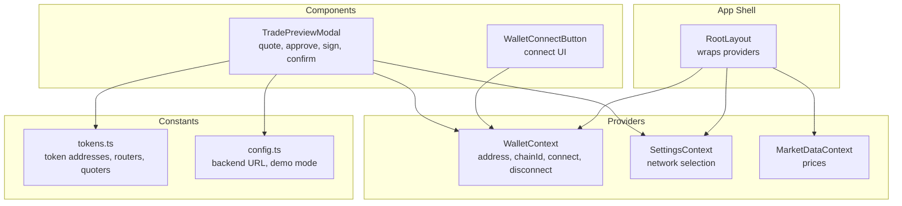
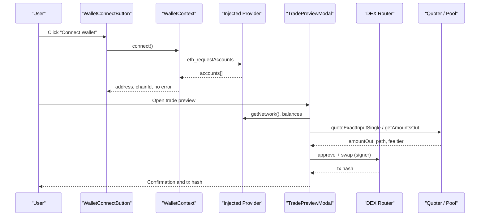
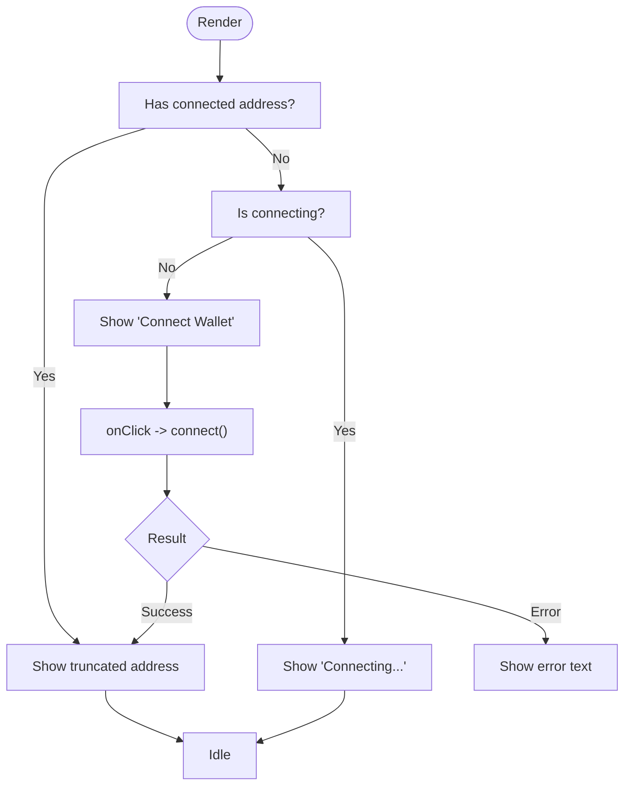
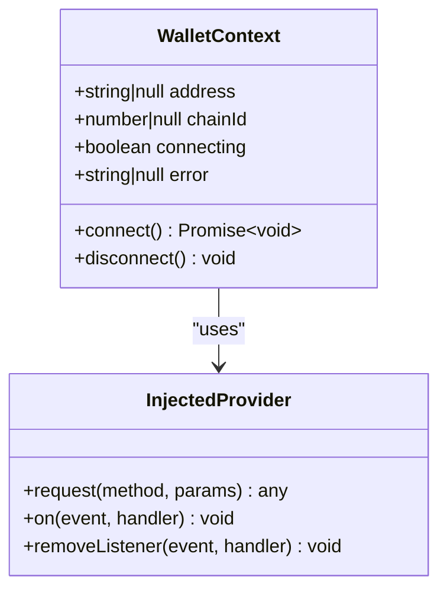
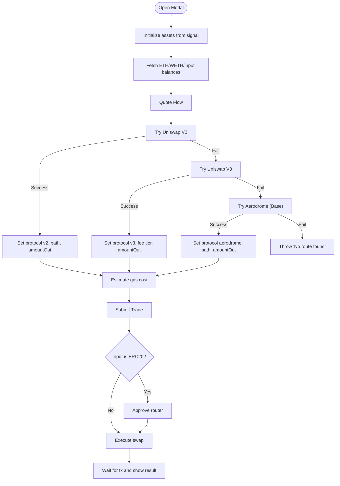
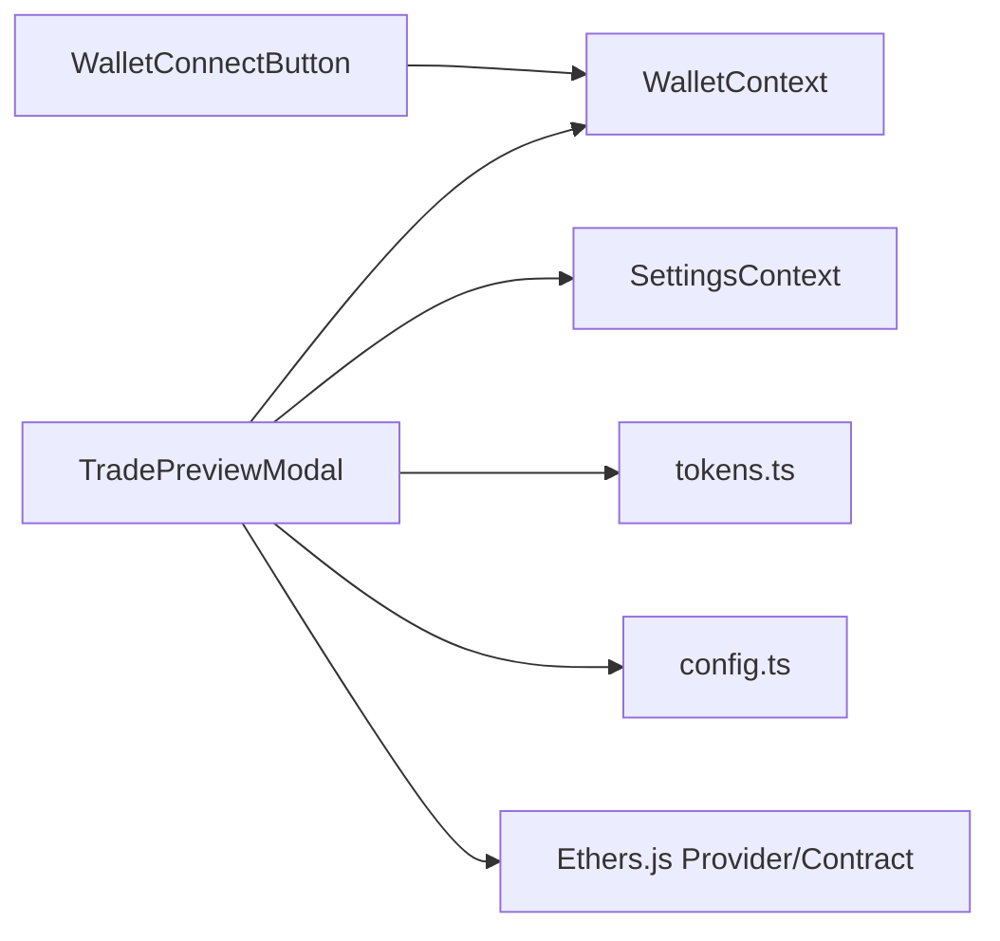
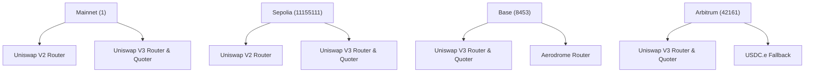

# Blockchain Integration Components

<cite>
**Referenced Files in This Document**
- [WalletConnectButton.tsx](file://frontend/components/WalletConnectButton.tsx)
- [WalletContext.tsx](file://frontend/context/WalletContext.tsx)
- [TradePreviewModal.tsx](file://frontend/components/TradePreviewModal.tsx)
- [tokens.ts](file://frontend/constants/tokens.ts)
- [config.ts](file://frontend/constants/config.ts)
- [layout.tsx](file://frontend/app/layout.tsx)
</cite>

## Table of Contents
1. [Introduction](#introduction)
2. [Project Structure](#project-structure)
3. [Core Components](#core-components)
4. [Architecture Overview](#architecture-overview)
5. [Detailed Component Analysis](#detailed-component-analysis)
6. [Dependency Analysis](#dependency-analysis)
7. [Performance Considerations](#performance-considerations)
8. [Troubleshooting Guide](#troubleshooting-guide)
9. [Security Considerations](#security-considerations)
10. [User Experience Patterns](#user-experience-patterns)
11. [Cross-Chain Compatibility](#cross-chain-compatibility)
12. [Conclusion](#conclusion)

## Introduction
This document explains the blockchain and wallet integration components used by the application:
- Wallet connection via a MetaMask-compatible provider using the WalletConnectButton component and WalletContext state.
- Transaction approval, gas estimation, quoting, and signing workflows through the TradePreviewModal component.
It also covers error handling, network detection, security considerations, user experience patterns, and cross-chain compatibility across Ethereum Mainnet, Sepolia, Base, and Arbitrum.

## Project Structure
The relevant frontend code is organized into:
- UI components for wallet connection and trade preview.
- A shared context for wallet state and events.
- Constants for token addresses, routers, and quoter contracts per chain.
- App layout that wraps providers around the application.

**Diagram sources**
- [layout.tsx:16-40](file://frontend/app/layout.tsx#L16-L40)
- [WalletContext.tsx:21-109](file://frontend/context/WalletContext.tsx#L21-L109)
- [WalletConnectButton.tsx:4-29](file://frontend/components/WalletConnectButton.tsx#L4-L29)
- [TradePreviewModal.tsx:34-76](file://frontend/components/TradePreviewModal.tsx#L34-L76)
- [tokens.ts:98-127](file://frontend/constants/tokens.ts#L98-L127)
- [config.ts:1-8](file://frontend/constants/config.ts#L1-L8)

**Section sources**
- [layout.tsx:16-40](file://frontend/app/layout.tsx#L16-L40)
- [WalletContext.tsx:21-109](file://frontend/context/WalletContext.tsx#L21-L109)
- [WalletConnectButton.tsx:4-29](file://frontend/components/WalletConnectButton.tsx#L4-L29)
- [TradePreviewModal.tsx:34-76](file://frontend/components/TradePreviewModal.tsx#L34-L76)
- [tokens.ts:98-127](file://frontend/constants/tokens.ts#L98-L127)
- [config.ts:1-8](file://frontend/constants/config.ts#L1-L8)

## Core Components
- WalletConnectButton: A small UI button that triggers wallet connection and displays the connected address or an error message. It consumes WalletContext to read connection state and invoke connect.
- WalletContext: Provides wallet address, chainId, connecting flag, error, connect/disconnect functions, and listens to injected provider events (accountsChanged, chainChanged).
- TradePreviewModal: Orchestrates quoting from DEX protocols (Uniswap V2/V3, Aerodrome), balance checks, approvals, gas estimation, transaction submission, and confirmation feedback. It adapts to the active chain and selected protocol.

Key responsibilities:
- WalletConnectButton: User-triggered connection with minimal UI feedback.
- WalletContext: Centralized wallet state and event handling.
- TradePreviewModal: End-to-end trade workflow including quoting, slippage, approvals, execution, and result display.

**Section sources**
- [WalletConnectButton.tsx:4-29](file://frontend/components/WalletConnectButton.tsx#L4-L29)
- [WalletContext.tsx:21-109](file://frontend/context/WalletContext.tsx#L21-L109)
- [TradePreviewModal.tsx:34-76](file://frontend/components/TradePreviewModal.tsx#L34-L76)

## Architecture Overview
The system uses a client-side React architecture with Ethers.js interacting with an injected Ethereum provider (e.g., MetaMask). The root layout provides context providers. Components consume these contexts to render UI and perform on-chain operations.

**Diagram sources**
- [WalletConnectButton.tsx:4-29](file://frontend/components/WalletConnectButton.tsx#L4-L29)
- [WalletContext.tsx:74-98](file://frontend/context/WalletContext.tsx#L74-L98)
- [TradePreviewModal.tsx:174-779](file://frontend/components/TradePreviewModal.tsx#L174-L779)
- [TradePreviewModal.tsx:1114-1600](file://frontend/components/TradePreviewModal.tsx#L1114-L1600)

## Detailed Component Analysis

### WalletConnectButton
Purpose:
- Provide a simple interface to initiate wallet connection.
- Display a truncated connected address when available.
- Show connection errors returned by WalletContext.

Behavior:
- On click, calls connect from WalletContext.
- Renders different labels based on address presence and connecting state.
- Displays error text if present.

Connection states exposed:
- Address: null or string.
- Connecting: boolean.
- Error: null or string.

Error handling:
- Errors are surfaced directly from WalletContext.connect and shown under the button.

**Diagram sources**
- [WalletConnectButton.tsx:4-29](file://frontend/components/WalletConnectButton.tsx#L4-L29)
- [WalletContext.tsx:74-98](file://frontend/context/WalletContext.tsx#L74-L98)

**Section sources**
- [WalletConnectButton.tsx:4-29](file://frontend/components/WalletConnectButton.tsx#L4-L29)
- [WalletContext.tsx:74-98](file://frontend/context/WalletContext.tsx#L74-L98)

### WalletContext
Purpose:
- Manage injected provider interactions.
- Track current account and chainId.
- Emit and handle provider events.

Key features:
- Reads initial accounts and chainId on mount.
- Listens to accountsChanged and chainChanged.
- Provides connect() which requests accounts and updates state.
- Provides disconnect() to clear address.

Network detection:
- Uses eth_chainId and parses hex values safely.
- Updates chainId reactively on chainChanged.

Error handling:
- Sets error messages for missing injected provider or failed connection attempts.

**Diagram sources**
- [WalletContext.tsx:21-109](file://frontend/context/WalletContext.tsx#L21-L109)

**Section sources**
- [WalletContext.tsx:21-109](file://frontend/context/WalletContext.tsx#L21-L109)

### TradePreviewModal
Purpose:
- Orchestrate the complete trade flow: input validation, quoting, slippage, approvals, gas estimation, signing, and confirmation.
- Support multiple DEX protocols and networks.

Key responsibilities:
- Balance fetching for ETH, WETH, and input tokens.
- Dynamic asset selection and optional amount conversion.
- Quoting via Uniswap V2, Uniswap V3, and Aerodrome (Base).
- Gas estimation and cost display.
- Approval transactions for ERC20 inputs.
- Swap execution with slippage protection.
- Handling multi-hop routes and protocol-specific logic.

Network detection and routing:
- Determines chainId from provider.getNetwork().
- Selects token sets and router/quoter addresses per chain.
- Falls back to settings-based configuration when needed.

Quoting logic:
- Tries Uniswap V2 first (getAmountsOut) with multiple candidate paths.
- If V2 fails, tries Uniswap V3 (quoteExactInputSingle and quoteExactInput).
- Adds special handling for Base’s Aerodrome pools.
- Computes price impact where possible.

Gas estimation:
- Estimates gas costs using provider.getFeeData() and fixed gas assumptions per protocol.
- Allows optional manual gas price override; enforces EIP-1559 constraints.

Approval and execution:
- For non-ETH inputs, checks allowance and performs approve if needed.
- Executes swaps via exactInputSingle or exactInput depending on route type.
- Handles specific edge cases (e.g., Base nonce issues during approval).

State management:
- Tracks loading, error, submitting, submitError, submitResult, txHash, and executionData.
- Resets states on open/close and signal changes.

**Diagram sources**
- [TradePreviewModal.tsx:174-779](file://frontend/components/TradePreviewModal.tsx#L174-L779)
- [TradePreviewModal.tsx:1114-1600](file://frontend/components/TradePreviewModal.tsx#L1114-L1600)

**Section sources**
- [TradePreviewModal.tsx:174-779](file://frontend/components/TradePreviewModal.tsx#L174-L779)
- [TradePreviewModal.tsx:1114-1600](file://frontend/components/TradePreviewModal.tsx#L1114-L1600)

## Dependency Analysis
- WalletConnectButton depends on WalletContext for state and actions.
- TradePreviewModal depends on:
  - WalletContext for address.
  - SettingsContext for network preference.
  - Ethers.js BrowserProvider and Contract utilities for on-chain calls.
  - tokens.ts for token addresses, routers, and quoters.
  - config.ts for backend URL and demo mode flags.

**Diagram sources**
- [WalletConnectButton.tsx:1-29](file://frontend/components/WalletConnectButton.tsx#L1-L29)
- [TradePreviewModal.tsx:1-76](file://frontend/components/TradePreviewModal.tsx#L1-L76)
- [tokens.ts:98-127](file://frontend/constants/tokens.ts#L98-L127)
- [config.ts:1-8](file://frontend/constants/config.ts#L1-L8)

**Section sources**
- [WalletConnectButton.tsx:1-29](file://frontend/components/WalletConnectButton.tsx#L1-L29)
- [TradePreviewModal.tsx:1-76](file://frontend/components/TradePreviewModal.tsx#L1-L76)
- [tokens.ts:98-127](file://frontend/constants/tokens.ts#L98-L127)
- [config.ts:1-8](file://frontend/constants/config.ts#L1-L8)

## Performance Considerations
- Quoting loops: V2 path enumeration and V3 fee tier iteration can be heavy; consider debouncing and limiting candidate paths.
- Contract reads: Decimals and reserves queries add latency; cache results where safe.
- Gas estimation: Fixed gas assumptions may not reflect complex multi-hop routes; dynamic estimation improves accuracy.
- Event listeners: Ensure proper cleanup of provider event listeners to avoid memory leaks.

[No sources needed since this section provides general guidance]

## Troubleshooting Guide
Common issues and resolutions:
- No injected wallet detected:
  - Cause: Missing MetaMask or other provider.
  - Resolution: Install a compatible wallet extension and ensure it is unlocked.
- Wrong network:
  - Cause: Connected chain does not match expected network.
  - Resolution: Switch wallet network to the required chain (Mainnet, Sepolia, Base, Arbitrum).
- Insufficient balance or allowance:
  - Cause: Not enough tokens or insufficient approval for router.
  - Resolution: Fund wallet or approve token spending.
- Quote failure:
  - Cause: No liquidity or unsupported pair.
  - Resolution: Try alternative pairs or networks; check token support.
- Execution errors:
  - Cause: Slippage too low, gas limits, or relayer nonce issues.
  - Resolution: Increase slippage, adjust gas, retry after network stabilization.

**Section sources**
- [WalletContext.tsx:74-98](file://frontend/context/WalletContext.tsx#L74-L98)
- [TradePreviewModal.tsx:937-1082](file://frontend/components/TradePreviewModal.tsx#L937-L1082)
- [TradePreviewModal.tsx:1114-1600](file://frontend/components/TradePreviewModal.tsx#L1114-L1600)

## Security Considerations
- Never hardcode private keys or secrets in client code.
- Validate all user inputs before parsing units or constructing transactions.
- Use MaxUint256 for allowances only when necessary; prefer explicit amounts if supported.
- Enforce slippage protection to prevent sandwich attacks.
- Avoid pinning nonces manually; let the provider manage sequencing for relay compatibility.
- Verify contract addresses per chain and use constants rather than runtime user input.
- Handle provider errors gracefully and surface meaningful messages to users.

**Section sources**
- [TradePreviewModal.tsx:1212-1399](file://frontend/components/TradePreviewModal.tsx#L1212-L1399)
- [TradePreviewModal.tsx:1401-1521](file://frontend/components/TradePreviewModal.tsx#L1401-L1521)
- [TradePreviewModal.tsx:1523-1600](file://frontend/components/TradePreviewModal.tsx#L1523-L1600)

## User Experience Patterns
- Connection flow:
  - Button shows “Connect Wallet” until connected.
  - While connecting, show “Connecting...” and disable further actions.
  - On error, display concise error text below the button.
- Trade preview flow:
  - Initialize assets from signals and allow manual overrides.
  - Auto-adjust slippage for high-tax tokens.
  - Show estimated gas cost and price impact.
  - Provide clear status messages during approval and execution.
  - Display tx hash and success/failure outcomes.

**Section sources**
- [WalletConnectButton.tsx:4-29](file://frontend/components/WalletConnectButton.tsx#L4-L29)
- [TradePreviewModal.tsx:49-61](file://frontend/components/TradePreviewModal.tsx#L49-L61)
- [TradePreviewModal.tsx:1084-1097](file://frontend/components/TradePreviewModal.tsx#L1084-L1097)

## Cross-Chain Compatibility
Supported chains and configurations:
- Ethereum Mainnet (chainId 1): Uniswap V2 and V3 routers/quoters.
- Sepolia (chainId 11155111): Testnet routers/quoters.
- Base (chainId 8453): V3 router/quoter and Aerodrome DEX.
- Arbitrum One (chainId 42161): V3 router/quoter; USDC.e fallback for liquidity.

Token and router mapping:
- Token sets per chain include major assets (WETH, USDC, USDT, etc.).
- Routers and quoters are defined per chain to ensure correct protocol interaction.
- Special handling for bridged stablecoins (e.g., USDC.e on Arbitrum).

**Diagram sources**
- [tokens.ts:98-127](file://frontend/constants/tokens.ts#L98-L127)
- [TradePreviewModal.tsx:192-219](file://frontend/components/TradePreviewModal.tsx#L192-L219)
- [TradePreviewModal.tsx:576-631](file://frontend/components/TradePreviewModal.tsx#L576-L631)

**Section sources**
- [tokens.ts:98-127](file://frontend/constants/tokens.ts#L98-L127)
- [TradePreviewModal.tsx:192-219](file://frontend/components/TradePreviewModal.tsx#L192-L219)
- [TradePreviewModal.tsx:576-631](file://frontend/components/TradePreviewModal.tsx#L576-L631)

## Conclusion
The WalletConnectButton and WalletContext provide a robust foundation for wallet connection and state management. The TradePreviewModal implements a comprehensive trading workflow with multi-protocol quoting, approvals, gas estimation, and execution. Together, they enable secure, user-friendly, and cross-chain DEX interactions across Ethereum Mainnet, Sepolia, Base, and Arbitrum. Proper error handling, slippage protection, and network validation ensure reliability and safety for end users.