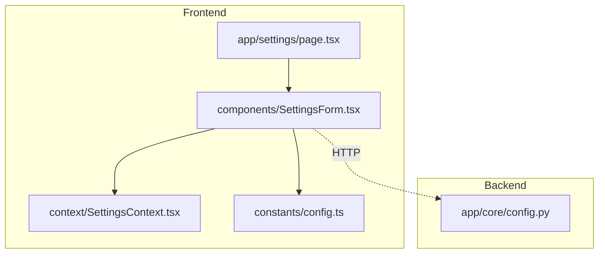
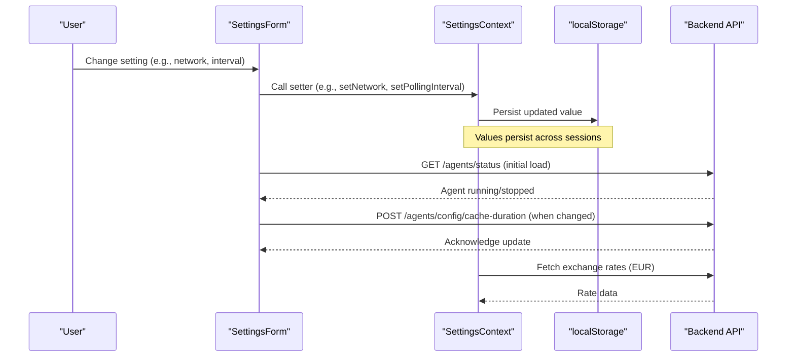
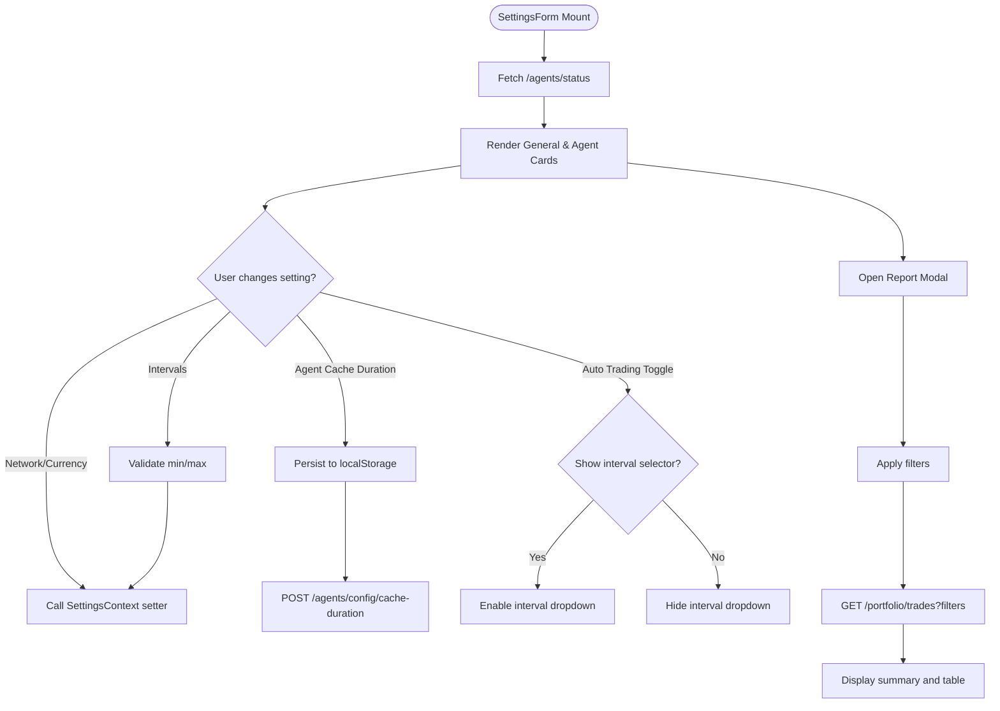
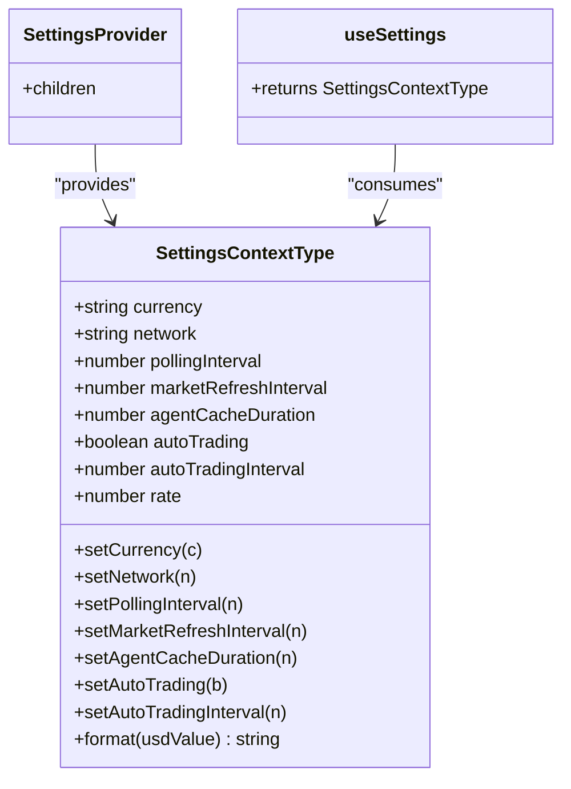
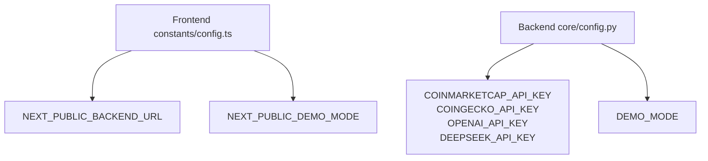
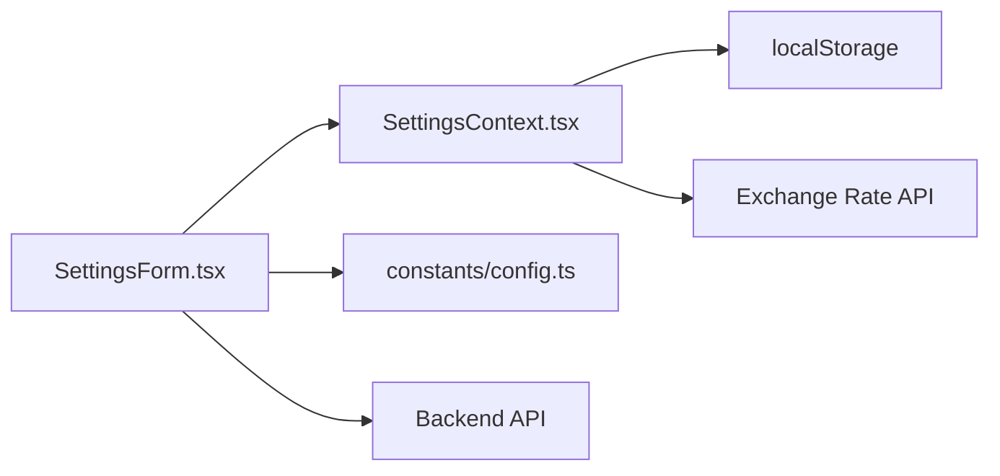

# Configuration Components

<cite>
**Referenced Files in This Document**   
- [SettingsForm.tsx](file://frontend/components/SettingsForm.tsx)
- [SettingsContext.tsx](file://frontend/context/SettingsContext.tsx)
- [page.tsx](file://frontend/app/settings/page.tsx)
- [config.ts](file://frontend/constants/config.ts)
- [config.py](file://backend/app/core/config.py)
</cite>

## Table of Contents
1. [Introduction](#introduction)
2. [Project Structure](#project-structure)
3. [Core Components](#core-components)
4. [Architecture Overview](#architecture-overview)
5. [Detailed Component Analysis](#detailed-component-analysis)
6. [Dependency Analysis](#dependency-analysis)
7. [Performance Considerations](#performance-considerations)
8. [Troubleshooting Guide](#troubleshooting-guide)
9. [Conclusion](#conclusion)

## Introduction
This document explains the configuration and settings subsystem for the application, focusing on:
- The SettingsForm component for managing user preferences, trading parameters, and agent behavior.
- The SettingsContext for global settings state management and persistence.
- Validation patterns, default value handling, environment-specific settings, and real-time updates.
- UX patterns for complex configuration forms and report generation workflows.

The goal is to make these components understandable for both technical and non-technical readers while providing precise references to the source code.

## Project Structure
The configuration features are implemented primarily in the frontend with a small backend configuration module:
- Frontend UI: SettingsForm.tsx renders the settings page and integrates with SettingsContext.
- Global State: SettingsContext.tsx provides centralized state, persistence via localStorage, and formatting utilities.
- Page Entry: app/settings/page.tsx mounts the SettingsForm.
- Environment Constants: constants/config.ts defines runtime URLs and flags.
- Backend Config: backend/app/core/config.py loads API keys and feature flags from environment variables.

**Diagram sources**
- [page.tsx:1-10](file://frontend/app/settings/page.tsx#L1-L10)
- [SettingsForm.tsx:1-680](file://frontend/components/SettingsForm.tsx#L1-L680)
- [SettingsContext.tsx:1-201](file://frontend/context/SettingsContext.tsx#L1-L201)
- [config.ts:1-8](file://frontend/constants/config.ts#L1-L8)
- [config.py:1-17](file://backend/app/core/config.py#L1-L17)

**Section sources**
- [page.tsx:1-10](file://frontend/app/settings/page.tsx#L1-L10)
- [SettingsForm.tsx:1-680](file://frontend/components/SettingsForm.tsx#L1-L680)
- [SettingsContext.tsx:1-201](file://frontend/context/SettingsContext.tsx#L1-L201)
- [config.ts:1-8](file://frontend/constants/config.ts#L1-L8)
- [config.py:1-17](file://backend/app/core/config.py#L1-L17)

## Core Components
- SettingsForm: User-facing form for network selection, display currency, polling intervals, market refresh, agent cache duration, auto-trading toggle, and report generation. It reads/writes settings through SettingsContext and calls backend endpoints for agent status and cache configuration.
- SettingsContext: Provides global settings state (currency, network, intervals, auto-trading), persistence to localStorage, exchange rate fetching, and a format utility for displaying values in USD or EUR.
- Environment Config: constants/config.ts exposes NEXT_PUBLIC_BACKEND_URL and DEMO_MODE; backend/app/core/config.py loads API keys and DEMO_MODE server-side.

Key responsibilities:
- SettingsForm: UI composition, validation constraints, local state for reports, and backend integration.
- SettingsContext: Centralized state, defaults, persistence, and formatting.
- Environment config: Runtime URL and feature flags.

**Section sources**
- [SettingsForm.tsx:31-680](file://frontend/components/SettingsForm.tsx#L31-L680)
- [SettingsContext.tsx:28-201](file://frontend/context/SettingsContext.tsx#L28-L201)
- [config.ts:1-8](file://frontend/constants/config.ts#L1-L8)
- [config.py:1-17](file://backend/app/core/config.py#L1-L17)

## Architecture Overview
The settings flow combines client-side state, persistent storage, and optional backend synchronization:

**Diagram sources**
- [SettingsForm.tsx:53-58](file://frontend/components/SettingsForm.tsx#L53-L58)
- [SettingsForm.tsx:254-293](file://frontend/components/SettingsForm.tsx#L254-L293)
- [SettingsContext.tsx:38-104](file://frontend/context/SettingsContext.tsx#L38-L104)
- [SettingsContext.tsx:106-153](file://frontend/context/SettingsContext.tsx#L106-L153)

## Detailed Component Analysis

### SettingsForm Component
Purpose:
- Manage user preferences: blockchain network, display currency.
- Configure trading and agent behavior: polling intervals, market refresh, agent cache duration, auto-trading toggle and interval.
- Generate daily reports with filters and export/print capabilities.

Key behaviors:
- Network selection buttons with warnings for production networks.
- Currency selection with live exchange rate display when EUR is selected.
- Numeric inputs with min/max constraints and quick toggles to enable/disable intervals.
- Agent cache duration input that persists locally and sends updates to the backend.
- Auto-trading toggle with conditional interval selector.
- Report modal with filters (network, action, date range), data fetching, summary metrics, print/export actions.

Validation and constraints:
- Polling and market refresh intervals accept 0 to disable auto-refresh; otherwise positive integers up to 3600 seconds.
- Agent cache duration enforces a minimum of 60 seconds and maximum of 86400 seconds.
- Auto-trading interval limited to predefined options (60–1800 seconds).

Persistence:
- Agent cache duration is persisted to localStorage immediately upon change.
- Other settings are persisted via SettingsContext setters.

Backend integration:
- Reads agent status on mount.
- Sends agent cache duration updates to the backend.
- Fetches trade data for report generation.

UX patterns:
- Clear labels and helper text explain each setting’s purpose.
- Visual feedback for active selections and disabled states.
- Modal-based report workflow with loading states and error alerts.

**Diagram sources**
- [SettingsForm.tsx:53-58](file://frontend/components/SettingsForm.tsx#L53-L58)
- [SettingsForm.tsx:183-209](file://frontend/components/SettingsForm.tsx#L183-L209)
- [SettingsForm.tsx:211-241](file://frontend/components/SettingsForm.tsx#L211-L241)
- [SettingsForm.tsx:243-307](file://frontend/components/SettingsForm.tsx#L243-L307)
- [SettingsForm.tsx:309-352](file://frontend/components/SettingsForm.tsx#L309-L352)
- [SettingsForm.tsx:372-676](file://frontend/components/SettingsForm.tsx#L372-L676)

**Section sources**
- [SettingsForm.tsx:31-680](file://frontend/components/SettingsForm.tsx#L31-L680)

### SettingsContext
Purpose:
- Provide global settings state and setters for currency, network, polling intervals, market refresh, agent cache duration, auto-trading, and auto-trading interval.
- Persist settings to localStorage and restore them on initialization.
- Fetch exchange rates for EUR conversion and provide a format utility.

State shape and defaults:
- currency: "USD" | "EUR", default "USD".
- network: "sepolia" | "mainnet" | "base" | "arbitrum", default "base".
- pollingInterval: number, default 30 seconds.
- marketRefreshInterval: number, default 60 seconds.
- agentCacheDuration: number, default 300 seconds.
- autoTrading: boolean, default false.
- autoTradingInterval: number, default 300 seconds.
- rate: number, fetched from external API, fallback 0.85.

Persistence strategy:
- On mount, read all relevant keys from localStorage and validate types/ranges before applying.
- On change, write updated values to localStorage under consistent key prefixes.

Formatting:
- format(usdValue): returns formatted string in USD or EUR using current rate.

Error handling:
- Exchange rate fetch failure falls back to default rate and logs an error.
- useSettings throws if used outside SettingsProvider.

**Diagram sources**
- [SettingsContext.tsx:7-24](file://frontend/context/SettingsContext.tsx#L7-L24)
- [SettingsContext.tsx:28-201](file://frontend/context/SettingsContext.tsx#L28-L201)

**Section sources**
- [SettingsContext.tsx:1-201](file://frontend/context/SettingsContext.tsx#L1-L201)

### Environment-Specific Settings
Frontend:
- BACKEND_URL: Used by SettingsForm to call backend endpoints. Defaults to localhost unless overridden by NEXT_PUBLIC_BACKEND_URL.
- DEMO_MODE: Boolean flag indicating public demo build behavior.

Backend:
- API keys loaded from environment: COINMARKETCAP_API_KEY, COINGECKO_API_KEY, OPENAI_API_KEY, DEEPSEEK_API_KEY.
- DEMO_MODE: Server-side feature flag controlling simulated portfolio behavior.

**Diagram sources**
- [config.ts:1-8](file://frontend/constants/config.ts#L1-L8)
- [config.py:1-17](file://backend/app/core/config.py#L1-L17)

**Section sources**
- [config.ts:1-8](file://frontend/constants/config.ts#L1-L8)
- [config.py:1-17](file://backend/app/core/config.py#L1-L17)

## Dependency Analysis
- SettingsForm depends on:
  - SettingsContext for state and setters.
  - constants/config.ts for BACKEND_URL.
  - Backend endpoints for agent status and cache configuration.
- SettingsContext depends on:
  - Browser APIs (localStorage) for persistence.
  - External exchange rate API for EUR conversion.
- Environment config modules are independent but consumed by both frontend and backend.

**Diagram sources**
- [SettingsForm.tsx:1-680](file://frontend/components/SettingsForm.tsx#L1-L680)
- [SettingsContext.tsx:1-201](file://frontend/context/SettingsContext.tsx#L1-L201)
- [config.ts:1-8](file://frontend/constants/config.ts#L1-L8)

**Section sources**
- [SettingsForm.tsx:1-680](file://frontend/components/SettingsForm.tsx#L1-L680)
- [SettingsContext.tsx:1-201](file://frontend/context/SettingsContext.tsx#L1-L201)
- [config.ts:1-8](file://frontend/constants/config.ts#L1-L8)

## Performance Considerations
- Minimize unnecessary re-renders:
  - Keep SettingsForm focused on UI; rely on SettingsContext for state changes.
  - Debounce rapid interval changes if needed to reduce localStorage writes and backend calls.
- Reduce backend calls:
  - Avoid sending cache duration updates on every keystroke; consider debouncing or batching updates.
  - Cache exchange rates locally for a short period to avoid frequent external API calls.
- Optimize report generation:
  - Use pagination or server-side filtering for large datasets.
  - Debounce filter changes to prevent excessive requests.

[No sources needed since this section provides general guidance]

## Troubleshooting Guide
Common issues and resolutions:
- Settings not persisting:
  - Verify localStorage availability and ensure SettingsContext setters are invoked.
  - Check browser privacy settings blocking localStorage.
- Exchange rate not updating:
  - Confirm external API availability; fallback rate is applied on failure.
  - Inspect network errors in the console.
- Backend endpoint failures:
  - Ensure NEXT_PUBLIC_BACKEND_URL points to a reachable backend instance.
  - Validate CORS policies and route availability for /agents/status and /agents/config/cache-duration.
- Invalid interval values:
  - Enforce min/max constraints in inputs; reset to defaults if out of range.
- Auto-trading not executing:
  - Confirm autoTrading is enabled and autoTradingInterval is valid.
  - Check backend execution service status and logs.

**Section sources**
- [SettingsContext.tsx:38-104](file://frontend/context/SettingsContext.tsx#L38-L104)
- [SettingsForm.tsx:254-293](file://frontend/components/SettingsForm.tsx#L254-L293)
- [SettingsForm.tsx:53-58](file://frontend/components/SettingsForm.tsx#L53-L58)

## Conclusion
The configuration subsystem centers around a clear separation of concerns:
- SettingsForm handles user interactions, validation, and backend integration.
- SettingsContext centralizes state, persistence, and formatting.
- Environment configuration isolates runtime dependencies.

Adopting the patterns described here will improve maintainability, reliability, and user experience for complex configuration forms. For future enhancements, consider introducing formal schema validation, migration strategies for settings versions, and more robust error handling and telemetry.

[No sources needed since this section summarizes without analyzing specific files]