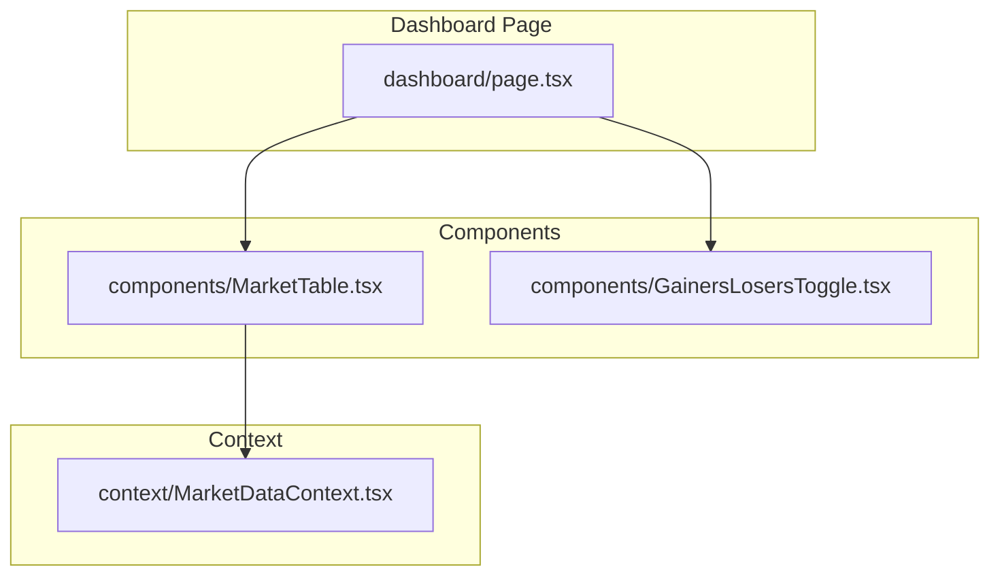
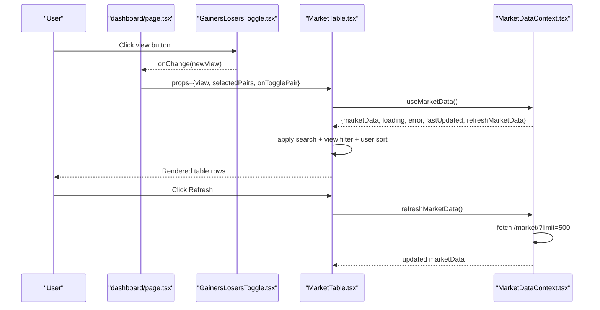
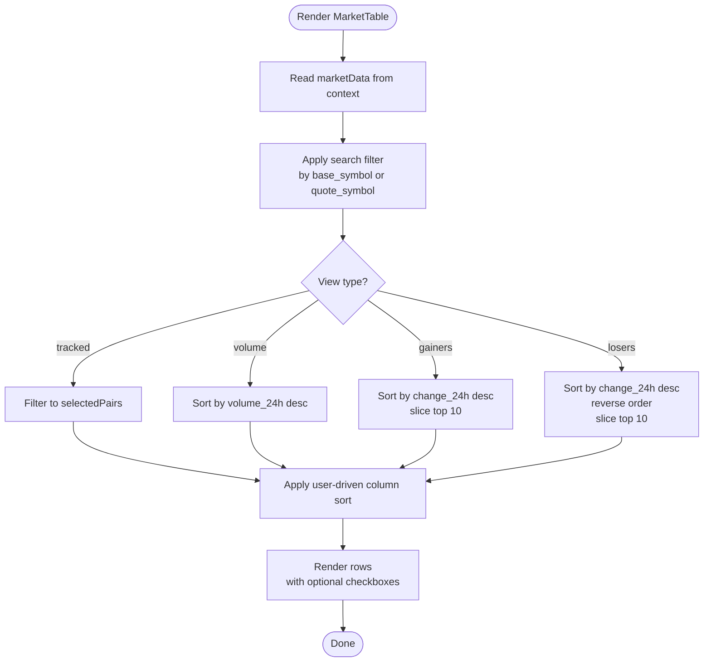
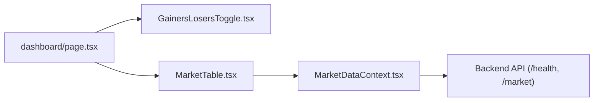

# Market Data Components

<cite>
**Referenced Files in This Document**
- [MarketTable.tsx](file://frontend/components/MarketTable.tsx)
- [GainersLosersToggle.tsx](file://frontend/components/GainersLosersToggle.tsx)
- [MarketDataContext.tsx](file://frontend/context/MarketDataContext.tsx)
- [page.tsx](file://frontend/app/dashboard/page.tsx)
</cite>

## Table of Contents
1. [Introduction](#introduction)
2. [Project Structure](#project-structure)
3. [Core Components](#core-components)
4. [Architecture Overview](#architecture-overview)
5. [Detailed Component Analysis](#detailed-component-analysis)
6. [Dependency Analysis](#dependency-analysis)
7. [Performance Considerations](#performance-considerations)
8. [Troubleshooting Guide](#troubleshooting-guide)
9. [Conclusion](#conclusion)

## Introduction
This document explains the market data display components used to present trading pairs, including filtering, sorting, selection, and view switching. It focuses on:
- MarketTable: a table that renders market data with search, sorting, and optional selection for tracked pairs.
- GainersLosersToggle: a segmented control to switch between views (all, tracked, volume, gainers, losers).
- Integration with MarketDataContext for fetching, caching, and refreshing market data.
- Styling approach using utility classes, responsive layout, and accessibility considerations.
- Performance guidance for large datasets and real-time updates.

## Project Structure
The relevant frontend code is organized as follows:
- Components:
  - MarketTable.tsx: Renders the market data table with search, sort, and selection.
  - GainersLosersToggle.tsx: Provides view switching UI.
- Context:
  - MarketDataContext.tsx: Provides market data state and refresh logic.
- Pages:
  - dashboard/page.tsx: Orchestrates view state, selected pairs, and composes MarketTable and GainersLosersToggle.

**Diagram sources**
- [page.tsx:1-76](file://frontend/app/dashboard/page.tsx#L1-L76)
- [MarketTable.tsx:1-259](file://frontend/components/MarketTable.tsx#L1-L259)
- [GainersLosersToggle.tsx:1-79](file://frontend/components/GainersLosersToggle.tsx#L1-L79)
- [MarketDataContext.tsx:1-150](file://frontend/context/MarketDataContext.tsx#L1-L150)

**Section sources**
- [page.tsx:1-76](file://frontend/app/dashboard/page.tsx#L1-L76)
- [MarketTable.tsx:1-259](file://frontend/components/MarketTable.tsx#L1-L259)
- [GainersLosersToggle.tsx:1-79](file://frontend/components/GainersLosersToggle.tsx#L1-L79)
- [MarketDataContext.tsx:1-150](file://frontend/context/MarketDataContext.tsx#L1-L150)

## Core Components
- MarketTable
  - Purpose: Display market data rows with search, column sorting, and optional pair selection for the tracked view.
  - Props:
    - view: MarketView — one of all, gainers, losers, tracked, volume.
    - selectedPairs?: string[] — list of selected pair keys (e.g., "BASE/QUOTE") when view is tracked.
    - onTogglePair?: (pair: string) => void — callback to toggle a pair’s selection.
  - Behavior:
    - Reads market data from context.
    - Applies search filter by base or quote symbol.
    - Applies view-specific filters/sorting:
      - tracked: show only selected pairs.
      - volume: pre-sort by volume descending.
      - gainers/losers: sort by change_24h; top 10; reverse for losers.
    - Allows user-driven sorting by pair, price, 24h change, or volume.
    - Renders checkboxes when selection is enabled.
    - Shows loading, error, and empty states.
    - Supports manual refresh via context.

- GainersLosersToggle
  - Purpose: Provide a segmented control to switch between views (all, tracked, volume, gainers, losers).
  - Props:
    - view: MarketView — current active view.
    - onChange: (view: MarketView) => void — handler to update the parent’s view state.
  - Behavior:
    - Highlights the active view.
    - Emits onChange with the new view when a button is clicked.

- MarketDataContext
  - Purpose: Provide market data, loading/error state, last updated timestamp, and refresh function.
  - Features:
    - Loads cached data from localStorage on mount for instant display.
    - Fetches fresh data from backend /market/?limit=500 after health check.
    - Persists latest data and timestamp to localStorage.
    - Exposes refreshMarketData for manual refresh.

**Section sources**
- [MarketTable.tsx:15-107](file://frontend/components/MarketTable.tsx#L15-L107)
- [GainersLosersToggle.tsx:5-79](file://frontend/components/GainersLosersToggle.tsx#L5-L79)
- [MarketDataContext.tsx:14-150](file://frontend/context/MarketDataContext.tsx#L14-L150)

## Architecture Overview
The dashboard page controls the high-level state (current view and selected pairs), while MarketTable consumes market data from context and applies local filters and sorting. GainersLosersToggle updates the view state in the dashboard page.

**Diagram sources**
- [page.tsx:11-73](file://frontend/app/dashboard/page.tsx#L11-L73)
- [GainersLosersToggle.tsx:10-79](file://frontend/components/GainersLosersToggle.tsx#L10-L79)
- [MarketTable.tsx:21-107](file://frontend/components/MarketTable.tsx#L21-L107)
- [MarketDataContext.tsx:28-150](file://frontend/context/MarketDataContext.tsx#L28-L150)

## Detailed Component Analysis

### MarketTable
Responsibilities:
- Consume market data from context.
- Filter by search query (base_symbol or quote_symbol).
- Apply view-specific rules:
  - tracked: restrict to selectedPairs.
  - volume: sort by volume_24h descending.
  - gainers/losers: sort by change_24h descending; slice top 10; reverse for losers.
- Allow user-driven sorting by columns: pair, price, change_24h, volume_24h.
- Render selection checkboxes when onTogglePair is provided.
- Handle loading, error, and empty states.
- Provide manual refresh via context.

Props interface:
- view: MarketView — one of all, gainers, losers, tracked, volume.
- selectedPairs?: string[] — list of selected pair strings like "BASE/QUOTE".
- onTogglePair?: (pair: string) => void — toggles inclusion of a pair in selectedPairs.

Sorting behavior:
- Default direction is descending.
- Toggling the same column reverses direction.
- Special handling for null/undefined values during sort.

Search behavior:
- Case-insensitive substring match against base_symbol and quote_symbol.

Selection behavior:
- When onTogglePair is provided, each row includes a checkbox bound to selectedPairs.
- The tracked view uses selectedPairs to filter displayed rows.

Styling and responsiveness:
- Uses utility classes for layout, colors, and borders.
- Table container supports horizontal scrolling on small screens.
- Color-coded positive/negative changes.

Accessibility:
- Interactive elements are buttons and inputs with labels via placeholders and visible text.
- Sortable headers are clickable and visually indicate sort direction.
- External links include rel="noopener noreferrer".

Error and loading states:
- Displays a loading message while data is being fetched.
- Displays an error message when fetching fails.
- Shows an empty state when no data matches filters.

Manual refresh:
- Triggers refreshMarketData from context.

**Diagram sources**
- [MarketTable.tsx:39-103](file://frontend/components/MarketTable.tsx#L39-L103)

**Section sources**
- [MarketTable.tsx:15-107](file://frontend/components/MarketTable.tsx#L15-L107)
- [MarketTable.tsx:109-259](file://frontend/components/MarketTable.tsx#L109-L259)

### GainersLosersToggle
Responsibilities:
- Present a segmented control with options: All, Tracked, Volume, Gainers, Losers.
- Reflect the current view and emit onChange with the new view.

Props interface:
- view: MarketView — current active view.
- onChange: (view: MarketView) => void — updates parent’s view state.

Behavior:
- Active view receives highlighted styling.
- Each button calls onChange with its corresponding view value.

Styling:
- Uses utility classes for rounded segments, borders, and hover states.
- Colors differentiate views (e.g., emerald for gainers, red for losers).

Accessibility:
- Buttons are semantic and keyboard accessible.
- Visual distinction indicates the active state.

**Section sources**
- [GainersLosersToggle.tsx:5-79](file://frontend/components/GainersLosersToggle.tsx#L5-L79)

### MarketDataContext
Responsibilities:
- Provide market data, loading/error state, last updated timestamp, and refresh function.
- Load cached data from localStorage on mount for immediate display.
- Perform health check before fetching market data.
- Fetch up to 500 pairs from /market/.
- Persist latest data and timestamp to localStorage.
- Surface errors and fallback to stored data if available.

Key behaviors:
- Auto-fetch on mount after restoring cache.
- Manual refresh via refreshMarketData.
- Error messages tailored for backend readiness issues.

Integration points:
- Consumed by MarketTable via useMarketData hook.
- Uses BACKEND_URL constant for API endpoints.

**Section sources**
- [MarketDataContext.tsx:14-150](file://frontend/context/MarketDataContext.tsx#L14-L150)

### Dashboard Page Integration
Responsibilities:
- Manage view state (MarketView) and selected pairs.
- Persist selected pairs to localStorage.
- Compose GainersLosersToggle and MarketTable.
- Pass view, selectedPairs, and onTogglePair to MarketTable.

State management:
- view: controlled by GainersLosersToggle.
- selectedPairs: persisted across sessions.

Layout:
- Responsive grid with signals panel alongside the market table.

**Section sources**
- [page.tsx:7-73](file://frontend/app/dashboard/page.tsx#L7-L73)

## Dependency Analysis
Component relationships:
- dashboard/page.tsx depends on:
  - GainersLosersToggle.tsx for view switching.
  - MarketTable.tsx for rendering data.
- MarketTable.tsx depends on:
  - MarketDataContext.tsx for data and refresh.
- MarketDataContext.tsx depends on:
  - Backend API at /market/?limit=500 and /health.

**Diagram sources**
- [page.tsx:1-76](file://frontend/app/dashboard/page.tsx#L1-L76)
- [MarketTable.tsx:1-259](file://frontend/components/MarketTable.tsx#L1-L259)
- [GainersLosersToggle.tsx:1-79](file://frontend/components/GainersLosersToggle.tsx#L1-L79)
- [MarketDataContext.tsx:1-150](file://frontend/context/MarketDataContext.tsx#L1-L150)

**Section sources**
- [page.tsx:1-76](file://frontend/app/dashboard/page.tsx#L1-L76)
- [MarketTable.tsx:1-259](file://frontend/components/MarketTable.tsx#L1-L259)
- [GainersLosersToggle.tsx:1-79](file://frontend/components/GainersLosersToggle.tsx#L1-L79)
- [MarketDataContext.tsx:1-150](file://frontend/context/MarketDataContext.tsx#L1-L150)

## Performance Considerations
- Client-side filtering and sorting:
  - Search and view filters run on every render when data or filters change. For large datasets, consider debouncing search input and memoizing filtered results.
  - Sorting is O(n log n); ensure it runs only when necessary.
- Data size:
  - Context fetches up to 500 pairs. If more data is needed, implement pagination or virtualization in the table.
- Real-time updates:
  - Add periodic polling or WebSocket integration to keep data fresh without full re-renders.
  - Use React.memo or useMemo for expensive computations where appropriate.
- LocalStorage:
  - Caching improves perceived performance but can grow over time; consider size limits or TTL-based eviction.
- Rendering:
  - Avoid unnecessary re-renders by stabilizing props and avoiding inline functions in lists.
  - Consider virtualized lists for very large row counts.

[No sources needed since this section provides general guidance]

## Troubleshooting Guide
Common issues and resolutions:
- No data displayed:
  - Verify backend health endpoint responds successfully.
  - Check network requests to /market/?limit=500.
  - Ensure localStorage has valid data if offline or backend unavailable.
- Error messages:
  - “Backend not ready” indicates the backend health check failed; wait for startup and retry.
  - Other errors surface through context and are shown in the table’s error area.
- Selection not persisting:
  - Confirm localStorage write permissions and that selectedPairs are saved/loaded correctly.
- Sorting anomalies:
  - Null/undefined values are treated as lowest during sort; verify data integrity.
- Performance lag:
  - Debounce search input.
  - Limit rendered rows or implement virtualization.
  - Reduce frequency of manual refreshes.

**Section sources**
- [MarketDataContext.tsx:66-121](file://frontend/context/MarketDataContext.tsx#L66-L121)
- [MarketTable.tsx:138-154](file://frontend/components/MarketTable.tsx#L138-L154)

## Conclusion
MarketTable and GainersLosersToggle provide a flexible, accessible, and styled interface for exploring market data. MarketDataContext centralizes data fetching, caching, and refresh logic. Together, they enable multiple views (all, tracked, volume, gainers, losers), robust search and sorting, and selection handling for tracked pairs. For production-scale usage, incorporate debounced search, virtualization, and real-time update strategies to maintain responsiveness with large datasets.

[No sources needed since this section summarizes without analyzing specific files]